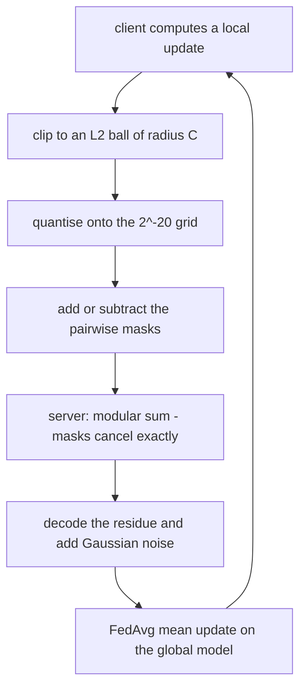
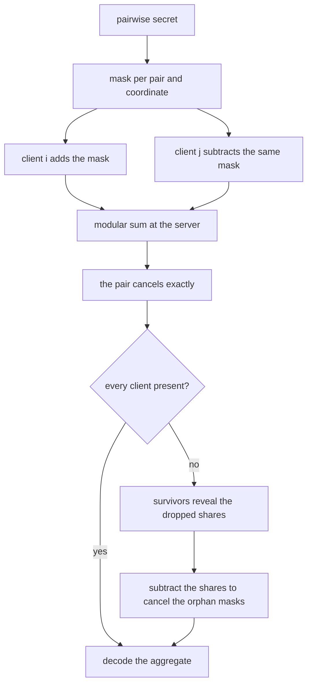
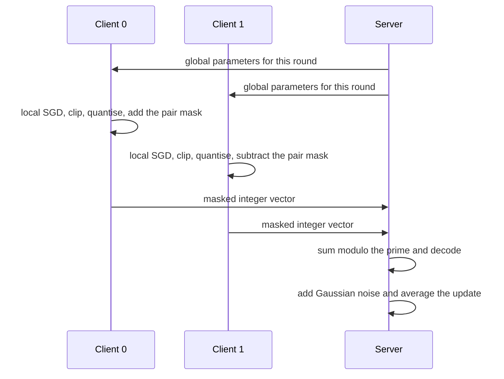

# 829 — Implement privacy-preserving federated learning with secure aggregation and differential privacy.

> **Tier:** Master · **CTCI chapter:** Beyond — Security & Privacy
> **Task spec:** [829-implement-privacy-preserving-federated-learning-with-secure-aggr.md](../../../tasks/master/829-implement-privacy-preserving-federated-learning-with-secure-aggr.md)
> **Solutions:** [Python](../../../solutions/python/master/829-implement-privacy-preserving-federated-learning-with-secure-aggr/solution.py) ·
> [Java](../../../solutions/java/master/829-implement-privacy-preserving-federated-learning-with-secure-aggr/Solution.java) ·
> [JavaScript](../../../solutions/javascript/master/829-implement-privacy-preserving-federated-learning-with-secure-aggr/solution.js) ·
> [C#](../../../solutions/csharp/master/829-implement-privacy-preserving-federated-learning-with-secure-aggr/Solution.cs)

## 1. Problem restatement

**Input.** Four clients with eight samples each (2-D inputs, labels in `{−1, +1}`), a three-parameter
regularised logistic model (`w0, w1, bias`), a fixed-point grid of `2^-20`, an L2 clipping radius
`CLIP = 0.2`, differential-privacy parameters `(epsilon, delta)` with `delta = 1e-5`, and `30` federated
rounds with two local epochs at learning rate `0.5`.

**Output.** A trained global model and, more importantly, a *transcript* of the protocol: what each client
sent, what the server received, the decoded aggregate, the noise added, and the recovered aggregate when one
client drops out.

| Piece | Contract |
| --- | --- |
| `quantise` / `dequantise` / `signed` | map a float vector onto integers on the `2^-20` grid, and map residues modulo `MOD = 2^61 − 1` back to signed integers |
| `pair_secret` / `mask_vector` | a toy Diffie-Hellman exchange (modulus `2^61 − 1`, generator `37`) whose shared secret seeds a SHA-256 mask per coordinate |
| `SecureAggregator` | client `i` adds the pair mask and client `j` subtracts it, so the modular sum cancels the masks exactly; `recovery_shares` handles one dropout |
| `gaussian_noise` / `sigma_for` | Box-Muller noise rounded onto the same integer grid, with `sigma = C · sqrt(2 ln(1.25/delta)) / epsilon` |
| `Accountant` | basic (linear) composition: `T` rounds of `epsilon` compose to `T · epsilon` at fixed `delta` |
| `federated_round` / `train` | local SGD, clip, quantise, mask, aggregate, noise, average update, with a centralised full-batch reference trained alongside |

**Constraints.**

1. Secure aggregation must be *exact*: the masked modular sum must equal the plain integer sum of the quantised
   updates, and decoding must recover the float sum up to the quantisation bound.
2. Mask cancellation must be structural — removing one client's mask must break the sum — and the masks must be
   asymmetric (one side adds, the other subtracts).
3. `n = 1` degenerates to no privacy, and the file states that explicitly instead of pretending otherwise.
4. Clipping must be active: every client's update has norm `<= C` after clipping, and at least one client
   exceeded `C` before it.
5. One dropout must be recoverable: the naive aggregate over the survivors is *wrong*, and the recovery shares
   must restore the exact survivor sum.
6. The DP calibration must be exact and monotone: smaller `epsilon` implies strictly more noise.
7. The federated loss must decrease, and the DP run must stay within tolerance of the non-private federated run
   and the centralised reference.

**Concrete behaviour asserted by the shipped Python run.**

| Scenario | Expected result |
| --- | --- |
| Calibration | `sigma = 0.1211` for `epsilon = 8`, `delta = 1e-5`; `0.9690` for `epsilon = 1` |
| Measured noise | aggregate noise sd `0.03024` against the predicted `sigma / n = 0.03028` |
| Composition | `30` rounds at `epsilon = 8` compose to `240.0` |
| Loss | federated `0.24554`, private (DP) `0.24720`, centralised reference `0.24399` |
| Fixed-point round trip | error at most `0.5 · 2^-20` per coordinate, exact signed decoding for negatives |

## 2. Intuition

Federated learning asks clients to compute updates locally. That alone is not privacy: the server still sees
each client's gradient, and a gradient can memorise a training sample. Two mechanisms are layered on top.

- **Secure aggregation: the server sees only a sum.** Each pair of clients agrees on a secret and derives a
  mask from it. Client `i` *adds* the mask to its update, client `j` *subtracts* the same mask, and when the
  server adds up the masked updates the pair cancels exactly. No client ever transmits its raw vector, and
  the server cannot undo the masks without the pair secrets. The elegant part is that this needs no
  cryptography to *stay honest*: it is arithmetic.
- **Differential privacy: the released aggregate is noisy.** Secure aggregation hides individual updates from
  the server, but the aggregate itself still leaks. Clipping each update to an L2 ball of radius `C` bounds
  one client's influence on the sum, and adding Gaussian noise calibrated to that sensitivity makes the
  released aggregate `(epsilon, delta)`-differentially private. The calibration formula
  `sigma = C · sqrt(2 ln(1.25/delta)) / epsilon` is what turns a privacy promise into a number.

Two implementation choices make the properties *checkable* rather than asymptotic. Everything is mapped onto
an integer grid of step `2^-20` before masking, so "the masks cancel" is an exact integer identity modulo a
Mersenne prime — no floating-point slop to hide behind. And the noise is drawn, then rounded onto the same
grid, so the measured standard deviation can be compared with the predicted `sigma / n` instead of being
taken on faith.



## 3. Algorithm

**Fixed point and masks.**

1. `quantise(v) = round(v · 2^20)` per coordinate; `dequantise` divides back; `signed` maps a residue in
   `[0, MOD)` to the integer in `(−MOD/2, MOD/2]` that it represents.
2. For every pair `(i, j)` with `i < j`: derive `secret = DH(g^i, g^j)`, seed a SHA-256 mask from the secret
   and the session id, and expand it into one integer per coordinate.
3. Client `i` adds that mask to its update; client `j` subtracts it. Both operations are modulo `MOD`, so the
   pair contributes exactly zero to the sum.

```text
function quantise(vector)
    return [round(value · SCALE) for value in vector]
end

function signed(residue)
    if residue > MOD / 2 then return residue - MOD
    return residue
end

procedure build_masks(clients, session, dimension)
    for every pair (i, j) with i before j do
        secret ← toy Diffie-Hellman between the pair's hashed identities
        mask ← one SHA-256-seeded integer per coordinate from the secret and the session
        for each coordinate d do
            my_mask[i][d] ← (my_mask[i][d] + mask[d]) mod MOD
            my_mask[j][d] ← (my_mask[j][d] - mask[d]) mod MOD
        end
    end
end
```

**One round.** Local SGD, clip, quantise, mask, aggregate, noise, mean.

```text
procedure federated_round(global, shards, aggregator, meta)
    for each client do
        raw ← local SGD from the global parameters for the configured epochs
        tight ← clip raw to the L2 radius C, recording whether clipping was active
        updates[client] ← quantise(tight)
    end
    masked ← updates with each client's own mask added modulo MOD
    residue ← the coordinate-wise modular sum of the masked vectors
    noise ← Gaussian integers on the grid when sigma is positive, otherwise zeros
    aggregate ← signed residues plus noise, modulo MOD, then decoded
    mean ← aggregate divided by SCALE and by the number of clients
    return global plus mean
end
```

**Dropout recovery.** If client `j` disappears after sending, the survivors reveal the shares they hold with
`j`; the server *subtracts* those shares from the survivor sum, which cancels exactly the masks that no longer
have a partner.

```text
function recovery_shares(dropped, survivors)
    shares ← zero vectors, one per survivor
    for each survivor do
        pair ← (survivor, dropped) ordered by identity
        sign ← +1 when the survivor has the lower identity otherwise -1
        add sign · mask[pair] to that survivor's share
    end
    return shares
end

function recover(survivor_masked_sum, shares)
    return survivor_masked_sum - the coordinate-wise sum of the shares, modulo MOD
end
```

**Differential privacy.** Calibration from the clipping radius, and accounting by basic composition.

```text
function sigma_for(epsilon, radius, delta)
    return radius · sqrt(2 · ln(1.25 / delta)) / epsilon
end

function accountant_total(epsilon, rounds)
    return epsilon · rounds and the same delta
end
```





**Documented simplifications and non-claims.** The Diffie-Hellman modulus is 61 bits, so a real adversary
could break it: the verified invariant is *exact* mask cancellation and exact dropout recovery, not
cryptographic secrecy, and the confidentiality check is a smoke test rather than a security proof.
Differential privacy is applied to the aggregate of clipped updates with a Gaussian mechanism and basic
composition — no subsampling amplification, no RDP or privacy-loss-accounting — and the noise is rounded onto
the `2^-20` grid, which is a bounded extra perturbation the checks measure rather than ignore. The scale is
tiny: four clients, eight samples each, three parameters, no threads, no sockets, no wall-clock.

## 4. Worked example

**Fixed point.** `quantise([0.1, -0.05, 0.2])` with `SCALE = 2^20` gives `[104858, -52429, 209715]`, and
`dequantise` of `0.1234567` is off by `2.55e-07` — inside the `0.5 · 2^-20 = 4.77e-07` bound the file asserts.
Negative coordinates round-trip through `signed` exactly, which is the part that usually breaks.

**Two clients, one pair mask.** Two clients, dimension three, session `"demo"`; the pair mask is a vector of
61-bit integers, and the per-client totals are asymmetric by construction:

| Quantity | Client 0 | Client 1 |
| --- | --- | --- |
| Quantised update | `[104858, -52429, 209715]` | `[-20972, 31457, 115343]` |
| Pair mask | `354252763511581680, 1178715000364318638, 873104282997784358` | the same, negated modulo `MOD` |
| What the client sends | update **+** mask | update **−** mask |
| Decoded at the server | — | the decoded sum is `83886, -20972, 325058` |

The last row is the whole mechanism: the server receives two enormous-looking residues, adds them modulo
`2^61 − 1`, decodes the result, and gets exactly the plain integer sum of the two updates
(`104858 − 20972 = 83886`, `−52429 + 31457 = −20972`, `209715 + 115343 = 325058`). Nothing was decrypted,
nothing was approximated.

**One dropout.** With three clients and client `0` dropping, the survivors' masked sum decodes to garbage —
`847609307213392102, -696217122543262514, -923438028211186088`, i.e. the orphan masks are still folded in.
The recovery shares for `client 1` and `client 2` are exactly those orphan masks with the opposite sign, and
*subtracting* them from the survivor sum yields the true survivor total `314573, -104858, 419430`, matching
`update(1) + update(2)` coordinate by coordinate. Recovery is one round of extra disclosure, and it is what
keeps a dropout from silently corrupting the aggregate.

**Differential privacy.** With `C = 0.2`, `delta = 1e-5`:

| `epsilon` | `sigma = C · sqrt(2 ln(1.25/delta)) / epsilon` | What it means |
| --- | --- | --- |
| `8.0` | `0.1211` | the shipped run's setting |
| `1.0` | `0.9690` | eight times more noise — strictly less private data leakage per release |

The measured standard deviation of the noise actually added to the decoded aggregate is `0.03024`, against the
predicted `sigma / n = 0.1211 / 4 = 0.03028`: the Box-Muller draws, rounded onto the integer grid, behave as
the calibration says they should. Composition over the `30` rounds gives `240.0` at the same `delta`, which is
basic composition's honest, pessimistic answer — one reason production systems prefer a tighter accountant.

**Utility.** With clipping active every round, the federated run reaches loss `0.24554`, the differentially
private run `0.24720`, and the centralised full-batch reference — trained on the union of all shards for the
same number of local steps — `0.24399`. The gap is the price of privacy, and it is small enough to state.

## 5. Complexity

Let `n` be the clients, `d` the dimension (`3`), `T` the rounds (`30`), `L` the local steps (`2` epochs ×
8 samples) and `S` the samples per client (`8`).

| Measure | Bound | Why it holds |
| --- | --- | --- |
| Mask construction | O(n² · d) had hashes | one pair secret and one mask vector per pair |
| Quantise / dequantise | O(d) | one rounding per coordinate |
| `masked_sums` / `aggregate` | O(n · d) | one modular add per client, one sum per coordinate |
| Dropout recovery | O(n · d) | one share vector per survivor |
| Local SGD | O(L · d) | `epochs × samples` gradient evaluations on three parameters |
| One round | O(n · L · d) | local work dominates; modular arithmetic is constant-time per coordinate |
| Noise | O(d) plus `O(1)` per normal pair | Box-Muller produces two draws at a time |
| Whole run | O(T · n · L · d) | `30` rounds of four clients |
| Communication | O(n · d) integers per round | the masked vectors, not the raw updates |

The interesting bound is the communication one: each client sends `d` integers, and the server never receives
anything else — no plaintext update, no second message unless a client drops out, in which case the survivors
send one share vector each.

## 6. Pitfalls and edge cases

- **Rounding versus modular arithmetic.** Masking floats would leave a residual error; masking integers modulo
  a prime makes cancellation exact. The grid step `2^-20` is the price, and it is bounded per coordinate.
- **Negative residues.** A residue near `MOD` represents a small negative number; forgetting the `signed`
  mapping turns a `-52429` into a 61-bit positive value and silently destroys the aggregate.
- **Asymmetry of the masks.** Client `i` adds and client `j` subtracts. If both added, the sum would double
  the masks instead of cancelling them; the fixture checks that removing one client's mask breaks the sum.
- **`n = 1`.** With a single client there are no pairs, so there are no masks and no privacy. The file states
  this rather than implying otherwise.
- **Clipping must be active.** If no client ever exceeds `C`, the clipping path is untested and the DP
  sensitivity argument is vacuous. The fixture asserts at least one client exceeded `C` before clipping and
  that all are inside it afterwards.
- **Clipping before quantisation.** Clipping after quantisation would round-trip through the grid and could
  push a norm back above `C`, breaking the sensitivity bound the noise calibration relies on.
- **Dropout recovery discloses masks.** The survivors reveal their shares with the dropped client, so recovery
  is a real privacy cost, paid once and only for the dropped pair.
- **Two dropouts.** The implemented recovery handles one dropout; with more, the revealed shares no longer
  cover the orphans, and a production protocol needs a different (threshold) construction.
- **Noise rounding.** Gaussian noise is drawn in floats and rounded onto the integer grid, adding a small
  bias; the checks measure the realised sd (`0.03024`) against the prediction (`0.03028`) instead of assuming
  the noise is untouched.
- **Calibration direction.** `sigma` is inversely proportional to `epsilon`: `0.1211` at `epsilon = 8` and
  `0.9690` at `epsilon = 1`. A check that only ever used one value would not catch an inverted formula.
- **Composition is pessimistic.** `30` rounds at `epsilon = 8` compose to `240` under basic composition; that
  is the correct linear statement for the accountant implemented here, not a bug.
- **Determinism.** Client data, DH exponents, mask seeds and the noise stream all come from fixed-seed
  generators, so the whole pipeline is bit-reproducible.
- **Simplifications kept honest.** A 61-bit DH group, aggregate-level DP with basic composition, four clients,
  three parameters, no threads, no sockets.

## 7. Variants and follow-ups

- **Aggregate without revealing shares.** Secure multi-party aggregation at scale is the same problem with a
  stronger adversarial model — see
  [838-implement-secure-multi-party-aggregation-for-machine-learning-ad.md](../../../tasks/master/838-implement-secure-multi-party-aggregation-for-machine-learning-ad.md).
- **Compute on encrypted data instead of summing it.** Fully homomorphic arithmetic removes the need to trust
  the aggregator at all — see
  [840-implement-fully-homomorphic-encryption-demo-simple-arithmetic-to.md](../../../tasks/master/840-implement-fully-homomorphic-encryption-demo-simple-arithmetic-to.md).
- **Private set intersection for the clients' overlap.** A different disclosure problem with the same
  oblivious-transfer toolkit — see
  [839-implement-oblivious-transfer-based-protocol-for-private-set-inte.md](../../../tasks/master/839-implement-oblivious-transfer-based-protocol-for-private-set-inte.md).
- **Collaborative training on encrypted state.** Bringing DP and encryption together end to end is
  [899-implement-end-to-end-encrypted-collaborative-machine-learning-wi.md](../../../tasks/master/899-implement-end-to-end-encrypted-collaborative-machine-learning-wi.md).

## 8. Check yourself

1. Why is the update quantised *before* masking?

<details><summary>Show answer</summary>

Because then the masks cancel exactly. On the integer grid the protocol is arithmetic modulo a prime, so
`(u_i + m) + (u_j − m) = u_i + u_j` holds identically, and decoding recovers the plain sum. Masking floats
would leave a rounding residual in every coordinate, and the server's aggregate would differ from the true sum
by an unbounded-in-principle amount rather than by the quantisation bound `0.5 · 2^-20` per coordinate.

</details>

2. What does the dropout recovery actually do, and what does it cost?

<details><summary>Show answer</summary>

When a client vanishes, the masks it shared with the survivors are no longer paired and stay folded into the
survivor sum — the naive decoded result is garbage (`847609307213392102, …` in the traced example). The
survivors reveal the shares they hold with the dropped client, and the server *subtracts* them, cancelling the
orphans and recovering the true survivor total (`314573, -104858, 419430`). The cost is disclosure: those
shares are exactly the information that was supposed to stay private, paid once per dropout.

</details>

3. Where does the DP guarantee come from, and what is *not* claimed here?

<details><summary>Show answer</summary>

Clipping bounds each client's contribution to the aggregate to an L2 ball of radius `C = 0.2`, so the
sensitivity of the aggregate is `C`; adding Gaussian noise with
`sigma = C · sqrt(2 ln(1.25/delta)) / epsilon` gives `(epsilon, delta)`-DP for the released aggregate. What is
*not* claimed: the 61-bit Diffie-Hellman group is breakable, so there is no cryptographic secrecy argument —
only exact mask cancellation and exact recovery; there is no subsampling amplification and no RDP accountant,
just basic composition (`30 × 8 = 240`); and the noise is rounded onto the integer grid, an extra perturbation
the checks measure rather than ignore.

</details>

4. Why is clipping checked in both directions?

<details><summary>Show answer</summary>

Because the DP argument needs the clip to be *both* active and effective. Effective means every client's update
has norm at most `C` afterwards; active means at least one client exceeded `C` before clipping, so the code path
that enforces the bound is really being exercised. A run where nobody ever exceeds `C` would pass the first
check while telling you nothing about the sensitivity bound the noise calibration assumes.

</details>

5. The measured noise sd is `0.03024` and the predicted value is `0.03028`. Should the check demand equality?

<details><summary>Show answer</summary>

No. Two deliberate effects stand between the draw and the measurement: the noise is rounded onto the `2^-20`
grid, and the aggregate is divided by `n = 4` clients, so the predicted scale is `sigma / n = 0.1211 / 4`. The
right check is that the measured standard deviation matches the prediction within the tolerance implied by the
rounding and the sample size — which is what the file asserts — while the *calibration* formula itself is
checked exactly (`0.1211` at `epsilon = 8`, `0.9690` at `epsilon = 1`).

</details>
