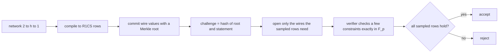
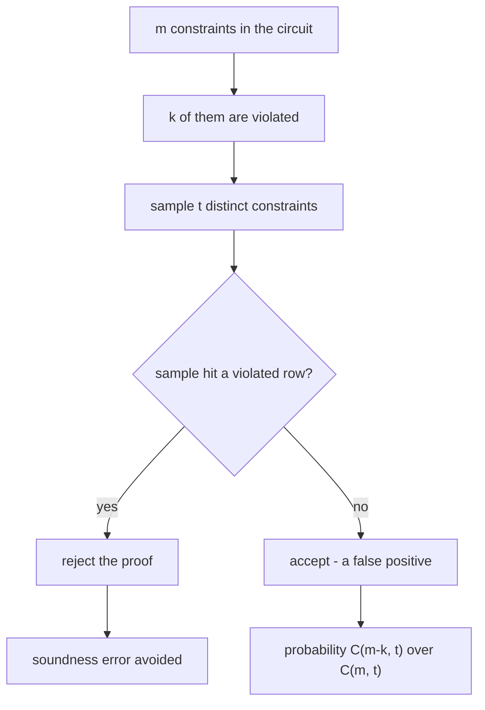
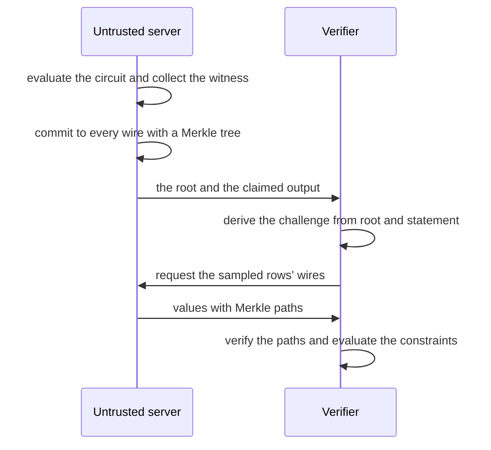

# 830 — Implement verifiable computation for ML inference with succinct proofs (conceptual).

> **Tier:** Master · **CTCI chapter:** Beyond — Security & Privacy
> **Task spec:** [830-implement-verifiable-computation-for-ml-inference-with-succinct.md](../../../tasks/master/830-implement-verifiable-computation-for-ml-inference-with-succinct.md)
> **Solutions:** [Python](../../../solutions/python/master/830-implement-verifiable-computation-for-ml-inference-with-succinct/solution.py) ·
> [Java](../../../solutions/java/master/830-implement-verifiable-computation-for-ml-inference-with-succinct/Solution.java) ·
> [JavaScript](../../../solutions/javascript/master/830-implement-verifiable-computation-for-ml-inference-with-succinct/solution.js) ·
> [C#](../../../solutions/csharp/master/830-implement-verifiable-computation-for-ml-inference-with-succinct/Solution.cs)

## 1. Problem restatement

**Input.** A statement `(inputs, model_tag, claimed output)` for a small polynomial network and an untrusted
server that claims to have run the inference.

**Output.** A *proof* that the verifier can check without re-running the inference: a commitment to the wire
assignment, a challenge derived from that commitment and the statement, and openings that let the verifier
evaluate a few constraints exactly.

| Piece | Contract |
| --- | --- |
| `compile_network` | compile a `2 → h → 1` network with the activation `t²` into R1CS rows `(A_i, B_i, C_i)` over `F_p`, each row naming few wires |
| `honest_witness` | evaluate the same gate list in `F_p` — gate order and field arithmetic must agree with the compiler |
| `merkle_root` / `merkle_open` / `merkle_check` | a SHA-256 commitment to the wire values and a logarithmic opening per wire |
| `prove` | commit, derive `t` distinct constraint indices from the commitment and the statement, open only the wires those rows need, report the byte size |
| `verify_spot` | re-derive the challenge, check every opening against the root, evaluate the sampled constraints exactly |
| `verify_exact` / `violated_rows` | the all-constraints verifier — the correctness oracle, not a succinct verifier |
| `acceptance_bound(m, k, t)` | the exact probability `C(m − k, t) / C(m, t)` that a uniform `t`-subset of `m` constraints misses all `k` violated ones |

**Constraints.**

1. The field must be a prime and every operation must match exact big-integer arithmetic.
2. The compiled circuit must reproduce the plain-integer network on several inputs, and the honest witness
   must satisfy every constraint.
3. Completeness: honest proofs must always verify.
4. Soundness must be *quantified*: the measured acceptance frequency for `k` violated constraints must track
   the combinatorial bound, and the bound must be exactly `0` once `t >= m`.
5. Succinctness must be visible in the numbers: the proof size grows like `O(t log n)` while the circuit grows
   much faster.

**Concrete behaviour asserted by the shipped Python run.**

| Scenario | Expected result |
| --- | --- |
| `2 → 3 → 1` circuit | `20` constraints over `23` wires, widest row `2` wires, proof `2673` bytes, `8` wires opened |
| Completeness | `200` seeded challenges, `200` acceptances |
| Soundness at `m = 20, t = 3` | with `1, 2, 3` corrupted activation wires (`2, 4, 6` violated rows): bounds `0.716, 0.491, 0.319` against measured `0.688, 0.525, 0.333` |
| Verifier work across the surveyed widths | `(6,9,6,1606,10,14)`, `(13,16,7,1881,21,12)`, `(20,23,8,2673,32,13)`, `(27,30,9,2955,43,14)`, `(41,44,8,3149,65,14)`, `(55,58,8,3181,87,13)` |
| `t = m` | the soundness bound is exactly `0.0` for any number of violations |

## 2. Intuition

Verifiable computation asks a blunt question: can a verifier who does *not* trust the server, and who is not
willing to redo the work, still be convinced that the claimed output is right?

The classic answer is a **spot check**. Compile the computation into an arithmetic circuit — here R1CS, where
each constraint is `(A · w)·(B · w) = C · w` over a prime field — and check a random handful of constraints
instead of all of them. If the server cheated, some constraints are violated; the probability that the
random sample misses all of them shrinks as the sample grows. That is the linear PCP idea, and it is
*combinatorially* analysable: with `m` constraints, `k` violated, and `t` sampled, the chance of missing every
violation is exactly `C(m − k, t) / C(m, t)`.

Three ingredients make it work as a protocol:

- **A commitment so the server cannot change its story.** The whole wire assignment is hashed into a Merkle
  root. The challenge depends on that root, so the server must commit *before* it learns which constraints it
  will be asked about; and it can open individual wires with logarithmic proof size.
- **Fiat-Shamir so no interaction is needed.** The challenge is derived by hashing the commitment and the
  statement, which turns the interactive coin flip into a deterministic value both sides can compute.
- **Succinctness means "few openings", not "small circuit".** The verifier opens only the wires the sampled
  rows mention — bounded by the row width times `t` — so its work is independent of the network width, even
  though the circuit itself grows linearly with it.

What the file is explicit about *not* claiming matters just as much: there is no zero knowledge (opened wires
are revealed in the clear), no pairing, no trusted setup, no polynomial commitment and no FFT. It is the
linear-PCP half of a SNARK, and ReLU is replaced by `t²` so the circuit contains no comparisons to prove.



## 3. Algorithm

**Compilation.** Each gate becomes a row: a multiplication becomes `(a)·(b) = c`, an addition becomes
`(a + b)·1 = c`, and a constant multiply becomes `(a)·(k) = c`. The compiler assigns wires in order, so the
witness evaluator can replay the gate list against the same numbering.

```text
procedure compile_network(model)
    wire zero ← the constant one
    wire one, wire two ← the two inputs
    for each hidden unit j do
        acc ← (two · weight) + bias as an addition row
        z ← (input · weight) + acc as an addition row
        activation[j] ← square z as a multiplication row
    end
    output ← the weighted sum of the activations, one row per term
    return the rows, the gates, the wire count and the input width
end

function honest_witness(circuit, inputs)
    witness[0] ← 1 and the two input wires ← the inputs modulo p
    for each gate in emission order do
        evaluate the gate in the field and store it in its target wire
    end
    return the witness
end
```

**Proving.** Commit, derive the challenge, open the needed wires.

```text
function prove(circuit, witness, statement, count)
    root, levels ← Merkle commit every wire value with SHA-256
    indices ← `count` distinct constraint indices from hash(root, statement)
    needed ← every wire referenced by the sampled rows
    openings ← for each needed wire, its value and its Merkle path
    return root, indices, openings and the byte size
end

function verify_spot(circuit, statement, proof, count)
    if the proof's statement differs then return reject
    indices ← recompute the challenge from the committed root and the statement
    if the recomputed indices differ then return reject
    for each wire of each sampled row do
        reject unless the opening verifies against the committed root
    end
    for each sampled row do
        reject unless (A · w) · (B · w) equals (C · w) in the field
    end
    return accept
end
```

**Soundness.** The acceptance probability is a hypergeometric-style computation, done exactly with integer
products rather than an approximation.

```text
function acceptance_bound(constraints, violated, count)
    m ← constraints, t ← min(count, constraints), k ← violated
    if k = 0 then return 1
    if m - k < t then return 0
    return the product over i from 0 to t - 1 of (m - k - i) / (m - i)
end
```

If `k = 0` every sample passes; if fewer than `t` constraints *remain* unviolated, every sample must hit a
violation and the probability is exactly `0`.





**Documented simplifications and non-claims.** No zero knowledge: opened wires are revealed in the clear. No
pairing, no trusted setup, no polynomial commitment, no FFT — "succinct" here means only that the number of
opened wires is bounded independently of the circuit size. `ReLU` is replaced by `t²`, so the circuit has no
comparisons and no range checks, and the file never claims to prove them. Soundness is quantified honestly:
the exact combinatorial bound is stated for a uniform challenge, Fiat-Shamir is only a random-oracle
*heuristic* instantiation of it, and the empirical acceptance frequencies are compared with the combinatorial
value. The commitment is SHA-256, so collision resistance is assumed. Nothing here is safe for real use.

## 4. Worked example

**The circuit and the proof size.** The `2 → 3 → 1` network compiles to `20` constraints over `23` wires, with
a widest row of `2` wires. A proof is `2673` bytes and opens `8` wires — that is the whole verifier's
workload: eight Merkle paths and three constraint evaluations.

**Soundness, computed and measured.** Corrupting one, two and three activation wires violates more rows than
wires, because each corrupted wire feeds several constraints:

| Corrupted activation wires | Violated rows | Exact bound `C(m − k, t) / C(m, t)` | Measured over `400` challenges |
| --- | --- | --- | --- |
| 1 | 2 | `(18/20)(17/19)(16/18) = 0.716` | `0.688` |
| 2 | 4 | `(16/20)(15/19)(14/18) = 0.491` | `0.525` |
| 3 | 6 | `(14/20)(13/19)(12/18) = 0.319` | `0.333` |

The arithmetic is the entire soundness argument: with `t = 3` samples out of `m = 20` constraints, the chance
of missing two violated rows is the chance that all three samples came from the `18` clean ones, which is
`0.716`. The measured frequencies track those bounds within the sampling noise of `400` challenges — and the
file says plainly that a bound above `0.4` is *weak*: three samples are not enough for this circuit, which is
why real systems use far more.

**Succinctness across widths.** The survey applies the same `t = 3` spot check as the hidden width grows.
Each tuple is `(constraints, wires, opened wires, proof bytes, prover multiplications, verifier field work)`:

| Tuple | Constraints | Opened | Proof bytes | Prover work | Verifier work |
| --- | --- | --- | --- | --- | --- |
| `(6, 9, 6, 1606, 10, 14)` | 6 | 6 | 1606 | 10 | 14 |
| `(13, 16, 7, 1881, 21, 12)` | 13 | 7 | 1881 | 21 | 12 |
| `(20, 23, 8, 2673, 32, 13)` | 20 | 8 | 2673 | 32 | 13 |
| `(27, 30, 9, 2955, 43, 14)` | 27 | 9 | 2955 | 43 | 14 |
| `(41, 44, 8, 3149, 65, 14)` | 41 | 8 | 3149 | 65 | 14 |
| `(55, 58, 8, 3181, 87, 13)` | 55 | 8 | 3181 | 87 | 13 |

Two facts are visible. Opened wires stay around `3t` and never track the circuit size, so the proof grows
roughly logarithmically while the circuit grows ninefold between the smallest and largest width. And on the
*smallest* circuit the verifier does **more** field work than the prover's multiplication count (`14` against
`10`): a three-sample spot check is not cheaper than the computation it checks until the circuit is large,
and the file states that instead of hiding it.

**Edge cases.** A three-constraint circuit is checked exhaustively: with `t >= m` the bound is exactly `0.0`,
so any corrupted witness is rejected deterministically. Tampering with the commitment changes the root and invalidates
every opening; an opening presented for a different value is rejected; and the same statement verifies under
two different witnesses, because the protocol proves *knowledge*, not uniqueness.

## 5. Complexity

Let `m` be the constraints, `n` the wires, `t` the samples (`3` here), `w` the widest row (`2` for the
`2 → 3 → 1` circuit) and `d` the field size.

| Measure | Bound | Why it holds |
| --- | --- | --- |
| Compilation | O(hidden) rows | a constant number of gates per hidden unit, `20` rows for `h = 3` |
| Witness evaluation | O(gates) | one field operation per gate |
| Merkle commit | O(n) hashes | one leaf per wire |
| Opening one wire | O(log n) hashes | binary tree height |
| `prove` | O(n + t · w log n) | the commit plus one path per wire the sampled rows touch |
| `verify_spot` | O(t · w · log n + t · w) | path checks plus one constraint evaluation per sample |
| Proof size | O(t log n) | measured: `1606` bytes at `n = 9` versus `3181` at `n = 58` while the circuit grew ninefold |
| Soundness error | `C(m − k, t) / C(m, t)`, exactly `0` when `t >= m` | the challenge is a uniform `t`-subset of the rows |
| `solve`-free field work | one multiplication and one subtraction per sampled row | `9` terms for three rows in the fixture |

The complexity claim that matters is the asymmetry: the prover pays for the whole circuit, the verifier pays
`t` rows and their wires, and the verification cost therefore depends on the *soundness target* (`t`) rather
than on the network's width.

## 6. Pitfalls and edge cases

- **Witness and compiler must agree on wire numbering.** `honest_witness` replays the gate list in emission
  order; any divergence makes every constraint fail and looks like a soundness bug in the prover.
- **The challenge must bind the commitment.** Deriving indices only from the statement would let a cheating
  server choose its witness after seeing which rows are sampled. The fixture checks that challenges move when
  either the root or the statement changes, and that a proof does not transfer to another statement.
- **The statement is part of the hash.** A proof for `(input, model_tag, output)` must not verify for a
  different `model_tag`; the fixture plants that check explicitly.
- **Sampling must be without replacement.** Sampling the same row three times reduces the effective check to
  fewer rows than `t` and silently weakens soundness.
- **A weak bound is a real result.** With `m = 20` and `t = 3` the bound for two violations is `0.716`; the
  honest response is to report it and note that three samples are not enough, not to dress up a 72% chance of
  missing a cheat as "verified".
- **`t >= m` collapses the bound.** Once the sample can cover every constraint the probability of missing a
  violation is exactly `0.0`, and the file checks that value rather than an epsilon.
- **Violated rows versus corrupted wires.** One corrupted wire can break several constraints (`2`, `4` and `6`
  rows for `1`, `2` and `3` corrupted activations); the bound is a function of the *row* count.
- **Field arithmetic.** Every operation is reduced modulo `2^61 − 1`; comparing unreduced integers would make
  honest proofs fail. Primality is checked with Miller-Rabin, and the field ops are compared with exact
  big-integer arithmetic.
- **Merkle domains.** Leaves are hashed from a string representation, so `1` and `'1'` must not collide, and
  duplicate leaves must not produce the same path in a way that lets an opening be reused for another value.
- **`t²` instead of `ReLU`.** The substituted activation keeps the circuit polynomial, but comparisons and
  range checks disappear from the proof obligation — a limitation to state, not to paper over.
- **Fiat-Shamir is a heuristic.** The combinatorial bound assumes a *uniform* challenge; hashing to derive it
  is only safe in the random-oracle model, which the file says out loud.
- **Not safe for real use.** No zero knowledge, no trusted setup, no pairings, SHA-256 collision resistance
  assumed. This is a teaching implementation of the linear-PCP spot check, and it says so.

## 7. Variants and follow-ups

- **Prove arithmetic rather than inference.** A minimal R1CS-to-SNARK pipeline for a tiny program is
  [834-implement-zk-snark-circuit-for-a-simple-arithmetic-program-toy.md](../../../tasks/master/834-implement-zk-snark-circuit-for-a-simple-arithmetic-program-toy.md).
- **Compose proofs instead of opening wires.** Recursive composition is what turns a spot check into a
  constant-size argument — see
  [835-implement-recursive-snark-composition-outline-conceptual.md](../../../tasks/master/835-implement-recursive-snark-composition-outline-conceptual.md).
- **Make the transcript self-verifying with hashes.** The Merkle commitment here is the same structure a
  verifiable log uses — see
  [902-implement-self-verifying-distributed-logs-with-merkle-trees-and.md](../../../tasks/master/902-implement-self-verifying-distributed-logs-with-merkle-trees-and.md).
- **Bound the randomness instead of the computation.** Provable bounds for randomised algorithms are the
  probabilistic cousin of this soundness analysis — see
  [901-implement-provable-bounds-for-randomized-algorithms-used-in-your.md](../../../tasks/master/901-implement-provable-bounds-for-randomized-algorithms-used-in-your.md).

## 8. Check yourself

1. Why must the challenge be derived *after* the commitment?

<details><summary>Show answer</summary>

Because otherwise a cheating prover could choose which constraints to violate after learning which ones will
be sampled — and could then violate exactly the unsampled ones with certainty. Hashing the Merkle root
together with the statement fixes the sampled indices before the prover can know them, which is what makes the
combinatorial bound `C(m − k, t)/C(m, t)` an honest statement about a *uniform* sample. The fixture checks that
changing either the root or the statement moves the challenge.

</details>

2. With `m = 20`, `t = 3` and two violated rows, why is the bound `0.716`?

<details><summary>Show answer</summary>

Because there are `18` clean rows and `2` violated ones, and the check fails to catch the cheat only when all
three samples land in the clean set: `(18/20)·(17/19)·(16/18) = 0.7158`. The measured frequency over `400`
challenges was `0.688`, consistent with that bound. The general formula is
`C(m − k, t)/C(m, t)`, computed here as a product of ratios rather than with binomial coefficients.

</details>

3. Opened wires stay near `3t` while the circuit grows from `9` to `58` wires. What does that buy?

<details><summary>Show answer</summary>

Succinctness: the verifier's work is a function of the soundness parameter `t` and the row width, not of the
network size. The proof bytes grew from `1606` to `3181` across the survey while the circuit grew ninefold,
because each opening costs `O(log n)` hashes. That is the property the task means by "succinct" — and the file
is careful to say it does *not* include zero knowledge or a constant-size argument.

</details>

4. On the smallest circuit the verifier does `14` units of field work while the prover does `10`. Is that
   a failure of the design?

<details><summary>Show answer</summary>

No — it is the honest crossover. Verifying costs `t` constraint evaluations plus path checks, so a spot check
against a tiny circuit can cost more than the circuit itself; the ratio only becomes favourable as the circuit
grows (`14/65` and `13/87` on the larger widths). The file prints this case explicitly rather than reporting
only the asymptotically flattering ones.

</details>

5. What does the protocol prove, and what does it assume?

<details><summary>Show answer</summary>

It proves that the committed witness satisfies the sampled constraints, hence (with probability
`1 − C(m − k, t)/C(m, t)`) that the wire assignment satisfies all of them and the claimed output is the
compiled network's output. It assumes SHA-256 collision resistance for the commitment, a random-oracle
instantiation for Fiat-Shamir, a prime field of size `2^61 − 1`, and it says nothing about zero knowledge,
trusted setup, or the comparisons that `ReLU` would have needed and `t²` avoids.

</details>
