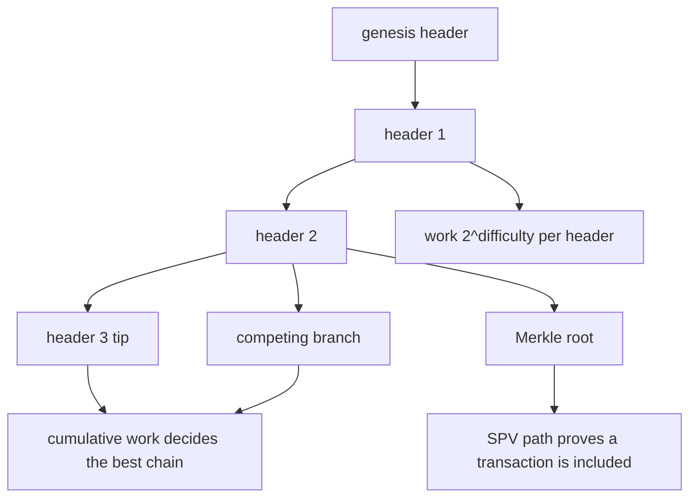
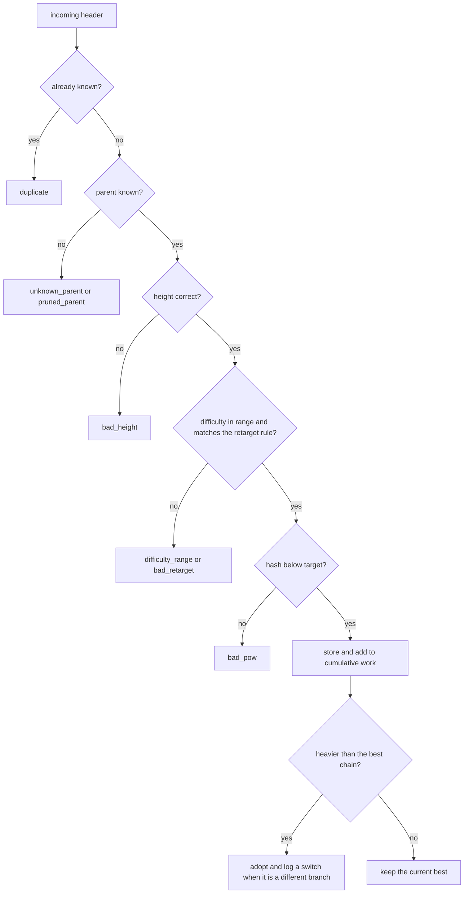
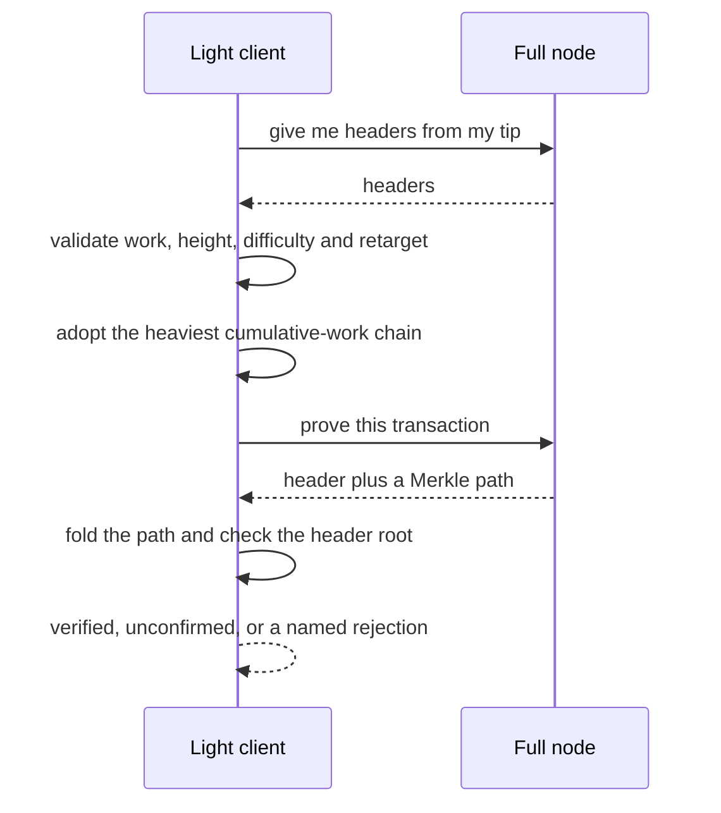

# 831 — Implement blockchain light client with SPV proofs and pruning.

> **Tier:** Master · **CTCI chapter:** Ch 9 — System Design and Scalability
> **Task spec:** [831-implement-blockchain-light-client-with-spv-proofs-and-pruning.md](../../../tasks/master/831-implement-blockchain-light-client-with-spv-proofs-and-pruning.md)
> **Solutions:** [Python](../../../solutions/python/master/831-implement-blockchain-light-client-with-spv-proofs-and-pruning/solution.py) ·
> [Java](../../../solutions/java/master/831-implement-blockchain-light-client-with-spv-proofs-and-pruning/Solution.java) ·
> [JavaScript](../../../solutions/javascript/master/831-implement-blockchain-light-client-with-spv-proofs-and-pruning/solution.js) ·
> [C#](../../../solutions/csharp/master/831-implement-blockchain-light-client-with-spv-proofs-and-pruning/Solution.cs)

## 1. Problem restatement

**Input.** A genesis header plus a stream of headers — each `(height, prev, root, timestamp, difficulty,
nonce)` — and, on demand, SPV proofs `(header, path)` for a transaction.

**Output.** Two answers and a memory bound: which chain the client follows, whether a transaction is in it,
and a header store that stays `O(depth)` instead of `O(chain)`.

| Piece | Contract |
| --- | --- |
| `mine` | deterministic nonce search for a header whose SHA-256 is below `2^(256 − difficulty)`; a header's *work* is `2^difficulty` |
| `merkle_root` / `merkle_path` / `verify_merkle` | a Bitcoin-style binary Merkle tree (odd levels duplicate their last node) with paths of length `ceil(log2 n)`, each element carrying its sibling's side |
| `retarget` | every `RETARGET = 2` blocks, the difficulty moves by up to two bits, read off the header timestamps and clamped to `[8, 12]` |
| `LightClient.add_header` | validation with an explicit rejection reason and the heaviest-chain rule, with a switch log when the tip moves to another branch |
| `LightClient.verify_inclusion` | exactly one of `verified`, `unconfirmed`, `pruned_header`, `unknown_header`, `not_in_best_chain`, `bad_proof`, plus the confirmation depth |
| `LightClient.prune_keep(depth)` | drop headers below `tip − depth`, keeping the highest pruned best-chain header as a checkpoint with its already-validated cumulative work |

**Constraints.**

1. Merkle correctness is checked against an independently materialised level list; mutated transactions,
   forged siblings, mis-indexed paths and paths borrowed from another block must all fail.
2. Every accepted header must beat its target, and the work credited must be exactly `2^difficulty`.
3. Admission errors must be distinguishable: unknown parent, wrong height, out-of-range difficulty, a
   difficulty that ignores the retarget rule, and a nonce that misses the target each have their own reason.
4. A shorter branch with more cumulative work must displace the best chain, and a heavier-but-invalid branch
   must be refused.
5. Memory must shrink with pruning while the *total work* stays unchanged, and a proof for a pruned
   non-checkpoint block must return `pruned_header` rather than a false accept.

**Concrete behaviour asserted by the shipped Python run.**

| Scenario | Expected result |
| --- | --- |
| Main chain | `7` headers, cumulative work `1792`, `1610` nonces tried |
| Difficulties | main chain all `8`; the fast branch `8, 10, 10, 12` |
| Pruning to depth `2` | `3` headers retained, checkpoint at height `3`, work still `1792` |
| Rejection bookkeeping | `4` rejections recorded by the syncing client, each with its own reason |

## 2. Intuition

A light client exists because verifying the whole chain is too expensive: it stores headers and nothing else.
Everything it does follows from that decision.

- **Which chain?** With only headers, validity of *state* is out of reach, but proof-of-work is checkable. The
  rule is therefore "the most cumulative work", not "the most blocks": each header's expected hash count is
  `2^difficulty`, and the client sums those instead of counting. A shorter branch can win — which is exactly
  what happens when a high-difficulty branch catches up.
- **Is this transaction in it?** A header contains a Merkle root, so inclusion is a path of `ceil(log2 n)`
  sibling hashes. The client never sees the block body; it needs only the root and the path, which is the
  whole point of SPV.
- **How does memory stay bounded?** Pruning drops old headers — but the fork choice needs cumulative work, and
  that number would be lost with them. The trick is to keep **one checkpoint**: the highest pruned header on
  the best chain, together with the cumulative work that was already validated for it. The client then
  reports the same total work with `O(depth)` headers, and the honest limitation (it cannot re-verify work it
  no longer stores) is stated rather than hidden.

The design tension is that the checkpoint is *trusted*: the checks say that pruning trusts a header that was
fully validated before it was pruned, and that a client cannot re-verify such work afterwards.



## 3. Algorithm

**Mining and work.** A header's hash must be below `2^(256 − difficulty)`; the search is a deterministic
nonce scan, capped so that a failure is an error rather than a hang.

```text
function mine(header)
    target ← 2^256 >> difficulty
    for nonce from 0 up to the cap do
        candidate ← header with that nonce
        if the SHA-256 of candidate is below target then return candidate and the nonce count
    end
    raise an error - no proof of work inside the nonce limit
end

function work_of(header)
    return 2^difficulty
end
```

**Merkle tree and paths.** Odd levels duplicate their last node, which is what makes the tree well-defined for
any transaction count.

```text
function merkle_root(transactions)
    level ← the hash of every transaction
    while more than one node remains do
        if the level length is odd then append a copy of the last node
        level ← hash of each adjacent pair
    end
    return the single remaining node
end

function merkle_path(transactions, index)
    level ← the hash of every transaction
    path ← empty list and position ← index
    while more than one node remains do
        if the level length is odd then append a copy of the last node
        append (side of the sibling, sibling hash) to path
            the sibling is to the right when position is even, otherwise to the left
        level ← hash of each adjacent pair and position ← position divided by 2
    end
    return path
end

function verify_merkle(transaction, path, root)
    node ← the hash of the transaction
    for (side, sibling) in path do
        node ← hash of node followed by sibling when the sibling is on the right
        otherwise hash of sibling followed by node
    end
    return node equals root
end
```

**Retargeting.** The client re-derives the rule from headers it holds; without a full window it declines to
judge rather than guessing.

```text
function retarget(parent_difficulty, window)
    span ← the timestamp of the last window header minus the first
    if span doubles to less than the nominal span then step ← +2
    otherwise if span is less than the nominal span then step ← +1
    otherwise if span exceeds twice the nominal then step ← -2
    otherwise if span exceeds the nominal then step ← -1
    otherwise step ← 0
    return the parent difficulty plus step, clamped into the allowed range
end
```

**Admission.** Every rejection gets its own label, and the heaviest-chain rule runs only after validation.

```text
function add_header(client, header)
    if the hash is already known then reject with duplicate
    if the parent is unknown then
        reject with pruned_parent when the client has already pruned, otherwise unknown_parent
    end
    if the height is not the parent height plus one then reject with bad_height
    if the difficulty is outside the allowed range then reject with difficulty_range
    if the expected difficulty for this height differs from the header's then reject with bad_retarget
    if the hash does not beat the target then reject with bad_pow
    store the header, record its cumulative work as the parent's plus its own
    if the new cumulative work exceeds the current best then
        adopt it as the best tip, logging a switch when the tip jumped to another branch
    end
end
```

**SPV verification.** One status, one confirmation depth.

```text
function verify_inclusion(client, transaction, proof)
    if the header is not known then
        return pruned_header when its height is at or below the prune mark, otherwise unknown_header
    end
    if the header is stored but not on the best chain then return not_in_best_chain
    if the header is not stored and is not the checkpoint then return not_in_best_chain
    if the Merkle path does not fold to the header root then return bad_proof
    depth ← tip height minus the header height
    return verified when depth reaches the confirmation requirement, otherwise unconfirmed, and depth
end
```

**Pruning.** Keep the checkpoint at the highest pruned best-chain header; if the checkpoint is already at or
above the new boundary the call is a no-op.

```text
function prune_keep(client, depth)
    keep_from ← the larger of 1 and the tip height minus depth
    if the checkpoint already sits at or above keep_from then return 0
    remove every stored header below keep_from, remembering the highest best-chain one as the boundary
    when a boundary exists then record a checkpoint with its hash, header and validated cumulative work
    set the prune mark to keep_from minus one
    return the number of headers removed
end
```





**Documented simplifications.** No P2P layer, no mempool and no signatures: a "transaction" is an opaque
string, so what is exercised is exactly an SPV client's job. Mining is real SHA-256 grinding at 8-12 leading
zero bits so the run stays instant and deterministic. Pruning *trusts* the checkpoint header, which was fully
validated before being pruned — a client cannot re-verify work it no longer stores, and the file says so.

## 4. Worked example

**Merkle paths for a three-transaction block.** With transactions `t0, t1, t2` the levels are
`[H(t0), H(t1), H(t2)]` → `[H(t0), H(t1), H(t2), H(t2)]` (odd level duplicates) →
`[H(H(t0)+H(t1)), H(H(t2)+H(t2))]` → the root:

| Index | Path (side, sibling) | Length | Verifies |
| --- | --- | --- | --- |
| `0` | `(right, H(t1))`, `(right, H(H(t2)+H(t2)))` | 2 | yes |
| `1` | `(left, H(t0))`, `(right, H(H(t2)+H(t2)))` | 2 | yes |
| `2` | `(right, H(t2))`, `(left, H(H(t0)+H(t1)))` | 2 | yes |

Index `2` is the interesting row: its first sibling is the *duplicated* node, which is why the path still has
length `ceil(log2 3) = 2` for an odd transaction count. A four-transaction block has exactly `n − 1 = 6`
distinct siblings across its four paths, and a single-transaction block has an empty path — both asserted.

**The chain.** Mining six blocks on top of the genesis gives a chain of `7` headers with cumulative work
`1792 = 7 × 2^8` and `1610` nonces tried by the miner in total. Every header has difficulty `8`, because the
timestamps advance at exactly the target rate of `10` ticks per block, so the retarget step is `0` at every
boundary. The competing branch, mined with a faster timestamp step, shows the rule working: its difficulties
climb `8, 10, 10, 12` — `+2` bits per retarget, until the hard clamp at `12` stops it.

**Pruning.** Pruning to depth `2` on a seven-header chain:

| Quantity | Before | After |
| --- | --- | --- |
| Stored headers | `7` | `3` |
| Checkpoint height | none | `3` |
| Total work reported | `1792` | `1792` |
| Prune mark | none | `3` |

Four headers disappeared and the client reports the *same* total work, because the checkpoint carries the
cumulative work that was validated for it before pruning. Repeating the same prune is a no-op; a deeper prune
moves the checkpoint forward; and a proof for a pruned non-checkpoint block returns `pruned_header` — a
refusal, not a false accept. The retained checkpoint can still prove its own transactions, which is exactly
what a checkpoint is for.

**Admission and switching.** The syncing client that receives headers from the competing branch records `4`
rejections with distinct reasons, and the heaviest-chain rule is exercised in both directions: a *shorter*
branch with more cumulative work displaces the best chain (logging exactly one switch), a lighter branch does
not, and a branch whose headers fail proof-of-work is refused however heavy it claims to be.

## 5. Complexity

Let `n` be the blocks in the chain, `b` the transactions in a block, `d` the prune depth and `h` the header
count retained.

| Measure | Bound | Why it holds |
| --- | --- | --- |
| `mine` | expected `2^difficulty` hashes | geometric search; `1610` nonces for seven headers at difficulty `8` |
| Merkle root | O(b) hashes per level, O(b) levels reclaimed | one hash per pair per level |
| `merkle_path` | O(log b) elements | halving the level each step; `2` for a three-transaction block |
| `verify_merkle` | O(log b) hashes | one hash per path element |
| `add_header` | O(1) plus O(RETARGET) for a retarget height | the window is the last `RETARGET` headers |
| Cumulative work | O(1) per header | the parent's stored total plus `2^difficulty` |
| `verify_inclusion` | O(log b) hashes plus O(1) | dominated by the path |
| `prune_keep` | O(n) once | it walks the store, then the store is `O(d)` |
| Steady-state memory | O(h) headers, `h = depth + 1` | measured `3` headers after pruning to depth `2` |

The whole point of the design is the last row: without pruning the client's memory grows with the chain, and
with the checkpoint the *accounting* stays correct while the memory does not.

## 6. Pitfalls and edge cases

- **Counting blocks instead of summing work.** A branch with more headers but less cumulative work must lose;
  the fixture mines a shorter, heavier branch to force exactly that case.
- **Retargeting without a window.** After pruning, the client may not hold the headers a retarget needs;
  `expected_difficulty` returns `None` and the header is neither accepted nor rejected on a rule it cannot
  check — silently assuming the parent's difficulty would be a divergence.
- **Clamping.** Difficulty must stay inside `[8, 12]`; the fast branch demonstrably hits the `12` clamp.
- **Out-of-range difficulty in a header.** A header claiming a difficulty outside the range is rejected with
  its own reason before any hashing, so a cheap DoS attempt cannot burn the client's work.
- **Proof-of-work not verified while *adding*.** A header can carry a perfectly valid difficulty and still miss
  its target; the target check is a separate step with its own reason.
- **Odd Merkle levels.** Forgetting the duplication makes a three-transaction block unprovable; duplicating
  inconsistently (say, at the root only) makes paths verify against the wrong root.
- **Path sides.** Each element must say whether the sibling is left or right, or the fold is ambiguous and a
  path could be replayed with its nodes swapped.
- **Proofs from another block.** A valid path for the same transaction in a *different* block must fail
  against this header's root — the fixture checks the borrowed-proof case.
- **Side-branch transactions.** A transaction included in a branch that is not the best chain must report
  `not_in_best_chain`, not `verified`.
- **Confirmations.** A transaction in the tip block is `unconfirmed` until the depth reaches the client's
  requirement (`2` here); reporting `verified` for an unburied transaction is the classic SPV mistake.
- **Pruned versus unknown.** Both are refusals, but they mean different things: `pruned_header` says "the
  client had this and dropped it", `unknown_header` says "never seen". The fixture distinguishes them.
- **Repeating a prune.** Calling `prune_keep` with a boundary at or below the existing checkpoint returns `0`
  and changes nothing, so the checkpoint cannot be moved backwards.
- **Trust in the checkpoint.** Pruned work is *carried*, not re-verifiable; that is the documented limitation
  of the design, and the run states it instead of implying the client can still prove the history.
- **Nonce cap.** Mining raises after `2^17` tries rather than looping forever, so a mis-set difficulty fails
  loudly.
- **Determinism.** Header timestamps, transactions and mining are deterministic, so re-mining the same chain
  reproduces every hash — the fixture asserts exactly that.

## 7. Variants and follow-ups

- **Prove the computation, not just inclusion.** SPV proves a transaction is in a block; a succinct proof can
  prove the inference result itself — see
  [830-implement-verifiable-computation-for-ml-inference-with-succinct.md](../../../tasks/master/830-implement-verifiable-computation-for-ml-inference-with-succinct.md).
- **Stitch headers across a gossip network.** Robustly following a chain from unreliable peers is
  [842-implement-blockchain-light-node-gossip-header-stitching-robustly.md](../../../tasks/master/842-implement-blockchain-light-node-gossip-header-stitching-robustly.md).
- **Make the log itself verifiable.** The Merkle commitment here is the same primitive as a self-verifying
  distributed log — see
  [902-implement-self-verifying-distributed-logs-with-merkle-trees-and.md](../../../tasks/master/902-implement-self-verifying-distributed-logs-with-merkle-trees-and.md).
- **Scale the same rules across shards.** Cross-shard messaging turns one chain into many — see
  [832-implement-sharded-blockchain-prototype-with-cross-shard-messagin.md](../../../tasks/master/832-implement-sharded-blockchain-prototype-with-cross-shard-messagin.md).

## 8. Check yourself

1. Why is the fork-choice rule cumulative work rather than block count?

<details><summary>Show answer</summary>

Because difficulty is the security parameter, not length. A branch of three difficulty-`12` headers represents
`3 × 4096 = 12288` expected hashes, more than a branch of seven difficulty-`8` headers at `7 × 256 = 1792`.
Summing `2^difficulty` makes the client follow the chain an attacker would have to work hardest to reorg, and
the fixture forces the case by mining a shorter but heavier branch.

</details>

2. What exactly does the checkpoint preserve, and what does it give up?

<details><summary>Show answer</summary>

It preserves the **cumulative work** of the highest pruned best-chain header, which was fully validated before
pruning. That keeps the heaviest-chain comparison and the reported total work correct (`1792` before and after
pruning to depth `2`) with only `depth + 1` headers stored. What it gives up is re-verifiability: the client
cannot recompute work it no longer stores, so the checkpoint is trusted, and the file states that limitation.

</details>

3. A three-transaction block's path for index `2` has a sibling that appears twice in the level. Why?

<details><summary>Show answer</summary>

Because Merkle trees need an even number of nodes per level, so an odd level duplicates its last node. For
`[H(t0), H(t1), H(t2)]` the level becomes `[H(t0), H(t1), H(t2), H(t2)]`, and index `2`'s sibling is that
duplicate — which is why the path still has length `ceil(log2 3) = 2` and folds to the same root every other
index folds to.

</details>

4. Why does a proof for a pruned, non-checkpoint block return `pruned_header` instead of failing silently?

<details><summary>Show answer</summary>

Because "I cannot check this" and "this is false" are different answers, and conflating them either rejects
valid history or, worse, accepts an unverifiable claim. `pruned_header` tells the caller the client once had
the header and dropped it, so the caller can ask for the checkpoint instead or fetch the header again —
whereas `unknown_header` means it was never seen, and `bad_proof` means the path is wrong.

</details>

5. Where does the client's memory stop depending on the chain length?

<details><summary>Show answer</summary>

At `prune_keep`. It drops every stored header below `tip − depth` (retaining the boundary as the checkpoint),
so the steady-state store is `depth + 1` headers — `3` after pruning a seven-header chain to depth `2` — while
the cumulative-work accounting stays exact through the checkpoint's stored work. A repeat call is a no-op, so
the retained window can never shrink below the requested depth.

</details>
