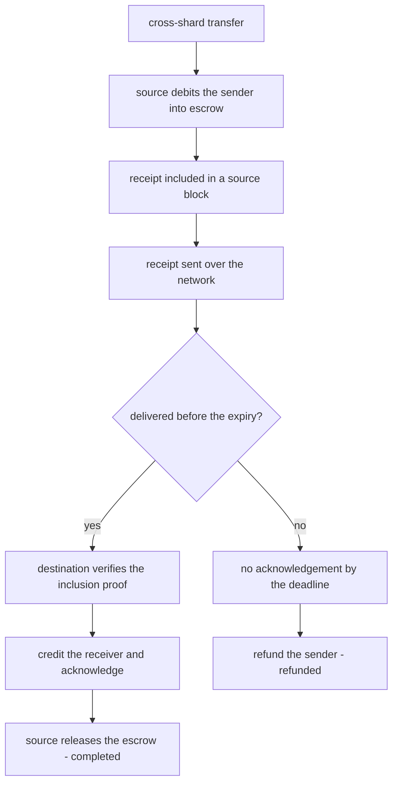
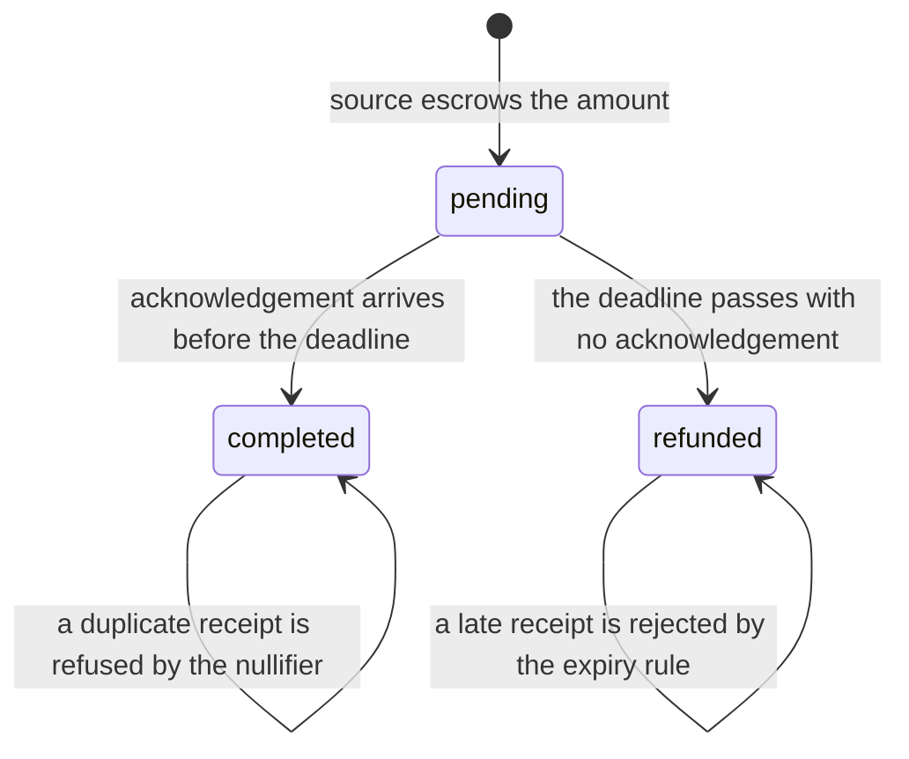
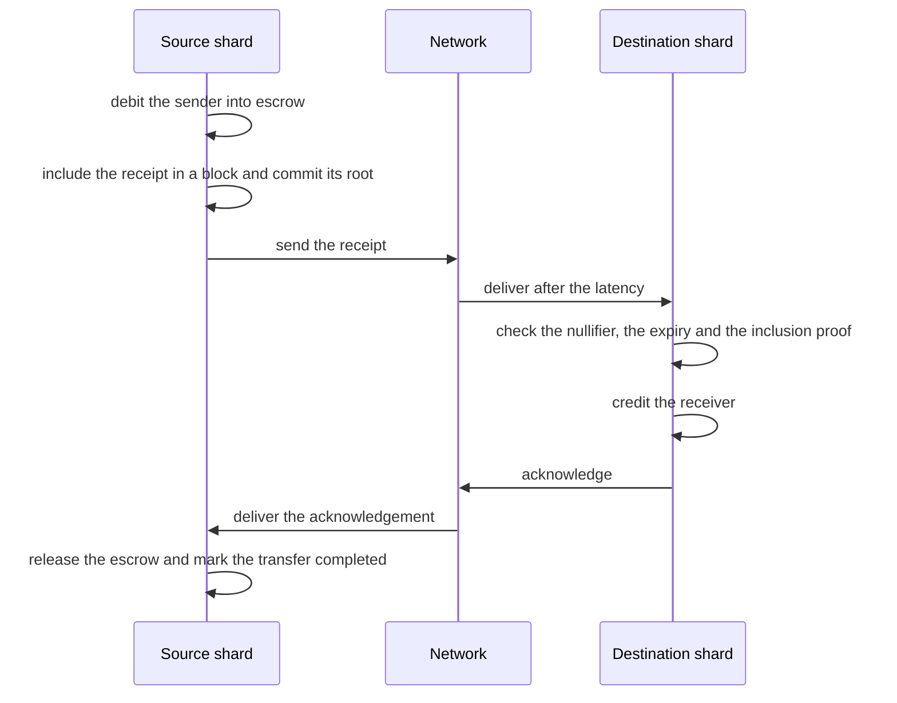
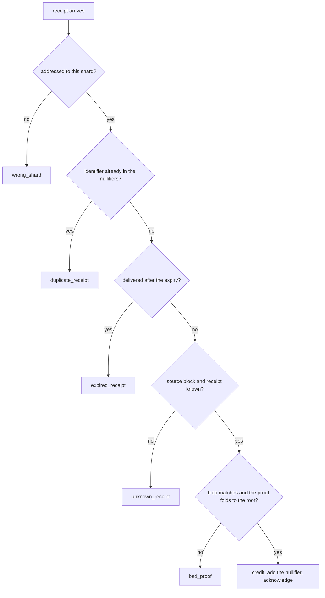

# 832 — Implement sharded blockchain prototype with cross-shard messaging.

> **Tier:** Master · **CTCI chapter:** Ch 9 — System Design and Scalability
> **Task spec:** [832-implement-sharded-blockchain-prototype-with-cross-shard-messagin.md](../../../tasks/master/832-implement-sharded-blockchain-prototype-with-cross-shard-messagin.md)
> **Solutions:** [Python](../../../solutions/python/master/832-implement-sharded-blockchain-prototype-with-cross-shard-messagin/solution.py) ·
> [Java](../../../solutions/java/master/832-implement-sharded-blockchain-prototype-with-cross-shard-messagin/Solution.java) ·
> [JavaScript](../../../solutions/javascript/master/832-implement-sharded-blockchain-prototype-with-cross-shard-messagin/solution.js) ·
> [C#](../../../solutions/csharp/master/832-implement-sharded-blockchain-prototype-with-cross-shard-messagin/Solution.cs)

## 1. Problem restatement

**Input.** Four shards, three accounts per shard holding `100` each (initial supply `1200`), a mix of local and
cross-shard transfers, and timing parameters: message latency `2` ticks, receipt expiry `3` ticks, refund
margin `4` ticks, a per-shard processing cap of `2` items per tick and a network delivery capacity of `8`
messages per tick.

**Output.** A ledger state per shard, a full event log, a per-transfer final status, and a violation list that
is re-checked after **every** tick: `balances + escrow − unsettled credits == 1200`.

| Piece | Contract |
| --- | --- |
| `receipts_root` / `receipt_proof` / `verify_receipt_proof` | SHA-256 Merkle inclusion of a receipt inside its source block — the source's authorisation |
| `Network` | deterministic delivery at `send_tick + latency`, a per-tick capacity with explicit capacity drops, a configurable drop list and duplicate delivery, all tick-driven |
| `ShardSystem.submit_cross` / `_produce` | debit the sender into escrow, emit a receipt with an expiry, and include it in a block whose root commits to it |
| `ShardSystem._credit` | credit the receiver only against a valid, unexpired, unseen receipt with a correct inclusion proof, then acknowledge |
| `ShardSystem._refund_due` / `_complete` | refund the sender at `send_tick + expiry + margin` when no acknowledgement arrived; release the escrow when it did |
| `ShardSystem._check_invariants` | supply conservation, the state machine `pending / completed / refunded` (never two), no credit after a refund, no double credit |

**Constraints.**

1. A receipt's inclusion proof must verify against its block's root, and a mutated receipt, a proof from
   another block and a proof for another position must all fail.
2. Supply must be conserved after every single tick of every run — including the tick at which the unsafe
   configuration first breaks.
3. Every cross-shard transfer must end in exactly one of `completed` or `refunded`.
4. Replay must be refused: a duplicated receipt is credited once, the nullifier remembers it, and the duplicate
   gets its own log entry.
5. A receipt delivered after its expiry must be rejected, so a refunded transfer can never be credited later.
6. No shard may process more than its per-tick cap, and the network may not deliver more than its capacity.

**Concrete behaviour asserted by the shipped Python run.**

| Scenario | Expected result |
| --- | --- |
| Safe run | supply `1200 == 1200`, every cross-shard transfer `completed`, no violations |
| Completion latency | measured `4` ticks, inside `expiry <= completion <= expiry + margin + latency` |
| Dropped receipt | `x1` refunded at tick `7` (`expiry 3 + margin 4`) |
| `margin = 0` | `8` double spends, supply `1420` against `1200` — the violation is detected and reported |
| Atomic equivalence | the sharded run ends with exactly the balances an atomic single-ledger run would produce |

## 2. Intuition

Sharding breaks the one thing a ledger gives you for free: atomicity. If account `s0:a0` and account `s1:a0`
live on different shards, there is no single write that debits one and credits the other, and no lock that a
third party can hold across both. A transfer therefore becomes a **protocol**.

- **Phase one: the source commits.** The sender is debited immediately and the money goes into *escrow* — not
  to the receiver, and not back to the sender. A *receipt* describing the transfer is included in a source
  block, and the block's Merkle root commits to it. At this instant the money exists in exactly one place that
  matters: escrow.
- **Phase two: the destination acts on proof.** The destination credits the receiver only when it holds a
  receipt with a valid inclusion proof against a source block root. It then acknowledges, and the
  acknowledgement lets the source burn the escrow. Until that acknowledgement, the escrow stays — which is why
  a credited-but-unsettled transfer legitimately appears *twice* in the accounting, once as the receiver's
  balance and once as the sender's escrow.

The pricing of that design is in the timing. If a receipt is lost, the source cannot wait forever: after
`expiry + margin` ticks it refunds the sender. But that refund races the credit — a receipt that was merely
delayed could be credited *after* the refund, which is the sharded version of a double spend. The safety
argument is therefore a timing assumption: with `latency <= expiry` and `latency <= margin`, the
acknowledgement always beats the refund. The file proves both sides by constructing the unsafe configuration:
with `margin = 0` the same scenario really does double-spend, and the violation is exhibited and counted
rather than assumed away.



## 3. Algorithm

**Receipt commitment.** Receipts inside a block are hashed into a root; an inclusion proof is a Merkle path,
and the destination checks the *receipt it holds* against the root of the *block the receipt claims*.

```text
function receipts_root(receipts)
    when the block is empty then return the hash of the word empty
    fold the receipt hashes pairwise with SHA-256, duplicating the last node on odd levels
    return the single remaining node
end

function verify_receipt_proof(receipt, path, root)
    fold the receipt hash with the path, respecting each sibling's side
    return the folded node equals the committed root
end
```

**Phase one, inside the source shard's block production.**

```text
procedure produce_block(system, shard)
    budget ← the per-shard cap
    spend the budget on local transfers first, in transaction-id order
    for each cross-shard transfer within the remaining budget do
        when the sender can pay then
            debit the sender and place the amount in escrow for this transfer
            build a receipt with its source, destination, amount, sender, receiver,
                send tick and expiry = send tick + EXPIRY
            append the receipt to the block and remember its index and location
            send the receipt over the network
        otherwise mark the transfer rejected
    end
    spend the rest of the budget on arriving receipts
    commit the block root over the receipts it contains
end
```

**Phase two, crediting against proof.**

```text
procedure credit(system, shard, receipt)
    reject with wrong_shard when the receipt's destination is not this shard
    reject with duplicate_receipt when the identifier is already in the nullifier set
    reject with expired_receipt when the current tick is past the receipt's expiry
    reject with unknown_receipt when the source block or the remembered receipt is missing
    rebuild the inclusion proof from the source block and compare the receipt blobs
    reject with bad_proof when the blob differs or the proof does not fold to the block root
    credit the receiver, add the identifier to the nullifiers and record the unsettled credit
    send an acknowledgement back to the source shard
end
```

**Settlement and refund.**

```text
procedure refund_due(system)
    for each escrow entry in identifier order do
        deadline ← the receipt send tick plus EXPIRY plus MARGIN
        when the tick has reached the deadline and no acknowledgement arrived then
            refund the sender, zero the escrow and mark the transfer refunded
        end
    end
end

procedure complete(system)
    for each acknowledged transfer still pending do
        zero its escrow and mark the transfer completed
    end
end
```

**The accounting invariant.** Because a credited-but-unsettled transfer appears in two places by design, the
invariant is not "balances equal the initial supply" but:

```text
function invariant(system, initial_supply)
    return the sum of all balances plus all escrow minus all unsettled credits
           equals the initial supply
end
```





**Documented simplifications.** Instant finality inside a shard: a deterministic producer appends one block
per tick in a fixed order, so there are no forks to resolve here (that is
[831-implement-blockchain-light-client-with-spv-proofs-and-pruning.md](../../../tasks/master/831-implement-blockchain-light-client-with-spv-proofs-and-pruning.md)).
Balances are non-negative integers and a transaction is an opaque id plus a fixed amount, so the checks are
about atomicity, conservation, replay and timing rather than signatures. The safety argument is a *timing*
argument, and both sides of it are verified.

## 4. Worked example

**The scenario.** Eight cross-shard transfers and two local ones over four shards, for example
`x1: s0:a0 → s1:a0, 30` and `x8: s3:a0 → s1:a0, 45`. Supply is `4 shards × 3 accounts × 100 = 1200`.

**Timing, tick by tick, for a transfer that succeeds.** Latency `2`, expiry `3`, margin `4`:

| Tick | Source shard | Network | Destination shard |
| --- | --- | --- | --- |
| `1` | debits `30` into escrow, emits the receipt, commits the block root | receipt queued for tick `3` | — |
| `3` | waiting | delivers the receipt | nullifier clear, `tick <= expiry`, proof folds to the root → credits `30` and acknowledges |
| `5` | acknowledgement arrives, escrow burned | — | — |
| — | status `completed` | | |

The measured completion latency is `4` ticks, inside the asserted band `expiry <= completion <= expiry +
margin + latency`, i.e. `3 <= 4 <= 9`: the transfer cannot complete before the receipt's own expiry window
opens, and it must complete before the refund deadline.

**A dropped receipt.** With the receipt for `x1` dropped by the network, no acknowledgement ever arrives, and
the refund fires at tick `7` — `send_tick + EXPIRY + MARGIN = 0 + 3 + 4`. The sender's `30` comes back, the
escrow is zeroed and the status is `refunded`, so the transfer resolves rather than hanging. Supply is still
`1200` before and after, and the checker sees no violation: refunding is a correct outcome, not a failure.

**Why the margin is not optional.** Run the identical scenario with `margin = 0` and the race flips: the
refund deadline coincides with the moment the delayed receipt is still in flight, so a receipt can be credited
*after* its sender was already refunded. The run reports `8` double spends and a total supply of `1420`
against the `1200` it started with — `220` of money created out of nothing, detected by the per-tick invariant
checker rather than discovered later. That is the safety assumption made concrete: with `latency <= expiry`
and `latency <= margin` the acknowledgement always wins the race, and without it the protocol is broken.

**End state.** In the safe run every cross-shard transfer completes, `no transaction is left pending`, and the
final balances equal exactly what an atomic single-ledger run of the same transfers would produce — which is
the strongest statement a sharded execution can make: distribution changed the mechanism, not the outcome.



## 5. Complexity

Let `n` be the transfers, `s` the shards, `T` the resolved tick count, `r` the receipts in a block, `C` the
per-shard cap per tick and `N` the network capacity per tick.

| Measure | Bound | Why it holds |
| --- | --- | --- |
| `receipts_root` | O(r) hashes | one hash per pair per level |
| `receipt_proof` / `verify_receipt_proof` | O(log r) | halving the level per step; five receipts need `3` siblings |
| `_produce` per tick | O(C) items | local transfers, cross sends and arriving receipts share the cap |
| `_credit` | O(log r) plus O(1) | dominated by the inclusion proof |
| `_refund_due` | O(escrow entries) per tick | one deadline comparison each |
| `_check_invariants` | O(accounts + escrow + credited) per tick | a full sweep **after every tick**, not only at the end |
| Whole run | O(T · (s · C + N + escrow)) | `40` ticks of a four-shard scenario |
| Network | O(N) deliveries per tick | the excess is dropped and logged as `capacity_drop` |

The cost note that matters is the invariant sweep: it runs after every tick, which is what turns a
conservation claim into an observation — and it is cheap because the state it sweeps is `O(accounts + escrow)`.

## 6. Pitfalls and edge cases

- **Crediting without verifying the proof.** A destination that trusts the receipt's contents can be fed a
  forged amount; the file checks that a tampered receipt, a proof from another block and a proof built for
  another position are all rejected.
- **Replay.** A duplicated receipt must be credited once. The nullifier set records credited identifiers, and a
  duplicate is refused with its own `duplicate_receipt` log entry.
- **Expiry.** A receipt delivered after its expiry must be rejected, otherwise a refunded transfer could still
  be credited — the double-spend the whole protocol exists to prevent.
- **The refund race.** With `margin = 0` the race flips and the run really does create money (`8` double
  spends, supply `1420`). Safety here is a timing assumption, and the file verifies it in both directions
  rather than asserting it.
- **Wrong-shard receipts.** A receipt addressed to another shard is refused (`wrong_shard`) rather than
  credited by whoever received it.
- **Double counting in the invariant.** A credited-but-unsettled transfer legitimately sits in two places, so
  the invariant subtracts unsettled credits: `balances + escrow − unsettled == supply`. Forgetting that
  subtraction would report a violation on every healthy in-flight transfer.
- **Releasing the escrow twice.** `_complete` only acts on transfers still in the `pending` state, so an
  acknowledgement for an already-refunded transfer cannot resurrect it.
- **Per-tick caps.** Each shard processes at most `2` items per tick and the network delivers at most `8`
  messages; the excess is dropped *and logged*, so a capacity problem is visible in the event log instead of
  hiding as unexplained latency.
- **Ordering.** Transfers and receipts are processed in identifier order, so a congested tick degrades
  deterministically rather than depending on dictionary iteration order.
- **Local transfers.** They are not free of the same bookkeeping: they share the per-tick cap, check the
  balance, and reject a self-transfer.
- **Liveness.** With a dropped receipt the transfer still resolves by refund inside the deadline; with no drops
  every transfer completes. Both are asserted, because a protocol that only ever completes is not the one a
  network delivers.
- **Determinism.** Ticks, latency, caps, drop lists and the scenario are fixed, so two runs produce identical
  state digests and identical event logs — the fixture compares both.
- **Simplifications kept honest.** Instant in-shard finality, no forks, integer balances, no signatures or fee
  market, no P2P layer.

## 7. Variants and follow-ups

- **Follow one chain from the light client's side.** The same Merkle-inclusion machinery, without the
  cross-shard protocol, is
  [831-implement-blockchain-light-client-with-spv-proofs-and-pruning.md](../../../tasks/master/831-implement-blockchain-light-client-with-spv-proofs-and-pruning.md).
- **Make the log self-verifying.** Receipt commitments and event logs together are what
  [902-implement-self-verifying-distributed-logs-with-merkle-trees-and.md](../../../tasks/master/902-implement-self-verifying-distributed-logs-with-merkle-trees-and.md) builds on.
- **Extend the same accounting to replicated state.** Byzantine agreement adds a consensus layer under these
  shards — see
  [811-implement-byzantine-fault-tolerant-replicated-state-machine-prac.md](../../../tasks/master/811-implement-byzantine-fault-tolerant-replicated-state-machine-prac.md).
- **Snapshot the shards consistently.** A global consistent snapshot is the cross-shard analogue of the
  checkpoint here — see
  [807-implement-global-scale-consistent-snapshot-across-geographically.md](../../../tasks/master/807-implement-global-scale-consistent-snapshot-across-geographically.md).

## 8. Check yourself

1. Why is escrow needed at all, rather than debiting the sender and letting the destination credit the receiver
   when the receipt arrives?

<details><summary>Show answer</summary>

Because between those two events the money would exist in neither place, or — worse — the source could not tell
whether the receiver already got it. Escrow pins the amount to the transfer: the sender's balance is reduced
immediately, the amount sits in a box keyed by the transaction id, and the box is either burned on
acknowledgement or returned to the sender on expiry. That is what makes every transfer end in exactly one of
`completed` or `refunded`, with supply conserved after every tick.

</details>

2. Why does the invariant subtract unsettled credits?

<details><summary>Show answer</summary>

Because until the acknowledgement arrives the destination has already credited the receiver while the source
still holds the escrow: the same money is visible in two places, by design, because the two shards act on local
knowledge only. The invariant `balances + escrow − unsettled credits == 1200` therefore counts the in-flight
amount once. Settling burns the escrow, so a settled transfer contributes to exactly one side and no
subtraction is needed.

</details>

3. What exactly goes wrong with `margin = 0`?

<details><summary>Show answer</summary>

The refund deadline becomes `send_tick + expiry`, while the receipt needs `latency` ticks to arrive. A receipt
that is delayed but still inside its expiry can therefore be credited *after* the source already refunded the
sender: the sender is made whole and the receiver is credited, so the money doubles. The run reports `8` double
spends and supply `1420` instead of `1200` — detected by the per-tick invariant sweep, which is why the safety
statement is a timing assumption (`latency <= expiry` and `latency <= margin`) and not a theorem about the code
alone.

</details>

4. A receipt arrives twice. What happens the second time, and why is that not a benign duplicate?

<details><summary>Show answer</summary>

The identifier is already in the nullifier set, so the second delivery is rejected with a
`duplicate_receipt` event and the receiver is *not* credited again. Without the nullifier the duplicate would
credit the amount a second time while the source releases the escrow once — money created out of nothing, which
is exactly what the conservation invariant exists to catch.

</details>

5. The sharded run ends with the same balances as an atomic run of the same transfers. Why is that worth
   checking?

<details><summary>Show answer</summary>

Because it is the strongest correctness statement available for a distributed ledger: sharding may reorder,
delay and interleave operations, but the final state must be one that a single-node execution of the same
transfers could have produced. The fixture builds that atomic end state explicitly (`sender -= amount`,
`receiver += amount` for every transfer and local transaction, checking solvency) and compares the whole
balance map, which catches double credits, lost refunds and mis-ordered effects in one assertion.

</details>
