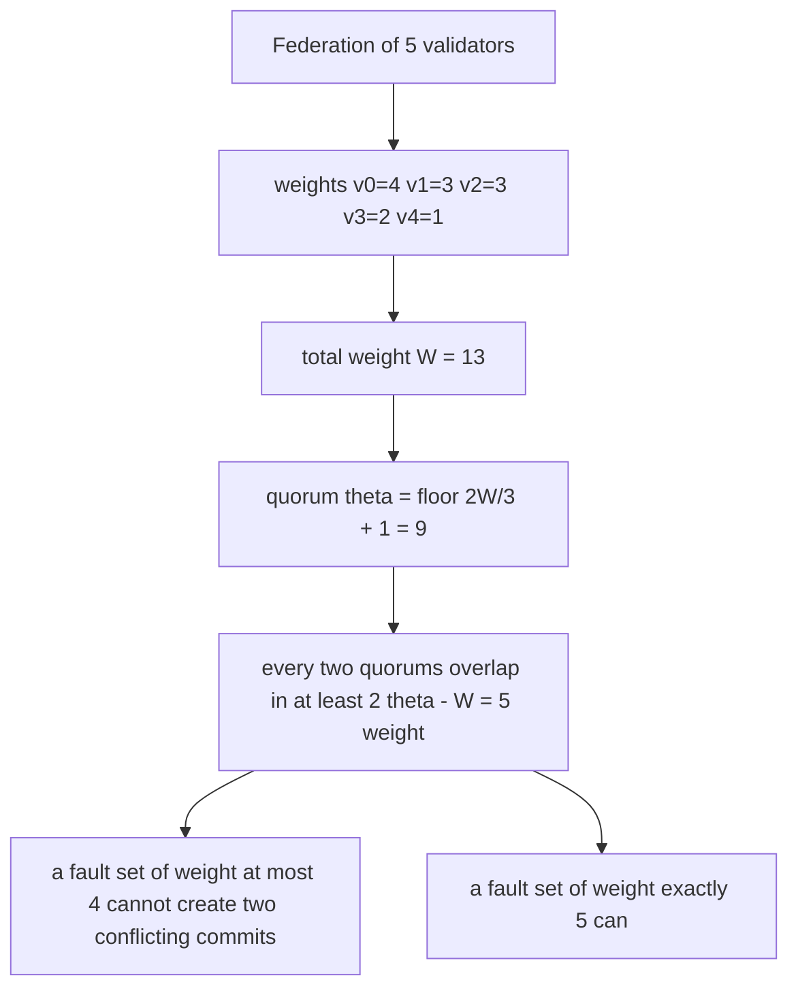
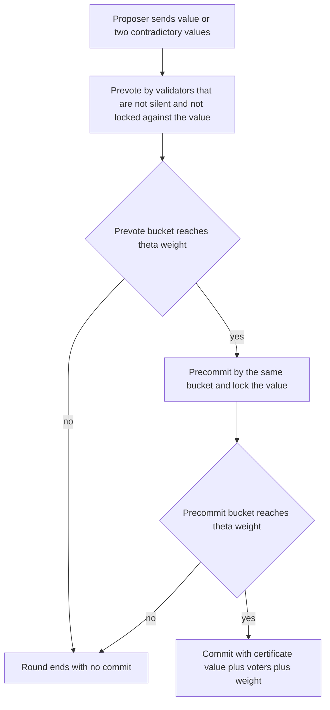
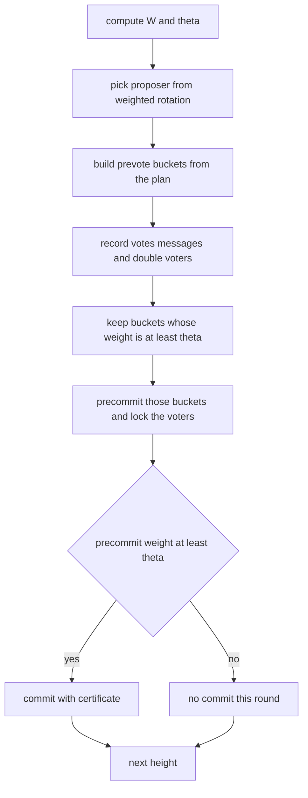
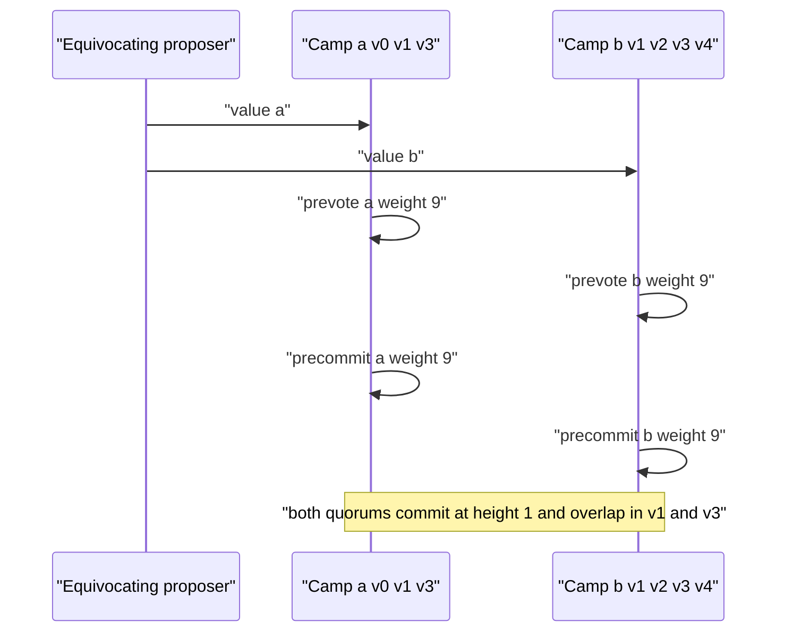

# 833 — Implement consensus over heterogeneous trust (federated consensus) simulation.

> **Tier:** Master · **CTCI chapter:** Ch 9 — System Design and Scalability
> **Task spec:** [833-implement-consensus-over-heterogeneous-trust-federated-consensus.md](../../../tasks/master/833-implement-consensus-over-heterogeneous-trust-federated-consensus.md)
> **Solutions:** [Python](../../../solutions/python/master/833-implement-consensus-over-heterogeneous-trust-federated-consensus/solution.py) ·
> [Java](../../../solutions/java/master/833-implement-consensus-over-heterogeneous-trust-federated-consensus/Solution.java) ·
> [JavaScript](../../../solutions/javascript/master/833-implement-consensus-over-heterogeneous-trust-federated-consensus/solution.js) ·
> [C#](../../../solutions/csharp/master/833-implement-consensus-over-heterogeneous-trust-federated-consensus/Solution.cs)

## 1. Problem restatement

The spec is a single line — *"Implement consensus over heterogeneous trust (federated consensus)
simulation"* — so the contract is whatever the four solution files implement and then assert.
This is a **system task**, and every solution is a self-contained in-process simulation.

**The modelling contract.** What is *simulated*: the message layer. Votes are not gossiped;
when the deterministic global tally for a value reaches quorum weight, the validators in that
tally commit in the same step. There are no clocks (one round is one timeout period), no
signatures, and a block value is just an abstract id such as `h1r1`. What is *real* and
asserted: the threshold arithmetic, the quorum-intersection argument it rests on, and the
safety/liveness consequences that follow from it.

**Inputs.** A trust map `weights` (validator → positive integer weight, plus one weight-0
observer in one check), a fault script (`node → "equivocate" | "silent"`), a height, a round
number, and for an equivocating proposer a **plan** mapping each candidate value to the
recipient list that receives it.

**Outputs.** Per round: the chosen proposer, the plan, the prevote and precommit buckets with
their weights, and any commits. Across a run: the commit log `(height, round, value,
certificate)` where a certificate is `(value, voters, weight)`, the vote log
`(round, phase, node, value)`, the point-to-point message log, the set of recorded double
voters, and `safety_violations()` — heights where two different values committed.

| Scenario | Result asserted by the solutions |
| --- | --- |
| `weights = {v0:4, v1:3, v2:3, v3:2, v4:1}` | `W = 13`, `theta = floor(2·13/3) + 1 = 9`, `2·theta − W = 5` |
| safe faults `{v1, v4}` (weight 4 < 5), all 1024 plans enumerated | exactly one value commits, certificate weight 11, violation list empty |
| unsafe faults `{v1, v3}` (weight 5 = 2·theta − W) | two conflicting values commit at height 1, both certificates have quorum weight, they intersect exactly in `{v1, v3}` |
| fault-free chain of heights 1..3 | every height commits in round 1, heights are exactly `[1, 2, 3]` |
| first round's messages dropped | the height still commits, in round 2, without duplicating the commit |

## 2. Intuition

The naive federated quorum is a head count: "more than half the validators". That is exactly
the assumption heterogeneity breaks. If `v0` carries weight 4 and `v1..v4` carry 3, 3, 2, 1,
then `v1, v2, v3, v4` are four nodes out of five and still weigh only 9 — while `v0` alone is
the most trusted party in the federation and can be outvoted by a coalition of light validators.
Counting heads also makes the *safety* argument wrong, not just the politics: with a plain
majority threshold two quorums can be **disjoint**, and two disjoint quorums can commit two
different values at the same height without any validator misbehaving twice.

The fix is to count trust instead of nodes, and to pick a threshold that forces overlap:



For any two subsets of weights summing to at least `theta`, the intersection weighs at least
`2·theta − W` — here `2·9 − 13 = 5`. That single inequality is the whole safety budget: it says
how much faulty weight you can tolerate before the two camps a Byzantine proposer wants become
simultaneously quorum-sized. With `theta = 9` and `W = 13`, exactly nine of the 32 subsets have
quorum weight, and the brute-forced minimum intersection over all pairs is the predicted 5.

The second insight is that the voting protocol must be *lock-step*, because weight alone does
not stop a value from being committed twice at different rounds. A Tendermint-style round —
propose, prevote, precommit, commit — plus a **lock** (a validator that precommitted a value at
a height refuses to vote for another value at that height) is what closes that hole. The
solutions model the two Byzantine behaviours the weight argument is about: a proposer that
sends contradictory values, and validators that vote for every value they are shown.



## 3. Algorithm

1. Read the trust map and compute `W`, the total weight, and `theta = floor(2W/3) + 1` (strictly
   more than two thirds; the `+1` is what makes 8.67 → 9 instead of a floating-point 8).
2. Build the proposer rotation. Sort by descending weight and repeat each validator `max(1,
   weight)` times, so heavier validators propose proportionally more often; round `r` at height
   `h` is driven by `proposers[(r + h − 1) mod len(proposers)]`.
3. Prevote: for each candidate value in the plan, walk its recipients. A silent validator is
   skipped, an equivocator joins **every** bucket, an honest validator is skipped if it is
   locked to a different value at this height or if it has already voted for another value in
   this round. Tally each bucket's weight with duplicate votes counted once.
4. Record evidence: every validator that lands in two prevote buckets of the same round is a
   double voter.
5. Precommit: only values whose prevote bucket already weighs at least `theta`; every member of
   that bucket precommits, which locks it to that value at that height.
6. Commit: only values whose precommit bucket weighs at least `theta`; the commit carries the
   `(value, voters, weight)` certificate, i.e. the proof a real client would check.
7. `run_height` retries rounds up to a round budget until a commit appears; a chain is a
   sequence of heights, and safety is checked afterwards as "no height has two committed
   values".

```text
function quorum_threshold(weights)
    W ← sum of all weights
    return floor(2 * W / 3) + 1
end

function weight_of(voters, weights)
    total ← 0
    for node in set of voters do            # a repeated vote weighs nothing extra
        total ← total + weights[node]
    end
    return total
end

procedure round(height, rnd, plan)
    proposer ← proposers[(rnd + height - 1) mod length(proposers)]
    if plan is empty then
        plan ← { "h" + height + "r" + rnd : every validator }     # silent proposer case
    end
    prevotes ← empty map from value to set of voters
    for value and recipients in sorted(plan) do
        for node in sorted(set of recipients) do
            behaviour ← faults[node]
            if behaviour = "silent" then continue end
            if behaviour = "equivocate" then add node to prevotes[value]; continue end
            if locked[node] is this height with a different value then continue end
            if node already voted in this round for a different value then continue end
            add node to prevotes[value]
        end
    end
    append every vote and every notification of every other validator to the logs
    add to double_voters every node present in two prevote buckets
    precommits ← empty map from value to set of voters
    for value and voters in sorted(prevotes) do
        if weight_of(voters) < theta then continue end
        add every voter to precommits[value]
        lock every voter to value at this height
    end
    for value and voters in sorted(precommits) do
        if weight_of(voters) ≥ theta then
            commit height with value and certificate (value, voters, weight_of(voters))
        end
    end
    return report with proposer, plan, prevote buckets, precommit buckets and commits
end

procedure run_height(height, budget)
    for rnd ← 1 to budget do
        report ← round(height, rnd, plan_for(round))
        if report has commits then return report end
    end
    return the last report
end
```



## 4. Worked example

Height 1, round 1, no faults. The rotation has length 13
(`v0 v0 v0 v0 v1 v1 v1 v2 v2 v2 v3 v3 v4`), so index `(1 + 1 − 1) mod 13 = 1` picks `v0`, which
proposes the single value `h1r1` to everybody.

| Step | Phase | Actor | Value | Voters | Weight | Verdict |
| --- | --- | --- | --- | --- | --- | --- |
| 1 | propose | `v0` | `h1r1` | all five | 13 | plan accepted |
| 2 | prevote | all five | `h1r1` | `v0 v1 v2 v3 v4` | 13 | 13 ≥ theta = 9, so precommit |
| 3 | precommit | all five | `h1r1` | `v0 v1 v2 v3 v4` | 13 | 13 ≥ 9, so commit |
| 4 | commit | — | `h1r1` | `v0 v1 v2 v3 v4` | 13 | certificate `(h1r1, all five, 13)` |

The message accounting is measured, not assumed: one clean round costs `2 · 5 · 4 = 40`
point-to-point vote messages and `2 · 5 = 10` votes — one prevote and one precommit per
validator, and nothing else.

Now the attack. With faulty validators `{v1, v3}` (weight 5) the enumerator finds a plan that
splits the federation into two camps: value `a` goes to `v0 v1 v3`, value `b` goes to
`v1 v2 v3 v4`. The equivocators `v1` and `v3` join **both** buckets, so they appear on both
sides of the split.

| Value | Recipients | Bucket after tally | Weight | Reaches theta = 9 | Committed |
| --- | --- | --- | --- | --- | --- |
| `a` | `v0 v1 v3` | `v0 v1 v3` | 4 + 3 + 2 = 9 | yes | yes, certificate 9 |
| `b` | `v1 v2 v3 v4` | `v1 v2 v3 v4` | 3 + 3 + 2 + 1 = 9 | yes | yes, certificate 9 |

Both certificates weigh 9, and their intersection is exactly `{v1, v3}` — 5 weight, which is
precisely `2·theta − W`. The safety checker reports the violation at height 1: two different
values committed at one height. Replacing `{v1, v3}` with the safe fault set `{v1, v4}` (weight
4) and enumerating **all** 1024 pairs of recipient sets leaves exactly one committed value with
an 11-weight certificate — the arithmetic bound, not luck, is what keeps the run safe.



Liveness is measured the same way. A fault-free chain of heights 1..3 commits every height in
round 1. Dropping a whole round's messages costs exactly one extra round, and the retry still
produces a single commit per height. With `v0` silent — the proposer slots at height 1, rounds
1 to 3 all belong to `v0` because of the weighted rotation — round 1 produces no commit at all
even though the remaining validators weigh `13 − 4 = 9`, exactly a quorum; round 4 hands the
proposal to `v1` and the height commits, still safely.

## 5. Complexity

Let `n` be the number of validators, `n_f` the number of faulty ones, and `R` the round budget.

| Measure | Bound | Why it holds |
| --- | --- | --- |
| Time per round, best/average/worst | O(n²) | every voter notifies every other validator, `2 · n · (n − 1)` messages in a clean round; the tally itself is O(n) |
| Time, quorum threshold | O(n) | one pass over the trust map |
| Space per round | O(n²) | the message log is the dominant structure (`40` entries for `n = 5`) |
| Space, quorum enumeration | O(2ⁿ) | `intersection_lemma` materialises every subset (`32` for `n = 5`) |
| Time, intersection brute force | O(4ⁿ) | every pair of subsets is compared (`9²` pairs actually reach quorum weight here, out of 32² subsets) |
| Time, exhaustive attack enumeration | O(4ⁿ) | 32 × 32 = 1024 plans, each replayed on a fresh federation |
| Space, votes and commits | O(n · R) | two votes per validator per round, at most one commit per height |
| Alternative: head-count majority | O(n) tally, **unsafe** | with a half-weight threshold the same enumeration finds two *disjoint* quorums, minimum intersection 0 |

The expensive terms are the brute-force verifications, not the protocol. Those exist so the
safety claim is tested against every plan rather than one hand-picked split; `n = 5` keeps them
at a few thousand operations. The protocol itself is quadratic because it models the honest
requirement that every validator hears every vote — the classic `O(n²)` gossip cost that makes
large federations reach for aggregation trees or gossip protocols.

## 6. Pitfalls and edge cases

- **Duplicate votes must weigh once.** The tally sums over `set(voters)`, so
  `weight_of([v0, v1, v0, v0]) = 7`, not 15. A tally that adds per message lets one validator
  mail itself into a quorum.
- **Integer threshold, not floats.** `floor(2W/3) + 1` gives 9 for `W = 13`. Computing `2/3`
  in binary floating point and comparing `>=` is how "8.666… votes" quietly becomes 8.
- **The 2/3 rule is load-bearing.** With a majority threshold (`theta = 6`) the brute force
  finds two disjoint quorums, so the same code would happily commit two conflicting values with
  no Byzantine behaviour at all.
- **Weight-0 observers.** They cannot move the threshold and cannot inflate a certificate, but
  `max(1, weight)` still gives them one slot in the proposer rotation, so an observer can waste
  a round. Decide deliberately whether a zero-weight node may propose.
- **Locking beats re-voting.** An honest validator locked to a different value at this height is
  filtered out of every bucket before the tally. Forgetting the lock check is the classic way a
  lock-step protocol loses the safety property it was written for.
- **Silent proposers cost liveness, not safety.** A wasted round is a schedule failure only if
  the round budget runs out, and **equivocation is recorded, not punished**: the simulation marks
  every double voter — the evidence a real client would use — and has no slashing rules.
- **Determinism.** Every dictionary is iterated in sorted order and the scheduler is explicit, so
  a second run reproduces commits, votes, messages and certificates exactly. Introducing hash
  iteration order would break the reproducibility checks.

## 7. Variants and follow-ups

- **Homogeneous BFT and crash faults.** Set every weight to 1 and the same code reduces to
  `3f + 1` classical BFT
  ([811-implement-byzantine-fault-tolerant-replicated-state-machine-prac.md](../../../tasks/master/811-implement-byzantine-fault-tolerant-replicated-state-machine-prac.md));
  with crash-only faults the lock becomes a leader lease, as in
  [801-implement-production-grade-raft-library-replication-reconfigurat.md](../../../tasks/master/801-implement-production-grade-raft-library-replication-reconfigurat.md)
  and [808-implement-highly-available-lease-based-leader-election-with-fail.md](../../../tasks/master/808-implement-highly-available-lease-based-leader-election-with-fail.md).
- **Real gossip under the same rules.** The message layer this simulation replaces is what
  [842-implement-blockchain-light-node-gossip-header-stitching-robustly.md](../../../tasks/master/842-implement-blockchain-light-node-gossip-header-stitching-robustly.md)
  builds for light nodes.
- **Trust beyond counting.** The same quorum skeleton underpins secure aggregation for federated
  learning
  ([838-implement-secure-multi-party-aggregation-for-machine-learning-ad.md](../../../tasks/master/838-implement-secure-multi-party-aggregation-for-machine-learning-ad.md)).

## 8. Check yourself

1. Why does a head-count quorum break when trust is heterogeneous?

<details><summary>Show answer</summary>

Because head count ignores how much each vote is worth. `v1 v2 v3 v4` are four of five
validators but only 9 weight, while `v0` alone holds 4. Worse, with a half-weight threshold two
head-count quorums can be disjoint — the enumeration in `intersection_lemma(weights, threshold=6)`
finds minimum intersection 0 — so the safety argument disappears entirely.

</details>

2. What does `2·theta − W` mean, and what is its value here?

<details><summary>Show answer</summary>

It is the guaranteed minimum weight shared by any two quorums: if `|A| ≥ theta` and `|B| ≥
theta` then `|A ∩ B| ≥ 2·theta − W`, since both live inside a universe of weight `W`. With
`W = 13` and `theta = 9` it is 5. Here it is a *tight* bound: the witness pair `{v0, v1, v3}` and
`{v1, v2, v3, v4}` intersects in exactly `{v1, v3}`.

</details>

3. The safe fault set `{v1, v4}` weighs 4 and the unsafe one `{v1, v3}` weighs 5. What exactly
   changes?

<details><summary>Show answer</summary>

With 4 faulty weight no pair of quorum-weight buckets can be built whose intersection is
entirely faulty, so all 1024 enumerated plans produce one committed value with an 11-weight
certificate. With 5 the two camps `{v0, v1, v3}` and `{v1, v2, v3, v4}` each weigh exactly 9 and
overlap exactly in the equivocators, so two conflicting values commit at height 1. The attack
succeeds precisely when the arithmetic says it can.

</details>

4. A round costs `2 · n · (n − 1)` messages. Where does that come from, and what is it for
   `n = 5`?

<details><summary>Show answer</summary>

Each of the `n` validators sends one prevote and one precommit to each of the other `n − 1`
validators, so `2 · n · (n − 1)` = 40 for five validators — the count the test measures on a
clean round, alongside `2 · n = 10` votes and exactly the two phases `{"prevote", "precommit"}`.

</details>

5. Why can a silent proposer produce a round with no commit even though the remaining
   validators exactly reach quorum weight?

<details><summary>Show answer</summary>

Because quorum weight is necessary but not sufficient: with `v0` silent nobody proposes a value,
so there is nothing to prevote and the buckets stay empty. `13 − 4 = 9 = theta` is only the
weight the rest could muster. A later proposal — round 4 hands the slot to `v1` — commits the
height, which is what the liveness check asserts.

</details>
