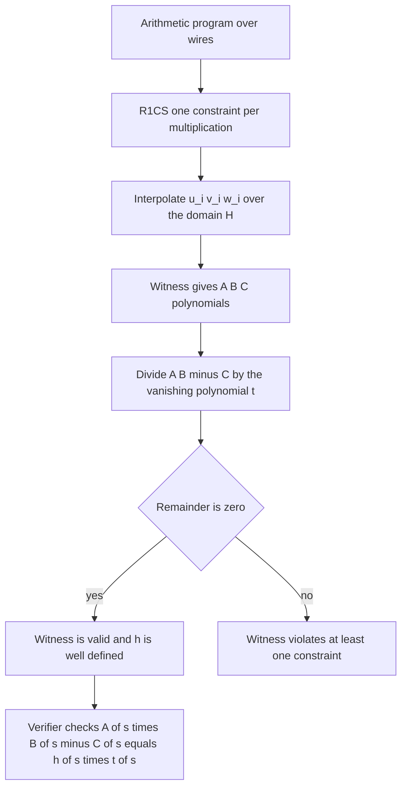
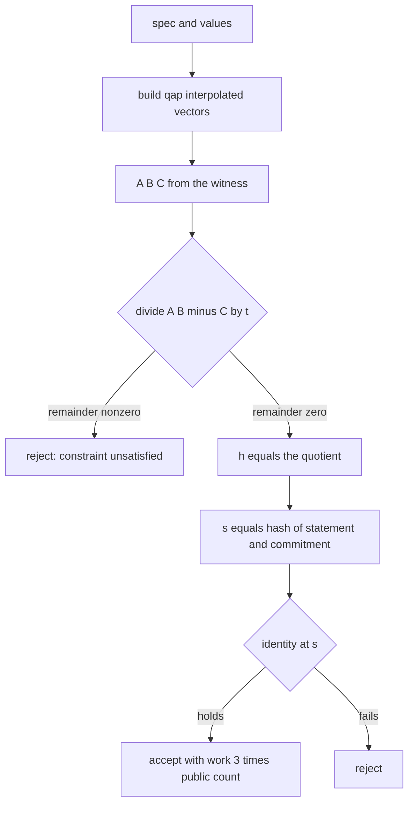
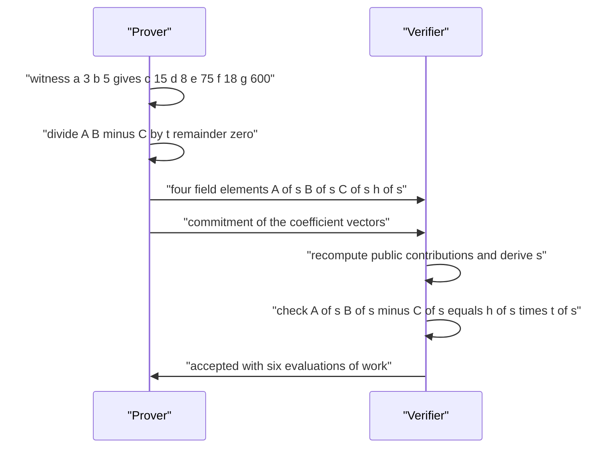

# 834 — Implement zk-SNARK circuit for a simple arithmetic program (toy).

> **Tier:** Master · **CTCI chapter:** Beyond — Security & Privacy
> **Task spec:** [834-implement-zk-snark-circuit-for-a-simple-arithmetic-program-toy.md](../../../tasks/master/834-implement-zk-snark-circuit-for-a-simple-arithmetic-program-toy.md)
> **Solutions:** [Python](../../../solutions/python/master/834-implement-zk-snark-circuit-for-a-simple-arithmetic-program-toy/solution.py) ·
> [Java](../../../solutions/java/master/834-implement-zk-snark-circuit-for-a-simple-arithmetic-program-toy/Solution.java) ·
> [JavaScript](../../../solutions/javascript/master/834-implement-zk-snark-circuit-for-a-simple-arithmetic-program-toy/solution.js) ·
> [C#](../../../solutions/csharp/master/834-implement-zk-snark-circuit-for-a-simple-arithmetic-program-toy/Solution.cs)

## 1. Problem restatement

The spec is one line — *"Implement zk-SNARK circuit for a simple arithmetic program (toy)"* — so
the contract is what the four solutions implement and assert. They implement **the QAP half of a
SNARK exactly** and are explicit about the half they do not implement.

**What is real.** A five-constraint arithmetic program is compiled to R1CS (one constraint per
multiplication), the constraint matrices are interpolated into three polynomial vectors
`u_i, v_i, w_i` over a small domain `H`, and the witness yields polynomials `A, B, C` such that
the witness satisfies the R1CS **if and only if** the vanishing polynomial `t(X) = ∏(X − r)`
divides `A·B − C`. The prover performs that exact polynomial division; the verifier checks the
resulting identity at a Fiat-Shamir point `s`, recomputing the public part itself.

**What is explicitly *not* claimed.** There is **no zero knowledge**: the prover ships
evaluations of `A, B, C, h`, which leak witness information. There is **no polynomial
commitment** — no KZG, no pairings, no trusted setup — so the verifier cannot check that the four
claimed evaluations really come from committed polynomials; the toy commits to coefficient
vectors with SHA-256 (binding for a fixed prover, not hiding) and states the gap. There is no
FFT: the domain is tiny, so Lagrange interpolation is `O(m²)` and division is schoolbook.

**Inputs.** A circuit `spec` (constraints over wires, a public/private split, a wire list), a
full assignment `values`, and a modulus. The working field is `p = 2⁶¹ − 1`; the same program is
also run over `F_101`, where *every* point of the field can be enumerated.

**Outputs.** A proof: whether the division was exact, the remainder, the quotient `h`, and the
four-element message `(A(s), B(s), C(s), h(s))` restricted to the private wires. The verifier
returns `accepted`, a `reason`, the point `s` it derived, and its `work` count.

| Circuit and call | Expected result |
| --- | --- |
| `program()`, public `{a: 3, b: 5}` | 5 constraints, 8 wires, witness `c=15, d=8, e=75, f=18, g=600` |
| `verify(spec, {a: 3, b: 5}, proof)` | accepted, `reason = "identity_holds"`, `s = 668881547450722931`, `work = 6` |
| same proof with public `{a: 4, b: 5}` | rejected — the verifier recomputes the public part, and `s` moves |
| tampered witness (`e += 1`) | division leaves a non-zero remainder, R1CS says *false*, verifier rejects |
| corrupted witness over `F_101` answering `h = 0` | the identity happens to hold at 3 of the 101 points |
| crafted `h` over `F_101` | passes at exactly `2m − 2 = 8` points, the Schwartz-Zippel bound, attained |

## 2. Intuition

The naive way to prove "I know `a, b, c, d, e, f, g` satisfying these five multiplications" is to
send all seven values. That is a transcript, not a proof: it reveals everything and it scales
linearly with the circuit. The R1CS trick is to stop reasoning about *values* and start reasoning
about *polynomials*.

Each constraint row `i` becomes one linear form per side. Interpolating the per-row coefficients
of a wire over `H = {0, 1, …, m−1}` gives three polynomials `u_i, v_i, w_i`; the witness turns
them into `A = Σ a_i u_i`, `B = Σ a_i v_i`, `C = Σ a_i w_i`. Constraint `i` is satisfied exactly
when `A(i)·B(i) − C(i) = 0`, so the witness is valid exactly when **the polynomial `A·B − C`
vanishes on all of `H`** — which, by the polynomial remainder theorem, is exactly when
`t(X) = ∏_{r∈H}(X − r)` divides it. One polynomial identity replaces `m` separate equations.



Once the identity is a *polynomial* identity, checking it at **one** random point is enough:
a non-zero polynomial of degree at most `2m − 2` can vanish at no more than `2m − 2` points, so a
single evaluation catches a cheating prover with probability all but `(2m − 2)/p`. That is the
Schwartz-Zippel bound, and the `F_101` program exists to *count* it instead of quoting it: the
sabotaged witness passes at 3 of 101 points, and a deliberately crafted `h` attains the bound
exactly at 8 points.

Succinctness is the payoff. The proof is a **constant four field elements** no matter how large
the circuit is, and the verifier's work is `3 · #public inputs` evaluations because the public
part is recomputed from the statement rather than trusted. The prover's polynomial set, by
contrast, grows with the number of constraints — the asymmetry that makes SNARKs worth their
setup ceremony.

## 3. Algorithm

1. Store a polynomial as a coefficient list and give it `padd`, `psub`, `pmul`, `pdivmod`,
   `peval`, `degree`, all reduced modulo `p`.
2. `interpolate(points, values)` builds the Lagrange basis for the tabulated pairs; the test
   case `interpolate([0,1,2], [5,8,17])` must return `3X² + 5`, i.e. the coefficients
   `[5, 0, 3]`.
3. `compile_r1cs` / `build_qap`: for every wire, tabulate its coefficient in the left, right and
   output form of each constraint row, then interpolate those columns over `H = {0..m−1}`; the
   vanishing polynomial is `t(X) = ∏(X − r)`.
4. `combine`: `A = Σ_wire a_wire · u_wire` (same for `B`, `C`) — the witness-weighted sum of the
   interpolated vectors.
5. `prove`: compute `A·B − C`, divide it by `t` with remainder. Non-zero remainder ⇒ reject and
   return the remainder. Zero remainder ⇒ `h` is the quotient and the witness is valid.
6. `statement_digest` hashes the public assignments and the constraint count; `sample_point`
   derives `s` from that digest and from `commit(proof)`, so `s` binds both the statement and the
   prover's message (Fiat-Shamir).
7. `verify`: recompute the public contributions in `u, v, w` at `s` itself, add them to the
   prover's private evaluations, evaluate `t(s)`, and accept only if
   `A(s)·B(s) − C(s) = h(s)·t(s)`; report the number of evaluations spent.
8. Counted soundness research: with a corrupted witness, form the defect polynomial with the
   *claimed* `h` and count its roots over the whole of `F_101`.

```text
function interpolate(points, values)
    result ← zero polynomial
    for i in 0 to length(points) - 1 do
        term ← constant polynomial values[i]
        for j in 0 to length(points) - 1 do
            if j ≠ i then
                term ← term * (X - points[j]) / (points[i] - points[j])   # field inverse
            end
        end
        result ← result + term
    end
    return result
end

function build_qap(spec)
    domain ← 0 to number of constraints - 1
    for wire in spec.wires do
        u[wire] ← interpolate(domain, left coefficients of wire per row)
        v[wire] ← interpolate(domain, right coefficients of wire per row)
        w[wire] ← interpolate(domain, output coefficients of wire per row)
    end
    return qap with domain and t = product of (X - r) for r in domain
end

procedure prove(spec, values)
    qap ← build_qap(spec)
    A ← sum over wires of values[wire] * qap.u[wire]
    B ← sum over wires of values[wire] * qap.v[wire]
    C ← sum over wires of values[wire] * qap.w[wire]
    quotient, remainder ← (A * B - C) divmod qap.t
    if remainder ≠ zero polynomial then
        return proof marked not ok with the remainder
    end
    return proof marked ok with h = quotient
end

function sample_point(proof, spec, public_values)
    return hash of statement_digest(spec, public_values) and commit(proof) reduced mod p
end

function verify(spec, public_values, proof)
    s ← sample_point(proof, spec, public_values)
    A_s ← public contributions at s + proof.A at s        # same for B_s, C_s
    if A_s * B_s - C_s = proof.h at s * qap.t at s then
        return accepted with reason identity_holds and work 3 * number of public inputs
    end
    return rejected
end

```



## 4. Worked example

The device is the five-constraint program: public wires `a, b`, private `c, d, e, f, g`.

| Row | Constraint | Public `{a: 3, b: 5}` gives |
| --- | --- | --- |
| 1 | `a · b = c` | `c = 15` |
| 2 | `(a + b) · 1 = d` | `d = 8` |
| 3 | `b · c = e` | `e = 75` |
| 4 | `(a + c) · 1 = f` | `f = 18` |
| 5 | `d · e = g` | `g = 600` |

That assignment is the witness `one=1, a=3, b=5, c=15, d=8, e=75, f=18, g=600`. The QAP step
interpolates the per-row coefficients over `H = {0,1,2,3,4}`, so `t(X) = X(X−1)(X−2)(X−3)(X−4)`,
and `prove` divides `A·B − C` by it. For this witness the remainder is the zero polynomial, so
`h` is exact.

| Step | Object | Value / verdict |
| --- | --- | --- |
| 1 | witness | `c=15 d=8 e=75 f=18 g=600` |
| 2 | `A·B − C mod t` | remainder `[0]` — exact division |
| 3 | prover message | 4 field elements `A(s) B(s) C(s) h(s)` restricted to private wires |
| 4 | Fiat-Shamir point | `s = 668881547450722931` |
| 5 | verifier work | `3 · 2 = 6` evaluations, all of them on public wires |
| 6 | verdict | `accepted`, `reason = "identity_holds"` |

Now break it. Changing `e` to `76` leaves a non-zero remainder; the R1CS `satisfies` check agrees
that the assignment is invalid, and the verifier rejects the proof with the failed identity.
Changing the *statement* instead — verifying the same proof against public `{a: 4, b: 5}` —
fails differently and more interestingly: the digest changes, so `s` moves, and the verifier's
recomputed public contributions no longer match the prover's private ones.

Soundness, counted rather than asserted, is done over `F_101` where all 101 evaluation points fit
in a loop:

| Cheating prover | Degree of the defect | Points where the check passes | Bound |
| --- | --- | --- | --- |
| corrupted witness answering `h = 0` | 8 | 3 of 101 (`X = 0, 1, 3`) | ≤ `2m − 2 = 8` |
| `h` shifted by a constant | 5 | exactly 5 = `m` (the domain points only) | ≤ `2m − 2` |
| crafted `h` built to maximise roots | 8 | exactly 8 | the bound, attained |



## 5. Complexity

Here `m` is the number of constraints and `n_pub` the number of public wires; `p` is the field
size.

| Measure | Bound | Why it holds |
| --- | --- | --- |
| Prover time | O(m²) | Lagrange interpolation and schoolbook division over a degree-`m` domain; no FFT |
| Prover space | O(m · #wires) | the `u, v, w` vectors plus the `A, B, C, h` coefficient lists |
| Proof size | O(1) | 4 field elements, asserted for every circuit size 1..5 |
| Verifier time | O(n_pub · m) | it recomputes public contributions; the reported work is `3 · n_pub` evaluations plus the interpolation of public wires |
| Soundness error | ≤ `(2m − 2)/p` | the defect polynomial has degree ≤ `2m − 2`; measured exactly over `F_101` |
| Naive alternative: send the witness | O(m) proof, O(m) verify | no soundness at all, and the verifier must re-run the circuit |
| Real SNARK with a polynomial commitment | O(m log m) prover, O(1) verifier | requires FFT, KZG/pairings and a trusted setup — **not** in this toy |

The interesting complexity is the asymmetry, not any single term: the prover's polynomial set
grows with the circuit (`< 40 · count` coefficients per truncated program in the assertions)
while the message stays at four elements and verifier work stays at `3` per public input. That
asymmetry is why SNARKs are interesting; the missing commitment layer is why this toy is not a
SNARK.

## 6. Pitfalls and edge cases

- **Non-zero remainder is the rejection path.** `pdivmod` returns *both* quotient and remainder
  precisely so the caller can reject a bad witness; a SNARK that silently discards the remainder
  proves nothing.
- **Modular inverse in interpolation.** The Lagrange denominators `points[i] − points[j]` must be
  inverted in the field. Over `F_101` a wrong inverse still produces *a* polynomial — just not the
  one that reproduces the table — so the assertion that interpolation returns `[5, 0, 3]` for
  `(0,5), (1,8), (2,17)` is the guard.
- **The vanishing polynomial must vanish exactly on the domain.**
  `peval(vanishing([0,2,5]), 5) == 0` *and* `peval(vanishing([0,2,5]), 3) != 0` — testing only
  the zero case would accept the zero polynomial.
- **Fiat-Shamir must bind the statement.** `s` is derived from both the public-values digest and
  the commitment, so a proof for `{a: 3, b: 5}` must not verify for `{a: 4, b: 5}`. Deriving `s`
  from the proof alone is the classic interactive-to-non-interactive mistake that makes proofs
  transferable between statements.
- **Public inputs are recomputed, not trusted.** The verifier adds the public contribution
  itself. If the prover could supply the public part, it could choose it to make the identity
  hold.
- **Zero witness and degenerate circuits.** The all-zero witness proves and verifies (`a = 0,
  b = 0`), while the assignment that breaks row 1 cannot be proven at all; a one-constraint
  circuit `a · a = b` with `a = 3, b = 9` works end to end.
- **No zero knowledge, no commitment.** Do not call this a SNARK that hides the witness: the
  header states the gap, and the SHA-256 commitment is binding for a fixed prover, not hiding.
  Determinism still holds — two proofs of one statement share `private_at_s`, `commit` and `s`.

## 7. Variants and follow-ups

- **Composition.** Recursive SNARK composition — verifying a proof inside a circuit — is the
  follow-up task
  [835-implement-recursive-snark-composition-outline-conceptual.md](../../../tasks/master/835-implement-recursive-snark-composition-outline-conceptual.md).
- **Succinct verification of ML inference** uses the same QAP skeleton with a commitment layer:
  [830-implement-verifiable-computation-for-ml-inference-with-succinct.md](../../../tasks/master/830-implement-verifiable-computation-for-ml-inference-with-succinct.md).
- **Delay instead of proof.** When you want a *lower bound on time* rather than a proof about a
  witness, the tool is a VDF:
  [836-implement-verifiable-delay-function-small-prototype-vdf.md](../../../tasks/master/836-implement-verifiable-delay-function-small-prototype-vdf.md).
- **Trust in hardware rather than arithmetic.** Attestation answers the same question with an
  enclave:
  [841-implement-secure-enclaves-chain-of-trust-verification-demo.md](../../../tasks/master/841-implement-secure-enclaves-chain-of-trust-verification-demo.md).

## 8. Check yourself

1. Why does `t(X) = ∏_{r∈H}(X − r)` dividing `A·B − C` mean the R1CS is satisfied?

<details><summary>Show answer</summary>

Constraint row `i` is satisfied exactly when `A(i)·B(i) − C(i) = 0`, i.e. when `i` is a root of
the polynomial `A·B − C`. The polynomial remainder theorem says a polynomial is divisible by
`(X − r)` exactly when `r` is a root, and by the whole product `t` exactly when *every* `r ∈ H`
is a root. So divisibility by `t` is equivalent to "all `m` constraints hold", with no reference
to the witness as a vector of numbers.

</details>

2. The proof is four field elements. What does the verifier still have to do, and what is its
   reported work here?

<details><summary>Show answer</summary>

It derives `s` from the statement digest and the commitment, interpolates the *public* wires'
`u, v, w` at `s`, adds those to the prover's private evaluations, evaluates `t(s)`, and compares
`A(s)·B(s) − C(s)` with `h(s)·t(s)`. In the five-constraint program with two public wires the
reported work is `3 · 2 = 6` evaluations, and it stays `3 · n_pub` for every truncated program.

</details>

3. A cheating prover answers `h = 0` for a corrupted witness over `F_101`. How often does that
   get caught, and how does the file know?

<details><summary>Show answer</summary>

The defect polynomial has degree 8 = `2m − 2` with `m = 5`, so it vanishes at no more than 8
points. Counting roots over the entire field of 101 points finds 3 (`X = 0, 1, 3`), so the check
rejects with probability 98/101 — and a crafted `h` attains the bound exactly, with 8 roots, so
the bound is tight rather than pessimistic.

</details>

4. What is missing before this could honestly be called a zk-SNARK?

<details><summary>Show answer</summary>

Two layers: **hiding** (the prover sends plain evaluations of `A, B, C, h`, which leak the
witness) and a **polynomial commitment** (KZG or similar, with a trusted setup, so the verifier
can be sure the four evaluations come from the polynomials it thinks they do). The QAP reduction,
the exact division, the public/private split and the Fiat-Shamir evaluation check are the real
ones; the file states the missing layers instead of pretending otherwise.

</details>

5. Why does the same proof fail against public `{a: 4, b: 5}` even though no arithmetic changed?

<details><summary>Show answer</summary>

Because `s` is derived from the statement digest as well as the commitment. Changing the public
inputs moves `s`, and at the new point the verifier's recomputed public contribution plus the
prover's (stale) private contribution no longer satisfy the identity — which is exactly the
binding the Fiat-Shamir transform is supposed to provide.

</details>
