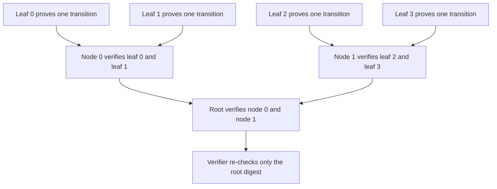
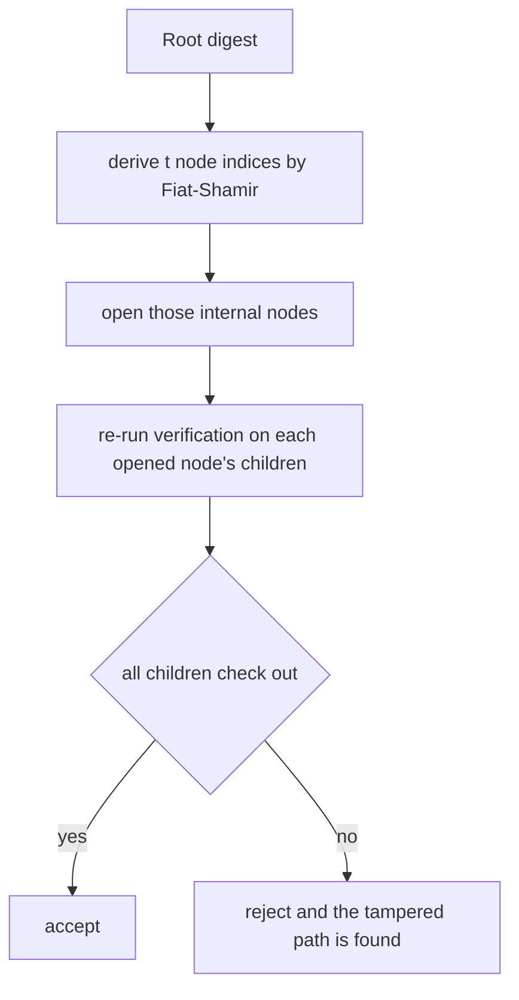
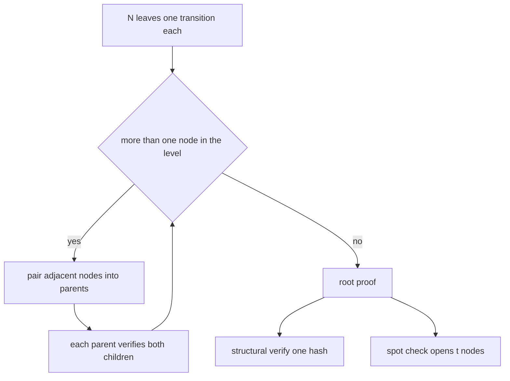
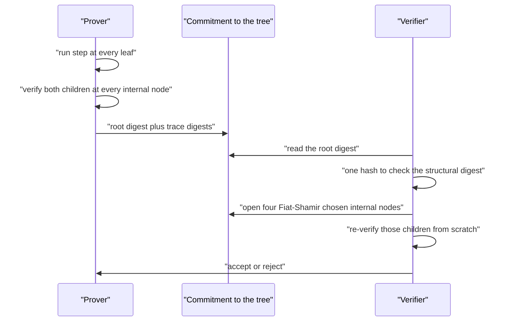

# 835 — Implement recursive SNARK composition outline (conceptual).

> **Tier:** Master · **CTCI chapter:** Beyond — Security & Privacy
> **Task spec:** [835-implement-recursive-snark-composition-outline-conceptual.md](../../../tasks/master/835-implement-recursive-snark-composition-outline-conceptual.md)
> **Solutions:** [Python](../../../solutions/python/master/835-implement-recursive-snark-composition-outline-conceptual/solution.py) ·
> [Java](../../../solutions/java/master/835-implement-recursive-snark-composition-outline-conceptual/Solution.java) ·
> [JavaScript](../../../solutions/javascript/master/835-implement-recursive-snark-composition-outline-conceptual/solution.js) ·
> [C#](../../../solutions/csharp/master/835-implement-recursive-snark-composition-outline-conceptual/Solution.cs)

## 1. Problem restatement

The spec is one line — *"Implement recursive SNARK composition outline (conceptual)"* — and it
is honest about being an outline. This is the one task in this range where the *structural*
property is the deliverable and the cryptographic layer is deliberately absent.

**The modelling contract.** What is implemented: a balanced binary tree of proofs over a
deterministic state transition. Leaves assert one transition `previous -> following` and are
**checkable exactly by anyone**, since the claim carries both states. Internal nodes run the
verifier on both children — that call *is* the recursion — and record the two child digests, a
digest of the verification trace, a combined claim digest and the two recorded verdicts. What is
simplified: **there is no in-circuit verifier in the cryptographic sense.** A Python function
cannot be snapshotted into an arithmetic circuit here, so the "circuit" is modelled by a trace
digest plus spot checks, and the structural verifier is sound only under the honest-prover
assumption. That gap is *demonstrated* rather than hidden: a prover that rewrites the recorded
verdicts passes the structural check, and the spot-check verifier then rejects it at a measured
rate.

**Inputs.** A step count `N`, the deterministic transition `step(state) = ((7·value + counter + 1)
mod p, counter + 1)` with `p = 2⁶¹ − 1`, and starting state `(123456789, 0)`.

**Outputs.** A root proof, all tree levels, and work counters (`verifications`, `hashes`). The
verifier returns a boolean; `spot_check_verify` returns `(ok, opened_positions)`; `soundness_bound`
returns the exact acceptance probability for a given number of tampered paths.

| Measurement | Value |
| --- | --- |
| `N = 16` | depth 4, root proof 192 bytes, 30 in-circuit verifications, 1 hash to verify |
| `N = 2, 4, 8, 16, 32` | prover work `2 · (N − 1)` = `[2, 6, 14, 30, 62]`, depth `[1, 2, 3, 4, 5]` |
| root proof size / verifier hashes | identical for every `N` — the succinctness claim |
| lying prover, tampered paths 1/15, 4 openings | structural check accepts, spot check rejects 0.247 of the time (bound 0.267) |
| IVC over 16 steps | accumulator 128 bytes throughout, 30 verifications inside the folds |

## 2. Intuition

A verifier that costs `O(n)` cannot certify an unbounded computation for a fixed price. Recursion
breaks the trade-off: instead of proving the whole computation, prove the statement *"there exist
two proofs, each of which verifies, whose statements chain together"*. The prover then has to run
the verifier inside the circuit at every internal node, and the outer verifier only re-checks a
constant-size digest. Verification cost becomes constant while proving cost grows linearly — an
asymmetry that compounds: proof of proofs of proofs.



The honest problem is that this construction, modelled without a real arithmetic verifier, is
only structurally sound: the node keeps `verified_children` as *data*, and the cheap verifier
checks the digest rather than re-running the children. A prover can therefore claim `(True, True)`
for children it never verified, and the structural check accepts. The fix is the standard one:
make the prover commit to the whole tree and let the verifier **open a Fiat-Shamir sample of the
internal nodes**, re-verifying the children of each opened node from scratch. The probability of
missing `k` tampered paths with `t` openings out of `n` nodes is `∏ (n − k − i)/(n − i)` — the
exact combinatorial bound the file computes instead of hand-waving.



The third piece is the incrementally verifiable variant: fold steps into a constant-size
accumulator one at a time, so a long chain never needs a tree in memory. Sixteen folds keep the
accumulator at 128 bytes with exactly two in-circuit verifications per fold.

## 3. Algorithm

1. `leaf_proof(previous)` computes `following = step(previous)`, builds the claim string
   `"prev->next"`, and digests both a trace and the claim. `leaf_verify` re-runs `step` on the
   predecessor and compares — an exact relation check, no trust involved.
2. `node_proof(left, right, counter)` increments the work counter by 2, calls `verify` on both
   children (the recursion), and stores `children`, `trace`, `claim` and the two verdicts.
   Its `digest` commits to both child digests and the trace.
3. `build_tree(N)` lays down `N` leaves along the state chain, then repeatedly pairs adjacent
   nodes into parents (carrying an odd node up unchanged) until one node remains.
4. `verify(proof, counter)` is the structural verifier: a leaf is checked exactly; a node is
   checked with one hash after asserting that both recorded child verdicts are `True`.
5. `challenge_positions(root_digest, count, total)` derives distinct node indices by hashing the
   root digest with an incrementing nonce, reduced modulo the number of internal nodes.
6. `spot_check_verify(root, levels, count)` opens those nodes, re-verifies each child by digest
   lookup, and rejects if any recorded verdict is false.
7. `soundness_bound(total, tampered, count)` computes the exact probability that a uniform sample
   of `count` nodes misses all `tampered` paths, with the two degenerate cases pinned: 0 tampered
   ⇒ 1.0, and `tampered + count > total` ⇒ 0.0.
8. `ivc_fold(N)` folds one step at a time into a constant-size accumulator and verifies the final
   one; the accumulator size is measured at every fold.

```text
function step(state)
    value, counter ← state
    return ((7 * value + counter + 1) mod p, counter + 1)
end

procedure leaf_proof(previous)
    following ← step(previous)
    claim ← text(previous) + "->" + text(following)
    return leaf with claim, trace digest and digest
end

function leaf_verify(proof)
    previous, following ← split claim on "->"
    return step(parse(previous)) = parse(following)
end

procedure node_proof(left, right, counter)
    counter.verifications ← counter.verifications + 2
    left_ok ← verify(left)
    right_ok ← verify(right)
    claim ← digest of left.claim and right.claim
    trace ← digest of left.digest right.digest left_ok right_ok
    return node with children left.digest and right.digest, trace, claim and verdicts
end

procedure build_tree(steps)
    level ← one leaf per consecutive state transition
    levels ← [level]
    while length(levels[last]) > 1 do
        parent ← pair adjacent nodes and carry an odd trailing node up
        append parent to levels
    end
    return root, levels and the work counter
end

function verify(proof, counter)
    counter.hashes ← counter.hashes + 1
    if proof is a leaf then return leaf_verify(proof) end
    if not all of proof.verified_children then return false end
    left, right ← proof.children
    return proof.digest = digest of node, left, right and proof.trace
end

function soundness_bound(total, tampered, count)
    if tampered ≤ 0 then return 1.0 end
    if total - tampered < count then return 0.0 end
    return product over i in 0 to count - 1 of (total - tampered - i) / (total - i)
end
```



## 4. Worked example

Take `N = 4`. The states walk forward deterministically from `(123456789, 0)`:

| Step | State | Leaf claim | `verified_children` of its parent |
| --- | --- | --- | --- |
| 0 | `123456789:0` | `123456789:0->864197524:1` | — |
| 1 | `864197524:1` | `864197524:1->6049382670:2` | — |
| 2 | `6049382670:2` | `6049382670:2->42345678693:3` | — |
| 3 | `42345678693:3` | `42345678693:3->296419750855:4` | — |
| node 0 | — | digest of leaf 0 and leaf 1 claims | `(True, True)`, 2 verifications |
| node 1 | — | digest of leaf 2 and leaf 3 claims | `(True, True)`, 2 verifications |
| root | — | digest of node 0 and node 1 claims | `(True, True)`, 2 verifications |

The tree has levels `[4, 2, 1]`, i.e. 3 internal nodes and depth 2 (`ceil(log2 4)`), and the
measured prover work is `2 · (4 − 1) = 6` in-circuit verifications — the same
`2 · (N − 1)` that gives 30 for `N = 16` and 62 for `N = 32`. Verification of the root costs
**one hash** whether the tree covers 2 steps or 32, and the root proof is three digests
(`claim`, `trace`, `digest`, 192 bytes) at every size.

Now the honesty test. Build a 4-step tree whose leaf 1 is false — claim the step from
`864197524:1` to the wrong successor — and rewrite every recorded verdict to `True`. The
structural verifier accepts, because it only recomputes digests. The spot-check verifier derives
its openings from the root digest, re-verifies the children of each opened node and rejects.
Measured over the whole 16-step tree with one tampered path out of 15 internal nodes and 4
openings, rejection happens **0.247 of the time** against the exact bound `1 − ∏(15 − 1 − i)/(15 −
i) = 0.267` for `i = 0..3` — measured, not assumed. Honest trees pass spot checks (the four
openings for a 4-step tree are deterministic), and a tree built over a leaf that genuinely fails
its transition records `(True, False)` and is rejected by the structural verifier too.

| Variant | Prover work | Verifier work | Root/accumulator size |
| --- | --- | --- | --- |
| tree over 2 steps | 2 verifications | 1 hash | 192 bytes |
| tree over 16 steps | 30 verifications | 1 hash | 192 bytes |
| tree over 32 steps | 62 verifications | 1 hash | 192 bytes |
| IVC over 16 folds | 30 verifications | verify the final accumulator | 128 bytes at every fold |



## 5. Complexity

`N` is the number of steps, `n = N − 1` the number of internal nodes, `t` the number of spot-check
openings, and `k` the number of tampered paths.

| Measure | Bound | Why it holds |
| --- | --- | --- |
| Prover time | Θ(N) | exactly `2 · (N − 1)` in-circuit verifications, measured as `[2, 6, 14, 30, 62]` |
| Prover space | Θ(N) | the tree holds one digest chain per level, `2N − 1` nodes |
| Recursion depth | Θ(log N) | `ceil(log2 N)`: depth 4 for 16 steps, 5 for 32 |
| Verifier time, structural | Θ(1) | one hash at the root, identical for every `N` |
| Verifier time, spot check | Θ(t) | `t` opened nodes and their children, `t = 4` in the tests |
| Verifier space | Θ(1) | a digest and a node index list |
| Soundness gap | `1 − ∏_{i<t}(n − k − i)/(n − i)` | uniform sample misses all tampered paths; 0.267 for `n = 15, k = 1, t = 4` |
| Alternative: no recursion | Θ(N) verify | the verifier replays every step, which is what recursion exists to avoid |

The measured separation is the point: prover work grows 31× from `N = 2` to `N = 32` while the
verifier's hash count and the root proof size do not move at all. What the toy does *not* pay is
the real recursion tax — a verifier circuit is far more expensive than the transition it checks —
which is why the file states the in-circuit layer is missing rather than pretending the constants
are realistic.

## 6. Pitfalls and edge cases

- **The structural verifier trusts recorded verdicts.** It is sound only under the honest-prover
  assumption; the spot check is the fallback and must be run. Confusing the two is how "recursive
  SNARK" becomes "hash chain with extra steps".
- **Leaves must carry both states.** A claim that only names the successor cannot be checked
  exactly; `leaf_verify` asserts the predecessor, and the tests reject a skipped step and a
  wrong predecessor.
- **Odd level sizes.** `build_tree` carries an unpaired trailing node up unchanged, so `N = 32`
  gives levels `[32, 16, 8, 4, 2, 1]`; forgetting the carry silently drops a subtree.
- **Distinct openings.** `challenge_positions` rejects duplicates, so `t` is a real number of
  distinct nodes; sampling with replacement would weaken the bound.
- **Degenerate soundness bound.** `soundness_bound(n, 0, t) = 1.0` and
  `soundness_bound(n, n, t) = 0.0` are asserted, so the "tampered ≥ total − t" case cannot
  silently return a nonzero probability.
- **Tampering a leaf changes the root.** No tampered tree collides with the honest root, and the
  rebuilt digests are compared digest by digest.
- **Determinism.** Everything is SHA-256 and integer arithmetic: rebuilding the tree reproduces
  every digest and the same work counters.
- **Do not claim zero knowledge.** Leaves prove plain transitions anyone can check; there is no
  hiding anywhere in this outline.

## 7. Variants and follow-ups

- **The proof system being recursed.** The QAP/division core and its counted soundness live in
  [834-implement-zk-snark-circuit-for-a-simple-arithmetic-program-toy.md](../../../tasks/master/834-implement-zk-snark-circuit-for-a-simple-arithmetic-program-toy.md).
- **IVC in production form.** Folding one step into a constant-size accumulator is the Nova-style
  variant; the same succinctness claim appears in
  [830-implement-verifiable-computation-for-ml-inference-with-succinct.md](../../../tasks/master/830-implement-verifiable-computation-for-ml-inference-with-succinct.md).
- **Where the chain discipline comes from.** A tree of commitments over a state transition is the
  same shape as header stitching in light clients,
  [842-implement-blockchain-light-node-gossip-header-stitching-robustly.md](../../../tasks/master/842-implement-blockchain-light-node-gossip-header-stitching-robustly.md)
  and [831-implement-blockchain-light-client-with-spv-proofs-and-pruning.md](../../../tasks/master/831-implement-blockchain-light-client-with-spv-proofs-and-pruning.md).
- **Time instead of proofs.** When the property to certify is elapsed sequential work rather than
  a witness, the primitive is a VDF:
  [836-implement-verifiable-delay-function-small-prototype-vdf.md](../../../tasks/master/836-implement-verifiable-delay-function-small-prototype-vdf.md).

## 8. Check yourself

1. Why does recursion make the verifier's cost independent of the computation's length?

<details><summary>Show answer</summary>

Because the statement being proven is *about proofs*, not about the computation. Each internal node
asserts "my two children verify and their claims chain", so the root's statement already covers
everything below it. The outer verifier then re-checks one constant-size digest — one hash here,
for `N = 2` through `N = 32` — while the prover pays `2 · (N − 1)` in-circuit verifications.

</details>

2. The structural verifier accepts a lying prover. Why is that not a bug in the test, and what
   catches it?

<details><summary>Show answer</summary>

Because the verification step was *modelled* rather than implemented: a searchable dict of
recorded verdicts is not an arithmetic circuit, so the honest-prover assumption is real. The file
demonstrates the gap instead of hiding it — `spot_check_verify` opens `t` Fiat-Shamir-chosen
internal nodes and re-verifies their children, rejecting the tampered tree at a measured 0.247
against the exact bound 0.267 for one tampered path among 15 nodes with 4 openings.

</details>

3. How is the probability `1 − ∏(n − k − i)/(n − i)` justified?

<details><summary>Show answer</summary>

A uniform sample of `t` distinct nodes out of `n` misses all `k` tampered paths with probability
`∏_{i<t}(n − k − i)/(n − i)`; the rejection probability is its complement. The file asserts both
degenerate ends (0 tampered ⇒ 1.0, all tampered ⇒ 0.0) and checks the measured frequency lies
within three standard deviations of the prediction.

</details>

4. What does the IVC variant buy over the tree?

<details><summary>Show answer</summary>

Memory and streaming behaviour: instead of materialising `2N − 1` nodes, `ivc_fold` folds one step
at a time into a 128-byte accumulator with exactly two in-circuit verifications per fold. For 16
folds that is 30 verifications in total — the same work as the tree — but the accumulator is
constant size at every fold, and a short chain produces the same accumulator size as a long one.

</details>

5. Which parts of this outline would a real recursive SNARK have to add?

<details><summary>Show answer</summary>

A verifier circuit: the leaf transition and the pairing check would have to be expressed as R1CS
over a curve that supports verifying the inner proof, typically with a pairing-friendly curve
cycle and polynomial commitments. Only then does the root's digest become a proof rather than a
commitment, and only then is the prover's claim sound without an honest-prover assumption.

</details>
