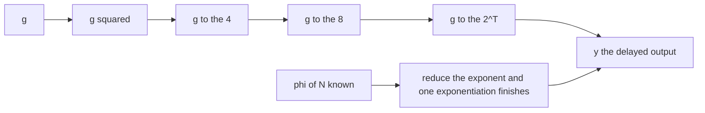
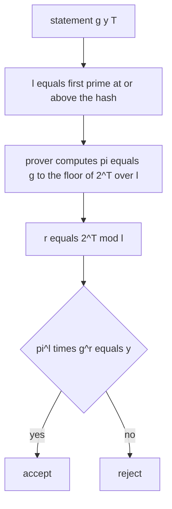
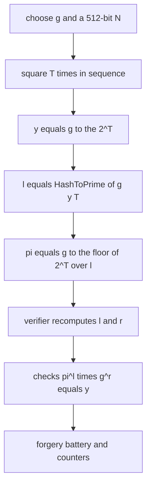
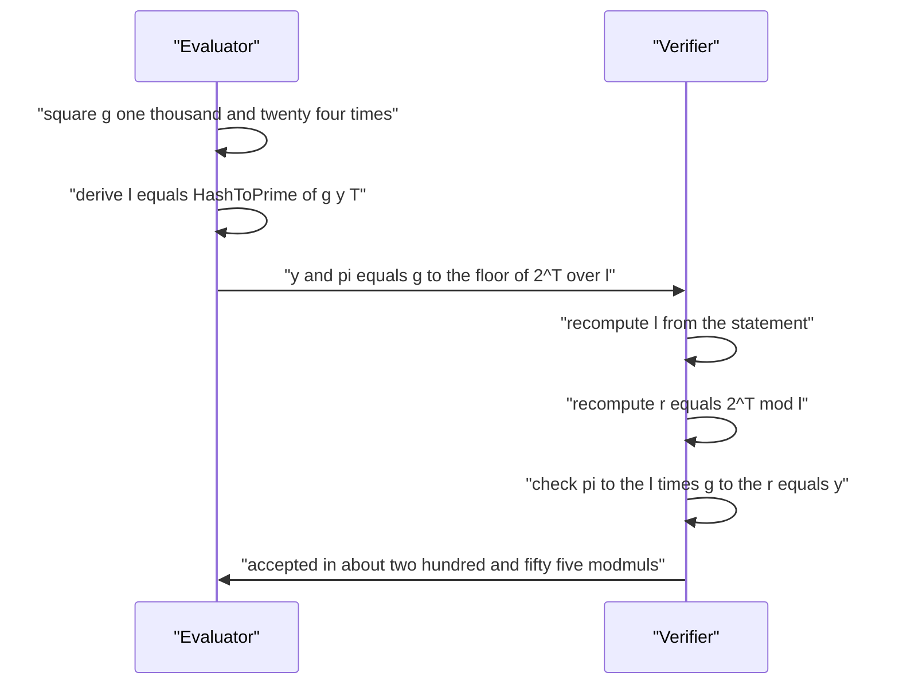

# 836 — Implement verifiable delay function small prototype (VDF).

> **Tier:** Master · **CTCI chapter:** Beyond — Security & Privacy
> **Task spec:** [836-implement-verifiable-delay-function-small-prototype-vdf.md](../../../tasks/master/836-implement-verifiable-delay-function-small-prototype-vdf.md)
> **Solutions:** [Python](../../../solutions/python/master/836-implement-verifiable-delay-function-small-prototype-vdf/solution.py) ·
> [Java](../../../solutions/java/master/836-implement-verifiable-delay-function-small-prototype-vdf/Solution.java) ·
> [JavaScript](../../../solutions/javascript/master/836-implement-verifiable-delay-function-small-prototype-vdf/solution.js) ·
> [C#](../../../solutions/csharp/master/836-implement-verifiable-delay-function-small-prototype-vdf/Solution.cs)

## 1. Problem restatement

The spec is one line — *"Implement verifiable delay function small prototype (VDF)"*. A VDF is a
function that takes a **prescribed sequential number of steps** to evaluate even with unbounded
parallelism, but whose output can be verified quickly. The prototype is the classic
repeated-squaring construction in a group of unknown order: `y = g^(2^T) mod N` with `N = p·q`,
and the output is checked by Wesolowski's one-element proof `pi = g^floor(2^T / l)` where
`l = HashToPrime(g, y, T)` is the challenge, by recomputing `l` and `r = 2^T mod l` and testing
`pi^l · g^r == y`.

**The modelling contract.** What is *real*: the modular arithmetic, the sequential loop, the
Fiat-Shamir challenge derivation, the proof algebra and every counter. What is *simplified*: the
factorization of `N` is generated inside the file, so it is **not** a delay function against a
real adversary — anyone holding `phi(N)` shortcuts it, and the `trapdoor_shortcut` check
demonstrates exactly that. `T` is small (256–4096 squarings), `N` is 512 bits, there are no
threads and no clock: "sequential" is a counted loop and "T steps" is a parameter. Wesolowski's
soundness (the adaptive root assumption in a group of unknown order) is *not* claimed; what is
verified is **the protocol algebra** — completeness, forgery rejection, and the work and size
bounds.

**Inputs.** A 512-bit modulus from deterministically seeded Miller-Rabin primes, a base
`g = 2 + 0x123456789 mod 1000 = 347`, and `T`.

**Outputs.** The statement `(y, pi, steps, l, r, q, g, N)` and counters. `delayed_output` reports
a squaring count, `wesolowski_prove` and `wesolowski_verify` report modular-multiplication
counts, and `trapdoor_shortcut` reports the cost of the shortcut.

| Measurement | Value |
| --- | --- |
| modulus | `N` is 511 bits (512-bit product of two 256-bit primes) |
| `T = 1024` | 1921 prover modmuls (1024 squarings + a 897-bit exponentiation), 255 verifier modmuls |
| `T = 2¹⁰, 2¹², 2¹⁴` | `(T, prover, verifier, size)` = `(1024, 1921, 255, 193)`, `(4096, 8065, 255, 192)`, `(16384, 32641, 255, 190)` |
| challenge `l` | always prime, at least 128 bits |
| trapdoor | the same output for `T = 2¹⁴` in 509 modmuls when `phi(N)` is known |
| forgeries | perturbed proof, perturbed output, wrong `T`, wrong `l`, wrong base, wrong modulus, proof `1` — all rejected |

## 2. Intuition

Someone wants to prove that a certain amount of *time* has passed — a randomness beacon that
cannot be pre-computed, a leader-election delay that cannot be rushed. A hash chain gives that
property but no way to verify the result without redoing the work. What is needed is a function
whose evaluation is inherently sequential yet whose output is checkable in a few hundred
operations.

Repeated squaring in a group of unknown order is the standard answer. Because nobody knows
`phi(N)`, the exponent `2^T` cannot be reduced modulo the group order, so `y = g^(2^T)` cannot be
computed by fast exponentiation: there is no shortcut, and the intermediate values depend on each
other. It is also automatically parallel-resistant — `x²` composed with itself `T` times has depth
`T`.



Verification needs its own trick, because the verifier must not repeat `T` squarings. The
challenge `l = HashToPrime(g, y, T)` is derived from the statement itself, so the prover cannot
choose it; the prover then sends `pi = g^floor(2^T / l)` and the verifier recomputes both `l` and
`r = 2^T mod l` and checks `pi^l · g^r = g^(l·q + r) = g^(2^T) = y`. One group element and about
`2 · 128` modmuls, whatever `T` is.



## 3. Algorithm

1. `deterministic_prime(bits, seed)` searches from a splitmix64 stream and returns the first
   Miller-Rabin prime of exactly `bits` bits; `rsa_modulus(512)` multiplies two of them into `N`
   and keeps `phi = (p − 1)(q − 1)` for the trapdoor demonstration only.
2. `delayed_output(g, N, steps)` squares `T` times in sequence, counting each multiplication.
   `oracle_output(g, N, steps)` computes `pow(g, 1 << steps, N)` independently, so the loop can be
   cross-checked against fast exponentiation.
3. `hash_to_prime(g, y, steps, modulus)` hashes the whole public statement, sets the top bit and
   the low bit of the first 128 digest bits, and walks upward by twos to the first prime.
4. `wesolowski_prove(g, N, steps)`: evaluate `y`, derive `l`, split `2^T = q·l + r`, and set
   `pi = g^q mod N`. The prover needs only `y` and `g`, not the whole squaring chain.
5. `wesolowski_verify(statement)`: recompute `l`, reject if the statement's `l` disagrees,
   recompute `r = 2^T mod l`, and test `pow(pi, l, N) · pow(g, r, N) mod N == y`.
6. `trapdoor_shortcut(g, phi, N, steps)`: reduce the exponent modulo `phi` and do a single
   exponentiation — the same `y` for a fraction of the work, which is exactly why the order must
   stay unknown in a real deployment.
7. Measure: prover modmuls versus verifier modmuls for `T = 2¹⁰, 2¹², 2¹⁴`, the proof size in
   digits, and the growth of the prover/verifier ratio; then run the forgery battery.

```text
function delayed_output(g, N, steps)
    value ← g mod N
    for i ← 1 to steps do
        value ← value * value mod N      # one squaring, counted
    end
    return value
end

function hash_to_prime(g, y, steps, modulus, bits)
    digest ← SHA-256 of modulus g y steps
    candidate ← first bits of digest with the top bit and low bit set
    while candidate is not prime do
        candidate ← candidate + 2
    end
    return candidate
end

procedure wesolowski_prove(g, N, steps)
    y ← delayed_output(g, N, steps)
    l ← hash_to_prime(g, y, steps, N)
    quotient, remainder ← divmod(2 to the steps, l)
    pi ← g to the quotient mod N
    return statement with y pi steps l remainder quotient g N
end

function wesolowski_verify(statement)
    l ← hash_to_prime(statement.g, statement.y, statement.steps, statement.N)
    if l ≠ statement.l then return false end
    r ← (2 to the statement.steps) mod l
    return pi to the l times g to the r mod N = y mod N
end

function trapdoor_shortcut(g, order, N, steps)
    exponent ← (2 to the steps) mod order
    return g to the exponent mod N
end
```



## 4. Worked example

The squaring chain is the whole delay. With `g = 347` and the 511-bit `N` from the seeded setup,
four squarings give a chain that nothing but sequencing can produce:

| Step | Value | Note |
| --- | --- | --- |
| 0 | `347` | `g` |
| 1 | `120409` | `g²` |
| 2 | `14498327281` | `g⁴` |
| 3 | `210201493946988852961` | `g⁸` |
| 4 | `44184668057545991390307229178390478467521` | `g¹⁶` = `y` |

`oracle_output(g, N, 4) = pow(347, 16, N)` reproduces that value exactly, so the loop is verified
against an independent path. Squaring the result five more times equals evaluating with `T + 5`,
which is the order-free extension property a VDF must have: an honest prover can continue without
restarting.

The interesting numbers come from larger `T`, where the delay actually bites:

| `T` | Prover modmuls | Verifier modmuls | Proof size (digits) | Ratio |
| --- | --- | --- | --- | --- |
| `2¹⁰ = 1024` | 1921 | 255 | 193 | 7.5 |
| `2¹² = 4096` | 8065 | 255 | 192 | 31.6 |
| `2¹⁴ = 16384` | 32641 | 255 | 190 | 128 |

The prover's count is `T` squarings plus one exponentiation whose exponent is about `T − 128`
bits; the verifier's 255 modmuls are `max(1, l.bit_length()) + max(1, r.bit_length()) = 128 + 127`
and never move with `T`. The proof stays one group element plus the small `T` field — 190 to 193
digits across a 16-fold change in `T`, which the file asserts is a non-growing size, and the
prover/verifier ratio more than doubles from the smallest to the largest `T`.

Then the trapdoor check, which is the honest part of this prototype: `T = 2¹⁴` costs 16384
sequential squarings for an honest evaluator and **509 modmuls** for anyone who knows `phi(N)`.
Same output, two percent of the work. That is not a flaw in the implementation; it is the reason
a production VDF needs a class group of unknown order or a trusted-setup RSA modulus.



## 5. Complexity

`T` is the delay parameter; `l` is the 128-bit challenge prime.

| Measure | Bound | Why it holds |
| --- | --- | --- |
| Evaluation time | Θ(T) | exactly `T` sequential squarings, counted: 1024 for `T = 2¹⁰`, 16384 for `T = 2¹⁴` |
| Evaluation parallelism | no speed-up | squaring composes with depth `T`; the chain has no independent work |
| Prover time | Θ(T) | `T` squarings plus one exponentiation with a `≈T`-bit exponent (1921 modmuls at `T = 1024`) |
| Verifier time | Θ(bit length of `l`) = Θ(128) | two exponentiations with exponents `l` and `r < l`; 255 modmuls at every `T` |
| Proof size | Θ(128 bits + log T) | one group element plus the `T` field, 190–193 digits in the measurements |
| Space | Θ(1) | the squaring loop keeps one value; the prover need not retain the chain |
| With `phi(N)` known | Θ(log T) | 509 modmuls at `T = 2¹⁴` — the trapdoor collapses the delay |
| Alternative: hash chain | Θ(T) verify | no succinct proof at all, so the verifier redoes the work |

The separation is the product: evaluation stays linear in `T` while verification stays constant,
so the ratio grows — 7.5× at `T = 2¹⁰`, 128× at `T = 2¹⁴`, and the file asserts the growth rather
than the constants.

## 6. Pitfalls and edge cases

- **Known order destroyed the property.** Because the file generates `p` and `q` itself, `phi(N)`
  exists in-process; the `trapdoor_shortcut` check proves the delay is real only when the order
  is unknown. Never describe this prototype as adversarially sound.
- **`l` must be a prime, not an odd number.** Making it composite reintroduces a small order that
  lets a cheater forge proofs; the file asserts primality and `>= 128` bits for every derived
  challenge.
- **The challenge must bind the whole statement.** Changing `g`, `y`, `T` or `N` must change `l` —
  asserted as five distinct challenges for five statements. A challenge that ignores `T` lets one
  output be replayed as a proof for another delay.
- **Degenerate `T`.** `T = 0` gives `y = g` and `T = 1` gives `y = g²`; both verify, and the
  squaring chain property (`squaring y, k times = evaluating at T + k`) is checked separately.
- **Small `T` makes the proof trivial.** With `T = 4` the quotient `2^4 / l` is zero, so
  `pi = 1` and the verifier accepts on `g^r = y` alone; the prototype works but the *delay* is
  meaningless, which is why the measurements start at `T = 1024`.
- **Output must not be guessable.** `y` differs from `g`, `g^2`, `g^T`, `g^(2T)`, `g^(T²)` and
  `g^(T!)` — checking that last term catches an implementation that leaks the exponent shape.
- **Forgery battery.** A perturbed proof, a perturbed output, a wrong `T`, a wrong challenge, a
  wrong base, a wrong modulus and the identity element as proof must all be rejected *and* the
  honest proof must still verify afterwards — the order of those two assertions matters.
- **Determinism.** The modulus comes from a seeded stream and the challenge from SHA-256, so two
  runs produce the same `y`, the same `pi` and the same `l`; no randomness library is used.

## 7. Variants and follow-ups

- **Proofs of the same flavour, different target.** The QAP/division machinery in
  [834-implement-zk-snark-circuit-for-a-simple-arithmetic-program-toy.md](../../../tasks/master/834-implement-zk-snark-circuit-for-a-simple-arithmetic-program-toy.md)
  verifies a witness rather than elapsed work, and
  [835-implement-recursive-snark-composition-outline-conceptual.md](../../../tasks/master/835-implement-recursive-snark-composition-outline-conceptual.md)
  composes proofs.
- **Where a VDF gets used.** Unbiasable randomness for distributed sampling is the natural
  consumer: [848-implement-distributed-sampling-with-global-randomness-coordinati.md](../../../tasks/master/848-implement-distributed-sampling-with-global-randomness-coordinati.md).
- **Deterministic delay in a ledger.** Consensus protocols use sequential work for leader
  election and fairness; see
  [833-implement-consensus-over-heterogeneous-trust-federated-consensus.md](../../../tasks/master/833-implement-consensus-over-heterogeneous-trust-federated-consensus.md)
  and [811-implement-byzantine-fault-tolerant-replicated-state-machine-prac.md](../../../tasks/master/811-implement-byzantine-fault-tolerant-replicated-state-machine-prac.md).
- **Succinctness in the verifier's direction.** The constant-size proof here is the same
  engineering goal as the light-client proofs of
  [831-implement-blockchain-light-client-with-spv-proofs-and-pruning.md](../../../tasks/master/831-implement-blockchain-light-client-with-spv-proofs-and-pruning.md).

## 8. Check yourself

1. Why can nobody compute `g^(2^T)` quickly from `g` and `T`?

<details><summary>Show answer</summary>

Because exponentiation in a group is normally sped up by reducing the exponent modulo the group
order, and the order here is `phi(N)`, which is unknown without factoring `N`. Without a way to
reduce `2^T`, no square-and-multiply schedule beats the naive chain of squarings, and the chain is
inherently sequential. The file proves that claim concretely: with `phi(N)` in hand, the same
output for `T = 2¹⁴` takes 509 modmuls instead of 16384 squarings.

</details>

2. How does the verifier avoid doing `T` squarings?

<details><summary>Show answer</summary>

It uses the challenge prime `l = HashToPrime(g, y, T)` — derived from the statement, so the prover
cannot pick it — and the identity `2^T = q·l + r` with `r = 2^T mod l`. Given `pi = g^q`, the check
`pi^l · g^r = g^(l·q + r) = g^(2^T) = y` holds exactly for an honest prover. Both exponentiations
have exponents below `l`, which is 128 bits, so verification costs 255 modmuls at every `T`.

</details>

3. What exactly does the prototype *not* claim?

<details><summary>Show answer</summary>

Adversarial soundness. The RSA modulus is generated inside the file and its factorization is
known, so the "unknown order" premise fails by construction; the 512-bit modulus is also far
below deployment size and there is no padding scheme with a security proof. What the checks do
establish is the algebra: the loop matches an independent oracle, the proof verifies, the forgery
battery is rejected, `l` is prime and statement-bound, and the work/size separation holds.

</details>

4. Is the proof size constant in `T`?

<details><summary>Show answer</summary>

Effectively yes: it is one group element of `N` plus the small `T` value, measuring 193, 192 and
190 digits at `T = 2¹⁰, 2¹², 2¹⁴`. The assertion allows the size to differ by less than 40 digits
rather than requiring exact equality, because the leading digits of a modular value vary — but the
size does not grow with `T`, which is the property that matters.

</details>

5. Why does the verifier recompute `l` instead of trusting the one in the statement?

<details><summary>Show answer</summary>

Because a trusted challenge is a forged challenge: if the prover could choose `l`, it could pick a
value that makes `pi^l · g^r = y` solvable without doing the work, and the proof would lose the
weak-Fiat-Shamir binding. `wesolowski_verify` therefore recomputes `l` and rejects a statement
whose `l` disagrees, which is what the "wrong challenge" forgery exercises.

</details>
