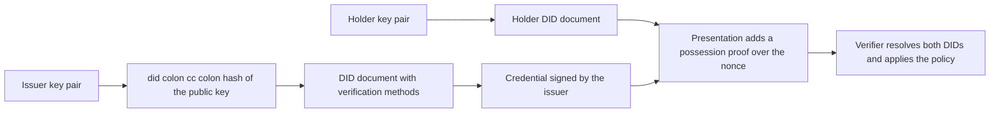
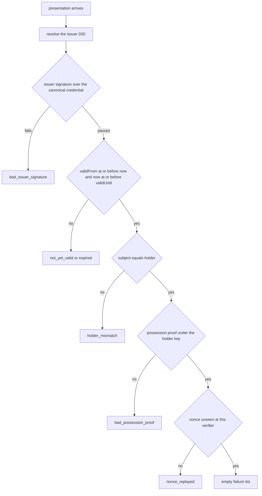
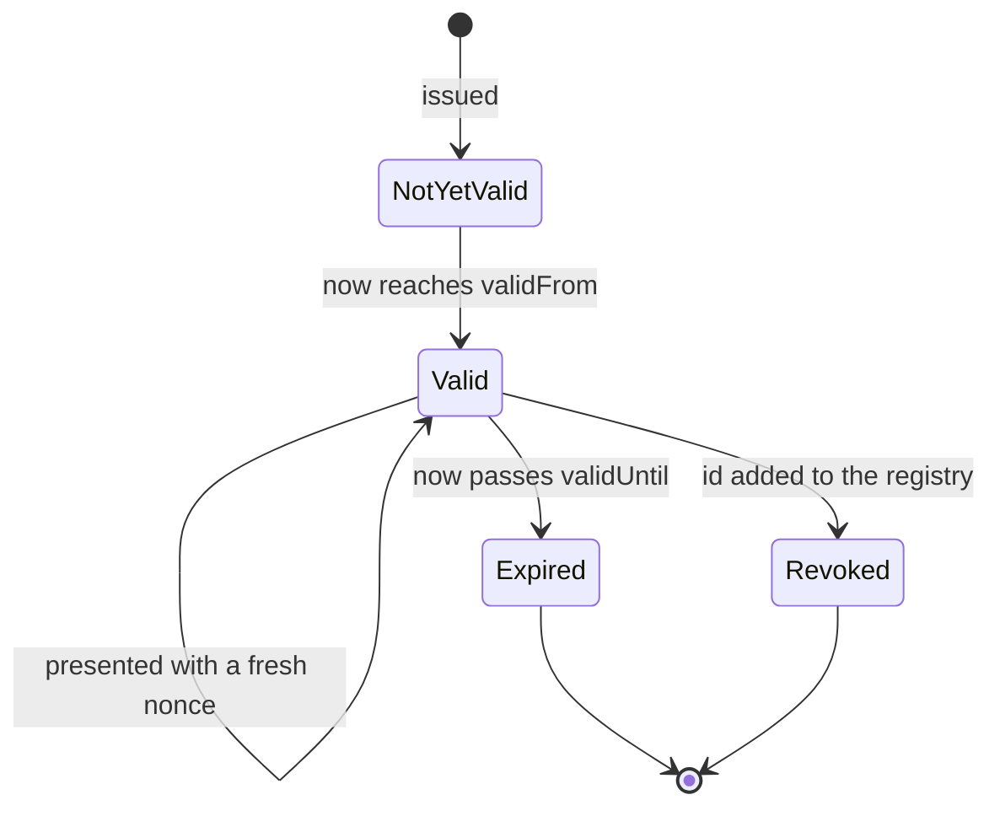

# 837 — Implement decentralized identity (DID) system with verifiable credentials simulation.

> **Tier:** Master · **CTCI chapter:** Beyond — Security & Privacy
> **Task spec:** [837-implement-decentralized-identity-did-system-with-verifiable-cred.md](../../../tasks/master/837-implement-decentralized-identity-did-system-with-verifiable-cred.md)
> **Solutions:** [Python](../../../solutions/python/master/837-implement-decentralized-identity-did-system-with-verifiable-cred/solution.py) ·
> [Java](../../../solutions/java/master/837-implement-decentralized-identity-did-system-with-verifiable-cred/Solution.java) ·
> [JavaScript](../../../solutions/javascript/master/837-implement-decentralized-identity-did-system-with-verifiable-cred/solution.js) ·
> [C#](../../../solutions/csharp/master/837-implement-decentralized-identity-did-system-with-verifiable-cred/Solution.cs)

## 1. Problem restatement

The spec is one line — *"Implement decentralized identity (DID) system with verifiable credentials
simulation"*. The flow it models: an **issuer** signs a credential for a **holder**, the holder
later presents it to a **verifier** who trusts neither of them but can resolve both DIDs.

**What is real.** RSA signing and verification over a deterministically generated modulus, a
full-domain-hash style message representative, domain separation, DIDs derived from public keys,
canonical (sorted-key) serialization so *every* credential field is covered by the signature,
proof-of-possession over a verifier nonce, an expiry window checked against a caller-supplied
logical clock, a revocation registry, and a nonce cache that stops replay.

**What is simplified — and not claimed.** The modulus is 512 bits, so it is *breakable*; there is
no OAEP/PSS padding and the FDH construction used has no security proof. There are no DIDComm
transports, no JSON-LD canonicalization beyond a sorted-key dump, no zero-knowledge presentations,
no status lists and no anchoring — the ledger is an in-process dictionary. Time is an explicit
integer, so every boundary is deterministic. No security property beyond "the algebra holds for
honest and dishonest inputs" is claimed.

**Inputs.** Three deterministic key pairs (seeds 11, 22, 33), a ledger of DID documents, an
eight-field credential, a logical time `now`, a verifier identifier, a nonce, an optional
revocation registry and an optional nonce cache.

**Outputs.** `resolve` returns a document or `{"error": "not_found" | "malformed_did"}`;
`verify_credential` and `verify_presentation` return a **list of failure reasons**, empty when the
policy passes.

| Call | Result |
| --- | --- |
| `issue_credential(... "vc-1", 10, 100)` with claims `{role: auditor, level: 3}` | verifies with `now = 50` |
| eight single-field mutations (`id`, `issuer`, `subject`, `version`, `type`, `validFrom`, `validUntil`, `claims`) | each caught by `bad_issuer_signature` |
| `now = 9 / 10 / 100 / 101` | `not_yet_valid` / valid / valid (inclusive) / `expired` |
| presentation with the wrong holder, a corrupted possession proof, a replayed nonce | `holder_mismatch`, `bad_possession_proof`, `nonce_replayed` |
| revoked credential vs its neighbour | `["revoked"]` vs `[]` |
| verification cost | 2 modular exponentiations, no private key |

## 2. Intuition

The naive identity flow is "the issuer emails a signed PDF". It fails in three places at once: the
verifier must already know the issuer's key, the holder is invisible in the credential (so anyone
holding a copy can present it), and nothing stops the same presentation from being replayed to the
same verifier twice.

DIDs fix the first: the identifier **is** a hash of the public key, so `did_for_key` is a
deterministic function and resolving it returns a document naming the verification methods. Here
`did:cc:45af786ff2…` is 32 hex characters after the method prefix, and `did:cc:short` or an
unknown hash are distinguished — `malformed_did` before the lookup, `not_found` after it.



The second and third problems need a presentation layer. The credential signature is over the
**canonical serialization** of all eight fields, so any mutation — including a swapped `issuer` or
a changed `subject` — breaks it. The holder then signs `nonce|credential-id|verifier` with the key
its own DID document names, binding the credential to *this* holder, *this* verifier and *this*
one-time nonce. Domain separators (`vc-v1` for credentials, `pop-v1` for possession) make the two
signature types non-interchangeable: a credential signature can never be replayed as a possession
proof.

## 3. Algorithm

1. `generate_key(bits, seed)`: seeded splitmix64 → Miller-Rabin primes → `(n, e, d)` plus the
   public `(n, e)`; deterministic, so the same seed reproduces the same key.
2. `full_domain_representative(message, modulus)` expands a SHA-256 digest to the modulus size by
   repeated hashing (64 bytes for the 511-bit modulus) and reduces it modulo `n`;
   `sign`/`verify_signature` apply the private/public exponent to `domain + message` and compare
   representatives.
3. `did_for_key(public)` = `did:cc:` + the first 32 hex characters of `SHA-256(n:e)`;
   `make_document` publishes the active verification method and any retained older ones;
   `resolve` validates the shape of the identifier before looking it up.
4. `canonical(credential)` = sorted-key compact JSON, so signature coverage is exactly the field
   set; `issue_credential` builds the eight fields and signs that byte string.
5. `verify_credential(ledger, bundle, now, revocation)`: resolve the issuer (an unresolvable issuer
   short-circuits to `issuer_<error>`), check whether any *active* method verifies the signature,
   then check `validFrom > now` (`not_yet_valid`), `now > validUntil` (`expired`) and the registry
   (`revoked`). The window is **inclusive** at both ends.
6. `present(...)`: the holder signs `nonce|credential-id|verifier` under `pop-v1` and returns the
   five-field presentation — credential, proof, holder, nonce, possession — with no key material.
7. `verify_presentation(...)` runs the credential checks and then adds holder binding
   (`holder_mismatch`), holder resolution (`holder_<error>`), the possession proof
   (`bad_possession_proof`) and nonce freshness (`nonce_replayed`). One reason per failure, in a
   list, so a caller can report all of them.
8. Key rotation: publish a new document retaining the old method with `revoked: false`, so old
   credentials still verify; mark the old method `revoked`, which produces `issuer_key_revoked`
   for the credential signed with it and leaves the new one valid.

```text
function full_domain_representative(message, modulus)
    size ← ceil(bit length of modulus / 8)
    out ← empty bytes
    block ← SHA-256 of message
    while length(out) < size do
        block ← SHA-256 of block concatenated with message
        out ← out concatenated with block
    end
    return first size bytes of out as an integer modulo modulus
end

procedure sign(key, domain, message)
    representative ← full_domain_representative(domain + message, key.n)
    return representative to the key.d mod key.n
end

function verify_signature(public, domain, message, signature)
    if signature < 0 or signature ≥ public.n then return false end
    representative ← full_domain_representative(domain + message, public.n)
    return signature to the public.e mod public.n = representative
end

function did_for_key(public)
    return "did:cc:" + first 32 hex characters of SHA-256 of public.n and public.e
end

function resolve(ledger, did)
    if did is not a string of the right shape then return error malformed_did end
    if did is in ledger then return the document end
    return error not_found
end

procedure verify_credential(ledger, bundle, now, revocation)
    failures ← empty list
    document ← resolve(ledger, bundle.credential.issuer)
    if document is an error then return ["issuer_" + error] end
    methods ← active methods of document
    if methods is empty then add "issuer_key_revoked" to failures
    else if no method verifies the signature over canonical(credential) then
        add "bad_issuer_signature" to failures
    end
    if credential.validFrom > now then add "not_yet_valid" to failures end
    if now > credential.validUntil then add "expired" to failures end
    if credential.id is in revocation[issuer] then add "revoked" to failures end
    return failures
end

procedure present(ledger, holder_key, holder_did, bundle, nonce, verifier)
    challenge ← nonce + "|" + credential.id + "|" + verifier
    return credential, proof, holder, nonce and possession signature over the challenge
end
function verify_presentation(ledger, presentation, now, verifier, nonce_cache, revocation)
    failures ← verify_credential(ledger, presentation, now, revocation)
    if credential.subject ≠ presentation.holder then add "holder_mismatch" end
    document ← resolve(ledger, presentation.holder)
    if document is an error then add "holder_" + error
    else if no active method verifies the possession proof over the challenge then
        add "bad_possession_proof"
    end
    if (verifier, nonce) is in nonce_cache then add "nonce_replayed" end
    return failures
end
```



## 4. Worked example

The demo issues credential `vc-1` from the issuer DID to the holder DID with claims
`{role: auditor, level: 3}` and window `validFrom = 10`, `validUntil = 100`.

| Step | Actor | Action | Result |
| --- | --- | --- | --- |
| 1 | issuer | `issue_credential(..., "vc-1", 10, 100)` | eight fields canonicalized, one RSA signature |
| 2 | verifier | `verify_credential(ledger, bundle, now=50)` | `[]` — inside the window |
| 3 | holder | `present(..., nonce="n-1", verifier="verifier-A")` | possession proof over `n-1|vc-1|verifier-A` |
| 4 | verifier | `verify_presentation(..., 50, "verifier-A", used={})` | `[]` — full policy passes |
| 5 | verifier | same presentation again, nonce now cached | `["nonce_replayed"]` |
| 6 | verifier | same nonce presented to `verifier-B` | `[]` — a different challenge entirely |
| 7 | verifier | presentation to `verifier-C` | fails: the proof does not transfer |

Step 6 is the interesting one. The challenge string includes the verifier's identity, so the same
nonce at `verifier-B` is a *different* challenge with a different signature — a proof collected by
one verifier is useless to another. Step 1 is likewise broader than it looks: mutating any one of
the eight fields — `id`, `issuer`, `subject`, `version`, `type`, `validFrom`, `validUntil`,
`claims` — flips the canonical bytes and the issuer signature check reports
`bad_issuer_signature`.

The window boundaries are pinned exactly, because the clock is a parameter and not a real clock:

| `now` | Failure list | Why |
| --- | --- | --- |
| 9 | `["not_yet_valid"]` | one tick before `validFrom` |
| 10 | `[]` | inclusive at `validFrom` |
| 50 | `[]` | inside the window |
| 100 | `[]` | inclusive at `validUntil` |
| 101 | `["expired"]` | one tick after `validUntil` |

Revocation and rotation are registry operations, not signature operations. Adding `vc-1` to the
issuer's revoked set makes that credential fail with `["revoked"]` while its neighbour still
verifies; rotating the issuer key by retaining the old method keeps the old credential valid, and
marking the old method `revoked` turns exactly that credential into `["bad_issuer_signature"]`
while the credential signed with the new key stays clean. A credential whose issuer is not in the
ledger returns `["issuer_not_found"]` without ever touching the signature check.



## 5. Complexity

`k` is the modulus size in bits, `t` the number of verification methods on a document, and `f` the
number of credential fields.

| Measure | Bound | Why it holds |
| --- | --- | --- |
| Signature time | O(k³) bit operations | one modular exponentiation with a `k`-bit exponent; `k = 511` here |
| Representative building | O(1) hashes for fixed `k` | two SHA-256 compressions expand a digest to the 64-byte modulus size |
| Canonicalization | O(f log f + |claims|) | sorted-key JSON; `f = 8` fields |
| `resolve` | O(t) copy | a dictionary lookup plus a document copy |
| `verify_credential` | O(t) exponentiations | one signature check per active method |
| `verify_presentation` | 2 exponentiations | issuer signature + possession proof, measured by the `modexps` counter; no private key is ever used |
| Space | O(f) | the credential; no chain, no proofs, no transcript |
| Alternative: PKI + CRL | O(1) per check but O(1) trust | a certificate authority that must be reached and trusted at verification time |

The cost that decides deployments is signature verification: one exponentiation for the credential
and one for possession, independent of the credential's content and of the holder's history. What
this simulation does *not* pay for is what a real deployment does — revocation propagation,
transport, DID method anchoring, and the fact that a verifier with no connectivity cannot resolve
anything.

## 6. Pitfalls and edge cases

- **A malformed DID must be rejected before lookup.** `did:cc:short` returns `malformed_did`, while
  a well-formed but absent identifier returns `not_found`; collapsing the two loses the ability to
  distinguish an attack from a stale reference.
- **Domain separation is load-bearing.** `verify_signature(..., DOMAIN_POSSESSION, message,
  credential_signature)` must fail. Without the separator, any credential signature would double
  as a possession proof and the holder binding would be vacuous.
- **Canonical serialization must cover every field.** All eight fields are signed, and the tests
  mutate each one; signing a subset (or a nested object serialized without sorted keys) leaves the
  rest forgeable.
- **Validity is inclusive at both ends.** `now = 10` and `now = 100` are valid, `9` and `101` are
  not. Off-by-one here is an off-by-one in an access-control decision.
- **Revocation is a registry, not a signature.** `revoked` comes from the registry lookup, while a
  revoked *method* yields `issuer_key_revoked` / `bad_issuer_signature`; keep them distinct.
- **Replay protection is state.** The nonce cache is passed in by the caller; with `None` there is
  no replay check at all, which is a real deployment hazard.
- **Determinism.** Seeded primes and deterministic signing mean issuing twice produces identical
  bytes, so the whole run is reproducible.

## 7. Variants and follow-ups

- **Hardware instead of math for the issuer's key.** Attested enclaves with a certificate chain
  replace "the issuer's key" with "the enclave's measurement":
  [841-implement-secure-enclaves-chain-of-trust-verification-demo.md](../../../tasks/master/841-implement-secure-enclaves-chain-of-trust-verification-demo.md)
  and [812-implement-secure-enclave-backed-key-value-store-with-remote-atte.md](../../../tasks/master/812-implement-secure-enclave-backed-key-value-store-with-remote-atte.md).
- **Proving a credential without revealing it.** Selective disclosure with a zk-SNARK is the
  natural extension of this presentation layer:
  [834-implement-zk-snark-circuit-for-a-simple-arithmetic-program-toy.md](../../../tasks/master/834-implement-zk-snark-circuit-for-a-simple-arithmetic-program-toy.md).
- **Revocation at scale.** Status lists and gossip-driven revocation are the same problem as
  header dissemination in light clients:
  [842-implement-blockchain-light-node-gossip-header-stitching-robustly.md](../../../tasks/master/842-implement-blockchain-light-node-gossip-header-stitching-robustly.md).

## 8. Check yourself

1. Why is the DID derived from the public key instead of being assigned by an authority?

<details><summary>Show answer</summary>

Because then the identifier is verifiable rather than trusted: anyone holding the document can
recompute `SHA-256(n:e)`, see it match `did:cc:…`, and know that the document publishes the key the
identifier commits to. That removes the registration authority from the trust path, which is the
whole point of a decentralized identifier.

</details>

2. What breaks if you sign only the claims instead of the canonical serialization of all eight
   fields?

<details><summary>Show answer</summary>

Every uncovered field becomes attacker-controlled. The tests mutate `id`, `issuer`, `subject`,
`version`, `type`, `validFrom` and `validUntil` one at a time and require `bad_issuer_signature`;
with a claims-only signature all seven mutations would pass and a holder could re-point the
credential at another subject or extend its own expiry.

</details>

3. Why does the possession proof include the verifier identity?

<details><summary>Show answer</summary>

So a presentation is not transferable. The challenge is `nonce|credential-id|verifier`, therefore
the same nonce presented to `verifier-B` is a different string with a different valid signature
over it, and a proof captured by one verifier fails at another — which is precisely the assertion
that the same nonce succeeds at `verifier-B` and fails at `verifier-C`.

</details>

4. What are the two failure modes for the issuer's key, and why keep them apart?

<details><summary>Show answer</summary>

`issuer_not_found` (the DID does not resolve — an unknown or malformed issuer, which short-circuits
before any signature work) and `issuer_key_revoked` / `bad_issuer_signature` (the document exists
but no active method verifies the signature, e.g. because rotation revoked the old key). Keeping
them separate tells an operator whether someone is presenting a credential from a stranger or from
a known issuer whose key has moved on.

</details>

5. Why does the test suite care about the direction of the validity comparison?

<details><summary>Show answer</summary>

Because `now` is an explicit parameter, the boundary semantics are part of the contract: `now = 10`
must be valid (inclusive `validFrom`) and `now = 101` must be `expired`. If the comparison were
off by one, a credential would be usable one tick before it was issued or one tick after it
lapsed, and because the clock is simulated, that bug would never show up as flakiness — only as a
wrong assertion.

</details>
