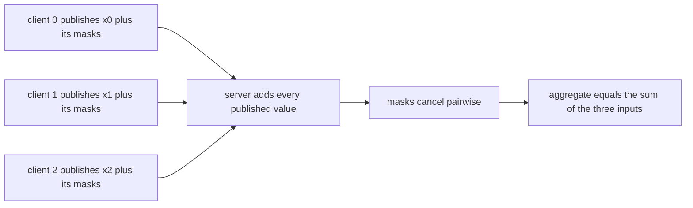
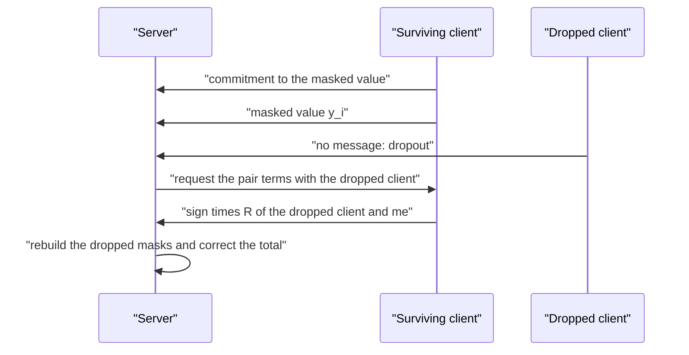
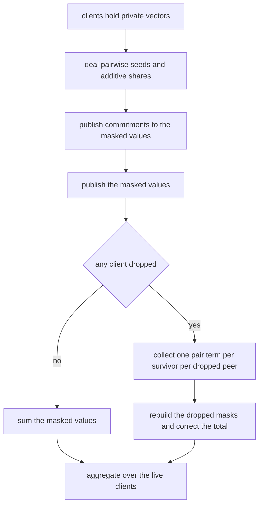
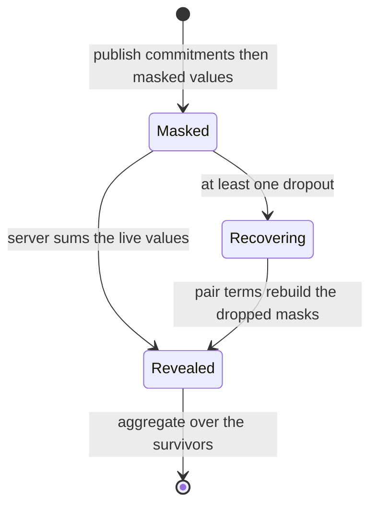

# 838 — Implement secure multi-party aggregation for machine learning (additive secret sharing).

> **Tier:** Master · **CTCI chapter:** Beyond — Security & Privacy
> **Task spec:** [838-implement-secure-multi-party-aggregation-for-machine-learning-ad.md](../../../tasks/master/838-implement-secure-multi-party-aggregation-for-machine-learning-ad.md)
> **Solutions:** [Python](../../../solutions/python/master/838-implement-secure-multi-party-aggregation-for-machine-learning-ad/solution.py) ·
> [Java](../../../solutions/java/master/838-implement-secure-multi-party-aggregation-for-machine-learning-ad/Solution.java) ·
> [JavaScript](../../../solutions/javascript/master/838-implement-secure-multi-party-aggregation-for-machine-learning-ad/solution.js) ·
> [C#](../../../solutions/csharp/master/838-implement-secure-multi-party-aggregation-for-machine-learning-ad/Solution.cs)

## 1. Problem restatement

The spec is one line — *"Implement secure multi-party aggregation for machine learning (additive
secret sharing)"*. Secure aggregation lets a server learn the **sum** of the vectors held by `n`
clients without learning any individual vector: the primitive behind federated averaging.

**The modelling contract.** This is an in-process deterministic model — no sockets, no threads, no
wall clock. Every payload travels over an explicit message transcript and the only "randomness" is
a seeded splitmix64 stream, so a run is reproducible. The server is **honest-but-curious**.
Simplified versus production: real deployments run over authenticated channels and Shamir-share
the pairwise seeds so recovery survives the dropout of the seed owners themselves; here the seeds
are derived deterministically from the pair identity, and the field is the 61-bit Mersenne prime
`p = 2⁶¹ − 1`.

**Inputs.** `n` clients with integer vectors, an epoch, the field modulus, an optional salt and a
set of dropped clients.

**Outputs.** `share`/`reconstruct` for additive sharing; a `SecureAggregator` exposing `masked`,
`commitments`, `reveal(dropped) → (aggregate, live, corrections)` and `verify_reveals(claimed)`;
`aggregate_vectors` for elementwise gradient sums; and the privacy simulator
`view`/`consistent_candidates`.

| Measurement | Value |
| --- | --- |
| sharing sweep | 5 secrets × party counts `1, 2, 3, 5, 8` — all reconstruct, first `n−1` shares are identical for `secret` and `secret + 1` |
| mask cancellation, 6 clients | `sum(masks) mod p == 0`, and every client holds a different mask |
| one round, epoch 4242 | inputs `i·7919 + 13`, aggregate `118863`, 15 pair seeds, 6 reveals, 0 corrections |
| dropouts | single, every pair, `(0,2,3)` and `(1,2,3,4,5)` all match the plaintext sum of the survivors; corrections `= live × dropped` |
| privacy, tiny field of size 11 | collusion of `n−2` leaves 11 candidates for the target, `n−1` leaves exactly 1 |
| vector round | 5 clients × 5 gradient slots, corrections 0, a constant offset shifts the aggregate |

## 2. Intuition

The naive federated round sends plaintext gradients to the server. That is exactly the leak the
protocol exists to prevent: the server already knows which client produced which update.

Additive secret sharing replaces one secret with `n` shares that sum to it over `GF(p)`: deal
`n − 1` uniform field elements and let the last share absorb the difference. Any `n − 1` of the
shares are independent of the secret — the assertions show that `secret` and `secret + 1` produce
**identical** first `n − 1` shares — while all `n` reconstruct it exactly. Sharing is additively
homomorphic, so `shares(x) + shares(y) = shares(x + y)`, and a client can even subtract shares
locally before reconstruction.

The second half is making the sum of individually-masked values equal the sum of plaintexts.
Client `i` holds a pairwise value `R(i, j) = R(j, i)` with client `j` and publishes
`y_i = x_i + Σ_j sign(i, j)·R(i, j)`, where the sign is `+` for `j > i` and `−` for `j < i`. Each
pair contributes `+R(i, j)` from one side and `−R(i, j)` from the other, so the masks cancel in
the group sum and the server recovers `Σ x_i` from the published `y_i` alone — it never sees a
pair value it could subtract.



The interesting case is dropout. If client `d` disappears before revealing `y_d`, its masks are
never published and the total is short by them. Every survivor can compute exactly the one term
it shares with `d` — `sign(d, party)·R(d, party)` — and the terms *between two dropped clients*
appear twice with opposite signs, so they cancel. The server therefore rebuilds the missing masks
from `live × dropped` disclosed terms and corrects the total, which is exactly what federated
learning needs when clients drop mid-round.



## 3. Algorithm

1. `share(secret, parties, p, rng)` draws `parties − 1` uniform field elements and appends
   `secret − sum(rest) mod p`. `reconstruct` sums them back.
2. `pair_seed(left, right, epoch, salt)` mixes the ordered pair, the epoch and the slot salt
   through splitmix64 — symmetric in the arguments, so both sides derive the same seed;
   `pair_value` turns that into a field element.
3. `mask(party, size, epoch, p, dropped)` sums `+R(i, j)` over peers `j > i` and `−R(i, j)` over
   peers `j < i`, skipping dropped peers, because their side of the pair is re-added by recovery.
4. `dropout_term(party, dropped, ...)` returns `Σ_d sign(d, party)·R(d, party)` over dropped
   clients — the single term per dropped peer that a survivor knows.
5. `SecureAggregator.__init__` publishes `masked[i] = (input[i] + mask(i)) mod p` and
   `commitments[i] = sha256(epoch, i, masked[i])` **before** the reveal phase.
6. `reveal(dropped)` sums the survivors' `masked` values, adds `dropout_term` for each survivor,
   counts corrections as `live × dropped`, and raises `ValueError` if everyone dropped.
7. `verify_reveals(claimed)` recomputes each commitment and returns the offending indices —
   catching a client that changes its value after seeing the others.
8. `aggregate_vectors(clients, epoch)` runs the round once per gradient slot, checking that all
   vectors have the same width and raising otherwise.
9. The privacy simulator builds the adversary's whole view (`masked`, its own inputs,
   `commitments`) and brute-forces **every** assignment of the free unknowns over a tiny field,
   collecting the target client's values that remain consistent with the transcript.

```text
procedure share(secret, parties, modulus, rng)
    shares ← parties - 1 draws of a uniform field element
    append (secret - sum(shares)) mod modulus to shares
    return shares
end

function reconstruct(shares, modulus)
    return sum of shares mod modulus
end

function pair_seed(left, right, epoch, salt)
    lo, hi ← ordered pair of left and right
    return splitmix64 of lo hi epoch and salt mixed together
end

function mask(party, size, epoch, modulus, dropped)
    total ← 0
    for other in 0 to size - 1 do
        if other ≠ party and other is not in dropped then
            value ← pair_value(party, other, epoch, modulus)
            if party < other then total ← total + value else total ← total - value end
        end
    end
    return total mod modulus
end

function dropout_term(party, dropped, epoch, modulus)
    total ← 0
    for client in dropped do
        if client ≠ party then
            value ← pair_value(party, client, epoch, modulus)
            if client < party then total ← total + value else total ← total - value end
        end
    end
    return total mod modulus
end

procedure reveal(dropped)
    live ← every client not in dropped
    if live is empty then raise an error end
    total ← sum of masked values over live
    corrections ← 0
    for client in live do
        total ← total + dropout_term(client, dropped, epoch, modulus)
        corrections ← corrections + number of dropped clients other than client
    end
    return total mod modulus, length(live), corrections
end

function verify_reveals(claimed)
    return every client whose commitment differs from sha256 of epoch client and claimed value
end

function aggregate_vectors(clients, epoch)
    require every client vector to have the same width
    for slot in 0 to width - 1 do
        aggregate ← reveal of the round over slot with no dropouts
        total[slot] ← aggregate
    end
    return total
end
```



## 4. Worked example

Six clients, epoch 4242, inputs `x_i = (i · 7919 + 13) mod p`:

| Client | Input `x_i` | Its mask (mod p) | Published `y_i` |
| --- | --- | --- | --- |
| 0 | 13 | 891360476728549319 | 891360476728549332 |
| 1 | 7932 | 189597228351834246 | 189597228351842178 |
| 2 | 15851 | 1672817791395819459 | 1672817791395835310 |
| 3 | 23770 | 134146732537587507 | 134146732537611277 |
| 4 | 31689 | 1484395463700402855 | 1484395463700434544 |
| 5 | 39608 | 239368325713194516 | 239368325713234124 |

The masks sum to `0 mod p` — the invariant `sum(masks) % p == 0` that the file asserts before
using any aggregate — so the sum of the published column is exactly `118863`, the plaintext sum.
No published value equals its input, and no two published values are equal, so nothing on the
wire is a gradient. Each client commits to `sha256(epoch, i, y_i)`: changing client 3's value to
`y_3 + 1` makes `verify_reveals` return `[3]`.

Now drop clients 1 and 4. Their masks are never published, so their pairwise contributions to the
four survivors are missing. Each survivor discloses exactly the term it shares with each dropped
peer, and the server corrects:

| Quantity | Value |
| --- | --- |
| live clients | 4 (`0, 2, 3, 5`) |
| sum of published `y_i` over the live clients | short by the dropped masks |
| correction messages | `live × dropped = 4 × 2 = 8` |
| corrected aggregate | `79242` |
| plaintext check | `118863 − 7932 − 31689 = 79242` |

The exhaustive sweep runs every single dropout and every *pair* of dropouts through the same
comparison, plus `(0,2,3)` and `(1,2,3,4,5)`; in each case the recovered value equals the plain sum
over the survivors. A full round needs `0` corrections, and dropping everyone raises
`ValueError` rather than returning a meaningless `0`.

Privacy is measured, not asserted, in a deliberately tiny field of size 11 with four clients and
secrets `{0: 3, 1: 7, 2: 5, 3: 9}`:

| Coalition | Free unknowns | Candidates for the target input |
| --- | --- | --- |
| `{2, 3}`, target 0 | the pair values between the two honest clients | all 11 residues |
| `{3}`, target 0 | more free unknowns | all 11 residues |
| `{1, 2, 3}`, target 0 | none | exactly `1` — the true value `3` |

The last row is the negative control that fixes the boundary: the guarantee is `t < n − 1`
colluders, and at `n − 1` the transcript pins the remaining input down. Without that row the
"all 11 candidates" measurement would be vacuous.



## 5. Complexity

`n` is the group size, `d` the number of dropouts, and `w` the gradient width.

| Measure | Bound | Why it holds |
| --- | --- | --- |
| Pair seeds | `n(n−1)/2` | one symmetric value per unordered pair: 15 for `n = 6` |
| Client masking work | O(n) field operations per client, O(n²) in total | each client sums `n − 1` pair terms; the file reports 30 masks for `n = 6` |
| Sharing | O(n) per secret | `n − 1` draws plus one subtraction; 5 secrets × up to 8 parties = 40 shares in the sweep |
| Reveal | O(n) | one addition per live client |
| Dropout recovery | O(live × d) messages | one disclosed term per survivor per dropped peer; `4 × 2 = 8` for a two-client dropout |
| Commitments | O(n) hashes | one SHA-256 per client |
| Space | O(n²) pair values, O(w) per client | the pair table dominates; a production deployment derives seeds on demand instead |
| Alternative: plaintext upload | O(n) but no privacy | the server sees every gradient |
| Alternative: `n`-out-of-`n` sharing without masks | O(n²) shares | correct but needs every share holder to stay online, so any dropout blocks the round |

The protocol's cost is quadratic in the group size because the masks are pairwise; that is the
price of the pairwise cancellation, and it is why real systems cap the group size per round. What
this simulation does not pay for — and does not claim to — is authenticated channels, seed
distribution that survives the dropout of the seed holders themselves, or any defence against a
*malicious* server that lies about which clients dropped.

## 6. Pitfalls and edge cases

- **The last share absorbs the secret.** The first `n − 1` shares must be identical for `secret`
  and `secret + 1` — the test that makes "any `n − 1` shares leak nothing" concrete rather than a
  slogan.
- **Masks must cancel exactly.** `sum(masks) % p == 0` is the invariant the aggregate depends on;
  a sign convention that adds `R(i, j)` on both sides of a pair silently doubles the mask instead
  of cancelling it.
- **Masks with a dropped peer must be excluded.** If a client still included `R(i, d)` for a
  dropped `d`, recovery would add it a second time. Symmetrically, the terms *between two dropped
  clients* appear twice with opposite signs and cancel, so they must not be disclosed.
- **Commitments must precede the reveal, and epochs must re-randomise.** `verify_reveals` is only
  meaningful because the hash is published before anyone sees the others' values; a new epoch
  changes every mask, and without it the difference of two transcripts would expose gradients.
- **Nobody left to aggregate.** `reveal` raising `ValueError` when every client dropped is part of
  the contract; returning `0` would be indistinguishable from an all-zero round.
- **Gradient dimensions must agree.** `aggregate_vectors` rejects ragged client vectors rather
  than truncating, and determinism follows from seeded streams the same way: same epoch and inputs
  reproduce the same masked values and commitments.
- **Degenerate rounds.** A single client aggregates to itself, an all-zero round aggregates to
  zero, and a constant offset of `1000` on every slot shifts the aggregate by `5 × 1000` — the
  linearity checks that make the "sum" contract precise. The privacy simulator is a brute force
  over the free unknowns, run on a field of size 11 for exactly that reason.

## 7. Variants and follow-ups

- **The dropout problem one level up.** Federated learning with secure aggregation end to end:
  [829-implement-privacy-preserving-federated-learning-with-secure-aggr.md](../../../tasks/master/829-implement-privacy-preserving-federated-learning-with-secure-aggr.md).
- **Sharing instead of masking.** Threshold reconstruction with Shamir shares and their use for
  verifiable set intersection:
  [839-implement-oblivious-transfer-based-protocol-for-private-set-inte.md](../../../tasks/master/839-implement-oblivious-transfer-based-protocol-for-private-set-inte.md).
- **Computation on hidden values.** Additive sharing supports sums; products and comparisons need
  heavier machinery, as in
  [840-implement-fully-homomorphic-encryption-demo-simple-arithmetic-to.md](../../../tasks/master/840-implement-fully-homomorphic-encryption-demo-simple-arithmetic-to.md).
- **Trust anchored elsewhere.** Where masking and sharing are too expensive, hardware attestation
  moves the aggregation inside an enclave:
  [841-implement-secure-enclaves-chain-of-trust-verification-demo.md](../../../tasks/master/841-implement-secure-enclaves-chain-of-trust-verification-demo.md).

## 8. Check yourself

1. What exactly does the server learn in a full masked round?

<details><summary>Show answer</summary>

The aggregate — the sum over live clients — plus each client's commitment. Every published value
is `x_i` plus a mask whose group sum is zero, so the server can compute the total but cannot
isolate any `x_i`: with `n − 2` colluding clients the tiny-field simulator still finds all 11
residues feasible for the target input.

</details>

2. Why does recovery need only one disclosed term per survivor per dropped client?

<details><summary>Show answer</summary>

Because the missing quantity is exactly the dropped clients' masks, and each mask is a sum of pair
terms. A survivor knows its own side of every pair it shares with a dropped client, so it can
disclose `sign(d, party)·R(d, party)`; the terms between two dropped clients appear twice with
opposite signs and cancel. That is why the correction count is `live × dropped` — 8 for four
survivors and two dropouts — and why the recomputed aggregate is the plain sum of the survivors.

</details>

3. What does the protocol *not* protect against?

<details><summary>Show answer</summary>

A malicious server that lies about which clients dropped, and a client that aborts after learning
others' values — the commitment only detects a *changed* value, it does not force a client to
reveal what it committed to. The model here is an honest-but-curious server and nothing more.

</details>
