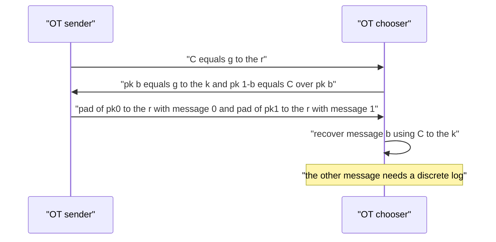
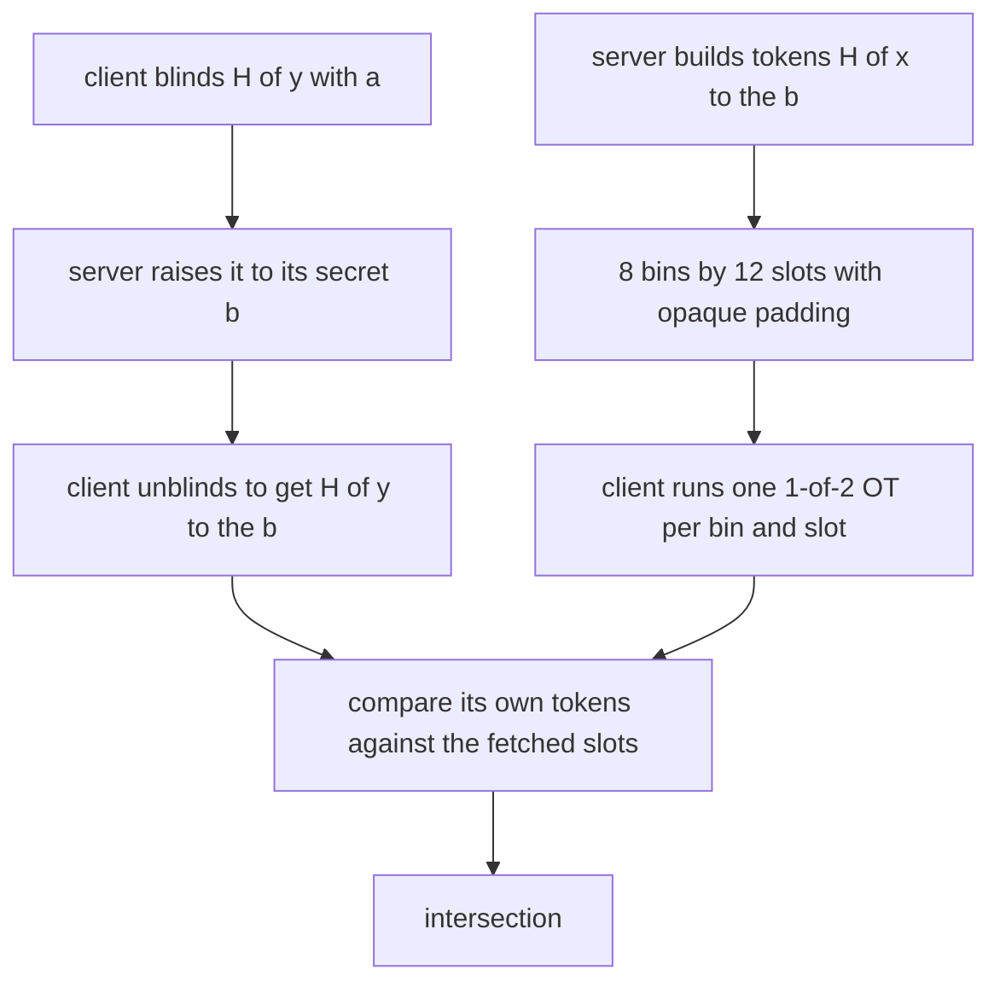
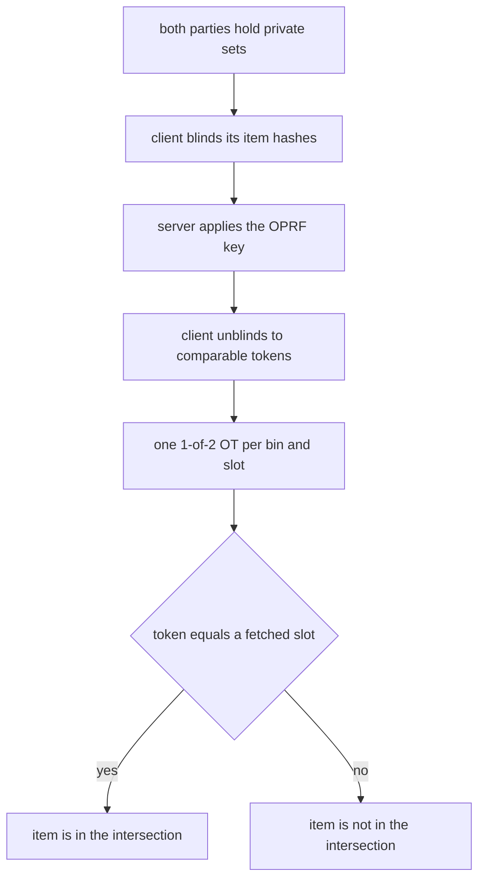
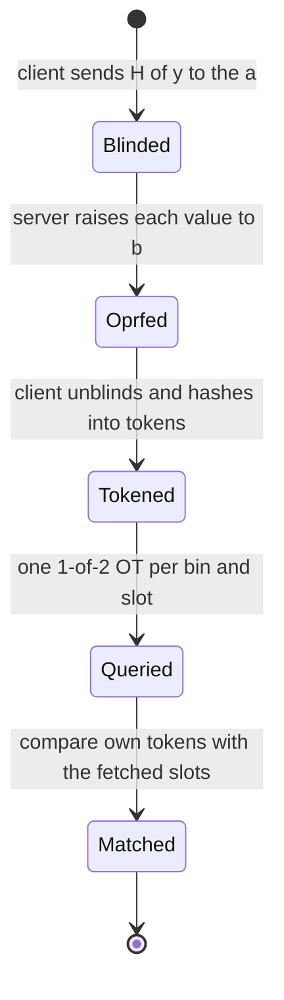

# 839 — Implement oblivious transfer based protocol for private set intersection.

> **Tier:** Master · **CTCI chapter:** Beyond — Security & Privacy
> **Task spec:** [839-implement-oblivious-transfer-based-protocol-for-private-set-inte.md](../../../tasks/master/839-implement-oblivious-transfer-based-protocol-for-private-set-inte.md)
> **Solutions:** [Python](../../../solutions/python/master/839-implement-oblivious-transfer-based-protocol-for-private-set-inte/solution.py) ·
> [Java](../../../solutions/java/master/839-implement-oblivious-transfer-based-protocol-for-private-set-inte/Solution.java) ·
> [JavaScript](../../../solutions/javascript/master/839-implement-oblivious-transfer-based-protocol-for-private-set-inte/solution.js) ·
> [C#](../../../solutions/csharp/master/839-implement-oblivious-transfer-based-protocol-for-private-set-inte/Solution.cs)

## 1. Problem restatement

The spec is one line — *"Implement oblivious transfer based protocol for private set
intersection"*. Two parties compute `X ∩ Y` without revealing the rest: the client (holding `Y`)
learns exactly `Y ∩ X`, and the server (holding `X`) learns nothing about `Y` at all.

**The modelling contract.** Everything runs in one deterministic process — no sockets, threads or
wall clock. Messages are plain values on an explicit transcript and the only randomness is a
seeded splitmix64 stream. The primitives are implemented *for real* at toy scale: the group is the
prime-order subgroup of `Z_p*` for a safe prime `p = 2q + 1` with `q ≈ 2⁶⁰`, all arithmetic is
genuine modular exponentiation, and the measured cost claim is that recovering a hidden exponent
needs at least `q ≈ 2⁶⁰` group operations. Nothing here is deployable and no real key material is
involved.

**What is simplified.** The fixed-capacity hash-bin table stands in for cuckoo hashing plus OT
extension; padding tokens are derived from the server's key instead of being fresh random group
elements; the binning hash is public, so the client knows which bin each of *its own* items lands
in (it computed that itself) while the OT hides the choice bits from the server. Parameters are
tiny — 8 bins × 12 slots — so everything is exhaustive and fast.

**Inputs.** Two integer sets, a `PsiParams` (group, bins, capacity, salt), a seed, and per-party
RNG seeds.

**Outputs.** `run_psi` returns the sorted intersection, metrics (`ots`, `messages`,
`tokens_fetched`, `bins_queried`), the transcript and the fetched tokens.

| Measurement | Value |
| --- | --- |
| group | `p` is 122 bits, `q` is 61 bits, generator order `1152921504606849959` |
| tiny measurement group | `p = 47`, `q = 23` |
| table | 8 bins × 12 slots = 96 OTs per run, 468 exponentiations per run |
| correctness | 32 seeded cases match brute-force intersection exactly; recall and precision 1 |
| main case | intersection `[6, 12]`, 48 fetched tokens (`bins_queried × capacity`) |
| OT privacy | 200 trials recovered nothing the chooser did not choose |
| cost | the same 96 OTs for a small and a big client set — independent of the set sizes |

## 2. Intuition

The naive PSI is "send me your set, I'll intersect it". The client learns the server's whole set
and the server learns the client's; both parties lose.

The starting primitive is **1-out-of-2 oblivious transfer** in the Bellare-Micali style. The sender
publishes `C = g^r`. The chooser picks a bit `b`, samples `k`, sets `pk_b = g^k` and
`pk_{1−b} = C / pk_b`, and sends both keys. The sender masks message `i` with
`hash(pk_i^r)`. The chooser can recover message `b` because `pk_b^r = (g^k)^r = C^k`, which it can
compute; it cannot recover message `1 − b` without solving a discrete logarithm, because it never
knows a `k'` with `pk_{1−b} = g^k'`. That asymmetry is the whole primitive.



Building PSI on top needs one more idea: the comparison value must be something the client can
compute **only for its own items**. The server keys an OPRF: it raises each blinded client value
to a secret key `b`, so after a fresh blinding `a` (which keeps `Y` hidden from the server) and
unblinding, the client holds `token(y) = H(y)^b` for its own items only. The server keeps
`token(x) = H(x)^b` in a fixed-capacity bin table, padding empty slots with opaque key-derived
values so every bucket looks full.

The client then fetches the slots of the bins its own items hash to, one 1-out-of-2 OT per
`(bin, slot)`, choosing the real token. Because the OT hides the choice bit, the server cannot tell
which bins were queried; and because the client only fetches bins it already has items in, a
fetched token can only ever confirm membership. Matching is token equality — a non-member's token
is indistinguishable from a PRF output.



## 3. Algorithm

1. `safe_prime(bits)` searches deterministically for `p = 2q + 1` with `q` prime; `Group` picks
   the first `h²` that generates the order-`q` subgroup, and provides `power` (counted), `inverse`,
   `element` (hash-to-subgroup), `pad` (a 128-bit one-time pad under a group element),
   `contains` and `witness` (brute-force discrete log, feasible only on the tiny group).
2. `token_from_group(group, element)` hashes a group element into a 128-bit comparison token.
3. `OTSender` samples `r`, publishes `C = g^r`, and `respond(pks)` returns
   `[pad(pk_0^r, m_0), pad(pk_1^r, m_1)]`. `OTReceiver` samples `k`, builds
   `(pk_b, pk_{1−b}) = (g^k, C/g^k)`, and `extract` decodes `pad(C^k, payloads[b])`.
4. `bin_of(item, params)` is a public hash from the item and the parameters into `[0, bins)`.
5. `Sender(items, params, rng)`: key `b`, tokens `H(x)^b`, then place each token in its bin,
   raising `ValueError` if a bin exceeds `capacity`; fill every remaining slot with
   `padding(bucket, slot)` derived from `b`.
6. `Receiver(items, params, rng)`: key `a`, `blind()` = `H(y)^a` per item, `unblind()` raises the
   OPRF answers to `a⁻¹ mod q`, and `bins` is the set of bins its own items land in.
7. `run_psi(params, sender, receiver, seed)`: exchange blindings and OPRF answers, derive tokens,
   open one OT per `(bin, slot)` with choice bit `1` exactly for the queried bins, fetch the chosen
   slot of the queried bins, then intersect by token membership. The metric `ots` counts the
   sessions, `tokens_fetched` = `bins_queried × capacity`.

```text
function safe_prime(bits)
    search upward for p with p = 2q + 1 and both p and q prime
    return p, q
end

function element(group, label)
    raw ← first 16 bytes of SHA-256 of the label
    return g to the (raw mod q) mod p
end

function pad(group, key, message)
    stream ← first 16 bytes of SHA-256 of key
    return message exclusive-or stream and 128-bit mask
end

procedure respond(sender, public_keys)
    keys ← pk0 to the sender.exponent and pk1 to the sender.exponent mod p
    return pad of key0 with message0 and pad of key1 with message1
end

function extract(receiver, payloads)
    return pad of (C to the receiver.exponent) with payloads[receiver.bit]
end

function token(sender, item)
    return token_from_group of (element(item) to the sender.key mod p)
end

procedure build_buckets(sender)
    for item in sender.items do
        bucket ← bin_of(item, sender.params)
        if occupancy[bucket] = capacity then raise an overflow error end
        append token(item) to buckets[bucket]
    end
    while any bucket is short do
        append padding(key, bucket, slot) to that bucket
    end
end

function run_psi(params, sender, receiver, seed)
    blinds ← element(y) to the receiver.key for every y in Y
    tokens ← token_from_group of (server answer to the receiver.key inverse)
    for bucket and slot in all bins and slots do
        session ← OTSender with a decoy message and sender token at that slot
        choice ← 1 when bucket is in receiver.bins else 0
        query ← OTReceiver choosing that bit against session.C
        payload ← session respond to query.public_keys
        if choice then append query extract of payload to fetched[bucket] end
    end
    return items of Y whose token appears in fetched[bin_of(item)]
end
```



## 4. Worked example

The main case uses the 122-bit group, an 8 × 12 table, and two integer sets that intersect in
`[6, 12]`.

| Step | Who | What travels | Cost |
| --- | --- | --- | --- |
| 1 | client | `H(y)^a` for every `y ∈ Y` (blinded) | `|Y|` exponentiations |
| 2 | server | `H(y)^(ab)` | `|Y|` exponentiations |
| 3 | client | unblinds with `a⁻¹ mod q`, yielding `token(y) = H(y)^b` | `|Y|` exponentiations |
| 4 | server | bucket table built: every bucket padded to exactly 12 slots | `|X|` + padding tokens |
| 5 | both | 96 OT sessions (`8 × 12`) | 96 OTs, 468 exponentiations per run |
| 6 | client | fetches `bins_queried × capacity = 48` tokens | 48 recovered messages |
| 7 | client | matches its own tokens against the fetched slots | intersection `[6, 12]` |

Two features of that trace are the ones the assertions pin down. First, the bucket table is
*padded*: every bucket has exactly `capacity = 12` values, so a bucket holding one real token and
one holding twelve are indistinguishable to anyone who cannot see the tokens. Second, the fetched
count depends only on `bins_queried × capacity`, not on the size of the server's set — the
protocol's cost is a function of the table shape, not of `|X|` or `|Y|`. The file asserts exactly
that: the small and big runs perform the **same 96 OTs**.

The OT itself is measured on the tiny group `p = 47, q = 23`, where discrete logs are enumerable:

| Property | Check |
| --- | --- |
| both public keys live in the subgroup | `contains(pk[0])` and `contains(pk[1])` hold |
| the two keys multiply back to `C` | `pk[0]·pk[1] mod p == C` |
| a witness exists for both choice bits | tiny-group logs found for `pk[0]` and `pk[1]` |
| the chosen bit's witness is the chooser's exponent | `witness(pk[b]) == k` |
| the other bit's witness is different | `witness(pk[1−b]) != k` |
| the choice is hidden | both keys are in the subgroup, so the transcript is consistent with either bit |
| the other message stays hidden | 200 trials, zero recovered the unchosen message |



## 5. Complexity

`n_c = |Y|` client items, `n_s = |X|` server items, `B` bins and `C` slots per bin.

| Measure | Bound | Why it holds |
| --- | --- | --- |
| Client blinding / unblinding | Θ(n_c) | two exponentiations per item |
| Server OPRF | Θ(n_s) | one exponentiation per distinct server item |
| Table build | Θ(n_s + B·C) | tokens plus padding to a fixed capacity |
| OT sessions | Θ(B · C) | 96 for 8 × 12, independent of `n_c` and `n_s` |
| Counted exponentiations | 468 per run | the file's measured total, bounded by `4·B·C` plus small terms |
| Fetched tokens | `bins_queried × C` | 48 in the main case; only bins containing a client item are queried |
| Matching | Θ(n_c · C) | a token-in-bucket test per client item |
| Space | Θ(n_c + B·C) | the tokens and the padded table, not the other party's set |
| Alternative: hash-to-hash with a shared key | Θ(n_c + n_s) | leaking the shared key to one side breaks the privacy goal entirely |
| Alternative: naive exchange | Θ(n_c + n_s) | no privacy at all |

The cost that matters is that it is **linear in the table, not in the data**: a client with three
items and a server with a hundred pay the same 96 OT sessions, because only the bins the client
touches are queried. The price is the padding — the server publishes `B × C` values where ``n_s``
would do — and that is the trade the fixed-capacity table makes for bin privacy.

## 6. Pitfalls and edge cases

- **Both public keys must be subgroup elements.** `pk_{1−b} = C / pk_b` is only valid inside the
  order-`q` subgroup; a value outside it lets a cheating chooser attack the sender's message. The
  tests assert `contains` for both keys.
- **`g = h²`, not `h`.** The generator must have order exactly `q`; using a raw generator of `Z_p*`
  would expose the two-element subgroup and the parity of exponents.
- **The blinding exponent must be fresh per run.** Without it the server sees `H(y)^b` values it
  could compare against its own token table, breaking the client's privacy.
- **Padding must be indistinguishable from a token.** Empty slots carry key-derived 128-bit values;
  leaving them empty, or using zeros, tells the server exactly how many items are in each bin.
- **Capacity overflow must be rejected, not truncated.** `Sender` raises `ValueError` when a bin
  exceeds `capacity`; silently dropping an item would make the intersection wrong.
- **Choice bit 0 for unqueried bins.** The client must actually perform the OT for every session
  and take the decoy message, or the pattern of sessions it skips reveals its bins.
- **Empty sets.** An empty intersection fetches zero tokens; a client with items and an empty
  server set still performs the full OT schedule (`tokens_fetched > 0`) and returns `[]`.
- **Public binning.** The binning hash is public, so the client knows its own bin indices — that is
  fine, since the OT hides which ones it queries; treating the bin index as secret would be a
  misreading of the model.
- **Determinism.** The same seed reproduces the transcript exactly, while a different seed keeps
  the intersection identical and changes the values — the right pair of assertions for a protocol
  whose correctness must not depend on randomness.

## 7. Variants and follow-ups

- **Numeric aggregation instead of membership.** Additive secret sharing computes sums without any
  OT at all:
  [838-implement-secure-multi-party-aggregation-for-machine-learning-ad.md](../../../tasks/master/838-implement-secure-multi-party-aggregation-for-machine-learning-ad.md).
- **Arithmetic on hidden values.** When the function is not just membership or a sum, the primitive
  becomes homomorphic encryption:
  [840-implement-fully-homomorphic-encryption-demo-simple-arithmetic-to.md](../../../tasks/master/840-implement-fully-homomorphic-encryption-demo-simple-arithmetic-to.md).
- **Search without a fixed query.** A different privacy answer to "find my items on your side" is a
  searchable encrypted index:
  [814-implement-searchable-encrypted-index-with-limited-leakage-and-pr.md](../../../tasks/master/814-implement-searchable-encrypted-index-with-limited-leakage-and-pr.md).
- **Proofs about the result.** A client that must prove the intersection it reported needs
  verifiable computation on top:
  [830-implement-verifiable-computation-for-ml-inference-with-succinct.md](../../../tasks/master/830-implement-verifiable-computation-for-ml-inference-with-succinct.md).

## 8. Check yourself

1. Why can the chooser recover exactly one of the two OT messages?

<details><summary>Show answer</summary>

Because it knows an exponent for one key only. It set `pk_b = g^k`, so `pk_b^r = C^k` is
computable from the public `C = g^r`; that decodes message `b`. The other key is
`C / pk_b`, and recovering message `1 − b` needs a `k'` with `g^(k') = C/g^k`, i.e. solving a
discrete logarithm in a subgroup of order `q ≈ 2⁶⁰`. The tiny group makes the asymmetry visible:
`witness(pk[b]) == k` while `witness(pk[1−b])` is some other exponent.

</details>

2. What stops the server from learning which bins the client queried?

<details><summary>Show answer</summary>

The oblivious transfer. The client runs an OT session for *every* `(bin, slot)` pair — 96 of them —
and for bins it does not need it chooses bit `0`, receiving the sender's decoy message. Since the
choice bit is hidden, the server's transcript is consistent with any subset of bins, so it learns
nothing beyond the number of client items.

</details>

3. Why is the comparison a token equality and not a test like `x ∈ Y`?

<details><summary>Show answer</summary>

Because neither party may see the other's plaintext items. Both derive `token(item) = H(item)^b`
from the same OPRF key, so equality of tokens is exactly equality of items, and a non-member's
token is simply a PRF output at a point the server never keyed — indistinguishable from padding.
The client therefore learns membership and nothing about the non-matching part of `X`.

</details>

4. What is the cost of the protocol as a function of the set sizes?

<details><summary>Show answer</summary>

The OT schedule is `B × C` — 96 sessions for 8 bins × 12 slots — regardless of `|X|` and `|Y|`,
which the file asserts by running a small and a big case with the same OT count. Blinding, the
OPRF and matching are linear in the number of items, and the server publishes `B × C` padded slots
rather than `|X|` values, so the published table size is a constant chosen by the parameters.

</details>

5. Why must the client's unblinding use `a⁻¹ mod q` rather than a field inverse modulo `p`?

<details><summary>Show answer</summary>

Because exponents live in the order-`q` subgroup: `(H(y)^a)^b = H(y)^(ab)` and unblinding must
raise to `a⁻¹ mod q` so the result is `H(y)^b` with the exponent reduced in the right group. Using
an inverse modulo `p − 1` gives an exponent that is congruent modulo `q` only by accident, and in
general leaves the client with a different group element and a token that never matches.

</details>
