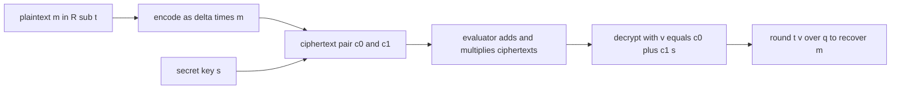
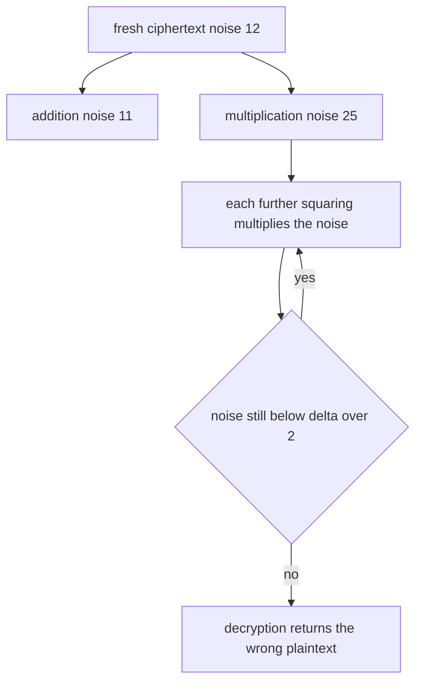
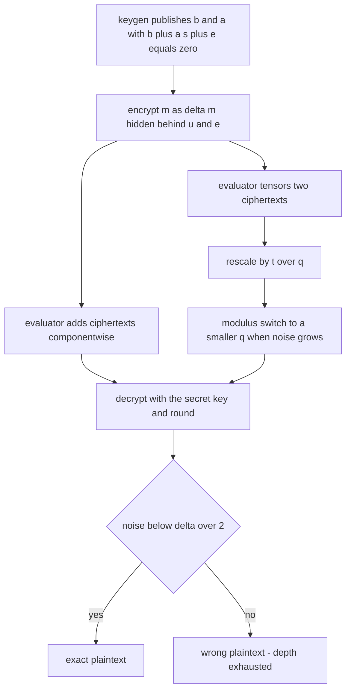
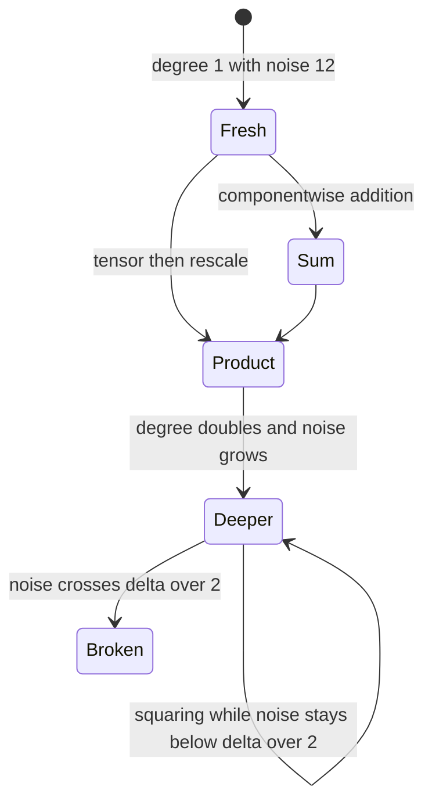

# 840 — Implement fully homomorphic encryption demo: simple arithmetic (toy).

> **Tier:** Master · **CTCI chapter:** Beyond — Security & Privacy
> **Task spec:** [840-implement-fully-homomorphic-encryption-demo-simple-arithmetic-to.md](../../../tasks/master/840-implement-fully-homomorphic-encryption-demo-simple-arithmetic-to.md)
> **Solutions:** [Python](../../../solutions/python/master/840-implement-fully-homomorphic-encryption-demo-simple-arithmetic-to/solution.py) ·
> [Java](../../../solutions/java/master/840-implement-fully-homomorphic-encryption-demo-simple-arithmetic-to/Solution.java) ·
> [JavaScript](../../../solutions/javascript/master/840-implement-fully-homomorphic-encryption-demo-simple-arithmetic-to/solution.js) ·
> [C#](../../../solutions/csharp/master/840-implement-fully-homomorphic-encryption-demo-simple-arithmetic-to/Solution.cs)

## 1. Problem restatement

The spec is one line — *"Implement fully homomorphic encryption demo simple arithmetic (toy)"*.
The solutions implement a real, deliberately tiny **leveled BFV-style** scheme over the negacyclic
ring `R = Z_q[x]/(x^n + 1)`: ciphertexts are genuinely encrypted, arithmetic happens on the
ciphertexts alone, and the only thing the evaluator ever sees is noise-carrying ciphertext.

**What is real.** Key generation with the public relation `b + a·s + e = 0`, encryption in the
standard BFV form, decryption with the `t·[v]_q/q` round, componentwise addition, and
multiplication as an exact tensor product followed by BFV's `t/q` rescaling. The negacyclic product
is cross-checked against an independent Kronecker-substitution big-integer oracle, so the ring
itself is verified rather than assumed.

**What is simplified.** `n = 8`, `q ≈ 2⁴²`, `t = 2`; ternary/error samples come from a seeded
splitmix64 stream rather than a real discrete Gaussian; there is **no relinearisation**, so a
product's ciphertext degree doubles (`k` ring elements → `2k`, needing `s²`, `s⁴`, …); no batching,
no NTT, no key reuse across runs. Nothing here is deployable or secure — the point is that every
step is real arithmetic and every claim is measured.

**Inputs.** `Params(n, q, t)` with `delta = q // t`, a key, a `Rng` seed, and ring elements as
coefficient lists.

**Outputs.** Ciphertexts (lists of ring elements), plaintexts, and three measurements: `noise`
(max coefficient of `[v − delta·m]_q`), the ciphertext degree, and bit widths after a modulus
switch.

| Measurement | Value |
| --- | --- |
| ring | `n = 8`, `q = 4398046515493` (43 bits), `t = 2`, `delta = 2199023257746` |
| fresh noise | 12 and 8, against the bound `delta/2 = 1099511628873` |
| addition / multiplication noise | 11 / 25 |
| multiplicative depth | exact through 4 levels, broken at 5 (noise `2123505458651`) |
| modulus switch | `q` 4398046515493 → 4294967300, noise 25 → 4, coefficients 42 → 32 bits |
| degree after one product | 3 ring elements (degree 2) — no relinearisation |

## 2. Intuition

The naive attempt at computing on encrypted data is "decrypt, compute, re-encrypt". That requires
the key at the evaluator, which defeats the purpose. Homomorphic encryption instead keeps the
message *inside* the arithmetic: encode the plaintext as `delta·m` inside a ring element, hide it
behind a secret-key relation, and let the operations on ciphertexts correspond to operations on the
encoded messages.

BFV's encoding is `delta = q // t`, so `m ∈ R_t` becomes `delta·m ∈ R_q`. A ciphertext is a pair
`(c0, c1)` with decryption `v = c0 + c1·s` and plaintext `round(t·[v]_q/q)`. Everything hinges on
`v` being `delta·m` **plus a small noise term**: as long as the noise stays below `delta/2`, the
rounding recovers `m` exactly. That is why the file measures noise at every step instead of
asserting correctness once.



Addition is then trivial — it is coefficientwise, and the noises add. Multiplication is where the
scheme earns its name: `(c0 + c1 s)·(d0 + d1 s)` produces terms up to `s²`, i.e. a degree-2
ciphertext of three ring elements, and the plaintext factor becomes `delta²` instead of `delta`.
The `t/q` rescaling brings that factor back to `delta` and simultaneously *shrinks* the noise by
`t/q ≈ 1/delta`. Without the rescaling a product would decrypt to `delta·m1·m2`, and with it the
noise is small enough for the next level.



That is what "fully" homomorphic means for a *leveled* scheme: the depth is bounded by noise, and
each level consumes headroom. Both a larger `q` and modulus switching buy depth back — the file
measures both, and also measures the point where the noise crosses `delta/2` and decryption really
does break.

## 3. Algorithm

1. `Params(n, q, t)`: `delta = q // t`; the ring is `x^n + 1` with `x^n = −1`, so products fold
   coefficient `k ≥ n` back to `k − n` with a sign flip.
2. `poly_mul` is the schoolbook negacyclic product; `poly_mul_kronecker` packs both polynomials
   into big integers with a carry-free base, multiplies exactly, and folds the `2n − 1` raw
   coefficients — an oracle that shares no code with `poly_mul`.
3. `keygen`: ternary `s`, uniform `a`, ternary `e`, and `b = −(a·s + e) mod q`; the relation
   `b + a·s + e = 0` is re-verified in `R_q`.
4. `encrypt`: ternary `u`, small `e1, e2`, and
   `c = ((b·u + e1 + delta·m) mod q, (a·u + e2) mod q)`.
5. `decrypt`: `v = Σ_i c_i·s^i` in `R_q`, then `round(t·[v]_q / q) mod t` coefficientwise;
   `noise(params, secret, ciphertext, message)` reports `max |[v − delta·m]_q|`.
6. `add_ciphertexts` adds componentwise (padding the shorter degree with zeros);
   `tensor_product` computes the exact integer product over centred representatives — a product
   cannot be reduced modulo `q`, because the `delta²·m` term is far larger than `q` — and
   `rescale` multiplies by `t/q` and reduces back into `R_q`.
7. `modulus_switch(params, ciphertext, new_params)` scales every centred coefficient from `q` to
   `q'`, preserving the message while shrinking the noise by roughly `q'/q`.
8. `canary_ok` is a known-answer test: it checks the decryption against the expected plaintext, so
   an over-aggressive modulus switch is *detected* rather than silently tolerated.

```text
function poly_mul(left, right, q, n)
    out ← n zeros
    for i and a in left do
        for j and b in right do
            k ← i + j
            if k ≥ n then
                out[k - n] ← (out[k - n] - a * b) mod q      # x^n = -1
            else
                out[k] ← (out[k] + a * b) mod q
            end
        end
    end
    return out
end

function keygen(params, rng)
    secret ← ternary coefficients in {-1, 0, 1}
    public_a ← uniform coefficients in R sub q
    error ← small coefficients with bound 2
    public_b ← -(public_a * secret + error) mod q
    return secret, public_a, public_b and error
end

function encrypt(params, key, message, rng)
    u ← ternary coefficients
    e1, e2 ← small coefficients
    scaled ← (params.delta * message) mod q
    c0 ← (key.b * u + e1 + scaled) mod q
    c1 ← (key.a * u + e2) mod q
    return [c0, c1]
end

function decrypt(params, secret, ciphertext)
    value ← sum over i of ciphertext[i] * secret to the i in R sub q
    return round(params.t * centre(value) / params.q) mod params.t
end

function noise(params, secret, ciphertext, message)
    value ← decrypt_raw(params, secret, ciphertext)
    return maximum over coefficients of absolute centre(value - params.delta * message)
end

procedure multiply_ciphertexts(left, right)
    tensor ← exact integer tensor product of the centred components
    return rescale of tensor by params.t over params.q mod params.q
end

function modulus_switch(params, ciphertext, new_params)
    return every centred coefficient scaled from params.q down to new_params.q
end
```



## 4. Worked example

Take `n = 8`, `q = 4398046515493`, `t = 2`, and the message `m = 1 + x² + x⁴ + x⁶`, i.e. the
coefficient list `[1, 0, 1, 0, 1, 0, 1, 0]`. The key from seed 7 has
`s = [−1, −1, 0, 1, −1, −1, 1, −1]`, and encryption (seed 11) produces the two ring elements

| Component | Coefficients |
| --- | --- |
| `c0` | `3363481057633 2089897982707 3161844086510 2228303387148 1117757264507 4237548658645 855566851260 1511534631869` |
| `c1` | `2875916089193 3381727601092 3233411077561 2662352445058 3385801075252 2101640725381 1890754725559 2014675486341` |

Decryption computes `v = c0 + c1·s` in `R_q`, and `round(t·[v]_q/q)` returns exactly
`[1, 0, 1, 0, 1, 0, 1, 0]` with measured noise **9** — six orders of magnitude below
`delta/2 = 1099511628873`. Nothing in `c0` or `c1` resembles the message: the encoding is
`delta·m` buried under `u`, `e1`, `e2`, and the public key.

Now evaluate on ciphertexts only:

| Step | Operation | Result | Noise |
| --- | --- | --- | --- |
| fresh | encrypt two plaintexts | 2 ring elements each | 12, 8 |
| add | `c0+c0', c1+c1'` | 2 ring elements, decrypts to `m1 + m2` | 11 |
| multiply | tensor then rescale | **3** ring elements, decrypts to `m1·m2` in `R_t` | 25 |
| circuit | `a·b + c` | 3 ring elements, matches the plaintext oracle | 25 |

The degree growth is the visible cost: one product makes the ciphertext degree 2, so decryption
needs `s²`. Squaring repeatedly — `product_ct` against itself, then that result against itself —
gives degree `2^levels`, and the file keeps going while the noise stays under the bound:

| Multiplicative levels | Decryption | Measured noise |
| --- | --- | --- |
| 1 (one product) | exact | 25 |
| 4 | exact | below `delta/2` |
| 5 | **broken** | `2123505458651 ≥ delta/2` |

That fifth row is the honest part of the demo: the noise bound is not decoration, and the toy
parameters do not support unbounded depth. Two ways to buy headroom are measured. A larger modulus
(`q << 12`) raises the correctness margin for the same circuit, and a modulus switch moves a
product from `q = 4398046515493` to `q = 4294967300`, taking the noise from **25 down to 4** and
the coefficients from 42 to 32 bits while the decryption stays exact. Switch too aggressively
though and `delta` collapses to 4; the known-answer canary then reports the mismatch instead of
silently returning garbage.



## 5. Complexity

`n` is the ring dimension, `k` the ciphertext degree, and `L` the multiplicative depth.

| Measure | Bound | Why it holds |
| --- | --- | --- |
| `poly_mul` | Θ(n²) | schoolbook convolution; 64 coefficient products for `n = 8` |
| Kronecker oracle | one big-integer multiply | carry-free packing, `2n − 1` coefficients unpacked |
| keygen | Θ(n²) | one ring multiplication plus sampling |
| encrypt | Θ(n²) | one `b·u` and one `a·u` |
| addition | Θ(k·n) | coefficientwise, no multiplication |
| multiplication | Θ(k²·n²) | tensor product of `k1 + k2 − 1` component pairs, then a `t/q` scale |
| decryption | Θ(k²·n²) | `Σ c_i·s^i`, needing the powers `s, s², …, s^k` |
| degree growth | doubles per multiplication | `k → 2k`, because there is no relinearisation |
| depth | `L ≈ log(delta) − const` | each level consumes noise headroom; 4 levels exact, 5 broken |
| Space | Θ(k·n) | a degree-`k` ciphertext is `k + 1` ring elements |

Compare the alternative: without rescaling, decryption would have to recover `delta²·m1·m2`, so
the plaintext factor changes per level and no fixed decoder works. The `t/q` step is what keeps
one decoder valid across additions and multiplications — and it is also what keeps the noise from
growing faster than the modulus can absorb.

## 6. Pitfalls and edge cases

- **Products cannot be reduced modulo `q`.** The `delta²·m` term is far bigger than `q`, so the
  tensor product is computed over the *integers* and only then rescaled; reducing early wraps the
  message into nonsense.
- **The noise bound is the decoder's contract.** `round(t·[v]_q/q)` is exact only while the noise
  is below `delta/2`; decryption past that returns a *plausible but wrong* plaintext, which is why
  the file drives the depth until it breaks and asserts the failure.
- **Nothing is verified by decryption alone.** The plaintext oracle `plain_mul` / `plain_add` in
  `R_t` and the `canary_ok` known-answer test keep the "homomorphic result" from being a
  self-consistent mistake.
- **`delta` must not be a rounding artefact.** The assertion `delta == q // t` and `delta > t`
  guards the encoding; a tiny `delta` makes the switch case collapse the message.
- **Zenith cases.** The all-zero message encrypts and multiplies to zero, `m = t − 1` everywhere is
  the extreme of the plaintext space, and multiplying by an encrypted zero still decrypts to zero.
- **Wrong key.** Decrypting with another generated secret must *not* reproduce the message; without
  that negative check, an implementation that ignored `s` would look correct.
- **Determinism.** The same seed reproduces byte-identical ciphertexts, and a different seed gives
  a different ciphertext for the same message — both are asserted.
- **Do not describe this as secure.** `n = 8`, `q ≈ 2⁴²`, ternary error distributions and a
  single-run key are a demonstration of the *algebra*, not of FHE security.

## 7. Variants and follow-ups

- **Membership without decryption.** Oblivious transfer and set intersection need no ring
  arithmetic at all:
  [839-implement-oblivious-transfer-based-protocol-for-private-set-inte.md](../../../tasks/master/839-implement-oblivious-transfer-based-protocol-for-private-set-inte.md).
- **Sums without ciphertexts.** Additive secret sharing covers aggregation far more cheaply:
  [838-implement-secure-multi-party-aggregation-for-machine-learning-ad.md](../../../tasks/master/838-implement-secure-multi-party-aggregation-for-machine-learning-ad.md).
- **Proving instead of computing.** When the goal is to certify a computation rather than hide it,
  the tool is a SNARK:
  [834-implement-zk-snark-circuit-for-a-simple-arithmetic-program-toy.md](../../../tasks/master/834-implement-zk-snark-circuit-for-a-simple-arithmetic-program-toy.md).
- **Hardware as the hiding mechanism.** Secure enclaves trade the noise budget for an attestation
  chain:
  [841-implement-secure-enclaves-chain-of-trust-verification-demo.md](../../../tasks/master/841-implement-secure-enclaves-chain-of-trust-verification-demo.md).

## 8. Check yourself

1. Why does a ciphertext product need a larger modulus than `q`?

<details><summary>Show answer</summary>

Because the product of two encodings contains `(delta·m1)·(delta·m2) = delta²·m1·m2`, which is much
larger than `q`, so reducing modulo `q` would wrap the message. The file therefore computes the
tensor product exactly over centred integer representatives, then rescales by `t/q` to bring the
factor back to `delta` and reduce into `R_q`.

</details>

2. What exactly does the noise measure, and what is the correctness bound?

<details><summary>Show answer</summary>

`max |[v − delta·m]_q|` over the coefficients: how far the decryption value strays from the
encoding of the true plaintext. Decryption rounds `t·[v]_q/q`, which returns `m` exactly while that
deviation is below `delta/2 = 1099511628873`. Measured values: 12 and 8 fresh, 11 after an
addition, 25 after a multiplication, and 2123505458651 at the level where decryption breaks.

</details>

3. Why is there no ciphertext of degree 1 after a multiplication?

<details><summary>Show answer</summary>

Because the implementation deliberately omits relinearisation. `(c0 + c1 s)(d0 + d1 s)` produces
`s²` terms, so the product is a three-element ciphertext of degree 2, and decryption has to use
`s²`. A production BFV keeps the degree at 1 with a relinearisation key, at the cost of that extra
key material and its own noise.

</details>

4. What does modulus switching buy, and what is the risk?

<details><summary>Show answer</summary>

It scales every coefficient to a smaller modulus `q'`, which preserves the message but multiplies
the noise by roughly `q'/q` and shrinks each coefficient by `log2(q/q')` bits — measured as
`4398046515493 → 4294967300`, noise `25 → 4`, coefficients `42 → 32` bits. Switch too far and
`delta` collapses (to 4 in the saturated case), so the message is destroyed; the file detects that
with the known-answer canary instead of trusting the switch.

</details>

5. Is this scheme "fully" homomorphic?

<details><summary>Show answer</summary>

It is *leveled*: addition and multiplication both work on ciphertexts, but the remaining noise
bounds the circuit depth — exact through 4 multiplicative levels and broken at 5 with these
parameters. That is the honest reading of "fully" for a finite modulus: any bounded depth can be
supported by choosing `q` large enough (the wider-`q` measurement shows the extra margin), but no
fixed `q` supports unbounded depth.

</details>
