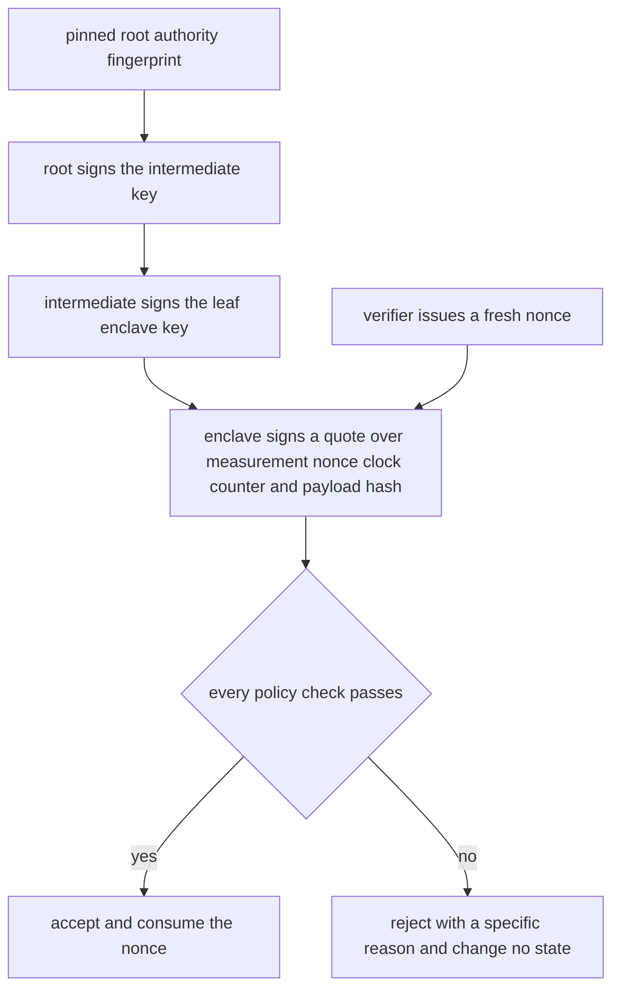
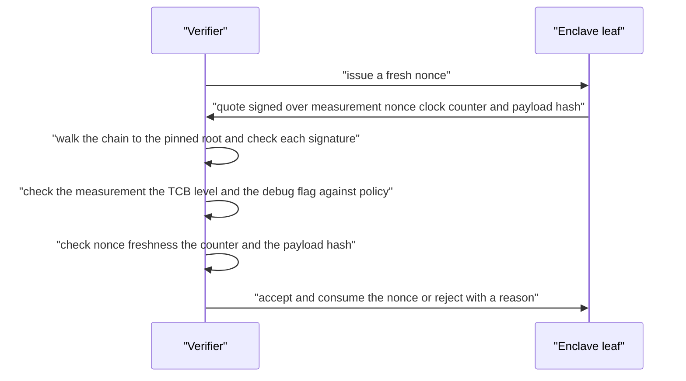
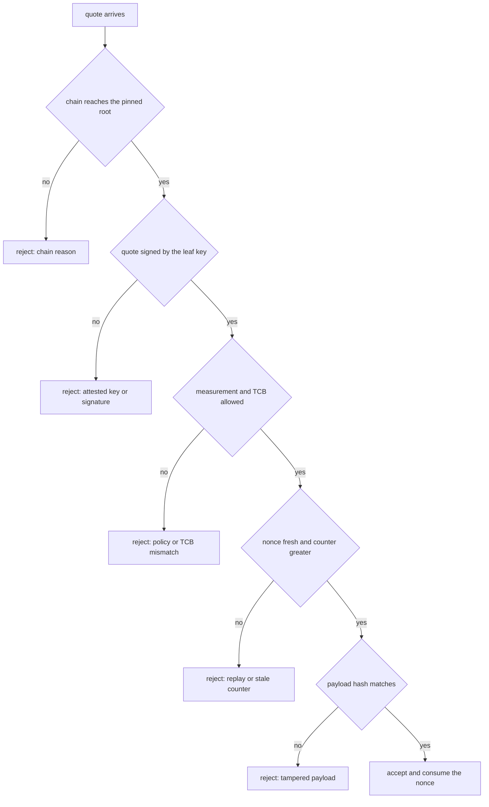
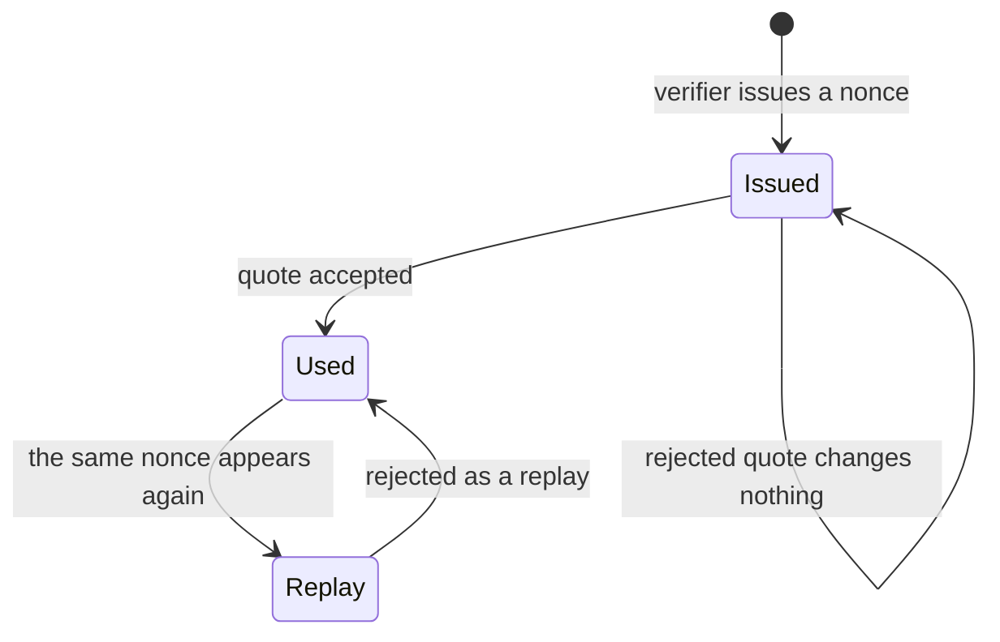

# 841 — Implement secure enclaves chain-of-trust verification demo.

> **Tier:** Master · **CTCI chapter:** Beyond — Security & Privacy
> **Task spec:** [841-implement-secure-enclaves-chain-of-trust-verification-demo.md](../../../tasks/master/841-implement-secure-enclaves-chain-of-trust-verification-demo.md)
> **Solutions:** [Python](../../../solutions/python/master/841-implement-secure-enclaves-chain-of-trust-verification-demo/solution.py) ·
> [Java](../../../solutions/java/master/841-implement-secure-enclaves-chain-of-trust-verification-demo/Solution.java) ·
> [JavaScript](../../../solutions/javascript/master/841-implement-secure-enclaves-chain-of-trust-verification-demo/solution.js) ·
> [C#](../../../solutions/csharp/master/841-implement-secure-enclaves-chain-of-trust-verification-demo/Solution.cs)

## 1. Problem restatement

The spec is one line — *"Implement secure enclaves chain-of-trust verification demo"*. Remote
attestation is modelled end to end in one deterministic process: a chain of certificate
authorities, an enclave that signs a **quote** over its measurement, and a verifier that either
accepts the quote or rejects it with a *specific reason*.

**What is real.** A toy RSA built from deterministically searched 61/63-bit primes (`n` is 125
bits, `e = 65537`), with signing `s = H(m)^d mod n` and verification `s^e mod n == H(m) mod n`.
Certificates signed by their issuer's key with a validity window and a TCB level; a self-signed
root pinned by fingerprint; quotes signed by the leaf key over `(measurement, nonce, clock,
counter, payload hash, debug flag)`; and every policy check as genuine comparison and hashing.

**What is simplified.** No real key material and no OAEP padding — a 125-bit modulus is not secure
against factoring. Real attestation uses ECDSA over P-256, platform-specific quote formats, group
signatures for privacy and hardware monotonic counters; here the counter lives in the verifier and
policies are small explicit sets. No sockets, threads or wall-clock reads: time is an explicit
integer and nonces come from the verifier's own issued set.

**Inputs.** A chain of `Certificate`s, a `directory` mapping subject names to certificates, a
`Policy` (allowed measurements, minimum TCB level, `allow_debug`, `max_clock_skew`, revoked
serials), a verifier `clock`, and a `Quote`.

**Outputs.** Two things from every call: a boolean and a human-readable reason string.

| Measurement | Value |
| --- | --- |
| keys | root modulus 125 bits; 13 authorities generated deterministically |
| chain cost | a 3-link chain needs 2 signature checks, a 10-link chain 9 |
| accepted quote | `"accepted at counter 7 after 4 signature checks"` |
| quotes | 7 accepted, 12 rejected across the attack battery |
| state | a nonce is consumed and a counter advanced **only** on acceptance |

## 2. Intuition

The naive way to trust a remote machine is to trust whoever answers. Attestation replaces that
with a chain of cryptographic statements: a root authority signs an intermediate's key, the
intermediate signs the leaf enclave's key, and the enclave signs a measurement of what it is
running. A verifier that already trusts the root can therefore conclude something about code it
has never seen — and it does so *without* trusting any of the parties in between.

Two properties make this different from ordinary certificate checking. First, the quote is bound
to the verifier: the enclave signs a **nonce that the verifier issued**, so an attacker cannot
replay an old quote. Second, freshness alone is not enough — the counter must strictly increase,
so an attacker cannot roll the enclave back to an earlier valid state and replay that. The
verifier is therefore stateful in exactly two fields per subject: the nonces it has consumed and
the highest counter it has seen.



The demonstration is as much about the *failure* reasons as about the accept path. Every attack the
file exercises — unpinned root, forged intermediate, cycle, expired certificate, missing issuer,
revoked serial, disallowed measurement, TCB mismatch, replay, unissued nonce, stale counter,
tampered payload, a quote signed by the wrong key, a debug enclave — produces a distinct reason
string. That is what makes the demo useful: an operator who sees
`"quote was not signed by the attested enclave key"` learns something different from one who sees
`"nonce has already been used (replay)"`.



## 3. Algorithm

1. `KeyPair(offset)` searches deterministic 61-bit and 63-bit primes for a modulus whose
   Carmichael-style product avoids `e`, computes `d = e⁻¹ mod (p−1)(q−1)`, and keeps a
   fingerprint hash of `(n, e)`.
2. A `Certificate` carries `(serial, subject, key, issuer, not_before, not_after, tcb_level)` and a
   signature from the issuer; the root is self-signed (`issuer == subject`).
3. `Verifier.verify_chain(leaf, directory)` walks from the leaf upward. At each step it rejects a
   repeated subject (cycle), a revoked serial, `not_before > clock`, `not_after < clock`, and a
   TCB level below policy. At the self-signed certificate it checks the pinned fingerprint, then
   verifies the root signature and returns. Otherwise it looks up the issuer, verifies the
   certificate's signature with the parent key, counts one `chain_check`, and continues.
4. `Verifier._verify_quote` runs the chain check first, then binds the quote to the attested leaf
   key (`n` and `e` must match the certificate's), verifies the quote signature, checks the
   measurement against policy **and** against the leaf's TCB level, honors `allow_debug`, checks
   the nonce was issued and is unused, enforces the clock skew, requires a strictly larger counter
   than the stored one, and finally compares the payload hash.
5. Only after every check passes does it mutate state: add the nonce to `used_nonces` and store the
   new counter for that subject.
6. `Verifier.totals` counts accepted and rejected verdicts, so the battery can assert that the
   negative cases were really exercised (`≥ 12` rejected, `≥ 4` accepted).

```text
function verify_chain(leaf, directory, policy, clock)
    seen ← empty set
    certificate ← leaf
    checks ← 0
    while true do
        if certificate.subject in seen then return false and "cycle" end
        add certificate.subject to seen
        if certificate.serial is revoked then return false and "revoked" end
        if certificate.not_before > clock then return false and "not yet valid" end
        if certificate.not_after < clock then return false and "expired" end
        if certificate.tcb_level < policy.min_tcb_level then return false and "TCB below policy" end
        if certificate.issuer = certificate.subject then
            if certificate.key.fingerprint ≠ pinned root then return false and "unpinned root" end
            if not certificate.key.verify(certificate.payload(), certificate.signature) then
                return false and "root signature is invalid"
            end
            return true and "chain verified" with the check count
        end
        if certificate.issuer not in directory then return false and "missing issuer" end
        parent ← directory[certificate.issuer]
        if not parent.key.verify(certificate.payload(), certificate.signature) then
            return false and "bad signature"
        end
        checks ← checks + 1
        certificate ← parent
    end
end

function verify_quote(quote, leaf_cert, directory, payload)
    ok, reason ← verify_chain(leaf_cert, directory)
    if not ok then return false and reason end
    if leaf_cert.key.n ≠ quote.leaf_key.n or leaf_cert.key.e ≠ quote.leaf_key.e then
        return false and "quote was not signed by the attested enclave key"
    end
    if not quote.leaf_key.verify(quote.payload(), quote.signature) then
        return false and "quote signature is invalid"
    end
    if quote.measurement not in policy.allowed_measurements then
        return false and "measurement is not in the policy"
    end
    if quote.measurement ≠ text(leaf_cert.tcb_level) then
        return false and "measurement does not match the attested TCB level"
    end
    if quote.debug and not policy.allow_debug then return false and "debug rejected" end
    if quote.nonce not in issued_nonces then return false and "nonce was never issued" end
    if quote.nonce in used_nonces then return false and "nonce has already been used (replay)" end
    if absolute(quote.clock - verifier.clock) > policy.max_clock_skew then
        return false and "clock skew too large"
    end
    if quote.counter ≤ counters.get(leaf_cert.subject, -1) then
        return false and "counter is stale"
    end
    if quote.payload_hash ≠ hash(payload) then return false and "payload hash does not match" end
    add quote.nonce to used_nonces and store quote.counter for the subject
    return true and "accepted"
end
```



## 4. Worked example

Build a three-link chain `root → ca1 → leaf` (serials `1, 101, 102`), pin the root fingerprint, set
the verifier clock to `100`, and issue a quote from the leaf with measurement `"3"`, counter `7`
and payload `"payload"`.

| Step | Check | Outcome |
| --- | --- | --- |
| 1 | leaf certificate signature by `ca1` | ok, `chain_checks = 1` |
| 2 | `ca1` certificate signature by `root` | ok, `chain_checks = 2` |
| 3 | root is self-signed and matches the pinned fingerprint | ok, chain verified |
| 4 | quote `leaf_key` equals the certificate's key | ok |
| 5 | quote signature over the quote payload | ok |
| 6 | measurement `"3"` in policy and equal to the leaf TCB level | ok |
| 7 | debug flag false / allowed | ok |
| 8 | nonce was issued and is unused | ok |
| 9 | `abs(clock − 100) ≤ 30` | ok |
| 10 | counter `7` > stored (none) | ok |
| 11 | payload hash matches | ok |
| 12 | **accept** | `"accepted at counter 7 after 4 signature checks"`, nonce consumed, counter `7` stored |

The chain cost is one signature check per link below the root: 2 checks for three links, 9 for ten.
The accepted count also reports `chain_checks + 2`, i.e. the leaf's own quote signature plus the
root's self-signature.

Now replay the identical quote. Everything up to the nonce check passes again, and the verdict
flips on one line:

| Attempt | Reason | Side effect |
| --- | --- | --- |
| first, fresh nonce | `"accepted at counter 7 after 4 signature checks"` | nonce consumed, counter 7 |
| identical quote again | `"nonce has already been used (replay)"` | **no** change: `used_nonces` and counters stay as they were |
| quote with a never-issued nonce | `"nonce was never issued"` | none |
| quote with counter 7 again after counter 9 | `"counter 7 is stale"` | none |
| quote whose payload changed | `"payload hash does not match"` | none |
| quote signed by a foreign key | `"quote was not signed by the attested enclave key"` | none |
| measurement outside policy | `"measurement is not in the policy"` | none |
| debug enclave, policy forbids it | `"debug enclave rejected by policy"` | none |

The state-machine assertion is the subtle one: a rejected verification must leave `used_nonces` and
`counters` *byte-identical*, otherwise a failed attempt would burn the verifier's fresh nonce and
let an attacker deny service by sending one bad quote. The file keeps a snapshot before the
rejections and asserts equality afterwards.



## 5. Complexity

`k` is the chain length, `b` the modulus size in bits, and `q` the number of quotes verified.

| Measure | Bound | Why it holds |
| --- | --- | --- |
| Chain verification | Θ(k) signature checks | one per link below the root: 2 for 3 links, 9 for 10 |
| One signature check | Θ(b²) to Θ(b³) | modular exponentiation with a `b`-bit exponent, `b = 125` |
| Quote verification | Θ(k) + O(1) checks | chain plus a constant number of comparisons and hashes |
| Nonce issuance | O(1) | one hash from label, clock and a serial counter |
| State per subject | O(1) | one stored counter plus the global used-nonce set |
| Space | Θ(k) certificates + O(q) nonces | the directory and the consumed-nonce set |
| Alternative: no pinning | Θ(k) but unsound | a chain ending at any self-signed certificate is worthless |
| Alternative: hardware counters | O(1) check, no verifier state | real monotonic counters live in the TPM rather than in the verifier |

The cost that matters operationally is that verification is **linear in chain depth and constant in
the size of the attested program**: the measurement is a hash inside the quote, not a re-run of the
workload. Everything else — clock skew, policy sets, nonce bookkeeping — is a constant-time
comparison over a small state.

## 6. Pitfalls and edge cases

- **Pinning is the whole trust anchor.** A chain that verifies up to *some* self-signed certificate
  is not evidence of anything; the file asserts that an unpinned root gives
  `"self-signed chain does not end at the pinned root"`.
- **A rejected quote must not mutate state.** Check ordering matters: the nonce is consumed and the
  counter stored only after the last check passes, and the test snapshots both structures across a
  batch of rejections.
- **Cycles and missing issuers are distinct failures.** A chain that loops back returns
  `"cycle in the chain"`; a certificate naming an issuer absent from the directory returns
  `"missing issuer"`. Both must terminate, so `verify_chain` tracks seen subjects.
- **Replay is not the same as staleness.** An old nonce fails freshness, while a fresh nonce with a
  non-increasing counter fails anti-rollback; the toy binds the *measurement string* to the leaf
  certificate's TCB level (`"%d" % tcb_level`), so a measurement that policy would allow can still
  be rejected for the TCB mismatch.
- **Clock skew and revocation are policy data, not clocks.** `abs(quote.clock − verifier.clock) > 30`
  is rejected, and `policy.revoked_serials` is consulted on every link, so revoking an intermediate
  fails every chain through it. There is no wall clock anywhere in the file.
- **Debug enclaves are a policy decision.** They are rejected unless `allow_debug` is set, and the
  battery verifies both directions. Tampering with a quote field breaks the signature, because the
  signature covers measurement, nonce, clock, counter, payload hash and the debug flag.

## 7. Variants and follow-ups

- **Identity documents instead of attestation.** The certificate-chain machinery is the same shape
  as a DID/VC flow, where the issuer signature plays the attestation role:
  [837-implement-decentralized-identity-did-system-with-verifiable-cred.md](../../../tasks/master/837-implement-decentralized-identity-did-system-with-verifiable-cred.md).
- **Enclave-backed storage.** Extending attestation from "verify a quote" to "keep a store inside
  the enclave":
  [812-implement-secure-enclave-backed-key-value-store-with-remote-atte.md](../../../tasks/master/812-implement-secure-enclave-backed-key-value-store-with-remote-atte.md).
- **Attestation versus other hiding mechanisms.** Where an enclave hides data behind hardware,
  FHE hides it behind noise
  ([840-implement-fully-homomorphic-encryption-demo-simple-arithmetic-to.md](../../../tasks/master/840-implement-fully-homomorphic-encryption-demo-simple-arithmetic-to.md)),
  and a SNARK certifies a computation with no trusted platform at all
  ([834-implement-zk-snark-circuit-for-a-simple-arithmetic-program-toy.md](../../../tasks/master/834-implement-zk-snark-circuit-for-a-simple-arithmetic-program-toy.md),
  [835-implement-recursive-snark-composition-outline-conceptual.md](../../../tasks/master/835-implement-recursive-snark-composition-outline-conceptual.md)).

## 8. Check yourself

1. Why is the nonce issued by the verifier rather than chosen by the enclave?

<details><summary>Show answer</summary>

Because freshness must be defined by the party that cares. If the enclave picked the nonce, an
attacker could re-send any previously accepted quote unchanged. By signing a value the verifier
issued *for this session*, the quote becomes bound to that session, and the verifier can maintain a
`used_nonces` set so the same value is never accepted twice — which the battery exercises as
`"nonce has already been used (replay)"`.

</details>

2. What does the pinned root fingerprint defend against?

<details><summary>Show answer</summary>

A chain that ends at a self-signed certificate the verifier never agreed to trust — an attacker can
always mint their own root, sign an intermediate and a leaf, and produce a perfectly valid chain
ending nowhere useful. `verify_chain` therefore checks
`certificate.key.fingerprint == self.pinned_root` at the self-signed link and returns
`"self-signed chain does not end at the pinned root"` otherwise.

</details>

3. Why check the counter when the nonce is already fresh?

<details><summary>Show answer</summary>

Because they defend different attacks. The nonce stops a *replay* of a captured quote; the counter
stops a *rollback* to an older enclave state that legitimately produced a quote with a different
nonce. Requiring `quote.counter > stored counter` per subject, and storing it only on acceptance,
makes the verifier's memory monotone — the anti-rollback property that real platforms implement
with hardware counters.

</details>

4. Why must a rejection leave the verifier's state untouched?

<details><summary>Show answer</summary>

Because state changes are side effects an attacker can trigger. If a failed verification consumed
the nonce, anyone able to send one malformed quote could burn the verifier's fresh nonce and deny
service; if it advanced the counter, an attacker could push the verifier's memory forward and make
honest quotes look stale. The file snapshots `used_nonces` and `counters`, runs the whole rejection
battery, and asserts both are unchanged.

</details>
