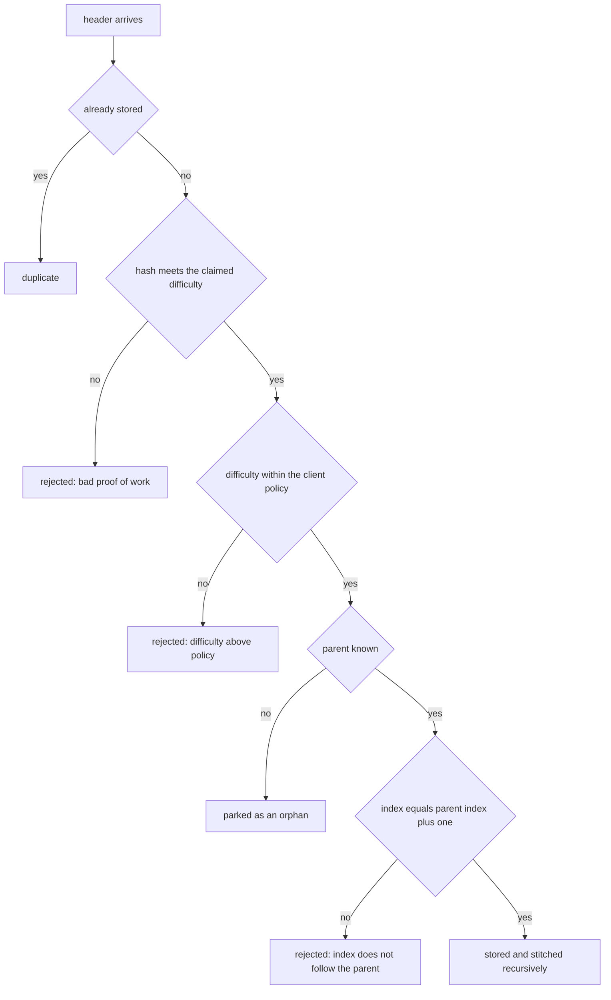
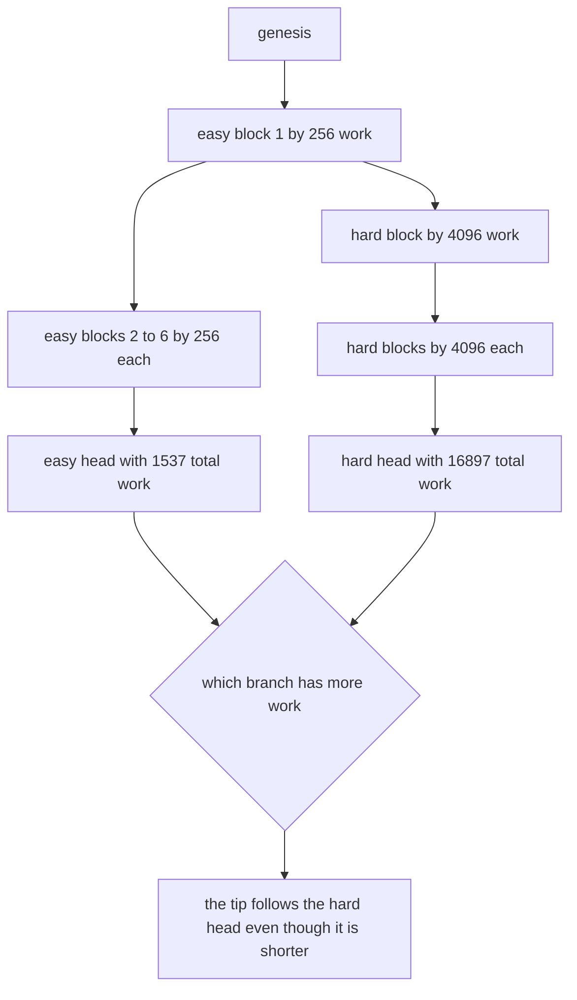
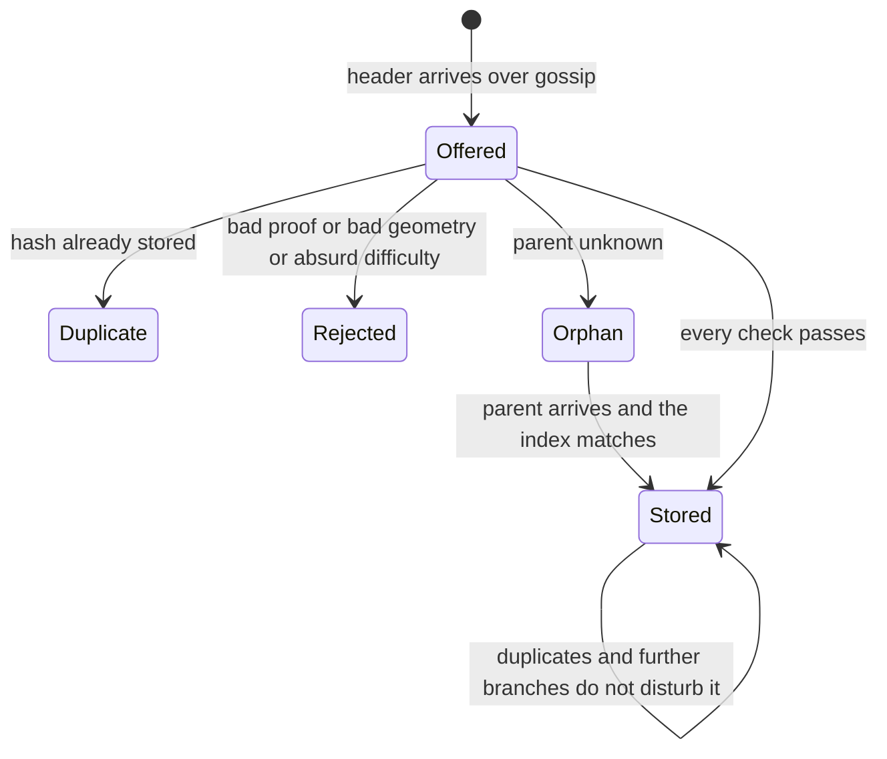
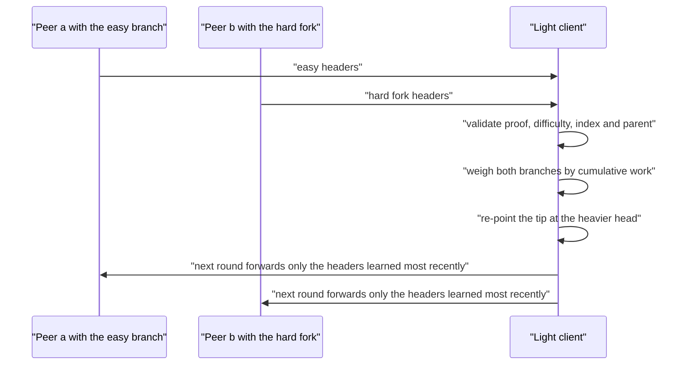

# 842 — Implement blockchain light node gossip + header stitching robustly.

> **Tier:** Master · **CTCI chapter:** Beyond — System Design & Scalability
> **Task spec:** [842-implement-blockchain-light-node-gossip-header-stitching-robustly.md](../../../tasks/master/842-implement-blockchain-light-node-gossip-header-stitching-robustly.md)
> **Solutions:** [Python](../../../solutions/python/master/842-implement-blockchain-light-node-gossip-header-stitching-robustly/solution.py) ·
> [Java](../../../solutions/java/master/842-implement-blockchain-light-node-gossip-header-stitching-robustly/Solution.java) ·
> [JavaScript](../../../solutions/javascript/master/842-implement-blockchain-light-node-gossip-header-stitching-robustly/solution.js) ·
> [C#](../../../solutions/csharp/master/842-implement-blockchain-light-node-gossip-header-stitching-robustly/Solution.cs)

## 1. Problem restatement

The spec is one line — *"Implement blockchain light node gossip + header stitching robustly"*. A
light client keeps only block **headers**, learns them from peers over flood gossip, stitches them
into a validated tree as they arrive (possibly out of order), and follows the heaviest branch by
cumulative proof-of-work — the behaviour an SPV client needs to answer "is this transaction in the
best chain?" without ever downloading bodies.

**The modelling contract.** There are no sockets, threads or wall-clock reads. Hashing is SHA-256
over a canonical header encoding; "proof of work" means the digest starts with `difficulty` zero
hex digits; every node is a plain object with an inbox; and a **round** is one deterministic pass
in which each node forwards exactly the headers it learned in the previous round — store-and-forward
flooding with hash deduplication.

**What is simplified.** Real clients negotiate with a few peers, request headers in batches and
apply retargeting and median-time rules; here every peer floods every header, difficulty is fixed
per block, there is no timestamp and no chainwork adjustment, the smallest-hash tie-break stands in
for a real chain-selection rule, and difficulties stay at 2–3 leading hex digits so mining is
instant. What *is* genuine: every validation, stitch, fork choice and merkle proof.

**Inputs.** A genesis header, groups of transaction ids per block, per-block difficulties, and a
list of peers with round count.

**Outputs.** `LightNode.offer(header)` returns a verdict string (`stored`, `duplicate`, `orphan`,
`rejected`), plus counters, the current `tip`, cumulative `work`, `path_to_genesis()` and
`depth_of()`. `run_gossip(peers, rounds)` returns the per-round delivered-message counts.

| Measurement | Value |
| --- | --- |
| proof of work | 3 of 400 random nonces meet difficulty 2, as expected for `1/256` |
| stitching | 5 orphans stitched, 10 stored, 6 duplicates, 0 rejected |
| fork choice | the easy chain weighs 1537, the shorter harder fork 16897 |
| gossip | 4 rounds, traffic `[18, 32, 32, 32]`, 1 converged tip |
| hostile headers | 3 distinct rejection reasons recorded; the tip never moves |
| bodies | `client.bodies` stays empty — headers only |

## 2. Intuition

The naive light client asks a peer "give me the chain". It then trusts that peer completely: the
peer can serve a short chain, a stale chain, or a fabricated one, and the client cannot tell. The
fix has two halves — *validate every header yourself* and *accept headers from many peers in any
order*.

Validation is cheap because a header commits to everything: index, parent hash, merkle root,
difficulty and nonce, and the header's own hash is the block id. A header is only admissible if its
hash meets the claimed difficulty, the difficulty is within policy, its index is exactly the
parent's index plus one, and its parent is already known. The last condition is what makes order
irrelevant: an unknown parent means the header is *parked as an orphan*, and when the parent
arrives the whole parked subtree is stitched in one go.



The second half is fork choice. Two peers will legitimately disagree about the best head, so the
client cannot simply keep the longest chain: it maintains cumulative work `Σ 16^difficulty` along
each branch and points its tip at the branch with the most work. A **shorter** branch of harder
blocks therefore wins — which is the whole point of proof of work — and a *reorg* is nothing more
than a tip change: the client re-points to the heavier head, keeps the abandoned headers around,
and headers below the fork point never move.



## 3. Algorithm

1. `header_blob(index, prev, merkle, difficulty, nonce)` gives a canonical encoding; `Header`
   hashes it with SHA-256 and `work()` returns `16^difficulty`.
2. `valid_proof(header)` checks the hash starts with `difficulty` zero hex digits, and `mine`
   increments the nonce until it does.
3. `merkle_root(txids)` builds the tree with the odd-duplicate rule (a lone node is duplicated),
   `merkle_proof(txids, index)` returns the `(side, hash)` sibling path, and `verify_proof`
   recomputes upward from the leaf.
4. `LightNode.offer(header)` is the validation state machine: duplicate → reject on proof → reject
   on policy difficulty → park as orphan when the parent is unknown → reject on index mismatch →
   otherwise store, link, `_consider` for fork choice, and `_stitch`.
5. `_stitch(parent_hash)` pops every parked orphan whose parent just arrived, applies the same
   checks, and queues the newly stored hashes so a whole chain can land in one call.
6. `_consider(header)` sets `work[hash] = work[parent] + header.work()` and moves the tip when the
   new branch is strictly heavier — ties break on the smaller hash, which makes fork choice
   deterministic.
7. `path_to_genesis()` walks parents up to the `0…0` genesis link and returns `None` if the branch
   is not connected; `depth_of(hash)` is the path length minus one.
8. `Peer` wraps a `LightNode` with a `fresh` set; `run_gossip(peers, rounds)` builds one message per
   (sender, receiver, hash) in the round, delivers them, and records how many were delivered per
   round.

```text
function valid_proof(header)
    return header.hash starts with header.difficulty zero hex digits
end

procedure offer(header)
    if header.hash is already stored then record duplicate and return "duplicate" end
    if not valid_proof(header) then record reason "bad proof of work" and return "rejected" end
    if header.difficulty > max_difficulty then
        record reason "difficulty above policy" and return "rejected"
    end
    if header.prev is not known then park the header under header.prev and return "orphan" end
    parent ← headers[header.prev]
    if header.index ≠ parent.index + 1 then
        record reason "index does not follow the parent" and return "rejected"
    end
    store the header, link it to its parent and consider it for the tip
    stitch every parked orphan that now has a parent
    return "stored"
end

procedure stitch(parent_hash)
    queue ← [parent_hash]
    while queue is not empty do
        current ← remove the last element of queue
        for header in orphans[current] do
            if header is already stored or fails its proof then continue end
            if header.index ≠ headers[current].index + 1 then record reason and continue end
            store the header, link it, consider it for the tip
            append header.hash to queue
        end
    end
end

procedure consider(header)
    work[header.hash] ← work[header.prev] + 16 to the header.difficulty
    if work[header.hash] > work[tip] then tip ← header.hash
    else if work[header.hash] = work[tip] and header.hash < tip then tip ← header.hash end
end

function path_to_genesis(tip)
    walk parents from tip
    return the list of hashes when the walk ends at the genesis link, otherwise nothing
end

procedure run_gossip(peers, rounds)
    for each round do
        messages ← one message per ordered peer pair and per hash the sender learned last round
        delivered ← 0
        for each message do offer the header at the receiver and count the delivery
        record delivered as this round's traffic
    end
end
```



## 4. Worked example

A six-block chain of difficulty 2 above genesis. Deliver the headers in **reverse** order,
`index 6, 5, 4, 3, 2, 1`:

| Delivery | Verdict | Why | Orphans parked | Cumulative work at the tip |
| --- | --- | --- | --- | --- |
| index 6 | `orphan` | parent (index 5) unknown | 1 | 1 (genesis) |
| index 5 | `orphan` | parent (index 4) unknown | 2 | 1 |
| index 4 | `orphan` | parent unknown | 3 | 1 |
| index 3 | `orphan` | parent unknown | 4 | 1 |
| index 2 | `orphan` | parent unknown | 5 | 1 |
| index 1 | `stored` | parent is genesis | 0 | 257 |
| stitch | 5 `stitched` | the parked subtree attaches in one call | 0 | 1537 |

The final state is identical to in-order delivery: the tip is the index-6 head, `depth_of` is 6, and
every header's index is one more than its parent's. Re-offering all six headers produces six
`duplicate` verdicts and leaves the tip and the cumulative work untouched — gossip floods, so
deduplication is not an optimisation but a correctness requirement for the counters.

Then the fork. Branch from the *index-2* header instead of the current head, with four blocks at
difficulty 3:

| Branch | Blocks | Length | Work |
| --- | --- | --- | --- |
| main | 6 blocks of difficulty 2 | 6 | `1 + 6·256 = 1537` |
| fork | 4 blocks of difficulty 3 | 4 | `1 + 2·256 + 4·4096 = 16897` |

Offering the four fork headers switches the tip to the fork head even though the fork is *shorter*,
because `Σ 16^difficulty` is what the client maximises. The abandoned branch is still stored, the
new branch walks back to genesis, and the three main-chain headers below the fork point are
untouched — the "depth 3 is stable" property, measured rather than assumed.

Hostile headers are refused with distinct reasons, and none of them moves the tip:

| Header | Verdict | Reason recorded |
| --- | --- | --- |
| mined with a nonce that fails difficulty 2 | `rejected` | `bad proof of work` |
| claims difficulty 9 against `max_difficulty = 3` | `rejected` | `difficulty above policy` |
| index 7 whose parent is genesis (index 0) | `rejected` | `index does not follow the parent` |
| parent `f…f`, never seen | `orphan` | parked, not accepted |



Across four gossip rounds the traffic is `[18, 32, 32, 32]` delivered messages and all three peers
— two full nodes and one light node — converge on a single tip, which is the heaviest branch any of
them knows. The light node rejects nothing during honest gossip, records duplicates as expected, and
never stores a transaction body: `bodies` stays empty while merkle proofs still verify against the
headers it holds.

## 5. Complexity

`n` peers, `r` gossip rounds, `h` headers total, `t` transactions in a block, `d` branch depth.

| Measure | Bound | Why it holds |
| --- | --- | --- |
| Header hash | O(1) hashes | one SHA-256 over a fixed-size blob |
| `offer` (happy path) | O(stitched) | usually O(1); a cascade of orphans costs one step per stitched header |
| Proof of work | expected `16^difficulty` hashes | 256 attempts per difficulty-2 block, measured as 3/400 |
| Merkle root | Θ(t) hashes | one layer per level, `t − 1` internal nodes |
| Merkle proof size | Θ(log t) | one sibling per level |
| Fork choice | O(1) per header | one addition and a comparison against the current tip |
| `path_to_genesis` / `depth_of` | Θ(d) | one step per ancestor |
| Gossip per round | O(n²·h) messages | every peer sends its fresh set to every other peer: 3 peers × 2 receivers × fresh headers |
| Space | O(h) headers | no bodies, no state trie, no transaction index |
| Alternative: trust one peer | O(h) download, no validation | a single lying peer is indistinguishable from the truth |

The asymptotic story is that a light client's storage and validation cost are linear in **header**
count, not in the chain's data size, and that fork choice is O(1) per header — which is what makes
following a long chain from a phone feasible. The gossip layer is the quadratic part, and it is
quadratic on purpose: flooding is the simplest robust dissemination strategy, and the file measures
how many rounds it takes for three peers to converge.

## 6. Pitfalls and edge cases

- **Out-of-order delivery is the normal case.** Every header whose parent has not arrived must be
  parked, not dropped; the reverse-order test asserts five orphans and five stitches for six blocks.
- **Orphan stitching must be recursive.** One arriving parent can unlock a chain of parked headers,
  so `_stitch` uses a queue instead of a single pass.
- **Reject before doing work.** An absurd claimed difficulty (`9` when policy allows `3`) is
  refused without mining anything; checking proof of work first would make the client burn hashes
  on hostile input.
- **The index must follow the parent, not the local height.** A header at index `7` claiming the
  genesis parent is rejected; the check is `header.index == parent.index + 1`, which is what keeps
  the tree topology honest.
- **Shorter can be heavier.** Fork choice is cumulative work, so the six-block easy chain loses to a
  four-block hard fork (`1537` vs `16897`). Comparing lengths is the classic SPV bug.
- **Ties need a deterministic rule.** Equal work resolves on the smaller hash, so all peers converge
  on the same tip instead of oscillating.
- **A reorg must not delete history.** The abandoned head stays in `headers`, and headers below the
  fork point are asserted present after the switch.
- **The light node keeps no bodies.** `bodies` is empty throughout while merkle proofs still verify
  — that is the entire point of a header-only client.
- **Empty and singleton merkle trees.** No transactions hash `SHA-256("empty")`, and a single-leaf
  tree is just the leaf hash; the odd-duplicate rule makes both well defined.

## 7. Variants and follow-ups

- **The full-node side of the same chain.** Blocks, shards and cross-shard messaging:
  [832-implement-sharded-blockchain-prototype-with-cross-shard-messagin.md](../../../tasks/master/832-implement-sharded-blockchain-prototype-with-cross-shard-messagin.md)
  and [831-implement-blockchain-light-client-with-spv-proofs-and-pruning.md](../../../tasks/master/831-implement-blockchain-light-client-with-spv-proofs-and-pruning.md).
- **Reaching agreement instead of weighing branches.** Where forks are the failure mode, consensus
  decides: [833-implement-consensus-over-heterogeneous-trust-federated-consensus.md](../../../tasks/master/833-implement-consensus-over-heterogeneous-trust-federated-consensus.md)
  and [811-implement-byzantine-fault-tolerant-replicated-state-machine-prac.md](../../../tasks/master/811-implement-byzantine-fault-tolerant-replicated-state-machine-prac.md).
- **Proofs about the headers themselves.** Stitching is a chain of commitments, the same shape as
  recursive proof composition:
  [835-implement-recursive-snark-composition-outline-conceptual.md](../../../tasks/master/835-implement-recursive-snark-composition-outline-conceptual.md).

## 8. Check yourself

1. Why can a light client accept headers in any order?

<details><summary>Show answer</summary>

Because validation is local and parent-relative: a header is checked against *its parent's* hash and
index, not against the client's current height. A header whose parent is unknown is parked as an
orphan and stitched when the parent arrives — recursively, so a whole chain delivered backwards
lands in one cascade. The reverse-order test shows five orphans and five stitches for six blocks,
ending at the same tip as in-order delivery.

</details>

2. Why does the six-block easy chain lose to a four-block hard fork?

<details><summary>Show answer</summary>

Because the client maximises cumulative work `Σ 16^difficulty`, not length: `1537` for the easy
chain versus `16897` for the fork (`1 + 2·256 + 4·4096`). A branch that took strictly more hashing
effort is the one an attacker would have to outrun, which is the security argument behind following
the heaviest branch rather than the longest.

</details>

3. What happens to the old branch after a reorg?

<details><summary>Show answer</summary>

Nothing is deleted. `headers` retains the abandoned head, `path_to_genesis()` for the new tip
returns a connected branch, and headers below the fork point — the first three of the main chain —
are still present. Only `tip` and the derived work comparison change, which is what makes a reorg
a pointer update rather than a rebuild.

</details>

4. What does the merkle machinery add to a header-only client?

<details><summary>Show answer</summary>

Membership: given the root committed in a header the client already validated, a `(side, hash)`
sibling path of length `log t` proves that a specific transaction is in that block. The tests flip a
sibling, substitute a different transaction and swap the root — all rejected — which is exactly the
SPV guarantee that makes header-only validation useful.

</details>
