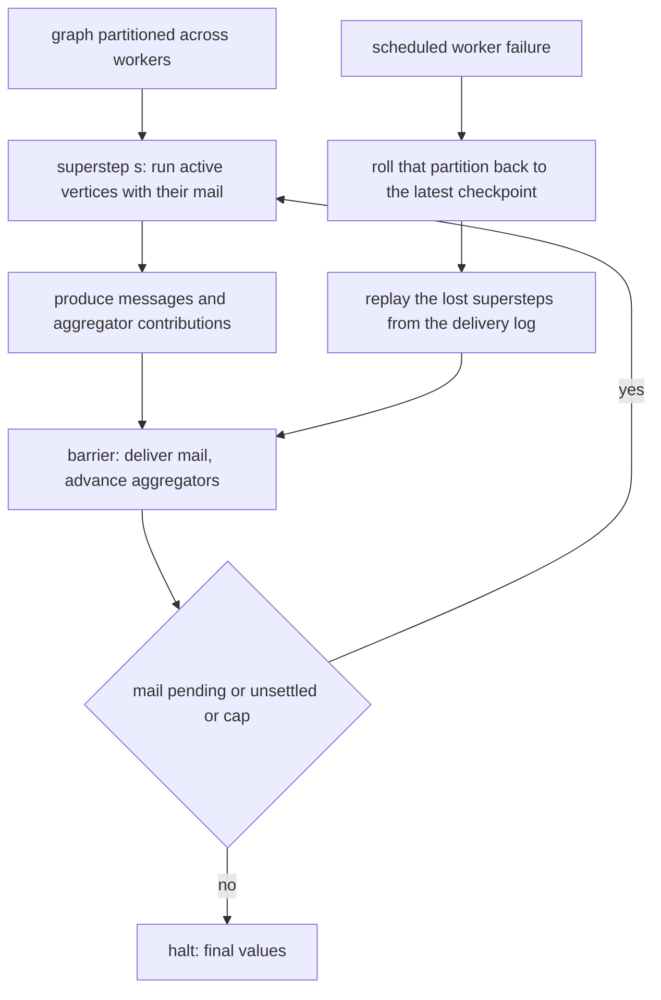
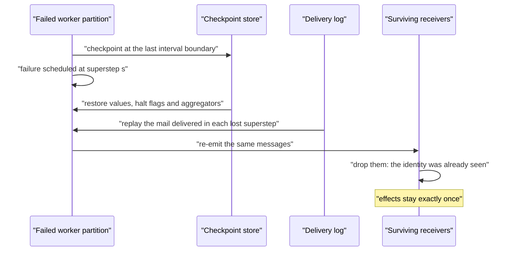
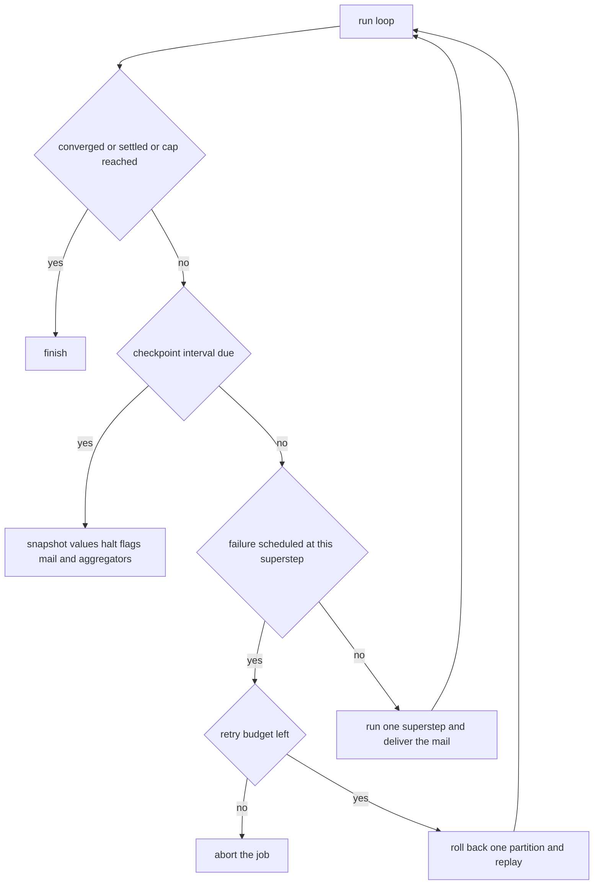
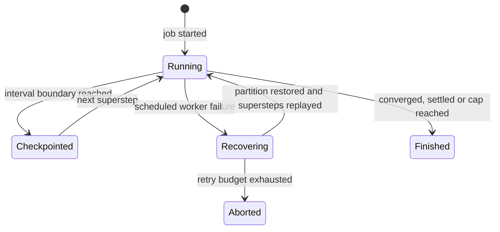

# 843 — Implement large-scale graph processing pipeline (Pregel-like) with fault tolerance.

> **Tier:** Master · **CTCI chapter:** Beyond — System Design & Scalability
> **Task spec:** [843-implement-large-scale-graph-processing-pipeline-pregel-like-with.md](../../../tasks/master/843-implement-large-scale-graph-processing-pipeline-pregel-like-with.md)
> **Solutions:** [Python](../../../solutions/python/master/843-implement-large-scale-graph-processing-pipeline-pregel-like-with/solution.py) ·
> [Java](../../../solutions/java/master/843-implement-large-scale-graph-processing-pipeline-pregel-like-with/Solution.java) ·
> [JavaScript](../../../solutions/javascript/master/843-implement-large-scale-graph-processing-pipeline-pregel-like-with/solution.js) ·
> [C#](../../../solutions/csharp/master/843-implement-large-scale-graph-processing-pipeline-pregel-like-with/Solution.cs)

## 1. Problem restatement

The spec is one line — *"Implement large-scale graph processing pipeline (Pregel-like) with fault
tolerance"*. The solutions implement a bulk-synchronous (BSP) vertex-centric engine: the graph is
partitioned across workers, each superstep runs every **active** vertex against the messages it
received in the previous superstep, and a barrier moves the produced messages over an explicit
in-memory network.

**The modelling contract.** There are no threads, sockets, sleeps or wall-clock reads: workers,
messages and checkpoints are plain data structures, and a failure is a **scheduled event**, not a
real crash. Simplified versus production: the network is a dictionary, the log lives in memory,
and only one worker fails at a time (a second failure is scheduled after the first recovery, and
exhausting the retry budget aborts the job). What is *not* simplified is the semantics — results
must be bit-identical to a failure-free run.

**Inputs.** An adjacency map `vertex → [(target, weight)]`, worker count, a checkpoint interval,
aggregators, an optional combiner, a tolerance and superstep cap, plus `(superstep, worker)`
failure events.

**Outputs.** `values` per vertex, `halted` flags, mailboxes, `pending()`, `converged()`,
`settled()`, and counters (`supersteps`, `sent`, `delivered`, `combined`, `cross_worker`,
`checkpoints`, `replays`, `replayed_steps`, `duplicates`, `emitted_on_replay`).

| Measurement | Value |
| --- | --- |
| graph | 8 vertices, 12 edges, a dangling sink, a self loop, two components |
| partition | 3 workers with counts `3 / 3 / 2` and `2752` cross-worker deliveries |
| PageRank | 172 supersteps, deviation `4.83e-13` from the dense oracle, ranks summing to `1`, sink rank `0.128260783` |
| combiner | delivers fewer messages, changes no value; `1368` combined, `2052` saved |
| SSSP | matches Bellman-Ford exactly; distance to the sink is 5, unreachable vertex stays `∞` |
| faults | 20 recovery scenarios, up to 5 replayed supersteps, 5 replayed messages dropped by identity |

## 2. Intuition

The naive large-graph computation is one machine walking the whole graph. It stops scaling for two
reasons: the graph does not fit in one machine's memory, and a single failure loses hours of work.
Pregel's answer is to make the *vertex* the unit of computation and the *superstep* the unit of
time: every vertex runs the same user function, sees only the messages addressed to it, and the
barrier between supersteps is the only synchronisation.

That design has three consequences worth naming. Iteration becomes message passing, so an algorithm
is expressed as "what do I send my neighbours when I change?" — PageRank, SSSP and connected
components all fall out of that shape. Termination is a *vote*: a vertex halts when it has nothing
left to say, and a run ends when no messages are in flight and every vertex has voted. And
aggregators give every vertex a global view — PageRank's convergence test is a `maxdelta`
aggregator, because a vertex cannot know on its own whether the whole iteration has settled.



Fault tolerance is where the engineering lives. A checkpoint every `k` supersteps captures values,
halt flags, in-flight mail and aggregator state; a worker failure rolls **only that worker's
partition** back to the latest checkpoint — surviving workers keep their newer state, so their
deliveries are not repeated — and the lost supersteps are replayed from a per-worker log of the
mail that was actually delivered. The replayed work re-emits the same messages, and receivers
recognise them by `(source, superstep, sequence)` identity and drop them. The result: a worker's
work is redone but its *effect* is exactly once, which is why a faulted run is bit-identical to a
clean one.



## 3. Algorithm

1. `PregelEngine.__init__` sorts the vertices and assigns `owner[vertex] = index % workers`, so the
   partition is deterministic and balanced, and every run sends the same messages in the same order.
2. `initialise(initial, active)` sets per-vertex values and halt flags; `inject(vertex, payload)`
   seeds a mailbox — the master's kick-off message.
3. `superstep(compute)`: snapshot the inbox, clear the mailboxes, record the delivery log for this
   step, and run every vertex that is either unhalted or has mail. Each call returns
   `(new_value, sends, voted_to_halt)`; aggregator contributions are staged for the *next* step.
4. `_route(index, produced)` deduplicates by `(source, superstep, sequence)`, counts sent and
   cross-worker deliveries, applies the combiner per target, and installs the new mailboxes.
5. Termination: `pending() > 0` keeps the run alive; `converged()` needs empty mail *and* every
   vertex halted; `settled()` is the global aggregator criterion (`maxdelta < tol`, after two
   supersteps); and a cap bounds the run.
6. `snapshot()` captures values, halt flags, mail and aggregator state; `restore(snapshot, worker)`
   restores either everything or only one worker's slice — deliberately partial, so surviving
   workers' newer deliveries are not repeated. Message identities (`seen`) are never rolled back.
7. `fail_worker(worker, compute)` finds the newest usable checkpoint, restores that worker's slice,
   replays each lost superstep using the *logged* mail, and counts the replayed steps and the
   duplicate messages the receivers dropped.
8. `run(compute, fail_plan)` checkpoints on the interval, handles each scheduled failure once, and
   raises `RuntimeError` when the retry budget is exhausted.

```text
procedure superstep(compute)
    index ← counters.supersteps
    inbox ← current mail; mail ← empty mailboxes
    record inbox in the delivery log for this step
    for vertex in sorted vertices do
        if not halted[vertex] or inbox[vertex] is not empty then
            new_value, sends, voted ← compute(vertex, values[vertex], inbox[vertex], context)
            halted[vertex] ← voted
            if new_value is not nothing then values[vertex] ← new_value end
            produced[vertex] ← sends
        end
    end
    counters.supersteps ← counters.supersteps + 1
    advance every aggregator
    route(produced, index)
    return pending() > 0
end

procedure route(produced, index)
    buffered ← empty map from target to list of payloads
    for source and its sends do
        for sequence and (target, payload) in sends do
            key ← (source, index, sequence)
            if key was seen then count a duplicate and continue end
            mark key as seen
            count a send, and a cross-worker send when the owners differ
            append payload to buffered[target]
        end
    end
    for target in sorted buffered do
        if there is a combiner then
            payloads ← combiner(payloads)
            count the messages that were combined away
        end
        mail[target] ← the payloads
    end
end

procedure fail_worker(worker, compute)
    start ← newest checkpoint not newer than the current superstep
    restore the checkpoint slice owned by worker
    for step in start to current - 1 do
        for vertex owned by worker do
            replay compute with the mail logged for that step
            update the value, halt flag and produced messages
        end
        advance every aggregator
        count the messages that the receivers dropped as duplicates
        count one replayed step
    end
    count one recovery
end
```



## 4. Worked example

The sample graph has 8 vertices and 12 edges, including a dangling sink (`5`), a self loop
(`7 → 7` with weight 3) and a second component (`6 ↔ 7`). The partition by sorted index modulo 3 is
`worker 0 → {0, 3, 6}`, `worker 1 → {1, 4, 7}`, `worker 2 → {2, 5}` — counts `3 / 3 / 2`, so the
partition is balanced and all three workers own something.

**PageRank** starts every vertex at `1/8`, uses `damping = 0.85`, and terminates when the
`maxdelta` aggregator reports that the largest per-vertex change is below `1e-13`.

| Superstep | What happens | Aggregator |
| --- | --- | --- |
| 0 | every vertex computes `(1−d)/8 + d·0 = 0.01875` and sends its share to its out-neighbours | `maxdelta` staged |
| 1 | the first real inbound shares arrive; the sink redistributes `rank/8` to *everyone* because it has no out-edges | `maxdelta` visibly larger than 0 |
| … | 172 supersteps of share-passing | `maxdelta` shrinks monotonically |
| final | `maxdelta < 1e-13` | run stops well before the cap of 300 |

| Result | Value |
| --- | --- |
| deviation from the dense power-iteration oracle | `4.83e-13` |
| sum of all ranks | `0.999999999999` |
| rank of the dangling sink (vertex 5) | `0.128260783` |
| delivered messages | `3420`, of which `2752` crossed a worker boundary |
| combined / saved by the sum combiner | `1368` combined, `2052` messages never delivered |

Two details in that table are the ones the file checks hardest. The dangling sink is handled by
*redistribution* — it sends `rank/n` to every vertex — rather than by a teleport term, and its final
rank matches the oracle to `1e-9`. And no vertex votes to halt individually in the PageRank job:
a vertex that stopped sending while its neighbours still waited for its share would leak rank mass,
so this algorithm ends on the aggregator criterion instead. The rank sum staying at exactly 1 is
the evidence that nothing leaked.

**SSSP and components** exercise the halt-vote path instead. From source `0`, distances match
Bellman-Ford exactly; the sink `5` is 5 hops away by the path `0-1-2-3-4-5`, and vertex `6` stays at
infinity because it lives in the other component. Component labelling agrees with union-find, with
`0` and `5` sharing a label and `6` separate. Re-running the same job twice gives identical values
*and* identical counters — the determinism the whole engine is built around.

**Fault injection.** The sweep fails a worker at every superstep of a run, with two checkpoint
intervals, and compares against the failure-free baseline:

| Scenario | Replayed steps | Duplicates observed | Values |
| --- | --- | --- | --- |
| failure right after a checkpoint | some (bounded by the interval) | `> 0` | identical to baseline |
| failure at superstep 1 | `0` | `0` | identical to baseline |
| two failures in one job | 2 recoveries recorded | dropped by identity | identical to baseline |
| component labelling with one failure | `1` | `5` duplicates `= 5` emitted on replay | identical to baseline |

Every one of the 20 scenarios reproduces the baseline values exactly. The duplicate count is the
proof that the replay actually happened and the receiver recognised the re-sent messages; the
replay cost never exceeds the checkpoint interval, which is the whole reason for checkpointing. Two
degenerate ends are also covered: with no checkpoint available the recovery raises, and exhausting
the retry budget aborts the job rather than looping forever.



## 5. Complexity

`V` vertices, `E` edges, `S` supersteps, `W` workers, `k` the checkpoint interval, and `m` the
messages in flight.

| Measure | Bound | Why it holds |
| --- | --- | --- |
| One superstep | Θ(V + m) | every vertex is visited; every message is routed once |
| Total run | Θ(S·(V + m)) | 172 supersteps for PageRank on the sample graph |
| Routing | Θ(m) per superstep | one dictionary insertion per produced message, plus identity hashing |
| Combiner | reduces `m` toward `E` per target | `2052` of `3420` messages were combined away |
| Partitioning | Θ(V log V) | one sort; assignment is `index % W`, giving `3 / 3 / 2` |
| Checkpoint | Θ(V + m) | values, halt flags, mail and aggregator state |
| Recovery | Θ(k·V_partition) | only the failed partition's vertices replay, at most `k` supersteps |
| Space | Θ(V + m + E + S·m) | the graph plus the in-memory delivery log |
| Alternative: no checkpoints | Θ(0) recovery cost, full restart | a failure restarts the whole job from superstep 0 |

The measured relationship that matters: recovery cost is bounded by the checkpoint interval, not by
the length of the run, and the combiner trades a tiny amount of latency (messages wait for the
barrier) for a large reduction in delivered messages. Notice also that PageRank converges in 172
supersteps on eight vertices — superstep count is a property of the algorithm and the graph's
diameter, not of the data volume, which is exactly why BSP fits graph problems.

## 6. Pitfalls and edge cases

- **Halt votes can lose work.** In SSSP a vertex halts when it has no messages and did not improve;
  in PageRank *no* vertex halts, because a stopped sender would leak rank mass. Picking the wrong
  termination rule silently changes the answer, which is why the rank sum is asserted.
- **Aggregators are step-delayed.** `contribute` during superstep `s` is visible in `s+1`; using it
  in the same superstep gives every vertex a different global value depending on visitation order.
- **Message identity is `(source, superstep, sequence)`.** That triple is what makes replay safe:
  the receiver drops re-sent messages, so a replayed superstep has exactly one effect. Counting
  those drops (`duplicates == emitted_on_replay`) is the evidence.
- **Recovery must be partial.** Rolling back *all* workers to a checkpoint would repeat deliveries
  that surviving workers already processed; only the failed partition is restored, and message
  identities are never rolled back.
- **No checkpoint means no recovery.** `fail_worker` raises if no checkpoint is available, and the
  retry budget bounds the number of recoveries — an infinite retry loop is a hang, not resilience.
- **Sink and self-loop handling.** A dangling vertex redistributes uniformly instead of dropping its
  rank, and the self loop `7 → 7` adds to the distance only if it would ever lower it. Deterministic
  ordering — sorted vertices, sorted buffered targets — keeps counters and values reproducible.

## 7. Variants and follow-ups

- **Streaming instead of BSP.** When the graph never stops changing, barriers are replaced by
  windows and eviction: [844-implement-streaming-graph-processing-with-windowed-aggregations.md](../../../tasks/master/844-implement-streaming-graph-processing-with-windowed-aggregations.md).
- **Fewer supersteps on the same graph.** Approximation replaces message passing with a local
  refinement scheme:
  [845-implement-approximate-personalized-pagerank-with-bookmark-colori.md](../../../tasks/master/845-implement-approximate-personalized-pagerank-with-bookmark-colori.md).
- **Subgraph-centric computation.** Grouping vertices changes the cost model but not the barrier:
  [846-implement-subgraph-centric-distributed-processing-framework-and.md](../../../tasks/master/846-implement-subgraph-centric-distributed-processing-framework-and.md).
- **The same fault-tolerance pattern elsewhere.** Checkpoint-and-replay with exactly-once effects
  is also what makes a replicated state machine safe to retry:
  [811-implement-byzantine-fault-tolerant-replicated-state-machine-prac.md](../../../tasks/master/811-implement-byzantine-fault-tolerant-replicated-state-machine-prac.md).

## 8. Check yourself

1. Why is recovery only applied to the failed worker's partition?

<details><summary>Show answer</summary>

Because the other workers did not fail. Rolling the whole cluster back to a checkpoint would
re-deliver messages that surviving workers already processed, so their side effects would happen
twice. The engine restores only the failed worker's values and halt flags, keeps the newer state
elsewhere, never rolls back the `seen` message identities, and lets the receiver drop re-emitted
messages — which is why a faulted run reproduces the failure-free values exactly.

</details>

2. How is exactly-once achieved when work is genuinely redone?

<details><summary>Show answer</summary>

By identity and deduplication rather than by avoidance. Each produced message is keyed
`(source, superstep, sequence)`; the first delivery records the key in `seen`, and a replay of the
same superstep re-emits messages with the same keys, which the receiver drops and counts as
duplicates. The assertion `duplicates == emitted_on_replay == 5` shows both halves of that
mechanism firing.

</details>

3. Why does the PageRank job ignore per-vertex halt votes?
