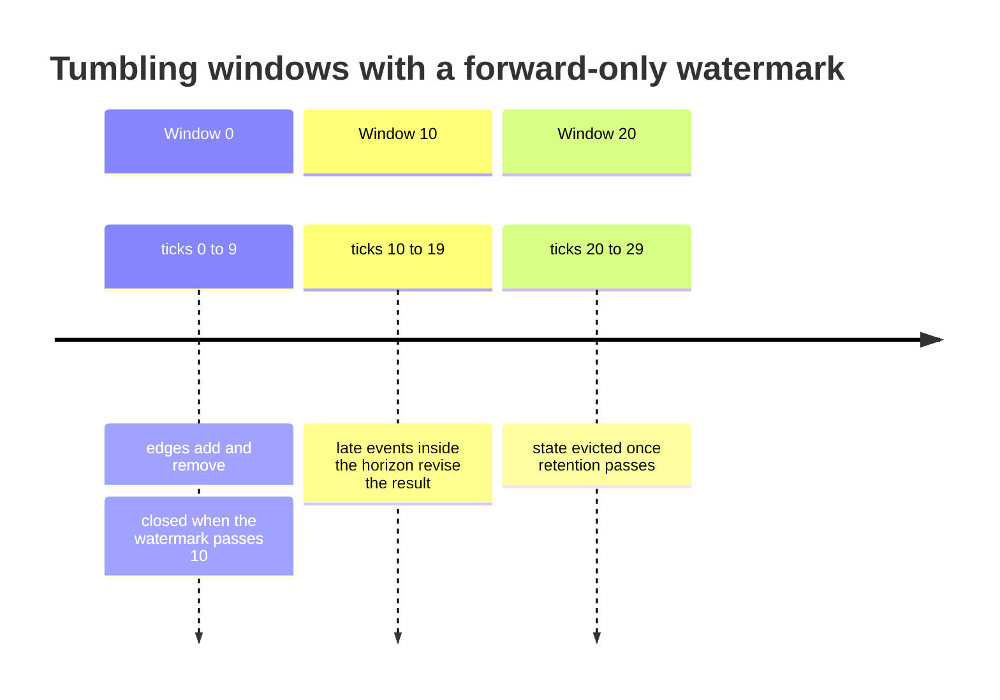
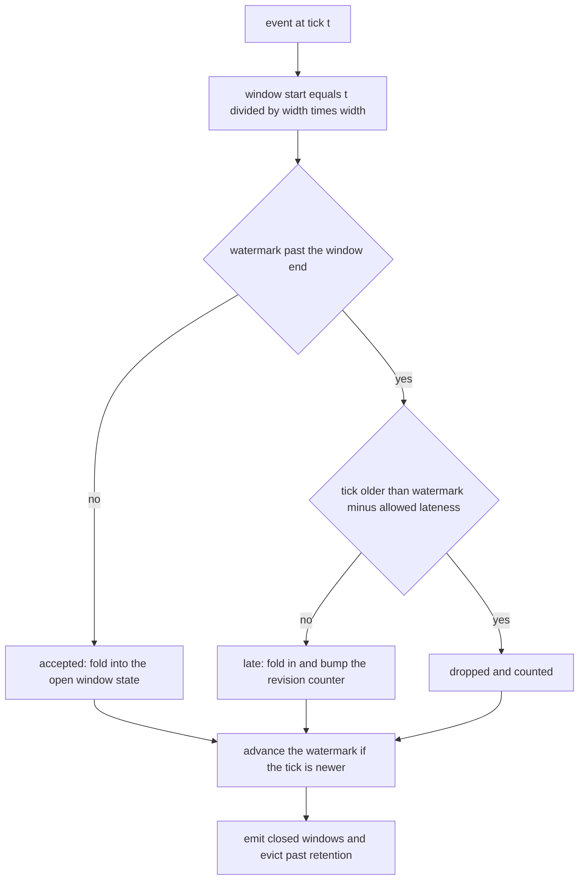
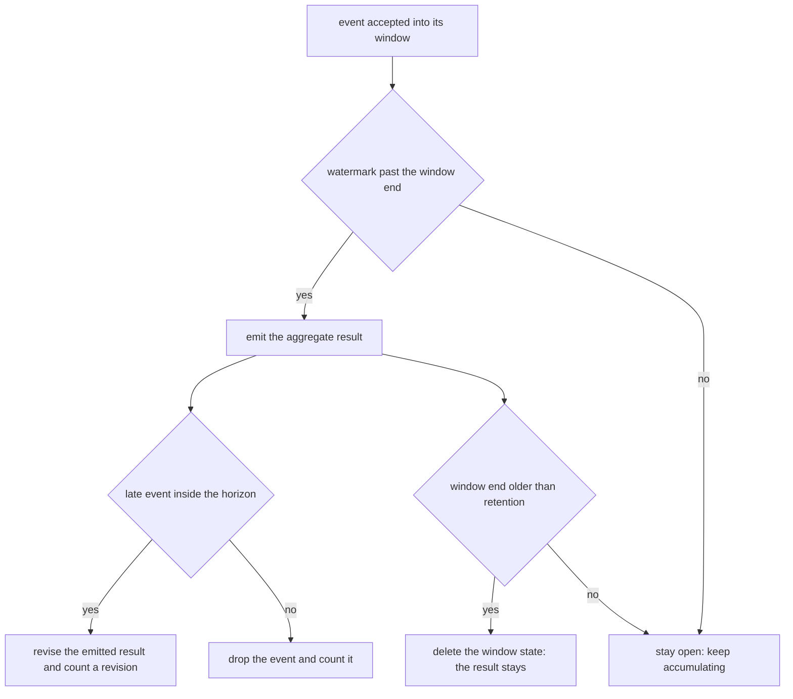
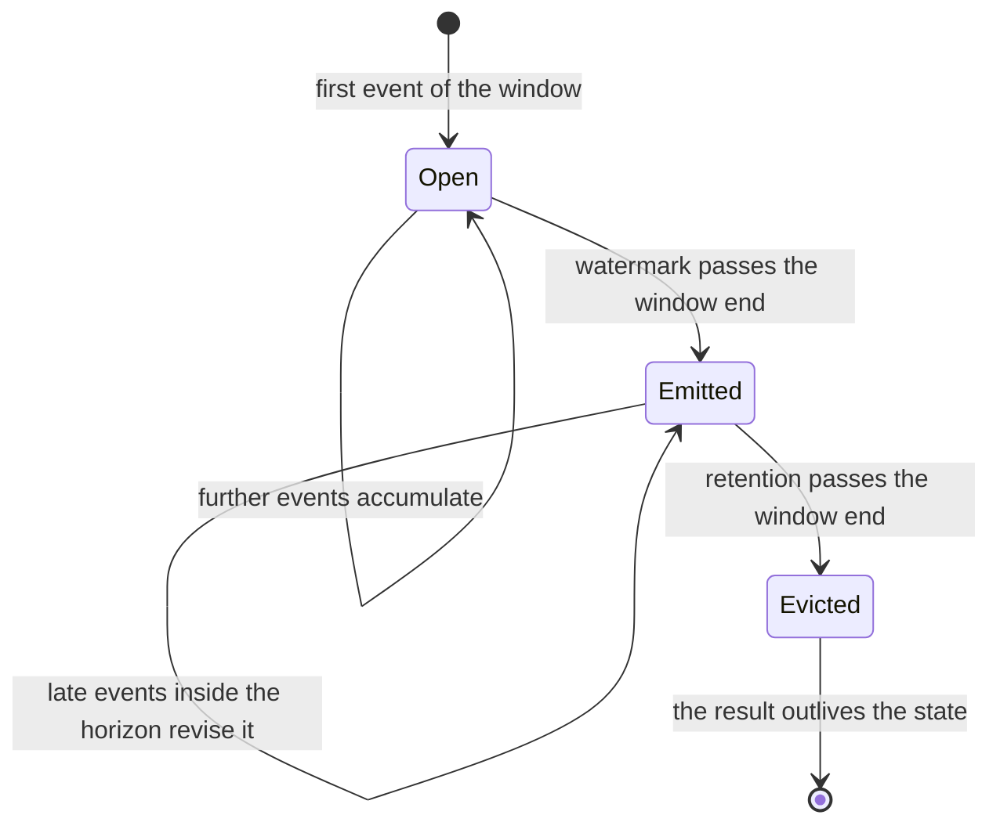

# 844 — Implement streaming graph processing with windowed aggregations.

> **Tier:** Master · **CTCI chapter:** Beyond — System Design and Scalability
> **Task spec:** [844-implement-streaming-graph-processing-with-windowed-aggregations.md](../../../tasks/master/844-implement-streaming-graph-processing-with-windowed-aggregations.md)
> **Solutions:** [Python](../../../solutions/python/master/844-implement-streaming-graph-processing-with-windowed-aggregations/solution.py) ·
> [Java](../../../solutions/java/master/844-implement-streaming-graph-processing-with-windowed-aggregations/Solution.java) ·
> [JavaScript](../../../solutions/javascript/master/844-implement-streaming-graph-processing-with-windowed-aggregations/solution.js) ·
> [C#](../../../solutions/csharp/master/844-implement-streaming-graph-processing-with-windowed-aggregations/Solution.cs)

## 1. Problem restatement

The spec is one line — *"Implement streaming graph processing with windowed aggregations"*. The
solutions implement a windowed streaming engine over an edge-event stream: events carry a **logical
timestamp**, tumbling windows of `width` ticks accumulate them, a **watermark** decides when a
window is complete, and state for windows older than the retention horizon is evicted.

**The modelling contract.** There is no clock and no sleep — time only moves when an event says so —
so every run is reproducible. What is simplified: triangles are recomputed from the window's own
edge multiset rather than maintained incrementally, since incremental triangle maintenance is a
different algorithm, and the *eviction* property under test only needs the state to be
self-contained. A retraction that arrives after its addition was dropped leaves a negative net
count, which simply means the edge is not live — the same convention the oracle uses, so both agree
by construction.

**Inputs.** `(timestamp, kind, source, target)` events with `kind ∈ {add, remove}`, plus `width`,
`allowed_lateness` and `retention`.

**Outputs.** `results[start]` per emitted window holding `(edges, degrees, triangles, revisions)`,
`live_windows()`, and counters (`accepted`, `late`, `dropped`, `revisions`, `emitted`, `evicted`).

| Measurement | Value |
| --- | --- |
| windows | 14 emitted, 0 live at the end, 44 events accepted |
| lateness | 2 late, 2 revisions, 6 dropped under a 3-tick horizon |
| eviction | 7 windows evicted, retention 10 ticks, live state stays `≤ 2` windows |
| correctness | edge counts, degree histograms and triangles equal the brute-force oracle for every window |
| conservation | `emitted + dropped + open == total` — no event is silently lost |
| merge | two partial window states merged equal the single-pass state |

## 2. Intuition

The naive way to aggregate an unbounded stream is to keep everything and recompute at the end. That
fails twice over: the state grows without bound, and "the end" never arrives. Windowing fixes the
first problem by giving every event a bounded home, and a watermark fixes the second by deciding
when a window's result may be published.

A **tumbling window** is just integer division: an event at tick `t` belongs to window
`t // width`, so the windows `[0,10)`, `[10,20)`, … partition the timeline and the boundary case
(`t = 10` lands in the *second* window, not the first) is checked explicitly. A **watermark** is the
maximum timestamp seen so far; once it passes a window's end, that window is closed and its
aggregate is emitted. Time advances only because events carry timestamps, which is what makes the
run deterministic.



Lateness is where streaming systems earn their reputation. An event whose window is already closed
is not simply discarded: if it is within `allowed_lateness` ticks of the watermark, it *revises* the
already emitted result for that window and the revision counter increments; only beyond that horizon
is it dropped. The retention horizon is at least the lateness horizon, so a window's state is always
still present when a late event arrives — which is exactly the ordering invariant that makes
"revise, then drop" well defined.



The last piece is **eviction**: once a window's revision horizon has passed, its entire state is
deleted, and the emitted result must stay identical. Results outlive state — that separation is what
keeps memory bounded while the answers remain available. To support sharded implementations, the
engine also exposes `merge`, and the associativity test checks that two halves of a stream merged
give exactly the aggregate of the whole.

## 3. Algorithm

1. `window_of(timestamp, width) = timestamp // width`; the window start is that value times `width`.
2. `WindowState` keeps the signed edge multiset, incremental degree counters, a revision counter and
   an `emitted` flag. `add(source, target, delta)` updates the net count and applies only the
   *change in liveness* to the degrees, so an add/remove pair nets out to zero and a negative net
   count never invents a degree.
3. `WindowState.aggregate()` returns `(window, edges, degrees, triangles, revisions)`: live edges are
   those with a positive count, degrees come from the live multiset, and triangles are counted over
   the window's own adjacency by triples with ordered nodes.
4. `StreamEngine.process(timestamp, kind, source, target)` logs the event, computes the window,
   classifies it (open → `accepted`, closed within the horizon → `late` + revision, closed beyond it
   → `dropped`), folds it into the window state, advances the watermark, and calls
   `_close_and_evict`.
5. `_close_and_evict` emits every window the watermark has passed (counting first emissions only)
   and deletes every window whose end is further back than `retention`.
6. `flush()` closes the remaining windows at the end of the stream so the run has a defined finish.
7. `brute_force(log, width)` recomputes every window directly from the raw event list — an
   independent oracle that shares only `WindowState`, never the engine's control flow.
8. `merge(other)` combines two partial states of the same window by summing net counts, degrees and
   revisions; the test compares both merge orders and both against the single-pass result.

```text
function window_of(timestamp, width)
    return timestamp / width       # integer division: tumbling windows
end

procedure add(state, source, target, delta)
    edge ← (source, target)
    before ← net count of edge, or 0
    after ← before + delta
    store after
    live_delta ← max(0, after) - max(0, before)
    if live_delta ≠ 0 then
        degrees[source] ← degrees[source] + live_delta
        degrees[target] ← degrees[target] + live_delta
    end
end

function aggregate(state)
    live ← every edge whose net count is positive
    degrees ← degree of every endpoint over the live edges
    triangles ← number of ordered triples of distinct nodes that form a triangle among live edges
    return window, count of live edges, degrees, triangles and the revision count
end

function process(timestamp, kind, source, target)
    append the event to the log
    start ← window_of(timestamp, width) * width
    closed ← watermark ≥ start + width
    if closed and timestamp < watermark - allowed_lateness then
        count a drop and return "dropped"
    end
    state ← state of that window, created empty if absent
    action ← "accepted"
    if closed then
        action ← "late"
        count a late event and a revision, and bump the window revision counter
    end
    add the edge to the state with delta 1 for "add" and -1 for "remove"
    count an acceptance
    if watermark < timestamp then watermark ← timestamp end
    close and evict
    return action
end

procedure close_and_evict
    for window start in sorted order do
        if watermark ≥ start + width then
            results[start] ← aggregate of the window state
            count the emission the first time only
            mark the window emitted
        end
    end
    for window start in sorted order do
        if watermark - retention ≥ start + width then
            delete the window state and count an eviction
        end
    end
end

procedure flush
    for window start in sorted order do
        results[start] ← aggregate of the window state
        count an emission
    end
    clear the state and return the results
end

function merge(left, right)
    return a window state whose net counts, degrees and revisions are the sums of both inputs
end
```



## 4. Worked example

Take `width = 10`, a generated 44-event stream, and follow the three regimes in one run.

**Regime 1 — unbounded lateness.** With `allowed_lateness = 1e9` nothing is ever dropped. Every
window's edge count, degree histogram and triangle count equal the brute-force oracle, and the
action sequence contains only `accepted` and `late` — the assertion that lateness was actually
exercised is `dropped == 0` together with `late > 0`.

**Regime 2 — a 3-tick horizon and retention 10.** The same stream produces:
| Counter | Value |
| --- | --- |
| accepted events | 44 |
| late events | 2 |
| revisions | 2 (`revisions == late`: every accepted late event is one revision) |
| dropped | 6 |
| admitted events | `44 − 6 = 38`, matching `len(admitted) + dropped == len(log)` |
| admitted windows | equal to the oracle over the admitted subsequence |

The conservation line is the important one: events are partitioned into accepted/late and dropped,
so nothing can vanish between the watermark logic and the counters.

**Regime 3 — cancellation and revision inside one window.** A small hand-built case shows the
arithmetic:

| Tick | Event | Net count of `(1,2)` | Live edges | Degrees |
| --- | --- | --- | --- | --- |
| 3 | `add (1,2)` | 1 | `{(1,2)}` | `{1:1, 2:1}` |
| 4 | `add (2,3)` | 1 | `{(1,2), (2,3)}` | `{1:1, 2:2, 3:1}` |
| 5 | `remove (1,2)` | 0 | `{(2,3)}` | `{2:1, 3:1}` |
| 6 | `remove (9,9)` | −1 for `(9,9)` | `{(2,3)}` | unchanged |

The unmatched retraction leaves a net count of `−1`, which is not live and contributes no degree:
`9` never appears in the histogram even though the raw count exists in the state. Then a late event
at tick `9` (the window closed when the watermark passed 10) is admitted as a revision, taking the
window's edge count from 1 to 2 with `revisions == 1`, while a fresh event at tick 60 is simply
`accepted`. Splitting the same window's events between two engine instances and merging the states
reproduces the single-pass aggregate exactly, in either merge order.



## 5. Complexity

`E` events, `W` the per-window event count, `d` the average degree of a node inside a window, and
`R` the retention horizon in ticks.

| Measure | Bound | Why it holds |
| --- | --- | --- |
| `process` per event | O(1) amortised + eviction sweep | a dictionary update plus a scan of the live windows |
| `close_and_evict` | O(number of live windows) | iterated on every event, bounded by `R / width + 1` (here `≤ 2`) |
| `WindowState.add` | O(1) | one net-count update and at most two degree increments |
| `aggregate` | O(W·d²) worst case | triangle counting over the window's adjacency; triangles are recomputed by design |
| `flush` | O(live windows) | closes what remains |
| `merge` | O(distinct edges in both states) | one pass over each multiset |
| Space | O(live windows × W) | state is bounded by the retention horizon; results are `O(windows)` scalars |
| Alternative: keep all state | O(stream) | unbounded memory, and any late event can be accepted — the naive design |

The measured bound is the point of retention: eviction keeps the live state at one or two windows
(7 windows were evicted in the run), so memory is a function of the retention horizon rather than of
the stream length. Results are retained as small aggregates — count, degree histogram, triangle
count — so answering questions about a long-past window costs O(1) memory even though its state is
gone.

## 6. Pitfalls and edge cases

- **The window boundary is exclusive at the top.** An event at tick `10` belongs to window `[10,20)`,
  not `[0,10)`; the boundary case is asserted because off-by-one here silently shifts every
  aggregate by one tick.
- **Causal order of the guards.** An event is dropped only when its window is *both* closed and
  older than the lateness horizon, and `retention ≥ allowed_lateness` guarantees the state still
  exists when a drop decision is made. Reordering those checks makes drops depend on eviction
  timing.
- **Every accepted late event is exactly one revision.** `revisions == late` is asserted, so a
  revision cannot be double-counted or forgotten when the same event also triggers an emission.
- **Cancellation must not invent degrees.** An add/remove pair nets to zero and disappears from the
  histogram; an unmatched retraction leaves a negative net count that stays non-live. Both cases are
  asserted separately.
- **No event may vanish.** `len(admitted) + dropped == len(log)` is the conservation law; without it
  a bug in the watermark arithmetic looks like a legitimate drop.
- **Emitting is not counting twice.** `_close_and_evict` runs on every event, so a window is
  re-aggregated many times; the `emitted` flag keeps the counter meaning "windows published".
- **The end of a stream needs a flush.** Otherwise the final windows never appear and the result set
  differs from the oracle's by exactly the open windows.
- **Degenerate streams.** An empty stream flushes to `{}` with zero accepted events, a single event
  produces one window with one edge, and three mutually connected edges produce exactly one triangle.
  The merge property is the sharded licence: two partial window states merged equal the single-pass
  aggregate, in either order, which the tests check explicitly.
- **Determinism.** Seeded generation, sorted iteration and the absence of a clock mean two runs
  produce identical results and counters.

## 7. Variants and follow-ups

- **Barrier-based graph processing.** When the graph is bounded and known, supersteps replace
  windows and eviction disappears:
  [843-implement-large-scale-graph-processing-pipeline-pregel-like-with.md](../../../tasks/master/843-implement-large-scale-graph-processing-pipeline-pregel-like-with.md).
- **Windows over sampled traffic.** The same windowing logic is what a streaming heavy-hitter
  detector consumes:
  [847-implement-heavy-hitter-detection-with-distributed-sketches-merge.md](../../../tasks/master/847-implement-heavy-hitter-detection-with-distributed-sketches-merge.md).
- **Randomness with a verifiable delay.** Where streams need an unbiasable seed per window, the
  primitive is a VDF:
  [836-implement-verifiable-delay-function-small-prototype-vdf.md](../../../tasks/master/836-implement-verifiable-delay-function-small-prototype-vdf.md).
- **Streaming joins with sketches.** Aggregating a window is the first half of an approximate join:
  [849-implement-scalable-approximate-joins-in-streaming-sketch-based.md](../../../tasks/master/849-implement-scalable-approximate-joins-in-streaming-sketch-based.md).

## 8. Check yourself

1. Why must `retention` be at least `allowed_lateness`?

<details><summary>Show answer</summary>

So that every event which is still admissible has state to be folded into. If a window's state were
evicted before the lateness horizon ended, an arriving late event would have nowhere to go: it would
have to be dropped for the wrong reason, and the "revise then drop" ordering would become
nondeterministic with respect to eviction timing. The engine enforces
`retention >= allowed_lateness` at construction.

</details>

2. What is the difference between a late event and a dropped event?

<details><summary>Show answer</summary>

Both arrive after their window closed. A *late* event is still inside the lateness horizon, so it is
folded into the window state and the already emitted result is revised (`revisions == late` in the
measured run). A *dropped* event is older than that horizon and is discarded, with the drop counted
so the conservation law `admitted + dropped == total` holds. The 3-tick horizon run shows 2 late
events and 6 drops.

</details>

3. Why is the triangle count recomputed instead of maintained incrementally?

<details><summary>Show answer</summary>

Because incremental triangle maintenance is a different (and much more delicate) algorithm — it needs
per-edge neighbourhood bookkeeping and careful handling of retractions. The property under test here
is eviction and lateness, which only need the window state to be self-contained, so the file
documents the recomputation as a simplification rather than pretending to be a graph analytics
engine.

</details>
