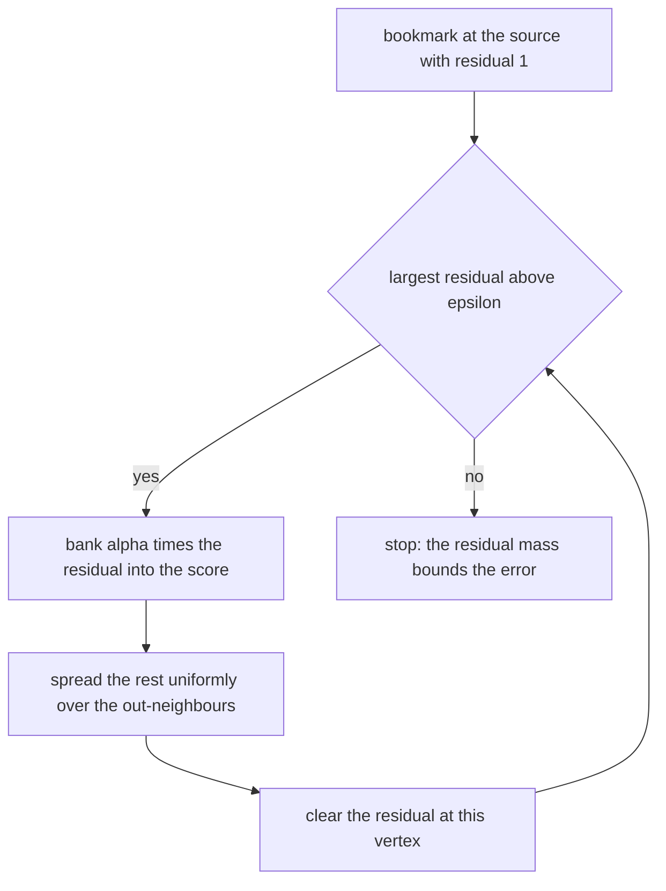
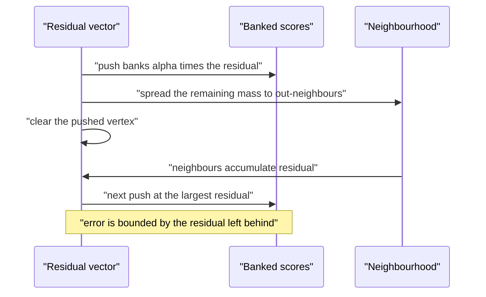
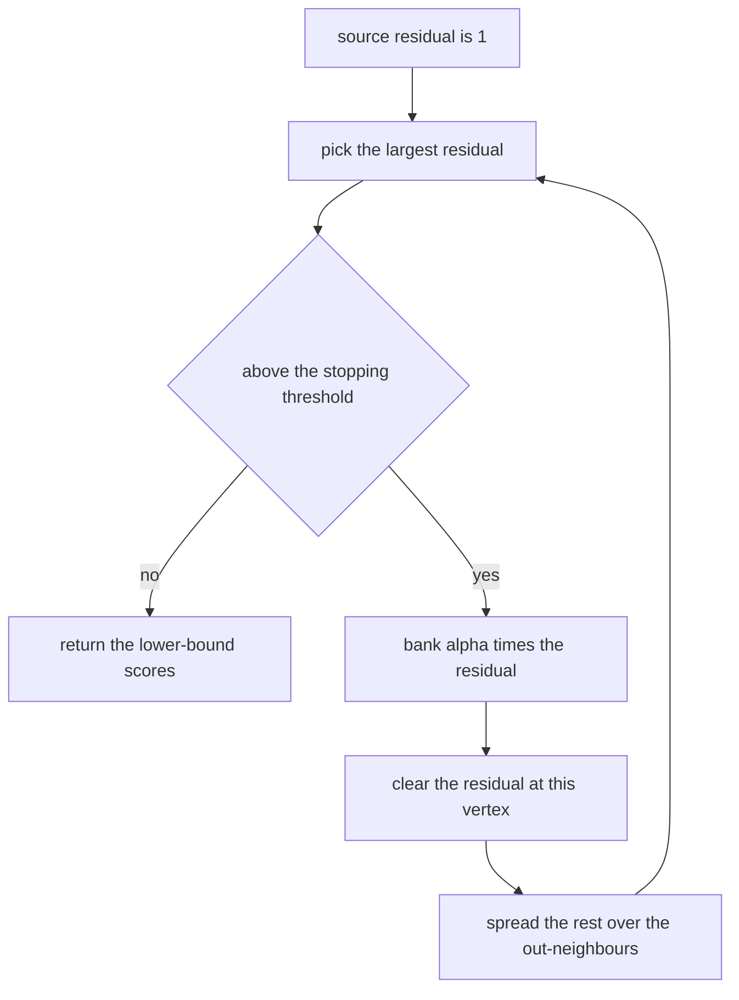
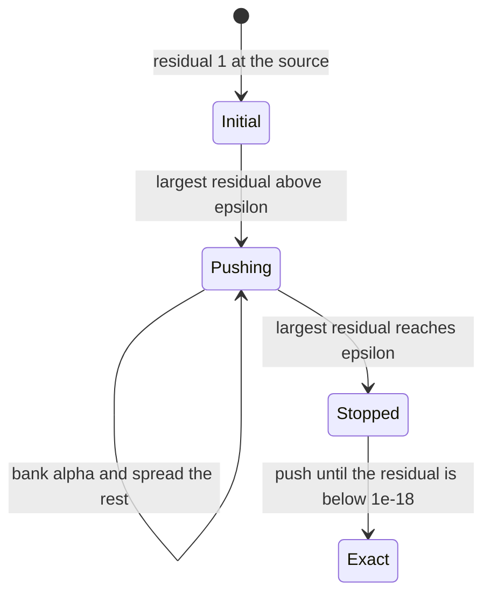

# 845 — Implement approximate personalized PageRank with bookmark coloring.

> **Tier:** Master · **CTCI chapter:** Beyond — System Design and Scalability
> **Task spec:** [845-implement-approximate-personalized-pagerank-with-bookmark-colori.md](../../../tasks/master/845-implement-approximate-personalized-pagerank-with-bookmark-colori.md)
> **Solutions:** [Python](../../../solutions/python/master/845-implement-approximate-personalized-pagerank-with-bookmark-colori/solution.py) ·
> [Java](../../../solutions/java/master/845-implement-approximate-personalized-pagerank-with-bookmark-colori/Solution.java) ·
> [JavaScript](../../../solutions/javascript/master/845-implement-approximate-personalized-pagerank-with-bookmark-colori/solution.js) ·
> [C#](../../../solutions/csharp/master/845-implement-approximate-personalized-pagerank-with-bookmark-colori/Solution.cs)

## 1. Problem restatement

The spec is one line — *"Implement approximate personalized PageRank with bookmark coloring"*. The
solutions implement Berkhin's **bookmark-colouring algorithm (BCA)** for approximate personalized
PageRank: instead of solving `(I − (1−α)Pᵀ) p = α·e_s`, mass is pushed from a single bookmark along
the graph and each vertex keeps a residual ("colour") that is spent only when it is large enough to
matter.

**The modelling contract.** Everything is deterministic — no random walk, no wall clock — and the
approximation is verified against an exact dense solve of the same linear system. Simplified versus
production: the graph is a fixed 8-vertex toy, the exact reference is dense Gaussian elimination,
and the *randomised* variant of BCA is replaced by deterministic largest-residual bookmark selection
so runs are reproducible. Locality is measured rather than assumed: the number of vertices that ever
receive mass and the number of pushes are reported and bounded.

**Inputs.** An adjacency map, a source vertex, a teleport probability `α`, a stopping threshold
`epsilon`, and optionally the stopping rule (`max` prefix-epsilon, or `alpha-residual`).

**Outputs.** `approx` (the lower-bound scores), `residual` (the unspent colour), `pushes`,
`touched`, the push `trace`, `residual_mass()`, `max_residual()`, `correction()`, `exact()` and
`top_k()`.

| Measurement | Value |
| --- | --- |
| exact solve, `α = 0.15`, source `0` | source score `0.313279`, which is also the maximum, and all scores sum to `1` |
| approximation at `epsilon = 1e-3` | 86 pushes, error `6.89e-05`, residual mass `0.00341`, all 8 vertices touched |
| work versus accuracy | pushes `122 / 86 / 50 / 14` and errors `6.9e-05 / 7e-4 / 7.2e-3 / 0.074` for `epsilon = 1e-4 … 1e-1` |
| top-3 ranking | `[0, 2, 1]` from the approximation, identical to the exact ranking |
| limit case | running to `1e-18` residual reproduces the exact scores to `1e-12` |

## 2. Intuition

Solving for personalized PageRank exactly costs a linear solve — or, iteratively, `O(iterations ×
m)` touching the whole graph. For a single user's bookmark that is wasteful: mass decays
geometrically away from the source, so most vertices hold amounts far below any useful precision.
The bookmark-colouring idea is to **never touch mass that cannot matter**.

Two vectors carry the state. `p` holds the mass already *banked* at each vertex, and `r` holds the
*residual* — mass that is currently sitting at a vertex but has not yet been spread. Initially
`r[s] = 1` and everything else is zero. A push at vertex `v` banks `α·r[v]` into `p[v]` and spreads
the remaining `(1−α)·r[v]` uniformly over `v`'s out-neighbours, clearing `r[v]`. Repeating pushes
until the largest residual falls below `epsilon` gives an approximation whose error is bounded by
the total unspent mass.



The reason the approximation is *auditable* rather than merely plausible is linearity. Exact
personalized PageRank is linear in the starting distribution, so

```text
exact_ppr(s → v) = p[v] + Σ_u r[u] · exact_ppr(u → v)
```

for every vertex `v`. That single identity gives three testable consequences, all of which the file
checks numerically: `p[v]` is always a **lower bound** of the exact score, the **error** is at most
the total residual mass, and the correction term is exactly computable from the residual vector. In
the limit `epsilon → 0` the bound collapses and the approximation becomes the exact answer.



## 3. Algorithm

1. `exact_ppr(graph, source, alpha)` builds `I − (1−α)Pᵀ` densely and solves it with Gaussian
   elimination — the reference the approximation is measured against.
2. `ApproximatePPR.__init__` sets `approx = 0`, `residual[source] = 1`, `pushes = 0`,
   `touched = {source}`.
3. `_push(vertex)` banks `alpha · residual[vertex]` into `approx[vertex]`, clears the residual, and
   distributes `(1−α)·residual[vertex] / outdeg(vertex)` to each out-neighbour, marking them
   touched. A dangling vertex has no out-neighbours, so its share is absorbed — which is exactly
   what the dense reference does with a zero row of `P`.
4. `_bookmark()` picks the vertex with the largest residual, ties broken by vertex id — the
   deterministic stand-in for BCA's randomised choice.
5. `run(epsilon, rule)` pushes until the stopping rule holds: prefix-epsilon
   (`max residual ≤ epsilon`) or alpha-residual (`residual[vertex] ≤ epsilon · outdeg(vertex)`),
   recording one trace entry per push.
6. `run_to_completion(tolerance)` pushes until the residual is numerically gone, with a non-zero
   tolerance because the residual decays geometrically and would otherwise crawl through denormals.
7. `correction(exact_scores)` computes `Σ_u r[u] · exact_ppr(u → v)` — the residual's exact
   contribution, which is what turns the lower bound into an equality.
8. `residual_mass()`, `max_residual()` and `top_k(scores, k)` expose the diagnostics the checks use:
   the error bound, the stopping condition, and ranking agreement.

```text
procedure push(vertex)
    mass ← residual[vertex]
    approx[vertex] ← approx[vertex] + alpha * mass
    residual[vertex] ← 0
    targets ← out-neighbours of vertex
    if targets is not empty then
        share ← (1 - alpha) * mass / count(targets)
        for target in targets do
            residual[target] ← residual[target] + share
            mark target as touched
        end
    end
    pushes ← pushes + 1
end

function bookmark()
    return the vertex with the largest residual, ties broken by the smallest vertex id
end

procedure run(epsilon, rule)
    while true do
        vertex ← bookmark()
        if vertex is nothing then break end
        if rule is "max" and residual[vertex] ≤ epsilon then break end
        if rule is "alpha-residual" and residual[vertex] ≤ epsilon * outdeg(vertex) then break end
        push(vertex)
        append (vertex, approx[vertex], residual_mass()) to the trace
    end
end

procedure run_to_completion(tolerance)
    while the largest residual is above tolerance do
        push(bookmark())
    end
end

function correction(exact_scores)
    total ← zeros for every vertex
    for holder and mass in residual do
        if mass > 0 then
            contribution ← exact_ppr(holder → every vertex)
            for vertex do total[vertex] ← total[vertex] + mass * contribution[vertex] end
        end
    end
    return total
end
```



## 4. Worked example

The toy graph has 8 vertices with edges `0→{1,2}`, `1→{2,3}`, `2→{0,4}`, `3→{4,5}`, `4→{5,6}`,
`5→{6,7}`, `6→{7,0}`, `7→{0}`. With `α = 0.15` and source `0`, the exact solve gives
`exact[0] = 0.313279`, which is also the maximum score, and the scores sum to 1.

Now the colouring run at `epsilon = 1e-3`. Each push banks `0.15` of the pushed residual and spreads
`0.85` of it uniformly:

| Push | Vertex | `approx` at that vertex | Residual mass left |
| --- | --- | --- | --- |
| 1 | 0 | 0.150000 | 0.850000 |
| 2 | 1 | 0.063750 | 0.786250 |
| 3 | 2 | 0.090844 | 0.695406 |
| 4 | 0 | 0.188609 | 0.656798 |
| 5 | 4 | 0.038609 | 0.618189 |
| 6 | 3 | 0.027094 | 0.591095 |
| … | … | … | … |
| 86 | — | run stops | 0.003410 |

The first push is at the source and banks `0.15·1 = 0.15`; the residual mass drops to `0.85`, which
is the `(1−α)` share now spread over vertices 1 and 2. Vertex 0 is pushed again later when it
accumulates enough residual from its in-neighbours (2, 6, 7) to become the largest holder again.

At the end, the diagnostics are exactly the ones the error theory predicts:

| Quantity | Value |
| --- | --- |
| pushes | 86 |
| error `max |approx − exact|` | `6.89e-05` |
| residual mass (the error bound) | `0.00341` |
| vertices that ever received mass | all 8 |
| `approx[0]` versus `exact[0]` | `0.312575…` versus `0.313279…` — a lower bound |
| top-3 by approximation | `[0, 2, 1]`, identical to the exact ranking |

Tightening and loosening `epsilon` traces the classic approximation curve — more work buys accuracy,
and the error tracks the residual budget rather than jumping around:

| `epsilon` | Pushes | Error |
| --- | --- | --- |
| `1e-4` | 122 | `6.9e-05` |
| `1e-3` | 86 | `7e-4` |
| `1e-2` | 50 | `7.2e-3` |
| `1e-1` | 14 | `0.074` |

Pushing until the residual reaches `1e-18` instead of `1e-3` reproduces the exact scores to `1e-12`,
which is the check that the algorithm converges to the right answer rather than to a self-consistent
approximation. Two degenerate shapes pin the ends of the range: a graph with a dangling vertex
absorbs its share and its scores sum to *less* than 1 (matching the reference), while a vertex
unreachable from the source stays at exactly 0.



## 5. Complexity

`m` edges, `n` vertices, `P` pushes, `d` the number of vertices that ever receive mass, and
`epsilon` the threshold.

| Measure | Bound | Why it holds |
| --- | --- | --- |
| One push | Θ(outdeg(v)) | one score update plus one residual update per out-edge |
| Total pushes | `O(1/epsilon)` in practice | 122 pushes at `epsilon = 1e-4`, 14 at `1e-1` |
| Total time | Θ(pushes × average out-degree) | each push touches only the pushed vertex's neighbourhood |
| Space | Θ(n) vectors plus Θ(d) touched | the residual and score arrays; no matrix |
| Error | ≤ residual mass | asserted at `6.89e-05` against a bound of `0.00341` |
| Vertices touched | ≤ n, and much less in sparse cases | the sparse variant touches no more than the dense one |
| Exact reference | Θ(n³) dense solve | Gaussian elimination on `I − (1−α)Pᵀ` |
| Alternative: iterative power iteration | Θ(iterations × m) | touches every edge each round, no locality at all |

The separation is the selling point: the colouring run touches a *neighbourhood* whose size is
governed by `epsilon`, not by the graph size, so a single-bookmark query on a huge graph costs a
bounded amount of work. The file asserts that work stays inside `about 1/epsilon` (122 pushes for
`1e-4`, bounded by 2000) and that the cost grows polynomially rather than explosively between
thresholds.

## 6. Pitfalls and edge cases

- **The approximation is a lower bound, not an estimate.** Every `approx[v]` satisfies
  `approx[v] ≤ exact[v]`, so ranking by approximation can differ from ranking by truth; the
  correction term is what makes the identity exact, and top-k agreement must be checked rather than
  assumed.
- **Residual mass is the error bound, not the error.** The file asserts `error ≤ residual_mass`, and
  the measured values (`6.89e-05 ≤ 0.00341`) show why the bound is loose but still useful.
- **Dangling vertices absorb their share.** With no out-edges the `(1−α)` part has nowhere to go,
  exactly as a zero row of `P` behaves; the scores then sum to less than 1, which the dangling test
  asserts as the *correct* behaviour rather than a bug.
- **Ties must be broken deterministically.** `_bookmark` picks the smallest id among equal residuals;
  without a tie-break the push trace — and therefore the counters — would be unreproducible.
- **Stopping rules differ.** Prefix-epsilon (`max residual ≤ epsilon`) and alpha-residual
  (`residual[v] ≤ epsilon·outdeg(v)`) give different push counts on the same graph; the file checks
  that each run satisfies *its own* rule, and that the residual vector stays non-negative.
- **Numerical termination needs a floor.** The residual decays geometrically, so
  `run_to_completion` uses `1e-18` rather than zero; demanding exact zero would crawl through
  denormals forever.
- **No push can leave mass behind.** After every push, `approx` plus the residual mass is still 1
  (asserted during the incremental walk), which is the invariant that makes the algorithm a
  redistribution rather than a transformation.
- **Unreachable vertices stay at zero**, and a graph whose source cannot reach anything yields zero
  pushes with an all-zero score vector — the degenerate ends of the locality claim.
- **Small shapes.** A single self-looping vertex scores exactly 1; a two-vertex cycle gives the
  source `α / (1 − (1−α)²)`, which the file asserts to `1e-12`.

## 7. Variants and follow-ups

- **Different random-walk primitives on the same graph.** Global PageRank over the same edges, with
  barriers and message passing:
  [843-implement-large-scale-graph-processing-pipeline-pregel-like-with.md](../../../tasks/master/843-implement-large-scale-graph-processing-pipeline-pregel-like-with.md).
- **Locality inside a bigger pipeline.** Community detection and motif counting under a
  subgraph-centric model:
  [846-implement-subgraph-centric-distributed-processing-framework-and.md](../../../tasks/master/846-implement-subgraph-centric-distributed-processing-framework-and.md).
- **Cheap summaries instead of walks.** Where only heavy nodes matter, a mergeable sketch is far
  cheaper: [847-implement-heavy-hitter-detection-with-distributed-sketches-merge.md](../../../tasks/master/847-implement-heavy-hitter-detection-with-distributed-sketches-merge.md).
- **Damping as an approximation knob.** The same `α` appears in global PageRank with an aggregator
  stopping rule; the difference is that colouring deliberately never touches the whole graph
  ([844-implement-streaming-graph-processing-with-windowed-aggregations.md](../../../tasks/master/844-implement-streaming-graph-processing-with-windowed-aggregations.md) shows the windowed
  variant of "process only part of the data").

## 8. Check yourself

1. Why is `p` a lower bound of the exact score rather than an unbiased estimate?

<details><summary>Show answer</summary>

Because a push only ever *banks* `α·r[v]` and *moves* the rest, never creating mass. Linearity of
personalized PageRank gives `exact[v] = p[v] + Σ_u r[u]·exact_ppr(u → v)`, and the correction term is
non-negative, so `p[v] ≤ exact[v]` always. The measured pair `0.312575…` versus `0.313279…` is a
concrete instance, and the file asserts the inequality at every vertex.

</details>

2. What bounds the error, and how tight is it in the example?

<details><summary>Show answer</summary>

The total residual mass bounds the maximum error, because the unspent colour can contribute at most
its own mass to any score. At `epsilon = 1e-3` the residual mass is `0.00341` while the actual error
is `6.89e-05` — so the bound is about 50× loose, which is typical: it is a worst-case statement over
all residual distributions, not a sharp estimate.

</details>

3. Why does the work grow like `1/epsilon` instead of like the graph size?

<details><summary>Show answer</summary>

Because mass decays geometrically away from the source, so only vertices close enough to still hold
more than `epsilon` residual are ever pushed. At `epsilon = 1e-4` the run performs 122 pushes and it
is bounded by `about 1/epsilon = 10000`; at `1e-1` it needs only 14. That locality is the entire point
of bookmark colouring — a query touches a neighbourhood, not the graph.

</details>

4. Why does a dangling vertex make the scores sum to less than one?

<details><summary>Show answer</summary>

Because the `(1−α)` share of its residual has no out-edge to travel along, so it is absorbed instead
of redistributed. That is exactly how the dense reference behaves when `P` has a zero row, so the
sum below 1 is the correct answer for that graph, and the file asserts the approximation matches the
reference to `1e-6` rather than asserting a mass sum.

</details>

5. When would you use the alpha-residual rule instead of prefix-epsilon?

<details><summary>Show answer</summary>

When you want the per-vertex error to be comparable across degrees: `residual[v] ≤ epsilon·outdeg(v)`
scales the budget with the degree, so high-degree hubs are allowed proportionally more residual and
the correction each push introduces stays balanced. Prefix-epsilon is simpler and gives a bound in
terms of the *total* remaining mass, which is the version the error identity here is stated against.

</details>
