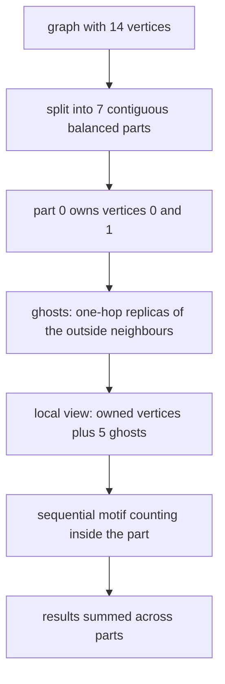
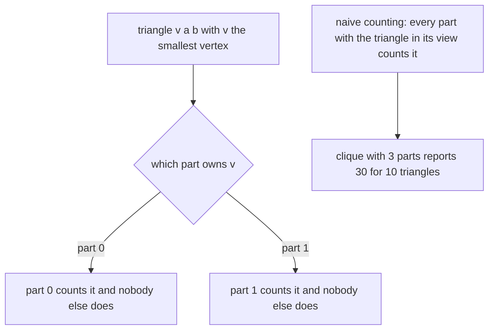
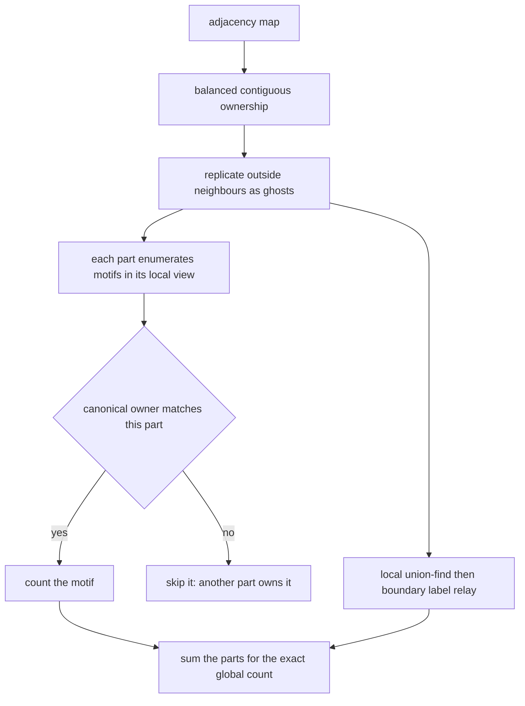
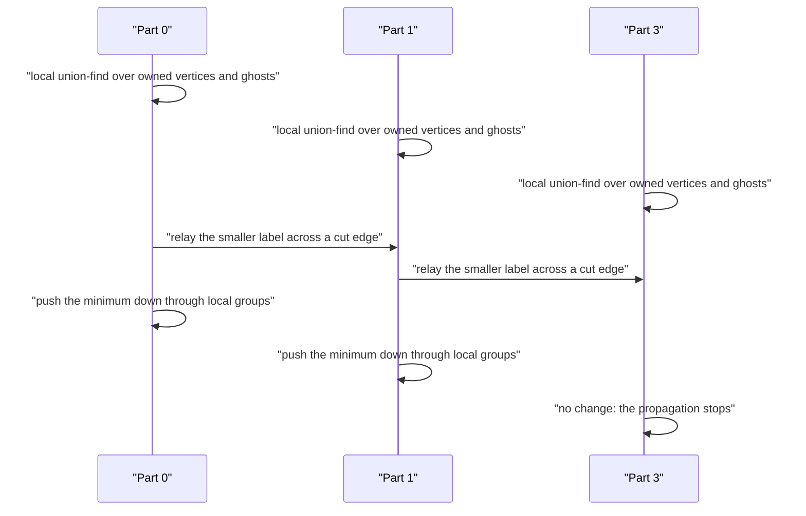

# 846 — Implement subgraph-centric distributed processing framework and test on motifs.

> **Tier:** Master · **CTCI chapter:** Beyond — System Design and Scalability
> **Task spec:** [846-implement-subgraph-centric-distributed-processing-framework-and.md](../../../tasks/master/846-implement-subgraph-centric-distributed-processing-framework-and.md)
> **Solutions:** [Python](../../../solutions/python/master/846-implement-subgraph-centric-distributed-processing-framework-and/solution.py) ·
> [Java](../../../solutions/java/master/846-implement-subgraph-centric-distributed-processing-framework-and/Solution.java) ·
> [JavaScript](../../../solutions/javascript/master/846-implement-subgraph-centric-distributed-processing-framework-and/solution.js) ·
> [C#](../../../solutions/csharp/master/846-implement-subgraph-centric-distributed-processing-framework-and/Solution.cs)

## 1. Problem restatement

The spec is one line — *"Implement subgraph-centric distributed processing framework and test on
motifs"*. Subgraph-centric (partition-centric) computation splits a graph into parts, each part
**owns** a contiguous block of vertices and **replicates** every neighbour that lives elsewhere as a
*ghost*, then each part runs an ordinary sequential algorithm over its own vertices plus those
ghosts.

**The modelling contract.** All the parallelism is expressed as a deterministic schedule over plain
data structures — no threads, sockets or clocks — so results are reproducible and comparable with a
brute-force central computation. Simplified versus production: instead of a coordinator that touches
a shared graph table, the parts read the same immutable adjacency dictionary; the "network" is the
ghost replication itself, and label exchange happens in rounds inside one process. The measured cost
model is the one that matters at scale: ghost replication, cut edges and messages per round.

**Inputs.** An adjacency map, a part count, and (for components) a round budget.

**Outputs.** `owner`, `owned`, `ghosts`, `local_view`, `cut_edges()`, `cost()`, motif counts
(`triangles_owned`, `stars_owned`, `paths_owned`) and `components()` with its message statistics.

| Measurement | Value |
| --- | --- |
| gallery | 10 graphs, 110 partitionings, 52 triangles counted in total |
| ownership rule on `clique5` with 3 parts | owned `9 + 1 + 0 = 10` versus naive `30` |
| `random14` with 7 parts | 2 owned vertices each, ghosts `5 3 3 6 3 7 5`, 18 cut edges, replication 32 |
| components on `random14` | matches union-find exactly in 2 rounds and 72 messages |

## 2. Intuition

Vertex-centric engines pay for every edge traversal with a message. The subgraph-centric idea is to
stop paying: give each part its whole neighbourhood — its own vertices plus one-hop **ghost**
replicas of the neighbours that live elsewhere — and let each part run *any* sequential algorithm
locally, over its private view. The cost moves from per-edge messages to per-part replication, which
is a much better trade for dense local structure like motif counting.



The hard part is not the split; it is **not double counting** when a motif straddles a boundary. On a
clique with three parts every part sees the *whole* clique through ghosts, so a "count every triangle
I can see" rule reports 30 for a graph that has 10. The framework's answer is a **canonical owner
rule**: attribute each motif to exactly one part, deterministically.

| Motif | Canonical owner | Why it is unique |
| --- | --- | --- |
| triangle `{v, a, b}` | the part owning `min(v, a, b)` | the smallest vertex belongs to exactly one part |
| star centred at `c` | the part owning `c` | the centre is a single vertex |
| 3-path with middle edge `(v, u)`, `v < u` | the part owning `v` | the smaller endpoint of the middle edge is unique |

Because every motif has exactly one owner, the parts' totals sum to the exact global count with no
coordination, no deduplication pass and no shuffle — which is what makes the rule a real design
decision rather than bookkeeping.



## 3. Algorithm

1. `Partitioner.__init__` symmetrises the adjacency (the framework is for undirected graphs), sorts
   the vertices, and assigns `block = position · parts // n` — a balanced contiguous split with
   `max(sizes) − min(sizes) ≤ 1`.
2. Ghosts per part are exactly the neighbours owned elsewhere: `outside = ⋃_{v ∈ owned} N(v) − owned`.
   Each ghost carries its *full* adjacency, the one-hop replication that lets a part run a complete
   local algorithm.
3. `local_view(index)` = owned ∪ ghosts; `cut_edges()` lists every edge whose endpoints live in
   different parts; `cost()` reports part sizes, ghost counts, cut edges and the replication factor.
4. `triangles_owned(index, naive=False)` enumerates each triangle once with the apex ordering
   `vertex < first < second`, keeps only triples whose three vertices are all in the local view, and
   then either attributes the triangle to the part owning `vertex` (canonical) or counts it
   wherever it is visible (`naive`, the negative control).
5. `stars_owned(index)` counts `deg(c)·(deg(c) − 1)/2` for the centres the part *owns*.
6. `paths_owned(index)` counts, for each owned vertex `v` and each neighbour `u > v`, the product
   `(deg(v) − 1)·(deg(u) − 1)` — the 3-paths whose middle edge starts at `v`, so the owner is the
   smaller endpoint of the middle edge.
7. `components(max_rounds)` runs a local union-find per part over its view, then propagates labels
   across the cut edges and pushes each minimum down through the part's local groups until nothing
   changes, bounded by `4n + 4` rounds.
8. The tests compare every motif total against a brute-force central count and the components against
   a union-find reference.

```text
procedure partition(graph, parts)
    symmetrise the adjacency
    vertices ← sorted keys
    for position and vertex in vertices do
        block ← min(position * parts / count(vertices), parts - 1)
        owner[vertex] ← block and append vertex to owned[block]
    end
    for index in 0 to parts - 1 do
        outside ← union of neighbours of owned vertices minus the owned set
        ghosts[index] ← outside
    end
end

function triangles_owned(index, naive)
    view ← owned[index] union ghosts[index]
    found ← empty list
    for vertex in sorted(view) do
        for first in sorted(neighbours of vertex) do
            for second in sorted(neighbours of vertex) do
                if not (vertex < first < second) then skip end       # each triangle once
                if second is not a neighbour of first then skip end
                if first or second is not in view then skip end
                if naive or owner[vertex] = index then append (vertex, first, second) end
            end
        end
    end
    return found
end

function stars_owned(index)
    total ← 0
    for vertex in owned[index] do
        degree ← number of neighbours
        total ← total + degree * (degree - 1) / 2
    end
    return total
end

function paths_owned(index)
    total ← 0
    for vertex in owned[index] do
        for neighbour in neighbours of vertex where neighbour > vertex do
            total ← total + (degree(vertex) - 1) * (degree(neighbour) - 1)
        end
    end
    return total
end

function components(max_rounds)
    labels ← every vertex labelled by itself
    for each part do
        run union-find over the part's local view only
        set the label of every owned vertex to its local root
    end
    rounds ← 0
    repeat
        rounds ← rounds + 1
        changed ← false
        for each cut edge (first, second) do
            relay the smaller label to the larger endpoint and mark a change
        end
        for each part and each local group do
            push the smallest label in the group down to every member
        end
    until not changed or rounds exceeds the budget
    return labels and the round and message counts
end
```



## 4. Worked example

**The ownership rule on `clique5` with three parts.** `K5` has `C(5,3) = 10` triangles. The balanced
split gives part 0 → `{0,1}`, part 1 → `{2,3}`, part 2 → `{4}`, and every part's local view is the
whole clique because each part replicates the other four vertices as ghosts.

| Part | Owned | Ghosts | Local view | Triangles owned | Triangles visible (naive) |
| --- | --- | --- | --- | --- | --- |
| 0 | `0 1` | `2 3 4` | all five | 9 (smallest vertex `0` or `1`) | 10 |
| 1 | `2 3` | `0 1 4` | all five | 1 (smallest vertex `2`) | 10 |
| 2 | `4` | `0 1 2 3` | all five | 0 (never the smallest) | 10 |
| total | — | — | — | **10** | **30** |

The right-hand column is the negative control: without the ownership rule the framework reports three
times the true count on a graph whose parts can see everything. The left-hand column sums to exactly
`reference_triangles(clique5) == 10`, which is the assertion that makes the rule load-bearing rather
than decorative. The same property is checked for stars (`deg·(deg−1)/2` summed over owned centres)
and 3-paths (over the smaller endpoint of the middle edge) on all ten gallery graphs.

**The cost model on `random14` with seven parts.** The random graph has 14 vertices with edges drawn
at 22 % probability from seed 4242:

| Metric | Value |
| --- | --- |
| parts | 7 |
| owned per part | `2` each (perfectly balanced) |
| ghosts per part | `5 3 3 6 3 7 5` |
| replication factor | `32` (ghost copies in total) |
| cut edges | `18` |

Replication is the price of the framework: 32 ghost copies to make each part self-sufficient, and 18
cut edges that any cross-part algorithm has to talk about. That is what a scheduler would compare
against the message volume of a vertex-centric run on the same graph.

**Boundary label propagation.** Components start with a local union-find per part — which can only
use edges entirely inside that part's view — and then resolve the cut edges by exchanging labels:

| Round | Action | Messages |
| --- | --- | --- |
| 1 | relay the smaller label across all 18 cut edges, then push each local minimum down | 36 |
| 2 | one more exchange confirms nothing changes; the loop stops | 36 |
| total | labels equal the union-find reference exactly | 72 |

The round budget is `4n + 4`, so termination is guaranteed even on a graph where labels trickle along
a path one part at a time. Reproducibility is checked too: partition cost, per-part triangle lists
and component labels are identical on a second run.



## 5. Complexity

`n` vertices, `m` edges, `p` parts, `g` total ghost copies, `e_c` cut edges, and `d` the maximum
degree.

| Measure | Bound | Why it holds |
| --- | --- | --- |
| Partitioning | Θ(n log n + m) | one sort plus one adjacency scan |
| Ghost replication | `g ≤ 2m` | each edge contributes at most one ghost copy per direction: 32 for `random14` |
| Cut edges | `e_c ≤ m` | one scan over the adjacency: 18 here |
| Part balance | `⌊n/p⌋ ≤ size ≤ ⌈n/p⌉` | contiguous blocks from integer division |
| Triangle counting | O(Σ_v deg(v)²) per part | the apex enumeration over the local view |
| Components | Θ(m α) local + `R·e_c` messages | `R = 2` rounds, `72 = 2·2·18` messages here |
| Space per part | O(owned + ghosts + their edges) | the replicated view is the memory cost |
| Alternative: vertex-centric | Θ(m) messages per superstep | one message per edge per round, the cost this design avoids |

The trade is explicit: replication buys the ability to run any sequential algorithm per part at the
cost of `g` extra vertex copies, and it is a good trade exactly when local structure (triangles,
stars, paths) is what you are counting — those would otherwise require shuffles or multi-round
message passing. The file reports the replication factor next to the cut-edge count precisely so the
trade can be evaluated rather than assumed.

## 6. Pitfalls and edge cases

- **Double counting is the default failure.** Every part can see every triangle of a clique through
  ghosts, so "count what I see" gives 30 instead of 10; the canonical owner rule and its negative
  control are the heart of the task.
- **The enumeration must produce each triangle once.** The apex ordering `vertex < first < second`
  does that; enumerating unordered neighbour pairs without it multiplies the count by six.
- **Ghosts are exactly the outside neighbours, with full adjacency.** Not "all vertices", not "one
  hop including owned", and not just the crossing edge: a part needs a ghost's complete neighbour
  list to count a triangle, and the test recomputes the outside set for every graph and part count.
- **Balance must be within one.** `max(sizes) − min(sizes) ≤ 1` is asserted for every partitioning;
  a skewed split inflates the largest part's work and its replication.
- **Degenerate graphs and bounded propagation.** An empty graph partitions into zero-vertex parts, a
  single vertex has no edges, and a graph with no cut edges reports replication `0`; label propagation
  stops when nothing changes, with a `4n + 4` round cap and message volume within
  `rounds × 2 × cut_edges`.
- **Determinism.** Sorted iteration over vertices, neighbours and cut edges means the ghost sets, the
  per-part triangle lists and the final labels are identical across runs.

## 7. Variants and follow-ups

- **Vertex-centric instead of partition-centric.** The message-passing alternative, with barriers and
  checkpoints: [843-implement-large-scale-graph-processing-pipeline-pregel-like-with.md](../../../tasks/master/843-implement-large-scale-graph-processing-pipeline-pregel-like-with.md).
- **Nearly the same counting problem, streaming.** Windowed live-edge aggregates with triangle counts
  recomputed per window:
  [844-implement-streaming-graph-processing-with-windowed-aggregations.md](../../../tasks/master/844-implement-streaming-graph-processing-with-windowed-aggregations.md).
- **Local views without scanning.** Bookmark colouring is the same "touch only what you need" idea
  for proximity queries:
  [845-implement-approximate-personalized-pagerank-with-bookmark-colori.md](../../../tasks/master/845-implement-approximate-personalized-pagerank-with-bookmark-colori.md).

## 8. Check yourself

1. Why does the ownership rule make coordination unnecessary?

<details><summary>Show answer</summary>

Because it is a *function* of the motif: the part owning the smallest vertex of a triangle, the centre
of a star, or the smaller endpoint of a 3-path's middle edge. Each motif therefore has exactly one
owner, so a simple sum over parts is the exact global count — no dedup pass, no shuffle, no global
seen-set. The check `owned == reference_triangles(clique5) == 10` is the evidence, and the naive
alternative reporting 30 shows what the rule prevents.

</details>

2. What does a ghost replicate, and why does it have to be the full adjacency?

<details><summary>Show answer</summary>

A ghost is a copy of a vertex that lives in another part, and it carries its **entire** neighbour list,
not just the edge that crosses the boundary. That is what lets a part enumerate a triangle with two
ghost endpoints: it needs to know whether the two ghosts are adjacent. The test asserts ghosts equal
the outside neighbour set exactly, and `cost()` reports the total replication — 32 copies for
`random14` split into 7 parts.

</details>

3. Why must the local union-find only use edges inside the part's view?

<details><summary>Show answer</summary>

Because in a real deployment that is all the part has. Edges crossing a boundary are represented by a
ghost at one end, and the *labels* on the two sides can only be reconciled by an explicit exchange.
The local phase merges vertices that are connected entirely within the view, and the propagation phase
relays the minimum label across each cut edge and pushes it down through local groups — the same
pattern a distributed union-find would use, with rounds and message counts measured (2 rounds, 72
messages).

</details>

4. Which parts of the framework are simplified compared with a real engine?

<details><summary>Show answer</summary>

The parts all read the same immutable adjacency dictionary instead of loading their own shards; the
"network" is ghost replication rather than a transport; label exchange runs as rounds inside one
process rather than over sockets; and there is no coordination service, no failure handling and no
disk-based shuffle. What is faithful is the algorithmic content — partitioning, replication, the
canonical-owner motif counts, boundary label propagation — and the cost metrics (sizes, ghosts, cut
edges, rounds, messages) that a real scheduler would optimise.

</details>
