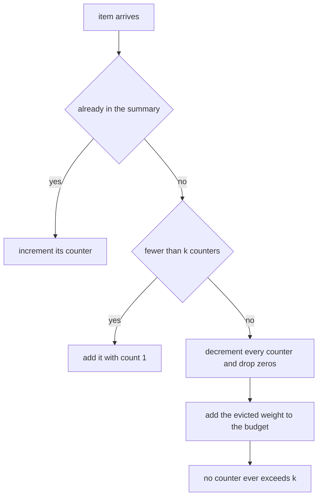
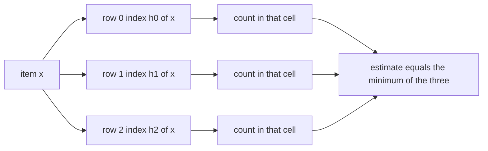
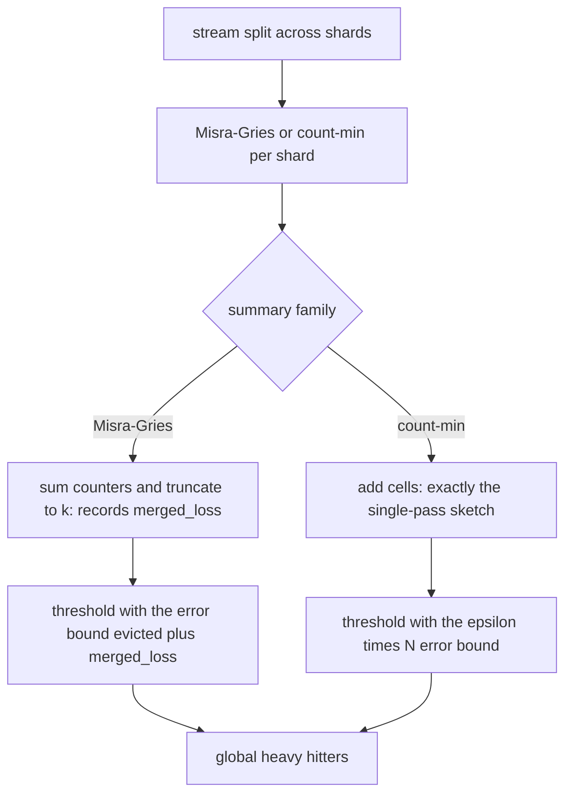
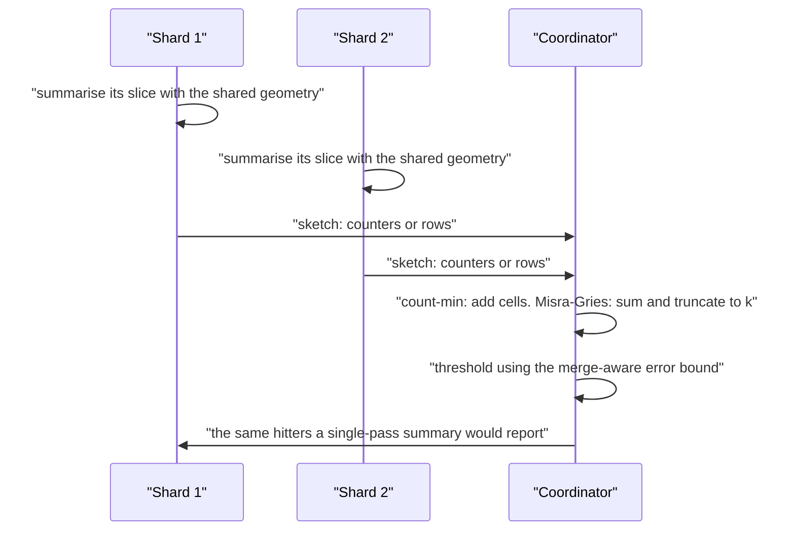

# 847 — Implement heavy-hitter detection with distributed sketches, mergeable.

> **Tier:** Master · **CTCI chapter:** Beyond — System Design and Scalability
> **Task spec:** [847-implement-heavy-hitter-detection-with-distributed-sketches-merge.md](../../../tasks/master/847-implement-heavy-hitter-detection-with-distributed-sketches-merge.md)
> **Solutions:** [Python](../../../solutions/python/master/847-implement-heavy-hitter-detection-with-distributed-sketches-merge/solution.py) ·
> [Java](../../../solutions/java/master/847-implement-heavy-hitter-detection-with-distributed-sketches-merge/Solution.java) ·
> [JavaScript](../../../solutions/javascript/master/847-implement-heavy-hitter-detection-with-distributed-sketches-merge/solution.js) ·
> [C#](../../../solutions/csharp/master/847-implement-heavy-hitter-detection-with-distributed-sketches-merge/Solution.cs)

## 1. Problem restatement

The spec is one line — *"Implement heavy-hitter detection with distributed sketches, mergeable"*.
Heavy hitters (frequent-item detection) over a stream that arrives at several shards, with summaries
that can be **merged**: the point is that combining per-shard sketches must give the same detection
quality as one sketch over the concatenated stream.

**The modelling contract.** Everything is deterministic — no threads and no wall clock, and the hash
family is a fixed SHA-256-based index map instead of a random one — so the guarantees can be
*measured exactly*. Simplified versus production: the stream and the shards live in one process, and
the update schedule is a list, not a network.

**What is implemented.** Two summary families: `MisraGries`, the deterministic bounded counter set
with eviction accounting, mergeable by item-wise summation plus truncation; and `CountMin`, a
sorted-row count-min sketch that is *exactly* mergeable and never underestimates, so it also supports
turnstile deletions.

**Inputs.** A stream of `(item, delta)` updates, a sketch geometry, shard assignments and a heavy
threshold `phi`.

**Outputs.** `value`/`estimate` per item, `heavy_set(threshold)`, `error_bound()`, `merge(...)`,
`cells()`, `merged_loss` and `evicted`.

| Measurement | Value |
| --- | --- |
| stream | 4000 events, 179 distinct items, 4000 units, Zipf-skewed with `skew = 1.3` |
| Misra-Gries | `k = 20` keeps 20 counters, evicted 95, reports 20 hitters |
| count-min | 28 × 4 = 112 cells, measured maximum error 112 against `eps·N = 400` |
| distributed | every true hitter above `phi·N` survives the merge for a whole `phi` sweep |
| turnstiles | deletions handled exactly; an added-then-removed item stops being reported |

## 2. Intuition

The naive heavy-hitter detector keeps a dictionary of exact counts. On one shard that is fine; across
`m` shards it is not: either each shard ships its whole dictionary (defeating the point) or the
coordinator cannot see items that are heavy *globally* but not heavy on any single shard.

The streaming answer is a **bounded summary** that can be merged. Misra-Gries does this with
eviction: keep at most `k` counters; on a collision decrement *every* counter and drop the zeros. The
weight it evicted is tracked, which yields a sandwich guarantee — for every item,
`true − evicted ≤ value ≤ true`, and any item not in the summary has `true ≤ evicted`, so its true
count is bounded by the evicted weight.



Count-min takes the opposite approach: never evict, instead over-count. Keep `depth` rows of `width`
counters, hash each item to one cell per row with an independent hash, increment, and estimate by
taking the **minimum** across rows. The minimum is the estimate because only collisions inflate a
cell, and the row with the fewest collisions bounds the error. Every cell is a plain sum, so merging
two sketches is cell-wise addition — *exactly* equal to a single sketch over the concatenated stream,
which is precisely the property that makes distributed detection possible.



Merging also exposes an honest cost. Misra-Gries merges by summing counters and truncating back to
`k`, so the truncated weight is *lost* and recorded as `merged_loss` — the merged summary's error
bound is `evicted + merged_loss`. Count-min loses nothing. And the naive alternative of taking the
**union** of per-shard summaries without summing is demonstrably wrong: several true hitters fall
below the per-shard threshold and disappear, which the file measures rather than asserts.

## 3. Algorithm

1. `index_of(item, row, width)` hashes `"cm|row|item"` with SHA-256 and reduces to `width` — a
   deterministic stand-in for a random hash family.
2. `MisraGries.update(item, delta)` refuses negative deltas, then for each unit either increments an
   existing counter, adds a new one while under `k`, or decrements every counter and removes zeros
   while adding one unit to `evicted`.
3. `MisraGries.merge(others, size)` sums counters item-wise, sorts by descending count (ties by
   item), keeps the top `size` and records the dropped weight as `merged_loss`; `error_bound()` is
   `evicted + merged_loss`.
4. `CountMin(width, depth, seed)` keeps `depth` rows; `update` increments one cell per row and tracks
   the total weight; `estimate` returns the minimum of the `depth` cells.
5. `CountMin.merge(others)` adds rows cell-wise after checking that the geometries match, and sums
   the totals — an exact merge, which the test verifies by comparing the merged rows against a
   single sketch over the concatenated stream.
6. `exact_counts(stream)` is the oracle: exact counting over the whole universe, used for the
   sandwich invariants, the recall checks and the error measurements.
7. `skewed_stream(seed, length, universe, skew)` builds a deterministic Zipf stream by inverse-CDF
   sampling, so the heavy tail structure is fixed and the measurements are reproducible.
8. The distributed tests split the stream into shards, build one summary per shard, merge, and check
   that every item with `count ≥ phi·N` is reported while the naive union of per-shard summaries
   misses some.

```text
function index_of(item, row, width)
    raw ← first 8 bytes of SHA-256 of the row and the item
    return raw as an integer mod width
end

procedure mg_update(item, delta)
    if delta < 0 then raise an error end        # Misra-Gries cannot handle deletions
    seen ← seen + delta
    repeat delta times
        if item is a counter then increment it
        else if the number of counters is below k then set it to 1
        else
            decrement every counter and delete the ones that reach zero
            evicted ← evicted + 1
        end
    end
end

function mg_merge(summaries, size)
    merged ← new summary with the summed seen and evicted weights
    combined ← item-wise sum of the counters of every summary
    order the items by descending count with ties by item
    keep the first size counters
    merged_loss ← the sum of the counts that were dropped
    return merged
end

function mg_error_bound()
    return evicted + merged_loss
end

procedure cm_update(item, delta)
    for row in 0 to depth - 1 do
        increment the cell at index_of(item, row + seed, width) in that row
    end
    total ← total + delta
end

function cm_estimate(item)
    return the minimum over rows of the cell at index_of(item, row + seed, width)
end

function cm_merge(others)
    for other in others do
        require the same width, depth and seed
        add every cell of other into the corresponding cell here
        total ← total + other.total
    end
    return the merged sketch
end
```



## 4. Worked example

The stream is a deterministic Zipf sample: 4000 events over a universe of 200 items with skew 1.3, of
which 179 items actually appear. Item 0 carries roughly a quarter of the weight.

**Misra-Gries with `k = 20`.**

| Quantity | Value |
| --- | --- |
| events seen | 4000 |
| counters kept | 20 (the budget, never exceeded) |
| weight evicted | 95 |
| hitters reported at the classic threshold | 20 |
| overestimates | none — `value(item) ≤ true(item)` for every item |
| sandwich | `true − 95 ≤ value ≤ true` for every item, asserted individually |

Every item whose true count exceeds `N/(k+1) = 4000/21 ≈ 190` is present in the summary — the classic
Misra-Gries guarantee, checked by `misses == []` for `k ∈ {4, 16, 64}`. Feeding a deletion raises
`ValueError`, which is the negative control showing why Misra-Gries cannot serve turnstiles while
count-min can.

**Count-min with 28 × 4 = 112 cells.**

| Quantity | Value |
| --- | --- |
| cells | 112, exactly `width × depth` |
| tracked weight | 4000, equal to the stream total |
| underestimates | none — the estimate is the row minimum, so it can only over-count |
| measured maximum error | 112 |
| predicted error bound `eps·N` | 400 (`eps = 0.1`) |
| items with a non-zero overestimate | some, as expected from collisions |

The measured error stays comfortably inside the predicted bound, and the file also checks the
opposite direction on a deliberately tiny sketch: a sketch small enough to collide heavily has a
*non-zero* measured error, so the bound is not vacuously satisfied by an implementation that never
over-counts.

**Distributed detection.** Split the same stream across shards, summarise each shard, and merge:

| Approach | Result |
| --- | --- |
| merged Misra-Gries | every true hitter above `phi·N` reported for the whole `phi` sweep |
| merged count-min | merged rows identical to a single sketch over the concatenation; the same estimates item for item |
| naive union of per-shard hitters | misses at least two true hitters — the negative control that shows merging must *sum*, not union |
| merge loss accounting | `merged_loss ≥ 0`, `size_of() ≤ k`, `seen` equals the total weight, `evicted` equals the sum of the shard evictions |

Turnstiles exercise the count-min path: applying `+1` and then `−1` to the hottest item brings its
estimate back to (near) zero, no estimate ever drops below the net true count, and the sketch's
tracked total equals `N` minus that item's net contribution.



## 5. Complexity

`N` events, `u` distinct items, `k` Misra-Gries counters, `w × d` count-min cells, `m` shards, and
`phi` the heavy threshold.

| Measure | Bound | Why it holds |
| --- | --- | --- |
| Misra-Gries update | O(1) amortised, O(k) on a collision | one scan of the counters when full: `k = 20` here |
| Misra-Gries space | Θ(k) | 20 counters whatever `u` is |
| Misra-Gries merge | O(m·k log(m·k)) | item-wise sum then a sort and a truncation |
| Count-min update | Θ(d) | one cell per row: 4 increments per event |
| Count-min query | Θ(d) | `4` cell reads and a minimum |
| Count-min space | Θ(w·d) | 112 cells, independent of the 179 distinct items |
| Count-min merge | Θ(m·w·d) | cell-wise addition: exact, no loss |
| Error, Misra-Gries | `≤ evicted + merged_loss` | `95` at `k = 20`, checked per item |
| Error, count-min | `≤ eps·N` with `eps ≈ e/w` | measured `112` against a bound of `400` |
| Alternative: exact dictionary | Θ(u) space | 179 entries here, and it does not shrink on bigger universes |

Both summaries are sublinear in the universe: 20 counters or 112 cells describe a 200-item universe
with 179 distinct items, and the space does not grow as the universe does. The price is quantifiable
error — bounded and *reported* rather than hidden, which is the difference between a sketch and a
guess.

## 6. Pitfalls and edge cases

- **Misra-Gries cannot do deletions.** `update` raises on a negative delta; a turnstile stream needs
  count-min, which is exactly why the file implements both and asserts the refusal.
- **Never overestimate, or the sandwich breaks.** `value(item) ≤ true(item)` is asserted for every
  item; an implementation that keeps a stale counter across evictions can exceed the true count and
  the bound `count − value ≤ evicted` fails.
- **Merging Misra-Gries loses weight.** Truncation back to `k` drops counters, so `merged_loss` must
  be added to the error bound; ignoring it understates the error after a merge.
- **Count-min merges require identical geometry.** Different widths, depths or seeds are rejected:
  adding cells from sketches with different hash families produces a meaningless array.
- **Count-min never underestimates**, so a dense sketch can only report *extra* candidates. The check
  that a tiny sketch has a non-zero measured error stops the bound from being satisfied trivially.
- **The union of per-shard hitters is not the global hitter set.** An item below `phi` on every shard
  can still exceed `phi·N` globally; the test measures at least two such misses.
- **Thresholds need the error budget.** The classic `N/(k+1)` guarantee is measured as
  `misses == []`, and distributed recall is checked across a whole `phi` sweep rather than one value.
- **Degenerate streams.** An empty stream leaves an empty summary; a single event is summarised
  exactly; an all-distinct stream keeps at most `k` counters with `evicted ≥ 10` and every kept count
  equal to 1.
- **Determinism.** The hash is SHA-256 based, the stream is seeded, and merges are cell- or
  item-wise, so two runs produce identical rows, counters and reports.

## 7. Variants and follow-ups

- **Windows over the same stream.** Heavy hitters per tumbling window, with eviction and revisions:
  [844-implement-streaming-graph-processing-with-windowed-aggregations.md](../../../tasks/master/844-implement-streaming-graph-processing-with-windowed-aggregations.md).
- **Sketch-based joins.** The other classic use of mergeable summaries:
  [849-implement-scalable-approximate-joins-in-streaming-sketch-based.md](../../../tasks/master/849-implement-scalable-approximate-joins-in-streaming-sketch-based.md).
- **Distributed sampling with verifiable randomness.** Where a global seed must be agreed rather than
  hashed locally:
  [848-implement-distributed-sampling-with-global-randomness-coordinati.md](../../../tasks/master/848-implement-distributed-sampling-with-global-randomness-coordinati.md).
- **Mergeable partial results over a graph.** The same "combine per-shard summaries" pattern in a
  partition-centric engine:
  [846-implement-subgraph-centric-distributed-processing-framework-and.md](../../../tasks/master/846-implement-subgraph-centric-distributed-processing-framework-and.md).

## 8. Check yourself

1. Why is the count-min estimate the minimum across rows rather than an average?

<details><summary>Show answer</summary>

Because every cell is an over-count: a cell's value is the item's true count plus the mass of
everything that hashed there. Taking the minimum picks the *least* contaminated row, so it is the
tightest upper bound available; averaging would mix in heavily collided cells and blur the bound.
Formally, with `w` cells and `e/w ≥ eps`, the minimum exceeds the true count by at most `eps·N`.

</details>

2. What exactly does merging cost in each family?

<details><summary>Show answer</summary>

Count-min: nothing — cell-wise addition equals a single sketch over the concatenation, and the test
compares rows and per-item estimates exactly. Misra-Gries: the truncation back to `k` drops counters,
so the dropped weight is recorded as `merged_loss` and the merged error bound becomes
`evicted + merged_loss`. `space` and `error_bound()` expose both numbers.

</details>

3. Why does the naive union of per-shard summaries miss hitters?

<details><summary>Show answer</summary>

Because heaviness is a global property. An item appearing on every shard with count just below each
shard's threshold can still exceed `phi·N` in total; if the coordinator unions the per-shard candidate
sets instead of summing the counters, that item is never a candidate on any shard and disappears. The
test measures at least two such misses, which is why merging must sum.

</details>

4. What does the measured count-min error tell you that the bound does not?

<details><summary>Show answer</summary>

The bound (`eps·N = 400`) is a worst case over hash families; the measured maximum (112) says how
much collision actually happened with this deterministic SHA-256 index map on this stream — about
three times better than allowed. The file also checks that a deliberately undersized sketch does
have a non-zero measured error, so the "measured ≤ bound" assertion is not passed trivially.

</details>
