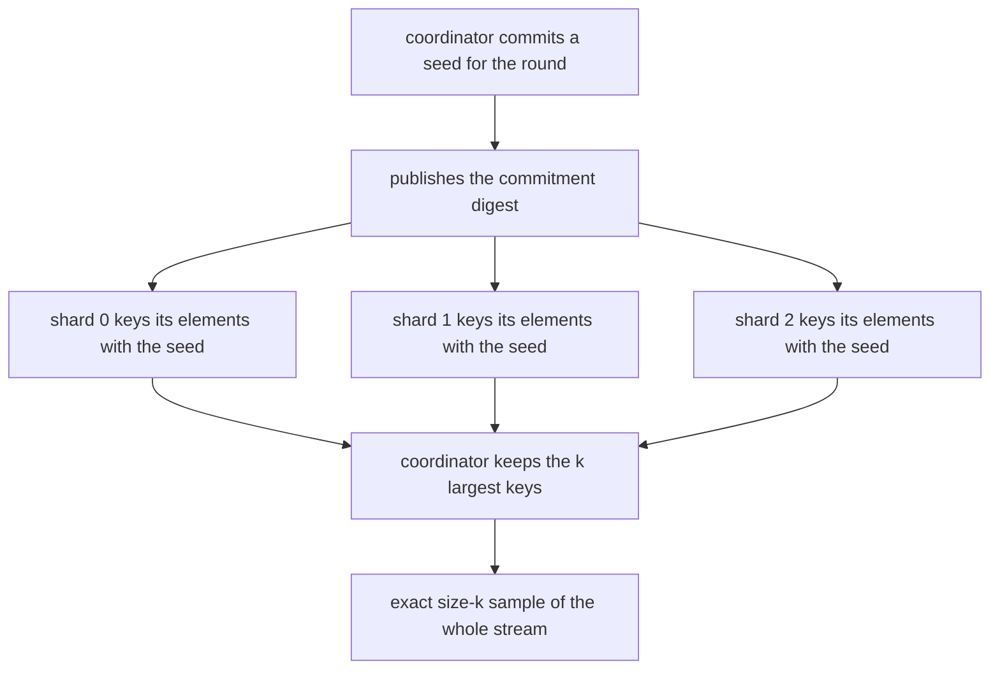
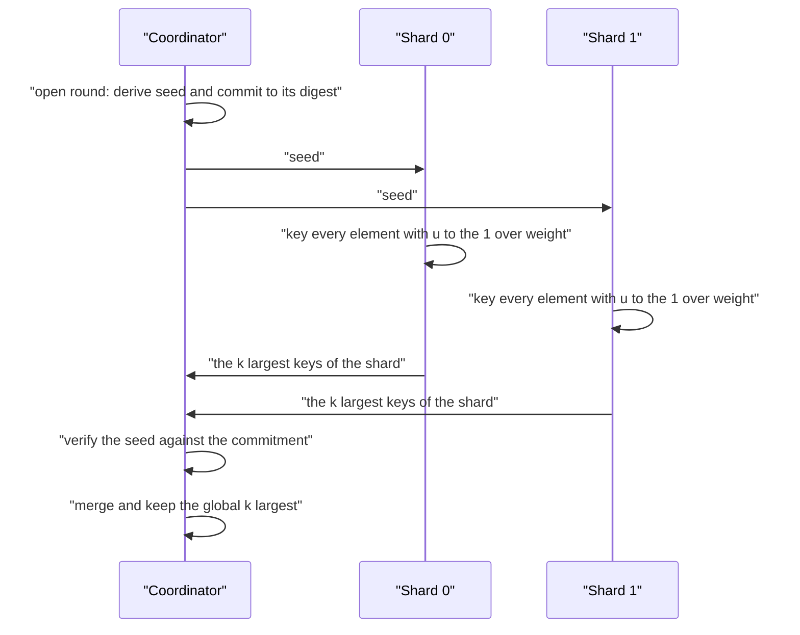
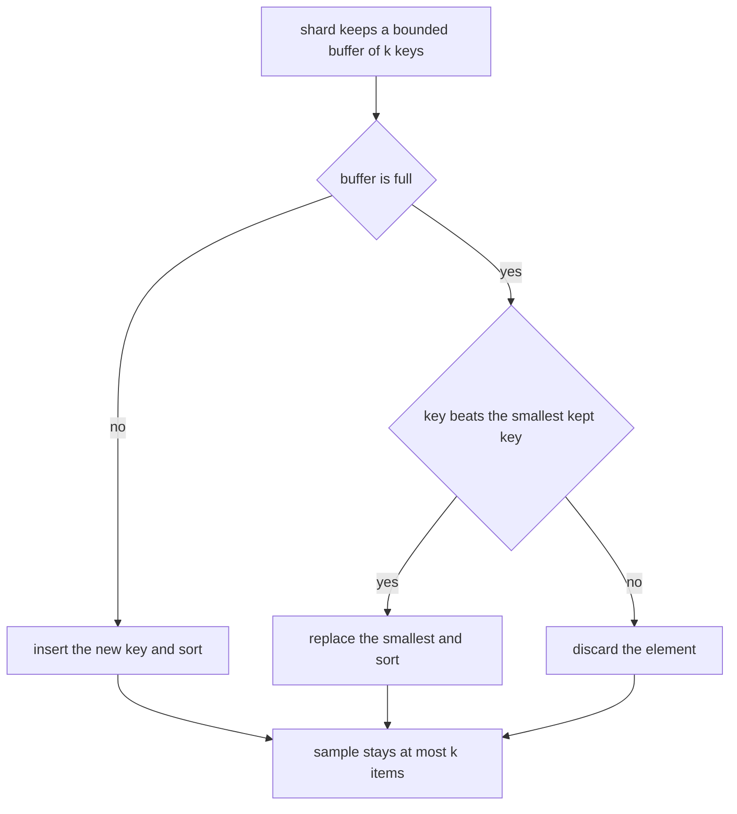
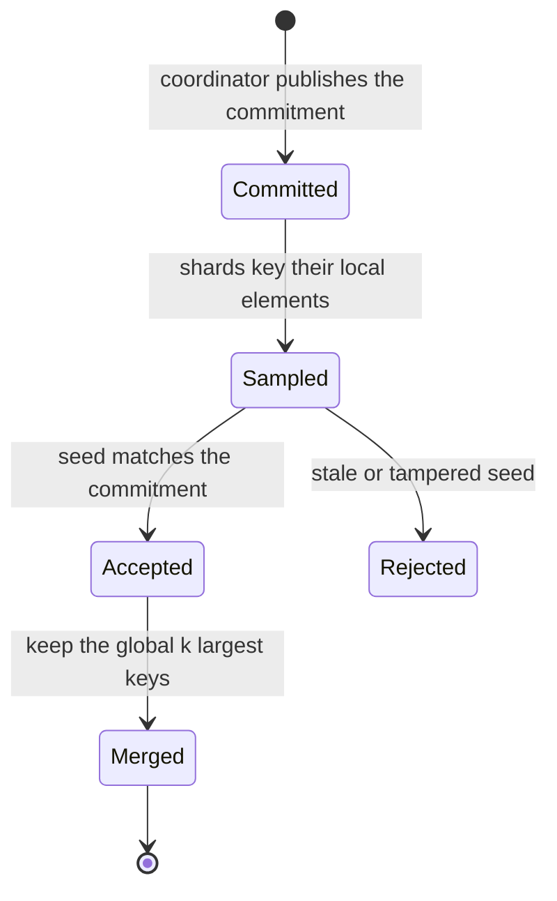

# 848 — Implement distributed sampling with global randomness coordination.

> **Tier:** Master · **CTCI chapter:** Beyond — System Design and Scalability
> **Task spec:** [848-implement-distributed-sampling-with-global-randomness-coordinati.md](../../../tasks/master/848-implement-distributed-sampling-with-global-randomness-coordinati.md)
> **Solutions:** [Python](../../../solutions/python/master/848-implement-distributed-sampling-with-global-randomness-coordinati/solution.py) ·
> [Java](../../../solutions/java/master/848-implement-distributed-sampling-with-global-randomness-coordinati/Solution.java) ·
> [JavaScript](../../../solutions/javascript/master/848-implement-distributed-sampling-with-global-randomness-coordinati/solution.js) ·
> [C#](../../../solutions/csharp/master/848-implement-distributed-sampling-with-global-randomness-coordinati/Solution.cs)

## 1. Problem restatement

The spec is one line — *"Implement distributed sampling with global randomness coordination"*.
The task: sample `k` items from a stream that is split across shards, with the randomness
**coordinated** — every shard draws from a global random stream that the coordinator publishes and
commits to — so that the union of the shard samples is an exact size-`k` sample of the whole stream.

**The modelling contract.** Nothing here uses threads, sockets or the wall clock: the coordinator,
the shards and the commitment registry are plain objects, and randomness is a deterministic hash of
`(round seed, shard, position)`. Simplified versus production: one process, k-samples are lists of
`(item, key)` rather than files, and the "global randomness" is a hash chain rather than a
distributed coin-tossing protocol.

**Inputs.** A stream, `k`, a shard layout, a round index, and per-shard weights.

**Outputs.** `run_round` returns the committed seed and the shard partition; the coordinator's
`sample()` returns the k sampled items, `merged` holds the `(item, key)` pairs, and counters track
rounds, acceptances, rejections and merged size.

| Measurement | Value |
| --- | --- |
| main case | `k = 10` from `n = 200` over 4 shards, merged size exactly 10 |
| exactness | merged sample equals the top-k-by-key sample for 1, 2, 4 and 7 shards |
| unbiasedness | mean per-position inclusion `0.1333` versus `k/n = 8/60 = 0.1333` over 400 worlds |
| layout independence | central `0.473` versus distributed `0.465` average inclusion frequency |
| memory | each shard keeps at most `k` items, the coordinator at most `k` |

## 2. Intuition

The naive distributed sampler has each shard sample `k` items and the coordinator keep `k` of those.
That is biased: a shard holding most of the stream is under-represented relative to its size, and the
final sample is not uniform over the concatenated stream. The reason is that the shards' samples are
not comparable — nothing tells the coordinator that shard 1's third pick is "better" than shard 4's
first.

The fix is to make every element carry a **comparable random key** drawn from one global random
stream. The coordinator commits to a seed per round by publishing `digest("commit", seed)` *before*
the round; every element at shard-local position `p` gets `u = global_unit(seed, shard, p)` and key
`u^(1/w)` (the A-Res rule), computed from data the shard already has. The merge then keeps the `k`
largest keys — and because keys are comparable across shards, that merge is exactly the same as
giving a key to every element of the concatenated stream and taking the top `k`.



Two properties fall out of using *hashes* rather than a stateful random stream. First, a shard's keys
do not depend on how the stream was split — they depend on `(seed, shard, local position)` — so the
merge is exact and the number of shards does not change the distribution. Second, a shard that used a
stale or tampered seed is *detected*, because the seed it reports back no longer matches the
published commitment, which the file asserts with two negative controls.



Interestingly, the same construction deliberately makes the sample depend on the *order* of the
stream: keys are derived from positions, so reversing the stream produces a different (but still
valid) k-sample. That is not a flaw — a position-based key over a different sequence is a different
random assignment — and the file asserts both halves: the reordered stream still yields exactly `k`
items, and (unless `n = k`) they are not the same set.

## 3. Algorithm

1. `global_unit(seed, shard, position, salt)` hashes `(seed, shard, position, salt)` with SHA-256 and
   maps the first eight bytes into `(0, 1]` — a stateless random draw.
2. `key_of(seed, shard, position, weight)` returns `u^(1/w)`; for unit weights it is just `u`, and
   larger keys are kept (so heavier elements are promoted, the A-Res weighting rule).
3. `Coordinator.open_round(round_index)` derives the seed deterministically from the round index and
   `k`, stores it, and publishes `commitments[round_index] = digest("commit", seed)`.
4. `shard_sample(stream, shard, seed, k)` keeps the `k` largest keys with a sorted list, so a shard's
   memory is bounded by `k` regardless of its stream length.
5. `run_round(stream, shards, k, round_index, coordinator)` splits the stream by
   `position % shards`, skips empty shards, samples each non-empty shard, and offers each sample to
   the coordinator.
6. `Coordinator.accept(round_index, seed, sample)` verifies the seed against the commitment (raising
   `ValueError` and counting a rejection otherwise), appends the sample, sorts by descending key with
   ties by item, and truncates to `k`.
7. `central_reservoir(stream, k, seed, shards)` and `top_positions(...)` are the brute-force
   references: they key every element of the whole stream and take the top `k`.
8. The statistical checks repeat the round over hundreds of deterministic "worlds" and compare
   measured inclusion probabilities against the exact values.

```text
function global_unit(seed, shard, position, salt)
    raw ← first 8 bytes of SHA-256 of seed shard position and salt
    return (raw + 1) / 2 to the 64
end

function key_of(seed, shard, position, weight)
    return global_unit(seed, shard, position) to the (1 / weight)
end

procedure open_round(round_index)
    seed ← hash of the round index and k
    store seed
    publish commitments[round_index] ← digest of the seed
    return seed
end

function shard_sample(stream, shard, seed, k)
    kept ← empty list of (key, item)
    for position and item in stream do
        key ← key_of(seed, shard, position)
        if fewer than k keys are kept then insert and sort
        else if the key beats the smallest kept key then replace it and sort
    end
    return the kept items with their keys
end

procedure accept(round_index, seed, sample)
    if commitments[round_index] ≠ digest of seed then
        count a rejection and raise an error
    end
    count an acceptance
    append the sample to the merged list
    sort by descending key with ties by item
    drop everything beyond the k largest
    count the round
end

procedure run_round(stream, shards, k, round_index, coordinator)
    seed ← open_round(round_index)
    deal every element into the shard equal to its position modulo the shard count
    for each shard with elements do
        accept that shard's k largest keys
    end
    return seed and the shard parts
end
```



## 4. Worked example

Take `n = 200` elements over a universe of 40 items, `k = 10`, and 4 shards. The stream is dealt by
`position % shards`, so each shard sees 50 elements.

| Step | Who | Action | Result |
| --- | --- | --- | --- |
| 1 | coordinator | `open_round(0)` | seed derived from `(round 0, k = 10)`, commitment published |
| 2 | shard 0 | keys its 50 elements | 10 largest keys retained |
| 3 | shards 1–3 | same | 10 each |
| 4 | coordinator | 4 samples accepted against the commitment | 40 candidates merged |
| 5 | coordinator | keep the global 10 largest keys | sample of size 10 |
| 6 | reference | `central_reservoir(stream, 10, seed, 4)` | identical to step 5 |

Step 6 is the exactness check, repeated for 1, 2, 4 and 7 shards: the merged result equals the
brute-force top-k over the whole stream *with the same global randomness*, and the sample size is
always exactly `min(k, n)`. Two negative controls sit next to it: a sample returned under an
uncommitted seed and one under a tampered seed (`seed + 1`) both raise `ValueError` and increment the
rejection counter.

**Unbiasedness** is measured rather than argued. A template stream of 60 elements over a universe of
12, `k = 8`, 4 shards, 400 seeded worlds:

| Quantity | Measured | Expected |
| --- | --- | --- |
| mean per-position inclusion probability | `0.1333` | `k/n = 8/60 = 0.1333` |
| per-position inclusion probability | within `0.12` of `k/n` | exactly `k/n` |
| sample size in every world | `8` | deterministic `k` |

The k=1 case checks a different identity: an item with multiplicity `c` should be sampled with
probability `1 − (1 − 1/n)^c`, because each of its copies has an independent chance of being the
single largest key. That is the formula the file compares against, tolerating `0.12` over 400 trials.

**Layout independence** compares a single central reservoir against a 5-shard distributed run, 300
worlds each, `k = 6` on a 40-element stream:

| Layout | Average inclusion frequency |
| --- | --- |
| central (1 shard) | `0.473` |
| distributed (5 shards) | `0.465` |

Per-item differences stay within `0.15` and the averages within `0.05`. That is the property the
whole task is about: *how the stream was split must not change what gets sampled*.

Finally the edge cases pin the boundaries: `k = 0` yields an empty sample, `k ≥ n` yields the whole
stream, an empty stream produces empty parts and an empty sample, a single element is always
sampled, an empty shard returns nothing, and re-running a round reproduces the same sample and
counters while two different rounds get different committed seeds.



## 5. Complexity

`n` stream elements, `s` shards, `k` sample size, `w` rounds.

| Measure | Bound | Why it holds |
| --- | --- | --- |
| Key computation per element | O(1) hash | one SHA-256 of `(seed, shard, position)` |
| Shard sampling | Θ(n/s · k) worst case | sorted insertion into a buffer of `k`: for `k = 10` and 50 elements per shard this is small |
| Shard memory | Θ(k) | the buffer never exceeds `k`: `len(sample) == k` for a long stream |
| Coordinator merge | Θ(s·k log(s·k)) | sort the candidates and truncate to `k` |
| Coordinator memory | Θ(k) | `len(merged) ≤ k` asserted for every layout |
| Communication | Θ(s·k) items | each shard ships at most `k` `(item, key)` pairs |
| Exactness | merge == top-k over the concatenation | verified against the brute-force reference |
| Error in inclusion probability | `O(1/√worlds)` empirically | 400 worlds give `0.1333` against `0.1333` |
| Alternative: sample `k` per shard and union | Θ(s·k) items but **biased** | a big shard is under-represented; the union is not a uniform k-sample |

The headline is the memory bound: neither a shard nor the coordinator ever holds more than `k`
elements, so the whole pipeline is streaming and its cost per round is `Θ(n)` hash evaluations plus
`Θ(s·k log(s·k))` merge work, independent of the stream's total length.

## 6. Pitfalls and edge cases

- **A stateful per-shard RNG cannot be merged.** If each shard drew from its own stream, shard
  samples would not be comparable and the union would be biased; keys must come from a *global*
  function of the round.
- **Keys must depend on shard-local position, not global offset.** Otherwise a shard cannot compute
  its keys without knowing the whole layout, which is exactly the coordination the design avoids.
- **The commitment must be published before the round.** `accept` recomputes `digest("commit", seed)`
  and rejects a mismatch; without the commitment a shard could choose its seed after seeing others'
  samples and bias the result.
- **Commitments must be per seed.** `digest("commit", 5) != digest("commit", 6)` is asserted, and each
  round derives a fresh seed, so a commitment cannot be replayed across rounds.
- **Order dependence is expected, not a bug.** Keys are position-based, so a reversed stream yields a
  different — still valid — k-sample. The file asserts both halves rather than assuming equality.
- **Weighted elements use `u^(1/w)`.** For unit weights the key is just `u`; the exponentiation is
  what a weighted variant needs so that heavier elements are promoted proportionally.
- **Empty shards must be skipped** without breaking the round, and the shard count may exceed the
  stream length (`sum(1 for part in parts if part) == min(shards, n)`).
- **Boundary `k`.** `k = 0` gives an empty sample, `k ≥ n` returns the whole stream, and a single
  element is always sampled.
- **Determinism.** Everything is hashing and sorting with ties broken by item, so rounds and counters
  are reproducible — which is what makes the statistical measurements meaningful rather than noisy.

## 7. Variants and follow-ups

- **Summary-based distribution instead of sampling.** When the goal is heavy hitters rather than a
  uniform sample, the mergeable structure is a sketch:
  [847-implement-heavy-hitter-detection-with-distributed-sketches-merge.md](../../../tasks/master/847-implement-heavy-hitter-detection-with-distributed-sketches-merge.md).
- **Freshness that cannot be replayed.** A verifiable delay function gives an unbiasable seed when no
  coordinator is trusted:
  [836-implement-verifiable-delay-function-small-prototype-vdf.md](../../../tasks/master/836-implement-verifiable-delay-function-small-prototype-vdf.md).
- **Agreement on the seed itself.** Across untrusted parties, the seed has to be agreed rather than
  published:
  [833-implement-consensus-over-heterogeneous-trust-federated-consensus.md](../../../tasks/master/833-implement-consensus-over-heterogeneous-trust-federated-consensus.md).
- **Windowed streams.** Sampling per tumbling window with the same key discipline fits naturally into
  a streaming engine:
  [844-implement-streaming-graph-processing-with-windowed-aggregations.md](../../../tasks/master/844-implement-streaming-graph-processing-with-windowed-aggregations.md).

## 8. Check yourself

1. Why does the merge of shard samples give an exact k-sample of the whole stream?

<details><summary>Show answer</summary>

Because every element carries a key drawn from the *same* global function
`global_unit(seed, shard, position)`, so keys are comparable across shards. Keeping the `k` largest
shard keys is therefore identical to giving a key to every element of the concatenated stream and
keeping the top `k` — which the file verifies by comparing against `central_reservoir` for 1, 2, 4 and
7 shards.

</details>

2. What does the coordinator's commitment protect against?

<details><summary>Show answer</summary>

A shard choosing its randomness after the fact. The coordinator publishes `digest("commit", seed)`
before the round, and `accept` recomputes the digest when the sample comes back: a stale seed (wrong
round) or a tampered one (`seed + 1`) raises `ValueError` and is counted as a rejection. Without the
commitment, a shard could re-draw until it liked the sample it contributed.

</details>

3. Why is the inclusion probability exactly `k/n` for every position?

<details><summary>Show answer</summary>

Because the keys are i.i.d. draws from the same distribution and the merge selects the `k` largest, so
by symmetry every position is selected with probability `k/n`. The file measures this over 400 worlds:
the mean per-position inclusion is `0.1333` against `k/n = 8/60 = 0.1333`, and each position
individually stays within `0.12` of it. For `k = 1` the item-level identity is
`1 − (1 − 1/n)^multiplicity`, also checked.

</details>

4. Why must the coordinator's merge keep the *largest* keys rather than, say, the first `k` received?

<details><summary>Show answer</summary>

Because the keys encode the global random order, and the sample must be the top `k` of that order for
the uniform-inclusion property to hold. Taking the first `k` arrivals would bias the sample toward
whichever shard answered first — the distributed analogue of sampling the head of a stream. The
sort-and-truncate in `accept` is the whole correctness argument, along with the `k`-bounded buffers.

</details>

5. What is the memory bound, and where does it bite?

<details><summary>Show answer</summary>

Both sides hold at most `k` items: `shard_sample` keeps a buffer of `k` keys regardless of the shard's
length, and `len(coordinator.merged) ≤ k` is asserted for every layout. That is what makes the
protocol streamable — a shard with a million elements still ships only `k` pairs — and the
communication cost is `Θ(s·k)` items per round rather than anything proportional to the stream.

</details>
