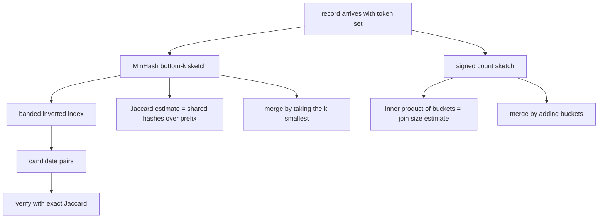
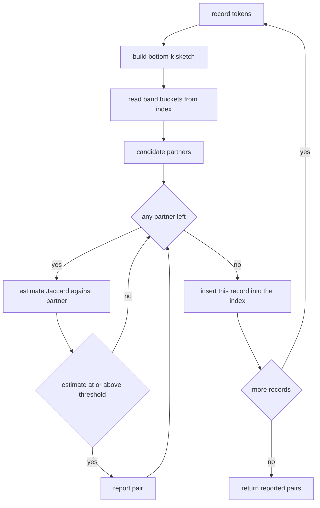
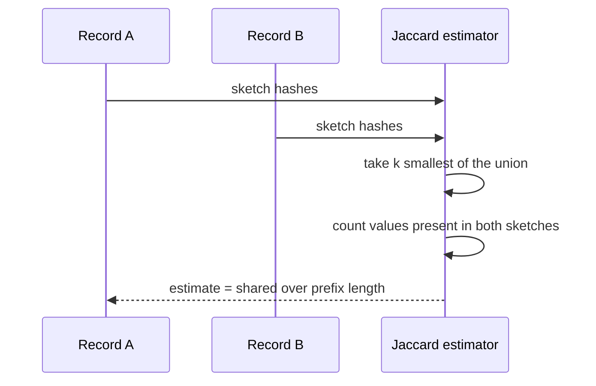

# 849 — Implement scalable approximate joins in streaming (sketch-based).

> **Tier:** Master · **CTCI chapter:** Ch 9 — System Design and Scalability
> **Task spec:** [849-implement-scalable-approximate-joins-in-streaming-sketch-based.md](../../../tasks/master/849-implement-scalable-approximate-joins-in-streaming-sketch-based.md)
> **Solutions:** [Python](../../../solutions/python/master/849-implement-scalable-approximate-joins-in-streaming-sketch-based/solution.py) ·
> [Java](../../../solutions/java/master/849-implement-scalable-approximate-joins-in-streaming-sketch-based/Solution.java) ·
> [JavaScript](../../../solutions/javascript/master/849-implement-scalable-approximate-joins-in-streaming-sketch-based/solution.js) ·
> [C#](../../../solutions/csharp/master/849-implement-scalable-approximate-joins-in-streaming-sketch-based/Solution.cs)

## 1. Problem restatement

Two join families have to run over data that never fits in memory:

- **Set-similarity join.** A stream of records arrives, each record `name` carrying a set of
  tokens. Report every pair of records whose Jaccard similarity
  `|A ∩ B| / |A ∪ B|` reaches a threshold `t`.
- **Frequency join.** Two streams `L` and `R` arrive independently and the answer is the join
  size `sum over keys v of count_L(v) * count_R(v)` — the number of pairs the SQL join
  `L join R on key` would emit.

The brute-force contracts are cheap to state and impossible to execute at scale: the similarity
join needs `m * (m - 1) / 2` set intersections for `m` records, and the frequency join needs a
materialised hash table on one side plus a lookup per record on the other.

**Modelling contract** (what the four solutions actually implement, and what section 5 is honest
about). Each file is a **single-process, in-memory simulation** of the distributed pipeline: no
network, no shards, no windowing, no eviction. The "stream" is a deterministic list produced by a
seeded splitmix64 generator and all hashing is SHA-256 based, so every run is byte-identical and
each error bound is **measured** against an exact oracle on the same toy data rather than argued
from probability. The sketch families themselves are the standard ones.

Concrete contract from the Python file's assertions, on a corpus of `24` records over a token
universe of `120`, each of size `40`, giving `276` pairs:

| Call | Result | Why |
| --- | --- | --- |
| `MinHash(200).jaccard(...)` vs exact | error `< 1e-12` | a sketch larger than the union is exact |
| `MinHash(k).jaccard(...)` worst error | `0.375` at `k = 8`, `0.241` at `k = 16` | measured, and each obeys `3 / sqrt(k)` |
| `lsh_candidates(bands=8, rows=4)` | fewer candidates than `276` pairs, recall `1` above similarity `0.9` | pruning plus the near-duplicate guarantee |
| `CountSketch(512, 5).join_size(...)` | ratio `1.0067` against a true join size of `4501` | measured relative error inside `10%`; `0.9976` when averaged over `24` seeds |
| streaming threshold join, `t = 0.3`, `16 x 2` banding | `76` true matches, `42` reported | measured recall `> 0.5`, honestly not `1` |

## 2. Intuition

The naive idea is the hash join: buffer one side in a dictionary, stream the other side through
it, and for sets, bucket by every token so that two records meet whenever they share a token.
Both are *exact* and both are what the solutions use as the **oracle** — and both are what makes
them unusable: the dictionary grows with the stream, and the "share a token" bucket degenerates
into all-pairs for common tokens.

The key insight is that the join only ever needs the parts of the data that survive a *summary*:

1. **For similarity**, a bottom-k MinHash sketch of size `k` keeps the `k` smallest hashes of a
   set. Position-wise agreement between two sketches estimates Jaccard, and the estimator is
   mergeable because the sketch of a union is the `k` smallest of the two sketches' union. So a
   set can be summarised once, on arrival, and never revisited.
2. **Which summaries to compare** is decided by banding: cut the `k` hashes into `b` bands of
   `r` rows and treat two sets as *candidates* when any whole band matches. A pair at similarity
   `s` survives with probability `1 - (1 - s^r)^b`, an S-curve whose knee sits near
   `(1 / b)^(1 / r)` — so banding is a *spend*: more bands, fewer rows, more candidates.
3. **For join size**, a signed count sketch per side turns the sum of products into an inner
   product of buckets: `sum_v a_v b_v` is estimated by `sum_c A[c] * B[c]`, and collisions are
   noise whose median over rows cancels.

The second half of the insight is that sketches which *merge by addition or by min* make the
distribution free: `min` over a union is `min` of the two `min`s, and signed counters add, so
sharding a stream and merging the shards reproduces the single-pass sketch **exactly** — the
Python file asserts `merged.rows == sketch_left.rows`, counter for counter.



Note what is *not* discarded in the Python file: candidates are **verified** with the exact
Jaccard over the stored token sets, so the output is an exact join over the candidate set. The
only approximation left in the reported pairs is the recall of the candidate generator.

## 3. Algorithm

The pipeline the Python file builds, in order:

1. Hash every item deterministically: `hash64(kind, seed, ...parts)` takes the first 8 bytes of
   SHA-256 of the pipe-joined parts; `minhash_value(item, seed)` is one such hash.
2. `MinHash(k, seed)` keeps the `k` smallest distinct hashes, sorted; `merge` unions the hash sets
   and keeps the `k` smallest, refusing sketches built with a different seed.
3. `jaccard(other)` takes the `k` smallest hashes of the union and counts how many are present in
   *both* sketches — Broder's bottom-k estimator.
4. `lsh_candidates(sketches, bands, rows)` keys each band by `(band, tuple(rows in that band))` and
   pushes the name into that bucket; every pair sharing a bucket is a candidate, and a sketch
   shorter than `bands * rows` is rejected.
5. `CountSketch(width, depth, seed)` touches one cell per row per update, signed by the top hash
   bit. `estimate` takes the median of `sign * bucket` over rows, `join_size` the median of the
   bucket inner products, and `merge` adds bucket matrices — exactly.
6. The streaming threshold join keeps an inverted index of sketches seen so far, computes each
   arriving record's candidates, estimates Jaccard against each, and reports the pairs that clear
   `t` — while `reference_join` and `exact_jaccard` keep the exact oracles for measurement.

```text
procedure minhash_jaccard(left, right)
    shared ← 0
    prefix ← k smallest values of set(left.hashes) union set(right.hashes)
    for value in prefix do
        if value in left.hashes and value in right.hashes then
            shared ← shared + 1
        end
    end
    if prefix is empty then
        return 1.0
    end
    return shared / length(prefix)
end

procedure lsh_candidates(sketches, bands, rows)
    buckets ← empty map from (band index, row tuple) to list of names
    for name, sketch in sketches do
        if length(sketch) < bands * rows then
            fail with "sketch shorter than bands * rows"
        end
        for band from 0 to bands - 1 do
            key ← (band, sketch[band * rows .. (band + 1) * rows - 1])
            append name to buckets[key]
        end
    end
    return every unordered pair of names that shares a bucket
end

procedure count_sketch_join_size(left, right)
    estimates ← empty list
    for row from 0 to depth - 1 do
        append the bucket inner product of left.rows[row] and right.rows[row]
               to estimates
    end
    return the median of estimates
end

procedure streaming_threshold_join(records, threshold, bands, rows)
    index ← empty map from name to sketch
    reported ← empty set
    for record in records do
        sketch ← bottom-k sketch of record tokens
        for (first, second) in lsh_candidates(index plus this sketch, bands, rows) do
            partner ← the member of the pair that is not this record
            if partner is in index and jaccard(index[partner], sketch) >= threshold then
                add the sorted pair to reported
            end
        end
        index[record.name] ← sketch
    end
    return reported
end
```

The control flow of a single arriving record is a short loop with one pruning decision:



## 4. Worked example

### Trace A — the bottom-k sketch, with real hash values

`MinHash(3, seed=11)` fed the items `1, 2, 3, 4, 5, 6`. The hashes below are the actual
`minhash_value(item, 11)` values printed modulo `100000` (the real values are full 64-bit):

| Step | item | hash mod 100000 | sketch before | sketch after |
| --- | --- | --- | --- | --- |
| 1 | 1 | 86993 | `[]` | `[86993]` |
| 2 | 2 | 82627 | `[86993]` | `[82627, 86993]` |
| 3 | 3 | 41726 | `[82627, 86993]` | `[41726, 82627, 86993]` |
| 4 | 4 | 81450 | `[41726, 82627, 86993]` | `[41726, 81450, 86993]` |
| 5 | 5 | 9784 | `[41726, 81450, 86993]` | `[9784, 41726, 81450]` |
| 6 | 6 | 4722 | `[9784, 41726, 81450]` | `[4722, 9784, 41726]` |

Step 4 is the interesting one: `81450` is smaller than the current maximum `86993`, so it
**evicts** `86993` and the sketch never grows past `k = 3`. Step 6 shows that the sketch is a
*summary*, not a prefix: after six items it holds hashes of `6`, `5` and `3` and can say nothing
about `1` or `2` individually. Everything the estimator does goes through this contracted view.

### Trace B — estimating Jaccard, and paying for it

`A` over `{1,2,3,4}` sketches to `86993, 82627, 81450` and `B` over `{1,2,3,5}` to
`86993, 9784, 82627`. The union's three smallest values are `9784, 81450, 82627`, but only `81450`
and `82627` appear in *both* sketches, so the estimate is `2 / 3 = 0.667` against an exact Jaccard of
`3 / 5 = 0.6` — an error of `0.067`, exactly the kind of residual the file measures across all `276`
pairs: worst case `0.375` at `k = 8` and `0.241` at `k = 16`, both inside `3 / sqrt(k)` (`1.06`,
`0.75`).



### Trace C — banding decides who is even compared

Band sizing matters. With `bands = 2`, `rows = 2`, `A = [1,2,3,4]` and `B = [1,2,9,9]` share band 0
(`(1,2)`), so `{(a,b)}` is a candidate; with `B = [1,9,9,9]` neither band matches, so the candidate
set is `{}` even though `B` contains `1`, the smallest hash of `A` — agreement is required on a
*whole band*. On the real corpus with `8` bands of `4` rows the candidate set was smaller than all
`276` pairs while every pair at similarity `0.9` or more was still a candidate (recall `1`, checked
pair by pair).

### Trace D — the join-size estimation, with the actual counters

`CountSketch(width=4, depth=3, seed=3)`, left stream `[1, 2, 2, 3]`, right stream `[2, 2, 4]`:

| Row | `A` buckets | `B` buckets | inner product |
| --- | --- | --- | --- |
| 0 | `[-1, 0, 2, -1]` | `[0, 0, 3, 0]` | `-1*0 + 0*0 + 2*3 + -1*0 = 6` |
| 1 | `[1, 2, 1, 0]` | `[1, 2, 0, 0]` | `1 + 4 + 0 + 0 = 5` |
| 2 | `[-1, 0, 2, 1]` | `[0, 1, 2, 0]` | `0 + 0 + 4 + 0 = 4` |

The median over rows is `5` against an exact join size of `count_L(2) * count_R(2) = 4`: one row
overshoots (`6`), one undershoots (`4`), and the median lands one unit high — the point of a median
over correlated rows. Scaled to the shipped configuration (`width = 512`, `depth = 5`, `2560` cells)
on streams of `600` keys, the ratio was `1.0067` against a true join size of `4501`, and the mean
over `24` independent seeds was `0.9976`: the bias disappears in the average.

## 5. Complexity

Let `m` be the number of records, `n` the total number of tokens, `k` the sketch size, `b` the
band count, `r` the rows per band (`k = b * r`), and `W * D` the count-sketch geometry.

| Measure | Bound | Why it holds |
| --- | --- | --- |
| Similarity join, naive | `O(m² * avg set size)` | every pair needs one intersection |
| Sketch build | `O(n * k)` worst, `O(n log k)` typical | each token either enters the sorted bottom-`k` list or is rejected; the Python file re-sorts on insertion, so it pays `O(k log k)` per accepted token |
| Candidate generation | `O(m * b)` bucket insertions plus the pairs inside buckets | one hash per band per record, then only within-bucket pairs |
| Verification | `O(#candidates * k)` | one Jaccard estimate per candidate |
| Space (similarity) | `O(m * k)` hashes | the sketch replaces the token set; the Python file keeps the token sets too, because its verification is exact |
| Frequency join, naive | `O(n)` time, `O(distinct keys)` space on one side | a materialised hash table that grows with the stream |
| Frequency join, sketched | `O(n * D)` time, `O(W * D)` space | one cell per row per element, fixed regardless of stream length |
| Merge cost | `O(k)` for MinHash, `O(W * D * #shards)` for the count sketch | both merges are associative and exact |

The error side is what the constants buy:

| Sketch | Measured error | Theoretical scale |
| --- | --- | --- |
| MinHash `k = 8` | worst `0.375` over `276` pairs | `1 / (2 sqrt(k))`; the file's bound is `3 / sqrt(k) = 1.06` |
| MinHash `k = 16` | worst `0.241`, with `errors[16] <= errors[8]` | error shrinks as `1 / sqrt(k)` |
| Count sketch `512 x 5` | ratio `1.0067`, seed mean `0.9976` | relative error `~ 1 / sqrt(W)` per row, median over `D = 5` rows |
| LSH banding `8 x 4`, `k = 32` | fewer candidates than `276` pairs, recall `1` above `0.9` | miss probability `(1 - s^r)^b`, knee near `(1/b)^(1/r)` |

The honest summary: the errors are *measured on the toy corpus*, not proven. The `1 / sqrt(k)` law
is verified empirically, because the splitmix64/SHA-256 hashes are not a universal family, and the
concentration bound quoted in the Java header is a bound the experiment tests rather than a theorem
the code relies on.

## 6. Pitfalls and edge cases

- **A sketch shorter than the band layout.** `lsh_candidates` raises
  `ValueError("the sketch of %s is shorter than bands * rows")`; the file asserts it with
  `lsh_candidates({"a": [1, 2]}, 2, 4)`. `MinHash(0).jaccard(...)` likewise raises
  `ValueError("an empty sketch has no estimate")` rather than silently returning `0`.
- **Empty, singleton and identical sets.** `exact_jaccard([], []) == 1.0` (two empty sets are
  identical) but `exact_jaccard([1], []) == 0.0`; a sketch of the empty set is `[]`, and `jaccard`
  on two empty sketches returns `1.0` through the `if not prefix` branch. Two sketches over the same
  items estimate exactly `1.0`, and singleton sets match exactly — the extremes where the estimator
  cannot be wrong, pinned by assertions.
- **Merging across seeds is forbidden.** `merge` raises
  `ValueError("sketches with different hash seeds cannot be merged")`, and `CountSketch.join_size`
  requires matching `width`, `depth` *and* seed — otherwise the bucket arithmetic silently mixes two
  hash families.
- **Banding is a recall/threshold dial, not a free win.** Measured on shapings `(4, 8)`, `(8, 4)`,  `(16, 2)`, the file asserts `recall(16, 2) >= recall(4, 8)` and also that `recall(4, 8) < 1.0`:
  the strict shaping *does* miss moderate pairs, and the file says so instead of hiding it.
- **The streaming join does not have recall 1.** With `t = 0.3` and `16 x 2` banding it reported
  `42` of `76` expected pairs. The file splits every miss into "banding miss" or "estimate miss" and
  asserts `len(missed) >= len(banding_misses)`, so a miss can never be unexplained.
- **Signed counters mean negative estimates.** A `CountSketch` cell can go negative, and a
  disjoint stream can estimate a small *negative* join. The file only requires
  `abs(estimate) <= 0.25 * max(1, truth)` for disjoint streams, and the `max(1, truth)` guard
  matters because the relative bound is meaningless at truth `0`.
- **Re-sorting on every insertion is deliberate.** `MinHash.add` re-sorts the bottom-`k` list each
  time an item enters — a heap would be the production choice, but the file is about the
  *estimator*, not the micro-optimisation.

## 7. Variants and follow-ups

- **Exactness instead of approximation, and the C# route.** The `reference_join` and `exact_jaccard`
  oracles are the textbook hash join and set intersection; the C# file implements the same three
  joins with a Count-Min join size (`sum_v min(estA(v), estB(v))`, never *below* the truth) and a
  Cohen-style sampled join size with a Bloom filter, checking the filter's measured false-positive
  rate against `(1 - e^{-hn/m})^h` — same contract, different sketch family, different error sign.
- **Sketches as online features, and merging shards.** Feature stores need exactly the mergeability
  used here, so the sketch-per-shard pattern reappears in
  [850-implement-monetizable-feature-store-with-lineage-versioning-and.md](../../../tasks/master/850-implement-monetizable-feature-store-with-lineage-versioning-and.md),
  and the associative, commutative, idempotent merge is the cheapest non-trivial example of what
  [851-implement-latency-slash-throughput-tradeoff-benchmarks-for-vario.md](../../../tasks/master/851-implement-latency-slash-throughput-tradeoff-benchmarks-for-vario.md)
  benchmarks for consistency levels.
- **Nearest-neighbour indexes and snapshotting.** Banding is the cheap cousin of the graph index in
  [864-implement-distributed-hnsw-graph-builder-with-merge-strategy-and.md](../../../tasks/master/864-implement-distributed-hnsw-graph-builder-with-merge-strategy-and.md),
  and both trade exact recall for a sub-quadratic candidate set; a sharded sketch index is recovered
  the same way a pipeline is, by the global snapshot of
  [852-implement-global-snapshotting-for-distributed-streaming-pipeline.md](../../../tasks/master/852-implement-global-snapshotting-for-distributed-streaming-pipeline.md).

## 8. Check yourself

1. Why must the frequency-join estimate be a *median* over rows rather than a mean?

<details><summary>Show answer</summary>

Because every row's buckets collide, and the per-row estimators share the same true value but
correlated noise. The median of `D = 5` rows is a robust combiner: in the trace of section 4 the
rows gave `6`, `5` and `4` for a true join size of `4`, so the mean would have been `5.0` and the
median `5`. The file's aggregate check is that the estimate stays inside `10%` of the truth
(`ratio = 1.0067`) and that averaging *over seeds* rather than rows removes the bias (`0.9976`).

</details>

2. A sketch has `k = 32` with `8` bands of `4` rows. Where do candidates start to appear, and what
   changes with `16` bands of `2` rows?

<details><summary>Show answer</summary>

The knee is near `(1 / b)^(1 / r) = (1 / 8)^(1 / 4) ≈ 0.59`. Switching to `16` bands of `2` rows moves
it to `(1 / 16)^(1 / 2) = 0.25`, so far more pairs become candidates and recall rises
(`recall(16, 2) >= recall(4, 8)` is asserted) at the cost of a larger candidate set. The file also
asserts `recall(4, 8) < 1.0`: the stricter shaping genuinely costs recall.

</details>

3. Why can a sketch larger than the union be *exact*, and why does `A.merge([B])` fail when the two
   sketches were built with different seeds?

<details><summary>Show answer</summary>

`MinHash.add` keeps every distinct hash while `len(hashes) < size`, so with `k = 200` and sets of
size `40` the sketch holds the whole hashed union and the shared fraction *is* the Jaccard ratio (the
file asserts error `< 1e-12`). Different seeds put the sketches on unrelated hash scales, so the
bottom-`k` lists are not comparable: merging would keep the `k` smallest of an incoherent mixture,
which is why `merge` raises `ValueError` — the same guard that makes `CountSketch` require matching
`width`, `depth` and seed.

</details>
