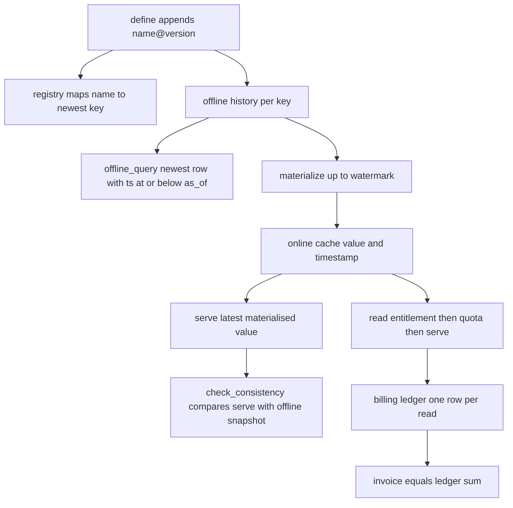
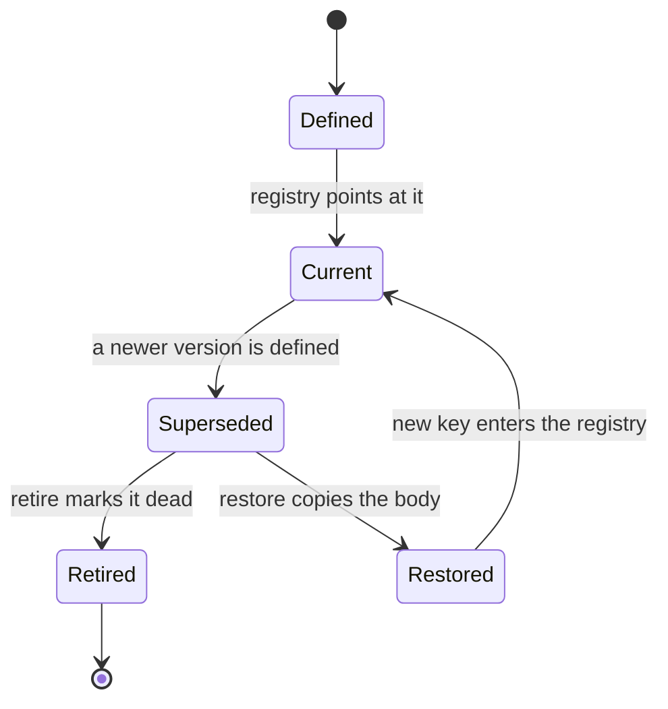
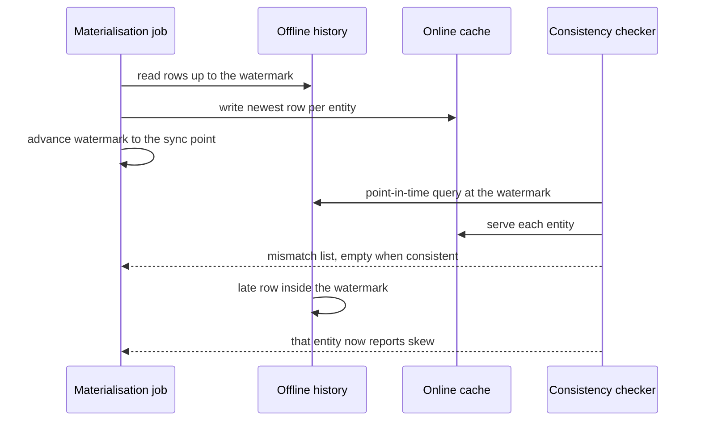

# 850 — Implement monetizable feature store with lineage, versioning, and online/offline sync.

> **Tier:** Master · **CTCI chapter:** Beyond — Software Engineering & Tooling
> **Task spec:** [850-implement-monetizable-feature-store-with-lineage-versioning-and.md](../../../tasks/master/850-implement-monetizable-feature-store-with-lineage-versioning-and.md)
> **Solutions:** [Python](../../../solutions/python/master/850-implement-monetizable-feature-store-with-lineage-versioning-and/solution.py) ·
> [Java](../../../solutions/java/master/850-implement-monetizable-feature-store-with-lineage-versioning-and/Solution.java) ·
> [JavaScript](../../../solutions/javascript/master/850-implement-monetizable-feature-store-with-lineage-versioning-and/solution.js) ·
> [C#](../../../solutions/csharp/master/850-implement-monetizable-feature-store-with-lineage-versioning-and/Solution.cs)

## 1. Problem restatement

Build a feature store with the four properties that make one usable in production:

1. **Versioned definitions.** A feature may be redefined, and the old body must remain
   addressable. `define` appends a new immutable `Version`; `restore` re-deploys an old body
   under a *new* version number; `retire` marks a version dead without deleting it.
2. **Lineage.** A derived feature declares pins to specific upstream *keys* (`name@version`),
   lineage resolves transitively, dangling pins and cycles are rejected, and recomputing a
   derived feature from its lineage must reproduce exactly what the transform defines.
3. **Offline point-in-time queries.** For a training frame, every entity must get the newest row
   with `timestamp <= as_of` — anything newer is label leakage. `materialize` copies offline rows
   up to a watermark into the online store, and `check_consistency` compares serving against the
   offline snapshot at that watermark.
4. **Entitlement, quota and billing.** A consumer must be licensed for the pinned version and
   inside its quota, and every successful read appends one row to a ledger; the invoice is the
   sum of that ledger, so the money is auditable per read.

The task spec is one line, so the contract is what the four solution files assert:

| Call | Result | Why |
| --- | --- | --- |
| `define("clicks", "raw", price=3)` | `"clicks@1"` | first version is numbered one |
| `define("clicks", "raw", price=5)` | `"clicks@2"`, both coexist | redefinition appends, never rewrites |
| `restore("clicks@1")` | `"clicks@3"` with `price == 3` | old body, new number, history intact |
| `offline_query(clicks, [0], 9)` | `{0: 0}` | rows after `as_of` do not leak |
| `offline_query(clicks, [0], 10)` | `{0: 1}` | a row exactly at `as_of` is included |
| `offline_query(clicks, [5], 16)` | `{5: 501}` | the newest admissible row wins |
| `offline_query(clicks, [99], 99)` | `{}` | an entity with no history produces no value |
| `materialize(clicks, 15)` | copies `12` rows, `lag` afterwards `12` | watermark sync |
| `read("alice", score, 0)` after 2 reads | `FeatureError`, usage stays `2` | refused reads are not metered |
| final `invoice("alice")` | `13` cents = `4 * 3 + 1 * 1` | four `clicks` reads at 3c, one `views` read at 1c |

**Modelling contract.** Every file is an **in-process deterministic model**: logical timestamps, an
explicit `materialize` step, no clock, no threads, no storage engine, dict-backed offline history
and online cache. Simplified versus production: one process, integer money in cents, quotas per
window instead of per month, and transforms restricted to the closed set
`identity | scale | combine | lag`. Not simplified: the *semantics* — every claim is checked
against an independent recomputation from the raw history (`reference_pit`, a plain scan).

## 2. Intuition

The naive feature store is a table. A job writes `clicks[entity] = value`, training selects
`where timestamp = max(timestamp)` and serving reads the same row. Everything above breaks:

- **You cannot reproduce last week's training set**, because the definition that produced it has
  been overwritten and the values have been replaced in place.
- **Training leaks labels.** "Latest row" is the latest row *now*, which is later than the label
  you are trying to predict, so the model learns from the future.
- **Training and serving can silently disagree** — the classic skew — because training pins a
  version while serving runs whatever the registry currently points at.
- **Nobody can explain a bill**, because reads are not recorded one by one.

The key insight is to make the *identity* of a feature a compound key `name@version` and to make
every write append-only:

- a definition is a `Version` value object with its own `kind`, `params`, `deps`, `price`, and
  `retired` flag, stored under that key; nothing is ever mutated except the one-bit `retired`
  marker;
- a derived feature pins the **exact versions** it read, so lineage is a DAG whose nodes are keys;
- values live in two places with different contracts — `offline_by_key[key]` keeps the whole
  sorted history for point-in-time queries, `online[key]` keeps one `(value, timestamp)` per
  entity for serving — and `watermarks[key]` records how far the offline side has been copied;
- money is a side effect of a *successful* read only.

That turns the three hard questions into three comparisons: history vs history (is the frame
correct?), offline-at-watermark vs online (is serving consistent?), ledger vs usage counters (is
the invoice right?).



## 3. Algorithm

1. **Define.** Reject an unknown `kind`; require `deps` for anything but `raw`; require every pin
   to exist. Number the version `len(existing versions of that name) + 1`, store it under
   `key()`, and point `registry[name]` at it. `restore` copies `kind`, `params`, `deps` and
   `price` from an old version into a new number; `retire` flips a flag.
2. **Ingest.** Append `(entity, timestamp, value)` to that key's history and keep it sorted by
   `(entity, timestamp)`. Unknown keys are refused.
3. **Point-in-time query.** Linear scan: for each requested entity, keep the row whose timestamp
   is `<= as_of` and maximal, breaking ties toward the later insertion order. Entities with no
   admissible row are simply absent from the result.
4. **Materialize.** Copy every offline row with `timestamp <= up_to` into the online cache, but
   only when its timestamp is `>=` the cached one, then advance the watermark to
   `max(up_to, current)`. Returning the copy count makes the sync observable.
5. **Serve / check consistency.** `serve` returns the cached value or `None`. `check_consistency`
   runs the point-in-time query at the watermark and diffs it against `serve` entity by entity,
   returning `(entity, served, expected)` triples. `lag` counts offline rows *beyond* the
   watermark — freshness, not skew.
6. **Lineage and recompute.** `lineage(key)` walks `deps` recursively with a `seen` set, raising
   on a dangling pin or a revisit (cycle). `recompute(key, as_of, entities)` recurses to the raw
   upstreams (which it reads with a point-in-time query) and applies the transform.
7. **Metered read.** Look up the version, check entitlement, check quota, serve, then increment
   usage and append `(consumer, name, version, watermark, price)` to the ledger. Refusals raise
   before any counter moves.

```text
procedure offline_query(key, entities, as_of)
    rows ← history of key sorted by entity then timestamp
    out ← empty map
    for entity in entities do
        chosen ← nothing
        for (row_entity, timestamp, value) in rows do
            if row_entity is entity and timestamp <= as_of then
                if chosen is nothing or timestamp >= chosen.timestamp then
                    chosen ← (timestamp, value)
                end
            end
        end
        if chosen is not nothing then
            out[entity] ← chosen.value
        end
    end
    return out
end

procedure materialize(key, up_to)
    cache ← online cache for key
    copied ← 0
    for (entity, timestamp, value) in history of key do
        if timestamp <= up_to and (entity not in cache or timestamp >= cache[entity].timestamp) then
            cache[entity] ← (value, timestamp)
            copied ← copied + 1
        end
    end
    watermarks[key] ← max(up_to, watermarks.get(key, -1))
    return copied
end

procedure recompute(key, as_of, entities)
    version ← versions[key]
    if version.kind is raw then
        return offline_query(key, entities, as_of)
    end
    upstreams ← empty list
    for dependency in version.deps do
        append recompute(dependency, as_of, entities) to upstreams
    end
    return transform(version.kind, upstreams, version.params)
end

procedure read(consumer, key, entity)
    version ← versions[key] or fail with unknown feature version
    if key not in entitlements[consumer] then
        fail with consumer is not licensed
    end
    if usage[consumer] >= quotas[consumer] then
        fail with consumer exceeded its quota
    end
    value ← serve(key, entity)
    usage[consumer] ← usage[consumer] + 1
    append (consumer, version.name, version.version, watermarks[key], version.price) to ledger
    return value
end
```

The lifecycle of a version is the state machine the file is built around:



## 4. Worked example

The file ingests `24` rows: for entity `e` in `0..5` and tick `t` in `0..3`,
`timestamp = 10t + e` and `value = 100e + t`. So entity `0` holds
`(0,0), (10,1), (20,2), (30,3)` and entity `5` holds `(5,500), (15,501), (25,502), (35,503)`.
Interleaving is deliberate: the entities' timestamps never line up.

### Point-in-time correctness

| `as_of` | result | what changed |
| --- | --- | --- |
| `9` | `{0:0, 1:100, 2:200, 3:300, 4:400, 5:500}` | every entity on its tick-`0` row, `t = 1` is still in the future |
| `10` | `{0:1, 1:100, 2:200, 3:300, 4:400, 5:500}` | only entity `0` has a row exactly at `10`, and it is included |
| `15` | `{0:1, 1:101, 2:201, 3:301, 4:401, 5:501}` | tick `1` for everyone; entity `5` newly at `15` |
| `16` | identical to `as_of = 15` | no row sits between `15` and `16` |
| `20` | `{0:2, ...}` | entity `0` moves to tick `2`; nobody else does |

`as_of = 9` versus `as_of = 10` is the whole leakage argument in one row: the row `(0, 10, 1)`
is invisible at `9` and visible at `10`, and the query never once looks at `(0, 20, 2)`.

### Sync, lag and skew

`materialize(clicks, 15)` copies `12` rows (the `2` rows per entity with `timestamp <= 15`) and
sets the watermark to `15`. The online cache becomes
`{0:(1,10), 1:(101,11), 2:(201,12), 3:(301,13), 4:(401,14), 5:(501,15)}` — one row per entity, the
newest admissible one. `check_consistency` then returns `[]` and `lag` returns `12` (the `12`
rows beyond `15`), which is freshness rather than disagreement.

Two further ingests split the two cases apart:

| Event | Offline | Online | `check_consistency` | `lag` |
| --- | --- | --- | --- | --- |
| `ingest(clicks, 3, 20, 9999)` | entity `3` gains `(20, 9999)` | `serve(3) == 301` | `[]` — a newer row is lag | grows by 1 |
| `ingest(clicks, 0, 14, 777)` | entity `0` gains a row *inside* the watermark | still `(1, 10)` | `[(0, 1, 777)]` — skew | unchanged |
| `materialize(clicks, 15)` again | unchanged | `serve(0) == 777` | `[]` | unchanged |
| `materialize(clicks, 20)` | unchanged | `serve(3) == 9999` | `[]` | recomputed |

Late data inside the watermark is the only thing that can make serving *wrong*; a row beyond the
watermark is merely not served yet. The file asserts exactly that difference, and also that
materialising an *older* watermark never moves the watermark backwards
(`materialize(clicks, 5)` leaves `watermarks[clicks] == 15`).



Training/serving skew shows up as a *version* difference rather than a timing one. Training
pins `clicks@1` and materialises the newer `clicks@4` (created by a later `define`), then
`check_consistency(clicks@1, entities, 20)` is still `[]` while
`serve(clicks@1, 0) != serve(clicks@4, 0)` — the file asserts both, which is the honest statement
that a pin isolates you from a deployment but not from having two versions live at once.

### Lineage and money

`views = define("clicks_scaled", "scale", {"factor": 2}, deps=[clicks], price=1)` and
`score = define("score", "combine", {"weight": 1}, deps=[views, "clicks@2"], price=2)`.
`lineage(score)` resolves to the sorted four keys `[clicks@1, clicks@2, views@3, score@4]`, and
`recompute(views, 20, entities)` equals the hand-built `{e: 2 * pit(e, 20)}` exactly. Because
`clicks@2` has an empty history, the `combine` with `weight = 1` cancels its term
(`expected * 1 + 0 * 0`), which the file checks entity by entity.

| Metering event | usage | ledger rows | invoice |
| --- | --- | --- | --- |
| licensed read of `clicks@1` for alice | `1` | `1` | `3c` |
| licensed read of `views@3` for alice | `2` | `2` | `4c` |
| unlicensed read of `score@4` | `2` (unchanged) | `2` | `4c` |
| three more licensed `clicks@1` reads | `5` | `5` | `13c` |
| sixth read | refused by quota | `5` | `13c` |

`13 = 4 * 3 + 1 * 1`, matching the file's `expected_invoice`, and `len(ledger) == usage["alice"]`
with `sum(cents) == invoice()` is asserted — the ledger is the single source of truth for both.

## 5. Complexity

Let `E` be the number of entities, `R` the rows ingested per feature, `V` the versions, and `d` the
lineage depth.

| Operation | Time | Space | Why |
| --- | --- | --- | --- |
| `define` / `restore` | `O(V)` | `O(1)` per version | it scans existing versions to compute the next number |
| `ingest` | `O(R log R)` amortised | `O(R)` | append, then re-sort the key's history |
| `offline_query` | `O(R * E)` | `O(E)` | nested scan: the full history is filtered per entity |
| `materialize` | `O(R)` | `O(E)` online | one pass over the history, one slot per entity |
| `serve`, `read` | `O(1)` | `O(1)` per ledger row | dictionary lookups plus one append |
| `check_consistency` | `O(R * E)` | `O(E)` | a point-in-time query plus a diff |
| `lineage`, `recompute` | `O(V + edges)`, `O(children + E)` | `O(V)`, `O(d * E)` | DFS over pins, then one transform per node per entity |
| `invoice` | `O(#ledger rows)` | `O(1)` | a sum |

The honest note is the `O(R * E)` for the point-in-time query: the file scans the whole history
per entity because it is *demonstrating* the semantics against an identical independent scan
(`reference_pit`), not because a production store would. A real store indexes
`(feature, version, entity, timestamp)` and bisects, which drops the query to `O(E log R)` and keeps
the merge-join shape. Likewise `ingest` re-sorts the whole history instead of inserting into a
tree, trading asymptotics for a line of code that is obviously correct.

The other deliberate cost is the online cache's `(value, timestamp)` pair. Storing the timestamp
is not needed to serve — `serve` ignores it — but it is what makes "materialise an older
watermark" a no-op instead of a rollback, and what lets the consistency check compare *which*
row is live rather than only its value.

## 6. Pitfalls and edge cases

- **Leakage at the boundary.** `timestamp <= as_of` includes a row exactly at `as_of`
  (`offline_query(clicks, [0], 10) == {0: 1}`) and excludes everything later. Writing `<` instead
  of `<=` silently drops the row that the label was computed from.
- **Entities without history simply vanish.** `offline_query(clicks, [99], 99) == {}` — no
  default, no `None` placeholder. In the `combine` transform the *caller* supplies the missing
  value via `first.get(entity, 0)`, which is where the zero-fill decision belongs.
- **Late data inside the watermark is skew, not lag.** The file asserts
  `[entry[0] for entry in skew] == [0]` after `ingest(clicks, 0, 14, 777)`. Reporting it as lag
  would let serving stay quietly wrong.
- **Watermarks are monotonic.** `materialize(clicks, 5)` after `materialize(clicks, 15)` keeps the
  watermark at `15`; a stale job that replays an old sync point must not rewind the store.
- **Cycles are impossible and still checked.** Pins only point at already-existing keys, so a
  cycle cannot be built — but `lineage` still raises, and the file *forces* one by rewriting
  `versions[views].deps = (score,)`, asserts the rejection, then restores the real pins. Do not
  drop the `seen` set just because the invariant holds today.
- **Dangling and missing pins.** `lineage("missing@1")`, `define(..., deps=["nope@1"])` and a
  derived feature with no `deps` all raise `FeatureError`. The last one matters because a
  `scale` with no upstream is a definition the engine cannot compute.
- **Refused reads are free.** After the unlicensed read of `score@4`, `usage["alice"]` is still
  `2`. Billing before the checks would charge for failures, and charging after `serve` would bill
  for `None`.
- **Ingesting into an unknown version.** `ingest("ghost@9", ...)` raises; an append-only store
  must never invent a version from data.

## 7. Variants and follow-ups

- **Mergeable shard state.** A feature store distributed over shards needs the sketches from
  [849-implement-scalable-approximate-joins-in-streaming-sketch-based.md](../../../tasks/master/849-implement-scalable-approximate-joins-in-streaming-sketch-based.md),
  whose merge-by-addition property is what makes a per-shard feature aggregatable without a shuffle.
- **Consistency under replication, and the snapshot that feeds the store.** `check_consistency` here
  is a single-process diff; doing it across replicas is
  [851-implement-latency-slash-throughput-tradeoff-benchmarks-for-vario.md](../../../tasks/master/851-implement-latency-slash-throughput-tradeoff-benchmarks-for-vario.md),
  and the global snapshot that makes an offline watermark meaningful when the writer is itself a
  distributed job is
  [852-implement-global-snapshotting-for-distributed-streaming-pipeline.md](../../../tasks/master/852-implement-global-snapshotting-for-distributed-streaming-pipeline.md).
- **Serving the pinned frame, and auditing reads.** Once a version is pinned for training, drift on
  the served distribution is the problem of
  [858-implement-streaming-transfer-learning-pipeline-with-concept-drif.md](../../../tasks/master/858-implement-streaming-transfer-learning-pipeline-with-concept-drif.md),
  and the entitlement check is the coarse version of the per-column policies in
  [853-implement-fine-grained-access-control-and-auditing-for-database.md](../../../tasks/master/853-implement-fine-grained-access-control-and-auditing-for-database.md).

## 8. Check yourself

1. Why is a late row *inside* the watermark a consistency failure while a row beyond it is not?

<details><summary>Show answer</summary>

Because materialisation has already claimed to have copied every row up to the watermark. A row
beyond it is simply not part of the served snapshot yet — `ingest(clicks, 3, 20, 9999)` leaves
`serve(3) == 301` and `check_consistency` empty, while `lag` grows. A row inside the watermark
(`ingest(clicks, 0, 14, 777)`) *should* have been copied, so serving is now wrong: the checker
returns `[(0, 1, 777)]` and re-materialising at the same watermark repairs it.

</details>

2. `restore("clicks@1")` produces `clicks@3`. Why not just make `clicks@2` current again?

<details><summary>Show answer</summary>

Because keys are what training pins and what entitlements and ledger rows reference. Reusing
`clicks@2` would change the meaning of an already-issued key: a model that trained on the old
`clicks@2` body and a job that re-deploys it would be indistinguishable afterwards. Appending
`clicks@3` with `clicks@1`'s body keeps every historical key's meaning fixed — the file asserts
that `clicks@1`, `clicks@2` and `clicks@3` keep their own prices, and that `clicks@2` is
`retired` rather than deleted.

</details>

5. Why must `materialize` never move the watermark backwards?

<details><summary>Show answer</summary>

Because a checkpoint of the sync point is what makes serving auditable: `materialize(clicks, 15)`
sets the watermark to `15`, and a later `materialize(clicks, 5)` must leave it at `15`. A stale or
replayed job that could rewind the watermark would silently un-materialise rows that serving already
returned, and `check_consistency` would then compare against the wrong snapshot. The file asserts the
monotonicity directly and re-checks that `lag` is recomputed from the surviving watermark.

</details>
