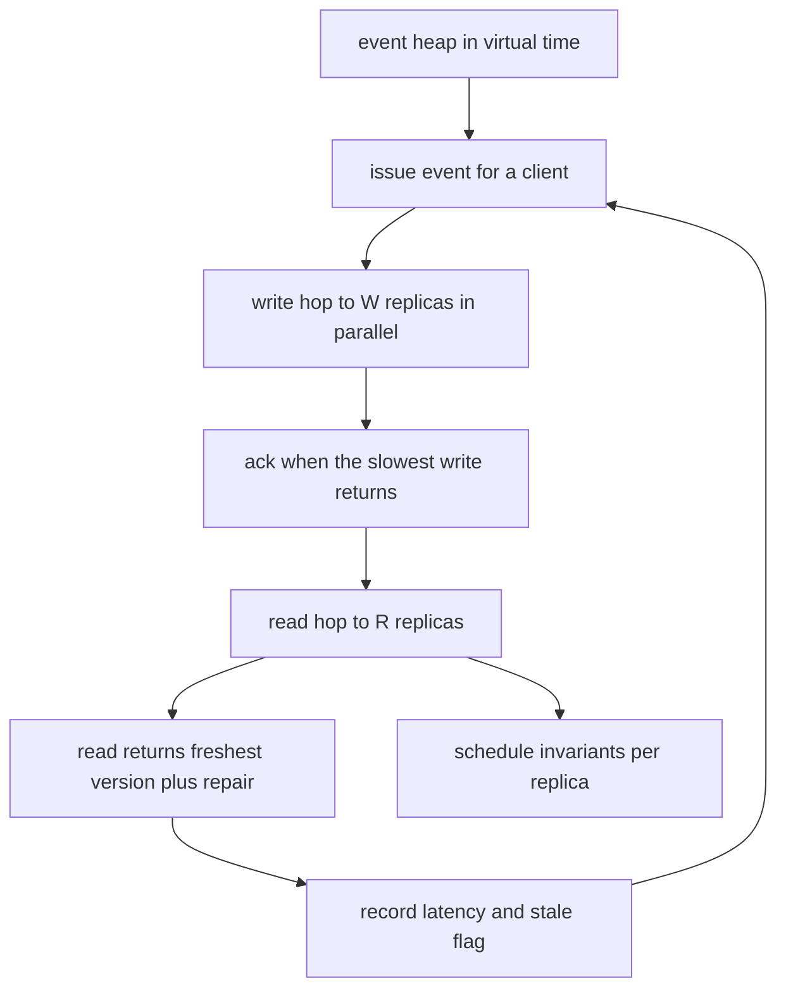
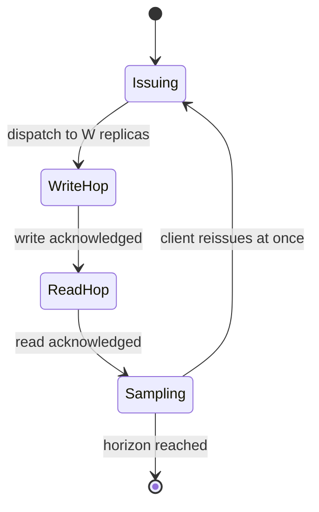
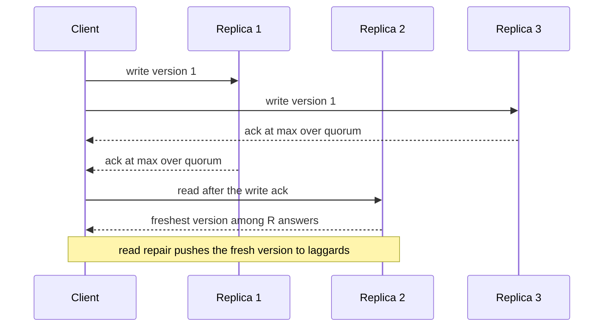

# 851 — Implement latency-slash-throughput tradeoff benchmarks for various consistency levels.

> **Tier:** Master · **CTCI chapter:** Ch 9 — System Design and Scalability
> **Task spec:** [851-implement-latency-slash-throughput-tradeoff-benchmarks-for-vario.md](../../../tasks/master/851-implement-latency-slash-throughput-tradeoff-benchmarks-for-vario.md)
> **Solutions:** [Python](../../../solutions/python/master/851-implement-latency-slash-throughput-tradeoff-benchmarks-for-vario/solution.py) ·
> [Java](../../../solutions/java/master/851-implement-latency-slash-throughput-tradeoff-benchmarks-for-vario/Solution.java) ·
> [JavaScript](../../../solutions/javascript/master/851-implement-latency-slash-throughput-tradeoff-benchmarks-for-vario/solution.js) ·
> [C#](../../../solutions/csharp/master/851-implement-latency-slash-throughput-tradeoff-benchmarks-for-vario/Solution.cs)

## 1. Problem restatement

Benchmark a quorum-replicated key-value ring across consistency levels and *prove* the
latency/throughput trade-off instead of asserting it. For each level you must produce:

- an **uncongested latency** that equals the analytic cost of the two hops the transaction makes;
- a **saturated throughput** from a closed-loop client pool, with the queueing that makes it
  different from the uncongested number;
- a **safety counter** — how many reads observed a write that was already committed before that
  read was dispatched;
- and the **schedule invariants** that let a reader trust the numbers: no replica is ever
  double-booked, utilisation stays at or below `1.0`, and the operation count is exactly
  `issued * W + reads * R`.

**Modelling contract.** There are no threads, sockets, sleeps or wall-clock reads. Time is a
`float` that only moves forward; every replica is a state machine with its own FIFO queue; the
workload is a **closed loop of `W` clients** whose events are consumed in virtual-time order from
an explicit heap. What is simplified versus a real cluster, honestly: the cluster is an in-process
event schedule, latency is deterministic (no jitter, no GC, no network noise), and the workload is
uniform key/value pairs against a fixed ring. What is *not* simplified is the arithmetic and the
bookkeeping: the analytic bounds are recomputed independently from the replica delays and compared
against the measured values.

Concrete contract — the file's own output for `N = 5`, `service = 0.2`, `workers = 80`,
`horizon = 1200`, `warmup = 600`:

| Level | Saturated throughput | Analytic bound `N / ((W+R) * service)` | Captured | Mean latency | p99 |
| --- | --- | --- | --- | --- | --- |
| `ONE(W=1,R=1)` | `12.445` | `12.500` | `100%` | `6.399` | `7.529` |
| `QUORUM(W=3,R=3)` | `4.055` | `4.167` | `97%` | `19.368` | `25.000` |
| `ALL(W=5,R=5)` | `2.467` | `2.500` | `99%` | `32.000` | `32.000` |

| Assertion | Value |
| --- | --- |
| uncongested mean latency `ONE / QUORUM / ALL` | `4.249 / 5.588 / 6.324`, envelope `2.081 .. 6.324` |
| sequential write-then-read stale reads | `ONE: 240`, `QUORUM: 0`, `ALL: 0` |
| `EVENTUAL` negative control | `240` stale reads out of `300` |
| concurrent stale reads under load | `ONE: 5881` of `7467`, `QUORUM` and `ALL`: `0` |
| `quorum_intersects(N, R, W)` vs `R + W &gt; N` | equal for every `N` in `1..6` |
| Little's law error `ONE / QUORUM / ALL` | `0.45%` / `1.83%` / `1.33%` |

## 2. Intuition

The naive benchmark measures a real cluster with a wall clock: seed, warm up, hammer, average.
That answer is unrepeatable, and it cannot tell you *why* `ALL` is slower than `ONE` — you get one
number and a wide error bar.

The key insight is that the entire trade-off is a **queueing consequence of a pure
combinatorial fact**, and both halves are checkable independently:
1. **Safety is arithmetic.** A read quorum of size `R` and a write quorum of size `W` on an
   `N`-replica ring can only miss each other if `R + W <= N`, because a read set and a write set
   of those sizes can then be chosen disjoint. When `R + W &gt; N`, every read quorum must contain
   at least one replica that has the write, and read repair spreads it. That is why `QUORUM` and
   `ALL` report `0` stale reads while `ONE` reports `240` out of `300` in the sequential
   experiment — and why `EVENTUAL`, which acknowledges before replicating, is stale `240` of `300`
   even though its quorums are `(1,1)`.
2. **Latency is a max, not a sum.** Dispatching to `k` replicas in parallel means a client waits
   for the *slowest* acknowledgement. The model encodes this as
   `ack = max(t + one_way, next_free) + service + one_way`: the `max` term is queueing, the
   `+ one_way` terms are the two network hops.
3. **Throughput is a bound on a scarce resource.** A transaction consumes exactly `W + R` replica
   operations, each costing `service` on one replica, so the ring as a whole cannot exceed
   `N / ((W + R) * service)` transactions per unit time. Nothing to tune: it is the reciprocal of
   the per-transaction service demand.



Latency rises and throughput falls monotonically in the quorum size, and running the benchmark
harder does not buy back either number — the measured curve is in section 4.

## 3. Algorithm

1. **Build the ring.** `Cluster(n, seed)` gives each replica a skew from a seeded `SplitMix64`
   generator: `one_way = base_one_way * (1 + skew * uniform(-1, 1))`, plus a shared `service`.
2. **Reserve a replica.** `Replica.schedule(now)` sets
   `start = max(now + one_way, next_free)`, advances `next_free` to `start + duration`, and
   returns `next_free + one_way` — the moment the acknowledgement reaches the client. Operations
   on one replica therefore serialise FIFO and can never overlap; `busy` records the intervals.
3. **Dispatch a write.** Bump the monotone version, pick `W` targets from a rotating preference
   order starting at `sequence mod n`, schedule them all, and return
   `max(acks)`. For an asynchronous level the replica absorbs the op at zero service cost and the
   client is acknowledged after a single hop — replication lands later.
4. **Dispatch a read.** Pick `R` targets from a *different* rotation
   (`(sequence * 3 + 1) mod n`), schedule them, take the freshest version among the answers,
   and **read-repair** every lagging target with that value.
5. **Uncongested run.** One client with a `1000`-unit idle gap so every request meets empty
   queues; compare each sample against the independently computed
   `max over targets of (2 * one_way + service)` summed over both hops.
6. **Closed-loop run.** `W` clients each reissue the instant their transaction completes. Events
   are `("issue")` and `("read")` tuples on a heap ordered by virtual time; only transactions
   issued after `warmup` count, so the cold start (empty queues) is discarded.
7. **Measure.** Throughput `= measured transactions / (horizon - warmup)`, mean and p99 latency
   from the window, and the stale counter: a read is stale when
   `version < committed_version` captured *before* the read was dispatched. Stale reads inside
   the warm-up are counted separately as `early_stale`.
8. **Verify.** Recompute `N / ((W + R) * service)` and check the measurement is at or below it and
   captures at least `85%`; check Little's law `throughput ≈ workers / mean_latency` within `5%`;
   check per-replica `busy` intervals are sorted and non-overlapping with utilisation at or below
   `1.0`; check `sum(replica.ops) == issued * W + reads * R`; check the queues settle.

```text
procedure replica_schedule(replica, now, duration)
    start ← max(now + replica.one_way, replica.next_free)
    replica.next_free ← start + duration
    replica.ops ← replica.ops + 1
    append (start, start + duration) to replica.busy
    return replica.next_free + replica.one_way
end

procedure write(cluster, now, value, level)
    cluster.sequence ← cluster.sequence + 1
    cluster.version ← cluster.version + 1
    targets ← W replicas from the rotation starting at cluster.sequence mod N
    acks ← empty list
    for replica in targets do
        if level.async_replication then
            replica_schedule(replica, now, duration = 0)
            append (now + replica.one_way) to acks
        else
            append replica_schedule(replica, now, replica.service) to acks
        end
    end
    for replica in targets do
        if replica.version < cluster.version then
            replica.version ← cluster.version
            replica.value ← value
        end
    end
    cluster.committed_version ← cluster.version
    return max(acks), targets
end

procedure read(cluster, now, level)
    cluster.sequence ← cluster.sequence + 1
    targets ← R replicas from the rotation starting at (cluster.sequence * 3 + 1) mod N
    acks ← [replica_schedule(replica, now, replica.service) for replica in targets]
    best ← the target with the largest (version, -index)
    for replica in targets do
        if replica.version < best.version then
            replica.version ← best.version
            replica.value ← best.value
        end
    end
    return max(acks), best.version, best.value, targets
end

procedure run_closed_loop(cluster, level, workers, horizon, warmup)
    heap ← one issue event per worker at time 0
    while heap is not empty do
        now, kind, worker, start ← pop the earliest event
        if now >= horizon then
            break
        end
        if kind is issue then
            issued ← issued + 1
            wack ← write(cluster, now, value, level)
            push read event at wack for that worker
        else
            committed ← cluster.committed_version
            rack, version ← read(cluster, now, level)
            if version < committed and start >= warmup then
                stale ← stale + 1
            end
            if start >= warmup then
                record (rack - start) as a latency sample
            end
            push the next issue event at rack for that worker
        end
    end
    return throughput as samples / (horizon - warmup), latency percentiles, stale
end
```

The event loop is a two-state cycle per client; the ring is a pure function of the virtual clock:



## 4. Worked example

`Cluster(5, seed=7, service=0.2)` draws these one-way delays, in ring order: replica `0` `0.8678`,
`1` `0.4201`, `2` `1.4809`, `3` `1.0995`, `4` `0.9429`. The slowest replica is `2` and the fastest
is `1`, which is exactly what the two levels below stumble over.

The sequential trace starts each transaction at `now = i`; targets come from
`preference_order(sequence mod 5, W)` for the write and `preference_order((sequence*3+1) mod 5, R)`
for the read.

| Tx | Level | Write targets | Write ack | Replica versions after write | Read targets | Read ack | Version read | Committed | Stale |
| --- | --- | --- | --- | --- | --- | --- | --- | --- | --- |
| 0 | `ONE` | `[1]` | `1.0403` | `[0,1,0,0,0]` | `[2]` | `4.2021` | `0` | `1` | **yes** |
| 1 | `ONE` | `[3]` | `3.3990` | `[0,1,0,2,0]` | `[3]` | `5.7981` | `2` | `2` | no |
| 2 | `ONE` | `[0]` | `3.9356` | `[3,1,0,2,0]` | `[4]` | `6.0215` | `0` | `3` | **yes** |
| 0 | `QUORUM` | `[1,2,3]` | `3.1618` | `[0,1,1,1,1]` | `[2,3,4]` | `6.3237` | `1` | `1` | no |
| 1 | `QUORUM` | `[3,4,0]` | `5.7609` | `[2,1,1,2,2]` | `[3,4,0]` | `8.1599` | `2` | `2` | no |
| 2 | `QUORUM` | `[0,1,2]` | `7.8964` | `[3,3,3,2,3]` | `[4,0,1]` | `9.9823` | `3` | `3` | no |

Row 1 is the whole safety argument in one line: the write of version `1` landed only on replica
`1`, and the read asked replica `2`, whose version is still `0` — the read returns an older value
than an already acknowledged write. Rows 4–6 show why `QUORUM` cannot do that: after
`write targets [1,2,3]` at least `3` of the `5` replicas hold version `1`, and any `3`-subset must
contain one of them. `quorum_intersects(5, 3, 3)` is `True` while `quorum_intersects(5, 1, 1)` is
`False`, an equivalence the file brute-forces for every `N` in `1..6` and every `(R, W)` pair.



### Aggregate numbers

Uncongested, the measured latency matched the analytic two-hop cost to `< 1e-9` for all `30`
rounds of every level, and averaged `4.249 / 5.588 / 6.324` for `ONE / QUORUM / ALL` inside the
envelope `[2 * (2 * one_way_min + service), 2 * (2 * one_way_max + service)] = [2.081, 6.324]`.

Saturated, the closed loop with `80` workers gives:

| Level | Throughput | Bound | Captured | Mean latency | p99 | Uncongested mean |
| --- | --- | --- | --- | --- | --- | --- |
| `ONE` | `12.445` | `12.500` | `100%` | `6.399` | `7.529` | `4.249` |
| `QUORUM` | `4.055` | `4.167` | `97%` | `19.368` | `25.000` | `5.588` |
| `ALL` | `2.467` | `2.500` | `99%` | `32.000` | `32.000` | `6.324` |

Every level's latency is *higher* under load than idle — `QUORUM` goes from `5.588` to `19.368`,
which is the queueing the file explicitly asserts. `ALL` saturates at exactly `32.000` because its
per-transaction demand is `10` replica services of `0.2`, so every acknowledgement waits for the
same `2.0`-unit service slot and p99 collapses onto the mean. Little's law closes the loop:
`workers / mean_latency` gives `12.501 / 4.130 / 2.500` against measured
`12.445 / 4.055 / 2.467`, all inside the `5%` tolerance.

The capacity bound is not a fitted curve — it is `N / ((W + R) * service)` computed from the level
alone, and the measurement is checked to be *at or below* it and to capture at least `85%`. `ALL`
capturing `99%` while `QUORUM` captures `97%` is the honest residual: the network hop between the
two hops of a transaction idles replicas, so no schedule is perfectly efficient.

## 5. Complexity

Let `T` be the number of transactions executed, `W` the client count, `N` the replicas, and
`h` the number of heap events.

| Measure | Bound | Why it holds |
| --- | --- | --- |
| Simulation time | `O(h log h)` | one heap push/pop per event, `h ≈ 2T` |
| Schedule cost per transaction | `O((W + R) log N)` | one `schedule` per target plus `max` over the acks |
| Space | `O(N + T + N * ops)` | replicas, latency samples, and the `busy` intervals |
| Analytic bound | `N / ((W + R) * service)` | `W + R` replica services per transaction, `N` replicas |
| Naive alternative | `O(T * N * service)` | locking the whole ring for each op serialises everything; `ALL` is exactly that case, and it measures `2.467` of `2.500` |

| Level | Per-transaction replica ops `W + R` | Bound (`service = 0.2`) | Measured |
| --- | --- | --- | --- |
| `ONE` | `2` | `12.500` | `12.445` |
| `QUORUM` | `6` | `4.167` | `4.055` |
| `ALL` | `10` | `2.500` | `2.467` |
| `EVENTUAL` | `2` (client) + `1` (async) | not capacity-bound the same way | unusable for read-your-writes |

The `EVENTUAL` row is the point of the negative control: its *write* cost is one hop and its
throughput would look excellent, but it is excluded from the throughput comparison because it is
not a consistency level at all — the file only feeds it to the staleness counter, where it reports
`240` stale reads out of `300`.

`O(h log h)` is simulation cost, not cluster cost; the file's purpose is the *model*, so the heap is acceptable. A production harness would timestamp real requests instead, and the invariants
(`busy` interval non-overlap, utilisation at or below `1.0`, `sum(ops) == issued * W + reads * R`)
are exactly the checks that would catch a harness bug.
## 6. Pitfalls and edge cases

- **Measuring the cold start.** Every queue is empty at `t = 0`, so the first transactions look
  artificially fast. The file only accepts transactions issued at or after `warmup = 600` in a
  `1200` horizon, and keeps a separate `early_stale` counter for warm-up reads so the safety
  statistics are not polluted by samples the latency statistics throw away.
- **Comparing a throughput to a bound the wrong way round.** The check is
  `throughput <= bound + EPS` **and** `throughput >= 0.85 * bound`. A harness that exceeds the
  capacity bound has a bug (double-counted ops, overlapping service windows), not a fast cluster.
- **Zero clients and a zero horizon.** `run_closed_loop(..., workers = 0, ...)` must produce
  `issued == 0` and `mean_latency == 0.0` without dividing by zero, and `horizon = 0` must produce
  `throughput == 0.0`. The file asserts both, because an empty benchmark that crashes is the
  classic CI failure.
- **A single replica.** `levels_for(1)` collapses `ONE`, `QUORUM` and `ALL` to `(1, 1)`; a
  one-replica closed loop must complete samples and report `0` stale reads — trivially safe.
- **`p99` indexing.** `latencies[int(0.99 * (measured - 1))]` needs the `- 1`, or a single-sample
  run indexes out of range; the file also asserts `max >= p99 >= mean > 0`.
- **A control that is accidentally clean.** `stale_report["ONE"] > 0` and
  `concurrent["stale_reads"] > 0` are asserted, because a safety test whose control never fails
  proves nothing. `EVENTUAL` exists for the same reason: `240` of `300`.
- **Staleness must be captured *before* the read is dispatched.** `committed = committed_version`
  is read before `cluster.read(...)`; capturing it afterwards would flag reads that legitimately
  observed a write committed while they were in flight.
- **Reproducibility is a requirement, not a nicety.** The same seed must give bit-identical
  metrics (`a == b`), and a different seed must give a *different* mean latency — otherwise the
  replica skew is not actually applied.
- **Async replication still consumes the replica.** `schedule(now, service=0.0)` keeps the FIFO
  and the `ops` counter honest, so `sum(ops) == issued * W + reads * R` holds for `EVENTUAL` too.

## 7. Variants and follow-ups

- **The consistency the benchmark is about** is the same quorum arithmetic that the replicated
  state machine of
  [801-implement-production-grade-raft-library-replication-reconfigurat.md](../../../tasks/master/801-implement-production-grade-raft-library-replication-reconfigurat.md)
  needs for commit decisions; that file's membership changes are what make `N` move while
  `R + W &gt; N` must keep holding.
- **Federated trust changes the quorum sets.** When replicas are not interchangeable,
  `quorum_intersects` becomes a question about weighted or nested quorums — see
  [833-implement-consensus-over-heterogeneous-trust-federated-consensus.md](../../../tasks/master/833-implement-consensus-over-heterogeneous-trust-federated-consensus.md).
- **The store this ring replicates.** The online/offline consistency check in
  [850-implement-monetizable-feature-store-with-lineage-versioning-and.md](../../../tasks/master/850-implement-monetizable-feature-store-with-lineage-versioning-and.md)
  is a single-process version of the stale-read counter measured here.
- **Benchmarks that must catch a regression.** Turning these metrics into a gate is exactly the
  differential/plan-regression machinery of
  [855-implement-automated-plan-regression-detector-for-query-optimizer.md](../../../tasks/master/855-implement-automated-plan-regression-detector-for-query-optimizer.md).

## 8. Check yourself

1. Why does the model compute a request's latency as the *maximum* acknowledgement rather than
   the sum over replicas?

<details><summary>Show answer</summary>

Because the coordinator dispatches to all targets in parallel, so the client waits for the last
one to answer. `Replica.schedule` returns `max(now + one_way, next_free) + service + one_way`, and
`write`/`read` return `max(acks)`. The `max` over *replicas* is the fan-out; the sum is over the
two *hops* of a transaction, which is why the uncongested analytic cost is
`2 * (2 * one_way + service)` for each hop. The uncongested experiment confirms this: measured and
recomputed values matched within `1e-9` for every round.

</details>

2. `ONE` has `W = R = 1`, which is the cheapest configuration. Why is `EVENTUAL` also `(1, 1)` yet
   strictly worse?

<details><summary>Show answer</summary>

Because `ONE` still *waits* for its single replica to apply the write before acknowledging,
whereas `EVENTUAL` acknowledges after one hop and replicates afterwards
(`level.async_replication`, `schedule(now, service=0.0)`). The client is told the write is done
before any replica has it, so a subsequent read can miss it even with a single-replica-wide
quorum — hence `240` stale reads out of `300` in the sequential control.

</details>

6. Why is `EVENTUAL` excluded from the throughput comparison?

<details><summary>Show answer</summary>

Because it is not a consistency level: its write is fire-and-forget (`async_replication`), so the
client is acknowledged after a single hop and replication lands later. Its throughput would look
excellent for the wrong reason, so the file only feeds it to the staleness counter, where it reports
`240` stale reads out of `300` — the same count as `ONE`, for a different reason (no replica waited,
versus waiting for the wrong replica).

</details>
