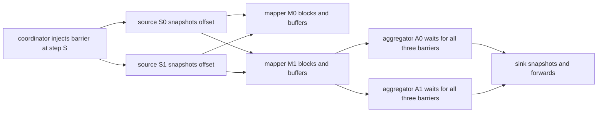
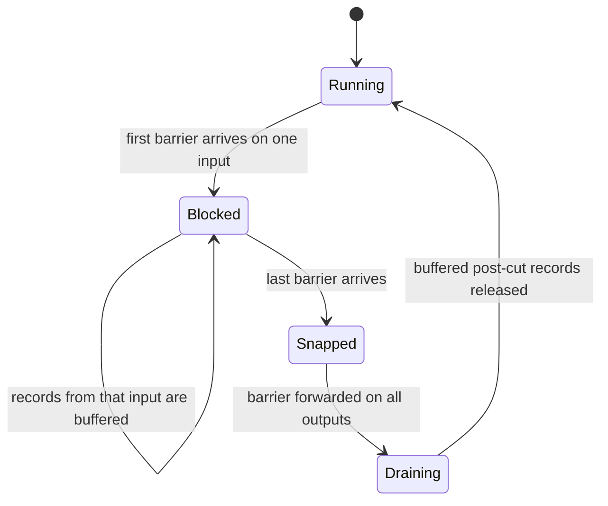
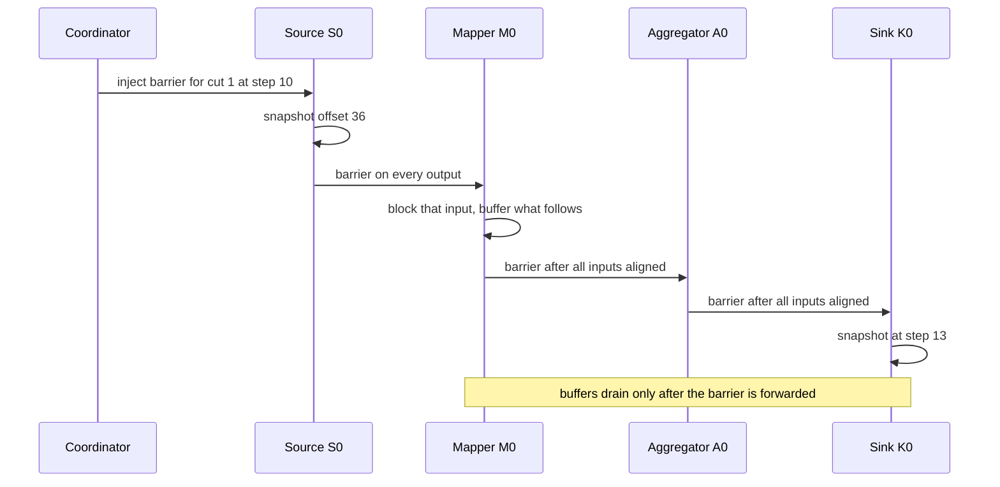

# 852 — Implement global snapshotting for distributed streaming pipeline (Chandy-Lamport at scale).

> **Tier:** Master · **CTCI chapter:** Ch 9 — System Design and Scalability
> **Task spec:** [852-implement-global-snapshotting-for-distributed-streaming-pipeline.md](../../../tasks/master/852-implement-global-snapshotting-for-distributed-streaming-pipeline.md)
> **Solutions:** [Python](../../../solutions/python/master/852-implement-global-snapshotting-for-distributed-streaming-pipeline/solution.py) ·
> [Java](../../../solutions/java/master/852-implement-global-snapshotting-for-distributed-streaming-pipeline/Solution.java) ·
> [JavaScript](../../../solutions/javascript/master/852-implement-global-snapshotting-for-distributed-streaming-pipeline/solution.js) ·
> [C#](../../../solutions/csharp/master/852-implement-global-snapshotting-for-distributed-streaming-pipeline/Solution.cs)

## 1. Problem restatement

A parallel streaming pipeline — `2` sources → `3` mappers → `2` aggregators → `1` sink, wired by
`14` explicit FIFO channels (`2*3 + 3*2 + 2*1`) — must take periodic **global snapshots** whose cut
is consistent: no record emitted before a subtask's snapshot may be delivered after its
downstream's snapshot, and replaying from a completed snapshot must reproduce the failure-free
result exactly, once.

The protocol is the asynchronous barrier snapshotting of Chandy & Lamport, as implemented in
Flink checkpoints:

- the coordinator injects a barrier into every source; a source snapshots its offset immediately
  (it has no inputs) and forwards the barrier on all outgoing channels;
- a subtask that receives a barrier on one input **blocks** that input — further records from it
  are buffered, because they were emitted after the sender's cut — and waits for barriers on its
  remaining inputs (**barrier alignment**);
- only when every input has delivered a barrier does the subtask snapshot its state, forward the
  barrier, and drain the buffered post-cut records;
- because channels are FIFO, the recorded channel state is always empty: everything ahead of the
  barrier was emitted before the sender's snapshot, everything behind it after the sender's cut.

**Modelling contract.** Everything is in-process and deterministic: no threads, sockets, sleeps or
wall clock. A tick-based driver advances virtual time, the coordinator injects one checkpoint at a
time, and barriers travel **in band** through the same channels as records. What is simplified,
honestly: channels are unbounded in-memory FIFOs (no backpressure), the source is a deterministic
index-addressable generator so replay is exactly reproducible, and subtask state is a small
dictionary rather than a serialised state blob. The invariants are nevertheless recomputed from
the channel emission/delivery logs, not trusted.

Concrete contract from the file's own run with `Topology(2, 3, 2, 300)` — `600` records over `6`
keys, `320` steps, checkpoints scheduled at steps `(10, 40, 70, 90, 150, 250)`:

| Cut | Injected at the cut | Sink counted | Alignment delay | Pre-cut records leaked | Buffered post-cut |
| --- | --- | --- | --- | --- | --- |
| 1 | `72` | `72` | `3` | `0` | yes |
| 2 | `312` | `312` | `13` | `0` | yes |
| 3 | `552` | `552` | `23` | `0` | yes |
| 4 | `600` | `600` | `0` | `0` | no (stream exhausted) |
| 5 | `600` | `600` | `0` | `0` | no (stream exhausted) |

| Assertion | Value |
| --- | --- |
| scheduled / initiated / completed | `6 / 5 / 5` — alignment pauses the pipeline while a checkpoint is in flight |
| end-to-end oracle match | every stage's per-key state equals a brute-force replay; sink consumed exactly `600` |
| crash inside cut `2` at step `42` | restored cut `1`, replayed `528` records, final total `600` |
| crash inside cut `3` at step `72` | restored cut `2`, replayed `288` records, final total `600` |
| naive control (no alignment) | `2` invariant violations; cut `2` counted `311` of `312` injected |
| naive control across crashes | totals `{55: 599, 95: 598, 160: 600, 265: 600}`, correct is `600` |

## 2. Intuition

The naive idea is to stop the world: pause every subtask, dump every state, resume. It costs a
global stall and a coordinator that must reach every node before anything moves again — and it
still needs a distributed agreement on *when* everyone stopped.

The key insight is that you do not need to stop anything. A barrier is an ordinary in-band message,
and the FIFO property of the channel does the hard work for you:

- when a subtask sees a barrier on input `i`, everything it will ever receive from `i` *before* the
  barrier is already delivered, and everything after it was emitted by the sender *after* the
  sender's cut. So blocking that input and buffering what follows is exactly right;
- a subtask can only snapshot once **every** input has delivered a barrier, because until then some
  upstream may still send it pre-cut records. That wait is the alignment delay;
- the channel state of a snapshot is therefore empty, which is what makes the algorithm cheap to
  write: state plus source offsets is the whole snapshot.

The price is visible in the measurements: alignment stalls the pipeline. With `2` sources feeding
`3` mappers and `3` mappers feeding a `2`-way fan-in, the sink's barriers arrive at the same step as
everyone else's in a shallow fan-out, but cut `3` took `23` steps to align because the fan-in
channels were deep. The whole pipeline pauses for exactly as long as the slowest input needs, which
is why the coordinator here injects the next checkpoint only when the previous one has completed.



## 3. Algorithm

1. **Wire the topology.** `_wire(upstream, downstream)` creates one `Channel` per pair so that
   `src.outputs` and `dst.inputs` both hold it; each channel remembers its own delivery log,
   barrier log and high-water queue depth.
2. **Tick the driver.** Increment `step`. If `step` is a scheduled checkpoint and no checkpoint is
   in flight, bump the checkpoint id and inject a barrier into every source (`on_barrier(None, ...)`).
3. **Emit.** Each source emits `emit_per_tick = 4` records, generated deterministically:
   `rid = source * 100000 + index`, `key = (rid * 7 + 3) % 6`, `value = (rid * 31 + 5) % 1000`.
   Routing is a pure function of the key: `mapper_for(key) = key % 3`,
   `aggregator_for(key) = key % 2`.
4. **Deliver.** Every channel hands over at most `bandwidth = 3` messages this tick. A data message
   is delivered unless its input is blocked; a barrier message goes to `on_barrier`.
5. **Snapshot on completion.** `on_barrier` records the arriving channel and step, then snapshots
   if `fully_aligned(ckpt)` — all inputs have delivered — and no snapshot exists yet. A snapshot
   stores the state copy, `consumed`, source `next_index`, the buffer sizes, the count of pre-cut
   records still queued behind a delivered barrier (must be `0`), and the global delivery
   watermark.
6. **Forward and drain.** Immediately after snapshotting, the barrier is enqueued on every output
   channel, and only then are the buffered post-cut records released. Enqueue-before-drain is the
   ordering that makes cut consistency hold.
7. **Complete.** When every subtask has a snapshot for the in-flight id, the checkpoint is
   complete and the coordinator may start another.
8. **Recover.** `crash()` restores the latest completed checkpoint: state, `consumed` and
   `next_index` from each subtask's snapshot, empty pending buffers and empty channels (a
   consistent cut has nothing in flight), then drops all evidence of cuts after the restored one.

```text
procedure on_barrier(subtask, channel, ckpt, step)
    name ← channel.name or coordinator marker
    subtask.barriers[ckpt][name] ← step
    if ckpt is not in subtask.snapshots and fully_aligned(subtask, ckpt) then
        take_snapshot(subtask, ckpt, step)
    end
end

procedure fully_aligned(subtask, ckpt)
    if subtask.naive then
        return subtask.barriers[ckpt] is not empty
    end
    for channel in subtask.inputs do
        if channel.name is not in subtask.barriers[ckpt] then
            return false
        end
    end
    return true
end

procedure take_snapshot(subtask, ckpt, step)
    subtask.current ← ckpt
    pre_cut_queued ← number of data messages still queued behind a delivered barrier
    subtask.snapshots[ckpt] ← copy of state, consumed, next_index, buffer sizes,
                              pre_cut_queued, clock.deliveries
    for channel in subtask.outputs do
        enqueue barrier for ckpt on channel
    end
    release every buffered post-cut record to the normal data path
end

procedure crash(pipeline)
    restore ← the latest completed checkpoint
    for subtask in pipeline.subtasks do
        saved ← subtask.snapshots[restore]
        subtask.state ← copy of saved.state
        subtask.consumed ← saved.consumed
        subtask.next_index ← saved.next_index
        subtask.pending ← empty
        subtask.snapshots ← only cuts at or before restore
        subtask.current ← restore
    end
    for channel in pipeline.channels do
        channel.queue ← empty
    end
    return restore
end
```

The alignment state machine is the heart of the protocol:



## 4. Worked example

### Cut 1, subtask by subtask

The coordinator injected cut `1` at step `10`, at which point each source had emitted `36` records
(`9` ticks of `4` records, since injection happens before the emission of step `10`) — `72`
injected in total. What each subtask recorded:

| Subtask | Kind | Snapshot step | Consumed | `next_index` / size | Buffered post-cut | Inputs already blocked |
| --- | --- | --- | --- | --- | --- | --- |
| `S0` | source | `10` | `0` | `36` | — | none (it *is* the barrier source) |
| `S1` | source | `10` | `0` | `36` | — | none |
| `M0` | mapper | `10` | `24` | size `24` | `2` on `S0->M0[0]` | `S0->M0[0]`, `S1->M0[0]` at step `10` |
| `M1` | mapper | `10` | `24` | size `24` | `1` on `S0->M1[1]` | both at step `10` |
| `M2` | mapper | `10` | `24` | size `24` | `1` on `S0->M2[2]` | both at step `10` |
| `A0` | aggregator | `10` | `36` | total `16268` | `1 + 2` from two mappers | all three at step `10` |
| `A1` | aggregator | `10` | `36` | total `17152` | `2 + 1` from two mappers | all three at step `10` |
| `K0` | sink | `13` | `72` | total `72` | `2` on `A0->K0[0]` | both at step `13` |

`alignment_delay` for cut `1` is `13 - 10 = 3`: every subtask up to the aggregators aligned within
the injection step, but the sink needed three more steps for both aggregators' barriers to arrive
through channels that still held two records each. The `buffers` column is the number of post-cut
records that arrived *after* the barrier on an already-blocked input — `2` on `S0->M0[0]` at `M0`,
`2` on `A0->K0[0]` at the sink — and the checks assert each of those counts equals the number of
post-cut records with a delivery sequence at or below the subtask's watermark.

Conservation is the headline number: the sources' checkpointed `next_index` sums to
`36 + 36 = 72`, and the sink's own counter at its cut is `72`. `pre_cut_queued` is `0` everywhere,
which is the actual proof that no pre-cut record sat behind a delivered barrier.



### Later cuts and recovery

Cuts `2` and `3` show alignment growing with the pipeline depth: `13` and `23` steps, because the
fan-in channels (`M*->A*`) carry more traffic by then and the sources are `156` and `276` records
ahead respectively. Cuts `4` and `5` have delay `0` — all `600` records were emitted by step `90`,
so the barriers arrive back to back through empty channels and every subtask aligns on the
injection step.

Crashing inside an alignment window and restoring the latest completed cut reproduces the
failure-free result:

| Crash step | Restored cut | Replayed records | Final sink total |
| --- | --- | --- | --- |
| `42` (inside cut `2`'s alignment) | `1` | `528` | `600` |
| `72` (inside cut `3`'s alignment) | `2` | `288` | `600` |
| `55` | `2` | `0` discarded cuts | `600` |
| `260` | `5` | `0` discarded cuts | `600` |

Restoring cut `1` means re-emitting from `next_index = 36` on each source, i.e. `600 - 72 = 528`
replayed records — and the sink still ends at exactly `600` because the restored state already
contained the `72` it had counted. The `2` deletes the in-flight cut `2` from `completed`, so a
discarded cut can never be restored afterwards.

## 5. Complexity

Let `T` be the number of ticks, `N` the subtasks, `C` the channels, `R` the total records, and
`B` the per-tick bandwidth.

| Measure | Bound | Why it holds |
| --- | --- | --- |
| Driver per tick | `O(sources * emit_per_tick + C * bandwidth)` | bounded emission plus a bounded drain per channel |
| Snapshot of one subtask | `O(size of its state + inputs)` | a dict copy plus the buffer inspection |
| Alignment delay | `O(depth * channel backlog / bandwidth)` | measured `3, 13, 23, 0, 0`; asserted `<= 40` and `> 1` somewhere |
| Space for a checkpoint | `O(N * state + C)` | states and logs; the channel state is provably empty |
| Naive stop-the-world alternative | `O(N * state)` plus a global stall | needs a coordinator round trip to every subtask before any work resumes |
| Records on a channel | `O(emitted - delivered)` | in-memory FIFO, unbounded in this model |
| Deepest queue observed | `81` messages | `clean.deepest_channel`, asserted `> 20` so buffering is real |

The honest reading: the algorithm's *time* cost is not the interesting number — the interesting one
is that the pipeline halts for `alignment_delay` steps per checkpoint, and the file asserts
`max(alignment_delay) <= 40` with `T = 320` steps and `5` completed checkpoints. That is the price
Chandy-Lamport pays for consistency, and a production system trades it away with unaligned
checkpoints, at the cost of having to store in-flight channel state.

Because the queue is unbounded and there is no backpressure, `high_water` (`81`) is a diagnostic
rather than a control: a real system would throttle the source when the deepest queue crosses a
threshold. The file records `high_water` per channel and asserts that an idle pipeline only ever
carries barriers (`high_water <= 4`), which is the negative-control shape for the buffering
measurement.

## 6. Pitfalls and edge cases

- **Snapshotting on the first barrier.** This is the classic bug and the file's negative control:
  `naive=True` makes `fully_aligned` return as soon as *any* barrier arrives. It breaks
  conservation (cut `2`: sink counted `311` of `312` injected; cut `3`: `550` of `552`) and it loses
  work across crashes — totals `{55: 599, 95: 598, 160: 600, 265: 600}` instead of `600`. Two cuts
  stay correct by luck, which is why the control is asserted to fail on *some* cut rather than all.
- **Draining the buffer before forwarding the barrier.** `take_snapshot` enqueues the barrier on
  every output *before* releasing buffered records; the reverse order would let a post-cut record
  overtake the barrier and be counted inside the downstream's cut.
- **Pre-cut records queued behind a barrier.** `pre_cut_queued` must be `0` for every subtask at
  every cut. A non-zero value means the FIFO ordering or the block-and-buffer step was broken, and
  the checker reports it per subtask.
- **Crash before any completed checkpoint.** `crash()` raises
  `AssertionError("a crash before the first checkpoint cannot be recovered")`; the file forces it
  with a checkpoint scheduled at step `10` and a crash at step `3`, and asserts the message
  mentions `recover`.
- **A discarded cut must never come back.** After `crash()` the file asserts
  `not (set(discarded) & set(completed))` and that `range(1, restored + 1)` is fully within
  `completed` — a partially restored prefix would silently mix two cuts.
- **In-flight state after recovery.** Channels are emptied and `pending` buffers cleared; keeping
  them would replay records that the restored state already contains. The delivery *logs* are kept,
  because the audit needs them.
- **Idle pipeline.** With `records_per_source = 0` the cuts must still complete (`3` of them) and
  report `injected = 0` and an empty sink snapshot, with every channel `high_water <= 4`. A
  checkpoint protocol that only works under traffic is broken.
- **Checkpoint injected before any record.** With `checkpoint_steps=(1,)` on a fresh tiny pipeline,
  cut `1` must complete with `total == 0` and `next_index == 0` — the earliest cut is empty, and
  that is a valid consistent cut.
- **No checkpoints at all.** `checkpoint_steps=()` must still produce the oracle result; snapshot
  bookkeeping must not be on the critical path of data.
- **Determinism.** A rerun must reproduce every cut's `counted` exactly, and the sink, mapper and
  aggregator states must match the brute-force oracle. With `6` keys, `100` records per key and
  `3` mappers owning `200` records each, the oracle is cheap enough to keep in the file.

## 7. Variants and follow-ups

- **Unaligned checkpoints.** Darting/unaligned variants store the in-flight channel state instead
  of stalling; the latency cost of that trade is what
  [851-implement-latency-slash-throughput-tradeoff-benchmarks-for-vario.md](../../../tasks/master/851-implement-latency-slash-throughput-tradeoff-benchmarks-for-vario.md)
  measures for quorums.
- **What consumes the cut.** A feature store's offline/online sync point is a watermark over
  exactly this kind of consistent cut — see
  [850-implement-monetizable-feature-store-with-lineage-versioning-and.md](../../../tasks/master/850-implement-monetizable-feature-store-with-lineage-versioning-and.md).
- **Exactly-once after recovery** is the same guarantee the replicated state machine of
  [801-implement-production-grade-raft-library-replication-reconfigurat.md](../../../tasks/master/801-implement-production-grade-raft-library-replication-reconfigurat.md)
  needs when a follower rejoins after a crash.
- **Re-optimising a running plan** while the pipeline is mid-flight is the runtime concern of
  [856-implement-runtime-adaptive-operator-re-optimization-and-replanni.md](../../../tasks/master/856-implement-runtime-adaptive-operator-re-optimization-and-replanni.md),
  and it must respect the same cut boundaries.
- **Fuzzing the protocol itself** — the differential-testing approach of
  [854-implement-system-for-differential-testing-and-fuzzing-of-databas.md](../../../tasks/master/854-implement-system-for-differential-testing-and-fuzzing-of-databas.md)
  — is how a scheduler should stress these alignment windows.

## 8. Check yourself

1. Why must a subtask wait for *every* input before snapshotting, instead of snapshotting on the
   first barrier it sees?

<details><summary>Show answer</summary>

Because until an input has delivered its barrier, records arriving on it may have been emitted
*before* the sender's cut, and applying them after the snapshot would place them in the wrong
epoch — that is precisely what the `naive=True` control demonstrates: cut `2` counts `311` of the
`312` records injected before the cut, cut `3` counts `550` of `552`, and the same control loses a
record or duplicates work after crashes (`{55: 599, 95: 598}`). Waiting for all inputs is what
makes the local state a valid part of a global cut.

</details>

2. Cut `1` injected `72` records and the sink counted `72`. Where do those `72` come from?

<details><summary>Show answer</summary>

Each source emits `4` records per tick, and the coordinator injects a barrier at step `10`
*before* that step's emission. After `9` complete ticks each source has emitted `36` records, and
that is exactly what each source snapshotted as `next_index`, so `36 + 36 = 72` is the injected
total. The sink's own counter at its snapshot (step `13`) is `72` as well, because the barriers had
propagated to every stage by then and no pre-cut record was dropped.

</details>

5. Why does the coordinator wait for a checkpoint to complete before injecting the next one?

<details><summary>Show answer</summary>

Because barrier alignment pauses the data path: while a checkpoint is in flight, subtasks block
their inputs and buffer what follows. With `6` checkpoints scheduled at steps
`(10, 40, 70, 90, 150, 250)` only `5` were initiated, which is the measured cost of that rule. Two
overlapping checkpoints would also put two barriers in the channels at once, and a subtask would then
have to decide which cut a record belongs to — the consistency proof does not survive that.

</details>
