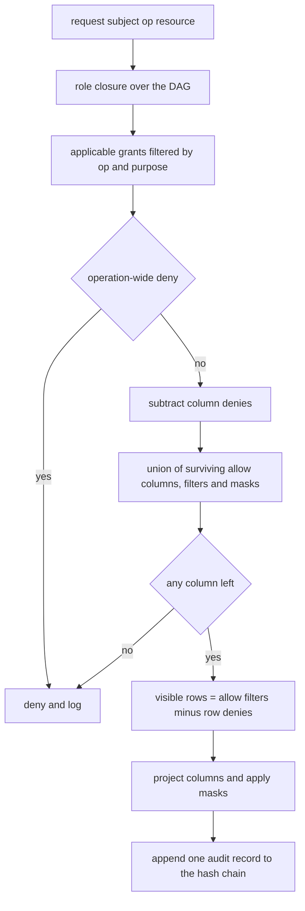
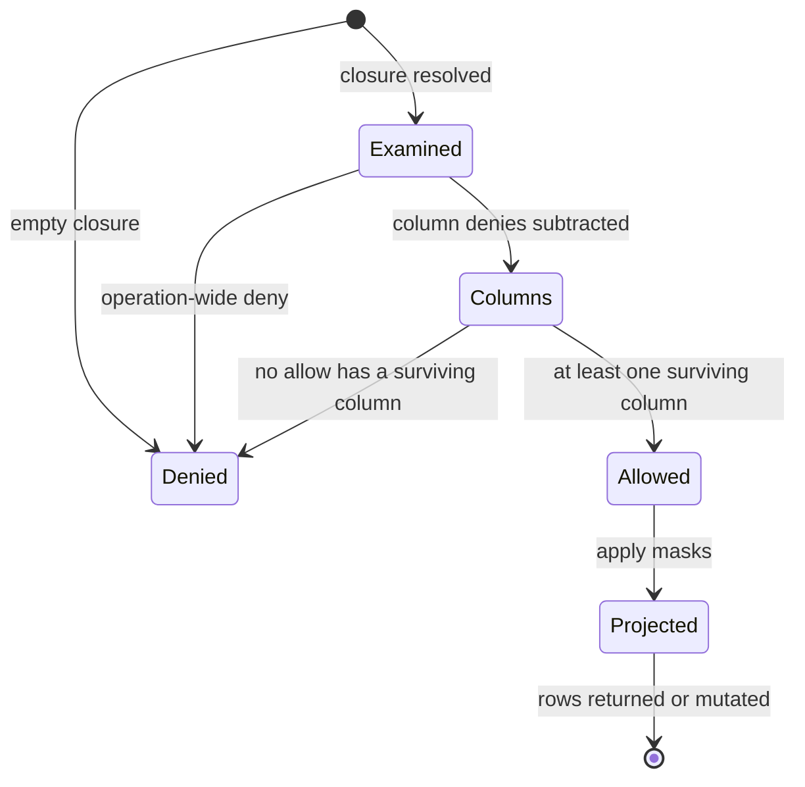
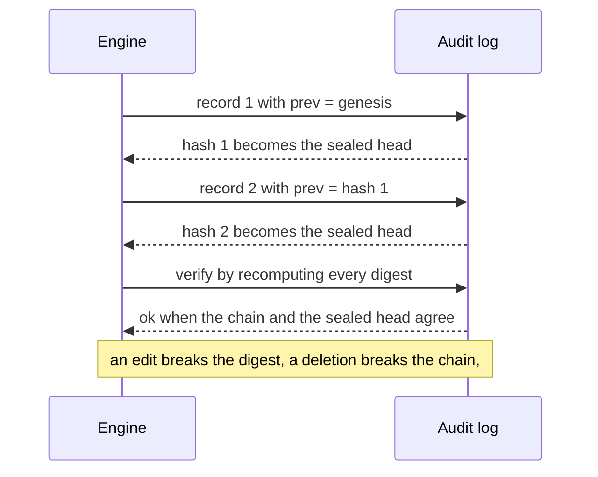

# 853 — Implement fine-grained access control and auditing for database operations.

> **Tier:** Master · **CTCI chapter:** Ch 14 — Databases
> **Task spec:** [853-implement-fine-grained-access-control-and-auditing-for-database.md](../../../tasks/master/853-implement-fine-grained-access-control-and-auditing-for-database.md)
> **Solutions:** [Python](../../../solutions/python/master/853-implement-fine-grained-access-control-and-auditing-for-database/solution.py) ·
> [Java](../../../solutions/java/master/853-implement-fine-grained-access-control-and-auditing-for-database/Solution.java) ·
> [JavaScript](../../../solutions/javascript/master/853-implement-fine-grained-access-control-and-auditing-for-database/solution.js) ·
> [C#](../../../solutions/csharp/master/853-implement-fine-grained-access-control-and-auditing-for-database/Solution.cs)

## 1. Problem restatement

Authorise row- and column-level operations on a table and record every decision in a
tamper-evident trail.

A request is `(subject, operation, resource)`. `subject -> roles` is a DAG (role inheritance);
operation is one of `select / insert / update / delete`; resource is a table with typed columns. A
policy is a flat list of `Grant`s, each carrying `role`, `resource`, `ops`, an `effect`
(`allow`/`deny`), an optional column list (absent means every column), optional row `filters`,
optional per-column `masks` (`null`, `redact`, `bucket`), and an optional purpose `condition` that
gates the grant at request time.

Row predicates are a tiny declarative language — `(attribute, op, value)` with
`op in {=, !=, in, >=}` — so they are *data* that a brute-force oracle can re-evaluate, not
callbacks. Resolution is one pass: **default deny**, a deny always beats an allow, and several
applicable allows union their row predicates, column sets and masks.

**Modelling contract.** Everything is deterministic and in-process: no clock reads (the audit log
carries a virtual sequence number), no randomness, standard library only. Simplified versus a real
DBMS: a single in-memory table, no transactions, no statistics-based optimiser interaction, and a
small fixed predicate language. The security properties, however, are checked against an
*independently written* oracle rather than asserted.

Concrete contract from the file's own output:

| Assertion | Value |
| --- | --- |
| default deny (empty policy, role-less subject, unknown role) | no rows in all three cases |
| employee projection | columns `['dept','id','level','name','region']`, `6` rows, no `salary` |
| intern projection | columns `['id','name']`, rows `2, 4, 5` — the `eu` rows are hidden |
| auditor projection | `salary` masked to `'***'` on all `6` rows |
| deny precedence | admin's `delete` denied by `legal-purge`; `insert` still allowed |
| differential matrix | `64` requests, engine vs oracle: allow, columns, filters, denies, visibility |
| policy lattice | `base = 94`, `+allow = 96`, `+deny = 88` privileges |
| audit | `17` records verified; `5` tamper patterns detected |
| filtered update | touched rows `[1, 2, 5]` of `6`; the other three untouched |

## 2. Intuition

The naive implementation is a single `if` chain: check the role, then a column list, then a row
condition. It works until two grants disagree, and then the answer depends on the order of the `if`s
— which is exactly the kind of bug that leaks a salary.

The key insight is that authorisation is a **lattice**, computed in a fixed order, from data:

1. **Resolve the role closure first.** `manager` inherits `employee`, so the applicable grant set is
   everything whose role is in the transitive closure. An unknown role contributes nothing, which is
   why `frank` with `["unknown-role"]` and `eve` with `[]` are denied before any grant is examined.
2. **A deny is a veto, and there are three kinds of it.** An *operation-wide* deny (`columns is
   None and not filters`) blocks the request outright; a *column* deny subtracts columns from the
   union of the allows; a *row* deny (`filters` present) is carried alongside and removes matching
   rows at execution time. Collapsing these three into one is the classic bug: `legal-purge` has
   neither a column list nor a filter, so it kills `delete` for the admin while `hr-write` still
   allows `insert`.
3. **Allows union, and a subtractive deny can empty a grant.** A grant whose columns are entirely
   denied stops contributing — for the intern, `intern-basics` offers `{id, name, salary}` and
   `no-salary` removes `salary`, leaving `{id, name}`. If every allow is emptied the answer is a
   deny, not an empty allow.
4. **Row visibility is a union of allow predicates minus deny predicates.** An allow with *no*
   predicate makes the decision `unrestricted`, so the union of `all-employees` (no filter) and
   `managers-eu` (region `eu`) is "all rows", not "the eu rows".

The `flowchart` below is the whole decision path, including the three veto kinds:



## 3. Algorithm

1. **Closure.** `role_closure(roles)` is an iterative DFS with a `seen` list; an unknown role is
   skipped and a cycle simply terminates. An empty closure returns `Decision(False, "unknown
   subject")`.
2. **Applicability.** Keep grants whose role is in the closure, whose resource matches, whose `ops`
   contains the operation, and whose `condition` is satisfied by the request's purpose set.
3. **Veto.** Any deny with `columns is None and not filters` denies immediately, naming the grant.
4. **Column arithmetic.** Collect `denied_columns`, then for each allow compute
   `surviving = granted - denied_columns`; skip a grant with no surviving column. Union the
   surviving columns, the row filters of contributing allows, and the masks whose column survived.
   If nothing contributed: deny, naming the first deny or `"default deny"`.
5. **Row visibility.** `unrestricted` is true when some contributing allow has no filter. A row is
   visible when `unrestricted` or it matches an allow predicate, *and* it matches no deny predicate.
6. **Projection and masks.** `project` walks the table columns in order, skips anything outside
   `decision.columns`, and applies `masking(kind, value)` for masked columns.
7. **Execution.** `select` returns projected rows; `update` writes only granted columns of visible
   rows and counts the writes; `delete` removes visible rows; every path calls `log(...)` once.
8. **Audit.** Each record stores `seq`, `subject`, `op`, `resource`, `allowed`, `reason`, `columns`,
   `rows`, `prev` (the previous hash, or `64` zeros for genesis) and its own `hash` over the sorted
   `key=value` payload. `verify_audit` recomputes the chain, checks contiguous sequence numbers,
   compares the recomputed head against `sealed_head`, and reports a truncated log when the record
   list is empty but a sealed head exists.

```text
procedure decide(subject_roles, op, resource, purpose)
    closure ← role_closure(subject_roles)
    if closure is empty then
        return deny with reason unknown subject
    end
    applicable ← grants whose role is in closure, resource matches,
                 op is covered and the purpose gate passes
    denies ← applicable with effect deny
    allows ← applicable with effect allow
    if some deny in denies has no column list and no filters then
        return deny naming that grant
    end
    denied_columns ← union of the column lists of the denies
    columns ← empty set
    masks ← empty map
    filters ← empty list
    contributing ← empty list
    for grant in allows do
        granted ← all table columns if grant.columns is nothing else grant.columns
        surviving ← granted - denied_columns
        if surviving is empty then
            continue
        end
        add grant to contributing
        columns ← columns union surviving
        append grant.filters to filters
        for column, kind in grant.masks do
            if column in surviving then
                masks[column] ← kind
            end
        end
    end
    if contributing is empty then
        return deny naming the first deny if any, otherwise default deny
    end
    return allow with columns, masks, filters, the filters of the row denies,
           and unrestricted = some contributing allow has no filters
end

procedure visible_rows(decision)
    if decision is not an allow then
        return empty list
    end
    rows ← empty list
    for row in table.rows do
        if not decision.unrestricted and no allow predicate matches row then
            continue
        end
        if some deny predicate matches row then
            continue
        end
        append row to rows
    end
    return rows
end

procedure verify_audit(records, sealed)
    previous ← sixty four zeros
    for index, record in enumerate(records) do
        if record.seq is not index + 1 then
            report a sequence problem
        end
        if record.prev is not previous then
            report a chain problem
        end
        if recomputed digest of record is not record.hash then
            report a modification problem
        end
        previous ← record.hash
    end
    if records is not empty and previous is not sealed then
        report a head problem
    end
    if records is empty and sealed exists then
        report that the log was truncated away
    end
    return whether no problem was reported
end
```

Execution is a straight pipeline from decision to audit record: `select` calls `decide`, a deny logs
zero rows, an allow computes the visible rows, projects them through the masks, and logs the row
count. Every path logs, which is what makes the trail complete rather than best-effort.

## 4. Worked example

The sample policy is one table `employees(id, name, dept, region, level, salary)` with `6` rows —
Ada `(1, eng, eu, 5, 150)`, Bob `(2, eng, us, 3, 90)`, Cleo `(3, sales, eu, 4, 120)`,
Dan `(4, sales, us, 2, 60)`, Eve `(5, eng, us, 6, 210)`, Fay `(6, ops, eu, 1, 40)` — roles
`admin -> ()`, `manager -> (employee)`, `auditor -> (employee)`, `intern -> ()`,
`gdpr-officer -> ()`, and `11` grants.

### The intern: a column deny plus a row deny

`carl` has role `intern`, whose closure is just `{intern}`, so the applicable grants are
`intern-basics` (allow, columns `[id, name, salary]`, mask `salary -> bucket`) and `no-salary`
(deny, columns `[salary]`) and `intern-no-eu` (deny, filter `region = 'eu'`).

| Step | Value |
| --- | --- |
| operation-wide denies | none — both denies have a column list or a filter |
| `denied_columns` | `{salary}` |
| `intern-basics` surviving | `{id, name, salary} - {salary} = {id, name}`, so it contributes |
| `columns` / masks kept | `('id', 'name')` / none — `salary` did not survive |
| `denied_rows` | `[region = 'eu']` |
| result | `[{'id': 2, 'name': 'Bob'}, {'id': 4, 'name': 'Dan'}, {'id': 5, 'name': 'Eve'}]` |

### The manager: union semantics, and its single-grant control

`alice` has role `manager`, closure `{manager, employee}`. `all-employees` (employee, columns
`[id, name, dept, region, level]`, no filter) and `managers-eu` (manager, all columns, filter
`region = 'eu'`) both apply.

| Grant | Columns | Filter | Effect on the decision |
| --- | --- | --- | --- |
| `all-employees` | `id, name, dept, region, level` | none | makes `unrestricted` **true** |
| `managers-eu` | all `6` | `region = 'eu'` | adds `salary`, adds a filter that is then irrelevant |

The union is `('dept','id','level','name','salary')` and — because one contributing allow has no
filter — all `6` rows are visible. Removing `all-employees` from the policy leaves only the filtered
grant, and the same subject then sees exactly the `3` `eu` rows. That is the trap: "union of filters"
is not "intersection", and an unfiltered allow wipes out every filter.



### The auditor, the oracle and monotonicity

`dora` (role `auditor`, closure `{auditor, employee}`) combines `all-employees` with `audit-select`
(columns `[id, level, salary]`, mask `salary -> redact`): the union keeps all `6` columns and the
mask survives, so all `6` rows come back with `salary` replaced by `'***'`.

The oracle is a separate, deliberately dumber implementation: it builds a flat truth table
`readable[column]` by iterating grants in policy order, subtracting denied columns, and returning
the sorted readable columns plus the union predicates. Over `8 subjects × 4 operations × 2 purposes
= 64` requests the file asserts agreement on *allow*, the exact column tuple, the sorted allow and
deny filters, and the `unrestricted` flag — plus, for every `select`, the visible row count.
Monotonicity is the third check: the privilege set is `94` for the base policy, `96` with an extra
allow and `88` with an extra deny, and `base ⊆ +allow` with `+deny ⊆ base` is asserted, which is what
makes the lattice claim real rather than decorative.

### The audit chain

`17` decisions (the `8` subjects selected twice each, once per purpose, plus one `alice` update)
produce `17` records. The first three:

| `seq` | subject | op | allowed | rows | `hash` (first 12) | `prev` (first 12) |
| --- | --- | --- | --- | --- | --- | --- |
| 1 | carl | select | true | 3 | `25ead7ec9cff` | `000000000000` |
| 2 | dora | select | true | 6 | `3ce9e5c2db40` | `25ead7ec9cff` |
| 3 | alice | select | true | 6 | `fbed3a1babd8` | `3ce9e5c2db40` |

Record 1 chains from the `64`-zero genesis digest; each later `prev` is the previous `hash`, so any
edit breaks the record's own digest *and* every subsequent link. The five tamper patterns replayed
are: editing a field, deleting a record, swapping two records, forging a digest, and truncating the
tail — the last one is why `sealed_head` exists, since dropping the final record leaves a chain that
still verifies internally.



## 5. Complexity

Let `G` be the number of grants, `R` the number of rows, `C` the columns, `P` the role DAG size, and
`N` the number of audit records.

| Operation | Time | Space | Why |
| --- | --- | --- | --- |
| `role_closure` | `O(P + edges)` | `O(P)` | iterative DFS with a `seen` list |
| `decide` | `O(G * C)` | `O(C)` | one pass over grants, one column set each |
| `visible_rows` and `project` | `O(R * (#filters) + C)` | `O(C)` | per row: allow disjunction, deny disjunction, then an ordered column walk |
| `update` | `O(R * (#filters) + #changes)` | `O(1)` | visibility first, then writes to granted columns |
| `log` | `O(C log C)` per record | `O(1)` per record | sorted keys, one SHA-256 |
| `verify_audit` | `O(N * C)` | `O(1)` | recompute each digest and walk the chain |
| Oracle | `O(G * C)` per request | `O(C)` | flat truth table, deliberately independent |

The `#filters`-per-row factor is the honest weakness of this design: predicates are re-evaluated
per row per request. A production engine would compile the union into a single interval or bitmap
per row group, turning the row pass into `O(R)` bit tests and letting the storage layer push the
filter down. The file keeps the naive evaluation because it makes the semantics auditable — the
oracle re-evaluates exactly the same predicates in exactly the same way.

## 6. Pitfalls and edge cases

- **Collapsing the three kinds of deny.** `legal-purge` is an *operation-wide* deny (`columns=None`,
  `filters=()`), so it blocks `delete` for the admin outright, while `hr-write` still allows
  `insert` and `update`. Treating it as a column deny or a row deny would let the admin delete.
- **A denied operation must not mutate.** The file snapshots the table, runs the denied `delete`,
  and asserts `removed == 0` and `snapshot() == before`; a denied `update` must leave the table
  untouched too. The side effect is the thing being tested, not just the decision.
- **A filtered update may only touch granted columns.** `frozen.update("alice", ..., {"salary": 7})`
  is allowed (the decision is an allow) but touches `0` cells, because `salary` is not in
  `decision.columns`. Asserting `touched == 0` distinguishes "allowed" from "authorised for this
  column".
- **Union of filters is not intersection.** `alice` sees all `6` rows because `all-employees` has no
  filter; only in the single-grant variant do the `3` `eu` rows appear. An implementation that
  ANDs the predicates would silently under-grant.
- **Masks only survive on surviving columns.** If a column is denied, its mask is discarded rather
  than applied, so no code path could reveal the original by "masking" nothing. A mask must also
  never pass the raw value through: the file asserts the raw salary set and the returned salary set
  are disjoint, and that every auditor row has `salary == '***'`.
- **Purpose gating must fail closed.** `gina` sees `('id',)` only with `purpose="gdpr"`; without a
  purpose the gated grant does not apply and the reason is exactly `"default deny"`, and an
  unrecognised purpose must not match. Unknown roles, empty roles and unknown resources are denied
  too, and the oracle denies them as well.
- **Role cycles and a closed operator set.** `{"a": ("b",), "b": ("a",)}` must terminate and still
  decide, and `Predicate("id", "~", 1)` raises `ValueError`.
- **Determinism of the trail.** Two engines given the same requests must produce identical audit
  records *including hashes*, and the genesis record's `prev` must be `64` zeros.

## 7. Variants and follow-ups

- **Access control as part of a query planner.** Pushing row predicates into the plan is the
  optimiser's job, and a bad push-down is exactly the regression
  [855-implement-automated-plan-regression-detector-for-query-optimizer.md](../../../tasks/master/855-implement-automated-plan-regression-detector-for-query-optimizer.md)
  is built to catch.
- **Verifying the engine against a reference.** The `64`-request oracle matrix is a miniature of
  the differential testing harness in
  [854-implement-system-for-differential-testing-and-fuzzing-of-databas.md](../../../tasks/master/854-implement-system-for-differential-testing-and-fuzzing-of-databas.md).
- **Who may read which feature, and who changed it.** The entitlement check and the append-only
  trail in
  [850-implement-monetizable-feature-store-with-lineage-versioning-and.md](../../../tasks/master/850-implement-monetizable-feature-store-with-lineage-versioning-and.md)
  are the coarse, whole-feature versions of the column- and row-level rules here.

## 8. Check yourself

1. Why does `legal-purge` deny the admin's `delete` while `hr-write` still allows `insert`?

<details><summary>Show answer</summary>

Because `legal-purge` is a *deny* for the `delete` operation specifically (`ops=["delete"]`), and it
has neither a column list nor a filter, which makes it an operation-wide veto in `decide`. `hr-write`
grants `insert`, `update` and `delete`; the veto only removes `delete`, so `insert` remains allowed —
and the file also asserts that the denied `delete` removes `0` rows and leaves the table unchanged.

</details>

2. The intern has an allow with columns `[id, name, salary]` and a deny with columns
   `[salary]`. What exactly does the intern see, and what happens to the `bucket` mask?

<details><summary>Show answer</summary>

The deny subtracts `salary`, leaving `{id, name}` — non-empty, so the grant still contributes and the
decision is an allow over `('id', 'name')`. The `bucket` mask is dropped, because masks are only
kept for columns that survived; no returned row contains the key `salary` at all. The separate row
deny (`region = 'eu'`) then shrinks the `6` rows to rows `2, 4, 5`.

</details>

5. Why does the differential oracle iterate grants in policy order instead of reusing the engine?

<details><summary>Show answer</summary>

Because the point of an oracle is to be *independently* written: it builds a flat per-column truth
table (`readable[column]`) by expanding the role closure, subtracting denied columns and unioning
predicates, without reusing `decide`'s layered veto logic. Over the `64` requests the two must agree on
allow, the exact column tuple, the sorted allow and deny filters, and the `unrestricted` flag, so a
mistake in either implementation shows up as a disagreement rather than as a silently shared bug.

</details>
