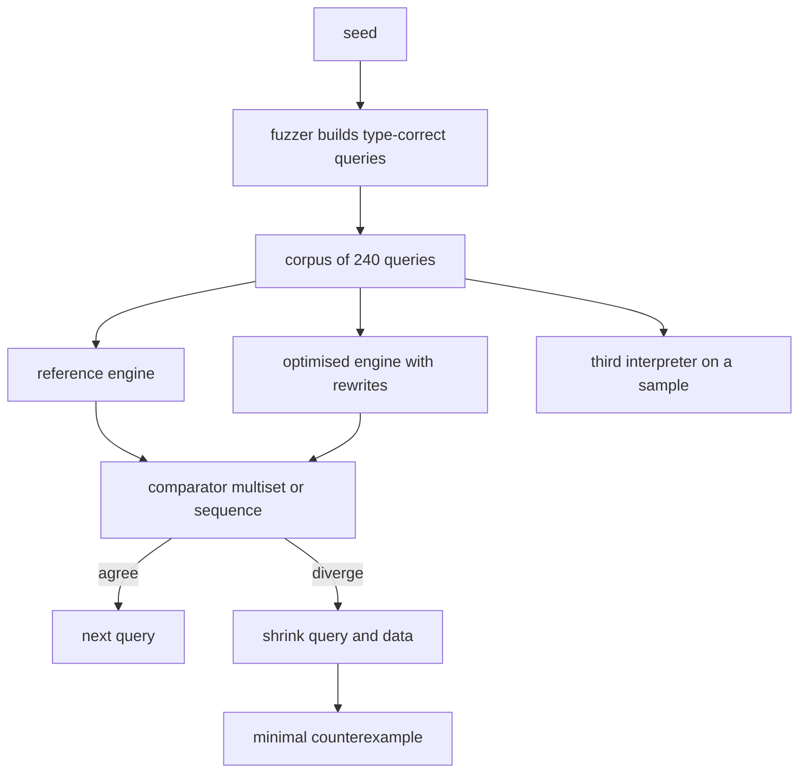
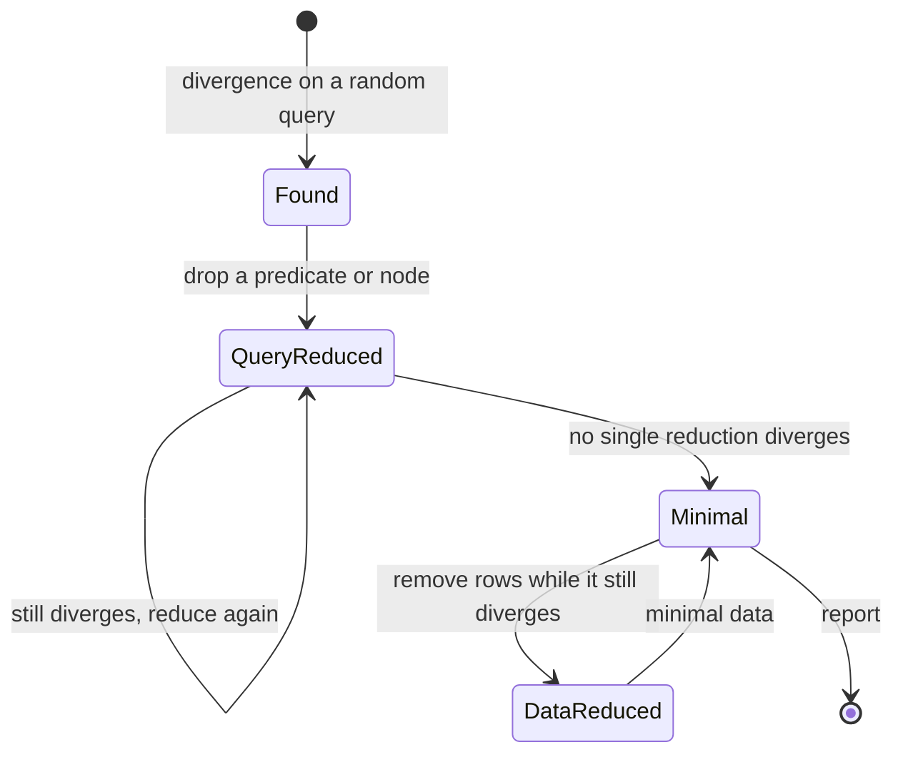
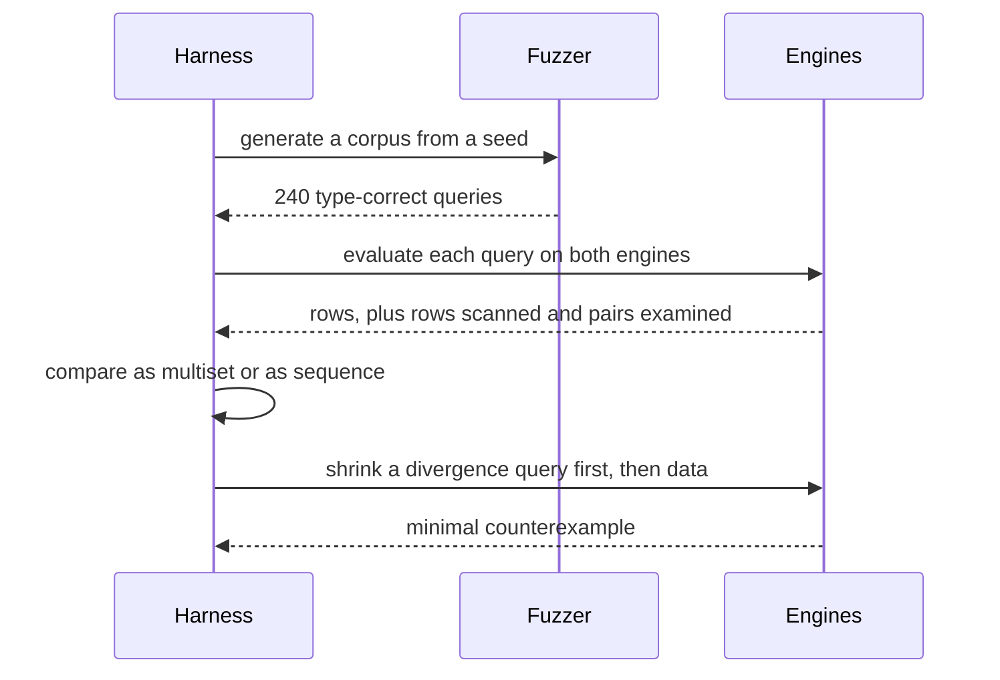

# 854 — Implement system for differential testing and fuzzing of database engines.

> **Tier:** Master · **CTCI chapter:** Ch 14 — Databases
> **Task spec:** [854-implement-system-for-differential-testing-and-fuzzing-of-databas.md](../../../tasks/master/854-implement-system-for-differential-testing-and-fuzzing-of-databas.md)
> **Solutions:** [Python](../../../solutions/python/master/854-implement-system-for-differential-testing-and-fuzzing-of-databas/solution.py) ·
> [Java](../../../solutions/java/master/854-implement-system-for-differential-testing-and-fuzzing-of-databas/Solution.java) ·
> [JavaScript](../../../solutions/javascript/master/854-implement-system-for-differential-testing-and-fuzzing-of-databas/solution.js) ·
> [C#](../../../solutions/csharp/master/854-implement-system-for-differential-testing-and-fuzzing-of-databas/Solution.cs)

## 1. Problem restatement

Build a differential test harness in the style of SQLancer:

- a **deterministic fuzzer** generates a corpus of type-correct relational queries from a seed;
- **several independent engine implementations** evaluate the same query on the same data;
- any disagreement is a **finding**, and each finding is **shrunk** to a minimal counterexample
  before it is reported.

**Modelling contract.** The schema is two small in-memory tables, `users(uid, dept, tier, age,
name)` with `15` rows and `orders(oid, uid, amount, status)` with `30` rows (every seventh order
has a `NULL` `uid`); the query language is a tiny relational algebra — `scan / filter / project /
equi-join / group-aggregate / order / limit`; and the engines are a straightforward reference
evaluator plus a rewrite-based one (predicate push-down into the scan, hash join with a build-side
choice, streaming aggregation) rather than real SQL planners. No threads, no clock, no unseeded
randomness: the fuzzer draws only from a seeded splitmix64 stream, so a corpus is reproducible.

The two semantics the harness fixes, because they are the classic bug sources:

- `NULL` never equals anything, not even another `NULL`, and a `NULL` join key never matches;
- engines may emit rows in **any order**, so results are compared as **multisets** — unless the
  outermost operator is `order` (or a `limit` over an `order`), in which case the sort is made
  total by breaking ties with a canonical row signature and the sequences are compared exactly.

Concrete contract from the file's own run with `240` generated queries:

| Assertion | Value |
| --- | --- |
| differential over the corpus | `0` divergences |
| third, independently written interpreter | agrees on `60` sampled queries |
| top-level shapes generated | `['aggregate', 'filter', 'join', 'limit', 'order', 'project']` |
| comparator is not vacuous | an unordered query returns two different row orders (`6` rows); multiset accepts, sequence rejects |
| rewrites pay off | join pairs examined `134956` → `12856` (`9.5%`); rows read `12060` vs `12060` |
| `left_join` mutant | detected on `127` of `240` queries |
| `drop_filter` mutant | detected on `132` |
| `limit_off_by_one` mutant | detected on `45` |
| `count_not_distinct` mutant | detected on `19` |
| `null_equals_null` mutant | detected on `1` |
| `conjunction_reversed` (neutral) | detected on `0` — no false positive |
| shrinking a finding | `4` nodes → `join(uid=uid, scan(users), scan(orders))` (`3` nodes) in `1` step |
| data shrinking | `44` of `45` rows removed, divergence survives on `1` row |

## 2. Intuition

The naive way to test an optimiser is to assert expected outputs: hand-write a query, hand-write
the answer, compare. It only catches bugs you already imagined, and every new rewrite needs new
expected values.

The key insight is that **two independent implementations of the same semantics are an oracle for
each other**, and a fuzzer can generate the inputs no human would think of:

1. **Generate type-correct queries structurally.** The fuzzer builds the query from a schema
   function: it wraps a node only in an operator the node's columns support (only numeric columns
   are summed, a join needs a `uid` on both sides, a `LIMIT` is only generated over an `ORDER BY`
   so it is well defined). Type-correctness is what keeps the signal high — random text produces
   parse errors, not divergences.
2. **Compare at the right granularity.** Row order is *not* part of the contract for an unordered
   query, so the comparator canonicalises both sides into sorted signatures. Comparing sequences
   would drown the harness in false positives; comparing multisets is the weakest relation that is
   still an oracle. Where order *is* fixed, the comparator must be strict — hence the tie-break,
   because an unstable sort would otherwise make the same engine disagree with itself.
3. **Prove the comparator is not vacuous.** A comparator that always says "equal" would report no
   bugs; the file exhibits a query where the two engines really do emit different orders, and shows
   that a naive sequence comparator rejects it while the multiset one accepts it.
4. **Shrink before reporting.** A random query is a terrible bug report. Greedy reduction — drop a
   predicate, drop a projection, drop an ordering, decrement a `LIMIT`, drop data rows — keeps a
   reduction only while the divergence survives, and the minimal result is verified to be minimal
   by exhaustive single-step re-checking.
5. **Mutation testing keeps the harness honest.** Five injected semantic mutants must be detected,
   and one *semantically neutral* mutant (swapping the operands of an `and`) must not be.



## 3. Algorithm

1. **Build the data and the schema.** `build_data()` creates `15` users (`dept` includes a `None`)
   and `30` orders, with `uid = None` whenever `oid % 7 == 0`; `SCHEMA` and `COLUMN_TABLE` let the
   fuzzer know which literals are legal for which column.
2. **Generate a query.** Start from `join(uid, uid, scan(users), scan(orders))`, then wrap it in
   `1..3` random nodes, then force the requested top-level `shape` (`filter`, `aggregate`, `order`,
   `limit`). `corpus(count)` cycles the shapes so every shape is represented.
3. **Run both engines.** The reference uses nested-loop joins and materialised sorts; the optimised
   engine pushes predicates into the scan, builds a hash table on the *smaller* side and probes with
   the other, and emits rows in reverse scan order. The mutation, if any, is injected into the
   *candidate* engine only, via `mutate` on the AST plus an engine flag.
4. **Compare.** `is_sequence_compared(query)` decides the relation: sequence when the outermost
   node is `order` or `limit over order`, otherwise multiset over `row_signature`.
5. **Cross-check with a third implementation.** `oracle` is an independently written interpreter
   (direct column access, no push-down, no hashing); it validates a sample of the corpus, so
   agreement between the two engines is real correctness rather than a shared mistake.
6. **Measure the rewrites.** `scans()` accumulates `rows_scanned` and `pairs_examined` for both
   engines over the whole corpus.
7. **Shrink a finding.** `reductions(query)` enumerates single-step reductions; the harness keeps
   the first reduction that still diverges and iterates until no reduction does. Data shrinking
   then removes rows while the divergence survives, and minimality is re-checked exhaustively.

```text
procedure differential(corpus, mutation)
    findings ← empty list
    for query in corpus do
        reference ← reference engine evaluates query
        candidate ← optimised engine evaluates mutated query with the mutation injected
        ordered ← outermost node is order or limit over order
        if compare(reference, candidate, ordered) is false then
            append a finding for that query to findings
        end
    end
    return findings
end

procedure compare(left, right, ordered)
    if ordered then
        return left equals right, mode sequence
    end
    return canonical(left) equals canonical(right), mode multiset
end

function canonical(rows)
    return the sorted list of row signatures
end

procedure shrink(query, mutation)
    current ← query
    while some reduction of current still diverges under mutation do
        current ← the first such reduction
    end
    return current
end

procedure shrink_data(data, query, mutation)
    keep ← true while removing a row still lets the query diverge
    return the smallest data that still diverges
end
```

Shrinking is a two-dimensional greedy loop — the query first, then the data:



## 4. Worked example

### The comparator is not vacuous

The file deliberately builds a query both engines agree on *semantically* but not *positionally*:

```text
filter(status = 'new',
       join(uid=uid, join(uid=uid, scan(users), scan(orders)), scan(users)))
```

| Aspect | Value |
| --- | --- |
| rows returned | `6` on each side |
| row order | different, because the optimised engine emits in reverse scan order |
| multiset comparison | accepts — the sorted signatures are equal |
| naive sequence comparison | rejects — the lists differ element by element |

That single query is why the comparator needs the `is_sequence_compared` test rather than a blanket
"compare lists": otherwise every unordered query in the corpus would be a false finding.

### What the rewrites cost and what they save

| Metric over `240` queries | Reference | Optimised | Ratio |
| --- | --- | --- | --- |
| join pairs examined | `134956` | `12856` | `9.5%` |
| rows read | `12060` | `12060` | `100%` (push-down moves work, it does not remove scans) |

The rows-read number is the honest part: predicate push-down filters inside the scan, but it still
reads the same rows off disk in this model, so the saving shows up in the join, where the nested
loop's `|left| * |right|` becomes a hash lookup over only the matching keys.

### Mutation testing: the harness catches bugs and not noise

| Mutant | What it changes | Detected on |
| --- | --- | --- |
| `left_join` | inner join becomes outer, unmatched left rows survive | `127` / `240` |
| `drop_filter` | a `filter` node is deleted from the AST | `132` / `240` |
| `limit_off_by_one` | `LIMIT n` becomes `LIMIT n + 1` | `45` / `240` |
| `count_not_distinct` | `count_distinct(v)` becomes `count(v)` | `19` / `240` |
| `null_equals_null` | `NULL = NULL` starts returning true | `1` / `240` |
| `conjunction_reversed` | swaps the operands of an `and` | `0` — correctly not reported |

The last row is the one that matters most. A harness that flags a commutative rewrite is
unusable, and `null_equals_null`'s single detection is the *expected* shape: only one query in the
corpus has a filter that can observe `NULL = NULL` on both sides at once, and the harness still
finds it.

### Shrinking a `left_join` finding

The unshrunk finding is a `4`-node query; one reduction step removes the surrounding node:

| Stage | Query size | Query | Divergence |
| --- | --- | --- | --- |
| finding | `4` nodes | `filter(..., join(uid=uid, join(uid=uid, scan(users), scan(orders)), scan(users)))` | present |
| reduced | `3` nodes | `join(uid=uid, scan(users), scan(orders))` | still present |
| minimal | `3` nodes | no single further reduction diverges | present |

Then the *data* is shrunk the same way: `44` of `45` rows can be removed while the divergence
survives, leaving a `1`-row counterexample. The file asserts both that the reduced query is
strictly smaller than the finding and that no single-step reduction still diverges, which is what
makes "minimal" a checked property rather than a hope.



## 5. Complexity

Let `C` be the corpus size, `Q` the query size in nodes, `D` the data size, and `V` the output
size of a query.

| Measure | Bound | Why it holds |
| --- | --- | --- |
| Fuzzing | `O(C * Q)` | each query is built by `1..3` wrapping steps plus the shape wrapper |
| Reference evaluation | `O(D²)` worst | nested-loop join compares every pair: `134956` pairs over the corpus |
| Optimised evaluation | `O(D)` expected | hash build plus probe; `12856` pairs measured, `9.5%` of the reference |
| Comparison | `O(V log V)` | canonicalisation sorts the row signatures |
| Sequence comparison | `O(V)` | only where the outermost operator fixes order, and the sort is total |
| Third-interpreter cross-check | `O(V)` per sampled query | `60` of `240` queries in the file |
| Shrinking | `O(Q²)` reductions, each `O(D²)` to re-run | a greedy loop with an exhaustive minimality re-check |
| Memory | `O(D + V)` | both engines materialise their inputs at each node |

The complexity that matters in practice is the *shrinking*, because it re-runs the engines once per
candidate reduction. The file accepts `O(Q²)` because `Q` is tiny (a finding is `4` nodes), and
because the greedy loop usually terminates in one step — the reported trace shrank a `4`-node query
in exactly `1` step. A production shrinker (as in C-Reduce) uses a fixed reduction grammar with a
smaller candidate set rather than exhaustive enumeration.

The `O(R)` rows-read parity deserves a note: push-down is not a data-volume optimisation in this
model, so the file reports both counters separately rather than claiming a single "speedup" number.
The rewrite's measured win is the join-pairs drop from `134956` to `12856`.

## 6. Pitfalls and edge cases

- **Comparing sequences when order is not in the contract.** The file's own engines disagree on
  order for a `6`-row query; a sequence comparator would report that as a bug. The rule is
  `order` or `limit over order`, and nothing else.
- **An unstable sort inside an engine.** `order` breaks ties with `row_signature(row)`, which is a
  canonical tuple over the sorted column names. Without a total order the same engine would
  disagree with itself across runs, making every ordered comparison flaky.
- **`NULL` is not a value.** `NULL = NULL` is false and a `NULL` join key matches nothing, in both
  engines and in the third interpreter. `null_equals_null` mutates an *engine flag*, not the AST,
  and is detected on exactly `1` query — which is the point: the corpus has to contain a query that
  can observe it.
- **Aggregates and `NULL`.** `count` counts rows including `NULL` values
  (`len(values)`), while `count_distinct`, `sum` and `max` first drop `None`; `max` of an
  all-`NULL` group is `None`. These are decisions, and both engines implement the *same* ones —
  which is why the `count_not_distinct` mutant is detectable at all.
- **Duplicate column names across a join.** `users` and `orders` both have `uid`, and the merge
  order decides the winner. The optimised engine resolves it *by position* (`right` side wins)
  regardless of which side it picked as the hash build input — a bug here would make the rewrite
  change the result, which is exactly what differential testing is for.
- **Type-incorrect generation.** Summing a `name` or joining on a `status` produces parse-level
  noise rather than divergences; `aggregate_func` and the `"uid" in columns` guard keep the corpus
  meaningful.
- **`LIMIT` without `ORDER BY` is not well defined.** The fuzzer only emits a `LIMIT` above an
  `ORDER BY` (choice `6` in `node`), which is why sequence comparison is sound for that shape.
- **Edge cases the file pins.** An empty database, `LIMIT 0`, a huge `LIMIT`, a self-join, a
  predicate that matches nothing, and `NULL` keys: both engines agree on all of them.
- **Reproducibility.** The same seed must regenerate the identical corpus *and* the identical
  verdicts and findings, or a finding cannot be handed to a developer.

## 7. Variants and follow-ups

- **Differential oracles with different shapes.** The third interpreter here exists because
  agreement between two implementations can be a shared mistake; the same idea appears in the
  brute-force oracle of
  [853-implement-fine-grained-access-control-and-auditing-for-database.md](../../../tasks/master/853-implement-fine-grained-access-control-and-auditing-for-database.md).
- **Regression gates versus bug hunting.** A fuzzer finds a divergence in one version; catching a
  *plan* regression between two versions is the job of
  [855-implement-automated-plan-regression-detector-for-query-optimizer.md](../../../tasks/master/855-implement-automated-plan-regression-detector-for-query-optimizer.md).
- **Rewrites that must preserve semantics.** The push-down and hash-join rewrites validated here
  are the cheap version of what a learned cost model chooses between in
  [857-implement-ml-based-cost-model-for-query-planner-with-online-lear.md](../../../tasks/master/857-implement-ml-based-cost-model-for-query-planner-with-online-lear.md)
  and what the runtime re-optimiser swaps in
  [856-implement-runtime-adaptive-operator-re-optimization-and-replanni.md](../../../tasks/master/856-implement-runtime-adaptive-operator-re-optimization-and-replanni.md).
- **Shrinking as a general technique.** The greedy query-then-data reduction is the same protocol a
  concept-drift pipeline needs when it has to explain a single misclassified window — see
  [858-implement-streaming-transfer-learning-pipeline-with-concept-drif.md](../../../tasks/master/858-implement-streaming-transfer-learning-pipeline-with-concept-drif.md).

## 8. Check yourself

1. Why must the comparator use multisets for unordered queries instead of comparing lists?

<details><summary>Show answer</summary>

Because row order is not part of the query's contract, and the two engines genuinely emit different
orders — the optimised engine scans in reverse. The file exhibits a `6`-row query where the orders
differ, the multiset comparator accepts it, and a naive sequence comparator rejects it. Sequence
comparison is reserved for queries whose outermost operator is `order` (or `limit over order`),
where the sort is made total with `row_signature`.

</details>

2. The mutant `conjunction_reversed` is detected on `0` queries. Is the harness broken?

<details><summary>Show answer</summary>

No — swapping the operands of an `and` is semantically neutral, so detecting it would be a *false
positive*. The five semantic mutants (`left_join` `127`, `drop_filter` `132`,
`limit_off_by_one` `45`, `count_not_distinct` `19`, `null_equals_null` `1`) carry the detection
signal instead, and the neutral mutant is in the file precisely to pin the no-false-positive
property.

</details>

3. Why is a third interpreter needed when two engines already disagree-on-need?

<details><summary>Show answer</summary>

Because two implementations can share a mistake — if both got `NULL` semantics wrong in the same
way, the differential test would report no divergence and the bug would ship. `oracle` is written
independently (direct column access, no push-down, no hashing) and is checked against the reference
on a sample of `60` queries, so agreement means correctness rather than consensus.

</details>

4. Which counter shows that the rewrites pay off, and which one shows that they do not?

<details><summary>Show answer</summary>

Join pairs examined drops from `134956` to `12856` (`9.5%`): the nested loop's cross product becomes
a hash lookup over only the matching keys. Rows read stays at `12060` for both engines — predicate
push-down filters *inside* the scan but still reads the same rows, so the file reports the two
counters separately instead of claiming a blanket speedup.

</details>
