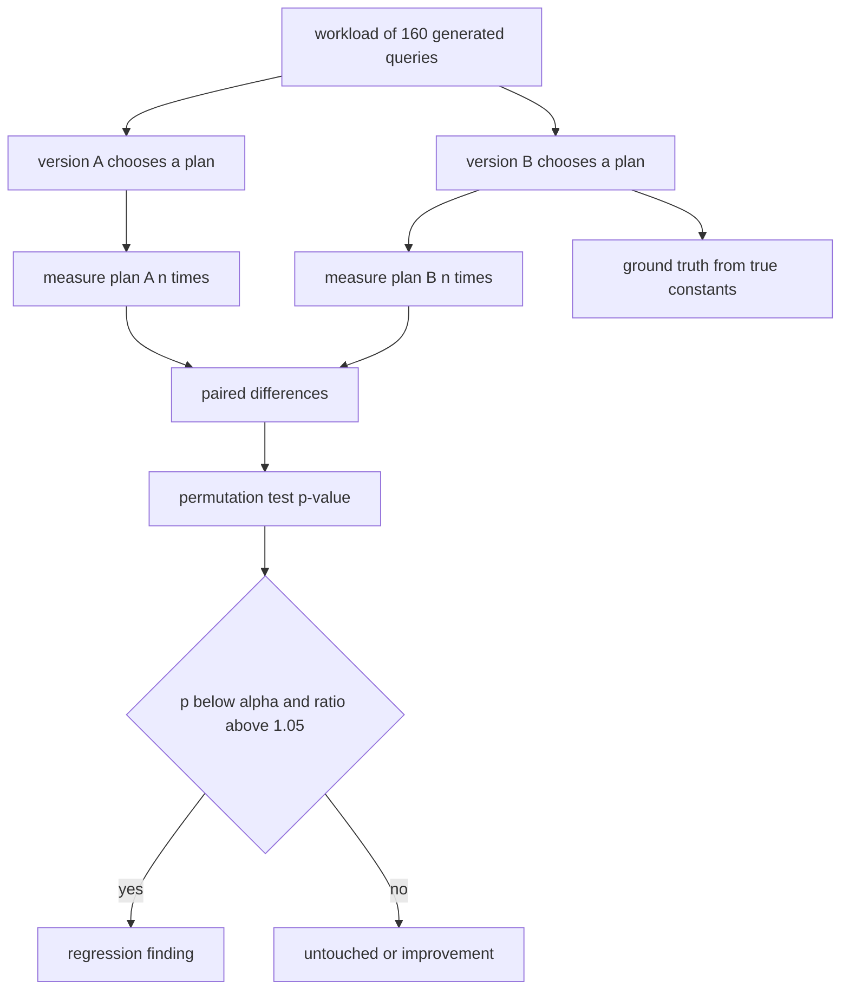
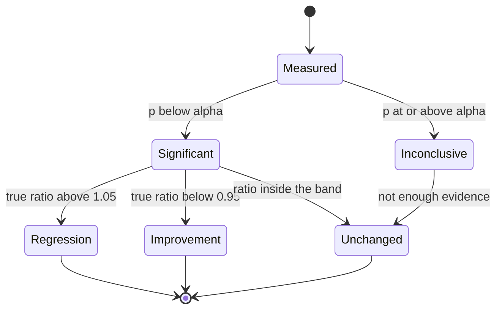
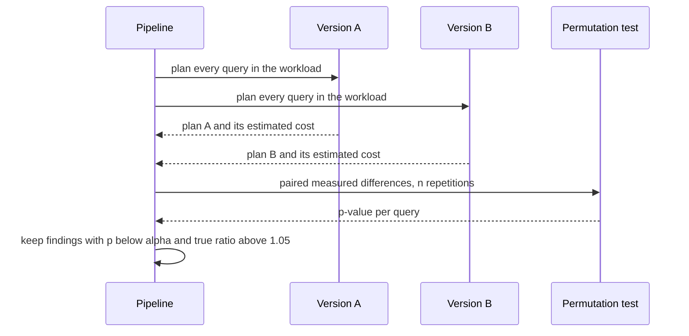

# 855 — Implement automated plan regression detector for query optimizer changes.

> **Tier:** Master · **CTCI chapter:** Ch 14 — Databases
> **Task spec:** [855-implement-automated-plan-regression-detector-for-query-optimizer.md](../../../tasks/master/855-implement-automated-plan-regression-detector-for-query-optimizer.md)
> **Solutions:** [Python](../../../solutions/python/master/855-implement-automated-plan-regression-detector-for-query-optimizer/solution.py) ·
> [Java](../../../solutions/java/master/855-implement-automated-plan-regression-detector-for-query-optimizer/Solution.java) ·
> [JavaScript](../../../solutions/javascript/master/855-implement-automated-plan-regression-detector-for-query-optimizer/solution.js) ·
> [C#](../../../solutions/csharp/master/855-implement-automated-plan-regression-detector-for-query-optimizer/Solution.cs)

## 1. Problem restatement

Two versions of a query optimizer must be compared on the same workload: plan every query with
both, **measure** both plans, and decide which queries genuinely got slower. The output is a
verdict per query — *regression*, *improvement* or *untouched* — with the plan shapes that
differ and a p-value for each finding.

**Modelling contract.** Everything is in-process and deterministic: no clock, no threads, no
unseeded randomness (measurement noise comes from a seeded splitmix64 stream), and the workload is
generated rather than read from disk. Simplified versus a real system: the "database" is a small
analytic cost model. A query joins three of four tables (`A` `2000` rows, `B` `800`, `C` `300`,
`D` `60`) left-deep with an optional filter; a plan is a join order plus one operator per join
(`hash` or `nested`), so the plan space is `3! * 2² = 24` plans enumerated exhaustively. Both
optimizer versions share the same cardinality estimator (uniform fan-out) and differ *only* in
their physical constants: version 2 believes random IO is a quarter of the real cost and that
memory is four times larger — exactly the shape of a cost-model bug. The measured cost always uses
the true constants and the true fan-out, perturbed by `±2%` jitter, so the detector must be
statistical.

Concrete contract from the file's run over `160` generated queries:

| Assertion | Value |
| --- | --- |
| plan space / operators | `24` plans, severities `[1.0, 1.58, 1.66, 1.68, 1.70, 1.71]` |
| optimality | every chosen plan is the cheapest of its space under that version's own model |
| measurement fidelity | `480` samples within `2.00%` of the analytic true cost |
| plan changes | `46` of `160` queries planned differently by version 2 (`14` of them uniform) |
| detector precision / recall | `1.00` / `1.00`; severe-regression recall `1.00` |
| verdicts | `46` regressions, `0` improvements, `114` untouched |
| calibration (self-comparison) | `0` findings; noise-only rejection rate `0.075`, median p-value `0.51` |
| reversed comparison | `46` improvements and `0` regressions |
| false positives among the `114` unaffected | `0` |
| single repetition | no regression can be claimed (p is always `1.0`) |
| worst finding | `q133` ratio `5.28`, `p = 0.0078`, `('hash','hash') → ('hash','nested')` |

## 2. Intuition

The naive regression check is "plan A is cheaper than plan B, therefore no regression". It is
wrong twice over. First, the optimizer picks by its *own* cost model, so a version that
underestimates random IO will confidently pick a nested loop and report a lower estimated cost
while the real cost explodes — the model is the bug, not the plan. Second, any real measurement is
noisy, so the comparison has to be a statistical test with a controlled false-positive rate rather
than an inequality.

The key insight is to separate the three things that were tangled together:

1. **The optimizer's belief** — estimated cost under the version's constants and the uniform
   fan-out assumption.
2. **The truth** — analytic cost under the true constants and the query's real fan-out. This is
   what decides whether a plan actually regressed, and it is the *ground truth* the detector is
   scored against, not something the detector may use.
3. **The measurement** — truth plus `±2%` jitter, which is all the detector is allowed to see.

With that split, the detector is a **paired** test over the same query: measure the two plans `n`
times each, take the per-repetition differences, and run an **exact two-sided permutation test**
over all `2^n` sign flips. A paired test is the right tool because the query, the data and the
machine are the same on both sides, so only the plan differs.



The ground truth is computed with the *true* constants only, so the detector cannot cheat: it sees
estimates and noisy measurements, and its verdicts are then compared against the true ratio.

## 3. Algorithm

1. **Generate the workload.** `generate_workload(seed, count)` builds `160` queries over tables
   `(A, B, C)`; every fourth query sets all fan-outs to `1.0` (symmetric, so no plan change is
   possible), the rest draw per-pair fan-outs in `[0.5, 6.5]` — exactly the skew the uniform
   estimator cannot see.
2. **Enumerate plans.** `plans_for(query)` yields `6` join orders × `2²` operator choices.
3. **Choose per version.** `choose_plan(query, constants)` returns the `argmin` of the estimated
   cost. `plan_cost(..., estimated=True)` uses the version's constants and the uniform estimate;
   `estimated=False` uses the true constants and the real fan-out.
4. **Measure.** `measure(query, plan, rng, repetition)` returns `true_cost * (1 + 0.02 * u)` with
   `u` uniform in `[-1, 1]`.
5. **Test.** `permutation_p_value(differences)` computes the exact two-sided p-value by
   enumerating all `2^n` sign flips and counting how many give a mean at least as extreme as the
   observed one; a zero observed mean returns `1.0` directly.
6. **Verdict.** A regression needs `p < alpha` **and** `ratio > MEANINGFUL = 1.05`, where the ratio
   is the true-cost ratio; an improvement needs `p < alpha` and `ratio < 1 / 1.05`. `SEVERE = 1.5`
   marks the findings worth escalating.
7. **Score.** `ground_truth` recomputes the true ratios and the real regression set;
   `precision_recall` compares them with what was reported.

```text
procedure choose_plan(query, constants)
    return the plan minimising estimated_cost(query, plan, constants)
           over every join order and operator assignment
end

function plan_cost(query, plan, constants, estimated)
    random_io ← constants.random_io if estimated else TRUE_RANDOM_IO
    memory ← constants.memory if estimated else MEMORY
    size ← rows of the first table after its filter
    cost ← size
    for each further table in the plan do
        inner ← rows of that table after its filter
        if the operator is hash then
            build ← min(size, inner)
            cost ← cost + size + inner + 2 * build
            if build > memory then
                cost ← cost + 2 * build
            end
        else
            cost ← cost + size * inner * random_io
        end
        fanout ← query.estimate if estimated else the true pair fan-out
        size ← min(size, inner) * fanout
    end
    return cost
end

function permutation_p_value(differences)
    n ← length(differences)
    observed ← mean of differences
    if observed is zero then
        return 1.0
    end
    extreme ← 0
    for mask from 0 to 2 power n - 1 do
        signed ← sum over i of (differences[i] if the i-th bit of mask is set else -differences[i])
        if absolute value of signed / n is at least absolute value of observed then
            extreme ← extreme + 1
        end
    end
    return extreme / (2 power n)
end

procedure evaluate(queries, constants_a, constants_b, repetitions, alpha)
    findings ← empty list
    for query in queries do
        plan_a ← choose_plan(query, constants_a)
        plan_b ← choose_plan(query, constants_b)
        differences ← empty list
        for repetition from 1 to repetitions do
            a ← measure(query, plan_a)
            b ← measure(query, plan_b)
            append (b - a) to differences
        end
        p ← permutation_p_value(differences)
        ratio ← true_cost(query, plan_b) / true_cost(query, plan_a)
        record the verdict: regression when p < alpha and ratio > MEANINGFUL,
                            improvement when p < alpha and ratio < 1 / MEANINGFUL
    end
    return findings
end
```

The decision is two-dimensional — statistical significance *and* practical size — because either
one alone produces useless verdicts:



## 4. Worked example

### One query, two plans, both models

`q133` has a selective `A` (`0.1296`) and strongly skewed fan-outs
(`A–B 5.00`, `A–C 2.02`, `B–C 1.95`), and version 2's constants are `random_io = 0.0125`
(a quarter of the true `0.05`) with `memory = 16000` (four times the true `4000`).

| | Plan | Estimated cost (own model) | True cost (true model) |
| --- | --- | --- | --- |
| Version 1 (true constants) | `(A,B,C)` with `('hash','hash')` | `2914.9` | `4034.1` |
| Version 2 (cheap random IO) | `(A,B,C)` with `('hash','nested')` | `2809.3` | `21292.5` |

Version 2 is right that its plan is cheaper *under its own model* — `2809.3 < 2914.9` — and wrong
about reality by a factor of `5.28`. This is the whole bug class in one row: the estimated cost
moved the wrong way relative to the truth because a constant was wrong, and no amount of plan
comparison would reveal it without measuring with the true constants.

The important structural detail is `plan_cost` is *one function used twice*: `estimated=True`
swaps in the version's constants and the uniform fan-out, `estimated=False` swaps in the true ones.
So a cost difference between the two modes is unambiguously a modelling error, not a formula
discrepancy. That is also why "the optimizer is optimal for its own model" is checked by brute
force over all `24` plans for every query — if it were not, a regression could be a planning bug
rather than a cost bug.

### The permutation test on the same finding

With `n = 8` repetitions and all eight paired differences positive, the exact two-sided p-value is
`1 / 2^8 * 2 = 0.0078` — the file's reported `p = 0.0078` for `q133`, well under `alpha = 0.05`.
Two calibration controls pin the test down:

| Control | Result | Why it matters |
| --- | --- | --- |
| version 1 against itself | `0` findings | a self-comparison must be silent |
| reversed comparison (B as baseline) | `46` improvements, `0` regressions | verdicts follow the direction |
| noise-only pairs with equal true costs | rejection rate `0.075`, median p-value `0.51` | close to `alpha = 0.05`, so the test is calibrated |
| a single repetition | no regression is possible | with `n = 1` the mean of either sign flip is equally extreme, so `p = 1.0` |

The single-repetition row is worth pausing on: it is not a bug in the harness but a property of
the test. The file asserts it explicitly (`with a single repetition no regression is claimed`),
because a detector that reports regressions from one sample each is exactly the tool that gets
switched off by its users.



### Verdicts over the workload

| Verdict | Count | Note |
| --- | --- | --- |
| regression | `46` | all `46` are severe (true ratio `> 1.5`), with ratios `1.58 … 5.28` |
| improvement | `0` | version 2's larger memory removes spills, but never enough to win |
| untouched | `114` | including the `14` queries where the plan shape changed inside the uniform family |
| precision / recall | `1.00` / `1.00` | no false positive among the `114`, no missed regression among the `46` |

`14` of the `160` queries changed plan *shape* without changing the true cost — the symmetric,
uniform-fan-out queries where several plans are genuinely equivalent. Reporting those as
regressions would be a false positive, and the `MEANINGFUL = 1.05` band plus the significance test
is what suppresses them: a shape change is not a regression.

## 5. Complexity

Let `Q` be the number of queries, `P` the plan-space size (`24` here), `n` the repetitions, and
`S` the number of tables in a plan.

| Measure | Bound | Why it holds |
| --- | --- | --- |
| Plan enumeration | `O(P)` | `S! * 2^(S-1)` plans; `24` for three tables |
| Choosing a plan | `O(P * S)` | one cost evaluation per plan, `S` join steps each |
| Measuring a query | `O(n)` | `n` samples per plan, `2n` per query |
| Permutation test | `O(2^n)` | exact enumeration of `2^n` sign flips, `n = 8` → `256` masks |
| Ground truth | `O(Q * P * S)` | the same enumeration with the true constants |
| Whole corpus | `O(Q * (P * S + n + 2^n))` | `160` queries, `480` samples, `24` plans |
| Space | `O(Q)` findings plus one plan per version | each finding holds two plan shapes and the p-value |

The exponential test cost is the design choice to notice: an exact permutation test doubles in
cost per extra repetition, which is why the file uses `n = 8` (`256` masks) rather than `n = 30`.
A production harness would sample the permutation distribution, or use a paired t-test once the
differences are known to be well behaved; the exact test is here because it needs no distributional
assumption and, at `n = 8`, is cheap enough to be the *reference* a sampled version is validated
against.

## 6. Pitfalls and edge cases

- **Comparing estimated costs.** The optimizer's own cost is not evidence about the real world — on
  `q133` it moves from `2914.9` to `2809.3` (a "win") while the truth moves from `4034.1` to
  `21292.5`. Every verdict here is based on the true-cost ratio.
- **Unpaired comparisons.** The test must be paired, because the noise on a query is far larger
  than the effect being detected. Pairing on the query cancels it, which is why the detector takes
  differences of paired samples instead of comparing two independent means.
- **A shape change is not a regression.** `14` queries changed plan with no true-cost change; the
  `MEANINGFUL = 1.05` band exists so they are reported as untouched.
- **Too few repetitions.** With `n = 1` the exact p-value is `1.0` for any difference, so nothing
  can be significant — the file asserts this rather than silently reporting noise.
- **A self-comparison must be silent.** Feeding version 1 as both sides must yield `0` findings,
  otherwise the detector is reporting its own noise floor as regressions.
- **Direction.** Comparing B against A as the baseline must invert the verdicts (`46` improvements,
  `0` regressions). A detector that reports the same direction both ways is comparing something
  other than what it claims.
- **The uniform-fan-out blind spot is intentional.** The estimator assumes `1.0` fan-out; the
  workload's non-uniform queries carry `0.5 … 6.5`. That is the skew a real optimizer's estimator
  also misses, and it is what makes the ground truth differ from the estimated one.
- **Edge cases the file pins.** A single-table query, a two-table plan space, two versions with
  *identical* constants, an extreme bug, and a two-table plan where the optimizer changes its mind
  for a legitimate reason.
- **Determinism.** The same seed must produce identical findings — same verdicts, same p-values,
  same plan shapes — or a finding cannot be investigated after the fact.

## 7. Variants and follow-ups

- **Fuzzing the optimizer instead of comparing versions.** Where this task detects a *difference*
  between two versions, the differential harness in
  [854-implement-system-for-differential-testing-and-fuzzing-of-databas.md](../../../tasks/master/854-implement-system-for-differential-testing-and-fuzzing-of-databas.md)
  finds disagreements between two implementations of the same semantics.
- **Learning the constant that is wrong.** Version 2's bug is a single scalar (`random_io`); the
  online learning in
  [857-implement-ml-based-cost-model-for-query-planner-with-online-lear.md](../../../tasks/master/857-implement-ml-based-cost-model-for-query-planner-with-online-lear.md)
  is how a planner would recover it from observed latencies.
- **Re-planning while the query runs.** A regression caught before release is one thing; an
  operator that has already gone slow is the runtime re-optimisation of
  [856-implement-runtime-adaptive-operator-re-optimization-and-replanni.md](../../../tasks/master/856-implement-runtime-adaptive-operator-re-optimization-and-replanni.md).
- **Where the true cost model comes from.** The analytic cost here is a stand-in for the kind of
  measurement the storage-layout optimiser must make when it decides to compact — see
  [859-implement-self-tuning-database-storage-layout-optimizer-auto-com.md](../../../tasks/master/859-implement-self-tuning-database-storage-layout-optimizer-auto-com.md).
- **Statistical drift detection.** The paired permutation test is the same instrument a drift
  monitor needs, in
  [858-implement-streaming-transfer-learning-pipeline-with-concept-drif.md](../../../tasks/master/858-implement-streaming-transfer-learning-pipeline-with-concept-drif.md).

## 8. Check yourself

1. Why is an exact permutation test used instead of comparing estimated costs or a plain
   inequality?

<details><summary>Show answer</summary>

Because the estimated cost is the thing that is broken — on `q133` version 2's estimate improves
(`2914.9` → `2809.3`) while the true cost degrades (`4034.1` → `21292.5`) — and because the
measurement carries `±2%` jitter, so an inequality has no false-positive control. The paired
permutation test gives an exact p-value under the null that the two plans cost the same, with no
distributional assumption, and the file validates it with a self-comparison (`0` findings), a
noise-only rejection rate of `0.075` against `alpha = 0.05`, and a median p-value of `0.51`.

</details>

2. What does "the optimizer is optimal with respect to its own model" buy the detector?

<details><summary>Show answer</summary>

It isolates the cause. If the chosen plan were not the cheapest of the `24` under that version's own
estimates, a cost change could be a planning bug rather than a modelling bug, and the finding would
be ambiguous. The file brute-forces the minimum over the whole space for every query and asserts
the chosen plan matches it, so any true-cost regression must come from the constants or the
estimator, which is precisely the class of bug this task hunts.

</details>

3. `46` queries regressed, all severe, and `0` improved. Why is the `0` important?

<details><summary>Show answer</summary>

Because it shows the verdicts are not just "version 2 is worse". Version 2 also *fixes* something —
its memory constant is four times larger, so spilled hash builds disappear — and that improvement is
real but never large enough to beat the random-IO error. A detector that reported improvements it
did not measure would be as untrustworthy as one that missed regressions, and the file checks the
reversed comparison (`46` improvements, `0` regressions) to prove the direction is data-driven.

</details>
