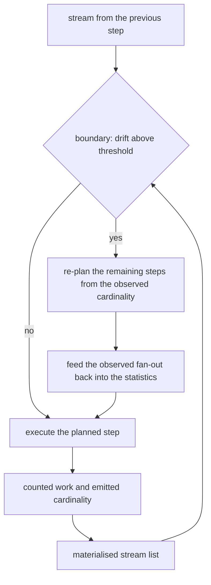
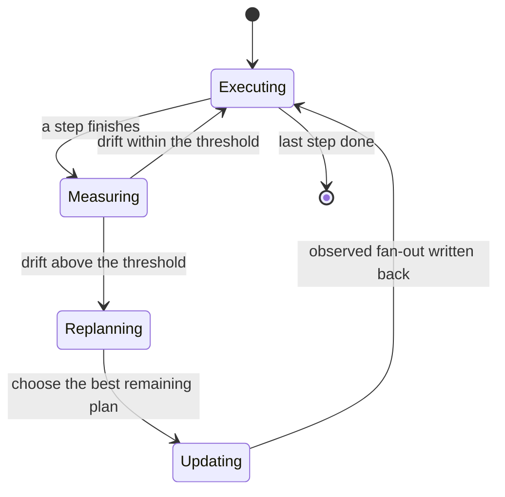
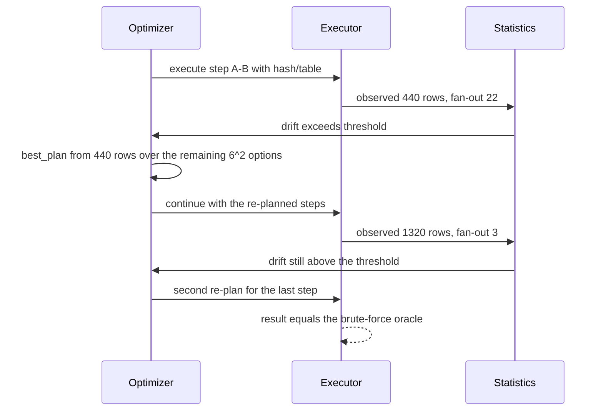

# 856 — Implement runtime adaptive operator re-optimization and replanning.

> **Tier:** Master · **CTCI chapter:** Ch 14 — Databases
> **Task spec:** [856-implement-runtime-adaptive-operator-re-optimization-and-replanni.md](../../../tasks/master/856-implement-runtime-adaptive-operator-re-optimization-and-replanni.md)
> **Solutions:** [Python](../../../solutions/python/master/856-implement-runtime-adaptive-operator-re-optimization-and-replanni/solution.py) ·
> [Java](../../../solutions/java/master/856-implement-runtime-adaptive-operator-re-optimization-and-replanni/Solution.java) ·
> [JavaScript](../../../solutions/javascript/master/856-implement-runtime-adaptive-operator-re-optimization-and-replanni/solution.js) ·
> [C#](../../../solutions/csharp/master/856-implement-runtime-adaptive-operator-re-optimization-and-replanni/Solution.cs)

## 1. Problem restatement

Execute a left-deep pipeline of joins step by step, and at every **materialisation boundary**
compare the cardinality that was actually produced with the cardinality the optimizer had
estimated. When they disagree by more than a threshold, re-plan the *remaining* steps from the
observed cardinality and feed the observed fan-out back into the statistics.

**Modelling contract.** Four small in-memory relations — `A` (`20` rows, hot key), `B` (`60`),
`C` (`12`), `D` (`4`) — and a chain of three joins with one pushed-down predicate (`C.w < 3`).
Each step chooses an algorithm (`hash`, `nested`, `sorted`) and a build side (`stream` or
`table`), so the plan space is `6³ = 216`. Work is **counted while executing** (build insertions,
probes, candidate examinations), not derived from the cost model; an independently written
analytic model is then verified against the measurement. There are no threads, no clock and no
unseeded randomness. Deliberately out of scope: sub-step adaptation (Eddies-style tuple routing),
multiple consumers per exchange, and statistics that must be persisted across runs.

Concrete contract from the file's run:

| Assertion | Value |
| --- | --- |
| plan space | `216` plans, all distinct |
| true cardinalities / oracle | `[440, 1320, 2640]`; the brute-force oracle returns `2640` rows |
| true fan-outs | `A-B 22.0`, `A-B-C 3.0`, `A-B-C-D 2.0` |
| semantics preserved | all `216` plans produce the identical result multiset, and so does every adaptive run |
| cost-model fidelity | `24` sampled plans match the measured work exactly (max deviation `1.1e-10`) |
| accurate statistics | `0` re-plans, work `11760`, plan-time choice `['A-B[hash/table]', 'A-B-C[hash/stream]', 'A-B-C-D[hash/table]']` (predicted `2064`) |
| adversarial statistics | `2` re-plans at `['A-B-C', 'A-B-C-D']`, drift `0.83 … 1.75` |
| decision quality | every re-plan equals an independent brute-force `argmin` over the remaining space |
| work | static `8456`, adaptive `6696`, post-hoc optimal `6696` → speedup `1.26x`, regret `1.00` |
| threshold sweep | `[(0.0, 2), (0.05, 2), (0.25, 2), (0.5, 2), (1.0, 1), (5.0, 0)]` |

## 2. Intuition

The naive adaptive optimizer re-plans by throwing away what was produced and starting over. That is
both expensive and dangerous: tuples that have already been joined must be preserved exactly once,
and a pipeline cannot rewind a table scan in a streaming system.

The key insight is that **materialisation makes the hand-off safe**. If each step writes its output
into an ordinary list, then a re-plan at that boundary is just "choose different options for the
*remaining* steps and keep consuming the same list". No tuple can be lost or duplicated, and the
correctness argument does not depend on the adapter at all — which is why the file asserts that all
`216` plans, including one that re-plans at every boundary, produce the same multiset as a
brute-force oracle.

The second insight is that the loop only works if the *estimate* and the *measurement* are in the
same units:

1. **Work is counted while executing.** `execute_step` increments a counter for every build
   insertion, every probe (`1 + len(candidates)`) and every candidate examined. The optimizer's
   `predicted_work` is then verified to equal that measurement exactly (max deviation `1.1e-10`
   over `24` sampled plans), so an optimizer decision is a real cost decision.
2. **The drift test is a ratio.** `drift = |observed - estimated| / max(estimated, 1)` at each
   boundary, compared against `threshold = 0.25`. A relative test is what makes one threshold work
   for a `440`-row and a `2640`-row intermediate.
3. **Re-planning uses the observed cardinality.** `best_plan(remaining, observed, stats)` enumerates
   the remaining `6^k` options and takes the `argmin`, and the observed fan-out is written back with
   `stats.observe(...)` so later boundaries see the corrected statistics.



## 3. Algorithm

1. **Build the data and the plan.** `build_tables()` gives `A` a hot join key so a uniform estimate
   is badly wrong; `baseline_steps()` is the plan-time choice as a list of three `Join` steps.
2. **Estimate.** `Stats` holds relation sizes and per-step fan-outs. `predicted_cardinality` is
   `rows * fanout * (0.5 if the step has a predicate else 1)`; `predicted_work` is the algorithm's
   formula in the executor's units: `build + probe * (1 + fanout)` for hash (plus `SPILL * build`
   when the build side exceeds `MEMORY = 300`), `probe * build` for nested loop, and
   `build * (log2(build + 1) + 1) + probe * (log2(build + 1) + fanout)` for sorted merge.
3. **Plan.** `plan_space(steps)` yields the `6^k` option combinations; `plan_cost` sums the
   predicted work along the chain while carrying the predicted cardinality forward; `best_plan` is
   the `argmin`.
4. **Execute a step.** `execute_step(step, stream, tables)` builds the hash table or the sorted
   array on the chosen build side, probes with the other, counts work, verifies the actual keys
   (`None` never matches), merges the rows (the right side wins on duplicate column names), applies
   the pushed predicate, and returns `(output, work, len(output))`.
5. **Adapt at a boundary.** `AdaptiveRun.run` walks the steps; before each step after the first it
   calls `maybe_replan`, which computes the relative drift against the stored estimate for that
   boundary and, if it exceeds the threshold, re-plans the remaining steps and records the decision
   with its drift and predicted cost.
6. **Feed back.** After a step finishes, the observed fan-out `cardinality / previous` is written
   into `Stats` via `observe`, so the next boundary is estimated from reality.
7. **Verify.** `oracle_result` is the brute-force nested-loop pipeline; `optimal_work_and_plan`
   enumerates all `216` plans with the *true* cardinalities to get the post-hoc optimum; the
   adaptive work is compared with both the stale static plan and that optimum.

```text
procedure run(steps, tables, stats, threshold)
    stream ← copy of table A
    previous ← length(stream)
    for index from 0 to length(steps) - 1 do
        if index > 0 then
            maybe_replan(index, stream)
        end
        step ← steps[index]
        stream, work, cardinality ← execute_step(step, stream, tables)
        total_work ← total_work + work
        stats.observe(step.name, cardinality / previous, index, cardinality)
        previous ← cardinality
    end
    return stream
end

procedure maybe_replan(index, stream)
    observed ← length(stream)
    estimated ← stats.sizes["stream_" + index]
    if estimated is nothing then
        return false
    end
    drift ← absolute(observed - estimated) / max(estimated, 1)
    if drift <= threshold then
        return false
    end
    remaining ← the steps from index onward
    chosen, cost ← best_plan(remaining, observed, copy of stats)
    stats.sizes["stream_" + index] ← observed
    for position, candidate in enumerate(chosen) do
        steps[index + position] ← candidate
    end
    record a re-plan finding with boundary, observed, estimated, drift, chosen and predicted cost
    return true
end

function execute_step(step, stream, tables)
    build rows and probe rows from the chosen build side
    work ← 0
    output ← empty list
    if the algorithm is hash then
        insert every build row into an index, counting one unit each
        if the build side exceeds MEMORY then
            work ← work + SPILL * number of build rows
        end
    else if the algorithm is sorted then
        sort the build side by the join key and count the sort
    end
    for row in probe rows do
        candidates ← the hash bucket, or every build row, or the equal-range scan
        work ← work + 1 + length(candidates)
        for other in candidates do
            skip when the left key is nothing or the keys differ
            merge the rows, keep the merged row when the predicate holds
        end
    end
    return output, work, length(output)
end
```

The adaptivity controller is a small state machine over boundaries:



## 4. Worked example

`build_tables()` gives `A` a hot key: the first `12` of `20` rows have `k = 0`, and `B`'s first
`32` of `60` rows likewise. A uniform estimate therefore predicts a much smaller join than reality.

| Boundary | True cardinality | True fan-out | Plan-time estimate |
| --- | --- | --- | --- |
| `A-B` | `440` | `22.0` | fan-out `12` |
| `A-B-C` | `1320` | `3.0` | fan-out `4` |
| `A-B-C-D` | `2640` | `2.0` | fan-out `2` |

### Accurate statistics: nothing to fix

With the true cardinalities and fan-outs handed to the optimizer, the plan-time choice is already
right (`['A-B[hash/table]', 'A-B-C[hash/stream]', 'A-B-C-D[hash/table]']`, predicted cost `2064`),
the run does `11760` units of work and triggers **`0` re-plans**. That is the control: an
adaptivity mechanism that fires when the statistics are good is pure overhead.

### Adversarial statistics: two re-plans

Starting from the deliberately uniform estimates, the executor observes `440` rows at the first
boundary where `240` were predicted:

| Re-plan | Boundary | Observed | Estimated | Drift | Re-planned steps |
| --- | --- | --- | --- | --- | --- |
| 1 | `A-B-C` | drift-corrected cardinality | plan-time estimate | `0.83` | `A-B-C` options |
| 2 | `A-B-C-D` | drift-corrected cardinality | plan-time estimate | up to `1.75` | `A-B-C-D` options |

Both decisions are checked against an independent brute-force `argmin` over the *remaining* plan
space, so a re-plan is not merely "different" but optimal for the statistics known at that moment.
The measured outcome:

| Run | Work | Note |
| --- | --- | --- |
| static plan (stale statistics) | `8456` | what the plan-time choice costs when executed on real data |
| adaptive | `6696` | `1.26x` less work than static |
| post-hoc optimal with true cardinalities | `6696` | regret `1.00` — the adaptive run reaches the optimum |

The regret is the interesting number: an adaptive optimizer cannot beat the post-hoc optimum, and
here it *matches* it, because the drift it observes at the first boundary carries enough
information to reconstruct the correct decision for the rest of the chain. The post-hoc optimum's
plan is different in shape (`['A-B[hash/stream]', 'A-B-C[hash/table]', 'A-B-C-D[hash/table]']`),
which is exactly what the first re-plan discovers.



### The threshold sweep

| Threshold | Re-plans |
| --- | --- |
| `0.0` | `2` |
| `0.05` | `2` |
| `0.25` | `2` |
| `0.5` | `2` |
| `1.0` | `1` |
| `5.0` | `0` |

The count is non-increasing in the threshold, which is asserted directly. At `0.0` any drift at all
re-plans; at `5.0` nothing does, and the run degrades to the static plan. `0.25` is the default:
loose enough not to chase estimation noise, tight enough to fire on a `0.83` drift.

## 5. Complexity

Let `k` be the number of steps, `r` the driving cardinality, `T` the table size, and `o = 6` the
options per step.

| Measure | Bound | Why it holds |
| --- | --- | --- |
| Plan space | `O(o^k)` | `216` for `k = 3` |
| One plan's predicted cost | `O(k)` | carry the estimated cardinality forward |
| `best_plan` over the remaining steps | `O(o^(k - j))` | `36` options for the last two steps, `6` for the last one |
| Executing a hash step | `O(T + r * (1 + fanout))` | build insertions plus probes and candidate examinations |
| Executing a nested-loop step | `O(r * T)` | every probe examines every build row |
| Executing a sorted-merge step | `O(T log T + r log T + matches)` | sort plus binary-search probes |
| An adaptive run | `O(total work + Σ over boundaries of o^(k - j))` | two re-plans here, `36 + 6` candidate plans |
| Space | `O(r * fanout)` per boundary | materialised streams, which is what makes the hand-off safe |

The `O(r * T)` nested loop is why the static plan is so bad in this example: `8456` versus `6696`
units of work. Because work is *counted* rather than modelled, that gap is a measurement, and the
analytic recomputation in `analytic_step` reproduces it exactly — the two agree to `1.1e-10` over
the `24` sampled plans, so the cost model the optimizer minimises is the quantity the executor pays.

The costs that are deliberately not modelled: thread scheduling, network transfer, cache effects and
the cost of *materialising* a boundary (writing `2640` rows into a list is free here). In a real
system those would enter the cost model, and materialisation boundaries would be the expensive
thing — which is precisely the trade adaptive optimizers make.

## 6. Pitfalls and edge cases

- **Losing or duplicating tuples across a re-plan.** A re-plan must consume the *same* materialised
  list. The file asserts that all `216` static plans *and* every adaptive run produce the identical
  multiset as `oracle_result` (`2640` rows), including a run that re-plans at every boundary.
- **Optimising something the executor does not pay.** `predicted_work` and `execute_step` count the
  same events; the verification is a strict equality, so a divergence is a bug in the model rather
  than a tolerance question.
- **An absolute drift threshold.** A flat tolerance cannot serve a `440`-row and a `2640`-row
  boundary; the drift is relative (`/ max(estimated, 1)`) and the `max(..., 1)` guard keeps an
  estimate of zero from dividing by zero.
- **Feeding nothing back.** Without `stats.observe(...)` the second boundary is estimated from stale
  statistics and the re-plan is a one-off. The observed fan-out is written back after *every* step.
- **`None` join keys.** `left_row.get(step.left_key) is None` skips the candidate in both the
  executor and the oracle, and the sorted-merge path additionally filters `None` out of the sorted
  array — otherwise the sort would compare `None` with integers.
- **Duplicate column names.** The merge is `left_row` then `right_row`, so the table side wins;
  both the executor and `analytic_step` must resolve it the same way or the cost model diverges
  from reality.
- **Applying the predicate at the right step.** The predicate is attached to `A-B-C` and applied to
  the *merged* row; the cost model accounts for it with the `0.5` selectivity factor in
  `predicted_cardinality`, and the executor `keep`s only merged rows.
- **Edge cases the file pins.** An unfiltered pipeline, a single-row database, an empty database,
  and a run with adaptivity disabled — all must stay correct and reproducible.
- **Determinism.** Identical results *and* identical re-plan decisions from the same seed; the
  drift values and the chosen plans are part of the observable output.
- **Re-planning every step is legitimate.** The file includes a run that re-plans at every boundary
  and gets the same answer for more work — a reminder that the mechanism must be correct, not just
  beneficial.

## 7. Variants and follow-ups

- **Catching the cost-model bug before release.** Version-to-version plan regressions are the static
  counterpart of this runtime loop — see
  [855-implement-automated-plan-regression-detector-for-query-optimizer.md](../../../tasks/master/855-implement-automated-plan-regression-detector-for-query-optimizer.md).
- **Learning the statistics instead of observing them.** `stats.observe` corrects a fan-out after
  the fact; a learned cost model predicts it before the fact, as in
  [857-implement-ml-based-cost-model-for-query-planner-with-online-lear.md](../../../tasks/master/857-implement-ml-based-cost-model-for-query-planner-with-online-lear.md).
- **Materialisation boundaries and consistency.** A boundary is a natural snapshot point, and the
  global snapshot protocol of
  [852-implement-global-snapshotting-for-distributed-streaming-pipeline.md](../../../tasks/master/852-implement-global-snapshotting-for-distributed-streaming-pipeline.md)
  is what a distributed executor would need before it could re-plan safely.
- **Verifying the rewrites.** The `216`-plan equivalence check is a miniature of the differential
  harness in
  [854-implement-system-for-differential-testing-and-fuzzing-of-databas.md](../../../tasks/master/854-implement-system-for-differential-testing-and-fuzzing-of-databas.md).
- **Where the true cardinalities come from.** The storage-layout optimiser in
  [859-implement-self-tuning-database-storage-layout-optimizer-auto-com.md](../../../tasks/master/859-implement-self-tuning-database-storage-layout-optimizer-auto-com.md)
  is the other consumer of the same measured statistics.

## 8. Check yourself

1. Why does materialisation make re-planning safe here?

<details><summary>Show answer</summary>

Because each step's output is a plain list, so a re-plan at a boundary only changes which *options*
the remaining steps use; the tuples already produced are consumed by the new plan exactly as the old
one would have consumed them. That is why the file can assert that every adaptive run — including
one re-planning at every boundary — returns the same `2640`-row multiset as the brute-force oracle,
with nothing lost or duplicated.

</details>

2. What is measured to prove the cost model is not fictional?

<details><summary>Show answer</summary>

`execute_step` counts build insertions, probes (`1 + len(candidates)`), candidate examinations and
spill passes, and `analytic_step` recomputes the same quantities from the data by brute force. The
two agree exactly — max deviation `1.1e-10` over `24` sampled plans — so the quantity `best_plan`
minimises is the quantity the executor actually spends.

</details>

3. The adaptive run does `6696` units of work and the post-hoc optimal plan also does `6696`. What
   does that say about the re-plan decisions?

<details><summary>Show answer</summary>

That the observed drift carried enough information to reconstruct the optimal remaining plan: the
regret is `1.00`, i.e. the adaptive run is as good as a planner that already knew the true
cardinalities. Each individual re-plan is separately validated against an independent brute-force
`argmin` over the remaining space, so the equality is not a coincidence of the final total.

</details>
