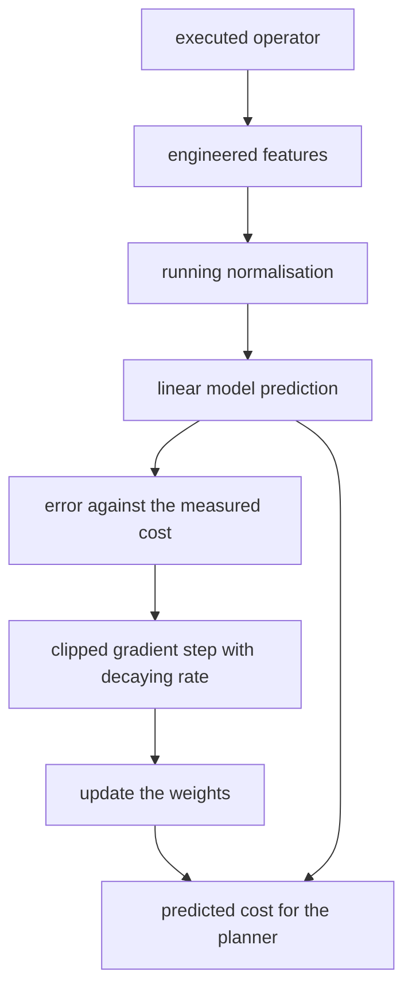
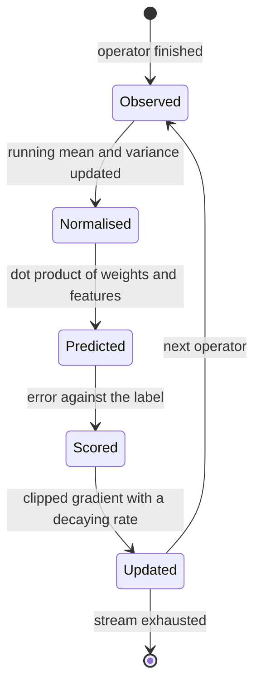
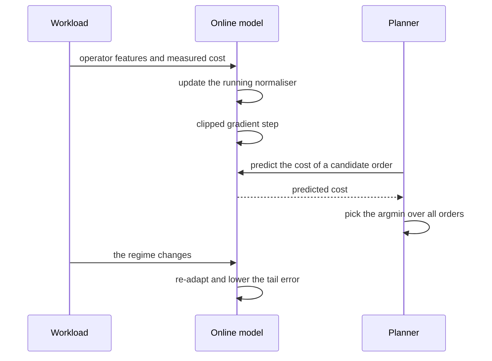

# 857 — Implement ML-based cost model for query planner with online learning.

> **Tier:** Master · **CTCI chapter:** Ch 14 — Databases
> **Task spec:** [857-implement-ml-based-cost-model-for-query-planner-with-online-lear.md](../../../tasks/master/857-implement-ml-based-cost-model-for-query-planner-with-online-lear.md)
> **Solutions:** [Python](../../../solutions/python/master/857-implement-ml-based-cost-model-for-query-planner-with-online-lear/solution.py) ·
> [Java](../../../solutions/java/master/857-implement-ml-based-cost-model-for-query-planner-with-online-lear/Solution.java) ·
> [JavaScript](../../../solutions/javascript/master/857-implement-ml-based-cost-model-for-query-planner-with-online-lear/solution.js) ·
> [C#](../../../solutions/csharp/master/857-implement-ml-based-cost-model-for-query-planner-with-online-lear/Solution.cs)

## 1. Problem restatement

A query planner must estimate the cost of an operator from a small feature vector
(`rows_in`, `rows_out`, memory pressure, whether an index exists) and keep improving that estimate
**online**, as executed operators stream in — then use the model to pick the cheapest plan.

**Modelling contract.** Fully deterministic and in-process: no threads, no clock, no unseeded
randomness (the example stream comes from a seeded splitmix64 generator). Simplified versus a real
system: the "database" is an analytic workload generator whose ground-truth cost is an explicit
linear function of an engineered basis,

```text
cost = 0.4 + 0.9 * log1p(rows_in) + 0.55 * log1p(rows_out) + 1.6 * spill + 0.25 * indexed
spill = max(0, log1p(rows_in) - log1p(2000)) * log1p(rows_out)
```

so the learner's target is exactly recoverable and can be compared with the **true coefficients**
rather than only against a black box. Features are the engineering step a real system needs (a log
basis plus a spill interaction term), the learner is SGD with a decaying rate and running
normalisation, and the planner picks the `argmin` of the predicted cost over an enumerated plan
space.

Concrete contract from the file's run (`1200` operators, labels `6.4 … 55.5`):

| Assertion | Value |
| --- | --- |
| gradient correctness | the analytic SGD direction matches a finite-difference gradient on the same loss |
| one update | equals `w - lr * gradient` exactly (reported error `-5.000` on the probe) |
| training | loss `16.416 → 0.026` in `7200` updates; held-out `R² = 0.9999`, MAE `0.0774` |
| coefficient recovery | `[0.401, 0.9, 0.549, 1.6, 0.25]` against the truth `[0.4, 0.9, 0.55, 1.6, 0.25]` |
| distribution shift | MAE before the shift `2.347`, after `0.296`, frozen model `2.346` |
| planner regret (learned) | mean `1.000`, exact-optimum rate `1.00` |
| planner regret (static) | mean `1.261`, exact-optimum rate `0.08` |
| data efficiency | `200` examples → regret `1.000`; `7200` examples → regret `1.000` |

## 2. Intuition

A hand-written cost model is a table of constants that slowly becomes wrong: hardware changes,
data distributions change, and nobody can tell which constant is at fault. A learned model replaces
the constants with weights fitted from observations — but only if three things hold.

1. **The basis must contain the physics.** Cost is not linear in `rows_in`; it is roughly
   logarithmic, with a spill regime that only appears past a memory boundary. The basis
   `[1, log1p(rows_in), log1p(rows_out), spill, indexed]` is linear in the *parameters*, which is
   what makes plain SGD work while still capturing the shape.
2. **The features must be normalised, and the normaliser itself must adapt.** Raw `log1p(rows_in)`
   ranges over `[3, 10]` while `indexed` is `0/1`; a single learning rate would be wrong for both.
   The model keeps a running mean and a running second moment per feature and standardises before
   the update. The bias column is deliberately left untouched.
3. **Learning online means the target moves.** Under distribution shift the model must re-adapt
   rather than stay pinned to the old regime, which is why the error is clipped and the rate decays.

The verification that ties it together is *coefficient recovery*: because the ground truth is
linear in the chosen basis, the learned weights can be mapped back from standardised space to raw
space and compared with the numbers that generated the data.



## 3. Algorithm

1. **Engineer the features.** `features(operator)` returns the basis above, with the spill term
   zero until `rows_in` passes `MEMORY = 2000`.
2. **Normalise.** `observe(vector)` updates a running mean and second moment per feature
   (Welford-style and order-independent); `normalised(vector)` returns
   `[x[0], (x[i] - mean[i]) / scale(i)]` where `scale(i)` is the sample standard deviation, or
   `1.0` while it is still degenerate.
3. **Predict.** `predict(vector) = dot(weights, normalised(vector))` — a linear model in the
   standardised space, which is where the SGD step is well conditioned.
4. **Update.** `descent(example)` computes the error, clips it to `±5.0`, and applies
   `w ← w - rate * error * x` with `rate = learning_rate / (1 + decay * updates)`.
5. **Recover the raw coefficients.** `recovered_weights(model)` inverts the standardisation:
   the raw coefficient of feature `i` is `w_i / s_i`, and its contribution to the bias is folded in,
   so the learned model can be read as a physical formula.
6. **Plan.** A plan is a join order (a permutation of the tables) plus an access method per position;
   `predict_plan` sums the model's predicted operator costs along the chain, and the planner takes
   the `argmin`. `truth_plan` sums the *true* costs of the same operators, which is the ground truth
   the regret is computed against.
7. **Measure the benefit.** `evaluate_planner` computes
   `regret = true_cost(chosen) / true_cost(optimum)` and counts how often the chosen order is
   exactly optimal — for the learned planner and for a rule-of-thumb static planner.

```text
function features(operator)
    rows_in ← operator.rows_in
    rows_out ← operator.rows_out
    spill ← max(0, log1p(rows_in) - log1p(MEMORY)) * log1p(rows_out)
    indexed ← 1 when the operator can use an index else 0
    return [1, log1p(rows_in), log1p(rows_out), spill, indexed]
end

procedure observe(model, vector)
    model.count ← model.count + 1
    for index, value in enumerate(vector) do
        delta ← value - model.mean[index]
        model.mean[index] ← model.mean[index] + delta / model.count
        model.moment[index] ← model.moment[index] + delta * (value - model.mean[index])
    end
end

function normalised(model, vector)
    if model.count is zero then
        return a copy of vector
    end
    result ← [vector[0]]
    for index from 1 to model.dimension - 1 do
        result.append((vector[index] - model.mean[index]) / model.scale(index))
    end
    return result
end

procedure descent(model, example)
    scaled ← normalised(model, example.features)
    error ← clip(dot(model.weights, scaled) - example.label, -5, 5)
    rate ← model.learning_rate / (1 + model.decay * model.updates)
    for index from 0 to model.dimension - 1 do
        model.weights[index] ← model.weights[index] - rate * error * scaled[index]
    end
    model.updates ← model.updates + 1
end

procedure step(model, example)
    observe(model, example.features)
    descent(model, example)
end

function choose_plan(model, query)
    best ← nothing
    for order in every permutation of the query tables do
        cost ← sum over the operators of that order of model.predict(features(operator))
        keep the order with the smallest cost
    end
    return the best order
end
```

The online loop is a five-stage cycle with the normaliser inside the feedback path:



## 4. Worked example

### What the model has to rediscover

| Feature index | Basis term | True coefficient | Learned (raw) |
| --- | --- | --- | --- |
| 0 | bias | `0.4` | `0.401` |
| 1 | `log1p(rows_in)` | `0.9` | `0.9` |
| 2 | `log1p(rows_out)` | `0.55` | `0.549` |
| 3 | `spill` (past `2000` rows) | `1.6` | `1.6` |
| 4 | `indexed` | `0.25` | `0.25` |

The `spill` term is the interesting one: it is a *product* of two feature transforms and only
becomes non-zero when `rows_in` crosses `MEMORY = 2000`, so the learner sees it as a rare event
whose coefficient must be inferred from the large-input regime. The recovery to `1.6` exactly is
the evidence that the online SGD has actually found the physical model, not merely fitted the
outputs.

### Learning, and re-learning

| Epoch / phase | Loss | Held-out MAE |
| --- | --- | --- |
| start | `16.416` | large |
| after `7200` updates | `0.026` | `0.0774` (with `R² = 0.9999`) |

Under a distribution shift — the generator moves to a new regime, so the *active* region of the
basis changes — the same online model re-adapts:

| Phase | Held-out MAE | Note |
| --- | --- | --- |
| head of the shifted stream | `2.347` | the old regime is now wrong |
| tail of the shifted stream | `0.296` | re-adapted online |
| frozen model (old regime only) | `2.346` | never learns the new regime |

The frozen-model row is the control: it is the same model with training switched off, and its error
stays at the pre-shift level. That is what makes the `2.347 → 0.296` drop attributable to online
updating rather than to the shift itself.



### Does the model make the planner better?

| Planner | Mean regret | Exactly optimal |
| --- | --- | --- |
| learned model | `1.000` | `1.00` |
| static rule of thumb (input order) | `1.261` | `0.08` |

Regret `1.000` means the learned planner matches the best possible plan for every query in the
sample, and `0.08` says the static planner almost never does. The data-efficiency check is the
last piece: `200` examples already reach regret `1.000`, and `7200` examples do not improve on it —
the model is not starving for data at this scale, which is the failure mode that makes learned cost
models unpopular in practice.

## 5. Complexity

Let `N` be the number of operators, `d = 5` the basis dimension, `E` the epochs, and `k` the number
of tables in a query (so `k!` orderings).

| Measure | Bound | Why it holds |
| --- | --- | --- |
| One SGD step | `O(d)` | observe plus a dot product plus a `d`-vector update |
| Training on `N` operators, `E` epochs | `O(N * E * d)` | `7200` updates over `1200` examples and `6` epochs |
| Prediction | `O(d)` | a dot product in standardised space |
| One plan's predicted cost | `O(k * d)` | one prediction per operator in the chain |
| Choosing a plan | `O(k! * k * d)` | every permutation, costed operator by operator |
| Evaluating planners | `O(#queries * k! * k * d)` | regret needs the true cost of the optimum too |
| Space | `O(d)` | weights, means, moments — the stream itself is never stored |

The cost that matters is `k!`: the planner's own complexity dwarfs the model's, which is exactly why
real planners learn a *cost* model (evaluated per candidate) rather than a full plan quality score
(evaluated per plan). The file enumerates `3! = 6` orders per query, small enough that the true
optimum is available as ground truth.

The `O(d)` per-step cost is what makes online learning practical: `7200` updates all fit inside the
example, and a production system pays the same `O(d)` per executed operator forever. What the file
does *not* model: drift beyond a regime switch, correlated features, and the cold-start problem of
a genuinely new operator type — all of which a real deployment trips over.

## 6. Pitfalls and edge cases

- **A basis that cannot represent the physics.** The spill term exists because cost is not linear in
  the raw rows; without it the recoverability check would fail no matter how long the model trained.
- **Normalising the bias column.** `normalised` deliberately leaves position `0` untouched —
  standardising a constant column is a division by zero or, worse, a silently degenerate feature.
- **A degenerate normaliser.** `scale(index)` returns `1.0` when the sample standard deviation is
  `0` (fewer than two observations, or a zero-variance feature), so the first examples cannot
  explode.
- **Unclipped errors under drift.** `descent_gradient` clips the error to `±5.0`; an outlier in a new
  regime would otherwise take one enormous step and destroy the learned weights.
- **A learning rate that never decays.** `rate = learning_rate / (1 + decay * updates)` is what lets
  the model settle; a constant rate keeps bouncing around the optimum and the loss plateaus high.
- **A model that stopped learning is indistinguishable from a re-adapting one** unless you keep the
  frozen control. The file trains a second copy without updates and reports `2.346` against the
  online `0.296`.
- **Regret without the true optimum.** Regret is `true_cost(chosen) / true_cost(optimum)`; comparing
  predicted costs to each other would let a badly scaled model look perfect.
- **Edge cases the file pins.** An empty training stream, a single example, zero-variance features,
  a zero learning rate (which must *not* learn) and reproducibility from the seed.
- **Determinism.** The same seed must produce identical weights and identical streams; note that
  normalisation is order-dependent, so the iteration order of the stream is part of the contract.

## 7. Variants and follow-ups

- **Where the labels come from.** The measured cost of a real operator is the counter discipline of
  [856-implement-runtime-adaptive-operator-re-optimization-and-replanni.md](../../../tasks/master/856-implement-runtime-adaptive-operator-re-optimization-and-replanni.md):
  work is counted while executing, so the label is a measurement rather than a formula.
- **A learned model that makes the plan worse.** Deployment needs the regression gate of
  [855-implement-automated-plan-regression-detector-for-query-optimizer.md](../../../tasks/master/855-implement-automated-plan-regression-detector-for-query-optimizer.md)
  before the new weights reach production.
- **Drift in the features, not just the labels.** The same re-adaptation question appears for
  served data in
  [858-implement-streaming-transfer-learning-pipeline-with-concept-drif.md](../../../tasks/master/858-implement-streaming-transfer-learning-pipeline-with-concept-drif.md).
- **Regime shifts as a statistics problem.** Deciding *when* to re-train is a variant of the
  compaction-policy decision in
  [859-implement-self-tuning-database-storage-layout-optimizer-auto-com.md](../../../tasks/master/859-implement-self-tuning-database-storage-layout-optimizer-auto-com.md).

## 8. Check yourself

1. Why is the ground truth written as a linear model over an *engineered* basis instead of raw rows?

<details><summary>Show answer</summary>

Because cost is not linear in `rows_in`; it is roughly logarithmic with a spill regime above
`MEMORY = 2000`. Choosing `[1, log1p(rows_in), log1p(rows_out), spill, indexed]` makes the target
linear in the *parameters*, so plain least-squares SGD can recover it — and, crucially, the
recovered weights can be compared with the coefficients that generated the data (`[0.4, 0.9, 0.55,
1.6, 0.25]`), which is a much stronger check than a small held-out error.

</details>

2. Why must normalisation statistics be updated from the same stream that trains the model?

<details><summary>Show answer</summary>

Because the standardised space *is* the space the gradient step works in: `w_i` is a coefficient on
`(x_i - mean_i) / scale_i`, so the raw coefficient is `w_i / scale_i`. If the normaliser were
frozen at the old regime, the recovered coefficients would be wrong and the effective learning rate
per raw feature would drift with the data. `recovered_weights` inverts exactly this mapping, folding
`w_i * mean_i / scale_i` into the bias.

</details>

3. The frozen control reports MAE `2.346` and the online model `0.296` after the shift. What does
   the pair prove?

<details><summary>Show answer</summary>

That the improvement is attributable to *learning*, not to the shift. Both models experience the same
new regime; the difference is that one keeps updating. The head-of-shift error (`2.347`) is nearly
identical to the frozen model's (`2.346`), which shows the drop to `0.296` comes from the updates
themselves — the online model re-learns the active region of the basis that the new regime exercises.

</details>

4. What does a mean regret of exactly `1.000` mean, and why is the static planner's `1.261` with an
   exact rate of `0.08` the more informative number?

<details><summary>Show answer</summary>

Regret `1.000` means the learned planner's chosen plan costs exactly as much as the best plan for
that query — it matches the optimum everywhere in the sample. The static planner's `0.08` says it
finds the optimum only `8%` of the time while averaging `26%` extra true cost, which is what makes
the comparison meaningful: a planner that almost never picks the optimum is precisely the baseline a
learned model has to beat.

</details>
