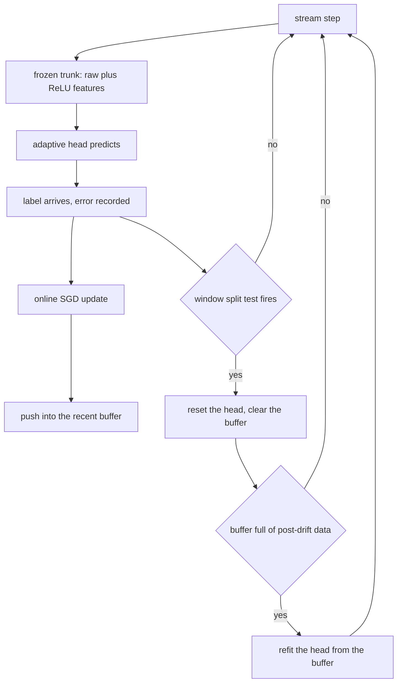
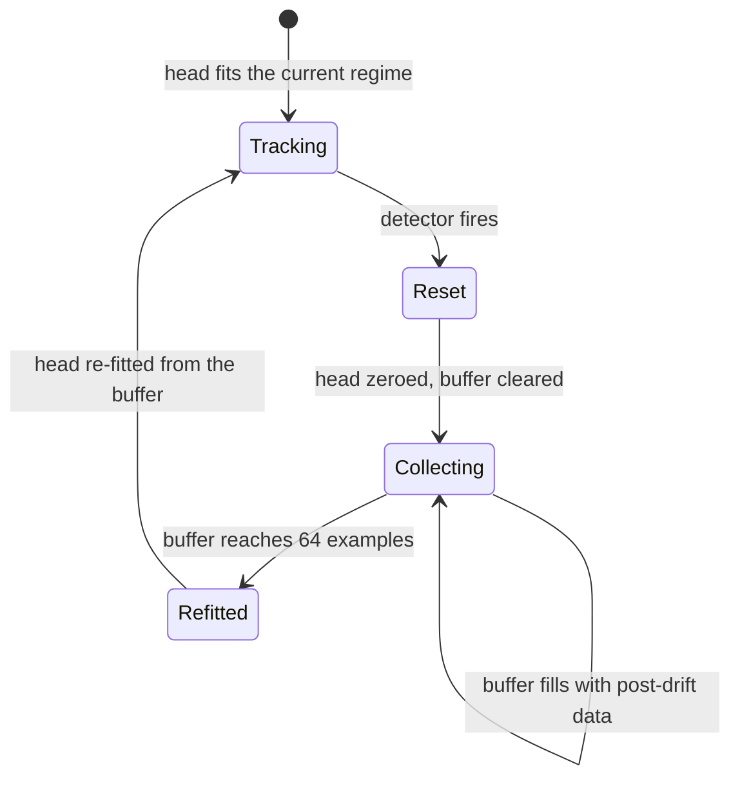
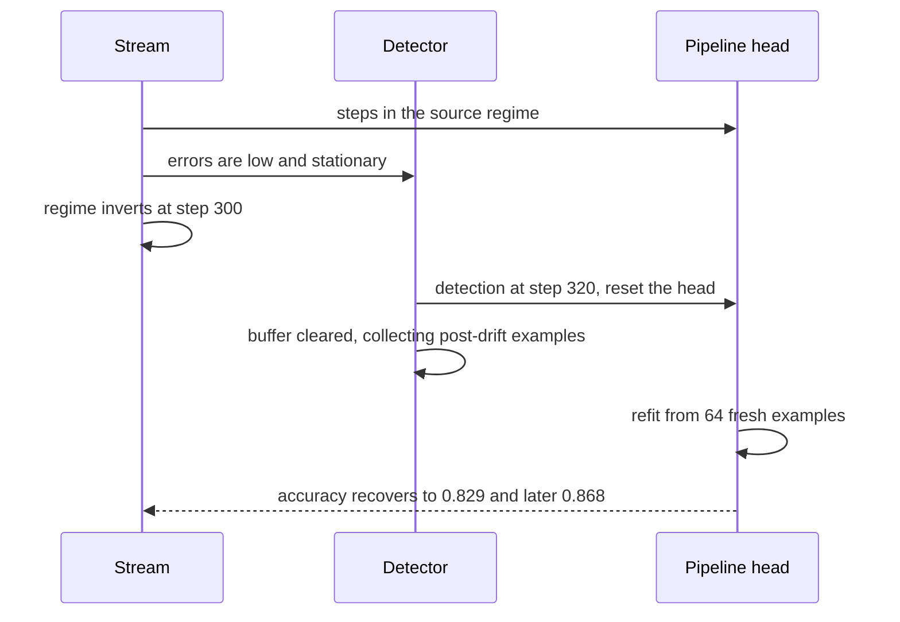

# 858 — Implement streaming transfer learning pipeline with concept drift detection.

> **Tier:** Master · **CTCI chapter:** Beyond — Machine Learning & AI
> **Task spec:** [858-implement-streaming-transfer-learning-pipeline-with-concept-drif.md](../../../tasks/master/858-implement-streaming-transfer-learning-pipeline-with-concept-drif.md)
> **Solutions:** [Python](../../../solutions/python/master/858-implement-streaming-transfer-learning-pipeline-with-concept-drif/solution.py) ·
> [Java](../../../solutions/java/master/858-implement-streaming-transfer-learning-pipeline-with-concept-drif/Solution.java) ·
> [JavaScript](../../../solutions/javascript/master/858-implement-streaming-transfer-learning-pipeline-with-concept-drif/solution.js) ·
> [C#](../../../solutions/csharp/master/858-implement-streaming-transfer-learning-pipeline-with-concept-drif/Solution.cs)

## 1. Problem restatement

Classify a stream with the shape transfer learning takes in production: a **frozen** feature
extractor transferred from a source task, plus a small **adaptive head** that learns from every
labelled example and is re-fitted from a recent buffer whenever a drift detector fires.

**Modelling contract.** Deterministic and in-process: no threads, no clock, no unseeded randomness
(the stream comes from a seeded splitmix64 generator). Simplified versus a real system: the input
distribution is synthetic, the trunk is a fixed random projection with a ReLU, the head is logistic
regression trained by SGD on the log loss, and the detector is an ADWIN-style window test that scans
every split point of a bounded window and fires when the two halves differ by more than a
Hoeffding-style bound.

The stream is `900` steps: features uniform in `[-1, 1]⁴`, labels from a linear boundary with `8%`
deterministic label noise, and regimes that either invert the label or rotate the boundary:

| Regime | Boundary | Inverted? | Steps (drifted stream) |
| --- | --- | --- | --- |
| `source` | `1.2, 0.3, -0.4, 0.7` | no | `0 … 299` |
| `inverted` | same boundary | yes | `300 … 599` |
| `restored` | same boundary | no | `600 … 899` |
| `rotated` | `-0.3, 1.1, 0.9, -0.5` | yes | sensitivity runs |

Concrete contract from the file's run:

| Assertion | Value |
| --- | --- |
| trunk shape | `4` raw + `2` ReLU features, bit-for-bit unchanged for the whole run |
| detector cross-check | brute-force and online window agree (split `20`, difference `1.000 > bound 0.616`) |
| stationary stream | `0` alarms over `900` steps, accuracy `0.883` |
| drifted stream | detections at `[320, 619]`, delays `[20, 19]` |
| accuracy, steps `320–560` | adaptive `0.829` vs frozen `0.613` |
| accuracy, steps `680–900` | adaptive `0.868` vs frozen `0.755` |
| sensitivity monotonicity | `delta = 0.0005 → 2` detections, `delta = 0.02 → 2`; delays `{inverted: 320, rotated: 316}` |
| false alarms over `12` stationary streams | `delta = 0.002 → 1`, `delta = 0.5 → 22` |

## 2. Intuition

The naive answer to concept drift is to retrain the whole model. In a streaming system that throws
away the transferred representation on every regime change, which is exactly backwards: the
representation is the part that transfers, and the decision boundary is the part that moves.

The key insight is to split the model in two and treat the drift detector as the switch between
them:

1. **The trunk is frozen.** It passes the raw features through and appends two fixed ReLU
   projections. Passing the raw inputs through is what makes a linear head on top still able to
   express any linear boundary of the source task, so the pipeline reaches the noise ceiling
   (`0.883` on a stationary stream, i.e. the `8%` label-noise ceiling) with only the head moving.
   `Trunk.unchanged()` asserts the parameters are bit-for-bit the same at the end of the run.
2. **The head is fully replaceable.** `reset()` zeroes it, and `fit(buffer, epochs=4, rate=0.5)`
   re-trains it *with the same update rule* the online path uses. Transfer, not redesign: the code
   that adapts is the code that trained.
3. **The detector watches the model's own error**, which is the only signal available without
   labels for the new regime. A window of `0/1` errors is tested for a change in mean by scanning
   every split and comparing the difference of the halves against a Hoeffding-style bound.
4. **Detection is two-staged.** On firing, `recalibrate` immediately resets the head (so it stops
   predicting with a boundary that is now wrong) and clears the buffer, but the *refit* waits until
   the buffer holds `buffer_size = 64` examples that are entirely post-drift. That is what prevents
   the classic failure of refitting on a mixture of old and new labels.



## 3. Algorithm

1. **Generate the stream.** `generate_stream(seed, count, regimes)` walks the regime table, draws
   features uniformly, computes `label_of(weights, inverted, features, noise)` and flips the label
   when the deterministic noise draw is below `0.08`.
2. **Transform.** `Trunk.transform(features)` returns `features + [relu(row · features) for row in
   projection]` — a `6`-dimensional vector.
3. **Predict and update.** `Head.probability` is a logistic squashing of `bias + w · hidden`
   (saturated at `±60`); `update(hidden, label)` applies `w -= rate * (p - y) * hidden` and returns
   the log loss. The online rate is `0.05`; the refit rate is `0.5` with `4` epochs.
4. **Detect.** `Detector.observe(error, index)` appends the `0/1` error to a window of `100`,
   requires at least `2 * patience = 40` errors, calls `split_statistic`, then rejects splits closer
   than `patience = 20` to either edge. On a detection it records the split, the difference and the
   bound, empties the window, and returns `True`.
5. **The bound.** `hoeffding_bound(a, b, delta) = sqrt(0.5 * (1/a + 1/b) * max(0, log(4/delta)))`,
   clamped to `0` when `delta >= 4`. A *smaller* `delta` is a stricter confidence requirement, so the
   bound is tighter and more detections follow.
6. **Recalibrate.** `recalibrate(index)` resets the head, clears the buffer, sets `pending_refit`,
   and records the adaptation index. `push(hidden, label)` keeps the buffer at `buffer_size` and, if
   a refit is pending and the buffer is full, does the real `reset()` + `fit()`.
7. **Measure.** `Pipeline.accuracy(start, end)` slices the correctness vector, so the file can
   compare the adaptive run with a frozen head over the same windows.

```text
function hoeffding_bound(size_a, size_b, delta)
    if delta >= 4 then
        return 0.0
    end
    return sqrt(0.5 * (1 / size_a + 1 / size_b) * max(0, log(4 / delta)))
end

function split_statistic(window, delta)
    best ← nothing
    for split from 1 to length(window) - 1 do
        left, right ← the two halves of the window at that split
        difference ← absolute value of (mean of left - mean of right)
        bound ← hoeffding_bound(length(left), length(right), delta)
        if difference > bound and better than the current best then
            best ← (margin, split, difference, bound)
        end
    end
    return best
end

procedure observe(detector, error, index)
    append error to detector.errors, dropping the oldest when the window is full
    if length(detector.errors) < 2 * patience then
        return false
    end
    found ← split_statistic(detector.errors, detector.delta)
    if found is nothing then
        return false
    end
    split, difference, bound ← found
    if split < patience or length(detector.errors) - split < patience then
        return false
    end
    record a detection for index, then empty detector.errors
    return true
end

procedure run(pipeline, stream)
    for index, (features, label, regime) in enumerate(stream) do
        hidden ← pipeline.trunk.transform(features)
        guess ← pipeline.head.predict(hidden)
        record the error and the correctness of guess
        pipeline.head.update(hidden, label)
        push(pipeline, hidden, label)
        if pipeline.adaptive and observe(pipeline.detector, error, index) then
            recalibrate(pipeline, index)
        end
    end
end

procedure recalibrate(pipeline, index)
    reset the head to zero weights
    empty the buffer
    set the pending-refit flag
    record the adaptation index
end

procedure push(pipeline, hidden, label)
    append (hidden, label) to the buffer, dropping the oldest beyond buffer_size
    if the refit is pending and the buffer is full then
        reset the head
        fit the head on the buffer with four epochs at rate 0.5
        clear the pending-refit flag
    end
end
```

The two-stage response is the state machine the pipeline is built around:



## 4. Worked example

### The detector, recomputed by hand

The file's unit test uses a window of `20` zeros followed by `20` ones and asserts the brute-force
scan finds the change exactly at the midpoint:

| Quantity | Value |
| --- | --- |
| split found | `20` |
| difference of the halves | `1.000` |
| Hoeffding bound at `delta = 0.002` | `0.616` |
| decision | `1.000 > 0.616` → change declared |

Three controls pin the detector down: a constant window (`[0.0] * 40`) never fires because no split
exceeds its bound; the online `Detector` reproduces the brute-force decision and the same split; and
over a stationary stream the detector fires `0` times in `900` steps while the head is already at
the noise ceiling (`0.883` accuracy — the labels are `92%` learnable because of the `8%` noise).

### Drift: detection delay and recovery

The drifted stream switches from `source` to `inverted` at step `300`:

| Detection | Step | Detector delay | What the window shows |
| --- | --- | --- | --- |
| 1 | `320` | `20` | the inverted regime has been misclassified long enough to shift the error mean |
| 2 | `619` | `19` | the `restored` regime at step `600` shifts it back |

The delay is exactly the `patience = 20` guard: a split must have at least `20` errors on both
sides, so no detection can be claimed sooner. That is a deliberate cost — a shorter patience would
detect faster and fire on noise.

Recovery is the payoff, measured over fixed windows:

| Window | Adaptive head | Frozen head | Delta |
| --- | --- | --- | --- |
| steps `320–560` (after the first drift) | `0.829` | `0.613` | `+0.216` |
| steps `680–900` (after the second) | `0.868` | `0.755` | `+0.113` |

The frozen head is a *control*: the same trunk, the same online updates refused after the first
drift, so the difference is attributable to recalibration rather than to the trunk or the stream.



### Sensitivity and false alarms

| `delta` | Detections (drifted stream) | False alarms over `12` stationary streams |
| --- | --- | --- |
| `0.0005` | `2` | — |
| `0.002` | `2` | `1` |
| `0.02` | `2` | — |
| `0.5` | — | `22` |

The monotonicity the file asserts is that a stricter threshold (smaller `delta`) produces *at least*
as many detections, and that a *larger* drift is detected no later than a smaller one — the
`rotated` regime is caught at step `316` against the `inverted` regime's `320`, i.e. sooner, because
its boundary shift moves the error mean further. The false-alarm column is the other half of the
trade-off: `delta = 0.5` produces `22` alarms over `12` stationary streams, which is why the default
is `0.002`, where the same experiment yields `1`.

## 5. Complexity

Let `N` be the stream length, `W` the window size (`100`), `d = 4` the input dimension, `h = 6` the
trunk output dimension, `B` the buffer size (`64`), and `E` the refit epochs (`4`).

| Measure | Bound | Why it holds |
| --- | --- | --- |
| Trunk transform | `O(h * d)` | `h - d = 2` projections, each a `d`-dot plus a ReLU |
| Head predict / update | `O(h)` | a dot product and an `h`-vector update |
| One stream step | `O(h * d + h)` | transform plus predict plus update |
| Detection check | `O(W)` per step | every split of the window is scored |
| Stream total, no detections | `O(N * (W + h * d))` | the window scan dominates |
| Refit | `O(E * B * h)` | `4` epochs over `64` examples |
| Space | `O(W + B + h)` | the error window, the recent buffer, and the head |

The `O(W)` window scan per step is the cost of an exact split test: ADWIN in production keeps
exponential histograms so the scan is logarithmic. The file keeps the linear scan because the
brute-force `split_statistic` is the *reference* the online detector must reproduce, and at `W = 100`
the cost is negligible against the transform.

The complexity the design avoids is the important one: retraining the trunk would be
`O(epochs * N * h * d)` per drift, while recalibrating the head is `O(E * B * h)` — constant in the
stream length. That is the transfer-learning bargain, and it is why the drift response can be
affordable at stream rates.

## 6. Pitfalls and edge cases

- **Refitting on mixed data.** The two-stage response exists precisely to avoid this: `recalibrate`
  clears the buffer and only sets `pending_refit`, and the refit happens once the buffer holds
  `buffer_size = 64` *post-drift* examples. Refitting immediately would average the old and new
  boundaries into a head that fits neither.
- **Moving the trunk.** `Trunk.unchanged()` asserts the projection is bit-for-bit identical at the
  end of the run. Only the head may change, or the "transfer" claim is gone.
- **Dividing by a zero-variance window.** `hoeffding_bound(4, 4, delta)` returns `0.0`, so a constant
  window can never fire; the guard is `delta >= 4` rather than a division, and `split_statistic`
  returns `None` so the caller treats it as "no change".
- **Splits at the edges.** A split with fewer than `patience = 20` errors on either side is rejected,
  which is why the first detection lands at step `320` and not `301`. Removing the guard makes the
  detector fire on the first few misclassifications.
- **A detector that never resets its window.** After a detection the window is emptied, so the same
  drift is not re-reported on the next step: the file's drifted run reports two detections for two
  drifts, not a storm.
- **Saturated probabilities.** `probability` clamps the logit at `±60` before `exp`, so the log loss
  stays finite (`-log(max(1e-12, ...))`) and a confident wrong prediction cannot produce `inf`.
- **8% label noise is not drift.** The labels are flipped deterministically below `0.08`, which caps
  accuracy near `0.92`; the detector's `0` alarms on the stationary stream shows it is not mistaking
  that noise for a regime change.
- **Edge cases the file pins.** An empty stream, a single example, a drift inside the first window,
  a threshold of zero (which must fire constantly) and a threshold that never fires.
- **Determinism.** Identical head weights and identical detections for the same seed; because the
  detector's window is order-dependent, the stream order is part of the contract.

## 7. Variants and follow-ups

- **The statistics that trigger re-optimisation.** A drift signal is the same kind of evidence the
  adaptive query executor uses at its boundaries — see
  [856-implement-runtime-adaptive-operator-re-optimization-and-replanni.md](../../../tasks/master/856-implement-runtime-adaptive-operator-re-optimization-and-replanni.md).
- **The model being transferred is learned online** in
  [857-implement-ml-based-cost-model-for-query-planner-with-online-lear.md](../../../tasks/master/857-implement-ml-based-cost-model-for-query-planner-with-online-lear.md),
  where the same decayed-rate SGD updates a cost model instead of a classifier head.
- **Detection as a change-point test.** The window split test here is the sequential cousin of the
  paired permutation test in
  [855-implement-automated-plan-regression-detector-for-query-optimizer.md](../../../tasks/master/855-implement-automated-plan-regression-detector-for-query-optimizer.md).
- **Serving the trained head.** Versioning, lineage and entitlements for a model whose head keeps
  changing are exactly the feature-store problems in
  [850-implement-monetizable-feature-store-with-lineage-versioning-and.md](../../../tasks/master/850-implement-monetizable-feature-store-with-lineage-versioning-and.md).
- **Deciding when to re-tune a policy from observations** is the same question the storage-layout
  optimiser answers for compaction — see
  [859-implement-self-tuning-database-storage-layout-optimizer-auto-com.md](../../../tasks/master/859-implement-self-tuning-database-storage-layout-optimizer-auto-com.md).

## 8. Check yourself

1. Why is the trunk frozen while the head is replaceable?

<details><summary>Show answer</summary>

Because the representation is what transfers and the decision boundary is what the drift moves. A
frozen trunk costs `O(h * d)` per step and never has to be re-trained, and because it passes the raw
features through, a linear head on top can still express any linear boundary of the source task — the
stationary run reaches `0.883` accuracy, which is the `8%`-label-noise ceiling. `Trunk.unchanged()`
asserts the projection is bit-for-bit identical after `900` steps.

</details>

2. Why does the pipeline reset the head immediately but only refit it after 64 new examples?

<details><summary>Show answer</summary>

Because immediately after detection the buffer still contains pre-drift examples, and refitting on a
mixture would fit a boundary that matches neither regime. Resetting the head stops the old, now-wrong
predictions from being trusted; `pending_refit` plus the `buffer_size = 64` condition then waits until
the buffer is entirely post-drift before calling `fit`. That is why `push` checks
`pending_refit and len(buffer) >= buffer_size`.

</details>

3. The Hoeffding bound decreases when `delta` increases, so a larger `delta` means fewer detections.
   What does the file assert about this monotonicity?

<details><summary>Show answer</summary>

That a stricter threshold (`delta = 0.0005` versus `0.02`) produces at least as many detections on the
drifted stream, and that a larger drift is detected no later: the `rotated` regime is caught at step
`316` against the `inverted` regime's `320`, because its boundary shift moves the error mean further
and clears the bound sooner. It also measures the cost of looseness — `delta = 0.5` yields `22` false
alarms over `12` stationary streams, against `1` at `delta = 0.002`.

</details>
