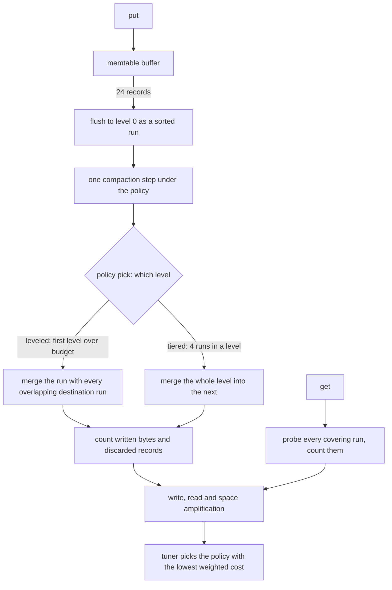
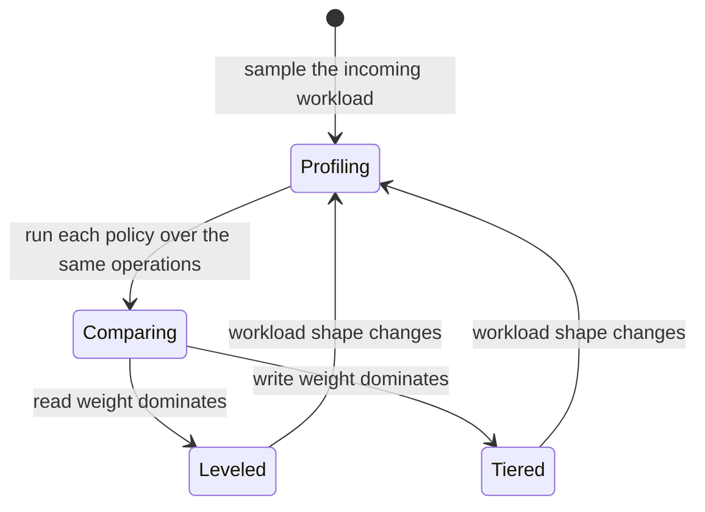
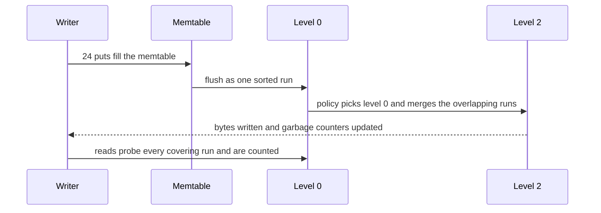

# 859 — Implement self-tuning database storage layout optimizer (auto compaction policy).

> **Tier:** Master · **CTCI chapter:** Ch 14 — Databases
> **Task spec:** [859-implement-self-tuning-database-storage-layout-optimizer-auto-com.md](../../../tasks/master/859-implement-self-tuning-database-storage-layout-optimizer-auto-com.md)
> **Solutions:** [Python](../../../solutions/python/master/859-implement-self-tuning-database-storage-layout-optimizer-auto-com/solution.py) ·
> [Java](../../../solutions/java/master/859-implement-self-tuning-database-storage-layout-optimizer-auto-com/Solution.java) ·
> [JavaScript](../../../solutions/javascript/master/859-implement-self-tuning-database-storage-layout-optimizer-auto-com/solution.js) ·
> [C#](../../../solutions/csharp/master/859-implement-self-tuning-database-storage-layout-optimizer-auto-com/Solution.cs)

## 1. Problem restatement

An LSM-tree storage engine with a **tunable compaction policy**: records are buffered in a memtable,
flushed to level `0` as sorted runs, merged down the levels by a policy, and a tuner profiles the
incoming workload and picks the policy that minimises the observed cost model.

**Modelling contract.** Deterministic and in-process: no threads, no clock, no unseeded randomness.
Simplified versus a real engine: keys and values are small integers, the tree has `4` levels, a
"run" is a plain sorted list rather than an on-disk SSTable, and the workload is a deterministic
sequence of puts and gets (no deletes, no bloom filters, no tombstones). What is *not* simplified is
the measurement discipline: read amplification is measured by really counting the runs a lookup
consults, and write amplification by really counting the bytes each flush and compaction writes.

The engine's constants are `MEMTABLE_LIMIT = 24` records before a flush, `RUN_TARGET = 24` records
per run, `TIER_TRIGGER = 4` runs before a tiered merge, and `LEVEL_BUDGET = (0, 2, 4, 64)` runs per
level for the leveled policy.

Concrete contract from the file's run over a `900`-operation workload (`30%` reads, key space `600`):

| Policy | Reads | Flushes | Compactions | Write amp | Read amp | Space amp |
| --- | --- | --- | --- | --- | --- | --- |
| leveled | `867` | `25` | `12` | `3.86` | `2.00` | `1.07` |
| tiered | `867` | `25` | `17` | `3.37` | `5.75` | `1.48` |

| Assertion | Value |
| --- | --- |
| bytes | ingested `633`, flushed `600`, written `2133`, stored `566`, garbage `34`, memtable `21` |
| conservation | `garbage == flushed - stored`; runs can never hold more than was flushed |
| formulas | the counters reproduce the reported amplifications exactly |
| write-heavy workload | leveled write `5.35` read `2.43` space `1.11` — tiered write `3.64` read `12.02` space `3.57` |
| tuner, mixed workload | costs `{'leveled': 7.995, 'tiered': 16.383}` → chose leveled |
| tuner, read-heavy | costs `{'leveled': 49.886, 'tiered': 96.712}` → chose leveled |
| tuner, write-heavy | costs `{'leveled': 109.624, 'tiered': 85.629}` → chose tiered |
| self-tuning decisions | `[(20, 1, 'leveled'), (1, 20, 'tiered'), (20, 1, 'leveled')]` |
| geometry | levels used `[0, 2]`; runs per level `[2, 0, 25, 0]`; bytes per run `9` and `24` |
| reclamation | `1` compaction step, `480` puts → `40` stored records for `40` live keys (space amp `1.00`) |

## 2. Intuition

The naive handling of compaction is a fixed policy chosen once by a human: "leveled, because that is
what the documentation says". It is wrong for half the workloads — a write-heavy ingest is exactly
where leveled compaction's write amplification hurts, and read-heavy serving is where tiered
compaction's read amplification hurts.

The key insight is that the trade-off is a **measured, three-dimensional quantity**, and a tuner can
see it directly:

1. **Write amplification** `= bytes_written / bytes_ingested`. Every flush and every compaction
   writes bytes; leveling rewrites the overlapping destination runs, so it writes more.
2. **Read amplification** `= runs_probed / reads`. A lookup consults every run whose `[smallest,
   largest]` covers the key; level `0` runs overlap by design (they are memtable dumps), so a
   leveled tree with disjoint lower levels probes far fewer runs.
3. **Space amplification** `= stored_bytes / live_keys`. Garbage that compaction has not yet
   reclaimed inflates it.

The engine counts all three from real work — `runs_probed` is incremented in `get`, `bytes_written`
in `flush` and `compact_once` — and the file then checks the analytic formulas against those
counters. That is what makes the tuner's comparison meaningful rather than a model talking to itself.



## 3. Algorithm

1. **Write path.** `put(key, value)` bumps the sequence, stores `(value, sequence)` in the memtable
   and counts one ingested byte. When the memtable reaches `MEMTABLE_LIMIT` distinct keys it calls
   `flush()` (a sorted `Run` at level `0`) and then `compact_once()` — one compaction slot per
   flush, which is how a background compactor behaves.
2. **Choose what to compact.** `LeveledPolicy.pick` returns the first level whose run count exceeds
   its budget; `TieredPolicy.pick` returns the first level holding at least `TIER_TRIGGER` runs;
   `NeverPolicy` always returns `None` and exists to build a deliberately dirty tree.
3. **Compact.** `compact_once` takes the level's runs, and for leveled also every *overlapping* run
   in the destination level, merges them newest-first (keeping the newest version of each key),
   splits the output into `RUN_TARGET`-sized runs, counts `bytes_written`, adds
   `input_records - output_records` to `garbage`, and records the merge with its source count.
4. **Read path.** `get(key)` collects candidates from the memtable and from every run whose key
   range covers the key, counting each such run in `runs_probed`, then returns the value with the
   greatest sequence number.
5. **Metrics.** `write_amplification`, `read_amplification(live_keys)` and `stored_bytes` are the
   three quantities above; `probe_count(key)` recomputes the probe count without side effects, so
   the counter can be cross-checked.
6. **Geometry check.** `geometry_ok()` verifies that every run is sorted, non-empty and at most
   `RUN_TARGET` records, and that levels below `0` hold pairwise non-overlapping runs under the
   leveled policy.
7. **Tune.** `cost_model(store, truth, read_weight, write_weight, space_weight=0.2)` is
   `rw * read_amp + ww * write_amp + 0.2 * space_amp`; the tuner runs each policy over the workload
   and picks the cheapest.

```text
procedure put(store, key, value)
    store.sequence ← store.sequence + 1
    store.memtable[key] ← (value, store.sequence)
    store.bytes_ingested ← store.bytes_ingested + 1
    if number of distinct memtable keys reaches MEMTABLE_LIMIT then
        flush(store)
        compact_once(store)
    end
end

procedure flush(store)
    records ← the memtable as (key, value, sequence) triples
    append a new Run at level 0 holding those records
    store.bytes_written ← store.bytes_written + number of records
    store.flushed_bytes ← store.flushed_bytes + number of records
    store.memtable ← empty
end

procedure compact_once(store)
    level ← store.policy.pick(store.levels)
    if level is nothing then
        return nothing
    end
    sources ← the runs currently at that level
    empty that level
    destination ← min(level + 1, last level)
    if the policy is leveled then
        move every overlapping run of the destination into sources as well
    end
    records ← merge sources newest-first, keeping the newest version of each key
    store.garbage ← store.garbage + (input records - length(records))
    store.bytes_written ← store.bytes_written + length(records)
    append the output to the destination in RUN_TARGET-sized runs
    return level
end

function get(store, key)
    candidates ← empty list
    if key is in the memtable then
        append its (value, sequence) to candidates
    end
    for level in store.levels do
        for run in level do
            if run.smallest <= key <= run.largest then
                store.runs_probed ← store.runs_probed + 1
                append the matching record's (value, sequence) when present
            end
        end
    end
    return the value with the greatest sequence, or nothing
end

function cost_model(store, live_keys, read_weight, write_weight, space_weight)
    return read_weight * store.runs_probed / store.reads
         + write_weight * store.bytes_written / store.bytes_ingested
         + space_weight * store.stored_bytes() / max(1, length(live_keys))
end
```

The tuner is a control loop over the three amplifications:



## 4. Worked example

### The same workload, two policies

Both runs apply the identical `900` operations (key space `600`, `30%` reads), so the differences are
purely the policy's:

| Metric | leveled | tiered | Who wins |
| --- | --- | --- | --- |
| compactions | `12` | `17` | leveled does fewer merges |
| write amplification | `3.86` | `3.37` | tiered writes less (it does not rewrite the destination level) |
| read amplification | `2.00` | `5.75` | leveled probes far fewer runs |
| space amplification | `1.07` | `1.48` | leveled reclaims garbage sooner |

The level-`0` detail explains the read column: level `0` holds memtable dumps whose runs *overlap*
(the file says so in `geometry_ok`), so a lookup must probe all of them; leveling keeps the lower
levels disjoint, which is what makes `2.00` achievable while tiered's `4`-run tiers stack up.

### Conservation of bytes

The file's strongest correctness check is not a formula, it is an accounting identity:

| Quantity | Value | Relation |
| --- | --- | --- |
| ingested | `633` | equals the number of `put` operations |
| flushed | `600` | `<= ingested` (memtable deduplication can only shrink) |
| written | `2133` | `>= flushed` (compactions add writes on top) |
| stored | `566` | `<= flushed` |
| garbage | `34` | `== flushed - stored` |
| memtable | `21` | the unflushed tail |

`garbage == flushed - stored` is asserted exactly: every flushed record is either still on disk or
explicitly accounted for as discarded, so a compaction cannot lose a record or invent one. Combined
with the per-read check against a dictionary oracle, that is the whole correctness story of an LSM
compaction policy.



### The tuner actually switching

| Workload | Cost of leveled | Cost of tiered | Chosen |
| --- | --- | --- | --- |
| mixed | `7.995` | `16.383` | leveled |
| read-heavy | `49.886` | `96.712` | leveled |
| write-heavy | `109.624` | `85.629` | tiered |

The write-heavy row is the one that matters: leveled's read advantage is irrelevant when there are
almost no reads, and its `5.35` write amplification against tiered's `3.64` decides the choice. The
self-tuning trace `[(20, 1, 'leveled'), (1, 20, 'tiered'), (20, 1, 'leveled')]` shows the same
decision being re-made as the workload shape changes, which is the point of tuning online rather
than at install time.

The reclamation run is the complementary experiment: with `NeverPolicy` the tree is built deliberately
dirty, then a single `compact_once` call takes `480` puts down to `40` stored records for `40` live
keys — a space amplification of `1.00`. Garbage is not just measured, it is bounded by compaction.

The geometry check completes the picture: after the run the tree uses levels `[0, 2]` with
`[2, 0, 25, 0]` runs per level and `9` or `24` records per run — never more than `RUN_TARGET = 24`,
never empty, never unsorted, and non-overlapping below level `0` under the leveled policy.

## 5. Complexity

Let `N` be the number of operations, `L` the number of levels, `R` the number of records, `K` the
live key count, and `S` the number of runs.

| Measure | Bound | Why it holds |
| --- | --- | --- |
| `put` | `O(1)` amortised, plus a flush every `MEMTABLE_LIMIT` | memtable insert, then a bounded flush |
| `flush` | `O(m log m)` | a memtable of `m = 24` records is sorted into a run |
| `compact_once` | `O(R log R)` per merge | merge the sources newest-first, then sort the output |
| `get` | `O(S + records per probed run)` | every covering run is probed and scanned |
| Whole workload | `O(N + #flushes * merge cost)` | one compaction slot per flush |
| Space | `O(R + S)` | runs plus the memtable |
| Write amplification | `~ 1 + (compactions * records written) / ingested` | measured `3.37 … 5.35` |
| Read amplification | `~ runs probed per read` | measured `2.00` (leveled) … `12.02` (tiered, write-heavy) |

The `O(S)` per read is the reason read amplification is the discriminating metric: `get` scans the
record list of every covering run until it finds the key, so a tree with many overlapping runs is
slow even though each run is sorted. A production engine replaces the scan with a per-run binary
search plus a bloom filter, which changes the constant but not the run-count structure — the probe
counter, and therefore the tuner's input, stays the same.

The `O(R log R)` merge is the write side of the trade-off: leveled compaction pays it on the
destination level's overlapping runs (hence `3.86` write amplification here and `5.35` on the
write-heavy workload), while tiered compaction merges whole levels with no destination rewrite
(`3.37` and `3.64`) and pays for it in read amplification.

## 6. Pitfalls and edge cases

- **Losing the correctness check to the performance story.** Every read of every workload is
  compared against a plain dictionary, including reads after each compaction. A policy that
  optimises amplification at the cost of a stale value is not a policy.
- **Conservation of bytes.** `garbage == flushed - stored` and `stored <= flushed <= ingested` are
  asserted exactly; they are what make a missing or duplicated record detectable without inspecting
  individual keys.
- **Level `0` is allowed to overlap.** `geometry_ok()` exempts level `0` from the disjointness rule,
  because level `0` holds memtable dumps. Forgetting this either reports false geometry failures or,
  worse, hides the real reason the read amplification is what it is.
- **Overlap detection must be inclusive.** `Run.overlaps` uses `not (largest < other.smallest or
  other.largest < smallest)`, so runs that touch at one key count as overlapping — a leveled tree
  that missed that could leave two runs with the same key and a lookup would then need both.
- **Splitting output into `RUN_TARGET` runs.** Compaction emits runs of at most `24` records; without
  the split a level could hold a single giant run, and the geometry check (`oversized run`) catches
  exactly that.
- **Sequence numbers decide freshness.** `merge_runs` and `get` both keep the record with the
  greatest sequence, so `sequence` is the only thing that makes "newest version wins" true after a
  merge.
- **A policy that never fires.** `NeverPolicy` returns `None` forever, so `compact_once` returns
  `None` and the tree accumulates garbage; the file uses it deliberately to *build* the dirty state
  that the reclamation experiment cleans up.
- **Convergence.** `compact_all(limit=200)` raises if compaction does not converge, so a policy that
  oscillates between levels is caught rather than looping forever.
- **Edge cases the file pins.** An empty store, a single key, a read-only workload, a very small
  flush threshold and a very large one.
- **Determinism.** Identical metrics for identical workloads — every sequence number, flush and
  merge is reproducible, which is what makes the tuner's comparisons stable.

## 7. Variants and follow-ups

- **The cost model is learned, not weighted by hand.** The `read_weight`/`write_weight` here is a
  hand-set linear model; learning those weights from observed latencies is
  [857-implement-ml-based-cost-model-for-query-planner-with-online-lear.md](../../../tasks/master/857-implement-ml-based-cost-model-for-query-planner-with-online-lear.md).
- **Re-deciding while the workload runs.** The tuner's switching trace is a re-planning decision, and
  the runtime machinery for that is
  [856-implement-runtime-adaptive-operator-re-optimization-and-replanni.md](../../../tasks/master/856-implement-runtime-adaptive-operator-re-optimization-and-replanni.md).
- **A drift signal for the workload shape.** Detecting that reads have started to dominate is the
  change-point problem of
  [858-implement-streaming-transfer-learning-pipeline-with-concept-drif.md](../../../tasks/master/858-implement-streaming-transfer-learning-pipeline-with-concept-drif.md).
- **Auditing who changed the policy.** Compaction decisions need the same append-only, tamper-evident
  record as any other privileged action — see
  [853-implement-fine-grained-access-control-and-auditing-for-database.md](../../../tasks/master/853-implement-fine-grained-access-control-and-auditing-for-database.md).
- **Verifying the engine against a reference.** The dictionary oracle used for every read is the same
  differential-testing idea as
  [854-implement-system-for-differential-testing-and-fuzzing-of-databas.md](../../../tasks/master/854-implement-system-for-differential-testing-and-fuzzing-of-databas.md).

## 8. Check yourself

1. Why does tiered compaction write less but read more than leveled compaction?

<details><summary>Show answer</summary>

Because leveled compaction merges the source runs *with every overlapping run in the destination
level* and rewrites all of them, which costs bytes but keeps levels below `0` disjoint — so a lookup
probes few runs. Tiered compaction merges a level's `4` runs and hands the result to the next level
without rewriting the destination, so it writes less (`3.37` versus `3.86` on the shared workload)
but leaves several overlapping runs in each level to be probed (`5.75` versus `2.00` reads per
read).

</details>

2. What does `garbage == flushed_bytes - stored_runs` actually rule out?

<details><summary>Show answer</summary>

That compaction loses or invents records. Every record that was flushed is either still present in
some run or explicitly counted as discarded, so a compaction that dropped a live record would show up
as an unexplained gap. Combined with checking every read against a dictionary oracle, and with
`stored <= flushed <= ingested`, it means the byte counters describe the same set of records the
read path serves.

</details>

3. Why is read amplification measured as runs probed per read rather than bytes read?

<details><summary>Show answer</summary>

Because the probe count is the structural cost: `get` consults every run whose key range covers the
lookup, so the number of runs determines how many sorted lists (and, in a real engine, how many index
and bloom-filter lookups) must be touched. It is also the quantity the *policy* controls — leveling
makes lower levels disjoint, tiering does not — whereas bytes read depend on where the key happens to
land. The file counts it in `get` and cross-checks it with the side-effect-free `probe_count(key)`.

</details>
