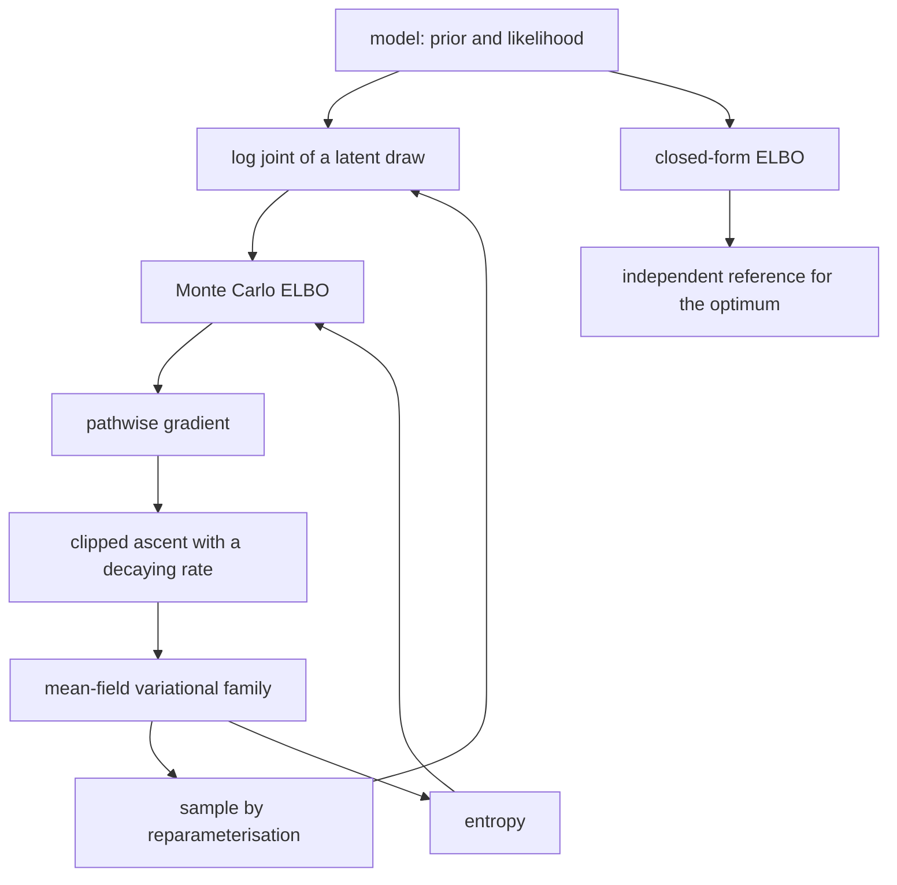
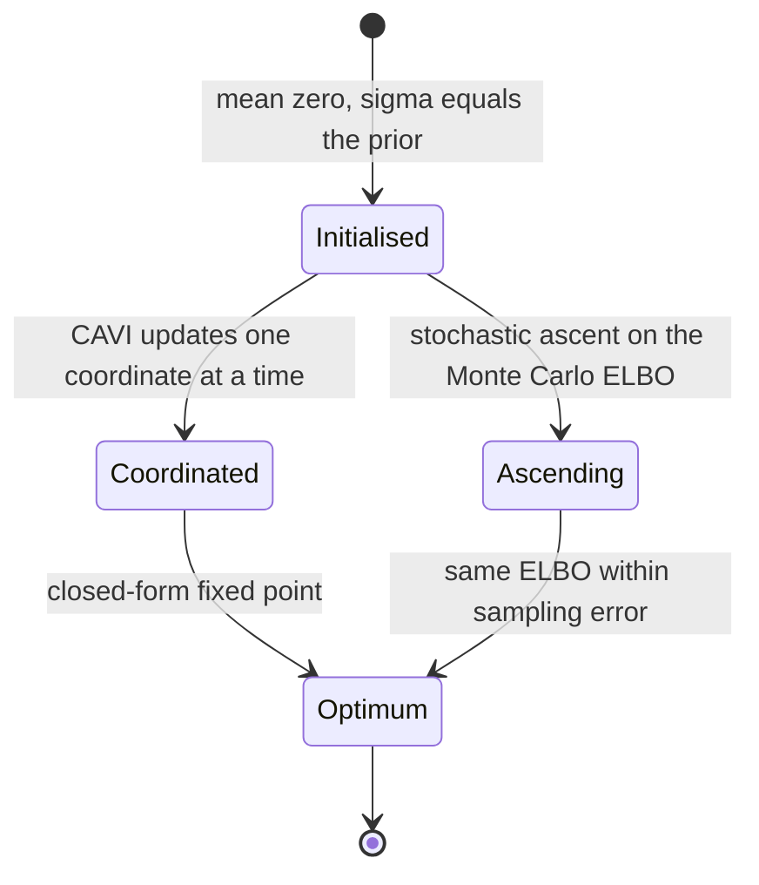
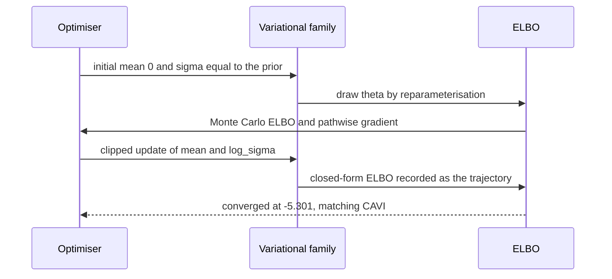

# 860 — Implement probabilistic programming inference engine with variational methods.

> **Tier:** Master · **CTCI chapter:** Beyond — Machine Learning & AI
> **Task spec:** [860-implement-probabilistic-programming-inference-engine-with-variat.md](../../../tasks/master/860-implement-probabilistic-programming-inference-engine-with-variat.md)
> **Solutions:** [Python](../../../solutions/python/master/860-implement-probabilistic-programming-inference-engine-with-variat/solution.py) ·
> [Java](../../../solutions/java/master/860-implement-probabilistic-programming-inference-engine-with-variat/Solution.java) ·
> [JavaScript](../../../solutions/javascript/master/860-implement-probabilistic-programming-inference-engine-with-variat/solution.js) ·
> [C#](../../../solutions/csharp/master/860-implement-probabilistic-programming-inference-engine-with-variat/Solution.cs)

## 1. Problem restatement

A small probabilistic programming engine: a **model** is a linear-Gaussian generative program, and
**inference** is mean-field variational inference over a diagonal Gaussian family, driven by the
ELBO.

**Modelling contract.** Deterministic and in-process: the "random" draws come from a seeded
splitmix64 stream (Box-Muller normals), there are no threads, no clock and no external libraries.
Simplified versus a general probabilistic language: the model is a single conjugate family —
`theta ~ N(0, prior_sigma² I)` and `x_i ~ N(a_i · theta, noise_sigma²)` — the variational family is
mean-field diagonal Gaussian, and the optimiser is plain gradient ascent with a decaying step (no
automatic differentiation, but the pathwise gradient is written out and verified against finite
differences). Two ELBOs are implemented: the **closed form** for this conjugate model and a **Monte
Carlo** estimate with the reparameterisation trick, and they must agree.

Concrete contract from the file's run (`5` observations, `2` latent weights, `prior_sigma = 1.5`,
`noise_sigma = 0.4`):

| Assertion | Value |
| --- | --- |
| KL | the closed form matches numerical quadrature on three parameter sets; identical Gaussians give `0` |
| ELBO agreement | analytic `-6.4308`; Monte Carlo `[-6.51, -6.555, -6.513, -6.369, -6.437]`, spread `0.186` |
| gradient | pathwise `[84.734, 187.277]` equals finite differences `[84.734, 187.277]` |
| CAVI | `44` iterations, ELBO `-22.5614 → -5.3010` |
| geometry | exact mean `[0.5002, 1.193]`; mean-field variance `0.0402` against exact trace `0.1341` (correlation `rho = 0.837`) |
| gradient ascent | `600` steps, ELBO `-254.0475 → -5.3011`, final mean `[0.4976, 1.1938]` |
| predictive | analytic means `[0.5, 1.693, 2.886, 3.006, 4.079]`; variational match within `0.01` |
| single observation | posterior mean `0.6000`, variance `0.8000` (matches the textbook) |

## 2. Intuition

The naive way to "do inference" is to sample from the joint and hope: run a chain, look at the
histogram. It works, but it has no convergence certificate, no comparable objective, and no way to
tell whether the answer is a modelling artefact or the sampler's fault.

The key insight is to turn inference into **optimisation of a single number you can check**:

1. **The ELBO is a lower bound on the log evidence**, `E_q[log p(x, theta)] + H(q)`. Maximising it
   over a family `q` makes `q` close to the posterior in KL divergence, and any value of the ELBO is
   *checkable* against an independent estimator.
2. **For a conjugate model the expectation has a closed form** — the mean-field Gaussian gives
   analytic terms for `E[log p]` and an analytic entropy `sum(0.5 log(2 pi e) + log_sigma)`. That is
   the reference the Monte Carlo estimator is validated against.
3. **The reparameterisation trick makes the Monte Carlo ELBO differentiable**: write
   `theta = mean + exp(log_sigma) * epsilon` with `epsilon ~ N(0, 1)`, so the gradient flows
   *through* the sample instead of through a score function. The result can be checked against
   finite differences taken with the very same draws, which is why it is trustworthy.
4. **Mean-field has a known bias**, so the file measures it rather than pretending it is absent: the
   mean converges to the exact posterior mean, but the variance shrinks (`0.0402` against an exact
   trace of `0.1341`) because the diagonal family cannot represent correlation.



## 3. Algorithm

1. **Define the model.** `LinearGaussian(design, observations, prior_sigma, noise_sigma)` stores the
   design matrix; `log_joint(theta)` sums `normal_logpdf(value, 0, prior_sigma)` for the weights and
   `normal_logpdf(observation, a_i · theta, noise_sigma)` for each observation.
2. **Get the exact posterior.** `exact_posterior()` builds the Gaussian precision
   `Aᵀ A / s² + I / s0²` and its right-hand side, inverts the precision with Gauss-Jordan
   (`invert`), and returns the mean and covariance — the ground truth for the variational optimum.
3. **Closed-form ELBO.** `closed_form_elbo(model, variational)` evaluates `E[log p]` analytically
   (`log N(mean; 0, prior_sigma)` minus `0.5 * sigma² / prior_sigma²` per weight, plus a similar term
   per observation using the propagated variance) and adds the entropy.
4. **Monte Carlo ELBO.** `mc_elbo` draws `theta = mean + exp(log_sigma) * normal()`, averages
   `log_joint`, and adds the same entropy.
5. **Pathwise gradient.** `mc_elbo_gradient` accumulates `grad_theta` and then
   `gradient_log_sigma += grad_theta * exp(log_sigma) * epsilon`, plus the entropy's `+1` per
   coordinate. It returns `(gradient_mean, gradient_log_sigma)` averaged over the samples.
6. **Optimise.** `cavi` runs closed-form coordinate ascent to a fixed point (the reference optimum);
   `gradient_ascent` ascends the Monte Carlo ELBO for a fixed number of steps, with each component
   clipped to `±1.0` and a rate of `0.05 / sqrt(1 + step / 20)`, and `log_sigma` capped at `3.0`.
7. **Check.** The file compares the two ELBOs, the two optimisers, the KL against quadrature, and the
   posterior predictive mean against the analytic one.

```text
function closed_form_elbo(model, variational)
    expectation ← 0
    for mean, scale in the variational coordinates do
        expectation ← expectation + log_normal_pdf(mean, 0, prior_sigma)
                       - 0.5 * scale squared / prior_sigma squared
    end
    for row, observation in the data do
        predicted ← dot(row, variational.mean)
        variance ← sum over the coordinates of (row value * scale) squared
        expectation ← expectation + log_normal_pdf(observation, predicted, noise_sigma)
                       - 0.5 * variance / noise_sigma squared
    end
    return expectation + sum over the coordinates of (0.5 * log(2 pi e) + log_sigma)
end

function mc_elbo(model, variational, rng, samples)
    total ← 0
    for each of the samples do
        theta ← mean + exp(log_sigma) * rng.normal() for every coordinate
        total ← total + model.log_joint(theta)
    end
    return total / samples + variational.entropy()
end

function mc_elbo_gradient(model, variational, rng, samples)
    gradient_mean ← zeros, gradient_log_sigma ← zeros
    for each of the samples do
        epsilon ← rng.normal() for every coordinate
        theta ← mean + exp(log_sigma) * epsilon
        grad_theta ← -theta / prior_sigma squared
        for row, observation in the data do
            residual ← (dot(row, theta) - observation) / noise_sigma squared
            grad_theta ← grad_theta - row * residual
        end
        gradient_mean ← gradient_mean + grad_theta
        gradient_log_sigma ← gradient_log_sigma + grad_theta * exp(log_sigma) * epsilon
    end
    divide both gradients by samples
    add one to every entry of gradient_log_sigma
    return gradient_mean, gradient_log_sigma
end

procedure cavi(model, variational, iterations)
    for each iteration do
        for each coordinate index do
            precision ← 1 / prior_sigma squared
            rhs ← 0
            for row, observation in the data do
                precision ← precision + row[index] squared / noise_sigma squared
                rhs ← rhs + row[index] * (observation - the other coordinates' contribution)
                        / noise_sigma squared
            end
            mean[index] ← rhs / precision
            log_sigma[index] ← -0.5 * log(precision)
        end
        record the closed-form ELBO; stop when the change is below the tolerance
    end
end

procedure gradient_ascent(model, variational, rng, iterations)
    for step from 0 to iterations - 1 do
        gradient_mean, gradient_log_sigma ← mc_elbo_gradient(model, variational, rng)
        rate ← 0.05 / sqrt(1 + step / 20)
        for each coordinate do
            mean ← mean + rate * clip(gradient_mean, -1, 1)
            log_sigma ← min(3, log_sigma + rate * clip(gradient_log_sigma, -1, 1))
        end
        record the closed-form ELBO at the current parameters
    end
end
```

Two optimisers on the same objective, which is what makes the comparison meaningful:



## 4. Worked example

### Checking the estimator before trusting it

An estimator that is only compared with itself proves nothing, so three comparisons come first.

| Check | Left side | Right side | Verdict |
| --- | --- | --- | --- |
| KL closed form | `gaussian_kl(mean_q, sigma_q, mean_p, sigma_p)` | quadrature of `∫ q log(q/p)` over `20001` points | agree within `1e-3` on three parameter sets |
| ELBO agreement | analytic `-6.4308` | Monte Carlo over `5` seeds: `-6.51, -6.555, -6.513, -6.369, -6.437` | all inside `0.25`, spread `0.186` |
| Pathwise gradient | `[84.734, 187.277]` | finite differences with the same random draws | equal to three decimals |

The gradient row is the crucial one: because the finite-difference probe uses the *same* `epsilon`
draws, the two gradients estimate the same random quantity, so their agreement is not a
statistical coincidence. Without the reparameterisation trick the gradient would have to include a
score-function term, and a sign error there is invisible to a loss curve.

### CAVI and gradient ascent converge to the same place

| Optimiser | Start ELBO | End ELBO | Steps |
| --- | --- | --- | --- |
| CAVI (closed-form coordinate ascent) | `-22.5614` | `-5.3010` | `44` iterations |
| gradient ascent on the Monte Carlo ELBO | `-254.0475` | `-5.3011` | `600` steps |

Both end at `/ -5.301`. The gradient-ascent run starts far worse (`-254`) because it begins at the
prior with a large `log_sigma`, and it needs the clipping and the `0.05 / sqrt(1 + step / 20)` decay
to survive the large gradients a nearly collinear design produces.



### The mean-field bias, measured

The exact posterior for this design has correlated coordinates (`rho = 0.837`), and a diagonal
Gaussian cannot represent that:

| Quantity | Exact | Mean-field | Note |
| --- | --- | --- | --- |
| posterior mean | `[0.5002, 1.193]` | `[0.4976, 1.1938]` | the mean is recovered |
| marginal variance (trace) | `0.1341` | `0.0402` | the variance is underestimated |
| posterior predictive means | `[0.5, 1.693, 2.886, 3.006, 4.079]` | match within `0.01` | predictions barely suffer |

That is the textbook mean-field shrinkage, and the file verifies it instead of assuming it. The
predictive row is the practical consolation: a diagonal approximation that gets the mean right and
the variance wrong still predicts well, because the predictive mean depends on the posterior mean.

### Edge cases that pin the semantics

| Case | Result |
| --- | --- |
| no observations | the variational posterior is *exactly* the prior |
| an overwhelming prior | the posterior stays at the prior even though the data pull the other way |
| a single observation | posterior mean `0.6000` and variance `0.8000`, matching the closed-form textbook values |

The single-observation case is a hand-computable identity: with a standard normal prior and noise
variance `1`, one observation `x = 1` gives mean `0.6` and variance `0.8` — `1/(1 + 1) * 1` and
`1/(1 + 1)`. A variational implementation that gets those wrong is wrong in a way no amount of
ELBO monitoring would reveal.

## 5. Complexity

Let `d` be the latent dimension (`2`), `n` the number of observations (`5`), `S` the Monte Carlo
sample count (`200`), and `T` the number of ascent steps.

| Measure | Bound | Why it holds |
| --- | --- | --- |
| `log_joint` | `O(n * d)` | the prior terms plus one inner product per observation |
| Closed-form ELBO | `O(n * d)` | analytic expectations, no sampling |
| Monte Carlo ELBO | `O(S * n * d)` | `S` independent `log_joint` evaluations |
| Pathwise gradient | `O(S * n * d)` | the same loop plus the `grad_theta` accumulation |
| Exact posterior | `O(n * d² + d³)` | build the precision, then Gauss-Jordan inversion |
| CAVI | `O(iterations * n * d²)` | per coordinate, one pass over the observations |
| Gradient ascent | `O(T * S * n * d)` | `600 * 200 * 5 * 2` — the dominant term |
| Space | `O(n * d + d²)` | the design matrix and the posterior covariance |
| KL by quadrature | `O(steps)` | `20001` points, used only as a validation reference |

The reason the file can afford a `20001`-point quadrature and a `600`-step, `200`-sample ascent is
that `d = 2` and `n = 5`. In a real engine the Monte Carlo cost `O(S * n * d)` per step is the thing
that gets optimised — variance reduction, minibatching, or a closed form where conjugacy allows it,
which is exactly why the file implements *both* ELBOs and checks that they agree.

The `O(d³)` inversion is a reference computation, not part of the inference loop: `exact_posterior`
exists so the variational answer can be scored against the truth. A production engine would not have
that luxury, which is precisely why it needs the gradient check and the ELBO trajectory instead.

## 6. Pitfalls and edge cases

- **A gradient that is not the gradient of the objective.** The pathwise estimator is verified
  against finite differences *with the same draws*; without that check, a missing entropy term or a
  sign error in the `log_sigma` chain rule produces a loss curve that still goes down.
- **Sampling `sigma` instead of `log_sigma`.** The variational parameter is unconstrained
  (`log_sigma`), so the gradient is with respect to the *logarithm*; the entropy derivative `+1` per
  coordinate comes from exactly that change of variables.
- **Unclipped gradients with a collinear design.** The file clips each component to `±1.0`, which is
  why the ascent starts at `-254` and still converges — with a fixed step size and unclipped
  gradients the run diverges.
- **`log_sigma` running away.** It is capped at `3.0` (a variance of `e^6`), so the family cannot
  buy ELBO by inflating the entropy arbitrarily.
- **A step size that never decays.** `rate = 0.05 / sqrt(1 + step / 20)` is what turns the early
  large steps into a settled optimum; a constant rate keeps oscillating and the trajectory plateaus.
- **Assuming mean-field matches the posterior.** It does not: the variance is `0.0402` against an
  exact `0.1341` here. The file measures both the recovered mean *and* the underestimated variance,
  and reports the correlation (`rho = 0.837`) that explains the gap.
- **Comparing the Monte Carlo ELBO with a single seed.** Its spread across `5` seeds is `0.186`, so
  the tolerance is `0.25` — a single draw could easily be `0.2` off and look like a bug.
- **Empty data.** With no observations the ELBO reduces to the prior term plus the entropy, and the
  fixed point is exactly the prior; the file asserts the identity rather than approximately.
- **An overwhelming prior.** A tight prior keeps the posterior at the prior despite the data, which
  is the check that the prior actually enters the objective, not just the initialisation.
- **Determinism.** Identical estimates, optima and trajectories for the same seed, because every
  normal draw comes from the seeded stream.

## 7. Variants and follow-ups

- **Asymptotic exactness.** When the family is a bad fit, the MCMC route in
  [861-implement-large-scale-mcmc-with-asynchronous-proposals-and-conve.md](../../../tasks/master/861-implement-large-scale-mcmc-with-asynchronous-proposals-and-conve.md)
  trades the ELBO's guarantees for consistency.
- **When the likelihood is not tractable.** Simulator-based inference with approximate Bayesian
  computation is the alternative when `log p(x | theta)` cannot be written down — see
  [862-implement-approximate-bayesian-computation-pipeline-for-simulato.md](../../../tasks/master/862-implement-approximate-bayesian-computation-pipeline-for-simulato.md).
- **The same ELBO geometry in metric learning.** Latent representations fitted by a probabilistic
  objective are the graph embeddings of
  [863-implement-large-scale-graph-embedding-training-with-negative-sam.md](../../../tasks/master/863-implement-large-scale-graph-embedding-training-with-negative-sam.md).
- **Where the gradient check pattern comes from.** Finiteness-checked derivative code is the same
  discipline the ML cost model applies to its SGD step in
  [857-implement-ml-based-cost-model-for-query-planner-with-online-lear.md](../../../tasks/master/857-implement-ml-based-cost-model-for-query-planner-with-online-lear.md).

## 8. Check yourself

1. Why are there two ELBO implementations, and what does the agreement prove?

<details><summary>Show answer</summary>

Because an estimator validated only against itself is worthless. The closed-form ELBO is analytic for
this conjugate model, and the Monte Carlo ELBO with the reparameterisation trick must land within its
sampling error of it: analytic `-6.4308` against five seeds spanning `-6.555 … -6.369`, with a spread
of `0.186` and a tolerance of `0.25`. That agreement is what licenses using the Monte Carlo estimator
in the parts of the code where the closed form is unavailable.

</details>

2. Why is the pathwise (reparameterised) gradient checked against finite differences with the *same*
   random draws?

<details><summary>Show answer</summary>

Because the Monte Carlo ELBO is a random function of the samples: two different draws give two
different function values, so a naive finite-difference check would measure noise, not error. By
reusing the same `epsilon` for both the analytic gradient and the perturbed evaluations, the two
sides estimate the gradient of the *same* function at the same point — the file's numbers are
`[84.734, 187.277]` for both.

</details>

3. CAVI converges in `44` iterations and gradient ascent in `600` steps, and both reach `/ -5.301`.
   What does that say about the optimum?

<details><summary>Show answer</summary>

That the closed-form fixed point and the stochastic ascent reach the same maximum of the same
objective, so the mean-field optimum is unique at this scale and the two optimisers are not
optimising different things. CAVI is fast because it uses the conjugacy to update each coordinate
exactly; the ascent is the general-purpose path that would apply when no closed form exists.

</details>

4. The mean-field variance is `0.0402` against an exact trace of `0.1341`. Is that a bug?

<details><summary>Show answer</summary>

No — it is the documented mean-field bias. The exact posterior has correlated coordinates
(`rho = 0.837`) and a diagonal Gaussian family cannot represent the correlation, so it underestimates
the marginal variance while still recovering the mean (`[0.4976, 1.1938]` against `[0.5002, 1.193]`).
The file measures both, and the predictive means still match the analytic ones within `0.01` because
predictions depend on the mean.

</details>
