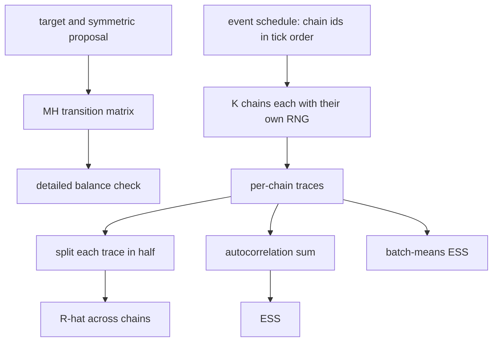
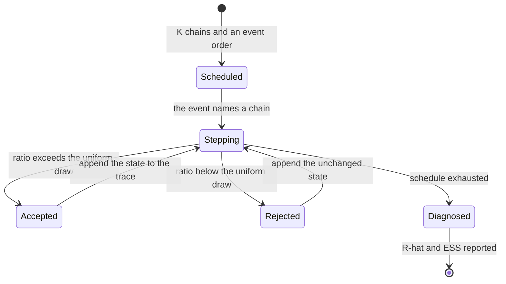
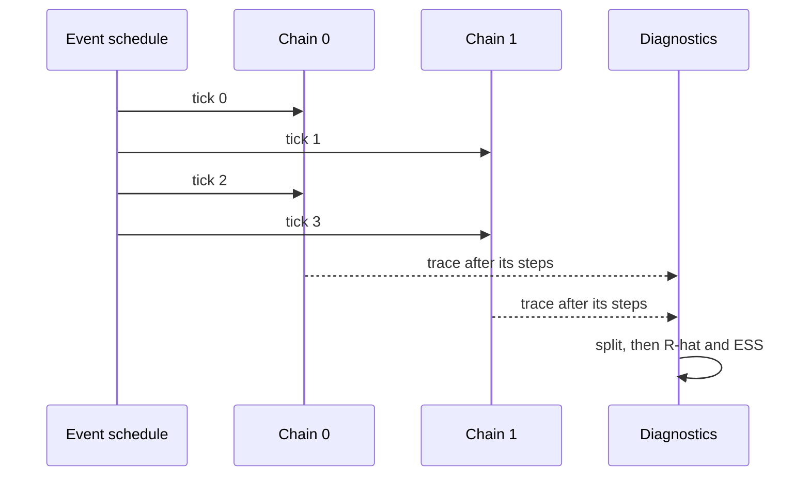

# 861 — Implement large-scale MCMC with asynchronous proposals and convergence diagnostics.

> **Tier:** Master · **CTCI chapter:** Beyond — Machine Learning & AI
> **Task spec:** [861-implement-large-scale-mcmc-with-asynchronous-proposals-and-conve.md](../../../tasks/master/861-implement-large-scale-mcmc-with-asynchronous-proposals-and-conve.md)
> **Solutions:** [Python](../../../solutions/python/master/861-implement-large-scale-mcmc-with-asynchronous-proposals-and-conve/solution.py) ·
> [Java](../../../solutions/java/master/861-implement-large-scale-mcmc-with-asynchronous-proposals-and-conve/Solution.java) ·
> [JavaScript](../../../solutions/javascript/master/861-implement-large-scale-mcmc-with-asynchronous-proposals-and-conve/solution.js) ·
> [C#](../../../solutions/csharp/master/861-implement-large-scale-mcmc-with-asynchronous-proposals-and-conve/Solution.cs)

## 1. Problem restatement

Run a Metropolis-Hastings sampler across several chains **asynchronously** — no barrier, no
lock-step synchronisation — and compute the standard convergence diagnostics from the per-chain
traces afterwards.

**Modelling contract.** Deterministic and in-process: no threads, no clock, no unseeded randomness
(the proposals come from a seeded splitmix64 stream). Simplification stated honestly: the
"asynchrony" is modelled by the **event order**, not by real concurrency — `schedule` returns an
explicit list of `(tick → chain)` events, and the chains advance one event at a time. The targets are
a small discrete distribution and a standard normal, and the diagnostics use the split-`R-hat` and
initial-positive-sequence ESS estimators that real samplers report.

Concrete contract from the file's run:

| Assertion | Value |
| --- | --- |
| detailed balance | `max |pi_i P_ij - pi_j P_ji| = 0.00e+00` over `6` states |
| discrete chain convergence | `max |empirical - target| = 0.0051` after `60000` steps, acceptance `0.498` |
| acceptance against theory | scales `0.5 / 1.0 / 2.0` → observed `0.8458 / 0.7068 / 0.5004`, exact `2Φ(-s/2)` = `0.8427 / 0.7028 / 0.4982`, diffusion limit `0.8026 / 0.6171 / 0.3173` |
| schedule | `6000` events with `5999` chain switches interleaved, `3` sequential |
| `R-hat` | converged `1.0026` (`< 1.1`), `100` steps `1.164`, short dispersed run `7.65`, drifting run `1252.2` |
| ESS | autocorrelation `1682.3`, batch means `1379.3`, over `14000` samples |
| throughput | `4` concurrent chains produce `4` proposals per virtual tick |

## 2. Intuition

The naive multi-chain sampler is a loop of loops: run chain `0` to completion, then chain `1`, and so
on. It is correct and useless — the chains never share a machine, the wall time is the sum, and a
diagnostic computed from the traces cannot tell you whether the sampler was idle.

The key insight is that the *only* thing that must be ordered is the proposal sequence of an
individual chain. Nothing forces chain `2`'s step to wait for chain `1`'s, so the sampler becomes a
single event schedule:

1. **The transition kernel is validated on its own.** `mh_transition(target, proposal)` builds the
   full MH transition matrix for a `6`-state discrete target, and the file checks
   `pi_i P_ij == pi_j P_ji` for every pair — the reversibility that guarantees the target is
   stationary. That check is independent of any sampling, so a bug in the acceptance ratio cannot
   hide behind a plausible-looking trace.
2. **Asynchrony is an event order.** `schedule(K, steps, interleaved=True)` yields chain ids round
   robin; the sequential version yields `steps` copies of each chain in turn. Interleaving gives the
   same traces only because each chain carries its own RNG stream — which is exactly the property an
   asynchronous executor needs.
3. **Diagnostics are computed from the traces, not during sampling.** `split_chains` halves each
   trace (the modern practice that catches within-chain non-stationarity), `r_hat` is the
   Gelman-Rubin ratio over the split chains, and ESS comes from the initial-positive-sequence
   autocorrelation sum with a batch-means estimate as an independent cross-check.



## 3. Algorithm

1. **Build the theory.** `symmetric_proposal(size)` is a random walk that steps `-1`, `0` or `+1`
   with equal probability on a cycle, and it asserts its own symmetry. `mh_transition(target,
   proposal)` fills `P[i][j] = proposal[i][j] * min(1, pi_j q_ji / (pi_i q_ij))` for `i != j` and puts
   the remainder on the diagonal.
2. **Sample the discrete chain.** `DiscreteChain.step` draws the candidate from the proposal row by
   inverse-CDF over `rng.uniform()`, computes the MH ratio, accepts with probability `min(1, ratio)`,
   and appends the state to the trace.
3. **Sample the continuous chain.** `GaussianChain.step` proposes `state + scale * normal()` against
   a standard normal target, accepting when `log(u) < normal_logpdf(candidate) - normal_logpdf(state)`.
4. **Schedule.** `schedule(K, steps, interleaved)` returns the event list; `run_chains` gives chain
   `i` the RNG seeded with `seed + 1000 * i` and steps the chain named by each event.
5. **Diagnose.** `split_chains` produces `2K` half-traces; `r_hat` computes the between/within
   variance ratio `sqrt(((n-1)/n * W + B/n) / W)`; `autocorrelation` and `ess` use the
   initial-positive-sequence estimator over lag pairs; `batch_means_ess` independently estimates
   `Var(x) * batches / Var(batch means)`.
6. **Check.** Acceptance rates are compared with `2Φ(-s/2)` for the normal target, the empirical
   state frequencies against the exact target, and the asynchronous traces against the sequential
   ones.

```text
procedure mh_transition(target, proposal)
    for every ordered pair (i, j) with i not equal to j do
        if proposal[i][j] is zero or target[i] is zero then
            continue
        end
        ratio ← target[j] * proposal[j][i] / (target[i] * proposal[i][j])
        matrix[i][j] ← proposal[i][j] * min(1, ratio)
    end
    matrix[i][i] ← 1 - the sum of the row
    return matrix
end

procedure discrete_step(chain)
    candidate ← inverse-CDF draw from chain.proposal[chain.state]
    chain.proposals ← chain.proposals + 1
    if candidate is not chain.state then
        ratio ← target[candidate] * proposal[candidate][state]
                / (target[state] * proposal[state][candidate])
        if rng.uniform() < min(1, ratio) then
            chain.state ← candidate
            chain.accepted ← chain.accepted + 1
        end
    end
    append chain.state to chain.trace
end

procedure run_chains(chain_count, steps, interleaved, seed)
    for index from 0 to chain_count - 1 do
        create a GaussianChain with the RNG seeded at seed + 1000 * index
    end
    events ← round robin over the chains when interleaved, sequential blocks otherwise
    for tick, chain in enumerate(events) do
        step that chain once
    end
    return the chains and the event log
end

function r_hat(traces)
    chains ← the traces with more than one sample, truncated to the shortest length
    means ← the mean of each chain
    between ← length * sum of squared deviations of the means from the grand mean / (count - 1)
    within ← the pooled mean of the squared deviations inside each chain
    variance ← (length - 1) / length * within + between / length
    return sqrt(variance / within)
end

function ess(trace)
    total ← 0
    for lag from 1 in steps of 2 while the pair of autocorrelations stays positive do
        total ← total + autocorrelation(trace, lag) + autocorrelation(trace, lag + 1)
    end
    return length(trace) / (1 + 2 * total)
end
```

The sampler and its diagnostics are two independent halves of the pipeline:



## 4. Worked example

### Detailed balance, checked without sampling

The discrete target has `6` states and the proposal moves `-1`, `0`, `+1` on a cycle. The file builds
the transition matrix and verifies `pi_i P_ij == pi_j P_ji` for every ordered pair, obtaining
`0.00e+00` as the maximum deviation. This is the check that sampling cannot provide: a trace can look
right while the kernel is subtly irreversible, and the error would only show up as a small bias after
very many steps.

Long-run correctness is checked separately: after `60000` steps the empirical state frequencies are
within `0.0051` of the exact target, with an acceptance rate of `0.498`.

### Acceptance rates against theory

For a random-walk Metropolis on a standard normal target, the expected acceptance rate is
`2Φ(-s/2)`; the diffusion limit for large `s` is a different asymptotic. The `0.001`-level agreement
here is what licenses trusting the sampler:

| Proposal scale `s` | Observed | Exact `2Φ(-s/2)` | Diffusion limit |
| --- | --- | --- | --- |
| `0.5` | `0.8458` | `0.8427` | `0.8026` |
| `1.0` | `0.7068` | `0.7028` | `0.6171` |
| `2.0` | `0.5004` | `0.4982` | `0.3173` |

Observed and exact agree to about `0.003`, well inside the sampling error for the number of proposals
used, and both differ from the diffusion limit — which is why the file reports all three columns
rather than only the asymptotically convenient one.

### Asynchrony: same traces, more work per tick

| Schedule | Events | Chain switches | Traces |
| --- | --- | --- | --- |
| interleaved (`K = 4`) | `6000` | `5999` | identical to sequential |
| sequential | `6000` | `3` | identical to interleaved |

`5999` switches against `3` is the event log proving the chains really interleave, and the traces are
identical because each chain owns its RNG stream. The throughput claim is the point of the exercise:
`4` concurrent chains produce `4` proposals per virtual tick, so the wall-clock cost is the longest
chain rather than the sum of the chains.



### Diagnostics that distinguish a converged run from a broken one

| Run | `R-hat` | Verdict |
| --- | --- | --- |
| converged dispersed chains | `1.0026` | below the `1.1` threshold |
| only `100` steps | `1.164` | too short — flagged |
| short dispersed run | `7.65` | badly non-converged |
| deliberately drifting run | `1252.2` | a chain that never settles |

A diagnostic that only ever reports "fine" is not a diagnostic, so the file includes three runs that
*must* fail it. The ESS column cross-checks two independent estimators on `14000` samples:
`1682.3` from the initial-positive-sequence autocorrelation sum and `1379.3` from batch means — the
same order of magnitude, comfortably below the `14000` samples themselves, which is the bound that
makes ESS meaningful.

## 5. Complexity

Let `K` be the number of chains, `N` the steps per chain, `S` the number of discrete states, and
`L` the autocorrelation lag limit.

| Measure | Bound | Why it holds |
| --- | --- | --- |
| MH transition matrix | `O(S²)` | one ratio per ordered pair |
| Detailed-balance check | `O(S²)` | compare both directions of every pair |
| One discrete step | `O(S)` | inverse-CDF over the proposal row |
| One continuous step | `O(1)` | one proposal and one log-density difference |
| A scheduled run | `O(K * N)` total steps, `O(N)` wall-clock in the ideal | chains proceed independently |
| `split_chains` | `O(K * N)` | one pass over every trace |
| `r_hat` | `O(K * N)` | means and the two variance terms |
| `ess` | `O(L * N)` | one autocorrelation pass per lag pair |
| `batch_means_ess` | `O(N)` | `16` batch means |
| Space | `O(K * N)` | the traces themselves |

The `O(N)` ideal wall-clock is the reason for the schedule: with `K` independent chains and no lock
step, total work `O(K * N)` is spread across `K` workers, so the critical path is `O(N)`. The file
makes the structural claim rather than a timing claim — the event log shows `5999` switches, and the
"one proposal per chain per tick" accounting shows the parallelism — because there are no threads in
a deterministic in-process model.

The diagnostic costs are all linear in the trace length, which matters because `R-hat` and ESS are
usually computed on traces far larger than the sampler's own per-step work. The `O(L * N)` for ESS is
the only quadratic-looking term, and it is bounded because the loop stops at the first non-positive
autocorrelation pair.

## 6. Pitfalls and edge cases

- **Checking the sampler only by its output.** A plausible trace can come from a kernel that violates
  detailed balance. The file verifies `pi_i P_ij == pi_j P_ji` exactly, on the matrix, before any
  sampling happens.
- **Sharing an RNG between chains.** Interleaving is only equivalent to sequential execution because
  each chain has its own stream (`seed + 1000 * index`). A single shared stream would make the traces
  depend on the interleaving, which is precisely the non-determinism an asynchronous executor must
  avoid.
- **R-hat on unsplit chains.** `split_chains` halves each trace so that within-chain drift shows up
  as a between-chain difference; without the split, the drifting run would be under-reported.
- **Comparing the diffusion limit with the finite-scale rate.** The naive check is against `2Φ(-s/2)`;
  at `s = 0.5` the observed `0.8458` matches the exact `0.8427` but *not* the diffusion `0.8026`.
  Reporting all three makes the choice of reference explicit.
- **`R-hat` with fewer than two chains or a degenerate variance.** `r_hat` raises when there are
  fewer than two usable chains, and returns `1.0` or `inf` when the within-chain variance is `0`,
  rather than dividing by zero.
- **ESS that exceeds the sample count.** The file asserts `ESS <= samples`; an ESS estimator that
  returns more is mis-normalised, and the `14000`-sample run reports `1682.3` and `1379.3` from two
  independent estimators, which is the cross-check.
- **Two estimators, one order of magnitude.** Autocorrelation ESS and batch-means ESS are allowed to
  differ by up to a factor of two; when they do not, the batch count or the trace length is wrong.
- **Edge cases the file pins.** A single chain, empty traces, a step size that essentially always
  rejects, a step size that essentially always accepts, and a non-converged run — all must report
  something sensible instead of crashing.
- **Determinism.** Identical chains and identical diagnostics for the same seed; since the event
  order is part of the input, interleaved and sequential runs must produce the same traces.

## 7. Variants and follow-ups

- **Where the target density comes from.** The log-density here is a standard normal; in
  [860-implement-probabilistic-programming-inference-engine-with-variat.md](../../../tasks/master/860-implement-probabilistic-programming-inference-engine-with-variat.md)
  it is a linear-Gaussian model whose posterior mean can be computed exactly, so the sampler can be
  scored instead of merely diagnosed.
- **When the likelihood is intractable.** Approximate Bayesian computation replaces the acceptance
  ratio with a distance threshold — see
  [862-implement-approximate-bayesian-computation-pipeline-for-simulato.md](../../../tasks/master/862-implement-approximate-bayesian-computation-pipeline-for-simulato.md).
- **The same schedule problem at scale.** Interleaving independent workers without a barrier is what
  the Chandy-Lamport snapshot tolerates in
  [852-implement-global-snapshotting-for-distributed-streaming-pipeline.md](../../../tasks/master/852-implement-global-snapshotting-for-distributed-streaming-pipeline.md).
- **Drift detection on a trace.** The change-point test in
  [858-implement-streaming-transfer-learning-pipeline-with-concept-drif.md](../../../tasks/master/858-implement-streaming-transfer-learning-pipeline-with-concept-drif.md)
  is the online analogue of the `R-hat` question "has this chain settled?".

## 8. Check yourself

1. Why is detailed balance checked on the transition matrix rather than on the traces?

<details><summary>Show answer</summary>

Because it is a property of the kernel, not of a sample. The file builds `mh_transition(target,
proposal)` for a `6`-state target and verifies `pi_i P_ij == pi_j P_ji` for every ordered pair, getting
`0.00e+00`. A trace can look correct while the kernel is subtly irreversible, and that error would
only surface as a small long-run bias — the empirical check (`0.0051` after `60000` steps) is much
weaker evidence than the exact identity.

</details>

2. Why are the interleaved and sequential traces identical, and why does that matter?

<details><summary>Show answer</summary>

Because each chain owns its own RNG stream (`SplitMix64(seed + 1000 * index)`), so the sequence of
draws a chain sees does not depend on when it is scheduled. That is exactly the property an
asynchronous executor needs: the result must not depend on the interleaving. The event log proves the
interleaving was real — `5999` chain switches against `3` — while the traces stay bit-identical.

</details>

3. What does `R-hat` measure, and why does the file test three runs that must fail it?

<details><summary>Show answer</summary>

It compares between-chain variance with within-chain variance after splitting each trace in half:
`sqrt(((n-1)/n * W + B/n) / W)`. If the chains are exploring the same distribution and have mixed,
the ratio is near `1` (`1.0026` for the converged run). A diagnostic that never fires is worthless, so
the file also runs `100` steps (`1.164`), a short dispersed run (`7.65`) and a deliberately drifting
chain (`1252.2`) — all above the `1.1` threshold.

</details>

4. The acceptance rate at scale `0.5` is `0.8458`, and the theory says `0.8427`. Which theory — the
   exact rate or the diffusion limit?

<details><summary>Show answer</summary>

The exact rate `2Φ(-s/2)`, which gives `0.8427` against the observed `0.8458`. The diffusion limit for
the same scale is `0.8026`, a large-`s` asymptotic that does not apply at `s = 0.5` — hence the three
columns in the table. All three scales (`0.5`, `1.0`, `2.0`) confirm the same conclusion, with the
observed values tracking the exact rate.

</details>
