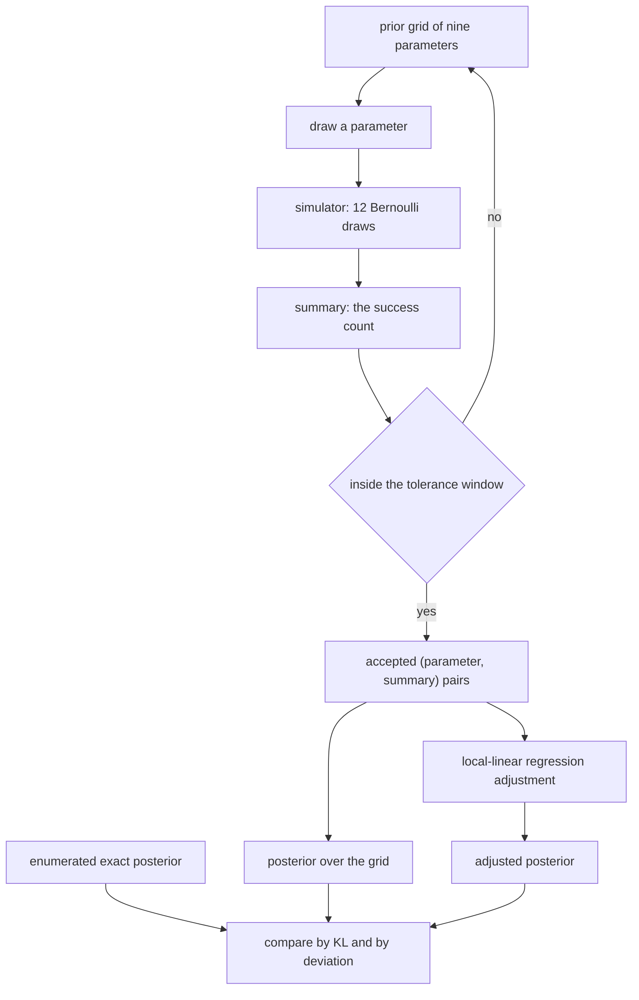
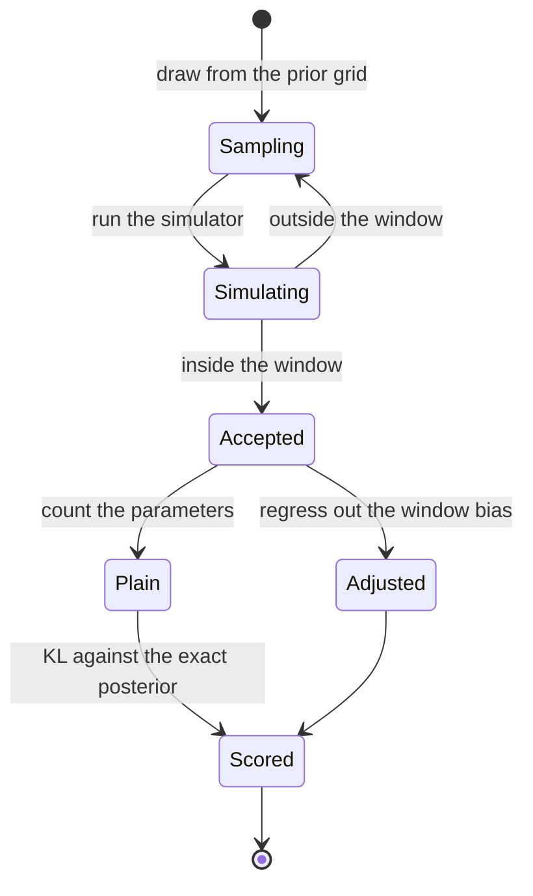
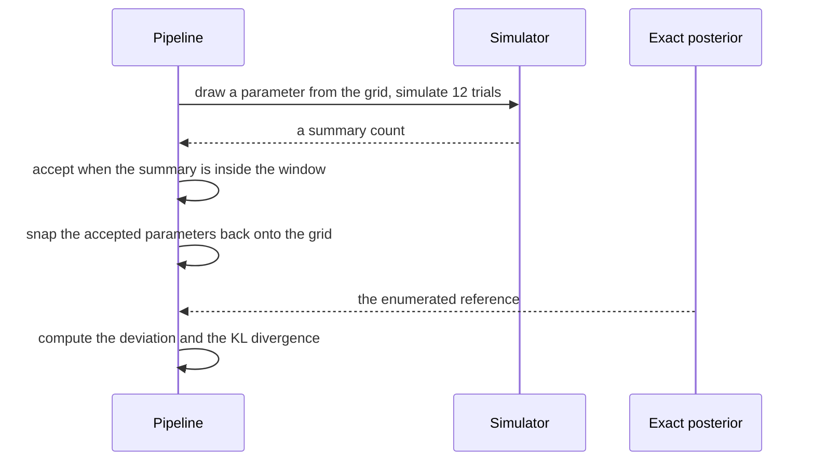

# 862 — Implement approximate Bayesian computation pipeline for simulator-based inference.

> **Tier:** Master · **CTCI chapter:** Beyond — Machine Learning & AI
> **Task spec:** [862-implement-approximate-bayesian-computation-pipeline-for-simulato.md](../../../tasks/master/862-implement-approximate-bayesian-computation-pipeline-for-simulato.md)
> **Solutions:** [Python](../../../solutions/python/master/862-implement-approximate-bayesian-computation-pipeline-for-simulato/solution.py) ·
> [Java](../../../solutions/java/master/862-implement-approximate-bayesian-computation-pipeline-for-simulato/Solution.java) ·
> [JavaScript](../../../solutions/javascript/master/862-implement-approximate-bayesian-computation-pipeline-for-simulato/solution.js) ·
> [C#](../../../solutions/csharp/master/862-implement-approximate-bayesian-computation-pipeline-for-simulato/Solution.cs)

## 1. Problem restatement

Inference for a model whose likelihood is only available by **running a simulator**: sample a
parameter from the prior, simulate, and keep the draws whose summary statistic is close to the
observation — rejection ABC, with an optional local-linear regression adjustment.

**Modelling contract.** The prior is a finite grid `GRID = 0.1, 0.2, …, 0.9`, the simulator is `12`
Bernoulli draws with success probability `parameter` summarised by the success count, and the
distance is the absolute difference of summaries. Because the summary is discrete and the prior is a
finite grid, the **exact posterior is available by enumeration**, so every approximation is measured
against the truth instead of assumed. The randomness is a seeded splitmix64 stream, so runs are
reproducible; there are no threads, no clock and no dependencies. Simplified versus a real pipeline:
the simulator is a binomial draw rather than a black-box generative model, and the prior is a grid
rather than a continuous distribution.

Concrete contract from the file's run with observation `8`:

| Assertion | Value |
| --- | --- |
| exact posterior | `[0.0, 0.0007, 0.0101, 0.0546, 0.1571, 0.2766, 0.3004, 0.1727, 0.0277]`, ML grid point `0.70` |
| tolerance `0` | `34349` accepted of `400000` simulations, `max abs(ABC - exact) = 0.0034` |
| acceptance rates | tolerance `0 / 1 / 2 / 3` → `0.0855 / 0.2566 / 0.427 / 0.5874` |
| tolerance sweep (KL) | `[(0, 0.0003), (1, 0.0113), (2, 0.0821), (3, 0.2444), (6, 1.1256)]` |
| enormous tolerance | tolerance `99` recovers the uniform prior (deviation `< 0.02`) |
| budget tightening | `5000 → 0.0272`, `50000 → 0.0069`, `400000 → 0.0034` deviation |
| regression adjustment | one-sided bias plain `0.0705` vs adjusted `0.0005`, exact mean `0.6429` |
| other observations | `4`, `6`, `8`, `11` all agree with the exact posterior |

## 2. Intuition

The naive ABC is "simulate a lot and keep what looks close". It is easy to write and hard to trust:
too tight and nothing is accepted, too loose and the answer is the prior, and neither failure
announces itself.

The key insight is to keep an **enumerable reference** next to the approximation:

1. **Enumeration gives the ground truth.** `exact_posterior(observation)` multiplies the uniform
   prior by the binomial likelihood at every grid point and normalises. Every approximation is then
   scored by `max abs` deviation or KL divergence from that vector — the file's whole verification
   strategy rests on this.
2. **The acceptance rate is predictable.** `exact_acceptance(tolerance, observation)` computes the
   prior-averaged probability that a simulator draw lands inside the window, so an acceptance rate
   that disagrees with it means the simulator or the window is wrong, not that the run was unlucky.
3. **The tolerance is the whole trade-off.** As it grows, more draws are accepted (better Monte Carlo
   error) and the posterior becomes smoother than the truth (worse approximation). The file measures
   both directions: the KL divergence grows monotonically with the tolerance, and at tolerance `99`
   the result *is* the prior.
4. **The acceptance window biases the estimate, and a regression can undo it.** A one-sided window
   `0 <= summary - observation <= tolerance` keeps only draws whose summary is at or above the
   observation, which drags the posterior mean upwards. The local-linear adjustment re-centres the
   accepted parameters at the observed summary, which is exactly the correction for the window.



## 3. Algorithm

1. **Define the model.** `simulate(parameter, rng)` runs `TRIALS = 12` Bernoulli draws and returns the
   success count; `binomial_probability(successes, trials, probability)` is the analytic likelihood,
   used only to build the reference.
2. **Enumerate the truth.** `exact_posterior(observation)` weights each grid point by its likelihood
   and normalises, returning `None` when every likelihood is zero (an impossible observation).
3. **Predict the acceptance rate.** `exact_acceptance(tolerance, observation)` averages, over the
   prior, the probability that a draw lands in `[observation - tolerance, observation + tolerance]`.
4. **Run rejection ABC.** `rejection_abc(observation, tolerance, simulations, seed, low=None)` draws a
   grid point uniformly, simulates, and keeps the pair when
   `bottom <= summary - observation <= tolerance`, with `bottom = -tolerance` unless `low` overrides
   it (the one-sided case uses `low=0`).
5. **Adjust.** `regression_adjusted(accepted, observation)` regresses the accepted parameters on the
   summary differences, and returns `parameter - slope * difference` for each draw — the fitted line
   evaluated at the observed summary.
6. **Summarise.** `posterior_from_samples` snaps the (possibly adjusted) values back onto the grid and
   normalises, so both the plain and the adjusted posteriors are comparable vectors;
   `kl_divergence(left, right)` scores them against the exact posterior.

```text
function exact_posterior(observation)
    weights ← binomial_probability(observation, TRIALS, parameter) for every grid parameter
    if the total is zero then
        return nothing
    end
    return the weights divided by their total
end

function exact_acceptance(tolerance, observation)
    total ← 0
    for parameter in the grid do
        probability ← sum over counts from observation - tolerance to observation + tolerance
                      of binomial_probability(count, TRIALS, parameter)
        total ← total + probability
    end
    return total / number of grid points
end

procedure rejection_abc(observation, tolerance, simulations, seed, low)
    bottom ← -tolerance if low is nothing else low
    accepted ← empty list
    for each of the simulations do
        parameter ← a uniformly drawn grid point
        summary ← simulate(parameter, rng)
        if bottom <= summary - observation <= tolerance then
            append (parameter, summary) to accepted
        end
    end
    return accepted, simulations
end

function regression_adjusted(accepted, observation)
    if fewer than three draws were accepted then
        return the accepted parameters unchanged
    end
    differences ← summary - observation for every accepted pair
    slope ← the least-squares slope of parameter on difference
    return parameter - slope * difference for every pair
end

function posterior_from_samples(samples)
    for value in samples do
        find the closest grid point and add one to its weight
    end
    return the weights divided by their total, or nothing when there are no samples
end

function kl_divergence(approximate, exact)
    total ← 0
    for a, b in the two distributions do
        if a > 0 and b > 0 then
            total ← total + a * log(a / b)
        else if a > 0 then
            return infinity
        end
    end
    return total
end
```

The pipeline is a filter with a correction stage, wrapped in a measurement loop:



## 4. Worked example

### The exact posterior, and what the approximation must match

With `12` trials and observation `8`, the likelihood peaks at `p = 0.7`, and the enumerated posterior
(with the uniform grid prior) is:

| Grid point | `0.1` | `0.2` | `0.3` | `0.4` | `0.5` | `0.6` | `0.7` | `0.8` | `0.9` |
| --- | --- | --- | --- | --- | --- | --- | --- | --- | --- |
| weight | `0.0` | `0.0007` | `0.0101` | `0.0546` | `0.1571` | `0.2766` | `0.3004` | `0.1727` | `0.0277` |

The file asserts the shape of that vector, not just its numbers: it rises monotonically to the peak
at index `6`, falls monotonically afterwards, suppresses `0.1` below `1e-3`, and has
`exact[8] < exact[7] < exact[6]`. A grid prior with a discrete summary produces exactly this
non-Gaussian shape, which is why an approximation has to be *measured* rather than assumed normal.

### Exact-match ABC converges to it

At tolerance `0`, a draw is accepted only when its simulated count equals the observation:

| Budget | Accepted | Max deviation from exact |
| --- | --- | --- |
| `5000` | `73` | `0.0272` |
| `50000` | `727` | `0.0069` |
| `400000` | `34349` | `0.0034` |

The accepting fraction (`0.0855`) matches the analytic `exact_acceptance(0, 8)` to within `0.01`, and
the deviation shrinks with the budget: ABC with tolerance zero is *exact* inference with a Monte
Carlo error, and the file shows the error decaying rather than asserting it.

### The tolerance trade-off, measured in both directions

| Tolerance | Acceptance rate | KL divergence from exact |
| --- | --- | --- |
| `0` | `0.0855` | `0.0003` |
| `1` | `0.2566` | `0.0113` |
| `2` | `0.4270` | `0.0821` |
| `3` | `0.5874` | `0.2444` |
| `6` | — | `1.1256` |
| `99` | — | the prior is recovered (deviation `< 0.02`) |

The KL divergence grows monotonically with the tolerance, which the file asserts pairwise. The
tolerance-`99` row is the degenerate end: the window is wider than the `12`-point summary range, so
every draw is accepted and the "posterior" is the prior — the failure mode that loosening the
tolerance eventually reaches, and the reason ABC reports its tolerance as part of its answer.



### Regression adjustment removes the window bias

A one-sided window keeps only draws with `summary >= observation`, so the plain posterior mean is
dragged upward. Averaged over six seeds:

| Estimator | Mean absolute bias against the exact mean `0.6429` |
| --- | --- |
| plain rejection ABC | `0.0705` |
| local-linear adjustment | `0.0005` |

That is a two-order-of-magnitude reduction, and it is the entire justification for the adjustment
step: `regression_adjusted` fits the slope of the accepted parameters against their summary
differences and evaluates the line at difference zero, which is where the observation sits. The file
also checks that the adjustment keeps every accepted draw on a symmetric window, so it corrects the
values rather than discarding data.

### Edge cases

| Case | Result |
| --- | --- |
| impossible observation (`13` successes out of `12`) | `exact_posterior` returns `None`; ABC accepts nothing but still runs all `5000` simulations |
| empty sample | `posterior_from_samples` returns `None` rather than a zero vector |
| zero simulations | the run completes with no accepted draws and no crash |
| observations `4`, `6`, `8`, `11` | all agree with the exact posterior |
| one-sided versus symmetric window | the one-sided acceptance window is never wider |

## 5. Complexity

Let `G` be the grid size (`9`), `S` the number of simulations, `T = 12` the trial count, `A` the
accepted count, and `W` the window width in summary units.

| Measure | Bound | Why it holds |
| --- | --- | --- |
| Enumerating the exact posterior | `O(G)` | one likelihood per grid point |
| Exact acceptance rate | `O(G * W)` | one binomial term per count in the window per parameter |
| One simulation | `O(T)` | `T` Bernoulli draws |
| Rejection ABC | `O(S * T)` | the simulation dominates; the acceptance test is `O(1)` |
| Posterior from samples | `O(A * G)` | each accepted value snaps to its nearest grid point |
| Regression adjustment | `O(A)` | one pass for the means, one for the slope, one for the correction |
| KL divergence | `O(G)` | one term per grid point |
| Space | `O(A + G)` | the accepted pairs plus the posterior vector |

The cost that matters in practice is `O(S * T)` — every simulation is a fresh run of the model, and
nothing is shared between draws. That is why the acceptance rate is worth predicting: the useful
sample size is roughly `S * acceptance`, so `exact_acceptance` tells you the budget needed before you
spend it. At tolerance `0` the rate is `0.0855`, i.e. about `12` simulations per accepted draw; at
tolerance `3` it is `0.5874`, i.e. fewer than `2`.

The `O(A * G)` snapping step is a deliberate simplification of mapping samples back to a grid. A
continuous-prior ABC would use a kernel density estimate instead, trading the exact grid comparison
for a bandwidth choice — and the file's `posterior_from_samples` would no longer be comparable
element by element with the enumerated truth, which is why the grid prior is the right choice for a
verifiable pipeline.

## 6. Pitfalls and edge cases

- **A tolerance that is never validated.** The file reports the KL divergence at every tolerance and
  asserts monotonicity: `0.0003 → 0.0113 → 0.0821 → 0.2444 → 1.1256`. Without that, "we used
  tolerance 2" is an unquantified approximation.
- **Accepting nothing and reporting an empty posterior.** An impossible observation (`13` successes
  out of `12`) has no posterior at all, and the file returns `None` explicitly — but the run still
  executes all `5000` simulations, so the failure is reported rather than hidden by an early exit.
- **Zero accepted draws in the adjustment.** `regression_adjusted` returns the parameters unchanged
  when fewer than three draws were accepted, and returns them unchanged when the summary differences
  have zero variance, rather than dividing by zero.
- **The mean subtraction in the adjustment.** The slope is computed against *centred* differences and
  parameters; a naive `sum(d * p) / sum(d²)` would be wrong whenever the accepted window is not
  centred on the observation, which is exactly the one-sided case the file tests.
- **A window that is one-sided by accident.** `rejection_abc` takes an explicit `low` parameter so the
  symmetric and one-sided cases are distinguishable in the call; the observed value is always
  `summary - observation`, so flipping the direction changes the bias sign.
- **Snapping without normalising.** `posterior_from_samples` returns `None` when the total weight is
  zero, so the caller cannot mistake an empty sample for a uniform posterior.
- **Comparing distributions with zeros.** `kl_divergence` returns `inf` when the approximation puts
  mass where the exact posterior has none, which is the honest answer — an approximation that
  spreads mass onto ruled-out parameters is infinitely wrong in that direction.
- **Determinism.** Identical accepted samples for the same seed, which is what makes the budget
  comparison (`5000` / `50000` / `400000` accepted counts) meaningful rather than noisy.

## 7. Variants and follow-ups

- **When the likelihood is tractable after all.** Variational inference replaces simulation with an
  optimised bound — see
  [860-implement-probabilistic-programming-inference-engine-with-variat.md](../../../tasks/master/860-implement-probabilistic-programming-inference-engine-with-variat.md).
- **Exact inference without a tolerance.** MCMC targets the true posterior asymptotically, at the
  price of the convergence diagnostics in
  [861-implement-large-scale-mcmc-with-asynchronous-proposals-and-conve.md](../../../tasks/master/861-implement-large-scale-mcmc-with-asynchronous-proposals-and-conve.md).
- **The drift question in a sequential setting.** Refitting a model as new observations arrive, with
  the same "is the posterior still valid?" question, is
  [858-implement-streaming-transfer-learning-pipeline-with-concept-drif.md](../../../tasks/master/858-implement-streaming-transfer-learning-pipeline-with-concept-drif.md).
- **Simulator-based evaluation at scale.** The distance-threshold idea reappears as an embedding
  similarity search in
  [863-implement-large-scale-graph-embedding-training-with-negative-sam.md](../../../tasks/master/863-implement-large-scale-graph-embedding-training-with-negative-sam.md).

## 8. Check yourself

1. Why is tolerance-zero ABC described as *exact* inference rather than an approximation?

<details><summary>Show answer</summary>

Because the acceptance condition becomes "the simulated summary equals the observation", so a draw is
kept with probability proportional to the likelihood — the accepted parameters are a sample from the
true posterior, and the only remaining error is Monte Carlo. The file shows both sides: the accepting
fraction matches the analytic `exact_acceptance(0, 8)` to within `0.01`, and the deviation from the
enumerated posterior shrinks with the budget (`0.0272` at `5000`, `0.0069` at `50000`, `0.0034` at
`400000`).

</details>

2. What happens at tolerance `99`, and why is that a useful check?

<details><summary>Show answer</summary>

The window is wider than the entire range of the summary statistic, so every draw is accepted and the
result is the prior — the file asserts the recovered distribution matches the uniform grid within
`0.02`. It is useful because it pins the degenerate end of the trade-off: the same code that produced
the exact posterior at tolerance zero must reproduce the prior at tolerance infinity, which proves the
acceptance machinery is actually filtering rather than always accepting.

</details>

3. Why does the local-linear adjustment reduce the bias from `0.0705` to `0.0005`?

<details><summary>Show answer</summary>

Because the one-sided window `0 <= summary - observation <= tolerance` keeps only draws whose summary
is at or above the observation, and summaries above the observation are associated with larger
parameters — so the accepted parameter sample is shifted upward relative to the posterior. Fitting the
slope of parameter against `summary - observation` and evaluating the line at difference zero
re-centres every accepted draw at the observed summary, which removes precisely that shift while
keeping all the draws.

</details>
