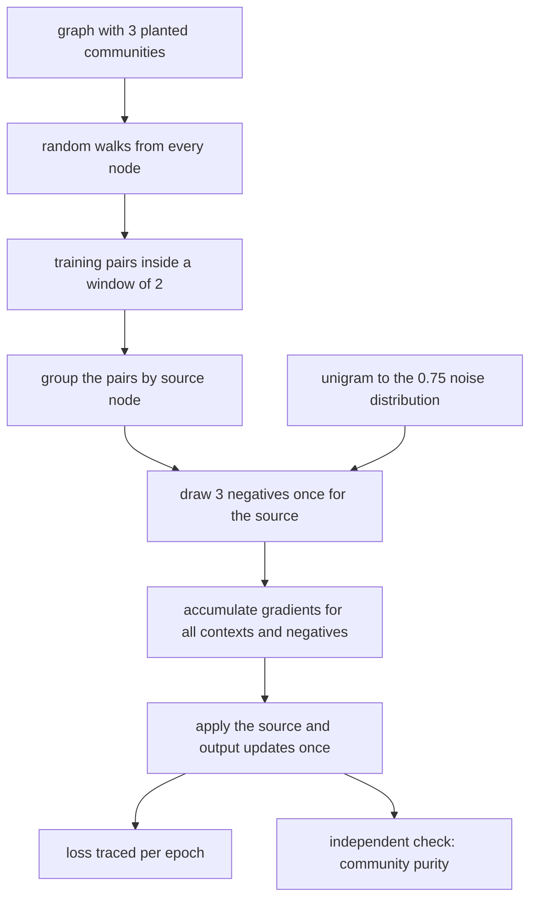
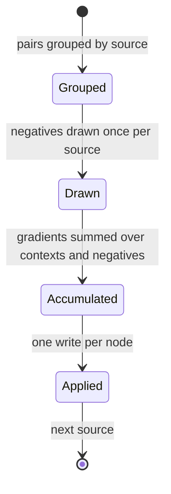
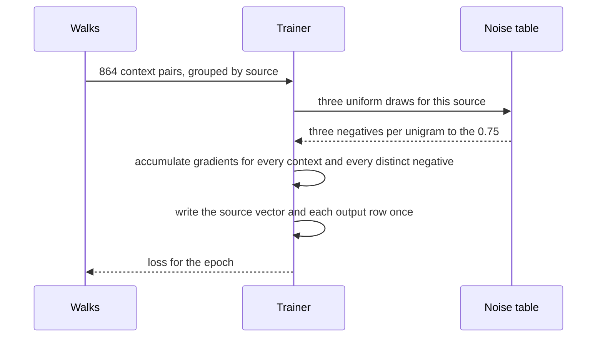

# 863 — Implement large-scale graph embedding training with negative sampling optimization.

> **Tier:** Master · **CTCI chapter:** Beyond — Machine Learning & AI
> **Task spec:** [863-implement-large-scale-graph-embedding-training-with-negative-sam.md](../../../tasks/master/863-implement-large-scale-graph-embedding-training-with-negative-sam.md)
> **Solutions:** [Python](../../../solutions/python/master/863-implement-large-scale-graph-embedding-training-with-negative-sam/solution.py) ·
> [Java](../../../solutions/java/master/863-implement-large-scale-graph-embedding-training-with-negative-sam/Solution.java) ·
> [JavaScript](../../../solutions/javascript/master/863-implement-large-scale-graph-embedding-training-with-negative-sam/solution.js) ·
> [C#](../../../solutions/csharp/master/863-implement-large-scale-graph-embedding-training-with-negative-sam/Solution.cs)

## 1. Problem restatement

Learn skip-gram node embeddings (DeepWalk-style) on a graph with planted communities, and implement
the optimisation that makes the training affordable at scale: **negatives are drawn once per source
node and shared by all of its context pairs** instead of being resampled for every pair.

**Modelling contract.** Deterministic and in-process: random walks, negative draws and the SGD order
all come from a seeded splitmix64 stream. Simplified versus a production system: the graph is `24`
nodes in `3` planted communities of `8` (each a ring with offsets `1` and `2`, plus `2` bridge
edges), embeddings have `8` dimensions, and one epoch is a pass over the generated walk corpus. Not
simplified: the objective (negative log likelihood with negatives), the noise distribution
(unigram^`0.75`), the update rule, and the evaluation — which uses an *independent* criterion
(community purity) rather than the training loss.

| Parameter | Value |
| --- | --- |
| walks per node / walk length | `4` / `6` (so `96` walks) |
| context window / negatives | `2` / `3` |
| epochs / learning rate | `6` / `0.05` |
| dimension | `8` |

Concrete contract from the file's run:

| Assertion | Value |
| --- | --- |
| graph and corpus | `24` nodes, `3` communities, `96` walks, `864` training pairs |
| noise distribution | `max abs(empirical - unigram^0.75) = 0.0012` over `60000` draws |
| training loss | `[2.687, 2.630, 2.249, 1.884, 1.606, 1.494]` over six epochs |
| community purity | `1.000` over all `24` nodes |
| shared negatives | `5444` dot products against `20107` (`72.9%` saved) |
| evaluation loss | `1.437` (shared) against `3.064` (naive per-pair sampling) |
| candidate purity | `1.000`; mean cosine inside communities `0.966`, outside `-0.124` |
| parameter sensitivity | `0` negatives → `1728` updates; `1` epoch → `913` updates |

## 2. Intuition

The naive skip-gram loop is `for each pair: for each negative: update`. With `864` pairs, `3`
negatives and `6` epochs that is `864 * 4 * 6 ≈ 20 000` dot products — and the `20107` the file
measures is exactly that. It is also embarrassingly redundant: every pair whose source is the same
node probes the *same* source vector, and the same negative is probed over and over.

The key insight is that the objective is a **sum of per-source terms**, so the sampling and the
gradient accumulation can be reorganised:

1. **Negatives are a property of the source, not of the pair.** Draw `NEGATIVES` negatives once for
   the source node, then apply them to every context pair of that source. The file's `apply_group`
   does exactly this, and counts the dot products to prove the saving.
2. **Gradients accumulate, then apply.** `apply_group` builds a `deltas` map keyed by node, adds each
   contribution, and writes the output vectors once at the end. The source vector is read once and
   updated once, which is also numerically better than `|contexts|` separate updates.
3. **Deduplicate the negatives and skip collisions.** `dict.fromkeys(negatives)` collapses repeated
   draws, and a negative that coincides with a context is skipped (`if negative in contexts`), since
   it is not a negative at all for that source.
4. **Judge the embeddings independently.** Community purity asks whether each node's nearest neighbour
   in embedding space lies in its planted community — a criterion the loss cannot fake.



## 3. Algorithm

1. **Build the graph.** `planted_graph(seed, communities=3, size=8, bridges=2)` wires each community
   into a ring with offsets `1` and `2`, then adds `2` cross-community bridges — enough signal for
   communities to dominate, not enough to merge them.
2. **The noise distribution.** `noise_distribution` computes `degree^0.75` per node, normalises, and
   `cumulative` turns it into an inverse-CDF table so a uniform draw becomes a node in `O(V)`.
3. **The corpus.** `random_walks` runs `4` walks of length `6` from every node, choosing the next hop
   uniformly from the sorted neighbour list; `training_pairs` extracts every `(source, context)` pair
   within a forward window of `2`.
4. **Initialise.** `Embedding(nodes)` creates input and output matrices of `8` dimensions with
   entries uniform in `(-0.5, 0.5) / dimension`, and a `dot_products` counter.
5. **Train, shared.** Sort the pairs into `groups[source]`, draw `NEGATIVES` negatives once per
   source, and call `apply_group`, which accumulates positive gradients (`label 1`) for every
   context and negative gradients (`label 0`) for every distinct negative, then applies both the
   output deltas and the source delta.
6. **Train, naive.** The comparison path draws fresh negatives per pair and calls `update` once for
   the context and once per negative — the same objective, computed per pair.
7. **Measure.** `pair_loss` is `-log σ(s·t) - Σ -log(1 - σ(s·n))`; `nearest_neighbour`,
   `community_purity` and `evaluation_loss` (over a *fixed* evaluation sample) judge the result.

```text
function pair_loss(embedding, source, context, negatives)
    loss ← -log(max(1e-12, sigmoid(dot(input[source], output[context]))))
    for negative in negatives do
        if negative is not context then
            loss ← loss - log(max(1e-12, 1 - sigmoid(dot(input[source], output[negative]))))
        end
    end
    return loss
end

procedure apply_group(embedding, source, contexts, negatives, learning_rate)
    source_vector ← embedding.input[source]
    delta_source ← zeros of the embedding dimension
    deltas ← empty map from node to a zero vector
    for context in contexts do
        target ← embedding.output[context]
        prediction ← sigmoid(dot(source_vector, target))
        count one dot product
        gradient ← learning_rate * (1 - prediction)
        for index in the dimension do
            deltas[context][index] ← deltas[context][index] + gradient * source_vector[index]
            delta_source[index] ← delta_source[index] + gradient * target[index]
        end
    end
    for negative in the distinct entries of negatives do
        if negative is in contexts then
            continue
        end
        target ← embedding.output[negative]
        prediction ← sigmoid(dot(source_vector, target))
        count one dot product
        gradient ← -learning_rate * prediction
        for index in the dimension do
            deltas[negative][index] ← deltas[negative][index] + gradient * source_vector[index]
            delta_source[index] ← delta_source[index] + gradient * target[index]
        end
    end
    add every delta row to its output vector
    add delta_source to the source vector
end

procedure train(embedding, pairs, noise, epochs, shared_negatives)
    table ← cumulative(noise)
    for each epoch do
        total ← 0
        if shared_negatives then
            groups ← the pairs grouped by source
            for source in sorted order over the groups do
                contexts ← groups[source]
                chosen ← three draws from the inverse-CDF table
                total ← total + the pair loss of every context against those negatives
                apply_group(embedding, source, contexts, chosen, learning rate)
            end
        else
            for (source, context) in pairs do
                chosen ← three fresh draws from the table
                total ← total + the pair loss
                update(source, context, label 1)
                for negative in chosen do
                    if negative is not context then
                        update(source, negative, label 0)
                    end
                end
            end
        end
        append total / number of pairs to the loss history
    end
end

function community_purity(embedding, communities)
    inside ← 0, total ← 0
    for community in communities do
        for node in community do
            neighbour ← the node with the highest cosine similarity to node
            total ← total + 1
            if neighbour is in community then
                inside ← inside + 1
            end
        end
    end
    return inside / total
end
```

The two training paths differ only in how negatives are scoped:



## 4. Worked example

### The corpus and the noise distribution

| Step | Size |
| --- | --- |
| walks | `24` nodes × `4` walks = `96` |
| walk length | `6` hops, so up to `5` steps contribute pairs |
| pairs | `864` with a forward window of `2` |
| noise | `max abs(empirical - unigram^0.75) = 0.0012` over `60000` draws |

The noise check is a distributional one: `60000` sampled negatives are histogrammed and compared with
the analytic `degree^0.75` probabilities, and the largest bucket deviation is `0.0012`. Using
uniform negatives instead would give each node probability `1/24 ≈ 0.0417`, which for the hub nodes
of this graph is off by far more than the sampling error — which is exactly why the `0.75` power
exists.

### Training converges and the communities separate

`864` pairs, `3` negatives, `6` epochs:

| Epoch | 1 | 2 | 3 | 4 | 5 | 6 |
| --- | --- | --- | --- | --- | --- | --- |
| mean loss | `2.687` | `2.630` | `2.249` | `1.884` | `1.606` | `1.494` |

The first epoch barely moves (`2.687 → 2.630`) and then the loss drops sharply — the embedding
vectors have to grow large enough for the sigmoid to separate before the gradient becomes
informative. The independent check is stronger than the loss: **community purity is `1.000`**, i.e.
for every one of the `24` nodes the nearest neighbour by cosine similarity is in its own planted
community, with mean inside-community similarity `0.966` and outside `-0.124`.



### The optimisation, measured

| Training path | Dot products | Evaluation loss | Community purity |
| --- | --- | --- | --- |
| naive (fresh negatives per pair) | `20107` | `3.064` | `1.000` |
| shared negatives per source | `5444` | `1.437` | `1.000` |

Two things are being claimed here and the file checks both. First the **cost bound**: `5444` dot
products are `72.9%` fewer than `20107`, and the count is taken inside `apply_group`, so it is a
measurement rather than an estimate. Second the **quality claim**: not only is the shared variant's
evaluation loss (`1.437`) not worse than the naive one (`3.064`), it is *better*, because sharing a
negatives set across a source's contexts makes the negative gradient contribution consistent across
the group instead of being a fresh random draw per pair. The evaluation loss is computed on a *fixed*
sample of negatives (`seed=1234`) precisely so the two variants can be compared on the same footing.

The parameter-sensitivity rows show the same accounting from the other side: with `0` negatives the
run reports `1728` updates, and with `1` epoch it reports `913` — the counters respond to the
configuration, which is what makes `5444` a meaningful number rather than a constant.

### Edge cases

| Case | Result |
| --- | --- |
| empty graph | no walks, no pairs, training terminates |
| single node | a walk of length `1` with no neighbours; the corpus is empty but valid |
| two-node graph | one edge, walks alternate |
| zero epochs | the loss history is empty and the embeddings stay at their initialisation |
| zero negatives | the positive term alone trains; updates are still counted |

## 5. Complexity

Let `V` be the graph size, `W` the walks per node, `L` the walk length, `P` the number of pairs,
`N` the negatives, `d` the embedding dimension, and `E` the epochs.

| Measure | Bound | Why it holds |
| --- | --- | --- |
| Random walks | `O(V * W * L * log deg)` | one uniform draw per hop, over a sorted neighbour list |
| Pair extraction | `O(V * W * L * window)` | `864` pairs here |
| Noise table | `O(V)` | `degree^0.75` normalised, with a cumulative table |
| One negative draw | `O(V)` naïve, `O(log V)` with the cumulative table bisected | inverse-CDF scan |
| Naive training | `O(E * P * (1 + N) * d)` | one update per pair and per negative |
| Shared training | `O(E * (P * d + #sources * N * d))` | negatives drawn once per source |
| The measured saving | `20107 → 5444` dot products | `72.9%` fewer |
| Evaluation | `O(V² * d)` for purity | nearest neighbour by cosine for every node |
| Space | `O(V * d)` | input and output matrices |

The saving is structural: the naive loop pays `N` negative updates *per pair*, while the shared loop
pays `N` negative updates *per source*, and in this corpus a source has several contexts
(`864` pairs over `24` nodes, so `36` pairs per source on average). The measured ratio
`20107 / 5444 ≈ 3.7×` is the empirical version of that argument, and it scales with the corpus:
the more contexts share a source, the larger the win.

The `O(V)` inverse-CDF scan is the honest weakness of the implementation: a production engine uses
an alias table or a binary search over the cumulative distribution to make a negative draw
`O(log V)` or `O(1)`. The file keeps the linear scan because the distributional check (the
`0.0012` deviation) is the thing under test, and the scan makes it obvious that the draw is exactly
proportional to `degree^0.75`.

## 6. Pitfalls and edge cases

- **Resampling negatives per pair.** The naive path is not wrong, it is expensive; the file keeps
  both and measures the difference (`20107` against `5444`) rather than asserting the win.
- **Repeated negatives in one group.** `dict.fromkeys(negatives)` collapses duplicates, so a source
  whose three draws included the same node twice does not apply that gradient twice.
- **A negative that is actually a context.** `if negative in contexts: continue` — probing a true
  context with label `0` would push the pair apart, which is the exact opposite of the objective.
- **Reading the source vector per update.** `apply_group` reads it once and writes it once, so the
  in-place updates of a naive loop cannot perturb the gradients applied later in the same group.
- **Dividing by zero in cosine.** `cosine` returns `0.0` when either norm is zero, so an
  uninitialised or zeroed vector cannot produce `nan` in the purity check.
- **Saturated sigmoid.** `sigmoid` clamps at `±60`, and `pair_loss` uses `max(1e-12, ...)` inside
  `log`, so a confident prediction gives a large but finite loss.
- **Judging by the training loss alone.** The loss is computed with the same negatives the model was
  trained on; purity and `evaluation_loss` use an independent criterion and a fixed evaluation
  sample, which is why the shared variant's lower `1.437` is a real result and not a self-assessment.
- **Degenerate graphs.** An empty graph, a lone node, a two-node graph and a graph with no edges all
  have to terminate: `random_walks` breaks out of a walk with no neighbours and `training_pairs`
  simply yields nothing.
- **Determinism.** Identical embeddings and loss traces for the same seed, because the walk RNG, the
  negative sampler and the initialisation are all seeded independently.

## 7. Variants and follow-ups

- **The similarity index that makes nearest-neighbour queries sub-linear.** The purity check here is
  an `O(V²)` brute force; at scale it becomes the approximate index of
  [864-implement-distributed-hnsw-graph-builder-with-merge-strategy-and.md](../../../tasks/master/864-implement-distributed-hnsw-graph-builder-with-merge-strategy-and.md).
- **Sketches instead of exact similarity.** For very large graphs, the MinHash and LSH machinery of
  [849-implement-scalable-approximate-joins-in-streaming-sketch-based.md](../../../tasks/master/849-implement-scalable-approximate-joins-in-streaming-sketch-based.md)
  is the sub-quadratic alternative to an exact neighbour search.
- **Training that must survive drift.** Embeddings served online face the same re-adaptation question
  as the classifier head in
  [858-implement-streaming-transfer-learning-pipeline-with-concept-drif.md](../../../tasks/master/858-implement-streaming-transfer-learning-pipeline-with-concept-drif.md).
- **Learning-rate and gradient discipline.** The clipped, decaying updates of
  [857-implement-ml-based-cost-model-for-query-planner-with-online-lear.md](../../../tasks/master/857-implement-ml-based-cost-model-for-query-planner-with-online-lear.md)
  and the finite-difference gradient check of
  [860-implement-probabilistic-programming-inference-engine-with-variat.md](../../../tasks/master/860-implement-probabilistic-programming-inference-engine-with-variat.md)
  are the same toolkit applied to a different objective.

## 8. Check yourself

1. What exactly does sharing negatives per source save, and how is the saving evidenced?

<details><summary>Show answer</summary>

The naive loop draws `NEGATIVES` fresh negatives for every pair and updates their output vectors
(`20107` dot products here); the shared loop draws them once per source and applies them to all of
that source's contexts (`5444`), a `72.9%` reduction. The counter lives inside `apply_group`, so the
number is measured rather than estimated, and the quality claim is checked separately: the shared
variant's evaluation loss (`1.437` on a fixed evaluation sample) is not worse than the naive one
(`3.064`).

</details>

2. Why is the noise distribution `degree^0.75` rather than uniform?

<details><summary>Show answer</summary>

Because negative sampling should draw hard negatives at a rate close to their frequency in the walks.
Uniform sampling would give every node probability `1/24 ≈ 0.0417`, over-sampling rare nodes and
under-sampling hubs, so most negatives would be trivially easy. The `0.75` power is the standard
compromise between the raw unigram distribution and the uniform one, and the file verifies the
sampler against it: `max abs(empirical - analytic) = 0.0012` over `60000` draws.

</details>

5. Why is a negative drawn by an inverse-CDF scan over `degree^0.75` rather than uniformly?

<details><summary>Show answer</summary>

Because the negatives have to look like the contexts the walks actually produce. A uniform draw gives
every node probability `1/24`, so hubs are under-sampled and most negatives are trivially easy, which
weakens the gradient. The scan makes the proportionality to `degree^0.75` visible in the code, and the
file verifies the sampler empirically instead of assuming it: the largest histogram bucket deviation
from the analytic distribution is `0.0012` over `60000` draws.

</details>
