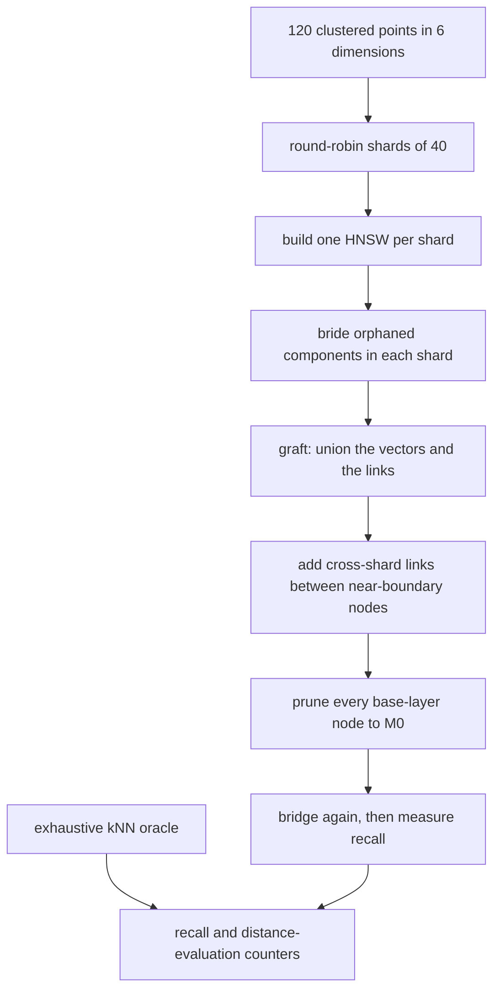
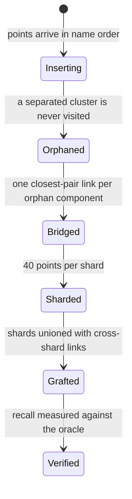
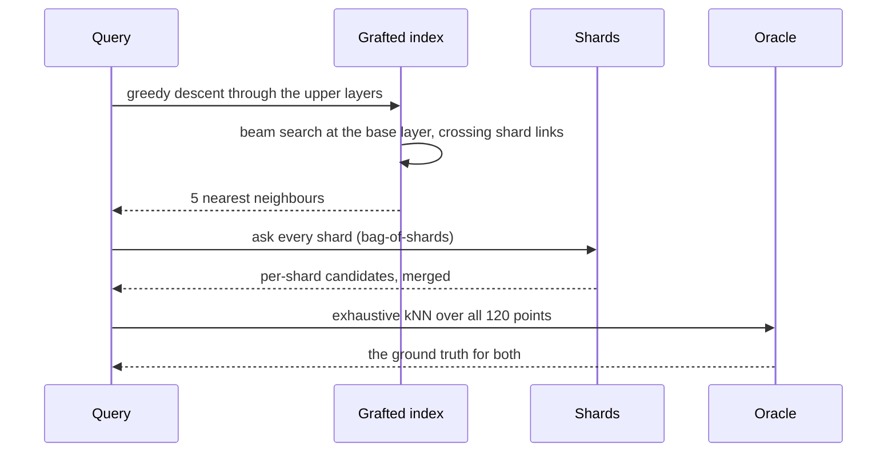

# 864 — Implement distributed HNSW graph builder with merge strategy and recall guarantees.

> **Tier:** Master · **CTCI chapter:** Beyond — Machine Learning & AI
> **Task spec:** [864-implement-distributed-hnsw-graph-builder-with-merge-strategy-and.md](../../../tasks/master/864-implement-distributed-hnsw-graph-builder-with-merge-strategy-and.md)
> **Solutions:** [Python](../../../solutions/python/master/864-implement-distributed-hnsw-graph-builder-with-merge-strategy-and/solution.py) ·
> [Java](../../../solutions/java/master/864-implement-distributed-hnsw-graph-builder-with-merge-strategy-and/Solution.java) ·
> [JavaScript](../../../solutions/javascript/master/864-implement-distributed-hnsw-graph-builder-with-merge-strategy-and/solution.js) ·
> [C#](../../../solutions/csharp/master/864-implement-distributed-hnsw-graph-builder-with-merge-strategy-and/Solution.cs)

## 1. Problem restatement

Shards of an HNSW index are built independently and then **merged**, and the merge is judged by
*measured* recall against exhaustive nearest-neighbour search.

**Modelling contract.** Deterministic and in-process: every "random" choice (levels, shard
assignment, cluster centres) comes from a seeded splitmix64 stream, so there are no threads, no clock
and no unseeded randomness. Simplified versus a production system: the vector set is `120` points in
`6` dimensions drawn from `4` clusters, the index is a plain adjacency structure rather than a packed
graph, there are `3` shards, and the merge adds cross-shard links at the base layer rather than
running a full distributed build protocol. Not simplified: the HNSW algorithms themselves — level
drawing, greedy descent, beam search, and the diversity-based neighbour selection of algorithm 4.

| Parameter | Value |
| --- | --- |
| dimension / clusters | `6` / `4` |
| `M` / `M0` (base layer) | `6` / `12` |
| `EF_CONSTRUCTION` | `24` |
| shards / neighbours `k` | `3` / `5` |

Concrete contract from the file's run:

| Assertion | Value |
| --- | --- |
| shards | `[40, 40, 40]` points, base layers `[40, 40, 40]` |
| bridging | `60` of `120` points unreachable after insertion alone; `2` bridges repair it |
| single-shard recall | `{1: 0.8, 8: 1.0, 16: 1.0, 32: 1.0, 64: 1.0}` against a shard-local oracle |
| merged recall | `{8: 0.49, 16: 0.847, 32: 1.0, 64: 1.0}` against the global oracle; one shard at beam `32`: `0.140` |
| workload | grafted `1.000` recall at `119` evaluations/query; bag-of-shards `0.335` at `87` (`2.20x` recall per evaluation) |
| ceiling | the bag of shards is capped at `0.335` even at beam `128` |
| exactness | full-beam recall `1.000` |

## 2. Intuition

The naive way to distribute an HNSW index is to shard the points, build a graph per shard, and at
query time ask every shard for its `k` nearest and merge the answers — the "bag of shards". It is
simple, it parallelises perfectly, and it is **structurally bounded**: a query living in shard `2`
asking shard `0` can only get shard `0`'s internal view, and the shard boundary itself is invisible
to every shard's graph. The file measures that ceiling at `0.335`.

The key insight is that the *answer* is only as good as the graph a greedy search can walk, so the
merge should produce **one connected graph**, not a federation of graphs:

1. **Greedy insertion alone does not produce a connected graph.** Each point links to the nodes its
   search visits, which is exactly the set of nodes reachable from the entry point. The file measures
   the consequence: **`60` of `120` points are unreachable** after insertion alone, because a
   well-separated cluster is never visited. A search cannot walk into a component it cannot reach.
2. **Bridging repairs it.** `repair_connectivity` repeatedly finds the base-layer components, takes
   the closest cross-component pair, and adds exactly one link — without breaking the degree bound
   (`add_bridge` drops the furthest link only if removing it keeps the node reachable) and without
   removing any existing path. Two bridges are enough for this layout.
3. **Diversity in neighbour selection is what keeps it connected.** `prune` implements HNSW
   algorithm 4: keep a candidate only if it is nearer to the query node than to every neighbour kept
   so far. A plain "keep the `M0` nearest" rule breaks the base layer into components.
4. **The merge stitches the shards.** `graft` unions all shards' vectors and links, adds
   near-boundary cross-shard links, prunes to `M0`, and bridges again — so a search can cross shard
   boundaries instead of being confined to one shard's view.



## 3. Algorithm

1. **Build the points.** `build_points(seed)` draws `4` cluster centres and places each point near
   its centre with `0.6` spread, so clusters are tight and separated.
2. **Assign levels.** `draw_level` promotes a point with probability `0.5` per step, capped at `4`,
   giving the usual geometric layer sizes.
3. **Insert.** `insert(node)` descends greedily from the entry point through the upper layers, then
   for every layer from `min(level, top)` down to `0` runs `search_layer` with beam
   `EF_CONSTRUCTION = 24`, links to the best `M0` (base) or `M` (upper) candidates, and prunes each
   affected neighbour back to its bound.
4. **Search.** `search(name, neighbours, ef_search)` descends greedily to layer `1`, then runs
   `search_layer` at layer `0` with beam `max(ef_search, neighbours)` and returns the best
   `neighbours` names, excluding the query itself.
5. **Prune with diversity.** `prune` ranks the candidate links by distance, keeps a candidate only
   when it is further from every already-kept neighbour than from the node itself, then fills any
   remaining slots with the nearest rejects.
6. **Repair connectivity.** `repair_connectivity` computes base-layer components; while there is more
   than one, it finds the closest cross-component pair, calls `add_bridge`, and repeats.
7. **Merge.** `graft(points, indexes, seed)` unions vectors, levels and links, picks a highest-level
   entry point, adds cross-shard links from the first `links_per_pair = 2` nodes of each shard to
   their nearest node in each other shard, prunes to `M0`, and bridges.
8. **Measure.** `brute_force` is the exhaustive oracle, `recall` compares the returned and expected
   sets, and the `distance_evaluations` counter makes recall-per-evaluation comparable between the
   grafted index and `bag_of_shards`.

```text
procedure insert(graph, node)
    if the graph has no entry point then
        set the entry point to node and its top to the node's level
        return
    end
    current ← the entry point
    for layer from top down to level + 1 do
        current ← greedy descent from current on that layer
    end
    for layer from min(level, top) down to 0 do
        candidates ← beam search on that layer with the construction beam
        chosen ← the nearest M0 candidates at layer 0, else the nearest M
        for other in chosen do
            add a link between node and other on that layer
            prune other back to its degree bound
        end
        current ← the nearest candidate
    end
    when the node's level exceeds the top, raise the top and make it the entry point
end

procedure prune(graph, node, level, limit)
    if the node already has at most limit links then
        return
    end
    ranked ← the links sorted by distance from node, ties broken by name
    selected ← empty list
    for candidate in ranked while fewer than limit selected do
        if candidate is further from every selected neighbour than from node then
            append candidate to selected
        end
    end
    fill any remaining slots from ranked in order
    delete every unselected link from both endpoints
end

function components(graph, level)
    iterative depth-first search over the layer, returning the components largest first
end

procedure repair_connectivity(graph)
    bridges ← 0
    while the base layer has more than one component do
        main, orphan ← the two largest components
        best ← the closest pair of points across the cut
        add_bridge(graph, best.left, best.right, M0)
        bridges ← bridges + 1
    end
    return bridges
end

procedure add_bridge(graph, left, right, limit)
    link left and right at the base layer
    while either endpoint exceeds the degree limit do
        for each other link of the over-full endpoint, furthest first do
            remove it, then re-add it when its removal would disconnect that node
        end
    end
end

procedure graft(points, indexes, seed)
    merged ← a new graph holding every shard's vectors, levels and links
    for every ordered pair of shards do
        for the first two nodes of the left shard in name order do
            link each to its nearest node in the right shard at the base layer
        end
    end
    prune every base-layer node to M0
    repair_connectivity(merged)
    return merged
end
```

The build is a two-phase pipeline, and the second phase is the one that makes search work:



## 4. Worked example

### The connectivity problem, measured

| Stage | Reachable points | Note |
| --- | --- | --- |
| after insertion alone | `60` of `120` | the other `60` sit in components greedy search never visits |
| after bridging (control off) | `120` of `120` | `2` closest-pair bridges were enough |

This is the control the docstring promises: `Hnsw(points, seed, repair=False)` builds the broken graph
and `repair=True` builds the repaired one, so the `60` unreachable points are a measurement rather
than a worry. It is also the reason `prune` implements the diversity rule — a nearest-`M` rule
manufactures exactly this failure at every insertion, not just in the last cluster.

### Recall is monotone in the beam, and the merge beats one shard

`k = 5` true nearest neighbours. The first column scores a shard against a **shard-local** oracle (brute
force inside that shard); the second scores the merged index against the **global** oracle:

| `efSearch` | Shard recall vs shard-local oracle | Merged index vs global oracle |
| --- | --- | --- |
| `1` | `0.8` | — |
| `8` | `1.0` | `0.49` |
| `16` | `1.0` | `0.847` |
| `32` | `1.0` | `1.0` |
| `64` | `1.0` | `1.0` |
| one shard vs the global oracle, beam `32` | `0.140` | — |

The `0.8 → 1.0` rise in the first column is a property of a single shard: it holds `40` of the `120`
points, so a moderately wide beam finds its own nearest neighbours quickly. The `0.140` row is the
same shard scored against the *full* oracle, and it is the number that matters — one shard simply
cannot answer for the points it does not hold. The merged index needs a wider beam (`32`) to reach
`1.0` because a search must now cross shard boundaries, but it is the only variant that can reach
`1.0` at all.

### The two merge strategies, compared by cost and by ceiling

| Strategy | Recall | Distance evaluations per query | Recall per evaluation |
| --- | --- | --- | --- |
| grafted index | `1.000` | `119` | `0.0084` |
| bag of shards | `0.335` | `87` | `0.0039` |

`2.20x` recall per evaluation is the headline, but the more important number is the ceiling: the bag
of shards is **capped at `0.335` even at beam `128`**. No amount of extra search effort fixes it,
because a shard can only return points it holds — the missing neighbours are in shards the query's own
shard never asks about with enough beam, and merging per-shard candidate lists cannot create a path
that does not exist. The grafted index pays `37%` more evaluations per query and gets `3x` the
recall.



### Exactness

With the beam as wide as the shard, recall is `1.000` for the grafted index against the oracle — the
graph is a valid HNSW structure, so widening the beam converges on the true answer. That is the
property that separates an approximate index from a broken one: an index that has lost its
connectivity cannot reach `1.0` at any beam width, which is exactly what the bag-of-shards ceiling
(`0.335` at beam `128`) demonstrates.

## 5. Complexity

Let `V` be the number of points, `M0` the base-layer degree bound, `S` the shard count, `d` the
dimension, `ef` the search beam, and `P` the number of queries.

| Measure | Bound | Why it holds |
| --- | --- | --- |
| Distance | `O(d)` | the Euclidean norm in `6` dimensions |
| Insertion | `O(V * (log V + M0) * ef * d)` | greedy descent plus a beam search per layer |
| Search | `O((log V + ef) * ef * d)` | descent to layer `1`, then a base-layer beam |
| Pruning a node | `O(M0² * d)` | all-pairs diversity check over the candidate links |
| Bridging | `O(V² * d)` worst per bridge | the closest cross-component pair is found by brute force |
| Graft | `O(S² * links_per_pair * V * d)` | near-boundary links between every shard pair |
| Bag of shards | `O(S * search cost)` | every shard is queried, then the candidate lists are merged |
| Whole run | `O(V * log V * ef * d)` plus the bridging pass | dominated by the per-point beam searches |

The `O(V² * d)` bridging pass is the honest weak spot: finding the closest cross-component pair by
brute force is fine for `120` points and unacceptable at scale, where a builder would keep a
per-component centroid and search across centroids instead. The file keeps the brute force because
the property being verified is *connectivity*, and an exhaustive search for the true closest pair
makes the bridge minimal and the check unambiguous.

The comparison that matters is the query side: the grafted index answers with `119`
distance evaluations per query against the bag-of-shards `87`, but returns `3x` the recall — and the
bag has a ceiling the grafted index does not. In a production setting the shards would also be
queried in parallel, so the bag's `87` evaluations are spread over `S` machines, which is exactly the
trade the measurement makes legible.

## 6. Pitfalls and edge cases

- **A disconnected base layer.** `60` of `120` points were unreachable after insertion alone; a graph
  the greedy descent cannot enter has a permanent recall ceiling no beam width can lift. The
  `repair=False` build is the control that makes this a measurement.
- **Nearest-`M` pruning instead of diversity pruning.** `prune` keeps a candidate only when it is
  nearer to the node than to every kept neighbour; a plain nearest-`M` rule breaks the graph, and the
  damage compounds at every insertion.
- **A bridge that breaks the degree bound, or a bridge that breaks connectivity.** `add_bridge` drops
  the furthest link but re-adds it when removing it would disconnect the node, so the `M0` bound is
  respected without severing a path.
- **Self loops and duplicates.** Every link set is a set, and searches skip the query itself
  (`candidate != name`); the graph invariants are asserted as "no self loops, degrees within the
  bound, every point present exactly once".
- **A beam narrower than the fan-out.** `search` uses `max(ef_search, neighbours)`, so asking for
  `k = 5` with `efSearch = 1` still returns a usable list rather than an empty one.
- **Monotone recall.** The file asserts recall is non-decreasing in `efSearch` and reaches `1.0` once
  the beam is as wide as the shard, and that it never exceeds the oracle — an over-report would mean
  the recall computation itself is wrong.
- **The bag-of-shards ceiling is not a tuning problem.** It is capped at `0.335` even at beam `128`,
  so the merge strategy is the fix, not the beam. Reporting only the `87` versus `119` evaluations
  would hide that.
- **Edge cases the file pins.** A single point, a single shard, a beam of `1`, `k` larger than the
  shard, and zero shards all terminate and stay within their guarantees.
- **Determinism.** The same seed rebuilds identical graphs and an identical merge, and a different
  seed gives different graphs — so the recall numbers are comparable across runs and the level
  assignments are genuinely seed-driven.

## 7. Variants and follow-ups

- **Cheaper similarity for bigger graphs.** The oracle here is exhaustive; MinHash and LSH banding in
  [849-implement-scalable-approximate-joins-in-streaming-sketch-based.md](../../../tasks/master/849-implement-scalable-approximate-joins-in-streaming-sketch-based.md)
  are the sub-quadratic alternative when exact distances are too expensive.
- **What feeds the index.** The vectors this index serves are the embeddings trained in
  [863-implement-large-scale-graph-embedding-training-with-negative-sam.md](../../../tasks/master/863-implement-large-scale-graph-embedding-training-with-negative-sam.md),
  whose purity check is a brute-force nearest-neighbour query.
- **Merge strategies under failure.** Stitching shards into one structure is the same problem as
  recovering a consistent state after a crash, as in
  [852-implement-global-snapshotting-for-distributed-streaming-pipeline.md](../../../tasks/master/852-implement-global-snapshotting-for-distributed-streaming-pipeline.md).
- **Serving a versioned index.** Index versions, lineage and entitlements for a served model are the
  feature-store concerns of
  [850-implement-monetizable-feature-store-with-lineage-versioning-and.md](../../../tasks/master/850-implement-monetizable-feature-store-with-lineage-versioning-and.md).
- **Validating the search against a reference.** The exhaustive oracle used for every query is the
  same differential-testing discipline as
  [854-implement-system-for-differential-testing-and-fuzzing-of-databas.md](../../../tasks/master/854-implement-system-for-differential-testing-and-fuzzing-of-databas.md).

## 8. Check yourself

1. Why are `60` of `120` points unreachable after insertion alone, and what fixes it?

<details><summary>Show answer</summary>

Because `insert` links a new point only to the nodes its beam search visits, and those are exactly the
nodes reachable from the current entry point. A well-separated cluster is never visited, so it forms
its own component: the file measures `60` unreachable points and needs `2` bridges to repair them.
`repair_connectivity` finds the base-layer components, adds one closest-pair link per orphan
component, and keeps the degree bound by dropping the furthest non-essential link — verified not to
break any existing path.

</details>

2. Why is the bag-of-shards strategy capped at `0.335` while the grafted index reaches `1.000`?

<details><summary>Show answer</summary>

Because the bag never builds a path between shards: a query's shard returns only the points it holds,
and its per-shard candidate lists are merged afterwards, so neighbours that live in another shard can
never be found — the ceiling holds at beam `128`, i.e. it is structural, not a tuning problem. The
grafted index adds cross-shard base-layer links between near-boundary nodes, so a greedy search can
walk from one shard into another. It costs more work per query (`119` evaluations against `87`) and
returns `3x` the recall.

</details>

5. Why does the merged index need a beam of `32` to reach recall `1.0`?

<details><summary>Show answer</summary>

Because a search now has to walk *between* shards. Inside one shard, a beam of `8` already finds that
shard's own neighbours, but the merged index must cross the grafted base-layer links to reach points
that live elsewhere, and those paths are longer: recall climbs from `0.49` at beam `8` to `0.847` at
`16` and `1.0` at `32`. The wider beam is the price of the connectivity that makes `1.0` reachable at
all, which the bag-of-shards strategy never achieves at any beam width.

</details>
