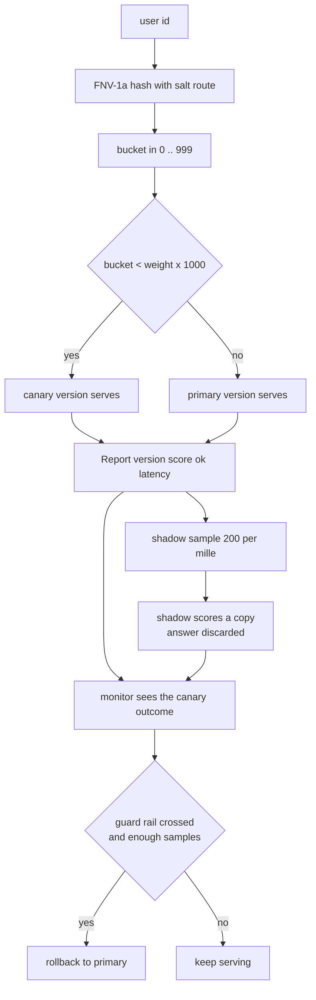
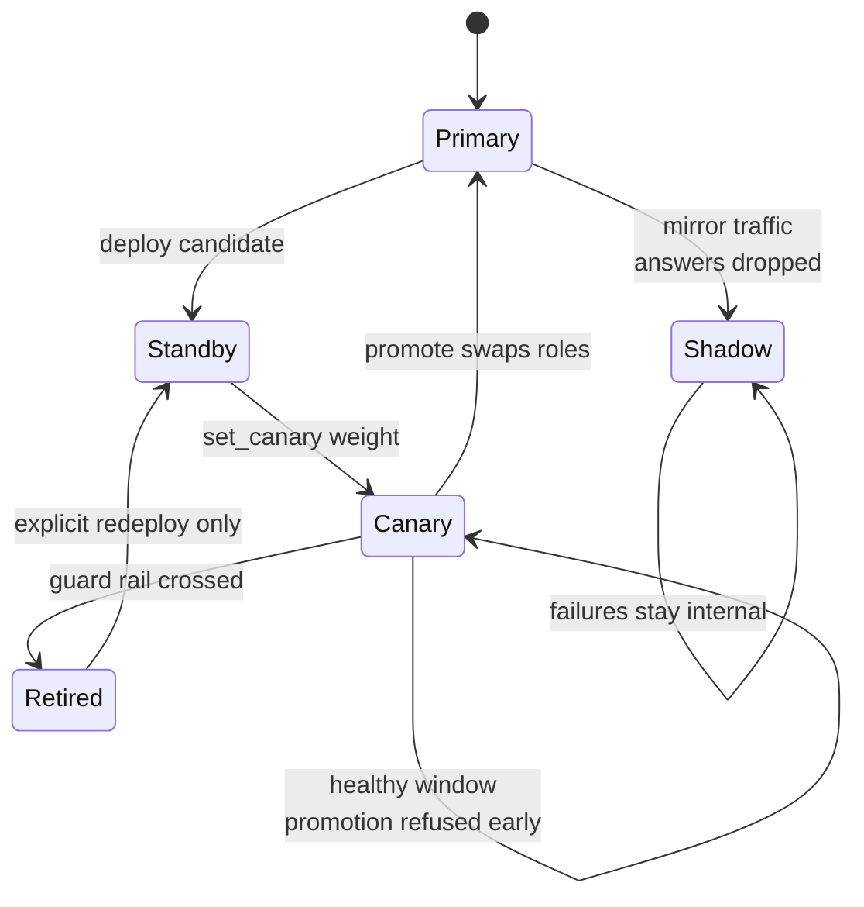
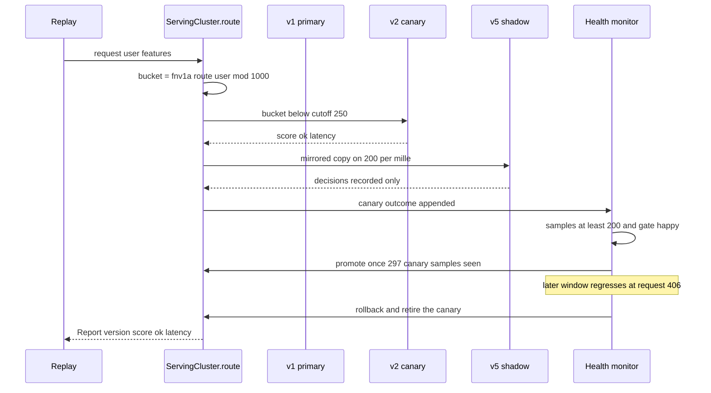

# 865 — Implement transparent model serving with versioning, canary, shadow tests, and rollback.

> **Tier:** Master · **CTCI chapter:** Beyond — Machine Learning & AI
> **Task spec:** [865-implement-transparent-model-serving-with-versioning-canary-shado.md](../../../tasks/master/865-implement-transparent-model-serving-with-versioning-canary-shado.md)
> **Solutions:** [Python](../../../solutions/python/master/865-implement-transparent-model-serving-with-versioning-canary-shado/solution.py) ·
> [Java](../../../solutions/java/master/865-implement-transparent-model-serving-with-versioning-canary-shado/Solution.java) ·
> [JavaScript](../../../solutions/javascript/master/865-implement-transparent-model-serving-with-versioning-canary-shado/solution.js) ·
> [C#](../../../solutions/csharp/master/865-implement-transparent-model-serving-with-versioning-canary-shado/Solution.cs)

## 1. Problem restatement

**Input.** A sequence of requests `(user, features)` replayed in order, plus a control plane of
registry operations: `deploy(model, role)`, `set_canary(name, weight)`, `promote()`, `rollback(reason)`.
Every published version is an immutable record `(name, weights, bias, error_rate, base_latency)`.

**Output.** For every request exactly one `Report(user, version, score, ok, latency, shadows)`:

| Field | Meaning |
| --- | --- |
| `version` | the single *live* version that served it (`primary` or `canary`) |
| `score` | the version's linear scorer evaluated on the request features |
| `ok` | the deterministic outcome draw for `(version, user)` |
| `latency` | the version's base cost plus a per-request jitter |
| `shadows` | the decisions of mirror versions, which never reach the user |

In addition the cluster exposes per-version counters (requests, failures, mean latency), a sliding
window used by the health monitor, and an **append-only hash-chained audit log** whose head digest
summarises every control-plane event.

**The modelling contract.** There are no processes, sockets or timers in any of the four solutions.
Traffic is an explicit list, "time" is the monotone request counter, latency is a deterministic cost
model plus jitter from a seeded `splitmix64` stream, a model is a linear scorer, failures are drawn
from a `(version, user)` key so two configurations see the same failure pattern, and the monitor runs
after every request instead of on a wall-clock schedule. Python buckets into `1000` buckets, Java into
`10000`, JavaScript and C# into `100`; the routing *rule* is identical, only the resolution differs.

**Constraints and examples.** The canary owns the lowest `weight * buckets` buckets, rollback needs at
least `MIN_CANARY_SAMPLES = 200` canary samples, and gating uses `ERROR_MARGIN = 0.02` and
`LATENCY_SLO_MS = 60.0`. The Python run reports:

| Scenario | Observed result |
| --- | --- |
| 600-request replay, `v1` primary + `v2` canary at `0.25` | `600` requests served by `['v1', 'v2']`, `2` live versions |
| weight sweep `0.0 / 0.1 / 0.25 / 0.5 / 1.0` | canary shares `0.0 / 0.102 / 0.255 / 0.495 / 1.0` |
| shadow version deployed with `SHADOW_SAMPLE_PER_MILLE = 200` | `122` sampled copies of `600` requests, `71` shadow failures kept out of the service metrics |
| regressed canary, healthy canary | rollback at request `406` for quality and for latency, `0` spurious fires |
| promoted canary | promotion after `297` canary requests, audit chain of `5` entries verifies |
| replayed workload | identical routing and audit head `624847` |

## 2. Intuition

The naive deployment flips a coin on every request: send 5% of *requests* to the canary. That fails
three ways. A user bounces between versions inside a single session; raising the weight from 5% to 10%
reshuffles the whole population, so the experiment you were measuring is not the experiment you
continue; and nothing about the run is reproducible the next morning.

The fix is to make the split a property of the **user**, not of the request. Hash the user id into a
bucket, and let the canary own the lowest `weight * buckets` buckets. Raising the weight can only move
the users standing on the boundary; everyone already on the canary stays there. That is the
minimal-disruption property of consistent bucketing, and it turns a random sampler into a pure
function of `(user, weight)`.

Three more ideas complete the system. A **shadow** version scores a mirror of the traffic, so you can
compare distributions offline, but its answer is dropped and its failures are counted in the shadow's
own counters — otherwise a bad experiment would page the on-call engineer for traffic the user never
saw. The **monitor** is a state machine with a minimum sample size, so a canary is never judged on
twenty requests. And every control-plane event is appended to a **hash chain**, so the deployment
history is auditable and tampering is detectable.



Because the bucket is a pure function of the user id, a *replayed* workload reproduces the same
per-user routing bucket for bucket. The Python docstring calls this out explicitly: it uses FNV-1a
rather than the built-in `hash()` precisely because the built-in is randomised per process.

## 3. Algorithm

1. Keep a registry of versions with their roles: `primary`, `canary`, `shadow`, `standby`, `retired`.
2. On startup, `deploy(v1, primary)` then `deploy(v2, standby)` then `set_canary("v2", weight)`: the
   standby is activated as the canary and its cutoff becomes `weight * buckets`.
3. For each request: `bucket_of(user) = fnv1a("route", user) mod buckets`. If a canary is active and
   `bucket < cutoff`, the canary serves; otherwise the primary serves.
4. Still inside the same request, decide the shadow sample from a second hash of the user id; if it is
   inside `SHADOW_SAMPLE_PER_MILLE`, evaluate every shadow version and record its decision only.
5. Append the canary's own outcome to the monitoring window, then run `health_action()`: with fewer
   than `MIN_CANARY_SAMPLES` canary samples do nothing; if the canary's error rate exceeds the
   baseline by more than `ERROR_MARGIN`, or its mean latency exceeds `LATENCY_SLO_MS`, roll back;
   if the gate is happy and the sample is large enough, promote.
6. `rollback` retires the canary, restores 100% primary traffic and logs one event; `promote` swaps
   roles atomically and resets the canary counters.
7. Log every control-plane event as `hash(previous_head, event, detail)` so the head digest is a
   tamper-evident summary of the run.

```text
procedure serve(cluster, user, features)
    bucket ← fnv1a("route", user) mod BUCKETS
    if cluster.canary is active and bucket < cluster.canary_cutoff then
        version ← cluster.canary
    else
        version ← cluster.primary
    end
    report ← execute(cluster, version, user, features)
    for each shadow in cluster.shadows do
        if fnv1a("shadow", user) mod 1000 < SHADOW_SAMPLE_PER_MILLE then
            report.shadows.append(execute(cluster, shadow, user, features))
        end
    end
    if cluster.canary is active and version = cluster.canary then
        cluster.window.append(report)
    end
    cluster.health_action()
    return report
end

procedure health_action(cluster)
    if cluster.canary is not active then return end
    if length(cluster.window) < MIN_CANARY_SAMPLES then return end
    if error_rate(cluster.window) > cluster.error_rate(primary) + ERROR_MARGIN
       or mean_latency(cluster.window) > LATENCY_SLO_MS then
        rollback(cluster, "guard rail")
    else if gate_is_happy(cluster) then
        promote(cluster)
    end
end
```



The state machine is what makes the deployment *self-driving*: a candidate that survives
`MIN_CANARY_SAMPLES` healthy requests becomes the primary, and one that regresses disappears before it
can hurt more users. `Retired` is terminal for that version object — after a rollback no request may
reach it again, which the Python test asserts explicitly.

## 4. Worked example

Walk the Python replay: `v1` deployed as primary, `v2` as standby and then set as the canary at weight
`0.25`, and `v5` deployed as a shadow. Then `600` requests are replayed.

| Requests | Phase | Live versions | Canary samples | Decision |
| --- | --- | --- | --- | --- |
| 0 | `deploy v1 primary` | `[v1]` | 0 | audit `deploy` |
| 0 | `deploy v2 standby`, `set_canary v2 0.25` | `[v1, v2]` | 0 | cutoff `250` of `1000` buckets |
| 0 | `deploy v5 shadow` | `[v1, v2]` + shadow | 0 | shadow never chosen by the router |
| 1 .. 199 | serving | `[v1, v2]` | `< 200` | monitor silent, below `MIN_CANARY_SAMPLES` |
| 200 | serving | `[v1, v2]` | 200 | gate becomes eligible |
| 297 | serving | `[v1, v2]` | 297 | promotion accepted, roles swap |
| 298 .. 405 | serving | `[v2, v1 canary]` | 0 (reset) | new canary accumulates samples |
| 406 | serving | `[v2, v1 canary]` | 200 | quality *and* latency regression, rollback |
| 407 .. 600 | serving | `[v2]` | 0 | retired `v1` unreachable |

The weight sweep is the interesting measurement, because it is where stickiness shows up. Each row
re-runs the same `600` requests at a different configured weight and measures the share of *requests*
that reached the canary:

| Weight | Analytic buckets | Measured share | Comment |
| --- | --- | --- | --- |
| `0.0` | 0 | `0.0` | canary live but owns no bucket |
| `0.1` | 100 | `0.102` | sampling noise of the fixed user population |
| `0.25` | 250 | `0.255` | the configuration used above |
| `0.5` | 500 | `0.495` | half the users |
| `1.0` | 1000 | `1.0` | every user on the canary |

The accompanying check asserts monotonicity and boundary-only movement: raising the weight never moves
a previously canary-assigned user off the canary, and lowering it never moves a primary user onto it.
Across the same replay the shadow version was asked to score `122` of the `600` requests and failed
`71` of those, yet every user-visible `(version, score, outcome)` triple was byte-identical with the
shadow enabled and disabled — the shadow's failures stayed in its own counters.



Finally the reason the whole thing is worth doing deterministically: replaying the identical workload
through two fresh clusters produced identical user-visible answers, identical shadow decisions and the
same audit head `624847`. A deployment experiment you cannot replay is a story, not an experiment.

## 5. Complexity

Let `B` be the bucket count (Python `1000`, Java `10000`, JavaScript and C# `100`), `V` the number of
versions, `d` the feature dimension, `W` the monitoring window and `E` the number of audit events.

| Operation | Best / average / worst | Space | Why the bound holds |
| --- | --- | --- | --- |
| `bucket_of(user)` | `O(len(user))` all three cases | `O(1)` | one FNV-1a pass over the id characters, no allocation |
| `route(user)` | `O(len(user))`, i.e. `O(1)` for practical ids | `O(1)` | one hash plus one integer comparison against the cutoff |
| `serve()` scoring | `O(d)` | `O(1)` | linear scorer over the feature vector |
| `serve()` shadow mirror | `O(S * d)` with `S` shadow versions, sampled | `O(1)` | shadow evaluated only when the sampled hash is inside 200 per mille |
| `health_action()` | `O(W)` amortised, `O(1)` amortised decision | `O(W)` | recomputes counters over the window only when the sample gate is open |
| `promote()` / `rollback()` | `O(1)` plus one audit append | `O(E)` | constant pointer swaps, atomic role change |
| whole replay | `O(n * (len(user) + d + W))` worst, `O(n * d)` typical | `O(V + W + E)` | one pass over the request list |

The honest caveat about the simulation: **latency and cost here are modelled, not measured.** A version
carries a `base_latency` and a seeded jitter, and the docstrings state plainly that inference
performance is not the phenomenon under test — routing, monitoring and rollback are. So the complexity
table describes the simulated cluster (one hash, one linear scorer, one window scan per request) and
not the cost of a real HTTP front door, a real GPU, or a real connection drain.

The alternative the naive deployment would pay is worse than the table suggests: re-sampling traffic
per request makes the *set* of canary users change with every request, so measuring the split requires
counting over the whole stream and the population comparison is no longer well defined. Recomputing
the canary share from scratch after every request would cost `O(n)` per step and `O(n²)` per replay,
where the bucketed version adds nothing beyond the hash it already pays.

## 6. Pitfalls and edge cases

- **Weight `0`** keeps the canary live and eligible for promotion but routes nothing to it; the share
  is exactly `0.0`. **Weight `1`** routes everything; the Python sweep shows `1.0`, so the canary
  becomes the sole served version without any registry surgery.
- **Unknown users.** A user that never appeared in the workload is still routed by the same bucket
  rule, so its version is predictable from its id alone. Ids full of symbols and parentheses hash
  without special handling as long as the FNV-1a loop walks characters.
- **Minimum sample size.** A canary below `MIN_CANARY_SAMPLES = 200` is never rolled back, and a
  healthy canary produced `0` spurious rollbacks. Removing the gate would let a single unlucky early
  failure retire a good model.
- **Shadow isolation.** Enabling shadows must leave every user-visible triple unchanged, which the
  Python test checks directly; the `71` shadow failures of the worked example never entered the service
  level error rate, or the healthy canary would have been rolled back for traffic it never served.
- **Rollback safety.** After a rollback the retired version is unreachable for the rest of the run. A
  rollback with no active canary is a no-op, not an error, and a repeated rollback of the same version
  must not double-log or double-retire.
- **Serving before any deploy.** The cluster must reject or default rather than serve from a missing
  primary; duplicate deploys must not leave two live primaries.
- **Replay determinism.** Never bucket with a per-process randomised hash. The Python docstring is
  explicit that `hash()` is unstable across processes and therefore unusable for routing.
- **Audit tamper detection.** Reordering or editing an entry must break `chain_valid()`, which the test
  demonstrates on a probe cluster; an audit log that cannot fail that check proves nothing.

## 7. Variants and follow-ups

- **Staged ramps** replace one `set_canary` call with a schedule of weights (`0.01 → 0.05 → 0.25 → 1.0`),
  re-checking the gate at each step. Because bucket assignment is nested, every step is a superset of the
  previous canary population; only the boundary moves.
- **Richer guard rails** swap the fixed error margin for latency percentiles, saturation or business
  metrics. The C# solution already gates on `p95` latency alongside the error rate, which is the same
  state machine with a second predicate.
- **Sharded buckets** hash `(region, user)` so a deployment can be ramped per region. The bucket
  function changes, the cutoff arithmetic does not.
- **Provenance-aware registries** are the natural companion: the audit chain here records *what* was
  deployed, while [871 — reproducible ML experiments registry](../../../tasks/master/871-implement-reproducible-ml-experiments-registry-with-artifact-pro.md)
  records *which artefacts and inputs* produced the version in the first place.
- **Gate-driven training loops** apply the same "do not promote until the evidence is in" logic to the
  model itself: see [868 — fairness-aware training loop](../../../tasks/master/868-implement-fairness-aware-training-loop-with-constraint-optimizat.md).
- **Recovery validation** stresses the rollback path with injected faults and asserts that service is
  restored exactly once, which is the adversarial reading of this task:
  [892 — chaos-style fault injection and recovery validation](../../../tasks/master/892-implement-chaos-monkey-style-fault-injection-and-recovery-valida.md).

## 8. Check yourself

<details><summary>Show answer</summary>

**1. Why hash the user id into buckets instead of sampling 5% of requests?**

Because the split must be a stable property of the *entity*, not of the event. Bucketing keeps a user
on one version across a session, makes the measured canary share predictable from the weight, and makes
a weight change disruptive only for the users on the boundary — the minimal-disruption property. The
observed sweep (`0.1 → 0.102`, `0.25 → 0.255`, `0.5 → 0.495`) is a fixed population's sampling noise
around the analytic share, not a fresh random draw each time.

</details>

<details><summary>Show answer</summary>

**2. A shadow version crashes on 71 of its 122 sampled requests. Why is that not a rollback?**

Because the shadow's answers were never served. The shadow writes into its own counters; the service
level metrics and the health monitor look only at the requests a live version actually answered. The
Python test asserts the mirror property directly: every user-visible `(version, score, outcome)` is
unchanged whether shadows are enabled or disabled.

</details>

<details><summary>Show answer</summary>

**3. What does `MIN_CANARY_SAMPLES = 200` buy you, and what does it cost?**

It buys statistical sanity: a candidate cannot be retired on a handful of requests, which is why the
healthy control produced `0` spurious fires. It costs latency of decision — the bad canary in the
worked example kept serving until request `406`, when its window had enough samples to cross the guard
rail. Choosing the constant trades blast radius against detection delay.

</details>

<details><summary>Show answer</summary>

**4. Why is the audit log a hash chain rather than a list of events?**

A list can be edited silently; a chain cannot. Each entry mixes in the previous head, so any edit or
reordering changes the head digest and `chain_valid()` fails — the test proves this with a tampered and
a reordered probe. It also gives the replay a one-number fingerprint: the same workload reproduces head
`624847`.

</details>

<details><summary>Show answer</summary>

**5. Which parts of this task are simulated rather than real, and does that change the complexity answer?**

Everything below the API: no sockets, no threads, no clocks, no real model. Traffic is a list, time is
the request counter, latency is a base cost plus seeded jitter, and failures come from `(version, user)`
draws. So the complexity table describes the router — one hash, one `O(d)` scorer and one window scan
per request — and says nothing about the cost of a real serving stack; the docstrings are explicit that
inference performance is not the phenomenon under test.

</details>
