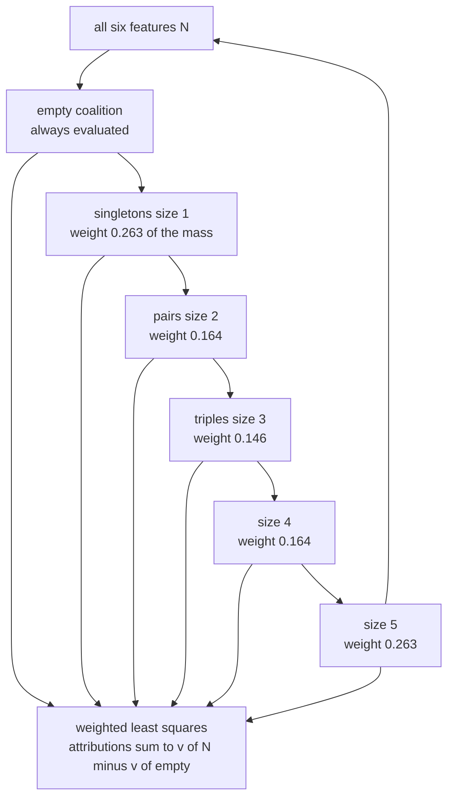
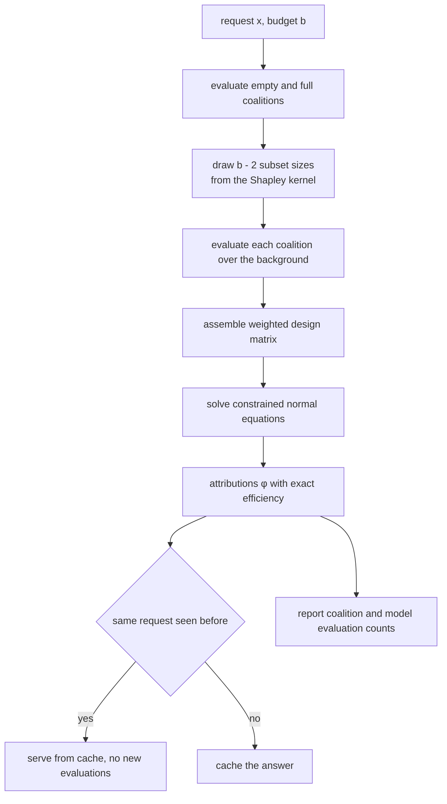
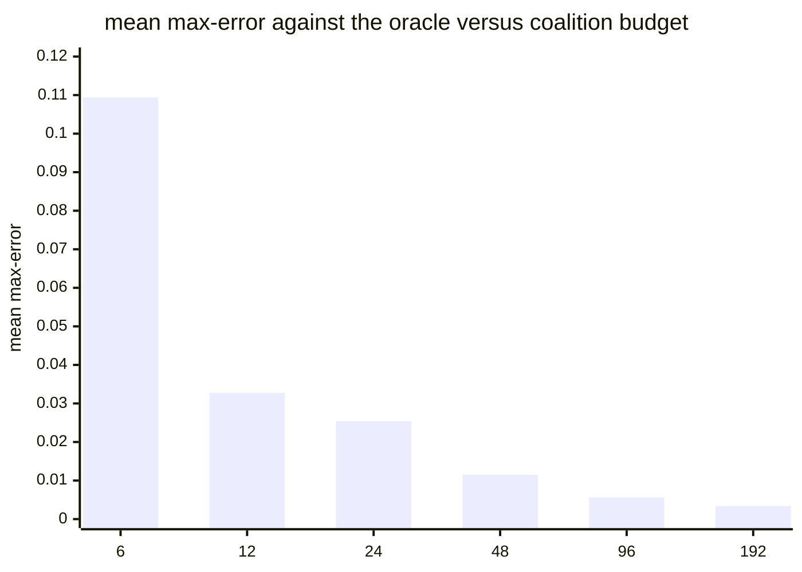
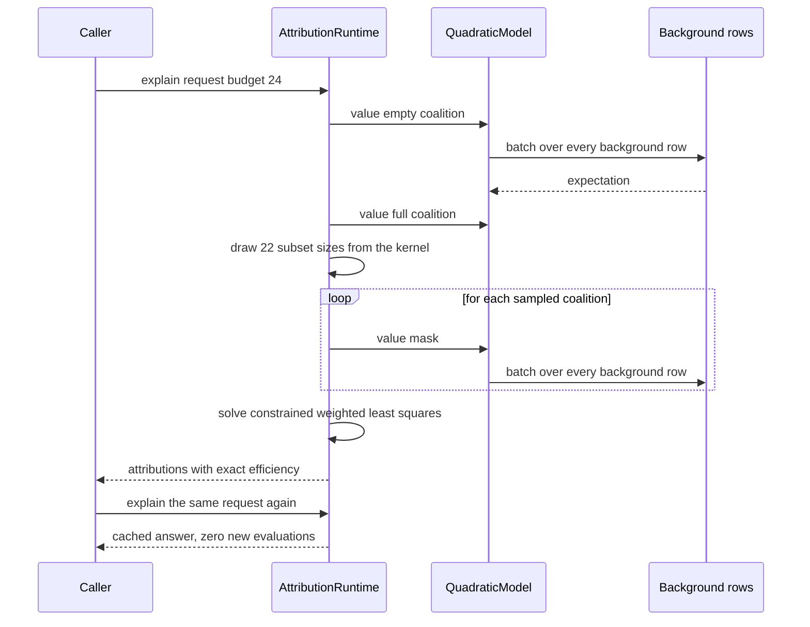

# 866 — Implement feature attribution runtime (SHAP-like) scalable for tabular models.

> **Tier:** Master · **CTCI chapter:** Beyond — Machine Learning & AI
> **Task spec:** [866-implement-feature-attribution-runtime-shap-like-scalable-for-tab.md](../../../tasks/master/866-implement-feature-attribution-runtime-shap-like-scalable-for-tab.md)
> **Solutions:** [Python](../../../solutions/python/master/866-implement-feature-attribution-runtime-shap-like-scalable-for-tab/solution.py) ·
> [Java](../../../solutions/java/master/866-implement-feature-attribution-runtime-shap-like-scalable-for-tab/Solution.java) ·
> [JavaScript](../../../solutions/javascript/master/866-implement-feature-attribution-runtime-shap-like-scalable-for-tab/solution.js) ·
> [C#](../../../solutions/csharp/master/866-implement-feature-attribution-runtime-shap-like-scalable-for-tab/Solution.cs)

## 1. Problem restatement

**Input.** A tabular model `f`, a background sample of rows, and one request `x` of `d = 6`
features. A coalition `S ⊆ {0..d-1}` is scored by a value function `v(S)`.

**Output.** One attribution `φ_j` per feature, with the guarantee

```text
sum over j of φ_j  =  v(N) - v(empty)  =  f(x) - E[f]
```

plus the cost of producing it: the number of coalition evaluations, the number of model evaluations,
and whether the answer came from the cache.

**The modelling contract.** The model is a quadratic polynomial in six features and the background is
an explicit list of rows, so `v(S)` can be computed exactly and — because the model is quadratic — the
*true* Shapley values can also be derived in closed form. That matters: the runtime can be **scored
against an oracle** instead of being trusted. The four solutions choose slightly different value
functions, and each documents its choice: Python and Java use the interventional expectation
`v(S) = E[f(x_S, X_S)]` over the background sample, JavaScript and C# use a fixed reference vector or
row sample. Sampling is deterministic in every language (splitmix64, mulberry32), a "budget" is a count
of coalitions rather than a duration, and latency is accounted as coalition evaluations rather than
wall-clock time. What is simplified, per the headers: quadratic models instead of boosted trees, a
small fixed background instead of a density estimate, and a direct least-squares solve instead of an
iterative solver. There are no threads, sockets or unseeded randomness.

**Concrete results from the Python run** (background of five rows, six features):

| Property checked | Observed |
| --- | --- |
| Efficiency axiom | attributions sum to `-1.078033569` = `v(N) - v(empty)` |
| Dummy / symmetry / linearity | dummy `0.000000000000`, symmetry `-0.187365412` vs `-0.187365412`, linearity exact |
| Exhaustive KernelSHAP over all `64` coalitions | max error vs the oracle `4.37e-13` |
| Shapley-kernel size distribution vs observed | `[0.263, 0.164, 0.146, 0.164, 0.263]` vs `[0.261, 0.166, 0.147, 0.167, 0.26]` |
| Consistency shift of feature `2` | `-0.0026 → -0.0458`, predicted shift `-0.0432` |
| Budget curve, mean max-error over `8` requests | `6: 0.1094`, `12: 0.0327`, `24: 0.0254`, `48: 0.0115`, `96: 0.0056`, `192: 0.0034` (tolerance `0.05`) |
| Kernel-weighted vs uniform coalition sizes at budget `24` | mean error `0.0166` vs `0.0196` |

## 2. Intuition

The obvious explanation is ablation: drop feature `j`, see how much the prediction moves. But the
number you get depends on what the other features were doing at the time — the model is not additive,
so "the effect of feature 2" is only defined relative to a context. Averaging the ablation over every
context, in every order, is exactly what the Shapley value does:

```text
φ_j = sum over S not containing j of |S|! (d - |S| - 1)! / d! * ( v(S + j) - v(S) )
```

That definition buys the four axioms everyone quotes — efficiency, symmetry, dummy, linearity — at a
price of `2^d` coalition values. For `d = 6` that is `64` values, which the oracle path simply
enumerates; for a real tabular model with `d = 200` it is hopeless, which is why the runtime also
implements the sampling path.

The key insight of KernelSHAP is that the whole axiom system can be rewritten as a **weighted least
squares regression** over coalitions. Introduce one unknown `φ_j` per feature and require that the
linear surrogate `sum of φ_j` over `S` match `v(S)`. Give coalition `S` the Shapley kernel weight

```text
w(S) = (d - 1) / ( C(d, |S|) * |S| * (d - |S|) )
```

and minimising the weighted residual reproduces the exact Shapley values — provided the empty and full
coalitions are handled, because their weights are unbounded in the limit. The solutions therefore always
evaluate `empty` and `N`, then spend the rest of the budget on subsets drawn with probability
proportional to `w(S)`, and finally enforce efficiency as a hard constraint.



The kernel is extremely lopsided: for `d = 6` more than half of the sampling mass sits on the smallest
and largest coalitions, exactly the ones that carry the most information about a single marginal
contribution. That is why sampling by size rather than uniformly produces the measured improvement
`0.0166` vs `0.0196` at the same budget of `24` coalitions.

## 3. Algorithm

1. Build the model (`base`, `linear`, `quadratic` coefficients) and the background rows.
2. `value(mask, x)` — the coalition value: for a masked coalition, take `x` on the included features
   and the background expectation on the excluded ones, then evaluate the model; each call is batched
   over the whole background, so cost is counted in *coalition* evaluations.
3. `exact_shapley(x)` — enumerate all `2^d` coalitions with `masks_of_size` and apply the textbook
   weight `|S|!(d-|S|-1)!/d!`. This is the oracle.
4. `sample_coalitions(budget, strategy)` — spend the budget on the empty and full coalitions plus
   subsets whose *size* is drawn from the normalised Shapley-kernel distribution
   (`size_distribution`), with the strategy selecting kernel-proportional or uniform sizes.
5. `explain(x, budget, strategy)` — solve the constrained weighted least squares for `φ` from the
   sampled coalitions, then return the attributions and the evaluation counters.
6. `explain_cached(x, budget, strategy)` — return the same answer for a repeated identical request
   without spending another coalition evaluation.
7. Raise if the budget would exceed the hard cap, and reject malformed requests (unknown feature,
   wrong mask length, empty background, negative budget).

```text
procedure kernel_weights(d)
    for size from 1 to d - 1 do
        weight[size] ← (d - 1) / (binomial(d, size) * size * (d - size))
    end
    return weight
end

procedure size_distribution(d)
    weight ← kernel_weights(d)
    total ← sum of weight[size] for size from 1 to d - 1
    return weight[size] / total
end

procedure explain(model, background, request, budget, strategy)
    coalitions ← sample_coalitions(budget, strategy)
    values ← empty list
    for each mask in coalitions do
        values.append(value(model, mask, request, background))
    end
    φ ← constrained_weighted_least_squares(coalitions, values, kernel_weights(d))
    return φ, model_evaluations
end

procedure constrained_weighted_least_squares(coalitions, values, weight)
    solve the weighted normal equations for φ over the sampled coalitions
    enforce sum of φ[j] = v(N) - v(empty) by substitution so the efficiency axiom is exact
    return φ
end
```



## 4. Worked example

Take the Python fixture: a quadratic model in `d = 6` features, a background of `5` rows and one
request. Each coalition evaluation costs one batched model pass over the background, so the accounting
is `model evaluations = background size * coalitions`.

| Step | Coalitions used | Coalition evaluations | Observed quantity |
| --- | --- | --- | --- |
| `exact_shapley` oracle | all `2^6 = 64` | 64 | axiom residuals: dummy `0`, symmetry `-0.187365412` vs `-0.187365412` |
| KernelSHAP, full budget | `64` | 64 | max error vs the oracle `4.37e-13` |
| Efficiency check | any | — | sum of `φ` = `-1.078033569` = `v(N) - v(empty)` |
| Sampled sizes, budget `24` | `2` mandatory plus `22` drawn | 24 | size histogram observed `[0.261, 0.166, 0.147, 0.167, 0.26]` vs kernel `[0.263, 0.164, 0.146, 0.164, 0.263]` |
| Kernel strategy, budget `24` | as above | 24 | mean error `0.0166` |
| Uniform-size control, budget `24` | `2` plus `22` | 24 | mean error `0.0196` |
| Repeated identical request | cache hit | 0 new | same attributions, no extra evaluations |

The consistency row is the sharpest test, because it has a *predicted* answer rather than a measured
one. Raising one linear coefficient by a constant `c` must move exactly that feature's attribution by
`c * (x_j - E[x_j])` and leave every other attribution untouched. The Python run reports feature `2`
moving `-0.0026 → -0.0458` against a predicted shift of `-0.0432`; the residual is the sampling error of
the budget used, and with the exhaustive budget the same test lands at `4.37e-13`.

The budget curve shows the classic `1/sqrt(budget)` shape of a Monte-Carlo estimator, measured against
the oracle over eight requests:



Doubling the budget twice takes the error from `0.1094` to roughly `0.0115` — an order of magnitude for
four times the work — and every value after `24` sits inside the tolerance of `0.05`. Crucially the
error is *bounded*, and the docstrings are honest that it is not zero: the runtime's contract is
efficiency exact, accuracy approximate and paid for with evaluations.



## 5. Complexity

Let `d` be the feature count, `R` the background size and `b` the coalition budget.

| Method | Time | Space | Why |
| --- | --- | --- | --- |
| `exact_shapley` (oracle) | `O(2^d * R)` | `O(2^d)` masks | every coalition is valued once, each value sweeps the background |
| analytic closed form (Java, C#) | `O(d^2)` | `O(d^2)` | the quadratic's product terms are summed with their Shapley weights directly |
| KernelSHAP, budget `b` | `O(b * R + b * d^2 + d^3)` | `O(b * d)` | `b` coalition values, each a design row of length `d`, then one direct solve |
| permutation sampling (JavaScript) | `O(permutations * d * R)` | `O(d)` | each permutation contributes `d` marginal contributions |
| cache lookup | `O(1)` amortised after a hash | `O(distinct requests)` | repeat requests are served without new evaluations |

The honest caveat: **cost here is counted in coalition evaluations, not seconds.** One coalition
evaluation means one batched sweep over the background rows; there is no GPU, no batching policy and no
wall clock, and the docstrings say so. So the table above describes the simulated estimator. The
*real* cost driver it exposes is the one that matters in production: `model evaluations =
background size * coalitions`, so a cheaper background sample buys accuracy at the same latency as a
bigger budget. Note also that the exponential oracle is not a straw man in this repository — it is the
ground truth the sampled paths are calibrated against, and the exhaustive KernelSHAP run matching it to
`4.37e-13` is precisely what makes the sampling budget meaningful.

## 6. Pitfalls and edge cases

- **Efficiency must be exact, not approximate.** `sum of φ` equals `v(N) - v(empty)` for *every* budget,
  which the solutions achieve by enforcing the constraint (substitution in the least-squares solve,
  post-correction in C#) rather than by hoping the sampled system is unbiased. A budget of `6` still
  satisfies it; only the accuracy worsens.
- **The empty and full coalitions are mandatory.** With `w(empty)` and `w(N)` unbounded in theory, a
  sampler that skips them loses the baseline and the endpoint. Both are always evaluated; only
  `b - 2` subsets are drawn.
- **Dummy and symmetry.** A feature the model ignores must get `0` — the run reports exactly
  `0.000000000000` — and two features with identical effects must get identical attributions
  (`-0.187365412` twice). These catch sign, indexing and mask-orientation bugs that efficiency alone
  would hide.
- **Degenerate models.** A single feature, or a constant model, collapses the least-squares system and
  must not divide by zero in `kernel_weights`; the run covers "one feature" and "constant model" among
  its edge cases.
- **Bad input is rejected, not repaired.** Unknown feature, wrong mask length, empty background and a
  negative budget are all rejected (six rejected requests in the run), and a budget above the hard cap
  *raises* instead of silently spending more.
- **Sampling honesty.** Sizes are drawn by the normalised kernel weight, and the run compares the
  observed size histogram with the analytic one — a sampler that quietly drew uniform sizes would pass
  the axiom checks and fail this one.
- **Determinism.** The same seed reproduces the same coalitions and attributions (`seed 31415`), while
  a different seed must still land inside tolerance: reproducibility without overfitting the answer to
  one lucky sample.

## 7. Variants and follow-ups

- **Conditional rather than interventional expectation** changes only `v(S)`: instead of averaging the
  background with masked features, sample the missing features from their conditional distribution. The
  estimator and its guarantees are unchanged; the value function becomes the modelling decision.
- **Tree-structured fast paths.** For an additive-plus-one-interaction model each feature takes its own
  marginal gain and the interaction splits evenly, which the Java and C# solutions use as an
  independent analytic oracle in place of enumeration.
- **Permutation sampling.** The JavaScript solution adds a Monte-Carlo-over-permutations estimator that
  reports its own standard error and never enumerates subsets, which is the practical route for `d = 20`
  and beyond — it is calibrated against a known additive model at that width.
- **Richer diagnostics.** SHAP's interaction-index and anti-correlation capping machinery is explicitly
  *not* implemented here, and the JavaScript header says so; they are the natural next layer.
- **From attribution to action.** Attribution answers "why this prediction", which pairs with the
  optimisation-based answer "what would change it":
  [867 — counterfactual explanation generator](../../../tasks/master/867-implement-counterfactual-explanation-generator-for-classifiers-o.md).
- **Attribution as an audit tool.** Per-group attribution gaps are one of the signals a constrained
  training loop can act on: see
  [868 — fairness-aware training loop with constraint optimisation](../../../tasks/master/868-implement-fairness-aware-training-loop-with-constraint-optimizat.md).

## 8. Check yourself

<details><summary>Show answer</summary>

**1. Why does KernelSHAP need a special rule for the empty and full coalitions?**

The Shapley kernel `w(S) = (d-1) / (C(d,|S|) |S| (d-|S|))` blows up at `|S| = 0` and `|S| = d`, which is
the mathematical signal that those two rows carry the baseline and the endpoint. The runtime always
evaluates them and spends only `b - 2` of the budget on sampled subsets, so the constraint
`sum of φ = v(N) - v(empty)` is anchored even at a tiny budget.

</details>

<details><summary>Show answer</summary>

**2. The exhaustive run matches the oracle to `4.37e-13` but the budget-`24` run only to `0.0254`. Why is the small number still useful?**

Because it is a *bounded* approximation with an exact structural guarantee. Efficiency, dummy, symmetry
and linearity hold for every budget — they come from the constrained solve, not from sampling luck —
while accuracy is traded for cost. The measured budget curve (`0.1094` at `6`, `0.0254` at `24`,
`0.0034` at `192`) is the price list, and it is monotone in the budget.

</details>

<details><summary>Show answer</summary>

**3. What does the consistency test with the constant-`c` coefficient perturbation actually check?**

That the explanation reacts to the model in the mathematically predicted way. Adding `c` to feature
`j`'s linear coefficient must shift `φ_j` by exactly `c * (x_j - E[x_j])` and leave every other `φ`
untouched. The run shows feature `2` moving `-0.0026 → -0.0458` against a predicted `-0.0432`; at the
exhaustive budget the same identity holds to machine precision. A "plausible-looking" explanation that
violated it would be wrong, not just noisy.

</details>

<details><summary>Show answer</summary>

**4. Why is cost measured in coalition evaluations instead of milliseconds?**

Because the solution files are in-process simulations: one coalition evaluation means one batched
model pass over the background sample. Counting evaluations keeps the accounting deterministic and
makes the trade-off explicit — `model evaluations = background size * coalitions` — instead of
depending on the machine. The docstrings state plainly that latency is accounted this way and that
there is no wall clock, thread or socket in play.

</details>

<details><summary>Show answer</summary>

**5. When is the exponential oracle acceptable inside a shipped runtime?**

When it is used as a *test* rather than a serving path: at `d = 6` the `64` coalitions are cheap, so
every sampled answer can be scored against ground truth in the test suite. For `d = 20` the JavaScript
solution switches to a known additive model as the reference instead, which is the general pattern —
keep an oracle for the small regime, and an analytically known instance for the large one.

</details>
