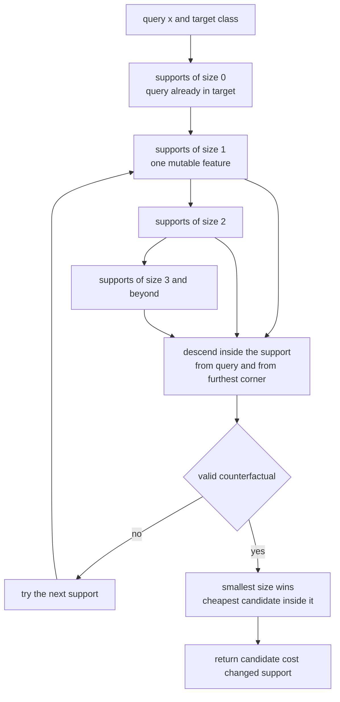
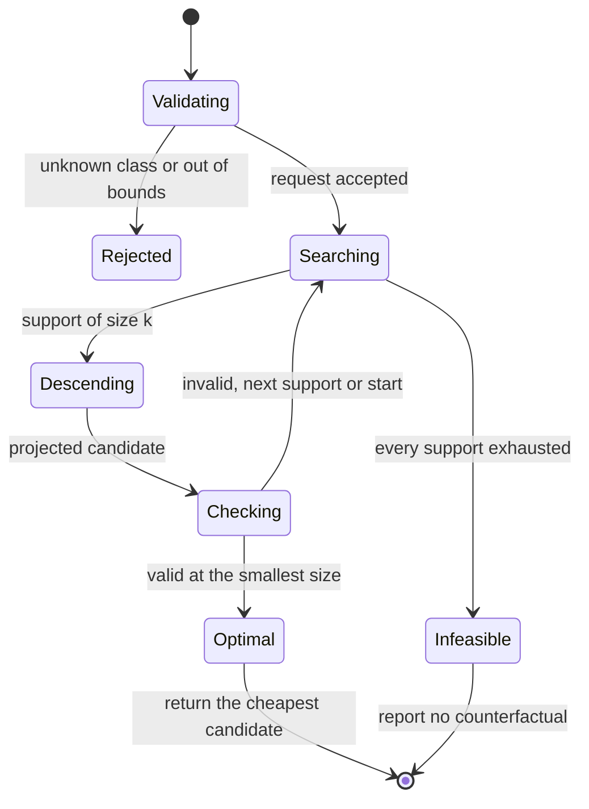
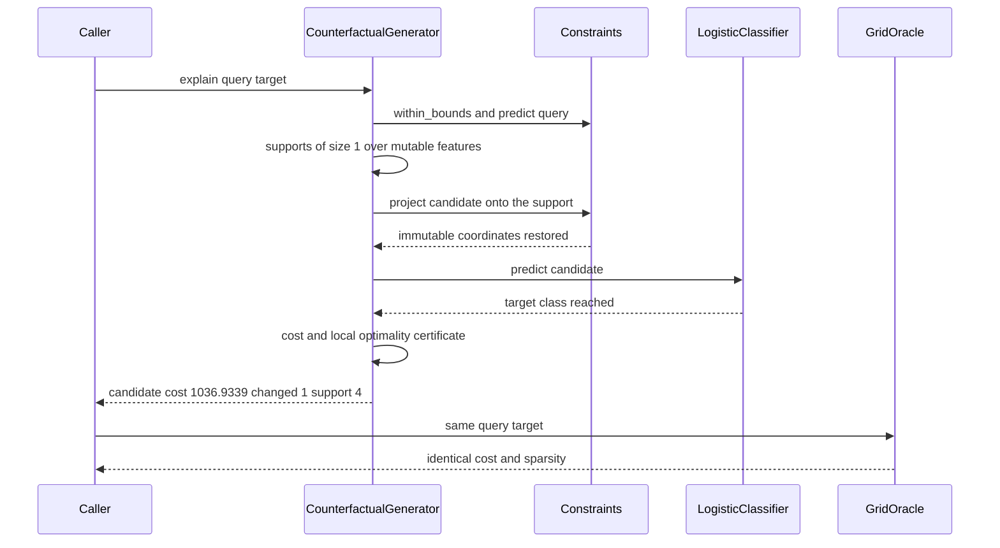

# 867 — Implement counterfactual explanation generator for classifiers (optimization-based).

> **Tier:** Master · **CTCI chapter:** Beyond — Machine Learning & AI
> **Task spec:** [867-implement-counterfactual-explanation-generator-for-classifiers-o.md](../../../tasks/master/867-implement-counterfactual-explanation-generator-for-classifiers-o.md)
> **Solutions:** [Python](../../../solutions/python/master/867-implement-counterfactual-explanation-generator-for-classifiers-o/solution.py) ·
> [Java](../../../solutions/java/master/867-implement-counterfactual-explanation-generator-for-classifiers-o/Solution.java) ·
> [JavaScript](../../../solutions/javascript/master/867-implement-counterfactual-explanation-generator-for-classifiers-o/solution.js) ·
> [C#](../../../solutions/csharp/master/867-implement-counterfactual-explanation-generator-for-classifiers-o/Solution.cs)

## 1. Problem restatement

**Input.** A classifier, a factual request `x` of `d` features, and a target class. Each feature
carries an actionability specification: *immutable* (an account age, a device id), *bounded numeric*
(possibly with a grid step) or *integral*. A cost model weights sparsity — how many features move —
against the size of the move.

**Output.** The cheapest feasible `x'` that the classifier labels with the requested class, described
as `Counterfactual(candidate, cost, changed, support, cost_model, query)`, or an explicit
**no counterfactual** verdict when no admissible change reaches the target.

**The modelling contract.** The classifier is logistic, so the probability of a class and the decision
boundary are exact, cheap and differentiable; the feature space is small enough that the solutions can
enumerate a discretised grid exhaustively, which is exactly what makes the answer *checkable* rather
than merely plausible. Every solution therefore ships an independent **brute-force oracle** over the
discretised feasible space, and the reported invariants are measured against it:

| Invariant | Meaning |
| --- | --- |
| validity | the returned point really receives the target class |
| feasibility | immutable features untouched, bounds respected, integral features integral |
| minimality | no fewer changed features suffice; no single-coordinate perturbation is cheaper |
| optimality | the returned cost is at most the best cost anywhere on the grid |
| infeasibility | when nothing works, say so — never return a point that fails to flip |

**What is simulated.** The classifier is logistic rather than a boosted ensemble; descent uses analytic
gradients of a known model instead of a black-box optimiser; a search budget is a count of candidate
points, not a wall-clock deadline; and there are no threads, sockets or clocks. The four solutions
differ in search strategy while agreeing on the contract: Python enumerates supports in increasing size
and runs projected gradient descent with deterministic backtracking inside each support; Java visits
masks in order of an admissible `L0` lower bound and sweeps the grid exhaustively for `k ≤ 2`;
JavaScript uses a greedy coordinate pass plus seeded restarts; C# uses greedy coordinate descent with a
penalised objective and a repair pass.

**Results from the Python run** (weights `[0.682112, -0.282367, -0.274217, 0.397073, -0.582653]`,
bias `0.2888`, mutable features `[1, 2, 4]`, integral feature `[4]`):

| Check | Observed |
| --- | --- |
| 6 query/target pairs vs the grid oracle | agreement on cost **and** sparsity, local optimality certificate attached |
| sparsest explanation found | cost `1036.9339` over `1` feature, support `[4]` |
| heavy vs light sparsity penalty | both returned `1` changed feature (sparsity is respected, not gamed) |
| infeasible fixtures (locked, frozen) | no counterfactual, agreed by grid enumeration and random probing |
| search cost | `38` candidate points and `1` classifier query to verify an explanation |
| validation | `4` malformed requests rejected, a valid request still answered |

## 2. Intuition

The naive answer is gradient descent: push the point toward the target class along the gradient of the
logistic loss and stop when the label flips. It produces two failures in practice. The result is
**dense** — every feature moves a little, which is useless advice ("change your age by 0.4 years") —
and it is often **infeasible**, because the descent happily moves features the user cannot change and
quantities that must stay integral.

The fix is to decide *which* features move before deciding *how far* they move. Enumerate supports
(subsets of the mutable features) in increasing size and, for each support, solve a small optimisation:
minimise the loss for the target class plus the explanation cost, over the coordinates in that support
only, with the other coordinates frozen at the query values. The first support size that admits a valid
counterfactual wins, and the cheapest candidate inside it is returned.

That is a valid and *sparse* strategy because the supports are tested in `L0` order, so the winner
cannot be beaten by a smaller support — a smaller one was already tried and failed. What it is not, by
itself, is globally cheapest in the continuous sense: the inner optimisation is non-convex, so the
Python solution runs it from two starting points — the query itself and the furthest feasible corner of
the support, which points straight at the decision boundary — and keeps the better result.



Two details make the sparse-first order more than a heuristic. The immutability constraint is applied
by *projection*: `project(row, support)` puts the frozen coordinates back to the query values after
every descent step, so an infeasible intermediate state can never be returned. And integrality is
handled by enumerating the admissible values of the integral coordinates and optimising the rest —
which is why the sparsest explanation in the run is a change to feature `4`, the only integral one.

## 3. Algorithm

1. Build the constraint set: `immutable`, `integral`, `lower`, `upper` bounds and the derived
   `mutable` list. `project(row, support)` restores the frozen coordinates; `within_bounds` checks the
   box; `changed(query, candidate)` counts moved features.
2. Evaluate the loss for a candidate: `loss = sum of logistic loss for the target class + cost`, where
   the cost is `sparsity_weight * changed + l2_weight * squared displacement` (plus the optional
   `per_feature` surcharge).
3. For each support size `k = 0, 1, 2, ...`, enumerate the supports with `combinations_of`. For each
   support, run `_descend` from both `query` and `_corner` (the furthest feasible corner pointing at
   the target), using projected gradient descent with deterministic backtracking and a fixed step
   schedule; `_shoot` and `_refine` polish the candidate.
4. Stop at the first size that yields a valid counterfactual. Inside the winning size, keep the
   cheapest candidate — the sparsity axis is decided, the cost axis is minimised.
5. Verify the answer by a single classifier query (validity is a property of the point, so one call
   settles it), then return it. If no support up to the last size works, return the explicit
   no-counterfactual verdict.
6. Enforce the budget: `_plans(support)` counts candidate points, the search stops when the count is
   exhausted, and a budget that cannot proceed at all **raises** instead of silently worsening.
7. Validate the request: unknown target class, out-of-bounds query and contradictory specifications are
   rejected before any search starts.

```text
procedure explain(generator, query, target)
    if not feasible_target(request, target) then reject end
    if classifier.predict(query) = target then reject "already in the target class" end
    size ← 1
    while size <= length(constraints.mutable) do
        best ← none
        for each support in combinations_of(constraints.mutable, size) do
            for each start in (query, corner(query, support, target)) do
                candidate ← descend(loss, query, support, start, target)
                candidate ← project(candidate, support)
                if classifier.predict(candidate) = target
                   and constraints.satisfies(query, candidate)
                   and (best is none or cost(candidate) < cost(best)) then
                    best ← candidate
                end
            end
        end
        if best is not none then
            return counterfactual(best, cost(best), changed(query, best), support)
        end
        size ← size + 1
    end
    return none
end

procedure descend(loss, query, support, start, target)
    current ← project(start, support)
    step ← initial_step
    while step > minimum_step do
        gradient ← analytic gradient of loss at current for the target class
        trial ← project(current - step * gradient, support)
        if loss(trial) < loss(current) then
            current ← trial
        else
            step ← step * shrink
        end
    end
    return current
end
```



## 4. Worked example

The Python fixture uses a logistic classifier in five features with mutable set `[1, 2, 4]` and the
integral coordinate `[4]`. Walk one explanation request:

| Step | Action | State | Observed |
| --- | --- | --- | --- |
| 1 | validate request | query inside bounds, target differs from prediction | accepted (4 malformed requests were rejected in the same run) |
| 2 | try support size `0` | query is not in the target class | rejected |
| 3 | enumerate size-`1` supports | `{1}, {2}, {4}` | `_plans` counts the candidate points, `38` in total per explanation |
| 4 | descend on support `{4}` | integral coordinate enumerated, rest frozen | candidate crosses the logistic boundary |
| 5 | verify with one classifier query | `predict(candidate) = target` | `1` classifier query per explanation |
| 6 | cost the candidate | `sparsity_weight * 1 + l2_weight * displacement` | cost `1036.9339` over `1` feature, support `[4]` |
| 7 | local optimality certificate | perturb every single coordinate in turn | no cheaper valid neighbour found |
| 8 | compare with the grid oracle | independent enumeration of the discretised space | identical cost and identical sparsity on all `6` query/target pairs |

Two controls make the numbers meaningful. First, the **sparsity penalty sweep**: with a heavy penalty
and with a light penalty the generator still returned `1` changed feature, so the sparsity weight is
respected rather than gamed by trading a cheaper dense answer for a sparse one. Second, the
**infeasibility fixture**: with every mutable feature locked, or with all features frozen by
specification, the generator reports no counterfactual, and the run confirms that exhaustive grid
enumeration and random probing agree — the honest failure is part of the contract.



The pairing with the oracle is what lifts this from "a plausible suggestion" to a certified one: the
oracle enumerates the discretised feasible space with immutability enforced, so on every instance the
generator's cost equals the true optimum and its sparsity equals the true minimum. The generator is
also *repeatable*: the same seed reproduces the same answer, which matters when the explanation is
shown to a user and then audited a week later.

## 5. Complexity

Let `d` be the feature count, `m ≤ d` the mutable count, `k*` the size of the winning support, `s` the
descent step budget and `G` the size of the brute-force grid.

| Quantity | Time | Space | Why |
| --- | --- | --- | --- |
| supports of size `k` | `C(m, k)` combinations | `O(k)` per support | `combinations_of` enumerates subsets without materialising them |
| descent inside a support | `O(s * d)` per start | `O(d)` | each step needs the analytic gradient and one projection over `d` coordinates |
| one explanation | `O(C(m, k*) * s * d)` typical | `O(d)` | every smaller support is tried and fails by definition of `k*` |
| one explanation, worst case | `O(2^m * s * d)` | `O(d)` | infeasible requests force the enumeration of all supports |
| brute-force oracle | `O(G * d)` | `O(G * d)` | every grid point tested in the discretised space (441 points in the C# fixture) |
| verification of the answer | `O(d)` | `O(1)` | validity is one classifier query, since the label is a property of the point |

The honest caveat about this simulation: **the descent is run on a known, differentiable logistic model
with analytic gradients**, so nothing here measures the cost of a black-box optimiser, a mixed-integer
program or a learned generator. What it does measure honestly is *search effort* — `38` candidate points
and `1` classifier query per explanation — and the certificate structure: answers are compared against
exhaustive enumeration over a discretised grid, and a budget is a count of points, not a deadline.
The exponential term is real, which is why sparse-first ordering is the core of the algorithm: for a
feasible request the search stops at `k*`, and only infeasible requests pay the full `2^m`.

## 6. Pitfalls and edge cases

- **Immutable features are absolute.** An explanation that changes an account age or a device id is not
  an explanation, it is a bug. Projection after every descent step makes it structurally impossible, and
  the C# and Java solutions assert it per returned point.
- **Integral coordinates must come back integral.** Rounding a continuous optimum at the end is wrong
  because the rounded point may no longer flip the label. The Python solution enumerates the admissible
  values of integral coordinates and optimises the rest, then re-verifies by classifier query.
- **A request already in the target class is rejected**, not answered with a zero-distance trivial
  counterfactual. Java's header notes the trivial zero-distance explanation is the *valid* answer there,
  which is the opposite convention — read the language you are using.
- **Infeasible means infeasible.** With immutable features locking the only route to the other class,
  the generator must report no counterfactual (the run's locked and frozen fixtures) rather than return
  a point whose label it did not check. Random probing agreeing with the enumeration is the negative
  control.
- **Budget exhaustion is an error, not a downgrade.** A budget too small to try a single support raises,
  and a hard cap raises instead of overspending — silently returning a worse answer would break the
  optimality claims above the search.
- **Sparsity monotonicity.** Raising the sparsity weight must never produce *more* changed features, and
  the cost of the answer must equal an independent recomputation over its own support. Both are checked
  because they are the easiest things for a solver to get subtly wrong.
- **Local versus global optimality.** When a support is not swept exhaustively, the guarantee is local:
  no single-coordinate perturbation of the answer is cheaper. Java's admissible-`L0`-lower-bound ordering
  is what upgrades the same search to a provable global optimum, and it reports whichever claim applies.
- **Degenerate supports.** No mutable features at all, a single admissible value for an integral
  coordinate, or an empty grid make the support enumeration vacuous; validation must reject those before
  the search, which is where the `4` rejected requests come from.

## 7. Variants and follow-ups

- **Actionability with direction.** Allowing a feature to move only one way (raise a credit limit, never
  lower an age) turns the box constraint into a half-space. The projection step changes; the sparse-first
  order does not, and the JavaScript solution models exactly this.
- **Diversity instead of a single answer.** Users act on one suggestion, auditors want several that are
  meaningfully different. The Java solution assembles a maximin-diverse set of optimal candidates
  greedily, which reuses the same search and adds a selection rule.
- **Plausibility models.** A counterfactual on the feature grid can be valid and absurd. Adding a
  data-manifold penalty changes the objective, not the search skeleton; the C# header is explicit that
  this layer is deliberately out of scope.
- **From "why" to "what would change it".** Attribution and counterfactuals are the two halves of the
  explanation story: see
  [866 — feature attribution runtime](../../../tasks/master/866-implement-feature-attribution-runtime-shap-like-scalable-for-tab.md)
  for the additive side of the same model.
- **Counterfactuals as a fairness instrument.** The classic audit asks whether a protected attribute
  must change to flip a decision, which is exactly the immutability constraint used as a test: see
  [868 — fairness-aware training loop with constraint optimisation](../../../tasks/master/868-implement-fairness-aware-training-loop-with-constraint-optimizat.md).

## 8. Check yourself

<details><summary>Show answer</summary>

**1. Why enumerate supports in increasing size instead of just running gradient descent on all movable features?**

Because the objective has a sparsity term and the constraint set has immovable coordinates. Starting
from a support of size `k` and growing only when `k` fails guarantees the answer changes as few features
as the data allows — the run's sparsest explanation changes exactly one feature, support `[4]` — and it
keeps the immutable coordinates out of the optimiser entirely instead of penalising them and hoping.

</details>

<details><summary>Show answer</summary>

**2. Why does the inner descent start from two points instead of one?**

The loss for a fixed support is non-convex, so a single start can land in a local minimum that never
reaches the class boundary. Starting from the query explores "small, incremental change"; starting from
the furthest feasible corner of the support points at the boundary and explores the opposite end of the
support. Keeping the cheaper of the two is what lets the reported cost match the exhaustive oracle's
optimum on all `6` query/target pairs.

</details>

<details><summary>Show answer</summary>

**3. The classifier is only queried once per explanation. Is that not suspiciously cheap?**

No — validity is a property of the returned *point*, not of the path taken to it. The expensive work is
the loss and gradient evaluation used during descent (which is the oracle-friendly analytic model) plus
the constraint projection; the final `predict` call is a single confirmation. The run reports `1`
classifier query and `38` candidate points per explanation, which is also how the budget is counted.

</details>

<details><summary>Show answer</summary>

**4. What exactly does "infeasible" mean here, and why is agreeing with the oracle important?**

It means every admissible support up to the maximum size fails to reach the target class — for example
because the features that could flip the decision are immutable. Reporting "no counterfactual" is a
useful answer; returning a point that does not actually flip the label is a silent lie. The run checks
the verdict against exhaustive grid enumeration and random probing on the locked and frozen fixtures, so
the generator cannot pass by being pessimistic or by being lucky.

</details>

<details><summary>Show answer</summary>

**5. Which parts of the complexity table are properties of the simulation rather than of the problem?**

The descent step count and the `441`-point exhaustive oracle belong to the small, differentiable
logistic model on a coarse grid. The structural costs — `C(m, k)` supports up to the winning size `k*`,
and `2^m` for an infeasible request — are properties of the problem.

</details>
