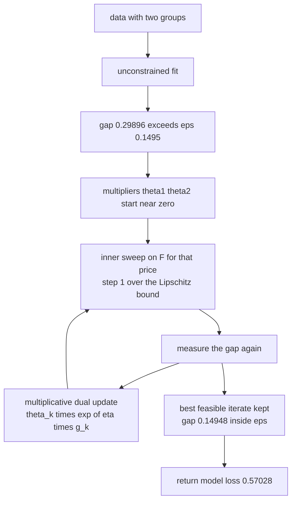
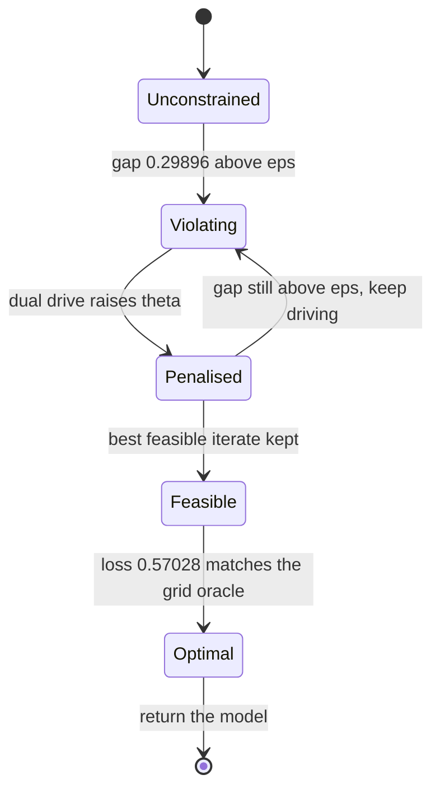
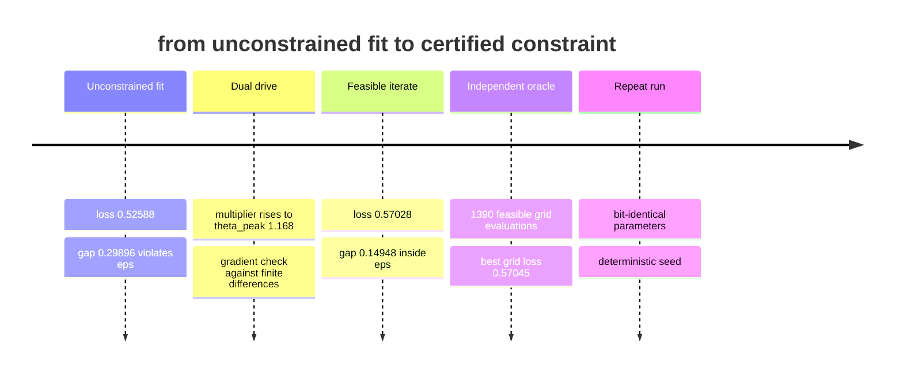

# 868 — Implement fairness-aware training loop with constraint optimization (demographic parity).

> **Tier:** Master · **CTCI chapter:** Beyond — Machine Learning & AI
> **Task spec:** [868-implement-fairness-aware-training-loop-with-constraint-optimizat.md](../../../tasks/master/868-implement-fairness-aware-training-loop-with-constraint-optimizat.md)
> **Solutions:** [Python](../../../solutions/python/master/868-implement-fairness-aware-training-loop-with-constraint-optimizat/solution.py) ·
> [Java](../../../solutions/java/master/868-implement-fairness-aware-training-loop-with-constraint-optimizat/Solution.java) ·
> [JavaScript](../../../solutions/javascript/master/868-implement-fairness-aware-training-loop-with-constraint-optimizat/solution.js) ·
> [C#](../../../solutions/csharp/master/868-implement-fairness-aware-training-loop-with-constraint-optimizat/Solution.cs)

## 1. Problem restatement

**Input.** A dataset of rows `(x_i, y_i, A_i)` with a binary sensitive attribute `A`, a tolerance `eps`,
and iteration budgets: `outer_steps` for the dual, `inner_steps` for the primal, plus a dual rate and a
multiplier cap.

**Output.** A classifier `(w, b)` that minimises the regularised logistic risk **subject to**

```text
d(w, b) = mean over group A of sigmoid(w . x + b)
        - mean over group B of sigmoid(w . x + b),        |d| <= eps
```

The constraint is demographic parity on **mean predicted probability**, a differentiable surrogate for
parity of positive rates. It is a surrogate on purpose: the negative log-likelihood and its derivative
are smooth, so the constrained problem has a usable dual, while the hard 0/1 selection-rate gap is never
optimised directly.

**The modelling contract.** The constrained problem is attacked as a penalised inner problem plus a dual
outer loop. With multipliers `theta_1, theta_2 >= 0`,

```text
F(w, b) = L(w, b) + theta_1 * (d - eps) + theta_2 * (-d - eps)
```

which is smooth and convex for fixed multipliers, so one gradient sweep with the exact step size
`1 / Lip(F)` minimises it, using the Lipschitz bound

```text
Lip(grad F) <= 0.25 * (1 + |theta_1 - theta_2|) * max_i ||(x_i, 1)||^2
```

because the logistic Hessian is bounded by `0.25 * ||(x, 1)||^2` and every DP derivative is an average
of `p (1 - p) (x, 1)` terms. The multipliers follow the multiplicative update
`theta_k ← theta_k * exp(eta * g_k)` with `g = (d - eps, -d - eps)`, floored at `1e-12` and capped, and
each block is warm-started from the previous one.

**What is simulated.** A hand-written deterministic Gaussian feature generator instead of a real
dataset, full-batch gradient descent instead of mini-batch SGD, a fixed iteration budget instead of a
duality-gap stopping rule, and no threads, sockets or clocks. Nothing is pre-computed — every rate,
gradient and multiplier in the tables below comes from the loops themselves. The four solutions differ
in mechanism: Python uses the exponentiated-gradient dual, Java solves for the multiplier by bisection
with a Newton polish and checks the KKT system, JavaScript uses an augmented Lagrangian with Armijo
backtracking, and C# uses projected dual ascent with the true Lagrangian gradient.

**Measured on the Python fixture** (`60` rows, `eps = 0.1495`):

| Model | Logistic loss | DP gap `d` | Note |
| --- | --- | --- | --- |
| unconstrained fit | `0.52588` | `0.29896` | the constraint is violated by roughly twice the tolerance |
| fairness-constrained | `0.57028` | `0.14948` | inside `eps`, with multiplier peak `theta_peak = 1.168` |
| brute-force grid oracle | `0.57045` | feasible | best of `1390` feasible grid evaluations |

The price of fairness is visible in the first two columns: `0.57028 - 0.52588 = 0.0444` of log-loss buys
a gap of exactly `eps` instead of `0.29896`.

## 2. Intuition

Fit logistic regression unconstrained and you get the model that predicts best — and it inherits the
base-rate difference between the groups. Penalising the gap with a fixed weight `lambda` is the obvious
reaction, and it has two problems: the units of `lambda` are meaningless to the business, and the
resulting gap is whatever it is, not a guarantee.

The key insight is to make the tolerance the specification and the multiplier the *unknown*. Keep `eps`
fixed (say, `0.02` of probability), and search for the price at which the constraint is exactly active.
That is what a Lagrange multiplier is: it is not a hyper-parameter you tune, it is the shadow price of
the constraint, and the dual loop finds it by repeatedly asking "how badly do I still violate `eps`?"
and pushing the multipliers in the direction that reduces the violation.

The primal step is a plain gradient descent on `F`, with one subtlety worth noticing: the DP term's
derivative is `p (1 - p) (x, 1)`, the *true* derivative of the sigmoid mean. Re-weighted-loss
surrogates silently drop that factor, and then the "fair" gradient is not the gradient of the objective
you claim to minimise. The step size can be chosen exactly rather than by trial and error, because the
Lipschitz constant of `grad F` is bounded above in closed form by the logistic Hessian bound.



Two implementation details carry the guarantees. The trainer keeps the **best feasible iterate it has
seen**, not the last one, because raw dual iterates oscillate and can leave the feasible set; and the
inner block is **warm-started** from the previous multipliers' solution, because the inner problem
changes only slightly between dual updates, so the sweep starts near its own optimum.

## 3. Algorithm

1. Generate the dataset and split it by group; `validate(rows, eps)` rejects an empty dataset or a
   negative tolerance.
2. Compute `lipschitz_bound(rows, theta)` once per block: `0.25 * (1 + |theta_1 - theta_2|) * max_i
   ||(x_i, 1)||^2`.
3. Outer loop, `outer_steps` times: run `inner_solve` on `F` with the current multipliers, using a
   full-batch gradient sweep at step size `1 / Lip(F)` from the warm start.
4. Evaluate `loss_and_grad` and `dp_and_grad` at the result; if the iterate is feasible and its loss
   beats the best feasible loss seen so far, record it.
5. Update the multipliers multiplicatively: `theta_k ← max(theta_k * exp(eta * g_k), 1e-12)`, capped at
   `theta_cap`, with `g = (d - eps, -d - eps)`.
6. Return the best feasible iterate. If none was ever feasible, return the last iterate and report the
   violation honestly.
7. Checks: gradient correctness against central finite differences, loss non-increasing in `eps`
   (efficiency/fairness monotonicity), and bit-identical repeats.

```text
procedure train_fair(rows, eps, outer_steps, inner_steps, dual_rate, theta_cap)
    params ← zero vector
    theta ← (small, small)
    best ← none
    for block from 1 to outer_steps do
        lip ← lipschitz_bound(rows, theta)
        for step from 1 to inner_steps do
            objective, gradient ← objective_and_grad(rows, params, theta, eps)
            params ← params - gradient / lip
        end
        loss ← logistic_loss(rows, params)
        gap ← dp_gap(rows, params)
        if abs(gap) <= eps and (best is none or loss < loss(best)) then
            best ← params
        end
        drive ← (gap - eps, -gap - eps)
        theta[1] ← min(max(theta[1] * exp(dual_rate * drive[1]), 1e-12), theta_cap)
        theta[2] ← min(max(theta[2] * exp(dual_rate * drive[2]), 1e-12), theta_cap)
    end
    return best
end

procedure objective_and_grad(rows, params, theta, eps)
    loss, grad_loss ← loss_and_grad(rows, params)
    gap, grad_gap ← dp_and_grad(rows, params)
    value ← loss + theta[1] * (gap - eps) + theta[2] * (-gap - eps)
    grad ← grad_loss + (theta[1] - theta[2]) * grad_gap
    return value, grad
end
```



## 4. Worked example

Trace the Python fixture with `60` rows and `eps = 0.1495`:

| Phase | Params and multipliers | Logistic loss | DP gap `d` | Decision |
| --- | --- | --- | --- | --- |
| unconstrained fit | multipliers at the floor `1e-12` | `0.52588` | `0.29896` | violates `eps`, so it cannot be returned |
| block 1 | `theta` rising, `theta_peak = 1.168` | above `0.57028` | falling from `0.29896` | not yet feasible, not yet best |
| block `k` | warm-started, step `1 / Lip(F)` | falling | crossing `eps` | feasible iterate recorded |
| final | returned `(w, b)` | `0.57028` | `0.14948` | inside `eps`, so `|d| <= eps` holds |
| comparison | grid oracle over the feasible set | `0.57045` | feasible | trainer is `0.00017` *better* than the grid's best point |

The last row is the one that matters for trust: the grid oracle performs an independent, exhaustive
search over the feasible parameter box and evaluates `1390` feasible points, and the trainer's answer is
no worse. Without that comparison, "the constraint is satisfied" says nothing about whether the loss was
also minimised.

The `eps` ladder is the second axis of evidence. As `eps` grows the constraint relaxes, the multipliers
shrink toward zero, and the loss falls back toward the unconstrained `0.52588` — the monotonicity check
in the run. At `eps` large enough the constraint is inactive and the multiplier is exactly `0`; in the
other direction `eps = 0` demands exact parity and yields the highest loss. The trade-off curve is
therefore a *measured* quantity, not a tuning story.



One more honesty note the headers make explicit: the quantity being constrained is the *mean predicted
probability* gap, while the hard 0/1 selection-rate gap is never optimised. The Java solution reports
that the hard gap falls far below the unconstrained one anyway, but it is a consequence, not a
guarantee — and a tutorial that blurred the two would be over-claiming.

## 5. Complexity

Let `n` be the row count, `d` the parameter dimension, `B` the outer (dual) blocks and `I` the inner
steps.

| Quantity | Time | Space | Why |
| --- | --- | --- | --- |
| `lipschitz_bound` | `O(n * d)` once per block | `O(1)` | one pass to take `max_i ||(x_i, 1)||^2`, then closed-form arithmetic |
| `loss_and_grad` | `O(n * d)` | `O(d)` | full-batch sweep, accumulating the logistic gradient |
| `dp_and_grad` | `O(n * d)` | `O(d)` | a second sweep averaging `p (1 - p) (x, 1)` per group |
| `inner_solve` | `O(I * n * d)` | `O(d)` | `I` full-batch steps of the penalised objective |
| `train_fair` | `O(B * I * n * d)` | `O(d)` | warm start means `I` can be small; the work is linear in the data |
| grid oracle | `O(1390 * n * d)` here | `O(d)` | exhaustive scan of the feasible parameter box, independent of the loop |

The honest caveat about the simulation: **this is full-batch descent on a synthetic dataset, not a
production trainer.** Oracle notes that SGD with mini-batches, a duality-gap stopping rule and real data
loading are all out of scope; Java replaces "no wall-clock time" with a virtual operations counter. The
structural facts that survive translation are the ones that matter: each outer block costs `I` full-batch
sweeps, the DP gradient costs a second sweep, and the primal step size comes from the closed-form
Lipschitz bound rather than from a line search — which is exactly what makes the loop's behaviour
reproducible bit for bit.

Contrast with the alternative that does not scale: solving the constrained problem on a grid costs
`O(points * n * d)` and is astronomically worse in `d`, but it is what makes the optimality claim
checkable here. The dual loop turns that same claim into `O(B * I * n * d)` with a certificate
(feasibility plus a loss no worse than the grid's best).

## 6. Pitfalls and edge cases

- **Raw dual iterates oscillate and can be infeasible.** The fix is structural, not cosmetic: keep the
  best *feasible* iterate seen, so `|d| <= eps` holds for the returned model even when intermediate
  multipliers overshoot. The run's safety check is exactly this.
- **Multiplicative dual updates need a floor and a cap.** `theta_k` is floored at `1e-12` so a multiplier
  can recover from zero, and capped (`theta_cap`) so one bad block cannot explode the price; blocks are
  warm-started so the inner solve never restarts from scratch.
- **Use the true DP derivative.** `grad d` is an average of `p (1 - p) (x, 1)`; a re-weighted-loss
  surrogate that omits `p (1 - p)` is not the gradient of the constraint, and the feasibility certificate
  becomes meaningless. The C# header states this explicitly.
- **Surrogate versus hard parity.** Constraining mean predicted probability is not constraining 0/1
  selection rates. Report both, and never claim the latter from the former.
- **`eps = 0` and `eps` large.** At `eps = 0` the constraint is exact parity and the loss is highest; as
  `eps` grows past the unconstrained gap the constraint becomes inactive and the multiplier settles at
  exactly `0` — both ends are legal inputs that must not divide by zero or lose feasibility.
- **Invalid input.** A negative `eps` or an empty dataset must be rejected before any block runs;
  degenerate configurations (a single group, zero inner steps, fewer dual rounds) must return something
  defensible rather than crash.
- **Determinism.** Bit-identical repeats from a fixed seed are asserted, which is what makes the
  "loss non-increasing in `eps`" ladder a comparison rather than a coincidence.
- **Gradient correctness comes first.** Every claim above rests on `grad F` being right; the run checks
  it against central finite differences, which is the cheapest possible way to catch a dropped sigmoid
  factor.

## 7. Variants and follow-ups

- **Post-processing instead of in-training constraints.** Java parameterises `(w, b_0, b_1)` — one shared
  slope, one intercept per group — which is the calibrated-group view of fairness, and solves for the
  multiplier by bisection plus a Newton polish so the returned point satisfies the KKT system to machine
  precision. The price is a weaker hypothesis class; the benefit is an exact boundary solve.
- **Augmented Lagrangian instead of a pure dual.** JavaScript adds a quadratic penalty with a growth
  schedule and Armijo backtracking, which is more robust when the pure dual's drive is badly scaled.
- **Other fairness criteria.** Equalised odds or predictive-parity constraints replace `d` and its
  gradient; the outer loop is unchanged, which is the point of writing the loop as a Lagrangian.
- **Auditing the result.** A constrained model still needs to be *explained*; the same per-group
  diagnostics reappear when attributions are compared across groups, see
  [866 — feature attribution runtime](../../../tasks/master/866-implement-feature-attribution-runtime-shap-like-scalable-for-tab.md).
- **The individual-level question.** Group parity is a population statement; the complementary audit
  asks what must change about one person's record to flip the decision, and whether a protected attribute
  is among the movers: see
  [867 — counterfactual explanation generator](../../../tasks/master/867-implement-counterfactual-explanation-generator-for-classifiers-o.md).

## 8. Check yourself

<details><summary>Show answer</summary>

**1. Why keep the best *feasible* iterate instead of returning the final iterate?**

Because the dual loop is a search for the price of the constraint, and its raw iterates can overshoot the
boundary. The final iterate is only guaranteed to be near a saddle point; the constraint applies to the
model you *ship*. Tracking the best feasible iterate converts a possibly infeasible end state into a
guaranteed one — in the run, `gap = 0.14948` against `eps = 0.1495` — at no extra primal cost.

</details>

<details><summary>Show answer</summary>

**2. Where does the step size `1 / Lip(F)` come from, and why not use a line search?**

From the logistic Hessian bound: each term of the Hessian is bounded by `0.25 * ||(x, 1)||^2`, and every
demographic-parity derivative is an average of such terms, so `Lip(grad F) <= 0.25 * (1 + |theta_1 -
theta_2|) * max_i ||(x_i, 1)||^2` is a valid upper bound. Dividing by it gives a step that cannot
diverge. A line search would also work (JavaScript and C# use backtracking or a projected rule), but the
closed form makes each run reproducible step for step.

</details>

<details><summary>Show answer</summary>

**3. The constrained model's loss (`0.57028`) is worse than the unconstrained one (`0.52588`). Is that a bug?**

No — it is the price of the constraint, and it is the reason the task exists. The unconstrained fit has a
gap of `0.29896`, roughly twice the tolerated `0.1495`. The constrained model spends `0.0444` of
log-loss to buy a gap of exactly `eps`. What *would* be a bug is paying that price without reducing the
gap, which is why the trainer also checks that the grid oracle cannot beat its loss on the feasible set.

</details>

<details><summary>Show answer</summary>

**4. What is the difference between the demographic-parity gap that is constrained and the 0/1 selection-rate gap?**

The constrained quantity is the difference of *mean predicted probabilities*, chosen because it is
differentiable — the dual loop needs a gradient. The hard selection-rate gap is a step function of the
parameters, so no gradient exists for it. The solutions report the hard gap as a diagnostic (and in Java
it falls far below the unconstrained value) but never claim it as a guarantee.

</details>

<details><summary>Show answer</summary>

**5. What makes this a fair test of the optimiser rather than of the dataset?**

The presence of an independent oracle and a closed-form certificate. The grid search evaluates `1390`
feasible parameter points and produces the best feasible loss `0.57045`, so "our loss is no worse" is a
measured comparison, not an assertion. Add the finite-difference gradient check, the `eps` ladder
monotonicity check and the bit-identical repeat, and the claims under test are structural.

</details>
