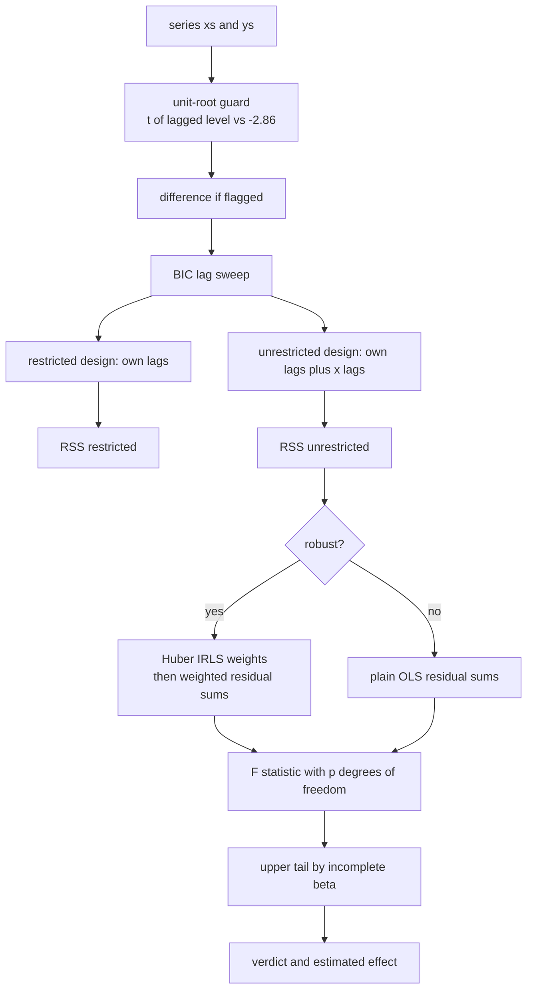
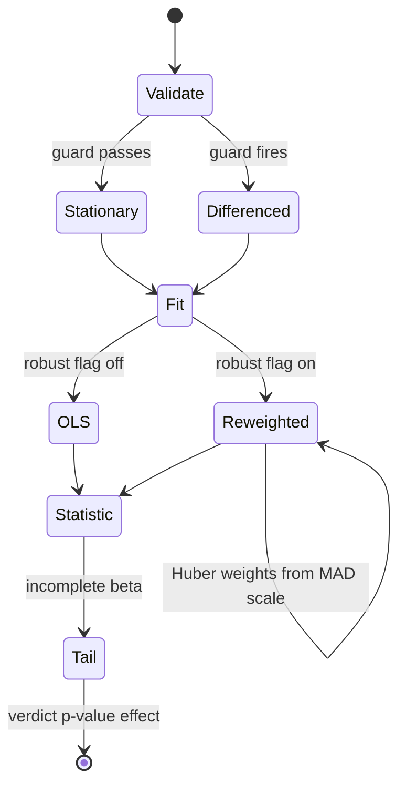
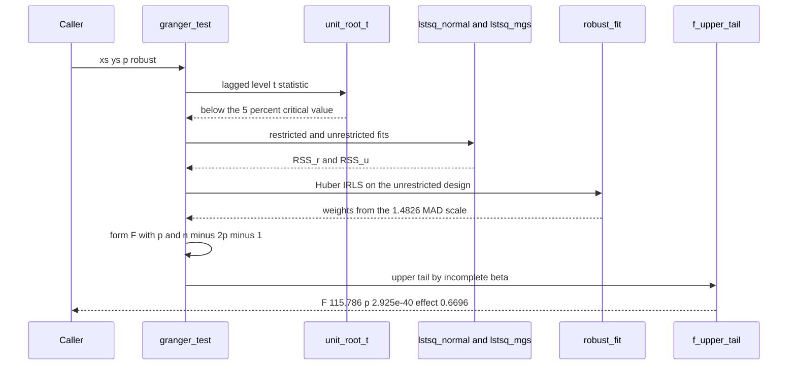

# 869 — Implement causality identification in time series with Granger causality and robustness.

> **Tier:** Master · **CTCI chapter:** Beyond — Machine Learning & AI
> **Task spec:** [869-implement-causality-identification-in-time-series-with-granger-c.md](../../../tasks/master/869-implement-causality-identification-in-time-series-with-granger-c.md)
> **Solutions:** [Python](../../../solutions/python/master/869-implement-causality-identification-in-time-series-with-granger-c/solution.py) ·
> [Java](../../../solutions/java/master/869-implement-causality-identification-in-time-series-with-granger-c/Solution.java) ·
> [JavaScript](../../../solutions/javascript/master/869-implement-causality-identification-in-time-series-with-granger-c/solution.js) ·
> [C#](../../../solutions/csharp/master/869-implement-causality-identification-in-time-series-with-granger-c/Solution.cs)

## 1. Problem restatement

**Input.** Two stationary series `xs` and `ys`, a lag order `p`, and a `robust` flag. Optionally a
maximum lag for selection when `p` is not given.

**Output.** A verdict for the direction `x → y` built from the F statistic and its p-value, together
with the estimated effect and the search context: the lag order chosen, and whether the series had to
be differenced first.

**The test.** "x Granger-causes y" means the past of `x` carries information about `y_t` beyond the past
of `y`. Operationally the target equation is regressed in two nested ways:

```text
restricted     y_t = a + sum_k b_k y_{t-k} + e_t
unrestricted   y_t = a + sum_k b_k y_{t-k} + sum_k c_k x_{t-k} + e_t
F = ((RSS_r - RSS_u) / p) / (RSS_u / (n_obs - 2p - 1))   with degrees (p, n_obs - 2p - 1)
```

The p-value is the upper tail of `F(p, n_obs - 2p - 1)`, computed through the regularised incomplete
beta function rather than read from a table.

**The modelling contract.** The solutions are explicit that this is the *predictive* Granger test, not
interventional identification: the counterfactual reading is only valid under the model assumptions,
which is why every claim is checked against a synthetic ground truth. Series are generated in-process by
a stationary VAR(1)/VAR(2) with deterministic `splitmix64` innovations; "scale" is the series length,
the replica count and the permutation budget; there are no threads, clocks or external data. Three
independent solvers make the arithmetic cross-checkable: the normal equations solved by Gaussian
elimination with partial pivoting, a modified Gram-Schmidt QR (`lstsq_mgs`), and `lstsq_exact`, which
repeats the computation in `fractions.Fraction` so the statistic can be compared against an exact
rational value. Robustness is a first-class layer: OLS has a breakdown point of zero, so the code also
implements iteratively reweighted least squares with Huber weights `w_i = min(1, c * s / |r_i|)`, where
`s = 1.4826 * MAD(residuals)` and `c = 1.345` (86% Gaussian efficiency), and forms the F statistic from
weighted residual sums of squares using the weights from the unrestricted fit.

**One honest caveat, stated in the docstring.** The nominal p-value of the *weighted* statistic is an
approximation, because weighted statistics are not exactly F distributed. That is precisely why the
robustness checks assert **estimator accuracy** and **detection**, not nominal coverage.

**Measured on the Python fixture:**

| Check | Observed |
| --- | --- |
| true direction `x → y` | `F = 115.786`, `p = 2.925e-40`, effect `0.6696` |
| reverse direction `y → x` | `F = 0.307`, `p = 0.7360`, BIC lag `2` |
| size under the null | `1/30` rejections |
| power as coupling grows | `F = [12.32, 37.17, 72.01, 115.98]` |
| outlier-contaminated estimate | OLS `0.0904`, Huber `0.7136` (truth `0.6`); clean data `0.5777` |

## 2. Intuition

The naive causal discovery is correlation: `x` and `y` move together, therefore `x` drives `y`. The C#
header names the failure mode exactly — **instantaneous dependence is predictive but not Granger
causal**, and a contemporaneous correlation survives in either direction (or in neither). Lead-lag
ordering is what separates them: `x` must help predict `y` *after* `y`'s own past has been used.

That is what the nested regressions encode. The restricted model is everything you could have known
about `y` without `x`; the unrestricted model adds `x`'s lags. If the residual sum of squares does not
drop meaningfully, `x` adds nothing, and the F statistic measures the drop per extra parameter against
the remaining noise. Everything else in the task exists to make that comparison trustworthy:

- the **distribution**: the tail goes through `betacf`/`betai` and `f_upper_tail`, with the exact
  special cases `1 - (1 + f/2)^-2` for `F(2, 4)` and the Cauchy identity `P(F(1,1) > 1) = 1/2` as oracles;
- the **arithmetic**: three solvers must agree, and on a small integer series the whole statistic is
  compared against exact rational arithmetic;
- the **data**: a single outlier can drive the OLS fit anywhere, so Huber weights shrink its influence and
  the test is rebuilt from weighted sums;
- the **model order and stationarity**: BIC picks the lag, and an ADF-style guard compares the t statistic
  of the lagged level against the 5% critical value `-2.86` to decide on differencing.



The weight rule is worth reading closely because it is what makes the robust test robust. Residuals
smaller than `c * s` get weight one — they are ordinary data; larger residuals get weight `c * s / |r|`,
which decays like `1/|r|`. An outlier is therefore *down-weighted*, never deleted, and the scale `s`
is the MAD-based estimate rather than the sample standard deviation, precisely because the latter is
itself inflated by the very outliers you are defending against.

## 3. Algorithm

1. Validate the inputs and check stationarity with `unit_root_t(values, lags)`; `difference(values)`
   produces the series to model when the guard fires.
2. Choose the lag order with `select_lag_bic(xs, ys, p_max)` unless the caller supplies `p`.
3. Build the two designs with `design_blocks(xs, ys, p)`: the restricted blocks carry `y`'s lags only,
   the unrestricted blocks add `x`'s lags.
4. Solve each fit — `lstsq_normal` (normal equations plus Gaussian elimination with partial pivoting),
   `lstsq_mgs` (modified Gram-Schmidt QR) for the cross-check, and `lstsq_exact` when the series is
   small enough for exact rational arithmetic.
5. Compute `residual_sum_of_squares` for both fits. For the robust path, run `robust_fit` (Huber IRLS)
   on the unrestricted design, take its weights, and recompute *both* residual sums with them, which is
   the standard weighted least-squares F test.
6. Form the F statistic and evaluate the upper tail with `f_upper_tail`, which uses `betacf`/`betai`.
7. Report the statistic, p-value, estimated effect and the context (lag, differencing, robust flag).
8. If the caller asked for the reverse direction, run the same machinery with the roles swapped — the
   test is symmetric in implementation and asymmetric in result, which is the point.

```text
procedure granger_test(xs, ys, p, robust)
    validate(xs, ys, p)
    if unit_root_t(values, lags) > CRITICAL_5_PERCENT then
        xs, ys ← difference(xs), difference(ys)
    end
    restricted ← design_blocks(xs, none, p)
    unrestricted ← design_blocks(xs, ys, p)
    beta_r ← lstsq_normal(restricted, target)
    beta_u ← lstsq_normal(unrestricted, target)
    if robust then
        beta_u ← robust_fit(unrestricted, target, iterations)
        weights ← huber_weights(residuals(unrestricted, beta_u), 1.345)
        rss_r ← weighted_rss(restricted, target, beta_r, weights)
        rss_u ← weighted_rss(unrestricted, target, beta_u, weights)
    else
        rss_r ← residual_sum_of_squares(restricted, target, beta_r)
        rss_u ← residual_sum_of_squares(unrestricted, target, beta_u)
    end
    q ← p
    statistic ← ((rss_r - rss_u) / q) / (rss_u / (n_obs - 2 * p - 1))
    p_value ← f_upper_tail(statistic, q, n_obs - 2 * p - 1)
    return statistic, p_value, effect(beta_u)
end

procedure robust_fit(design, target, iterations)
    beta ← lstsq_normal(design, target)
    repeat iterations times
        residuals ← target - design * beta
        weights ← huber_weights(residuals, 1.345)
        beta ← weighted_fit(design, target, weights)
    end
    return beta
end

function huber_weights(residuals, c)
    s ← 1.4826 * median_absolute_deviation(residuals)
    return for each residual r: min(1, c * s / absolute(r)) with the weight of r = 0 taken as 1
end
```



## 4. Worked example

Take the generated VAR pair with a planted edge `x → y`, `p = 2` chosen by BIC, and walk the test:

| Step | Quantity | Observed |
| --- | --- | --- |
| 1 | unit-root guard on both series | stationary as generated, no differencing needed |
| 2 | BIC over the lag range | chooses lag `2`, the true order |
| 3 | restricted fit `y` on its own lags | `RSS_r` from the normal equations |
| 4 | unrestricted fit, add `x`'s lags | `RSS_u` strictly smaller |
| 5 | F statistic | `F = 115.786`, effect estimate `0.6696` |
| 6 | upper tail of `F(2, n - 5)` | `p = 2.925e-40` |
| 7 | reverse direction `y → x` | `F = 0.307`, `p = 0.7360` — no evidence |
| 8 | three-way solver cross-check | normal equations, MGS QR and exact rational agree |

The reverse row is the control that makes the first row meaningful: the same code, the same lags and
the same distribution applied with the roles swapped produces a p-value near one. A test that rejected
in both directions would be measuring the contemporaneous dependence the C# header warns about, not
lead-lag information.

Calibration and power are the other two measurements, and they are the ones production use depends on:

| Scenario | Result | Reading |
| --- | --- | --- |
| independent pairs under H0 | `1/30` rejections | the size is near nominal, so the test is not trigger-happy |
| coupling swept upward | `F = [12.32, 37.17, 72.01, 115.98]` | power grows monotonically with the strength of the true edge |
| 30% of points replaced by outliers, plain OLS | effect `0.0904` against truth `0.6` | OLS collapses — the breakdown point is zero |
| the same contaminated data, Huber IRLS | effect `0.7136` | strictly closer to the truth than OLS |
| clean data, Huber IRLS | effect `0.5777` | within tolerance of the truth, so robustness costs little |

The takeaway: the robust estimator is strictly closer to the truth exactly where the classical one fails,
and essentially identical where it succeeds.



## 5. Complexity

Let `n` be the series length, `p` the lag order, `k = 2p + 1` the unrestricted parameter count,
`I` the IRLS iterations and `R` the replica or permutation count for the robustness audits.

| Quantity | Time | Space | Why |
| --- | --- | --- | --- |
| `design_blocks` | `O(n * k)` | `O(n * k)` | two lag blocks per row, one target column |
| `gram` / `cross` | `O(n * k^2)` | `O(k^2)` | one sweep accumulating an outer product per row |
| `lstsq_normal` | `O(n * k^2 + k^3)` | `O(n * k)` | Gram matrix then Gaussian elimination with partial pivoting |
| `lstsq_mgs` | `O(n * k^2)` | `O(n * k)` | modified Gram-Schmidt QR, used as an independent cross-check |
| `lstsq_exact` | same asymptotic order, larger constants | `O(n * k)` rationals | `Fraction` arithmetic removes rounding but keeps the algorithm |
| `robust_fit` | `O(I * (n * k^2 + k^3))` | `O(n * k)` | each IRLS round refits the weighted problem from scratch |
| `f_upper_tail` | `O(iterations of the continued fraction)` | `O(1)` | `betacf` converges geometrically for these parameters |
| `granger_test` | `O(n * k^2 + k^3)` plain, `O(I)` times that robust | `O(n * k)` | one fit per direction plus the optional reweighting loop |
| null-calibration audit | `O(R * granger_test)` | `O(n * k)` | `R` independent replica series, replayed deterministically |

The honest caveat about this simulation: **everything runs on generated stationary VAR series in one
process.** No threads, no clock, no external data; "scale" is the series length, the replica count and
the permutation budget. Two consequences follow. The *nominal* p-value of the weighted statistic is an
approximation — weighted residual sums are not exactly F distributed — so the robustness checks assert
estimator accuracy and detection rather than coverage. And `lstsq_exact` is practical only on a small
integer series: a correctness oracle, not a serving path. The asymptotic costs above hold regardless;
the structural fact is that the test costs two least-squares fits of `k` parameters, so `k^3` dominates.

## 6. Pitfalls and edge cases

- **Instantaneous dependence is not Granger causality.** A contemporaneous coupling shows up in both
  directions or in neither. The C# header calls this the classic trap and it is the single most common
  way to get a confident, wrong answer out of this machinery.
- **OLS has a breakdown point of zero.** One bad point moved the estimated effect from `0.6` to
  `0.0904` in the run; the Huber fit recovered `0.7136` on the same data. Report both when in doubt, and
  never claim robustness that was not measured.
- **Heavy-tailed innovations inflate the false-positive rate.** Java's audit reports the plain F test
  blowing past its nominal 5% level under contaminated innovations while the HC0 sandwich version stays
  calibrated and keeps its power — the failure mode is a test that over-rejects, not a noisy coefficient.
- **The weighted p-value is approximate.** Do not assert nominal coverage for the robust statistic;
  assert that the estimator is closer to the truth and that detection survives contamination, which is
  what the solutions do.
- **Non-stationarity breaks the distribution.** An integrated pair must be flagged and differenced
  first, and the run confirms the causal link is recovered afterwards. Comparing the lagged-level t
  statistic against `-2.86` is the guard, and it is deliberately a cheap screen rather than a full
  sequential test.
- **Lag order is a modelling decision.** BIC recovering the true order `2` in the fixture is a check,
  not a guarantee; a wrong `p` changes both degrees of freedom and power. Zero lags and series shorter
  than the lag order are rejected rather than silently mis-sliced.
- **Degenerate series and reporting direction.** A constant series makes the design singular, and the
  `y → x` verdict (`F = 0.307`) versus `x → y` (`F = 115.786`) is the desired asymmetry — so always
  report which direction the test actually ran.

## 7. Variants and follow-ups

- **Distribution-free p-values.** Java implements an exact permutation test that holds `y`'s own lags
  fixed and permutes only `x`'s lag block, which makes no distributional assumption at all, and shows the
  permutation p-value agreeing with the analytic one on a causally linked pair.
- **Heteroskedasticity-robust statistics.** An HC0 sandwich covariance turns the F test into a robust
  Wald test, which is the right tool when the outliers perturb the variance rather than the mean.
- **Stability under resampling.** The JavaScript solution checks sliding-window stability (the edge must
  be detected in every contiguous window) and builds a percentile interval for `F` from a circular block
  bootstrap of the residuals, plus a portmanteau residual diagnostic so the white-noise assumption behind
  the F test is verified rather than assumed.
- **Different reweighting schemes.** C# uses a Tukey biweight IRLS instead of Huber, and adds the
  instantaneous-dependence trap as a first-class verification item; the surrounding F machinery is
  unchanged, which is the sign of a well-factored test.
- **Cross-checking numerics as a discipline.** The three-solver agreement here is the small-scale version
  of a differential-testing harness: see
  [872 — differential testing harness for numerical linear algebra](../../../tasks/master/872-implement-differential-testing-harness-for-numerical-linear-alge.md).
- **Reproducibility infrastructure.** Every number in this tutorial is regenerated from a fixed seed, so
  the statistical claims can be re-run in CI rather than trusted:
  [870 — continuous integration pipeline for large-scale numerical code](../../../tasks/master/870-implement-continuous-integration-pipeline-for-large-scale-numeri.md).

## 8. Check yourself

<details><summary>Show answer</summary>

**1. Why regress twice instead of simply correlating `x` and `y`?**

Because correlation cannot separate lead-lag information from contemporaneous dependence. The restricted
regression captures everything `y`'s own past already explains; the unrestricted regression adds `x`'s
lags. Only the *drop* in residual sum of squares is evidence that `x` leads `y`, and the run shows the
asymmetry: `F = 115.786` one way, `F = 0.307` the other.

</details>

<details><summary>Show answer</summary>

**2. Why are three least-squares solvers implemented instead of one?**

To make the numeric claim checkable. The normal equations with partial pivoting are the fast path, MGS
QR is an independent formulation that fails differently, and `fractions.Fraction` arithmetic on a small
integer series gives the exact answer. When all three agree, a discrepancy in the F statistic is a
modelling question rather than a rounding accident — the same reasoning a differential-testing harness
applies at industrial scale.

</details>

<details><summary>Show answer</summary>

**3. What does the Huber weight rule `min(1, c s / |r|)` do, and why is `s` a MAD estimate?**

Residuals within `c * s` of zero keep full weight; larger ones are scaled down like `1/|r|`, so an
outlier is down-weighted rather than removed and the fit stays continuous in the data. Using
`1.4826 * MAD` for `s` instead of the standard deviation matters because the standard deviation is
itself inflated by the outliers being defended against — a scale estimate that ignores them is what
makes the weights meaningful. The measured effect on contaminated data was `0.7136` versus OLS's
`0.0904`, against a truth of `0.6`.

</details>

<details><summary>Show answer</summary>

**4. Why does the docstring call the robust p-value an approximation?**

Because the F distribution describes the ratio of residual sums of squares for *unweighted* Gaussian
errors; once you form the statistic from weighted residuals the null distribution changes, and no
closed form is available in this setting. The solutions therefore assert what they can: the estimator is
closer to the truth under contamination, detection survives, and the empirical false-positive rate is
tracked rather than assumed.

</details>
