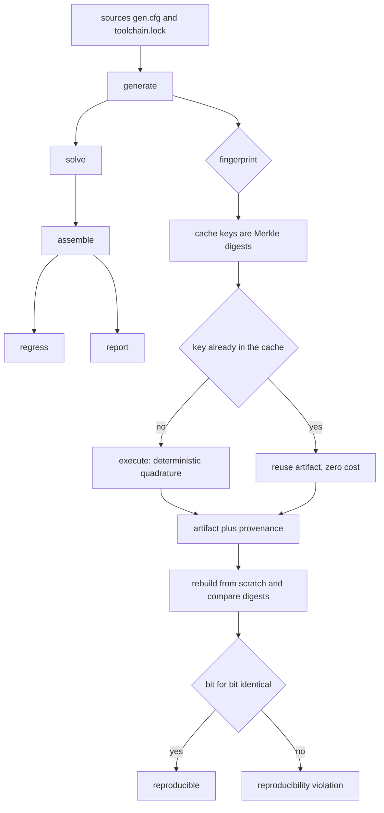
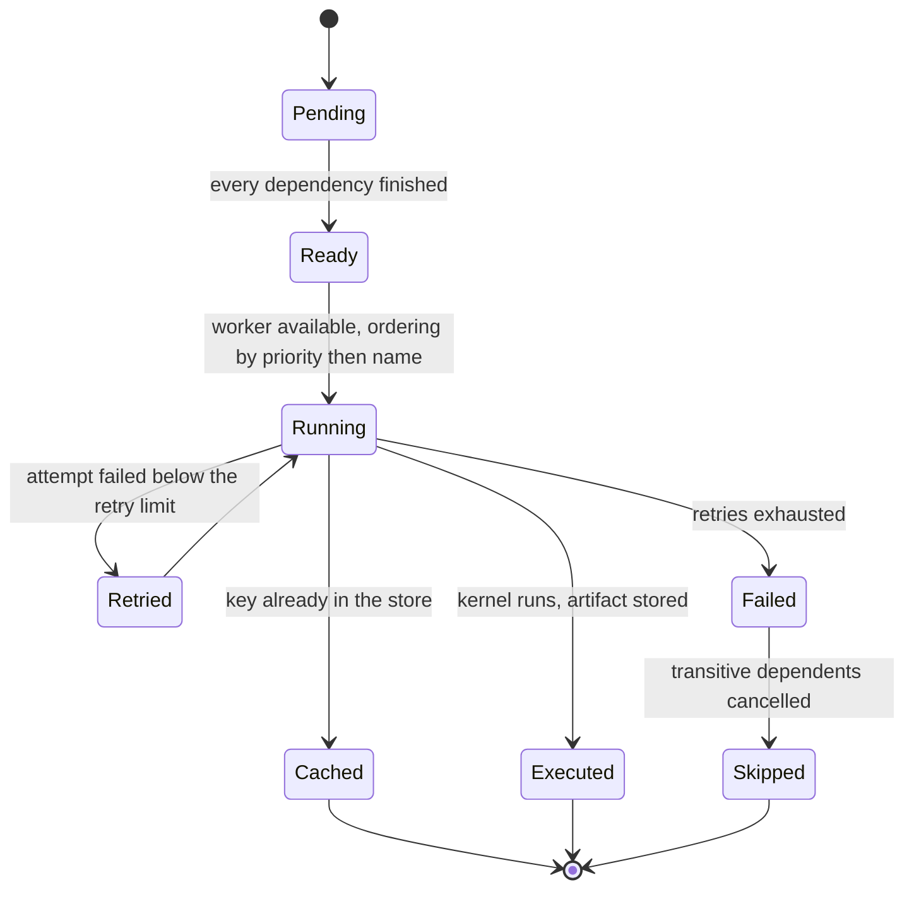
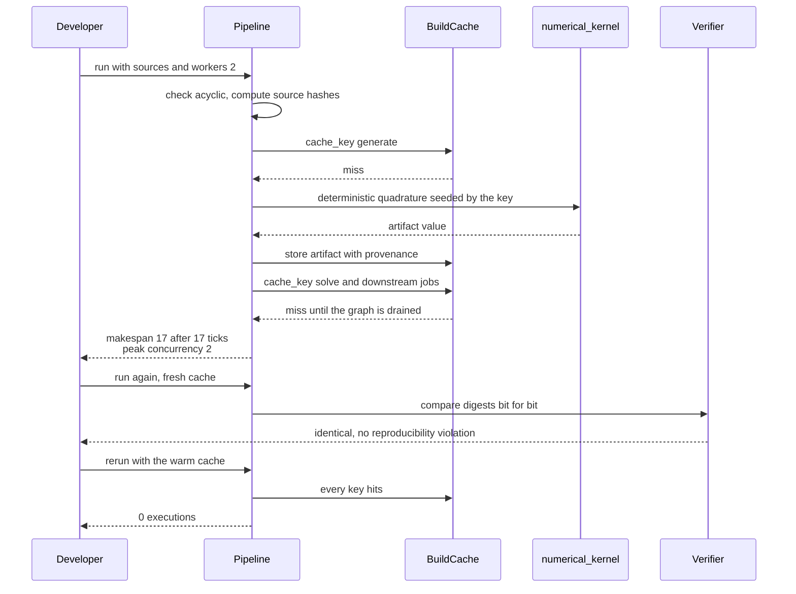

# 870 — Implement continuous integration pipeline for large-scale numerical code with reproducibility.

> **Tier:** Master · **CTCI chapter:** Beyond — Software Engineering & Tooling
> **Task spec:** [870-implement-continuous-integration-pipeline-for-large-scale-numeri.md](../../../tasks/master/870-implement-continuous-integration-pipeline-for-large-scale-numeri.md)
> **Solutions:** [Python](../../../solutions/python/master/870-implement-continuous-integration-pipeline-for-large-scale-numeri/solution.py) ·
> [Java](../../../solutions/java/master/870-implement-continuous-integration-pipeline-for-large-scale-numeri/Solution.java) ·
> [JavaScript](../../../solutions/javascript/master/870-implement-continuous-integration-pipeline-for-large-scale-numeri/solution.js) ·
> [C#](../../../solutions/csharp/master/870-implement-continuous-integration-pipeline-for-large-scale-numeri/Solution.cs)

## 1. Problem restatement

**Input.** A job DAG — each job carrying a name, a duration, dependencies, a priority, declared source
files, a sample count, a command, a `nondeterministic` flag and a `fail_attempts` count — plus the
contents of those source files, a toolchain string, a worker count `W` and a retry limit. Optionally a
cache from a previous run.

**Output.** A timeline of `(start, finish)` per job, the makespan, the peak concurrency, and per job a
cache key, an artifact digest and its provenance. Plus a verdict: whether rebuilding from scratch
reproduces every digest bit for bit.

**The modelling contract.** The orchestrator is a discrete-event simulation on an **explicit virtual
clock**. The scheduler fills `W` worker slots from the ready set ordered by `(-priority, name)`, then
advances the clock to the earliest completion. Nothing sleeps and nothing is concurrent: the schedule is
a pure function of the DAG, so scheduling properties — worker limit, critical path, priority order — are
*checked* rather than timed.

Incremental builds are **content-addressed**: a job's cache key is the digest of its toolchain, its
command, its declared source files *by content hash*, and the digests of its dependencies' artifacts — a
Merkle key over the DAG. Artifacts carry provenance (job, toolchain, source hashes, dependency digests),
so the provenance closure of a final artifact reaches exactly its transitive source set. Reproducibility
is real rather than declared: artifacts are produced by an actual numerical kernel — a deterministic
quadrature trace-driven by the artifact's own Merkle key — and a job flagged `nondeterministic` consumes
an entropy counter per attempt and is reported as a reproducibility violation.

**What is simulated.** Virtual milliseconds instead of wall time, synthetic durations, a synthetic flake
function and a dictionary-backed artifact store instead of compilers, networks and an artifact server.
Java replaces "machines" with an explicit machine pool and a virtual-ops counter, C# models build
duration as a FLOP count, and the only randomness anywhere is `splitmix64` keyed by the run seed.

**Measured on the Python fixture:**

| Scenario | Observed |
| --- | --- |
| cold run | makespan `17`, critical path `17`, serial sum `22`, peak concurrency `2` |
| warm-cache rerun | `0` executions |
| one source edited | incremental set `['assemble', 'generate', 'regress', 'report', 'solve']` |
| byte-identical touch | no-op rebuild, nothing re-executed |
| a job fails | skipped-on-failure `['regress', 'report']` |
| provenance of the final artifact | sources `['gen.cfg', 'toolchain.lock']` |

## 2. Intuition

The naive numerical CI runs the stages serially and rebuilds everything. It is correct and slow, and it
gets slower exactly where it hurts — a numerical code base with long regression and benchmark stages.

Three ideas fix it, and each one is a *property* you can test rather than a heuristic you hope for.

First, **schedule from the ready set**. A job may start the moment its dependencies are done, so the
list of candidates is the frontier of the DAG, ordered by priority and then by name to keep ties
deterministic. The lower bound on the makespan is the critical path; the upper bound is the serial sum;
under a single worker the schedule must reproduce the serial order exactly. In the fixture both bounds
are visible: `22` serial, `17` critical path, `17` achieved, `2` jobs concurrent at peak.

Second, **key everything by content**. A Merkle key over the DAG means the cache key of a job depends on
the *bytes* of its inputs, not their timestamps. Two immediate consequences: touching a file without
changing its content rebuilds nothing, and changing one source rebuilds exactly the transitive
dependents of that job. That exact set is what the run reports — and it is verified against an
independent reachability search rather than asserted.

Third, **record provenance and check reproducibility**. Every artifact stores the job, toolchain, source
hashes and dependency digests that produced it, so the closure of the final artifact is a certificate of
what went into it. And because a numerical kernel is deterministic in principle, rebuilding with a fresh
cache must reproduce every digest bit for bit.



The reproducibility gate is where "large-scale numerical code" earns its place in the title. The run
checks that a job declared nondeterministic is *detected*: it consumes an entropy counter per attempt, so
its digest changes between runs and the pipeline reports a violation instead of quietly publishing a
different answer. The JavaScript solution makes the same point numerically — the same ill-conditioned
reduction accumulated in two different orders agrees bitwise in double precision and drifts in float32 —
which is exactly the class of bug a reproducibility gate exists to catch.

## 3. Algorithm

1. `_check_acyclic` validates the DAG: cycles, duplicate names and dangling dependencies are rejected
   outright. `dependents(name)` and `_transitive_dependents(name)` give the invalidation closure.
2. `source_hashes(job)` hashes the declared source files by content; `cache_key(job, digests)` mixes the
   toolchain, the command, those hashes and the dependency artifact digests into the Merkle key.
3. `run(cache)`: maintain a ready set of jobs whose dependencies have finished. Pop the ready job with
   the best `(-priority, name)` ordering, start it at the current virtual time on a free worker, and
   advance the clock to the earliest completion.
4. `execute(job, key)` consults the cache first; on a miss it runs the numerical kernel and stores the
   artifact with its provenance. A failing job is retried up to `fail_attempts`; a job whose retries are
   exhausted triggers `_promote`, which marks it failed and skips its transitive dependents.
5. After the run, compute `critical_path`, verify the worker limit was never exceeded, that every start
   time follows its dependencies, and that the makespan lies between the critical path and the serial sum.
6. `provenance_closure(name, artifacts)` walks the recorded digests to list the transitive source set of
   a final artifact.
7. Re-run with a fresh cache and compare digests; report any mismatch as a reproducibility violation.

```text
procedure run(pipeline, cache)
    finished ← empty set
    failed ← empty set
    timeline ← empty list
    while not all jobs are finished or skipped do
        ready ← jobs whose dependencies are all finished and that are not started
        order ready by decreasing priority then by name
        free ← workers - number of running jobs
        for each job in the first free entries of ready do
            start ← clock
            key ← cache_key(job, digests of finished dependencies)
            if cache contains key then
                artifact ← cache.get(key)
                finish ← start
            else
                artifact ← execute(job, key)
                finish ← start + job.duration
                if job.failed and attempts(job) < job.fail_attempts then retry end
            end
            timeline.append(start, finish, job)
        end
        if nothing is running then break end
        clock ← earliest finish time
        mark the completed jobs finished; if a job failed permanently then mark its transitive dependents skipped
    end
    return timeline, artifacts, skipped
end

procedure cache_key(job, dependency_digests)
    return digest of (toolchain, job.command, content hash of each declared source, dependency_digests)
end

procedure execute(job, key)
    if job.nondeterministic then
        seed ← seed_of(key) + attempts(job)
    else
        seed ← seed_of(key)
    end
    value ← numerical_kernel(seed, job.samples)
    return artifact(job, key, value, provenance(job, key))
end
```



## 4. Worked example

Walk the Python fixture. The pipeline has a fan-out (`generate`, `solve`, `assemble`, `regress`,
`report`) and the run is observed in four states.

| Run | Cache state | Executions | Makespan | Observed detail |
| --- | --- | --- | --- | --- |
| cold | empty | every job once | `17` | critical path `17`, serial sum `22`, peak concurrency `2` |
| warm | fully populated | `0` | `0` | every key hits; nothing is recomputed |
| one source edited | populated | the closure only | as recomputed | incremental set `['assemble', 'generate', 'regress', 'report', 'solve']` |
| byte-identical touch | populated | `0` | `0` | content addressing ignores the timestamp change |
| a job fails | populated | the closure only | as recomputed | skipped-on-failure `['regress', 'report']` |

Two rows deserve a second look. The cold run achieves the critical path exactly (`17` of a `22` serial
sum), the strongest scheduling statement available: the makespan sits at its lower bound. And the
incremental set matches the transitive closure of the edited source, cross-checked against reachability.

The failure row shows the *skip* set rather than the retry count: when a job exhausts its retries, its
transitive dependents are marked skipped (`regress`, `report`) instead of being run against a missing
artifact. Which jobs are independent — for example a lint or documentation branch — must survive the
failure untouched, or the pipeline loses the property that one broken stage does not hide the others.



The final act is the one that justifies the task: a fresh cache and a second full run, compared digest
by digest. If a stage silently depends on the clock, the float rounding of an unordered reduction, or the
iteration order of a hash map, this is where it shows up — and the run reports the closure of the final
artifact (`['gen.cfg', 'toolchain.lock']`) so a failure can be traced to a specific input rather than to
"the build is flaky".

## 5. Complexity

Let `n` be the job count, `e` the dependency edge count, `W` the worker count, `S` the total declared
source bytes, `K` the kernel sample count and `A` the total artifact bytes.

| Quantity | Time | Space | Why |
| --- | --- | --- | --- |
| `_check_acyclic` | `O(n + e)` | `O(n + e)` | one topological pass over the DAG |
| `source_hashes` per job | `O(source bytes)` | `O(1)` per hash | content hashing reads each declared file once |
| `cache_key` per job | `O(S_job + degree)` | `O(1)` | mixes toolchain, command, source hashes and dependency digests |
| scheduling | `O((n + e) log n)` | `O(n + e)` | each completion re-inserts dependents into an ordered ready set |
| `execute` on a miss | `O(K)` | `O(K)` | the quadrature kernel is linear in its sample count |
| whole cold run | `O((n + e) log n + sum of durations + n * K)` | `O(n + A)` | the clock advances by integer ticks, not by real time |
| warm run | `O((n + e) log n)` | unchanged | every lookup hits, so the kernel is never invoked |
| `critical_path` / `provenance_closure` | `O(n + e)` | `O(n + e)` | one traversal each, independent of the schedule |

The honest caveat about this simulation: **time here is a virtual counter, not a measurement.**
Durations are synthetic integers (C# uses a FLOP count instead), the artifact store is a dictionary, and
"running a stage" is an in-process call rather than a compiler invocation. What the task *does* verify
honestly is the structure: the makespan is compared against the critical path and the serial sum, Java
adds a memoised brute force over `(completed set, free times)` for the exact optimum no list schedule may
beat, and the incremental sets are compared against an independent reachability search. The `O(K)` kernel
cost is real per artifact; the win that matters is the warm path, replacing `n * K` kernel work with lookups.

The three languages illustrate the same bound from different angles: Java's machine pool adds a resource
filter to dispatch, C#'s Kahn waves fix concurrency to the DAG width, and the JavaScript engine's logical
ticks make the retry backoff an explicit additive cost rather than a sleep.

## 6. Pitfalls and edge cases

- **Invalid DAGs must be rejected, not scheduled.** Cycles, duplicate job names and dangling dependencies
  are refused up front; without that check a scheduler can deadlock or silently drop work.
- **Content addressing is about bytes.** Touching a file without changing it must rebuild nothing, which
  is only true if the key hashes content instead of modification times. The warm run's `0` executions and
  the no-op touch are the direct tests of that property.
- **The invalidation set is a closure.** Editing one source re-executes exactly the transitive dependents
  (`['assemble', 'generate', 'regress', 'report', 'solve']`) — too few jobs and the build is stale, too
  many and the cache is pointless. Both errors are caught by comparing against an independent reachability
  search.
- **Failure must skip, not stop.** When a job exhausts `fail_attempts`, its dependents are cancelled
  (`['regress', 'report']`) while independent branches keep running, so one failure does not mask the
  rest of the signal.
- **Retries need accounting.** A flaky job's attempts must be counted and bounded, or the schedule's
  makespan and the artifact digests both depend on how lucky the run was.
- **Degenerate pipelines and tie-breaking.** An empty pipeline or a single stage must not divide by a
  worker count of zero, `W = 1` must reproduce the serial order exactly, and ties must be broken by name
  (Python) or topological index and id (JavaScript) so the whole timeline can be replayed.

## 7. Variants and follow-ups

- **Machines with resource demand vectors.** Java's coordinator assigns each stage a demand vector and
  starts it on the first machine that can hold it, prioritising by critical-path height, killing stages at
  their time budget, retrying flakes and cancelling descendants of an abandoned stage. The Merkle cache
  and provenance layers are unchanged.
- **Rigid wave scheduling.** C# executes Kahn topological waves of at most `workers` ready stages and
  models durations as FLOP counts, which makes artifact digests invariant under the worker count — the
  cleanest possible statement of "parallelism must not change the answer".
- **A reproducibility gate that does real work.** The JavaScript engine evaluates an ill-conditioned
  reduction with two accumulation orders and compares bitwise, which turns the gate from a promise into an
  observation and connects directly to differential testing.
- **Remote or shared caching.** Replacing the in-memory store with a content-addressed server changes the
  latency model (a fetch has a cost of its own) but not the key derivation, which is the whole point of
  hashing inputs rather than paths.
- **Experiment-level provenance.** This task tracks artifacts inside one pipeline; the registry view
  tracks whole experiments and their artefact lineage across runs: see
  [871 — reproducible ML experiments registry with artifact provenance](../../../tasks/master/871-implement-reproducible-ml-experiments-registry-with-artifact-pro.md).
- **Independent implementations as the gate.** The float32-versus-double drift above is exactly the
  target of
  [872 — differential testing harness for numerical linear algebra](../../../tasks/master/872-implement-differential-testing-harness-for-numerical-linear-alge.md).

## 8. Check yourself

<details><summary>Show answer</summary>

**1. Why does the cold run's makespan matter as a claim?**

Because `17` equals the critical path while the serial sum is `22`. The critical path is a lower bound on
any schedule, so achieving it says the list schedule never left a worker idle while work was ready —
nothing was lost to scheduling. With `2` jobs concurrent at peak, the fixture also shows the worker limit
is enforced, which the run re-checks from the recorded timeline.

</details>

<details><summary>Show answer</summary>

**2. What makes a cache key a Merkle key, and what does that buy?**

The key mixes the job's own description (toolchain, command, its source files by content hash) with the
*digests of its dependencies' artifacts*. Because the dependencies' keys are themselves derived from
their inputs, a change anywhere propagates to exactly the transitive dependents and nowhere else — the
observed incremental set of five jobs. It also makes the key independent of paths, timestamps and clock
time, which is why a byte-identical touch rebuilds nothing.

</details>

<details><summary>Show answer</summary>

**3. How can a pipeline detect that a "reproducible" job is not reproducible?**

By rebuilding from a fresh cache and comparing digests bit for bit. A deterministic kernel keyed by its
Merkle seed reproduces its digest exactly; a job flagged `nondeterministic` consumes an entropy counter
per attempt, so its digest changes and the pipeline reports a violation. The JavaScript gate does the
same thing numerically, where double-precision accumulation agrees across orders and float32 drifts.

</details>

<details><summary>Show answer</summary>

**4. What happens to a job whose dependency failed permanently?**

It is cancelled rather than run: the failure marks the transitive dependents skipped (`['regress',
'report']` in the fixture) so nothing consumes a missing artifact, while independent branches continue.
Retries are bounded by `fail_attempts`, and the run checks that a retried job's attempts are accounted
for, otherwise the makespan would depend on luck. Which numbers are simulated and which are structural is
spelled out in section 5: durations and the clock are models, while the critical-path bounds, the Merkle
closure and the digest equality are checked properties.

</details>
