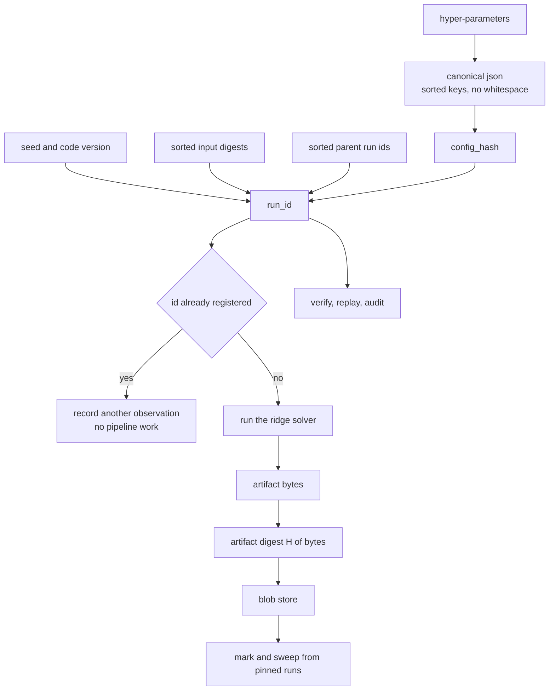
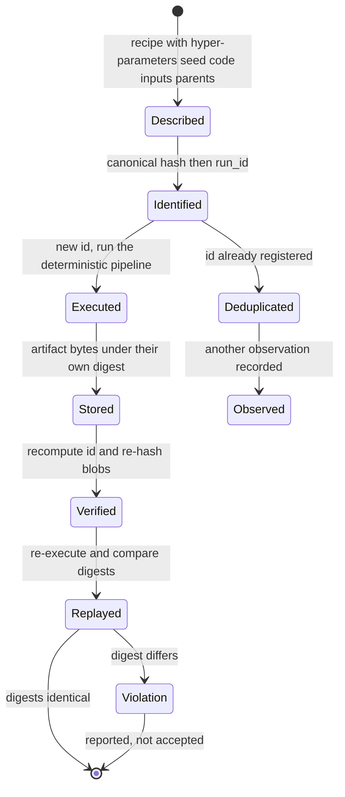
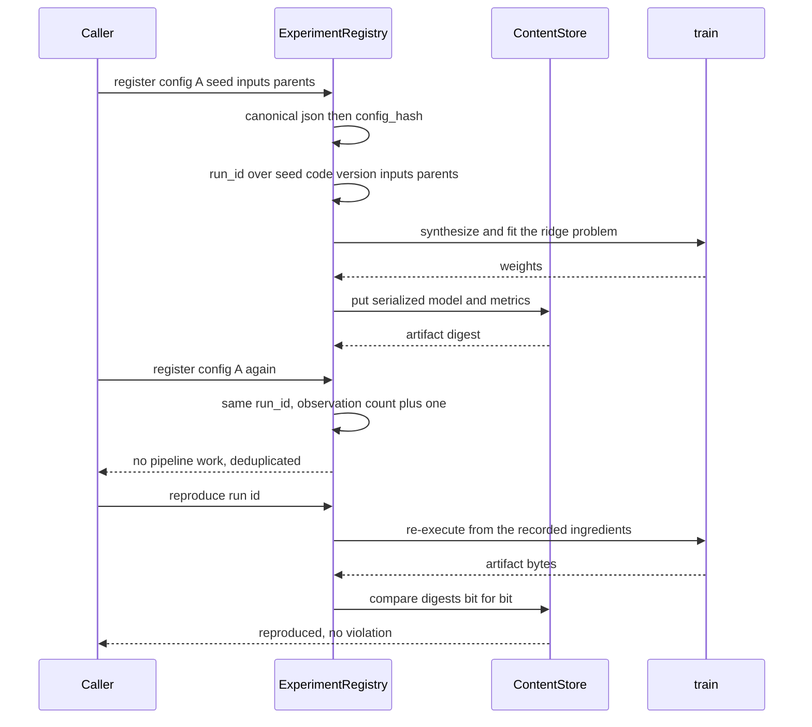

# 871 — Implement reproducible ML experiments registry with artifact provenance.

> **Tier:** Master · **CTCI chapter:** Beyond — Software Engineering & Tooling
> **Task spec:** [871-implement-reproducible-ml-experiments-registry-with-artifact-pro.md](../../../tasks/master/871-implement-reproducible-ml-experiments-registry-with-artifact-pro.md)
> **Solutions:** [Python](../../../solutions/python/master/871-implement-reproducible-ml-experiments-registry-with-artifact-pro/solution.py) ·
> [Java](../../../solutions/java/master/871-implement-reproducible-ml-experiments-registry-with-artifact-pro/Solution.java) ·
> [JavaScript](../../../solutions/javascript/master/871-implement-reproducible-ml-experiments-registry-with-artifact-pro/solution.js) ·
> [C#](../../../solutions/csharp/master/871-implement-reproducible-ml-experiments-registry-with-artifact-pro/Solution.cs)

## 1. Problem restatement

**Input.** A run recipe: hyper-parameters, a seed, a code version, input digests and parent run ids.
Plus, for a re-registration, tags and a cache of artifacts already in a content-addressed store.

**Output.** A run record with a content-derived identity, the artifact bytes, and the audit verdicts:
whether the recorded metric can be recomputed from the artifact, whether the run replays to the same
digest, and which blobs a garbage collection would reclaim.

**The identity rules.**

```text
config_hash = H(canonical json of the hyper-parameters)          (key order irrelevant)
run_id      = H(config_hash, seed, code version, sorted input digests, sorted parent ids)
artifact    = serialised trained model + metrics, stored under H(artifact bytes)
```

**The modelling contract.** Deduplication is *structural*: registering the same configuration, seed,
code version, inputs and parents again yields the same run id, so the registry records a second
**observation of one run** rather than a new one — and any change to any ingredient yields a new run id.
That provenance-sensitive identity is what makes a run reproducible in the first place: you cannot
reproduce something you cannot name.

The experiment itself is real work rather than a placeholder. A deterministic PRNG builds a synthetic
regression problem from the data spec and a fixed-step gradient-descent ridge solver fits it. `evaluate`
re-derives the objective from the **decoded weights and the data**, so the recorded metric can be
cross-checked independently of the training loop, and `reproduce` re-executes the experiment from the
recorded ingredients and compares the digest of the new artifact with the recorded one.

**What is simulated.** An in-memory append-only log or dictionary instead of a database, object store or
filesystem; virtual sequence numbers instead of timestamps; a deterministic synthetic ridge-regression
pipeline instead of real training; no threads and no network. Java hashes a Merkle transparency log and
hands out inclusion proofs, JavaScript uses a canonical JSON writer with SHA-256 and C# uses 128-bit
FNV-1a addresses. "Scale" is the number of runs, the log length and the audit sample size.

**Measured on the Python fixture:**

| Quantity | Observed |
| --- | --- |
| registered runs / observations / blobs | `3` runs, `4` observations, `4` blobs |
| objective at iteration budgets `[10, 30, 90]` | `[0.011211, 0.005217, 0.005216]` — strictly decreasing |
| replay audit | `replay violations = []` |
| mark-and-sweep collection | `5` blobs reclaimed |

## 2. Intuition

The naive experiment record is a directory called `run_final_v2_ok` and a metric pasted into a
spreadsheet. Three things then go wrong: nobody can say which code and data produced the number, two
engineers re-run the same configuration without noticing, and a year later the result cannot be
reproduced because the record is a *label* rather than a *recipe*.

The fix is to make identity a hash of the recipe. Canonicalise the hyper-parameters into a form where
key order and whitespace do not matter, hash that, and mix in the seed, the code version, the sorted
input digests and the sorted parent ids. Two consequences follow immediately and both are testable:
re-registering the same recipe is *free* (the registry sees the same id and simply records another
observation), and no single ingredient can change without changing the id.

Once identity is content-derived, everything else becomes a question about a graph. Provenance is a DAG
of parent edges, so lineage queries are a traversal and a cycle is a bug rather than a curiosity. Storage
becomes garbage-collectable by reachability: keep every pinned run and all of its ancestors, reclaim
exactly the blobs nothing reaches. And verification becomes mechanical — recompute the id from the
recorded fields, re-hash the stored bytes, or re-execute the pipeline and compare the artifact digest.



The audit is the part that makes the registry worth having. `reproduce` re-executes the pipeline from
the recorded ingredients and compares digests. A pipeline that secretly depends on something the recipe
does *not* mention — an unset seed, an environment variable, the iteration order of a set — will produce
a different digest and be caught. Java's header puts it bluntly: this is "the only audit that can
actually catch an unreproducible experiment".

## 3. Algorithm

1. `canonical(value)` serialises the config with sorted keys and no insignificant whitespace;
   `digest_of_text` hashes it into `config_hash`.
2. `run_id(config, seed, inputs, parents)` hashes the config hash together with the seed, the code
   version, the sorted input digests and the sorted parent ids.
3. `register(...)` looks the id up: a hit records another observation without executing anything, a miss
   synthesises the dataset with `synthesize`, fits it with `train`, stores the artifact bytes in the
   `ContentStore` under `H(bytes)` and appends the run to the registry.
4. `verify(run_id)` recomputes the id from the record and checks `intact(digest)` for every referenced
   blob, which detects tampering with stored bytes or an in-place edit of the record.
5. `evaluate_from_artifact(run_id)` decodes the weights and the data and recomputes the objective
   independently of the training loop, so a recorded metric can be falsified without trusting the fit.
6. `reproduce(run_id)` re-executes the experiment from the recorded ingredients and compares the new
   artifact digest with the recorded one. A config that declares itself unstable mixes an entropy counter
   into its parameters, so its digest changes and the run is reported as a reproducibility violation
   rather than silently accepted.
7. `lineage(run_id)` walks the parent edges; `collect_garbage(pinned)` marks every pinned run and all of
   its ancestors and then sweeps the unreachable blobs; `export` / `import_runs` round-trip a registry
   into a fresh one.

```text
procedure register(registry, config, seed, inputs, parents, tags)
    if any parent is unknown then reject end
    ch ← digest_of_text(canonical(config))
    id ← digest_of_text(ch, seed, code_version, sorted(inputs), sorted(parents))
    if registry contains id then
        registry.observations[id] ← registry.observations[id] + 1
        return id
    end
    features, targets ← synthesize(spec_digest(config.inputs), seed, samples, dimensions)
    weights ← train(features, targets, config.iterations, config.learning_rate, config.penalty, entropy)
    payload ← serialize(weights, metrics(features, targets, weights))
    digest ← store.put(payload)
    registry.append(run(id, ch, digest, parents, tags))
    return id
end

procedure reproduce(registry, id)
    record ← registry.record(id)
    features, targets ← synthesize(record.spec, record.seed, record.samples, record.dimensions)
    weights ← train(features, targets, record.iterations, record.learning_rate, record.penalty, record.entropy)
    payload ← serialize(weights, metrics(features, targets, weights))
    if store.digest_of(payload) = record.artifact_digest then
        return "reproduced"
    else
        return "reproducibility violation"
    end
end

procedure collect_garbage(registry, pinned)
    marked ← empty set
    frontier ← pinned
    while frontier is not empty do
        id ← pop(frontier)
        for each ancestor reachable through the parent edges of id do
            if ancestor is not in marked then
                marked ← marked plus ancestor
                push ancestor onto frontier
            end
        end
    end
    sweep every blob whose digest is referenced only by runs outside marked
    return the number of reclaimed blobs
end
```



## 4. Worked example

Walk the Python fixture. Three recipes are registered, one of them twice, giving four observations of
three runs and four stored blobs.

| Step | Action | State | Observed |
| --- | --- | --- | --- |
| 1 | register recipe A | new id, pipeline runs once | `1` run, `1` blob |
| 2 | register recipe B | new id, pipeline runs again | `2` runs, `2` blobs |
| 3 | register recipe A again with new tags | id hit, **no** pipeline work | `4` observations of `3` runs |
| 4 | register recipe C with a different seed | new id | `3` runs, `4` blobs |
| 5 | change one hyper-parameter value | different `config_hash`, therefore a different id | provenance sensitivity confirmed |
| 6 | replay every registered run | digests recomputed from ingredients | `replay violations = []` |
| 7 | `evaluate_from_artifact` | objective recomputed from decoded weights | matches the recorded metric |
| 8 | mark-and-sweep with two runs pinned | unpinned ancestors reclaimed | `5` blobs reclaimed |

The iteration-budget ladder is the check that the pipeline is real work rather than a hash function with
extra steps. Fitting the same synthetic problem at budgets `10`, `30` and `90` produces objectives
`0.011211`, `0.005217`, `0.005216` — strictly decreasing, exactly as a fixed-step ridge solver must
behave, and almost flat by `90` because the fit has converged. A registry whose "training" was a
constant would pass every identity test and fail this one, which is why the docstring says the
experiment itself is real work.



The garbage collection row is smaller than it looks. Pinning a run pins its whole ancestry, so a run's
parents can never be collected out from under it; the sweep reclaims only blobs that no pinned closure
reaches. That is exactly the semantics a retention policy needs, and it is verified by an independent
reachability computation rather than by trusting the collector.

## 5. Complexity

Let `R` be the number of runs, `E` the parent edges, `S` the serialised config size, `P` the artifact
bytes, `I` the training iterations, `N` the samples and `D` the dimensions.

| Operation | Time | Space | Why |
| --- | --- | --- | --- |
| `canonical` / `config_hash` | `O(S)` | `O(S)` | one traversal of the config with sorted keys |
| `run_id` | `O(S + k log k)` | `O(S)` | sorting the input digests and parent ids dominates |
| `register` (cache hit) | `O(S + k log k)` | unchanged | deduplication by identity, no pipeline work at all |
| `register` (miss) | `O(I * N * D)` plus hashing | `O(P + N * D)` | gradient-descent ridge fit plus serialisation |
| `verify` | `O(S + number of referenced blobs * P)` | `O(1)` | recompute the id and re-hash the stored bytes |
| `evaluate_from_artifact` | `O(N * D)` | `O(P)` | one objective evaluation from decoded weights and data |
| `lineage` | `O(R + E)` | `O(R + E)` | breadth-first walk over parent edges |
| `collect_garbage` | `O(R + E + P)` | `O(R + E)` | mark the pinned closures, then sweep unreachable blobs |

The honest caveat about this simulation: **the "training" is a small deterministic ridge fit on
synthetic data.** C#'s header says the problem is deliberately "small enough to replay hundreds of
times", and every language stores artifacts in an in-memory dictionary, with Java substituting virtual
sequence numbers for timestamps and C# using 128-bit FNV-1a addresses rather than SHA-256. So the
`O(I * N * D)` term is not a claim about real training cost; it is the price of making `reproduce` an
actual re-execution rather than a comparison of stored metadata. The parts that are structural are the
identity derivation (`O(S + k log k)` and independent of every hyper-parameter value), the lineage walk
and the reachability-based retention, all of which scale to real registries.

The comparison worth noting is against the alternative: storing a human-readable name plus a copy of
everything. That costs `O(#registrations * P)` of storage forever and cannot detect a duplicate at all,
where content addressing makes a duplicate registration free and a tamper detectable.

## 6. Pitfalls and edge cases

- **Canonicalisation is the whole trick.** If key order matters, the same semantics produces two
  different `config_hash` values and deduplication silently stops working. The run checks key-order
  insensitivity directly, and semantic changes must still change the hash.
- **Every ingredient must be in the id.** The tests vary the seed, the inputs, the parents, the code
  version and each hyper-parameter, and every single one must produce a different run id. An ingredient
  left out of the recipe is precisely the thing that later makes a run unreproducible.
- **Metrics are not the artifact.** The recorded metric must be recomputable from the *decoded weights
  and data*, which is what `evaluate_from_artifact` does. A metric that cannot be recomputed is a claim,
  not evidence.
- **Stored bytes can rot.** Tampering is detected by re-hashing blobs on read, and an in-place edit of a
  record is caught by a full integrity pass that recomputes every id and lineage hash. Re-registering an
  existing id with *different* content must be refused outright.
- **Deliberate instability must be caught.** A config declaring itself unstable mixes an entropy counter
  into its parameters so its digest changes; Java goes further and audits a "leaky" pipeline whose result
  depends on state the recipe omits. Both must be reported as violations, not accepted.
- **Lineage is a DAG, not a tree.** Cycles are rejected, a run whose parent does not exist is refused,
  and lineage queries are cross-checked against an independent breadth-first search over the edges.
- **Retention must respect pinning.** A collector must keep every pinned run *and all of its ancestors*,
  and reclaim exactly the unreachable blobs — a collector that deletes a parent breaks every child's
  ability to replay.
- **Degenerate registries.** An empty registry, a root run with no parents and an export/import round
  trip into a fresh registry must all behave; the round trip is the cheapest test that the record format
  is complete.
## 7. Variants and follow-ups

- **A transparency log.** Java appends runs to an immutable log summarised by a Merkle root and hands
  each run an inclusion proof that folds up to that root. Tampered or index-mismatched proofs fail,
  which turns "the registry was not edited" into a checkable statement rather than a policy.
- **Provenance replay.** C# keeps a provenance DAG (`dataset`, `model`, `metrics`, `report`) and replays
  an experiment from provenance alone, recomputing the payload and comparing it byte for byte with what
  is stored — the same audit as here, expressed as a graph rather than a flat record.
- **Retention and querying.** Mark-and-sweep retention, tag filters and best-run selection are the
  operational layer; they read the same records, so they inherit the identity guarantees for free.
- **Pipeline-level provenance.** This task follows one experiment; the build that produced its code and
  dependencies is the other half of the story: see
  [870 — continuous integration pipeline for large-scale numerical code](../../../tasks/master/870-implement-continuous-integration-pipeline-for-large-scale-numeri.md).
- **Lineage in a serving store.** Feature stores face the same versioning question for their data rather
  than for their models: see
  [850 — feature store with lineage, versioning and monetization](../../../tasks/master/850-implement-monetizable-feature-store-with-lineage-versioning-and.md).
- **The platform view.** A full research platform assembles registry, CI and provenance into one
  workflow: see
  [900 — full-featured reproducible research platform](../../../tasks/master/900-implement-full-featured-reproducible-research-platform-with-hard.md).

## 8. Check yourself

<details><summary>Show answer</summary>

**1. Why is `config_hash` computed over a *canonical* serialisation instead of the config as written?**

Because identity must depend on semantics, not on formatting. Two configs that differ only in key order
or whitespace describe the same experiment and must hash identically, or deduplication becomes useless;
the run tests key-order insensitivity explicitly. Conversely a semantic change — one parameter value —
must change the hash, and the tests vary every ingredient to confirm it.

</details>

<details><summary>Show answer</summary>

**2. What exactly does `reproduce` compare, and what does that catch that `verify` cannot?**

`verify` recomputes the id from the record and re-hashes the stored bytes, so it catches tampering but
assumes the record is honest. `reproduce` re-executes the pipeline from the recorded ingredients and
compares artifact digests bit for bit, so it also catches a pipeline that secretly depends on something
the recipe does not mention — an unset seed, wall-clock time, hash iteration order. In the fixture every
replay returned no violation, and a config declaring itself unstable is reported instead of accepted.

</details>

<details><summary>Show answer</summary>

**3. Four observations of three runs — what is the fourth one, and why does that matter?**

It is a re-registration of an existing recipe: same configuration, seed, code version, inputs and
parents, so the same run id. The registry records another *observation* and performs no pipeline work,
which is the cost story — duplicate experiments are free — and the honest interpretation: the run did not
happen twice, it was recorded twice. Conflating the two would inflate the experiment count and destroy
the audit trail.

</details>

<details><summary>Show answer</summary>

**4. Why does garbage collection pin ancestors rather than just the requested runs?**

Because a run can only be replayed if everything it descends from still exists. Marking the transitive
ancestor closure of the pinned set keeps the provenance chain intact, so `reproduce` never fails for a
missing input; the sweep then reclaims exactly the blobs nothing reaches — `5` of them in the fixture.
The collector's result is cross-checked against an independent reachability computation.

</details>
