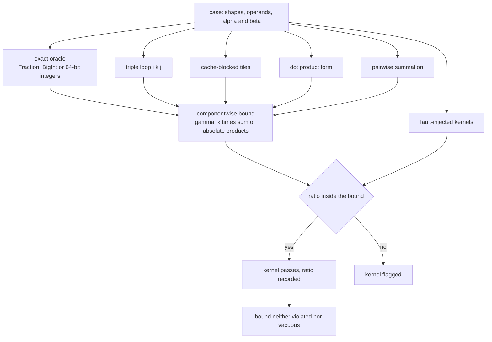
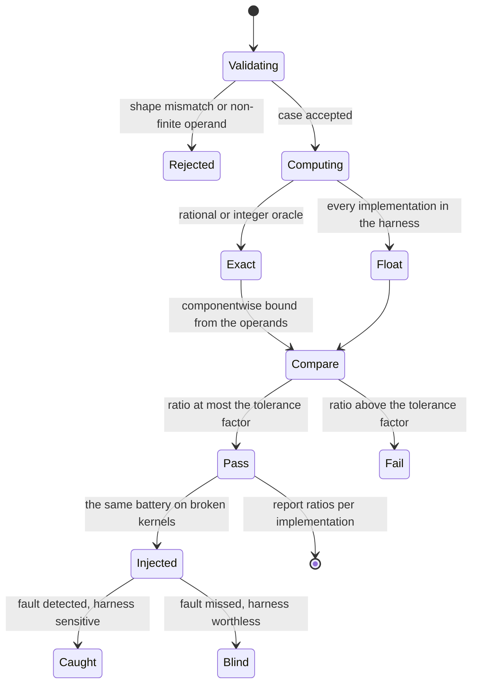
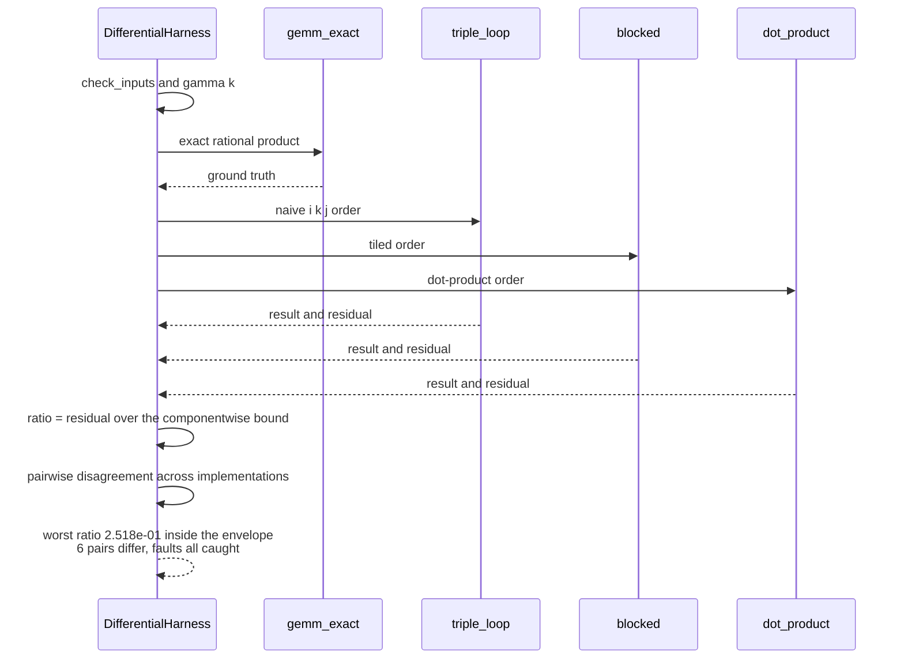

# 872 — Implement differential testing harness for numerical linear algebra (BLAS correctness).

> **Tier:** Master · **CTCI chapter:** Beyond — Software Engineering & Tooling
> **Task spec:** [872-implement-differential-testing-harness-for-numerical-linear-alge.md](../../../tasks/master/872-implement-differential-testing-harness-for-numerical-linear-alge.md)
> **Solutions:** [Python](../../../solutions/python/master/872-implement-differential-testing-harness-for-numerical-linear-alge/solution.py) ·
> [Java](../../../solutions/java/master/872-implement-differential-testing-harness-for-numerical-linear-alge/Solution.java) ·
> [JavaScript](../../../solutions/javascript/master/872-implement-differential-testing-harness-for-numerical-linear-alge/solution.js) ·
> [C#](../../../solutions/csharp/master/872-implement-differential-testing-harness-for-numerical-linear-alge/Solution.cs)

## 1. Problem restatement

**Input.** A set of cases — matrix shapes, operand values, and `alpha`/`beta` scaling — plus a list of
kernel implementations of the same specified operation (a dense matrix product in the Python, Java and
C# fixtures, with vector and triangular forms alongside).

**Output.** Per case, per implementation: the result, and the *fraction of the allowed error bound it
uses*. Plus the batch verdicts: whether every correct kernel stays inside the bound, whether any two
kernels disagree, and whether injected faults are caught.

**Why `==` is the wrong test.** A BLAS kernel cannot be validated by comparing two float
implementations for equality: every summation order rounds differently. The harness therefore compares
against a **componentwise error bound** that accounts for the floating-point arithmetic actually being
performed. For a `k`-term inner product the classical bound (Higham, *Accuracy and Stability of
Numerical Algorithms*, Theorem 3.1) is

```text
|fl(sum_l a_il b_lj) - sum_l a_il b_lj| <= gamma_k * sum_l |a_il| |b_lj|,
gamma_k = k * u / (1 - k * u),          u = 2^-53
```

**The three ingredients, all real.**

- An **exact oracle**: the same product computed in `fractions.Fraction` arithmetic in Python, in
  `BigInt` mantissa/exponent arithmetic in JavaScript, and in 64-bit integers in C#. The true rounding
  error of every implementation is therefore *known*, not assumed.
- **Several independent implementations** with genuinely different accumulation structure: the `i,k,j`
  triple loop, cache-blocked tiles, the dot-product form and a pairwise-sum kernel, plus the sub-routines
  (`axpy`, `gemv`, `dot`). Java adds a recursive divide-and-conquer kernel and a Strassen variant.
- A **fault-injection suite** — a dropped final term, a dropped final row, a transposed operand and a
  relative perturbation at the `1e-12` level — proving the harness is *sensitive*. As the docstring puts
  it, a harness that never fails is worthless.

**What is simulated.** Dense routines over small matrices rather than millions of fuzzed cases, a block
size that is a parameter rather than a tuned constant, and the classical componentwise bound instead of
a probabilistic tail bound. Java caps dimensions at `129` so odd sizes, non-power-of-two padding and
Strassen base cases are all exercised quickly, reports "performance" as operation counts, and uses no
vendor BLAS or wall clock; JavaScript adds a 64-byte-line cache model so blocked kernels can be shown to
reduce misses without changing the floating-point answer.

**Measured on the Python fixture:**

| Quantity | Observed |
| --- | --- |
| cases | `16` |
| implementations | `['blocked', 'blocked3', 'dot_product', 'triple_loop']` |
| worst error/bound ratio | `2.518e-01` |
| pairs of implementations that really round differently | `6` |
| worst pairwise disagreement ratio | `1.921e-01` |
| injected faults detected | `['drop_term', 'drop_row', 'transposed', 'perturb']` |

## 2. Intuition

The instinct is to write one implementation, test it against a second, and treat agreement as proof.
That fails in the most dangerous possible way: two implementations with the same accumulation structure
agree bit for bit *including when both are wrong*, and two correct implementations with different orders
disagree in the last digits, so a naive `==` test reports failures that are not bugs and passes bugs that
happen to round the same way.

The key insight is to replace equality with a **provable envelope**. The floating-point error of a sum of
`k` products is bounded by `gamma_k` times the sum of absolute products, so each result gets its own
scale-aware bound derived from the operands at hand. A kernel "passes" when it lands inside that
envelope, and the harness reports *how much of the envelope it used* rather than a boolean. In the
fixture the worst case used about a quarter of its allowance (`2.518e-01`), which is the healthy regime:
comfortably inside, and far from zero.

That last clause matters, because a vacuous bound would pass anything. The run checks the ratio from both
sides: **below one** (no violation) and **above zero** (the bound is not so loose that it is meaningless).
And to prove the harness can fail at all, the same battery is run against deliberately broken kernels —
including a perturbation so small it is only `1e-12` relative — every one of which must be caught while
no correct kernel is ever flagged.



Two structural details are worth noticing. First, the bound is *componentwise*, so it is computed from
the absolute values of the operands rather than from global norms, which makes it tight enough to catch a
real bug without rejecting legitimate rounding. Second, the exact oracle is not a "high precision"
approximation: it is exact, which is what makes the integer and power-of-two cases **bit-exact
comparisons** rather than tolerance comparisons — the point where differential testing stops being
statistical.

## 3. Algorithm

1. `check_inputs(a, b)` validates shapes, finiteness and the absence of overflowing products; malformed
   cases are rejected or reported rather than silently scored.
2. `gamma(k)` computes `k * u / (1 - k * u)`; `error_bound(a, b, k)` computes the componentwise envelope
   `gamma_k * sum_l |a_il| |b_lj|` for the case at hand.
3. For each case, every implementation in the harness produces a result, and `gemm_exact` produces the
   exact product. `max_abs` of the difference, divided by the bound, is the reported ratio.
4. `pairwise_disagreement(a, b)` compares implementations with each other, so the harness can report
   whether the orders *really* round differently on this input — the evidence that the tolerance is
   doing work rather than papering over a shared bug.
5. `run_case` records pass/fail per implementation against the bound and against the exact oracle, and
   `run` aggregates the batch.
6. The same battery is replayed against the fault-injected kernels; a fault that is *not* caught fails
   the harness, and a correct kernel that is flagged is a false positive that must be eliminated.

```text
procedure run_case(harness, label, a, b)
    check_inputs(a, b)
    k ← number of contracted terms
    bound ← error_bound(a, b, k)
    exact ← gemm_exact(a, b)
    for each implementation in harness.implementations do
        result ← implementation(a, b)
        residual ← max_absolute_difference(result, exact)
        ratio ← residual / bound
        record pass = (ratio <= harness.tolerance_factor), ratio, residual
    end
    disagreement ← pairwise_disagreement(a, b)
    return case_report(label, per implementation results, disagreement)
end

function error_bound(a, b, k)
    g ← gamma(k)
    build the matrix of sums of absolute products of a and b
    return g times that matrix entrywise
end

function gamma(k)
    factor ← k * u                      with u = 2^-53
    return factor / (1 - factor)
end

procedure run(harness, cases)
    reports ← empty list
    for each case in cases do
        reports.append(run_case(harness, case))
    end
    audit the injected faults: every fault must be detected
    audit the correct kernels: none may be flagged
    return reports
end
```



## 4. Worked example

Walk the Python fixture across the interesting cases:

| Case | Claim under test | Observed |
| --- | --- | --- |
| `1x1` product | exactness at the smallest size | bit-exact, ratio `0` |
| `k = 0` (zero dimension) | the empty sum is exactly zero | exact for every implementation |
| integer operands scaled by powers of two | dyadic arithmetic is exact | reproduced bit for bit |
| non-square shapes | index arithmetic is not tied to square padding | inside the bound |
| random matrices, `16` cases | the tolerance is neither violated nor vacuous | worst ratio `2.518e-01` |
| blocked vs dot-product orders | rounding orders genuinely differ | `6` pairs disagree, worst pairwise ratio `1.921e-01` |
| dropped final term | an off-by-one in the contraction is caught | detected |
| dropped final row | a missed row is caught | detected |
| transposed operand | a transposed path used where the plain form was specified is caught | detected |
| `1e-12` relative perturbation | the harness is sensitive at the level of legitimate rounding | detected |

The third row is the strongest case in the table. When the operands are integers scaled by powers of two,
every partial product and every partial sum is exactly representable, so the exact oracle and the float
kernels must agree *bit for bit* — no tolerance, no statistics. A kernel with a wrong index bound, a
wrong accumulator reset or a transposed access pattern cannot hide behind rounding there, which is why
the harness includes such cases at all.

The fifth row is the opposite kind of evidence. A tolerance that is never approached is a tolerance that
is not being tested: the blocked and dot-product orders disagree on six pairs of cases, so the harness is
comparing genuinely different arithmetic, and the worst disagreement uses only `1.921e-01` of the bound.
Together, "rooms to spare" and "orders really do differ" is what makes `2.518e-01` meaningful.



## 5. Complexity

Let `m, n, k` be the product dimensions, `I` the number of implementations, `K` the number of cases and
`b` the block size.

| Quantity | Time | Space | Why |
| --- | --- | --- | --- |
| `gemm_triple_loop` | `O(m * n * k)` | `O(m * n)` | one multiply-add per output element per contracted index |
| `gemm_blocked` | `O(m * n * k)` arithmetic, fewer cache misses | `O(m * n + b^2)` | same flop count, reordered to reuse a tile of operands |
| `gemm_dot_product` | `O(m * n * k)` | `O(m * n)` | same arithmetic, different accumulation order |
| `pairwise_sum` | `O(k)` per output element | `O(log k)` stack | tree-shaped accumulation, different rounding profile |
| `gamma` / `error_bound` | `O(1)` / `O(m * n * k)` | `O(m * n)` | the bound needs the sums of absolute products |
| `gemm_exact` | `O(m * n * k)` rational or big-integer operations | `O(m * n)` exact values | exact arithmetic keeps the algorithm, inflates the constants |
| one case | `O(I * m * n * k)` for the kernels plus one exact pass | `O(m * n)` | the oracle dominates when rational arithmetic is used |
| whole battery | `O(K * I * m * n * k)` | `O(m * n + n * k)` | the fixture uses a small case count and small shapes |

The honest caveat: **these are small matrices compared by exact arithmetic, not a BLAS benchmark.**
Java caps dimensions at `129` and reports operation counts rather than seconds; JavaScript models cache
behaviour by counting 64-byte-line misses instead of measuring wall time; C# uses a few hundred rows. The
classical componentwise bound is used rather than a probabilistic tail bound, and the block size is a
parameter rather than a tuned constant. What the harness *does* give you at real scale is the shape of the
work: one exact pass plus `I` kernel passes per case, all reproducers from a fixed seed, so a failure in
production can be replayed exactly.

The comparison with the naive alternative is the reason the harness exists. Testing one implementation
against one other costs the same `O(m * n * k)`, but detects nothing when both share an accumulation
structure; testing against the bound with an exact oracle costs one extra pass and catches structural
errors, off-by-one bounds and whole missing rows.

## 6. Pitfalls and edge cases

- **Equality on floats is not a test.** Two implementations with the same accumulation order agree
  bit-for-bit even when both are wrong. The harness compares against an exact oracle *and* against a
  componentwise bound, and reports the ratio so a reader can see how much headroom the kernel used.
- **A vacuous bound verifies nothing.** The run asserts the ratio is below one *and* above zero: if the
  envelope were never approached, passing would say nothing about the implementation.
- **Degenerate shapes decide index arithmetic.** A `k = 0` contraction (the empty sum is exactly zero), a
  `1x1` product and non-square matrices all have to be exact; padding assumptions and index bounds break
  there first.
- **Integer and power-of-two cases must be bit-exact.** Dyadic operands are exactly representable, so the
  comparison becomes exact and the tolerance is not allowed to hide anything.
- **The exact oracle can overflow.** Very large integer products exceed 64 bits, so overflow must be
  reported rather than wrapped, and non-finite operands must be rejected instead of scored as
  "disagree".
- **Fault injection is part of the contract.** A harness that does not fail on a dropped final term, a
  dropped row, a transposed operand or a `1e-12` relative perturbation has proved nothing; all four are
  detected and no correct kernel is flagged (zero false positives).
- **Different orders must actually differ.** The pairwise-disagreement report is what demonstrates that
  the tolerance is doing work; if no pair ever disagreed, the harness would be testing one implementation
  twice.
- **Determinism.** Every operand comes from a seeded `splitmix64` stream, so the verdicts are reproducible:
  a failure found in CI can be re-run to the same matrices, the same ratios and the same verdict.
## 7. Variants and follow-ups

- **Wider kernel families.** Java's battery adds a recursive divide-and-conquer kernel, Strassen's
  seven-multiplication variant and transposed forms, with `alpha`/`beta` semantics, over `27` cases
  spanning sizes `1, 2, 7, 16, 33, 64, 65, 100, 129`; it also injects five faults, including a Strassen
  sign flip and a beta that is ignored.
- **A high-precision reference instead of an exact one.** JavaScript computes an exact dyadic product with
  `BigInt` mantissas and *also* a Kahan-compensated accumulation, then checks the compensated result
  against the classical bound — belt and braces, with the bound measured rather than assumed.
- **Cache behaviour as a counter.** Modelling 64-byte-line misses lets the blocked kernels be shown to
  reduce traffic *without changing the floating-point answer*, which is the honest way to claim a
  performance property in a deterministic test.
- **Extending the specification.** `gemv`, `dot`, `axpy`, forward and backward substitution and a `SYRK`
  built from the same primitives are all cross-checked the same way, which is how a harness grows into a
  library's regression suite.
- **Rigorous enclosures instead of bounds.** Where a bound answers "is this within tolerance", interval
  arithmetic answers "what interval must contain the true value", which is the next step up:
  [873 — verified numerics library for interval arithmetic](../../../tasks/master/873-implement-verified-numerics-small-library-for-interval-arithmeti.md).
- **Running the battery on every change.** A harness is only useful if it runs unconditionally, which is
  the reproducibility pipeline's job:
  [870 — continuous integration pipeline for large-scale numerical code](../../../tasks/master/870-implement-continuous-integration-pipeline-for-large-scale-numeri.md).

## 8. Check yourself

<details><summary>Show answer</summary>

**1. Why compare against `gamma_k * sum |a| |b|` instead of a fixed epsilon?**

Because the achievable accuracy depends on the *problem*, not just the machine: `gamma_k` grows with the
number of contracted terms, and the sum of absolute products captures cancellation (a result computed
from large terms that cancel is allowed a larger absolute error). A fixed epsilon is either so tight that
correct kernels fail or so loose that real bugs pass. The harness also reports the *fraction* of the
bound used, which was at most `2.518e-01` in the fixture.

</details>

<details><summary>Show answer</summary>

**2. What does the exact oracle add over comparing implementations with each other?**

It removes the shared-bug blind spot. Two float kernels that share an accumulation structure agree
bit-for-bit even when both are wrong; an exact rational (or integer) product is ground truth, so the
residual measured against it is the *true* rounding error. On dyadic inputs it makes the comparison
bit-exact instead of approximate, which is how a dropped row or a wrong index bound gets caught.

</details>

<details><summary>Show answer</summary>

**3. Why is a harness that never fails described as worthless?**

Because agreement is not evidence unless the test can distinguish right from wrong. The battery therefore
runs the same cases against a dropped final term, a dropped final row, a transposed operand and a `1e-12`
relative perturbation, and all four must be detected while no correct kernel is flagged. The
`1e-12` case is the calibrated one: it is small enough to resemble legitimate rounding, so detecting it
shows the bound is tight enough to be useful.

</details>

<details><summary>Show answer</summary>

**4. Six pairs of implementations disagree — is that a bug?**

No, it is the point. Different accumulation orders round differently, which is why the harness needs a
bound at all; the worst such disagreement used `1.921e-01` of the envelope. What *would* be a bug is a
disagreement that exceeds the bound, or a report where no pair ever differs — that would mean the harness
was really testing one implementation several times.

</details>
