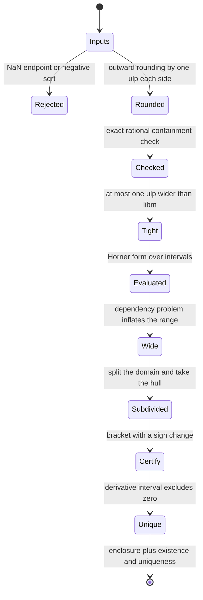
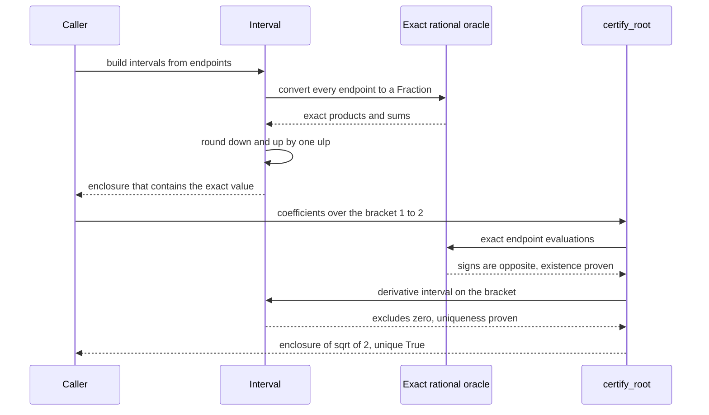

# 873 — Implement verified numerics small library for interval arithmetic.

> **Tier:** Master · **CTCI chapter:** Beyond — Software Engineering & Tooling
> **Task spec:** [873-implement-verified-numerics-small-library-for-interval-arithmeti.md](../../../tasks/master/873-implement-verified-numerics-small-library-for-interval-arithmeti.md)
> **Solutions:** [Python](../../../solutions/python/master/873-implement-verified-numerics-small-library-for-interval-arithmeti/solution.py) ·
> [Java](../../../solutions/java/master/873-implement-verified-numerics-small-library-for-interval-arithmeti/Solution.java) ·
> [JavaScript](../../../solutions/javascript/master/873-implement-verified-numerics-small-library-for-interval-arithmeti/solution.js) ·
> [C#](../../../solutions/csharp/master/873-implement-verified-numerics-small-library-for-interval-arithmeti/Solution.cs)

## 1. Problem restatement

**Input.** Intervals `[lo, hi]` of IEEE doubles, and expressions built from them: `+ - * /`, integer
powers, `sqrt`, `exp`, `log` (plus `sin`/`cos` in Java), together with `hull`, `intersect`, `subset_of`
and `width`.

**Output.** For every operation, an interval that is *guaranteed to contain* the exact real result for
every choice of `x` in the first operand and `y` in the second:

```text
if x is in [lo, hi] and y is in [c, d] then the exact real value of x op y lies in the computed interval
```

**Outward rounding.** Every operation widens the round-to-nearest result by one ulp on each side using
`math.nextafter` (Java: `Math.nextDown` / `Math.nextUp`). That makes containment a machine-checkable
statement rather than a claim, because the harness recomputes the ground truth in exact rational
arithmetic: a float is a dyadic rational, so `Fraction(a) * Fraction(b)` *is* the exact product of the two
operands.

**Rigorous transcendental checks.** `exp_enclosure` bounds `exp(r)` with a truncated Taylor sum plus a
geometric remainder term, and `log_enclosure` bounds `log(r)` with the `atanh` series
`2 * atanh((r - 1) / (r + 1))` plus its remainder, so the `exp`/`log` containments are verified against
rational bounds instead of against `libm`. For general endpoints the checks additionally assert that the
enclosure is at most one ulp wider than the correctly rounded `libm` value — the rounding is outward *and
not padded*.

**Certification.** The library ships a certified root finder: bisection that (a) keeps a bracket whose
exact rational endpoint evaluations have opposite signs, so the intermediate value theorem proves a root
exists, and (b) evaluates the derivative interval on the bracket, which excludes zero and therefore proves
the root is unique. Subdivision refinement is included to show the **dependency problem** concretely:
enclosed as a range, `x(1-x)` over `[0, 1]` is `[0, 1]`, while the hull over `2^k` subintervals contracts
geometrically toward the true range `[0, 1/4]`.

**What is simulated.** A scalar double-precision library, not a full verified-numerics stack: no complex
intervals, no vectors or matrices, no arbitrary precision, and Java's trigonometric range reduction is the
standard critical-point argument. There are no threads, clocks or hardware dependence.

**Measured on the Python fixture:**

| Quantity | Observed |
| --- | --- |
| containment checks | `24` |
| naive dependency width of `x(1-x)` over `[0, 1]` | `1.0000` |
| subdivision widths | `[0.5, 0.28125, 0.257813]` |
| certified enclosure of `sqrt(2)` | `[1554944255987/1099511627776, 388736063997/274877906944]`, unique `True` |

## 2. Intuition

Floating-point computation gives you a number that is probably close to the answer. Interval arithmetic
gives you a *range that provably contains it* — and once you have that, every downstream claim becomes
sound: a root is bracketed, a bound is a bound, a comparison that matters can be decided in one direction
or reported as undecided.

The mechanism is outward rounding. Round-to-nearest lands within half an ulp of the exact result, so
widening by one ulp on each side cannot lose the true value. But soundness alone is not enough: an
enclosure padded by a thousand ulps is still sound and completely useless. That is why the checks also
assert **tightness** — at most one ulp wider than the correctly rounded value — and why the JavaScript and
C# solutions compute the tightest possible enclosure at all, by converting the operands to exact rationals
and rounding the exact result down and up to the neighbouring doubles.

The subtlety that makes interval arithmetic interesting is the **dependency problem**. Because each
occurrence of a variable is treated independently, the natural interval extension of `x(1-x)` over
`[0, 1]` is `[0, 1]` — width `1.0` — even though the true range is `[0, 0.25]`. The enclosure is sound
and hopeless. Subdivision is the classical remedy: split the domain, evaluate each piece, and take the
hull. The fixture's widths `0.5`, `0.28125`, `0.257813` show the contraction toward `0.25`, geometric as
the number of pieces doubles.

```mermaid
flowchart TD
    A["interval operands lo hi and c d"] --> B["exact rational evaluation<br/>Fraction or BigInt dyadic"]
    B --> C["round down and up to neighbouring doubles"]
    C --> D["outward rounded result"]
    D --> E{"contains the exact value"}
    E -->|yes| F["sound, and at most one ulp wider than libm"]
    E -->|no| G["containment bug"]
    F --> H["natural extension of an expression"]
    H --> I["dependency problem: repeated variables widen the result"]
    I --> J["subdivide the domain and take the hull"]
    J --> K["widths contract toward the true range"]
    F --> L["certified root finder"]
    L --> M["sign change proves existence"]
    L --> N["derivative interval excluding zero proves uniqueness"]
```



Certification uses the same primitives for a genuinely different purpose. Existence is an intermediate
value theorem argument, and it only works if the endpoint signs are *known* rather than computed in
floating point — which is why the bracket is evaluated in exact rational arithmetic. Uniqueness is a
monotonicity argument: if the derivative's interval over the bracket excludes zero, the function cannot
turn around inside, so the root found is the only one. In the fixture this certifies `sqrt(2)` inside
`[1554944255987/1099511627776, 388736063997/274877906944]` with `unique = True`.

## 3. Algorithm

1. `down(value)` / `up(value)` step one ulp outward with `math.nextafter`, rounding toward minus and plus
   infinity respectively.
2. Each operation computes its candidate extremes from the endpoint combinations — all four sign branches
   for multiplication — and returns `Interval(down(low), up(high))`. Empty intervals propagate through
   every operation; unbounded intervals widen rather than raise.
3. `power(exponent)` handles the cases separately: odd powers are monotone; even powers need the
   `[0, magnitude]` correction when the interval straddles zero; `sqrt` intersects with the non-negative
   half-line and rejects a fully negative input; `exp` and `log` are monotone, so their endpoints are
   evaluated and padded.
4. `hull`, `intersect`, `subset_of`, `width` and `contains_zero` provide the lattice operations; division
   by an interval containing zero is reported rather than returning nonsense.
5. `evaluate_polynomial(interval, coefficients)` runs Horner form over intervals;
   `evaluate_polynomial_exact(value, coefficients)` computes the same polynomial in exact rational
   arithmetic for a point sample, which is the oracle for the range checks.
6. `certify_root(coefficients, lower, upper, tolerance)` bisects while the exact rational endpoint
   evaluations have strictly opposite signs, and evaluates the derivative interval on the bracket to
   prove the function is monotone there — existence plus uniqueness.
7. `subdivide_hull(coefficients, subdivisions)` splits the domain into equal pieces, evaluates the
   polynomial on each, and returns the hull; the widths are compared against the analytically known range.
8. `ulps_apart(wide, narrow)` counts how many representable doubles separate two endpoints, which is how
   the tightness claims ("at most one ulp wider than `libm`") are expressed.

```text
procedure multiply(a, b)
    candidates ← [a.lo * b.lo, a.lo * b.hi, a.hi * b.lo, a.hi * b.hi]
    return interval(down(minimum(candidates)), up(maximum(candidates)))
end

procedure sqrt(a)
    if a.hi < 0 then report domain error end
    lo ← down(sqrt(maximum(a.lo, 0)))
    hi ← up(sqrt(a.hi))
    return interval(lo, hi)
end

procedure certify_root(coefficients, lower, upper, tolerance)
    lo, hi ← lower, upper
    if sign(evaluate_polynomial_exact(lo, coefficients)) = sign(evaluate_polynomial_exact(hi, coefficients))
        then report "no sign change, existence not proven" end
    while width(lo, hi) > tolerance do
        mid ← midpoint(lo, hi)
        if sign(evaluate_polynomial_exact(mid, coefficients)) = sign(evaluate_polynomial_exact(lo, coefficients))
            then lo ← mid
            else hi ← mid
        end
    end
    derivative ← evaluate_polynomial(interval(lo, hi), differentiate(coefficients))
    exists ← true because the endpoint signs are exactly opposite
    unique ← not derivative.contains_zero()
    return interval(lo, hi), exists, unique
end

procedure subdivide_hull(coefficients, subdivisions)
    pieces ← split the domain into subdivisions equal parts
    ranges ← for each piece: evaluate_polynomial(piece, coefficients)
    return hull of ranges
end
```



## 4. Worked example

Walk the Python fixture. The containment battery and the structural properties are checked against exact
rational arithmetic throughout:

| Check | What it proves | Observed |
| --- | --- | --- |
| `24` containment checks on random rational operands | every operation encloses the exact result | all contained |
| tightness against `libm` | outward but not padded | within `1` ulp |
| width subadditivity, multiplicative width bound | the algebra of widths behaves as theorems require | holds |
| sub-distributivity `A(B+C) <= AB + AC` | inclusion is one-sided, and correct | holds |
| polynomial range vs `257` sample points | a range is really a range | all samples enclosed |
| empty and unbounded propagation | degenerate intervals do not crash or lie | propagated correctly |
| division by an interval containing zero, `sqrt` of a negative | invalid input is reported | rejected |

The dependency-problem table is the most instructive part of the run, because it shows width shrinking
toward a known answer:

| Domain split | Hull width for `x(1-x)` | Distance from the true range `[0, 0.25]` |
| --- | --- | --- |
| whole interval `[0, 1]` | `1.0000` | enclosure is four times too wide |
| `2` subintervals | `0.5` | halves the excess |
| `4` subintervals | `0.28125` | |
| `8` subintervals | `0.257813` | closing on `0.25` |

Every row is sound — the true range is always inside the enclosure — and the contraction is geometric in
the subdivision count, which is exactly the classical result. A library that returned `[0, 1]` forever
would pass a containment test and fail this one.



Nothing in that sequence "converges to the answer": bisection narrows the bracket, the exact sign
evaluations prove a root must be inside it, the derivative interval proves there is only one, and the
final enclosure is a *theorem* about `sqrt(2)` produced by machine arithmetic.

## 5. Complexity

Let `d` be the polynomial degree, `T` the number of terms in a series enclosure, `S` the bisection steps
and `k` the subdivision count.

| Operation | Time | Space | Why |
| --- | --- | --- | --- |
| interval `+ - *` | `O(1)` | `O(1)` | a constant number of endpoint products plus two `nextafter` calls |
| interval `/` | `O(1)` | `O(1)` | four endpoint quotients, with the zero-straddling case reported |
| `power`, `sqrt` | `O(1)` | `O(1)` | branch on sign or straddling, then one padded evaluation |
| `exp` / `log` | `O(T)` | `O(T)` | truncated Taylor or `atanh` series plus a geometric remainder bound |
| `evaluate_polynomial` (Horner) | `O(d)` | `O(1)` | one interval multiply-add per coefficient |
| `certify_root` | `O(S * d)` | `O(d)` | each bisection step costs two exact evaluations and one derivative interval |
| `subdivide_hull` | `O(k * d)` | `O(k)` | one Horner evaluation per piece, hulled together |
| containment battery | `O(cases * d)` exact operations | `O(d)` | rational arithmetic dominates the constants |

The honest caveat about this simulation: **the library is scalar, double precision only.** There are no
complex or vector intervals, no arbitrary-precision fallback, and Java's trigonometric handling uses the
critical-point argument rather than a high-precision range-reduction routine, which is precisely why Java
documents it as simplified. The rational oracle is used for *verification*, not as a serving path; C#
computes every result in exact `BigInteger` fractions first and then rounds, which is the tightest possible
enclosure at a much higher constant cost than the error-free-transformation path, and JavaScript does both
so the two can be cross-checked.

The comparison with plain floating point is why the library exists: a point evaluation costs `O(d)` and
returns one number with an unquantified error, while an interval evaluation costs the same `O(d)` plus a
constant and returns a range containing the truth. Subdivision buys accuracy back at the `k` factor.

## 6. Pitfalls and edge cases

- **Soundness is binary; tightness is a separate claim.** An enclosure that is wide is not wrong, it is
  just weak. The run checks both: containment against exact rationals, and "at most one ulp wider than
  `libm`" for the tightness claim.
- **The dependency problem is the whole story of interval accuracy.** `x(1-x)` over `[0, 1]` naturally
  encloses `[0, 1]`; the true range is `[0, 0.25]`. Subdivision fixes the width at a linear cost in pieces,
  and a library that hides this behaviour is hiding its main limitation.
- **Division by an interval containing zero, `sqrt` of a negative, `log` of a non-positive value.** Each
  must be reported as a domain error rather than returning a nonsense interval. Empty and unbounded
  intervals must propagate through every operation without crashing.
- **Even powers need the straddling correction.** If the interval contains zero, the magnitude of a
  negative endpoint is as large as that of a positive one, so the upper bound must come from
  `magnitude`, not from `hi`; odd powers are monotone and need no such care.
- **Existence and uniqueness are different proofs.** A sign change on exact rational endpoint evaluations
  gives existence via the intermediate value theorem; only the derivative interval excluding zero gives
  uniqueness. A bisection that "converges" proves neither by itself.
- **NaN endpoints must be rejected.** A `NaN` silently poisons every comparison, so an interval containing
  one must never be constructed.
- **Do not rely on the hardware rounding mode.** Python, JavaScript and C# all compute the exact result and
  round deliberately; Java uses `Math.nextDown`/`Math.nextUp` rather than switching the FPU mode, which
  keeps behaviour identical across platforms.
- **Determinism.** All sampling and cases are seeded, so the containment results are reproducible on any
  machine — which matters because a verified-numerics bug is exactly the kind that appears once a year.

## 7. Variants and follow-ups

- **Tightest enclosures without a rational oracle.** JavaScript implements two independent paths — error-free
  transformations (`TwoSum` for addition, Dekker's `TwoProduct` with Veltkamp splitting for products)
  widened by exactly one ulp on the side the exact error term points at, and a `BigInt` rational reference
  with `rationalFloor` / `rationalCeil`. The first is fast, the second *defines* correctness, and they are
  cross-checked.
- **The mean value form.** Java compares the natural extension with the mean value form, which is strictly
  tighter for the same interval, and proves a root's uniqueness with interval Newton
  `N(X) = m - f(m) / f'(X)` — the same certification idea in one step instead of a bisection loop.
- **Trigonometry with exact critical points.** `sin` and `cos` are non-monotone, so their range must be
  computed from the critical points inside the interval rather than from the endpoints; Java handles
  `sin`/`cos` this way.
- **From enclosures to root counts.** Interval methods give enclosures of roots; Sturm sequences count them
  exactly, which is the complementary technique for the next task:
  [874 — certified numerical solver for polynomial roots](../../../tasks/master/874-implement-certified-numerical-solver-for-polynomial-roots-sturm.md).
- **Exact oracles as a testing discipline.** Every containment claim here is checked against rational
  arithmetic, which is the same strategy a differential-testing harness applies to BLAS kernels: see
  [872 — differential testing harness for numerical linear algebra](../../../tasks/master/872-implement-differential-testing-harness-for-numerical-linear-alge.md).

## 8. Check yourself

<details><summary>Show answer</summary>

**1. Why is one ulp on each side enough to guarantee containment?**

Because round-to-nearest lands within half an ulp of the exact result, so the exact value can never be
more than half an ulp outside the computed one; widening by a full ulp on each side therefore contains it
with room to spare. The harness does not take this on faith: it recomputes the exact result as a rational
number (`Fraction(a) * Fraction(b)` is exact for dyadic operands) and checks containment directly, and then
checks that the enclosure is no more than one ulp wider than `libm`'s correctly rounded value.

</details>

<details><summary>Show answer</summary>

**2. Why is `x(1-x)` over `[0, 1]` the classic dependency-problem example?**

Because interval arithmetic treats each *occurrence* of `x` independently, the expression is evaluated as
if the two `x`s could take different values, so the natural extension is `[0 - 0, 1 - 0] = [0, 1]` while
the true range is `[0, 0.25]`. The fixture reports the width `1.0000` for one piece and `0.5`, `0.28125`,
`0.257813` as the domain is split, which is the geometric contraction toward `0.25` that makes subdivision
the standard remedy.

</details>

<details><summary>Show answer</summary>

**3. What exactly does the certified root finder prove, and how?**

Two separate things. Existence: the bracket endpoints are evaluated in exact rational arithmetic and have
strictly opposite signs, so by the intermediate value theorem a root lies strictly inside — no floating-point
"probably" involved. Uniqueness: the derivative interval over the bracket excludes zero, so the function is
monotone there and cannot cross twice. The fixture certifies `sqrt(2)` inside
`[1554944255987/1099511627776, 388736063997/274877906944]` with `unique = True`.

</details>

<details><summary>Show answer</summary>

**4. Why check tightness when soundness is the real requirement?**

Because a padded enclosure is sound and useless: it would let every downstream bound stay vacuous. Asserting
"at most one ulp wider than the correctly rounded `libm` value" turns the library from "not wrong" into
"as sharp as double precision allows", which is what a numerical kernel actually needs from it. JavaScript
and C# go further and construct the tightest possible enclosure directly, using rational rounding down and
up.

</details>
