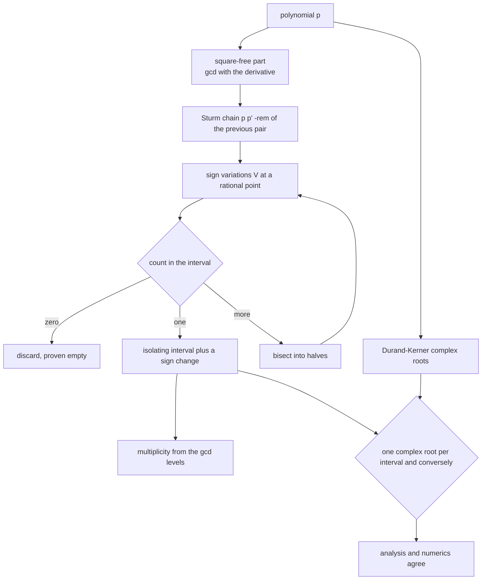
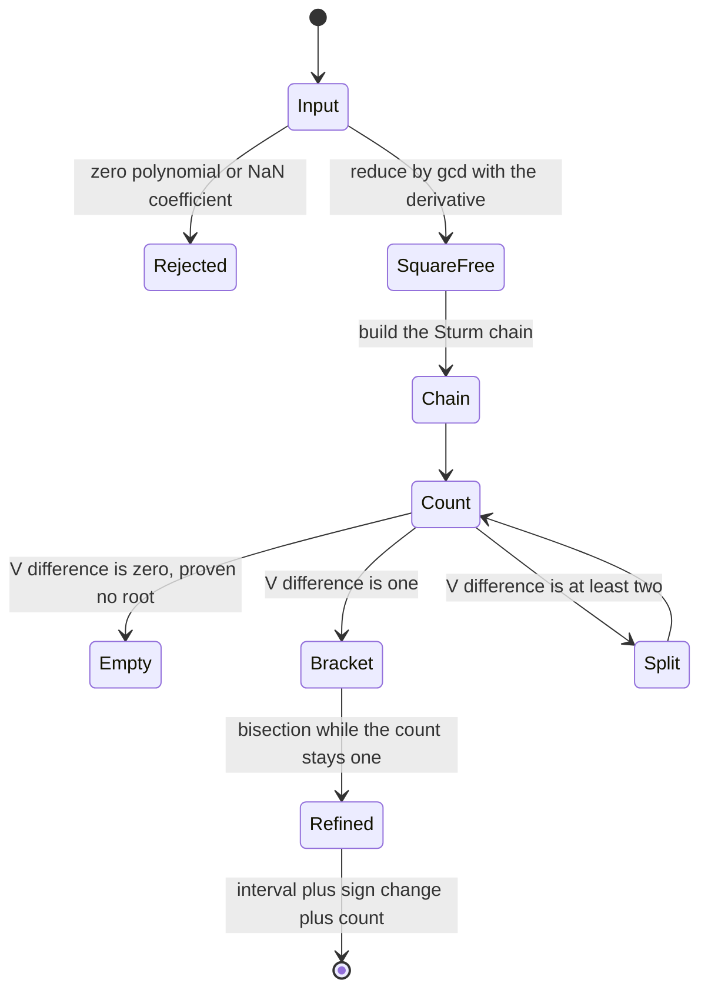
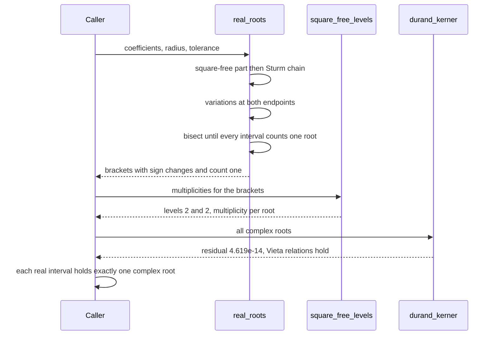

# 874 — Implement certified numerical solver for polynomial roots (Sturm sequences).

> **Tier:** Master · **CTCI chapter:** Beyond — Software Engineering & Tooling
> **Task spec:** [874-implement-certified-numerical-solver-for-polynomial-roots-sturm.md](../../../tasks/master/874-implement-certified-numerical-solver-for-polynomial-roots-sturm.md)
> **Solutions:** [Python](../../../solutions/python/master/874-implement-certified-numerical-solver-for-polynomial-roots-sturm/solution.py) ·
> [Java](../../../solutions/java/master/874-implement-certified-numerical-solver-for-polynomial-roots-sturm/Solution.java) ·
> [JavaScript](../../../solutions/javascript/master/874-implement-certified-numerical-solver-for-polynomial-roots-sturm/solution.js) ·
> [C#](../../../solutions/csharp/master/874-implement-certified-numerical-solver-for-polynomial-roots-sturm/Solution.cs)

## 1. Problem restatement

**Input.** A polynomial `p` given by its coefficients, a search radius and a tolerance. Coefficients are
exact (rationals in Python and JavaScript, integers in Java and C#).

**Output.** For every real root, an **isolating interval** together with two independent certificates:

1. an exact rational sign change of `p` at the endpoints — so a root is provably *there*;
2. a Sturm count of exactly one in the interval — so it is provably the *only* one.

Plus the multiplicity of each root, and a full set of complex roots from an independent method used as a
cross-check.

**The machinery.** The Sturm chain of a square-free polynomial is built by

```text
p_0 = p,   p_1 = p',   p_{k+1} = -rem(p_{k-1}, p_k)
```

and the number of distinct real roots in `(a, b]` is `V(a) - V(b)`, where `V(x)` counts sign changes of the
chain evaluated at `x` with zeros ignored. Isolation is therefore a *decision procedure*: bisect until an
interval is certified to hold exactly one root.

**Multiplicities** come from the square-free gcd levels `h_j = u_j / u_{j+1}` with `u_1 = p` and
`u_{j+1} = gcd(u_j, u_j')`. Writing `p = prod g_k^k`, each `h_j` equals `prod_{k >= j} g_k`, so the
multiplicity of a root is exactly the number of levels that contain it, each level scanned with its own
Sturm chain.

**Everything is exact.** The chain, the remainders, the gcds and the bisection all stay in rational
arithmetic, so no certificate depends on a floating-point tolerance. Floating point enters only in the
independent cross-check: Durand-Kerner (Weierstrass) iteration computes *all* complex roots, and the report
verifies that every real isolating interval contains exactly one complex root and vice versa, that the
residuals `|p(z_i)|` are small, and that Vieta's relations hold on the multiset of roots. Descartes' rule of
signs is checked as a bound on the number of positive roots, and malformed input (empty, zero polynomial,
`NaN` coefficients) is rejected.

**What is simulated.** A textbook bisection/Sturm pipeline on integer or rational coefficients: no
continued-fraction or Descartes acceleration, bisection rather than interval Newton as the refinement
engine, and no threads, clocks, hardware dependence or randomness at all. Java uses the pseudo-remainder
with the content divided out to keep coefficients integral and small; JavaScript rescales each chain element
by a *positive* factor to keep it primitive.

**Measured on the Python fixture:**

| Check | Observed |
| --- | --- |
| factored polynomial with integer roots | roots `[-1.0, 2.0, 5.0]` |
| repeated-root fixture | multiplicities `[2, 2]` from gcd levels `[2, 2]` |
| Descartes' rule of signs | positive bound `3`, positive roots `3` |
| Durand-Kerner residuals | `4.619e-14` |
| complex roots of `x^4 + 1` vs the analytic values | error `2.483e-16` |

## 2. Intuition

Root finders normally return a number and a shrug: Newton converged, the residual is small, so presumably
it worked. Two things can go wrong that a residual cannot detect — you may have found a root that is not
there (a flat spot, a wrong sign conversion), or there may be a *second* root in the neighbourhood you are
about to declare empty.

The Sturm sequence turns both questions into counting. It is built from `p` and `p'` by a remainder
recursion, and the number of sign changes of the sequence at a point decreases by exactly the number of
roots you passed on the way from `a` to `b`. That gives an exact integer count for any interval, with no
tolerance involved — which is why isolation can *stop with a proof*: an interval with a sign change and a
count of one contains a root and cannot contain a second.

The details that make the proof hold are worth naming. Remainders must keep their sign relationship: the
classical chain negates the remainder, and when coefficients are integralised with pseudo-remainders, each
element may only be rescaled by a **positive** factor, otherwise the sign pattern — and therefore the
count — silently changes. Evaluation at a rational point has to be exact, which is why the implementations
scale by `den^degree` and work in integers or rationals rather than evaluating in floating point. And
because a repeated root would make the count disagree with the number of *distinct* roots, the polynomial
is reduced to its square-free part before isolation, with multiplicities recovered separately from the gcd
levels.



The cross-check is deliberately independent in *kind*, not just in implementation. Durand-Kerner is an
iterative method in floating-point complex arithmetic over the whole complex plane; Sturm is exact integer
counting on the real line. When a real interval and a computed complex root agree to `4.619e-14`, that is
evidence from two different mathematical directions — and `x^4 + 1` provides the case where no real root
exists at all, matching the analytic values to `2.483e-16`.

## 3. Algorithm

1. `trim` and `as_fractions` normalise the input; empty, zero and non-finite coefficient lists are rejected.
2. `poly_divmod`, `poly_gcd` and `square_free_part` reduce `p` to `p / gcd(p, p')`, which is what makes the
   Sturm count equal the number of *distinct* roots.
3. `sturm_chain(p)` builds `p, p', -rem(...)` down to a nonzero constant; `sign_at` evaluates one element
   exactly at a rational point, and `variations(chain, point)` counts sign changes ignoring zeros.
4. `sturm_count(p, a, b) = V(a) - V(b)` counts distinct real roots in the half-open interval.
5. `isolate(p, lower, upper, tolerance)` bisects: a half whose count is zero is discarded, a half whose
   count is one is an isolating interval, a half with more is split again. `refine` narrows a bracket while
   preserving a count of one.
6. `descartes_positive_bound(p)` counts sign changes of the coefficient sequence as an upper bound on the
   number of positive roots, checked against the solver's own count.
7. `square_free_levels(p)` computes `u_{j+1} = gcd(u_j, u_j')`, and `multiplicities(p, brackets)` reports the
   number of levels containing each root.
8. `durand_kerner(p, iterations)` iterates `z_i ← z_i - p(z_i) / prod_{j != i} (z_i - z_j)` from a fixed
   complex start, giving all complex roots; the report compares them with the isolating intervals,
   computes the residuals and checks Vieta's sums and products.

```text
procedure real_roots(poly, radius, tolerance)
    p ← square_free_part(poly)
    chain ← sturm_chain(p)
    brackets ← empty list
    isolate(chain, -radius, radius, tolerance, brackets)
    deliver every bracket together with its exact sign change and its Sturm count of one
    return brackets
end

procedure isolate(chain, lower, upper, tolerance, results)
    count ← variations(chain, lower) - variations(chain, upper)
    if count = 0 then return end
    if count = 1 and width(lower, upper) <= tolerance then
        results.append(bracket(lower, upper))
        return
    end
    middle ← (lower + upper) / 2
    isolate(chain, lower, middle, tolerance, results)
    isolate(chain, middle, upper, tolerance, results)
end

procedure significances(poly)
    levels ← empty list
    u ← poly
    while degree(u) > 0 do
        v ← poly_gcd(u, poly_derivative(u))
        if degree(v) > 0 then levels.append(poly_exact_divide(u, v)) end
        u ← v
    end
    return levels
end

function multiplicity(brackets, levels, root)
    return the number of levels whose Sturm count on the root's bracket equals one
end
```



## 4. Worked example

The Python run reports several independent checks; each row below is one of its printed quantities:

| Check | What is proven | Observed |
| --- | --- | --- |
| factored polynomial with integer roots | exact rational roots land inside certified brackets | roots `[-1.0, 2.0, 5.0]` |
| repeated-root fixture | multiplicities come from the gcd levels | levels `[2, 2]`, multiplicities `[2, 2]` |
| no-real-root and degree-1 cases | the counts handle degenerate shapes | all count as expected |
| Descartes' rule of signs | the solver's count never exceeds the bound | bound `3`, positive roots `3` |
| large-integer coefficients | exactness is not lost at scale | handled without loss |
| Durand-Kerner residuals | every complex root really satiates `p` | `4.619e-14` |
| `x^4 + 1` | the complex roots match the analytic values | error `2.483e-16` |
| isolating intervals | disjoint, ordered, each with a sign change | all certified |

The Descartes row is the one that shows why an independent bound is useful. The rule of signs bounds the
number of positive roots by the number of sign changes in the coefficient sequence; if the solver ever
returned *more* positive roots than that bound, the chain or the evaluation would be broken. Here the
solver finds exactly `3` positive roots against a bound of `3` — tight, and consistent.



The multiplicity machinery is the subtlest part of the pipeline, and it is why the square-free reduction
happens first. A double root of `p` is a simple root of the square-free part, so the count of *distinct*
roots is correct even for repeated factors; the multiplicity then comes from asking, for each gcd level,
whether that level's own Sturm chain still counts the root as present. Two levels each reporting one gives
the `[2, 2]` result above — and the multiplicities must sum to the degree, which the run also checks.

## 5. Complexity

Let `d` be the degree, `D` the bisection depth, `I` the Durand-Kerner iterations and `r ≤ d` the number of
real roots. Arithmetic is exact, so coefficient size also matters; `B` denotes the bit length of the
largest coefficient.

| Quantity | Time | Space | Why |
| --- | --- | --- | --- |
| `poly_divmod`, `poly_gcd` | `O(d^2)` coefficient operations | `O(d)` coefficients | Euclidean elimination on exact coefficients |
| `square_free_part`, `square_free_levels` | `O(d)` gcds, each `O(d^2)` | `O(d^2)` levels | repeated gcd with the derivative |
| `sturm_chain` | `O(d)` remainders, each `O(d^2)` | `O(d^2)` coefficients | the chain has at most `d` elements |
| `sign_at`, `variations` | `O(d^2)` per point | `O(1)` | exact evaluation of every chain element at a rational |
| `sturm_count` | `O(d^2)` | `O(1)` | two variation counts, no tolerance |
| `isolate` | `O(r * D * d^2)` | `O(d^2 + r)` | each accepted bracket needs counts along a bisection path |
| `durand_kerner` | `O(I * d^2)` | `O(d)` complex values | each iteration updates `d` roots against products of `d - 1` differences |

The honest caveat about this simulation: **the pipeline is the textbook one**, without Descartes acceleration
or continued-fraction splitting, and bisection — not interval Newton — is the refinement engine, so the
`D` factor is a real cost rather than a formality. Coefficient growth is the other practical issue: Java
uses pseudo-remainders and divides out the content, JavaScript rescales each element by a positive factor
only, and C# reduces to the square-free part first, all of which keep the exact integers small. There is no
randomness, no thread and no wall-clock time anywhere, which is what makes the certificates reproducible.

What the exactness buys is worth its cost. A floating-point solver with the same asymptotic shape would be
faster per step, but its "count" would be a heuristic and its certificates would evaporate exactly where
they are needed — near multiple roots and near-miss intervals. Here the count is an integer theorem, and
the only floating-point work in the task is the independent Durand-Kerner cross-check.

## 6. Pitfalls and edge cases

- **Rescale by positive factors only.** When remainders are integralised with the pseudo-remainder, the
  chain element may be multiplied by any positive constant without changing the number of sign variations;
  a negative factor flips the pattern and silently changes the root count.
- **Evaluate exactly at rational endpoints.** Scaling by `den^degree` turns evaluation at `p/q` into an
  integer computation; doing it in floating point makes the "count" a guess, which is the one thing the
  whole method exists to avoid.
- **Reduce to the square-free part before counting.** A root of multiplicity `k` is counted once by the
  chain on the square-free part, and a quadruple root must collapse to a single isolating interval rather
  than four overlapping ones.
- **Multiplicity is a separate computation.** It comes from the gcd levels `h_j = u_j / u_{j+1}`, and the
  multiplicities must sum to the degree — a check that catches an off-by-one level scan immediately.
- **The interval convention is half-open.** The count `V(a) - V(b)` covers `(a, b]`, so a root exactly at a
  subdivision point belongs to one side only; evaluating at infinity uses the leading coefficient, times
  `(-1)^degree` at minus infinity.
- **Descartes gives a bound, not a count.** It bounds positive roots by coefficient sign changes, and the
  run asserts the solver never exceeds it — a bound that the solver beats is fine, a bound it violates is a
  bug.
- **Refinement must preserve the count.** Narrowing a bracket on tolerance alone is not a certificate; the
  interval must still hold exactly one root when it is returned. JavaScript makes the same point from the
  other side: the reported double bounds are corrected *outwards* until they provably contain the exact
  rational bounds.
- **Reject malformed input.** An empty coefficient list, a zero polynomial and `NaN` coefficients are
  refused rather than solved; `NaN` in particular poisons every comparison in the chain.

## 7. Variants and follow-ups

- **Integer coefficients and Cauchy's bound.** Java keeps everything integral with pseudo-remainders and
  content division, bounds the search box with Cauchy's bound, and isolates by bisection depth, reporting
  root counts in boxes, half-lines and over the whole line against an independent grid sampling.
- **Yun's scheme and outward rounding.** JavaScript uses `BigInt` rationals, primitive rescaling and
  repeated gcd (Yun's square-free factorisation), isolates each factor with its own chain, and converts to
  double only at the end with outward correction.
- **Acceleration techniques.** Descartes' rule and continued fractions replace bisection by splitting at
  sign-change bounds, reducing the `D` factor at the price of more bookkeeping; the certificates are
  unchanged.
- **Interval Newton instead of a derivative interval.** A Newton step over an interval can certify
  uniqueness in one step per iteration, which connects directly to
  [873 — verified numerics library for interval arithmetic](../../../tasks/master/873-implement-verified-numerics-small-library-for-interval-arithmeti.md).
- **Two methods, one answer.** The Sturm/Durand-Kerner pairing is the numerical version of a testing
  discipline: independent implementations must agree where both are defined, which is the idea behind
  [872 — differential testing harness for numerical linear algebra](../../../tasks/master/872-implement-differential-testing-harness-for-numerical-linear-alge.md).

## 8. Check yourself

<details><summary>Show answer</summary>

**1. What exactly does `V(a) - V(b)` count, and why is that enough to stop bisecting?**

It counts the number of distinct real roots in the half-open interval `(a, b]`, where `V` is the number of
sign changes in the Sturm chain with zeros ignored. When a bracket's count is one *and* `p` changes sign
across it, you have existence (intermediate value theorem, evaluated exactly) and uniqueness (the count) at
the same time, so further bisection would add precision but no information.

</details>

<details><summary>Show answer</summary>

**2. Why is the square-free part computed before isolation?**

Because Sturm's theorem counts *distinct* roots, and repeated roots would otherwise produce a count that
does not correspond to the number of intervals you want. Reducing `p` by `gcd(p, p')` makes every root
simple, so each bracket holds exactly one distinct root, and the multiplicities are recovered afterwards
from the gcd levels.

</details>

<details><summary>Show answer</summary>

**3. Why is Durand-Kerner used at all, if Sturm already certifies the real roots?**

As an independent cross-check of a different kind. Sturm is exact integer counting on the real line;
Durand-Kerner is floating-point iteration over the whole complex plane, so it also finds the non-real roots
(for `x^4 + 1`, there are none real) and provides residuals and Vieta sums. The report checks that each real
isolating interval contains exactly one complex root and conversely — agreement between two unrelated
methods, not just two runs of one.

</details>

<details><summary>Show answer</summary>

**4. Why must chain elements only be rescaled by positive factors?**

Because the count is the number of sign *variations* in the chain. Multiplying a chain element by a positive
constant leaves every sign untouched; multiplying by a negative one flips that element's sign and can
change the variation count, which would silently corrupt the root count. Java's content division and
JavaScript's primitive rescaling are both chosen to keep the factor positive.

</details>
