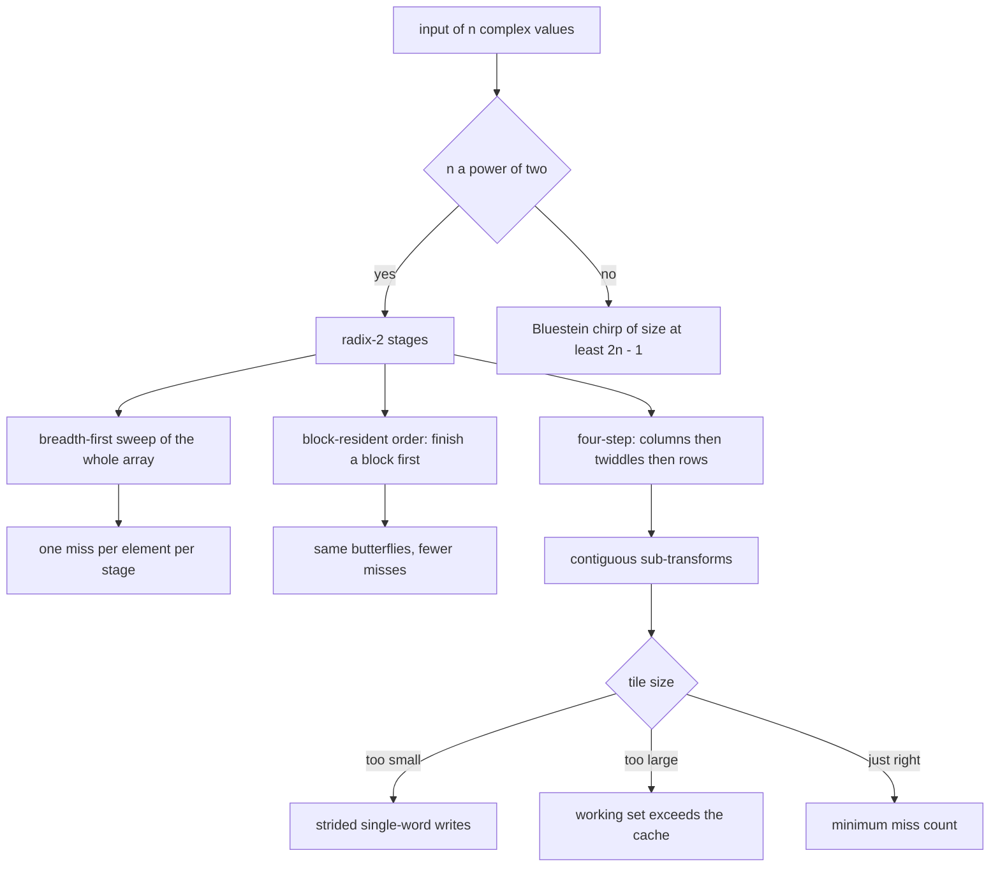
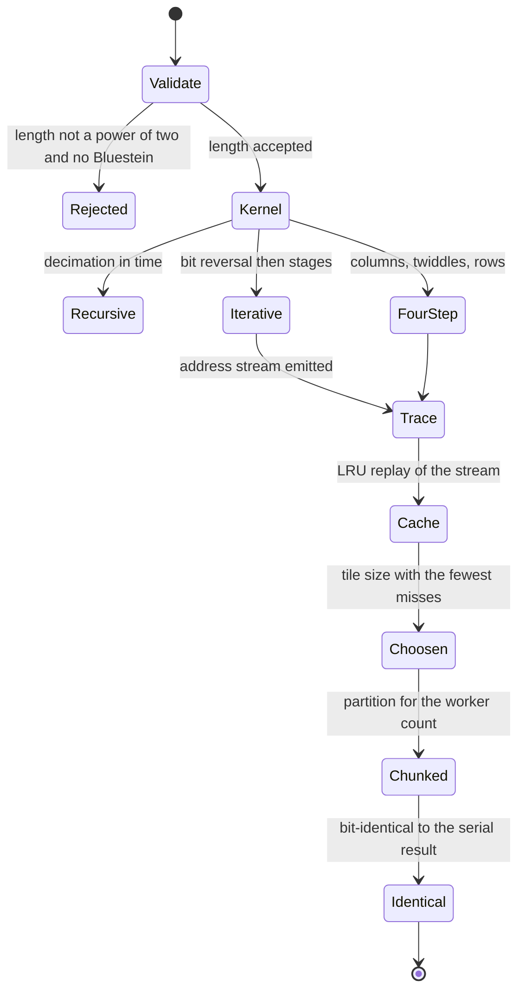
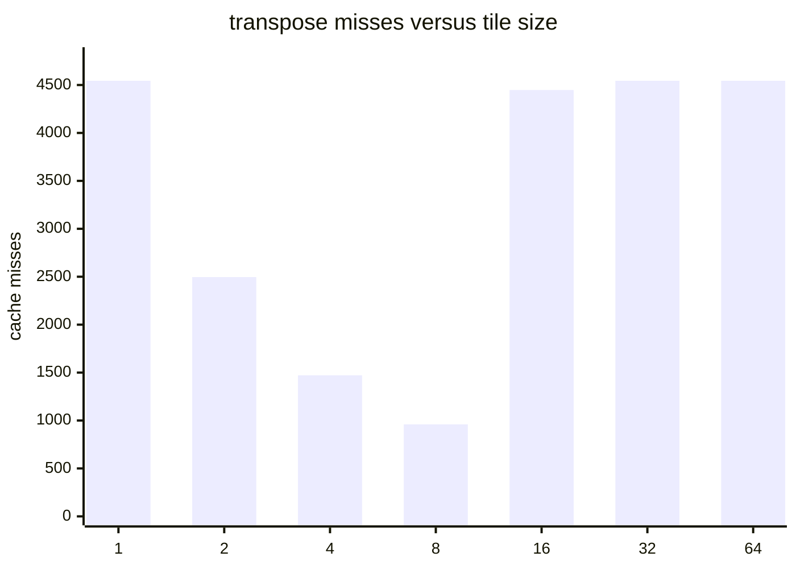
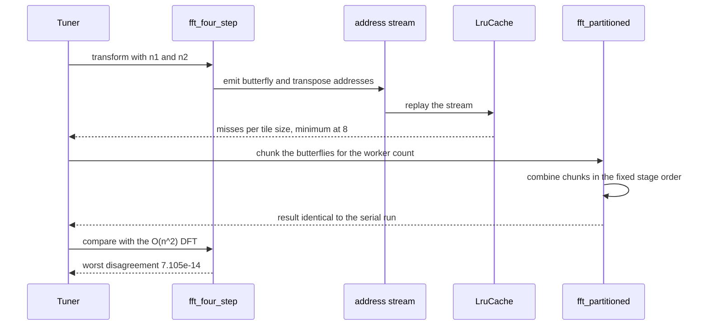

# 875 — Implement high-performance FFT tuned for cache and threading parameters.

> **Tier:** Master · **CTCI chapter:** Beyond — Numerical & Scientific Computing
> **Task spec:** [875-implement-high-performance-fft-tuned-for-cache-and-threading-par.md](../../../tasks/master/875-implement-high-performance-fft-tuned-for-cache-and-threading-par.md)
> **Solutions:** [Python](../../../solutions/python/master/875-implement-high-performance-fft-tuned-for-cache-and-threading-par/solution.py) ·
> [Java](../../../solutions/java/master/875-implement-high-performance-fft-tuned-for-cache-and-threading-par/Solution.java) ·
> [JavaScript](../../../solutions/javascript/master/875-implement-high-performance-fft-tuned-for-cache-and-threading-par/solution.js) ·
> [C#](../../../solutions/csharp/master/875-implement-high-performance-fft-tuned-for-cache-and-threading-par/Solution.cs)

## 1. Problem restatement

**Input.** A complex vector of length `n`, the number of workers (or "lanes" / "chunks") and a cache
geometry: a number of lines and a number of complex words per line.

**Output.** The discrete Fourier transform of the vector, produced by several genuinely different
implementations, plus the measured consequences of the tuning parameters: cache misses per algorithm and
per tile size, and a modelled parallel makespan.

**The implementations.**

| Kernel | Structure | Why it exists |
| --- | --- | --- |
| `fft_recursive` | decimation in time, recursive, natural order | the readable reference |
| `fft_iterative` | in-place Stockham-style butterflies with bit reversal | the classic flat kernel |
| `fft_four_step` | `n = n1 * n2`: columns, twiddles `W_n^{i2 k1}`, then rows | the cache-friendly formulation |
| `bluestein` | chirp-z transform built from a power-of-two FFT of size at least `2n - 1` | `O(n log n)` for lengths that are not powers of two |
| `dft` | the `O(n^2)` definition | the oracle everything is checked against |

**Turning cache behaviour into a measured quantity.** `LruCache` is a fully associative least-recently-used
cache simulator whose line holds several complex words. Feeding it the *address streams* of the algorithms
(`butterfly_addresses`, `transpose_addresses`, `four_step_addresses`) converts a slogan — "this layout is
cache friendly" — into a count. The four-step stream is compared against the breadth-first butterfly
stream, and the tiled transpose exposes the classical **U-curve**: too small a tile and the writes stride
one word per line, too large a tile and the read/write working set no longer fits.

**Threading expressed the same way.** The butterflies of each stage are cut into contiguous chunks, the
per-stage cost is `ceil(work / workers) * unit + sync overhead`, and the schedule is a deterministic
function of those typed parameters. No threads are created; what is verified is that the chunked
decomposition is **bit-identical** to the single-worker result for every worker count — the property a real
parallel FFT has to preserve.

**What is simulated.** No threads, no vector units, no wall-clock timing and no vendor library: the cache is
an LRU over an index trace, "time" is a virtual butterfly count, and sizes stop at `4096` (Python and Java)
or `1024` (C#) so the battery runs in milliseconds.

**Measured on the Python fixture:**

| Quantity | Observed |
| --- | --- |
| worst disagreement with the `O(n^2)` DFT | `7.105e-14` |
| error growth with size | `2.093e-16`, `8.872e-16` |
| cache misses, butterfly stream vs blocked stream | `576` vs `296` (`1.125` vs `0.578` per element) |
| best tile size for the transpose | `8` |
| modelled makespans for `1, 2, 4, 8, 16` workers | `[204.0, 108.0, 60.0, 36.0, 24.0]` |

## 2. Intuition

A radix-2 FFT stage combines pairs of elements inside blocks of length `L`. That single observation drives
everything: the *arithmetic* of a stage is local to a block of `L` elements, and `L` doubles with every
stage. If you execute stage by stage across the whole array, then by the last stage each butterfly operand
lives half an array away and every access is a miss — with `n = 4096` and a small cache, the array is
several times the cache and each sweep is one compulsory miss per element.

The fix is to change the *order*, not the arithmetic. Process a block of `B` elements to completion — its
own `log2(B)` stages — before moving on to the next block, then finish the remaining `log2(n/B)` stages
across blocks. The same butterflies are executed in the same groups, so the result is bit-for-bit
identical; only the miss count changes. Java's header makes exactly this point: this is what a cache-tuning
parameter is supposed to buy, and it is measured here rather than asserted.

The four-step decomposition attacks the same problem from the layout side: split `n = n1 * n2`, transform
the `n1`-point columns, apply the twiddles, then transform the `n2`-point rows. Every sub-transform now
works on a contiguous chunk instead of striding through the whole array. The price is the transpose, and
that is where the U-curve appears: a tile of `1` writes one word per line (misses `4544` in the fixture),
a tile of `8` is best (`960`), and a tile of `64` is back to `4544` because the read/write working set no
longer fits.



Threading is the same story one level up. The butterflies of a stage are independent, so they can be split
into contiguous chunks whose partial results are combined in a fixed order. The modelled schedule — cost
`ceil(work / workers) * unit` plus a sync term — improves monotonically from `204.0` for one worker to
`24.0` for sixteen, and the actual outputs must be bit-identical across worker counts, which the run
checks. That is the honest way to study parallelism without a thread pool: verify the invariance exactly,
and model the benefit explicitly.

## 3. Algorithm

1. `dft(values)` computes the `O(n^2)` transform, the oracle for every other kernel.
2. `fft_recursive` performs decimation in time with natural output order; `fft_iterative` does the in-place
   Stockham-style pass with a bit-reversal permutation first; `fft_for_length` dispatches by length.
3. `fft_four_step(values, n2)` splits `n = n1 * n2`, transforms the `n1`-point columns, multiplies by the
   twiddle factors `W_n^{i2 k1}`, transposes, and transforms the `n2`-point rows.
4. `bluestein(values)` handles arbitrary lengths with the chirp-z identity, using a power-of-two FFT of size
   at least `2n - 1` for the convolution.
5. `butterfly_addresses`, `transpose_addresses(rows, columns, tile)` and `four_step_addresses(n, n2, tile)`
   emit the memory address streams of each strategy; `cache_misses(addresses, lines, line_words)` replays
   them through `LruCache` and returns the miss count.
6. `partition(work, workers)` splits a stage's butterflies into contiguous chunks and `fft_partitioned`
   composes the result; `stage_work(n)` gives the per-stage work and `modelled_makespan` turns it into a
   virtual makespan using `ceil(work / workers) * unit + sync`.
7. The battery checks every implementation against the DFT and against each other: round trip, linearity,
   circular convolution against brute force, Parseval energy, conjugate symmetry, delta/constant/cosine
   spectra, and error growth limited to `O(eps log n)`.

```text
procedure fft_four_step(values, n2)
    n ← length(values)
    n1 ← n / n2
    for each of the n1 columns do
        transform the contiguous column of length n2
    end
    for i2 from 0 to n1 - 1 do
        for k1 from 0 to n2 - 1 do
            multiply by the twiddle factor W_n raised to i2 * k1
        end
    end
    transpose the n1 by n2 layout in tiles of the chosen size
    for each of the n2 rows do
        transform the contiguous row of length n1
    end
    return values
end

procedure fft_partitioned(values, workers)
    for each stage in the radix-2 schedule do
        chunks ← partition(stage_work(n), workers)
        for each chunk in chunks do
            run this chunk's butterflies in place
        end
        combine the chunk results in the fixed stage order
    end
    return values
end

function modelled_makespan(n, workers, unit, sync)
    total ← 0
    for each stage in the schedule do
        total ← total + ceil(stage_work(n) / workers) * unit + sync
    end
    return total
end

procedure cache_misses(addresses, lines, line_words)
    cache ← LruCache(lines, line_words)
    return the number of accesses whose line was not resident
end
```



## 4. Worked example

Walk the Python fixture for `n = 512` (the miss counts scale with the case, so the ratios are the story):

| Step | Quantity | Observed |
| --- | --- | --- |
| 1 | accuracy against the `O(n^2)` DFT | worst `7.105e-14` |
| 2 | error growth with size | `2.093e-16` then `8.872e-16` — about `O(eps log n)` |
| 3 | butterfly address stream | `576` misses, `1.125` per element |
| 4 | four-step blocked stream | `296` misses, `0.578` per element |
| 5 | best transpose tile | `8` |
| 6 | modelled makespan, `1 → 16` workers | `[204.0, 108.0, 60.0, 36.0, 24.0]` |
| 7 | chunked result vs serial | bit-identical for every worker count |

Row 4 is the tuning claim, measured: the blocked stream halves the miss rate at the same arithmetic. Row 5
is the U-curve, and it is worth seeing in full because the shape is the whole lesson — the curve is a bar
chart of the transpose miss count:



Reading the curve: a tile of `1` writes a single complex word per line, so every write is a miss
(`4544`); doubling the tile halves the waste until `8`, which is the sweet spot (`960`); from `16` onward
the tile's read/write working set stops fitting and the count explodes back to `4544`. That non-monotone
behaviour is exactly why tiling is a *tuned* parameter rather than a bigger-is-better setting, and why a
model of the memory hierarchy is more useful than a rule of thumb.



## 5. Complexity

Let `n` be the transform length, `m ≥ 2n - 1` the Bluestein padding, `L` the cache line count, `t` the tile
size and `p` the worker count.

| Quantity | Time | Space | Why |
| --- | --- | --- | --- |
| `dft` | `O(n^2)` | `O(n)` | the definition, used only as an oracle |
| `fft_recursive` | `O(n log n)` | `O(n log n)` | `log n` levels of recursion, each with an `O(n)` combine |
| `fft_iterative` | `O(n log n)` | `O(n)` | the same butterfly count, in place after bit reversal |
| `fft_four_step` | `O(n log n)` arithmetic, fewer misses | `O(n)` plus a tile | column and row sub-transforms are contiguous; the transpose costs `n` moves |
| `bluestein` | `O(m log m)` | `O(m)` | three power-of-two FFTs of size `m` plus a chirp multiplication |
| cache replay | `O(accesses)` | `O(L)` | each access is one LRU dictionary probe |
| `fft_partitioned` | same arithmetic, `O(n log n)` | `O(n)` | chunks partition the work; combination adds `O(n)` per stage |
| `modelled_makespan` | `O(log n)` | `O(1)` | sums `ceil(stage_work / p) * unit + sync` over the stages |

The honest caveat about this simulation: **the timing model is a model.** `LruCache` is a fully associative
simulator replaying recorded index streams, the per-stage cost is `ceil(work / workers) * unit + sync`, and
"time" is a virtual butterfly count rather than seconds; Java says plainly that the cache is an LRU over an
index trace and that `n` stops at `4096`, and C# models lanes rather than threads. So the numbers above are
consistent, reproducible statements about a memory-hierarchy *model* — the U-curve and the blocked-versus-
breadth-first ratio are properties of that model, and their value is that they are measurable at all rather
than asserted from wall-clock noise. The arithmetic, by contrast, is real: the transforms agree with the
`O(n^2)` definition to `7.105e-14`, and the chunked decomposition is bit-identical to the serial one.

The comparison with the un-tuned kernel is the point of the exercise. Both orders perform exactly the same
`O(n log n)` butterflies; the blocked order halves the miss count at the same arithmetic cost, and the
four-step layout goes further at the price of an explicit transpose that must itself be tiled well.

## 6. Pitfalls and edge cases

- **Bit reversal versus Stockham layouts.** The iterative kernel permutes the input into bit-reversed order
  and then works in place; a Stockham-style variant writes a fresh buffer each stage. Mixing the two
  conventions produces a transform that is *almost* right — a wrong permutation looks like a small error —
  which is why every kernel is compared with the `O(n^2)` definition rather than with one sibling.
- **Accuracy grows like `eps log n`.** The measured error growth `2.093e-16 → 8.872e-16` is the expected
  shape; an implementation whose error grows like `eps n` has a broken twiddle table or an accumulating
  normalisation.
- **Non-power-of-two lengths need Bluestein.** The chirp-z route costs a power-of-two FFT of size at least
  `2n - 1` plus a chirp multiplication; forgetting the padding length or the conjugation in the chirp table
  yields plausible-looking garbage.
- **The transpose tile is a tuned parameter.** Too small and writes stride one word per line (`4544`
  misses at tile `1`), too large and the working set misses (`4544` again at `64`); the optimum in the
  fixture is `8`. Monotonicity is the wrong mental model.
- **Chunking must not change the answer.** Splitting butterflies across workers is only safe if the
  combination order is fixed; the run asserts bit-identical results for every worker count from `1` to `8`,
  which is the invariant a real parallel FFT must preserve.
- **Stage-local arithmetic.** A butterfly touches only elements inside a block of length `L`; a kernel that
  reads across blocks in the same stage is computing something else, and the miss model will show it.
- **Invalid parameters.** Lengths that are not powers of two without a Bluestein path, a tile size of zero,
  negative or zero worker counts and non-positive cache geometries must be rejected rather than silently
  producing a wrong schedule.
- **Determinism.** Inputs come from `splitmix64` with a fixed seed, so the transforms, the miss counts and
  the modelled makespans are reproducible: a tuning result you cannot re-derive is not a tuning result.

## 7. Variants and follow-ups

- **Depth-first block-resident stages.** Java processes every block of `B` elements to completion before
  moving on, which executes the same butterflies in a different order and is therefore bit-identical while
  measuring fewer misses — the cleanest demonstration that ordering, not arithmetic, is the tunable part.
- **A plan autotuner.** JavaScript enumerates a grid of `kernel × tile size × chunk count`, scores each plan
  with an explicit cost model (arithmetic operations, measured non-local accesses, parallel overhead), and
  verifies the search against a brute-force evaluation of the entire grid.
- **Radix-4 and lanes.** Radix-4 kernels halve the number of stages; C# models parallelism as disjoint
  lanes over the leading index, which makes the bit-identical requirement obvious because the lanes never
  share an accumulator.
- **Tuning more parameters at once.** The same search over block, grid and thread shapes is the subject of
  [884 — autotuner for kernel block and grid parameters](../../../tasks/master/884-implement-autotuner-that-explores-kernel-block-grid-parameters-a.md).
- **Parallelism without bit-differences.** A different workload with the same invariance requirement is
  [876 — parallel N-body gravitational simulator](../../../tasks/master/876-implement-parallel-n-body-gravitational-simulator-with-gpu-offlo.md),
  where a deterministic reduction order is what keeps results reproducible at any thread count.

## 8. Check yourself

<details><summary>Show answer</summary>

**1. Why do two FFT orders with identical butterflies produce different cache behaviour?**

Because a radix-2 stage only combines elements inside a block of length `L`, and `L` doubles per stage.
Breadth-first execution therefore strides further and further apart as the transform progresses, so late
stages miss on essentially every access. Block-resident execution finishes a small block while it is
resident and defers the wide stages, cutting the misses from `1.125` to `0.578` per element in the fixture —
with bit-identical results, since the same butterflies run in the same groups.

</details>

<details><summary>Show answer</summary>

**2. Why does the transpose miss count get worse again for large tiles?**

Because the tile has to hold both the reads and the writes. At tile `1` each write touches a new line
(`4544` misses); the count halves as the tile grows until the working set saturates (minimum `960` at tile
`8`); beyond that the tile evicts itself, and the count climbs back to `4544` at tile `64`. The U-curve is
the signature of a tiled transpose, and it is why the tile size is a parameter to be searched, not a
constant to be increased.

</details>

<details><summary>Show answer</summary>

**3. Why is threading modelled by chunking butterflies rather than by starting threads?**

Because what matters about a parallel FFT is not that threads exist but that the decomposition *cannot
change the answer*. Splitting a stage's butterflies into contiguous chunks and combining them in a fixed
order is the real algorithmic content, and it is verified by checking bit-identical output for every worker
count. The benefit is then reported from an explicit cost model (`ceil(work / workers) * unit + sync`),
which is honest about being a model rather than a measurement.

</details>

<details><summary>Show answer</summary>

**4. What role does the `O(n^2)` DFT play, and why keep it?**

It is the oracle. Every fast kernel — recursive, iterative, four-step, Bluestein — is checked against the
definition of the transform, so a subtle layout or twiddle mistake cannot hide behind a sibling that shares
the same convention. It also anchors the accuracy claim: the worst disagreement is `7.105e-14`, and the
error growth with size (`2.093e-16 → 8.872e-16`) matches the expected `O(eps log n)` behaviour.

</details>
