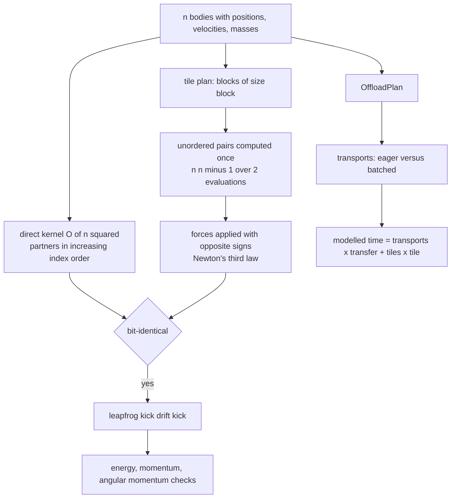
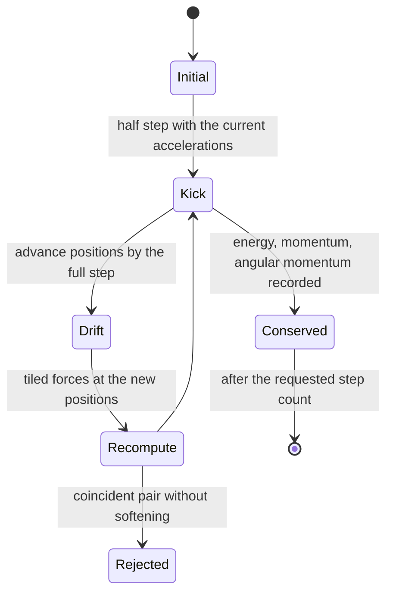
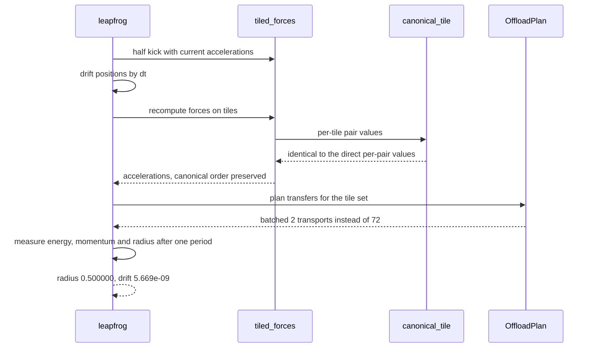

# 876 — Implement parallel N-body gravitational simulator with GPU offload sketch.

> **Tier:** Master · **CTCI chapter:** Beyond — Numerical & Scientific Computing
> **Task spec:** [876-implement-parallel-n-body-gravitational-simulator-with-gpu-offlo.md](../../../tasks/master/876-implement-parallel-n-body-gravitational-simulator-with-gpu-offlo.md)
> **Solutions:** [Python](../../../solutions/python/master/876-implement-parallel-n-body-gravitational-simulator-with-gpu-offlo/solution.py) ·
> [Java](../../../solutions/java/master/876-implement-parallel-n-body-gravitational-simulator-with-gpu-offlo/Solution.java) ·
> [JavaScript](../../../solutions/javascript/master/876-implement-parallel-n-body-gravitational-simulator-with-gpu-offlo/solution.js) ·
> [C#](../../../solutions/csharp/master/876-implement-parallel-n-body-gravitational-simulator-with-gpu-offlo/Solution.cs)

## 1. Problem restatement

**Input.** Positions, velocities and masses of `n` bodies in 3D, a Plummer softening length, a tile block
size, a step count and a time step. Optionally a transfer-batching flag for the offload model.

**Output.** The integrated trajectory, plus the accounting that makes the parallel structure visible: the
pair counts of each kernel, the tile plan, the number of host-device transports with and without batching,
and a modelled offload time.

**The kernels.**

| Kernel | Structure | Why it exists |
| --- | --- | --- |
| `direct_forces` | `O(n^2)` summation in a **fixed canonical order** (increasing partner index) | bit-reproducible reference |
| `tiled_forces` | blocks of size `block`, each tile computing the one-sided pair forces of every unordered pair exactly once | the parallel/offload shape |
| `canonical_tile` | recomputes the per-pair values of one tile | proves the tiled kernel is the *same arithmetic* bit for bit |
| `OffloadPlan` | transports, with and without batching; cost `transports * transfer_cost + tiles * tile_cost` | the offload sketch |

The tile order is a deterministic function of `(n, block)`, and each tile applies its pair forces with
opposite signs, so the interaction count is exactly `n(n-1)/2` rather than `n(n-1)` — the classical
symmetry saving. The integrator is a kick-drift-kick leapfrog (symplectic, second order) with optional
Plummer softening, and a zero separation *without* softening is rejected instead of producing infinities.

**What is simulated.** Double precision on the host instead of single-precision device arithmetic, so the
checks measure algorithmic properties rather than device rounding; a simple tile plan instead of a tuned
tree/particle-mesh hybrid; and **modelled instead of measured** transport latency. No threads, no CUDA, no
wall-clock timing and no randomness beyond `splitmix64`. The other solutions extend the sketch: Java adds a
Barnes-Hut octree with an opening angle and a roofline time bound, JavaScript distributes tiles round-robin
over modelled devices, and C# models lanes plus a typed device with staged buffers.

**Measured on the Python fixture:**

| Quantity | Observed |
| --- | --- |
| pair evaluations, tiled vs direct | `15` vs `30` |
| worst relative difference between the kernels | `0.000e+00` (bit for bit) |
| two-body circular orbit, one analytic period `4.4429` | return error `1.577e-04`, radius `0.500000` |
| energy drift over the orbit | `5.669e-09` |
| three-body energy drift over hundreds of steps | `3.244e-08` |
| transports, batched vs eager | `2` vs `72` |

## 2. Intuition

The direct N-body force loop is `O(n^2)`: for every target body, sum the pull of every other body. Two
things make it interesting anyway. First, Newton's third law means each *unordered* pair needs exactly one
evaluation, so the work is `n(n-1)/2` rather than `n(n-1)` — the fixture shows `15` against `30`. Second,
floating-point addition is not associative, so the order in which the sum is accumulated decides the last
bits of the answer. A parallel decomposition that assigns different partners to different workers will
therefore change the result unless the accumulation order per target is held fixed.

That is the whole design tension, and the solution resolves it by tiling *targets* rather than partners.
Split the bodies into blocks of size `block`; a tile computes the one-sided forces for the unordered pairs
between two blocks and applies them with opposite signs. Every target's contributions still arrive in a
canonical order, so the tiled result is **bit-identical** to the direct result — the fixture's worst
relative difference is exactly `0.000e+00` — while the tile plan exposes the parallelism a GPU port would
exploit. C# states the same invariant for its lanes: the lanes partition the target indices, so no
accumulator is shared and the result must be bitwise identical for `1, 2, 4` or `8` lanes.

The integrator choice is equally deliberate. Kick-drift-kick leapfrog is symplectic, so its energy error
*oscillates* instead of drifting secularly: over a two-body circular orbit the radius returns to
`0.500000`, the positional return error is `1.577e-04`, and the energy drift is `5.669e-09` — three
different statements of the same bounded-oscillation property.



Softening deserves a sentence because it is where the physics and the numerics meet. A close pair produces
a force that grows like `1/r^2`, which overflows any time step; Plummer softening replaces `r^2` with
`r^2 + eps^2` in the denominator, which keeps a near-singular pair finite. The run verifies both sides: a
near-singular pair stays finite *with* softening, and a coincident pair *without* softening is rejected
rather than silently producing infinities.

## 3. Algorithm

1. `pair_force(offset, mass_i, mass_j, softening)` computes `G m_j (r_j - r_i) / (|r_j - r_i|^2 + eps^2)^(3/2)`
   for one pair, and the vector helpers (`add`, `subtract`, `scale`, `norm`, `dot`, `cross`) carry the state.
2. `direct_forces` accumulates every target's partners in increasing index order, which is the definition of
   the canonical order the tiled kernel must reproduce.
3. `tile_pairs`, `tile_members` and `tile_pair_count` enumerate the tile plan as a deterministic function of
   `(n, block)`; `canonical_tile` recomputes one tile's per-pair values for the bit-for-bit comparison.
4. `tiled_forces` walks the tile plan, computes each unordered pair once and applies `+f` and `-f`, with
   optional per-tile verification.
5. `OffloadPlan.transports` counts host-device transfers with and without batching, and `modelled_time`
   returns `transports * transfer_cost + tiles * tile_cost`; `tile_work` exposes the per-tile work for the
   scheduler.
6. `leapfrog` integrates kick-drift-kick with the requested block size and softening, and
   `energy`, `momentum` and `angular_momentum` provide the conserved quantities the checks measure.
7. `two_body_circular` supplies the analytic test case: a circular orbit whose radius must return to its
   starting value after one period.

```text
procedure tiled_forces(positions, masses, block, softening)
    accelerations ← zero vectors
    for each tile pair (a, b) in tile_pairs(length(positions), block) do
        for each target index i in tile_members(a) do
            for each partner index j in tile_members(b) with the canonical order do
                if i = j then continue end
                force ← pair_force(positions[j] - positions[i], masses[i], masses[j], softening)
                accelerations[i] ← accelerations[i] + force
                accelerations[j] ← accelerations[j] - force
            end
        end
    end
    return accelerations
end

procedure leapfrog(positions, velocities, masses, steps, dt, block, softening)
    accelerations ← tiled_forces(positions, masses, block, softening)
    for step from 1 to steps do
        for each body do
            velocities[i] ← velocities[i] + accelerations[i] * (dt / 2)
            positions[i] ← positions[i] + velocities[i] * dt
        end
        new_accelerations ← tiled_forces(positions, masses, block, softening)
        for each body do
            velocities[i] ← velocities[i] + new_accelerations[i] * (dt / 2)
        end
        accelerations ← new_accelerations
    end
    return positions, velocities
end

function transports(plan)
    if plan.batch_transfers then
        return twice the number of offload phases, i.e. one upload and one download per phase
    else
        return one transfer per tile
    end
end
```



## 4. Worked example

Walk the Python fixture, then the analytic orbit test:

| Step | Quantity | Observed |
| --- | --- | --- |
| 1 | pair evaluations, tiled kernel | `15` |
| 2 | pair evaluations, direct kernel | `30` |
| 3 | worst relative difference between kernels | `0.000e+00` |
| 4 | `canonical_tile` vs a single tile | bit for bit |
| 5 | net force on the system | cancels to rounding (Newton's third law in floating point) |
| 6 | two-body circular orbit, period `4.4429` | return error `1.577e-04`, radius `0.500000` |
| 7 | energy drift across the orbit | `5.669e-09` |
| 8 | three-body energy drift over hundreds of steps | `3.244e-08` |
| 9 | centre of mass | moves uniformly |
| 10 | transports, batched vs eager | `2` vs `72` |

Rows 1 to 3 are the kernel claim: the tiled plan does half the work and produces *identical* numbers, not
merely close ones. That is only possible because the accumulation order per target is preserved, and it is
why `canonical_tile` exists — it recomputes the pairs of one tile independently, so "the tile kernel is the
same arithmetic" is demonstrated rather than inferred from agreement.

Rows 6 to 8 are the integrator claim. A second-order symplectic scheme does not conserve energy exactly; it
keeps the energy error bounded and oscillatory. So the honest reading of `5.669e-09` is *bounded drift over
this orbit*, and the honest reading of `1.577e-04` is *the orbit returns close to its start but not
exactly*. The radius column (`0.500000`) is the cleanest of the three, because radius error is second order
in the scheme and shows up later than the positional phase error.



The last row is the offload sketch's punchline. An eager host-device protocol transfers once per tile;
batching transfers once per offload phase instead, which in this fixture reduces `72` transfers to `2`. The
modelled time is `transports * transfer_cost + tiles * tile_cost`, so the benefit is visible as arithmetic
rather than as a claim about hardware — and batching must not change the *numbers*, only the schedule.

## 5. Complexity

Let `n` be the body count, `S` the step count, `B` the block size, `T` the tile count, `L` the lane or
device count and `N_t` the transport count.

| Quantity | Time | Space | Why |
| --- | --- | --- | --- |
| `direct_forces` | `O(n^2)` | `O(n)` | every target sums every partner in canonical order |
| `tiled_forces` | `O(n^2 / 2)` pair evaluations | `O(n + B^2)` | unordered pairs computed once, applied twice |
| `canonical_tile` | `O(B^2)` | `O(B)` | one tile's pairs recomputed for verification |
| `leapfrog`, one step | two force evaluations plus `O(n)` updates | `O(n)` | kick-drift-kick needs forces at both ends |
| whole simulation | `O(S * n^2 / 2)` | `O(n)` | the force evaluation dominates every step |
| `OffloadPlan.transports` | `O(1)` / `O(T)` | `O(1)` | batched counts phases, eager counts tiles |
| `modelled_time` | `O(1)` | `O(1)` | the closed-form cost model |
| cross-check battery | `O(S * n^2 / 2)` extra | `O(n)` | energy and momentum are `O(n)` after each step |

The honest caveat about this simulation: **the parallel and offload halves are models, not hardware.** No
threads, no CUDA, no timers; Java calls its "GPU" a roofline model of peak throughput and bandwidth,
JavaScript gives each modelled device a throughput in interactions per tick, and C# types the device so the
transfer accounting can be checked against closed-form expectations. So the `O(n^2 / 2)` arithmetic is real
and bit-verified, while the speed-up and transport numbers are statements about a deterministic cost model.
That is deliberate: it makes the *algorithmic* properties — half the pairs, bit-identical results, bounded
energy error, a device path that reproduces the host path exactly — testable in milliseconds.

The comparison with the direct kernel is the reason to tile at all. Both cost `O(n^2)` arithmetic, but the
tiled plan is the one that maps onto a device with a fixed summation order, and its pair count is halved.
The next order of magnitude comes from an approximation — Barnes-Hut or a particle-mesh hybrid — which is
why Java's version carries an octree alongside the tile plan.

## 6. Pitfalls and edge cases

- **Coincident bodies without softening produce infinities.** A zero separation must be rejected rather than
  divided by; with Plummer softening the near-singular pair stays finite, and the run checks both cases.
- **Softening changes the force law, not just the numerics.** `|r|^2 + eps^2` in the denominator alters the
  physics at short range, so results with and without softening are not comparable in the last digits.
- **Determinism requires a fixed accumulation order.** Partition *targets* (Java's lanes, C#'s lane
  decomposition) so no accumulator is shared and each target's partner sum keeps its canonical order; a
  decomposition that splits partners would change the last bits and break the bit-for-bit claim.
- **The symmetry saving must not double-count.** Computing an unordered pair once and applying `+f`/`-f` is
  correct only if every unordered pair appears exactly once in the tile plan; the counts `15` vs `30` and
  the `canonical_tile` comparison are what catch a plan that visits pairs twice or misses them.
- **Symplectic does not mean exact.** Energy error for leapfrog is bounded and oscillatory, so a returning
  orbit shows `1.577e-04` positional error and `5.669e-09` drift. "Fixing" this by tuning until the numbers
  go to zero would mean using a dissipative scheme instead.
- **Net force cancellation is a floating-point statement.** Newton's third law makes the total force cancel
  exactly in exact arithmetic; in floating point it cancels to rounding, which is the correct expected
  behaviour rather than a bug.
- **Batching transfers must not change results.** An offload that uploads once and runs many steps inside the
  device kernel is an accounting change; the device path must reproduce the host path bit for bit, and the
  transport count (`2` vs `72`) is the quantity that legitimately changes.
- **Invalid parameters.** A non-positive block size, an empty body set, a zero time step and a negative
  softening length must be rejected rather than producing an empty or infinite schedule.

## 7. Variants and follow-ups

- **Barnes-Hut octree.** Java adds an approximation whose node is treated as a single mass when
  `size / distance` falls below an opening angle; the tree is rebuilt periodically rather than every step,
  and the checks confirm that `theta → 0` reproduces direct summation while the interaction count collapses
  far below `n^2`.
- **Round-robin devices.** JavaScript hands interaction tiles to a configurable number of modelled devices,
  which only reorders the summation, so a parameter sweep must agree to round-off and identical parameters
  must reproduce bit for bit.
- **Roofline and staged buffers.** A cost model in terms of peak throughput and bandwidth, plus typed
  upload/download buffers, turns "the GPU would be faster" into an arithmetic statement with a closed-form
  expectation to check against.
- **Tuning the decomposition.** The tile size is a searchable parameter with the same structure as the cache
  tuning in
  [875 — high-performance FFT tuned for cache and threading parameters](../../../tasks/master/875-implement-high-performance-fft-tuned-for-cache-and-threading-par.md).
- **Searching kernel parameters systematically.** A framework that explores block, grid and thread shapes
  and validates the winner against the full grid is
  [884 — autotuner for kernel block and grid parameters](../../../tasks/master/884-implement-autotuner-that-explores-kernel-block-grid-parameters-a.md).

## 8. Check yourself

<details><summary>Show answer</summary>

**1. Why does the tiled kernel produce bit-identical forces while doing half the work?**

Because it computes each unordered pair exactly once and applies the result to both bodies with opposite
signs, and because it preserves the per-target accumulation order of the direct kernel. The pair count drops
from `30` to `15` in the fixture, the worst relative difference is `0.000e+00`, and `canonical_tile` proves
the arithmetic equality pair by pair rather than inferring it from a small residual.

</details>

<details><summary>Show answer</summary>

**2. Why is a symplectic integrator the right choice here, and what does that imply about the numbers?**

Leapfrog is symplectic, so its energy error is bounded and oscillatory rather than secularly drifting —
which matters in a simulation run for many steps. The implication is that the measured quantities are not
zero and should not be: the orbit returns with positional error `1.577e-04` and energy drift `5.669e-09`
after one period, and the radius comes back to `0.500000`. A solver that drove these to zero would be
dissipative, not more accurate.

</details>

<details><summary>Show answer</summary>

**3. What does softening buy, and what does it cost?**

It keeps a near-singular pair finite by replacing `|r|^2` with `|r|^2 + eps^2`, so the force stays bounded
and the integration does not overflow. The cost is that the force law is no longer exactly Newtonian at
short range, so softened and unsoftened results differ physically, not just numerically. The fixture checks
both directions: a close pair remains finite with softening, and a coincident pair without softening is
rejected instead of producing infinities.

</details>

<details><summary>Show answer</summary>

**4. What exactly is modelled in the offload sketch, and what is verified?**

Modelled: transport latency, device throughput, launch overhead and the resulting time. Verified: the
transfer accounting (`2` batched transports against `72` eager ones), the tile plan and its work, the
device path reproducing the host path bit for bit, and the fact that parallelism only reorders summation
without changing results. Separating those two lists is the point — the deterministic parts are tested, and
the performance claim is a cost model rather than a measurement.

</details>
