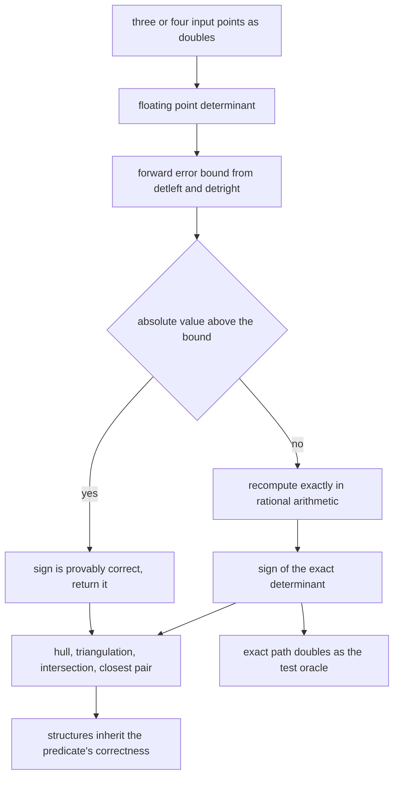
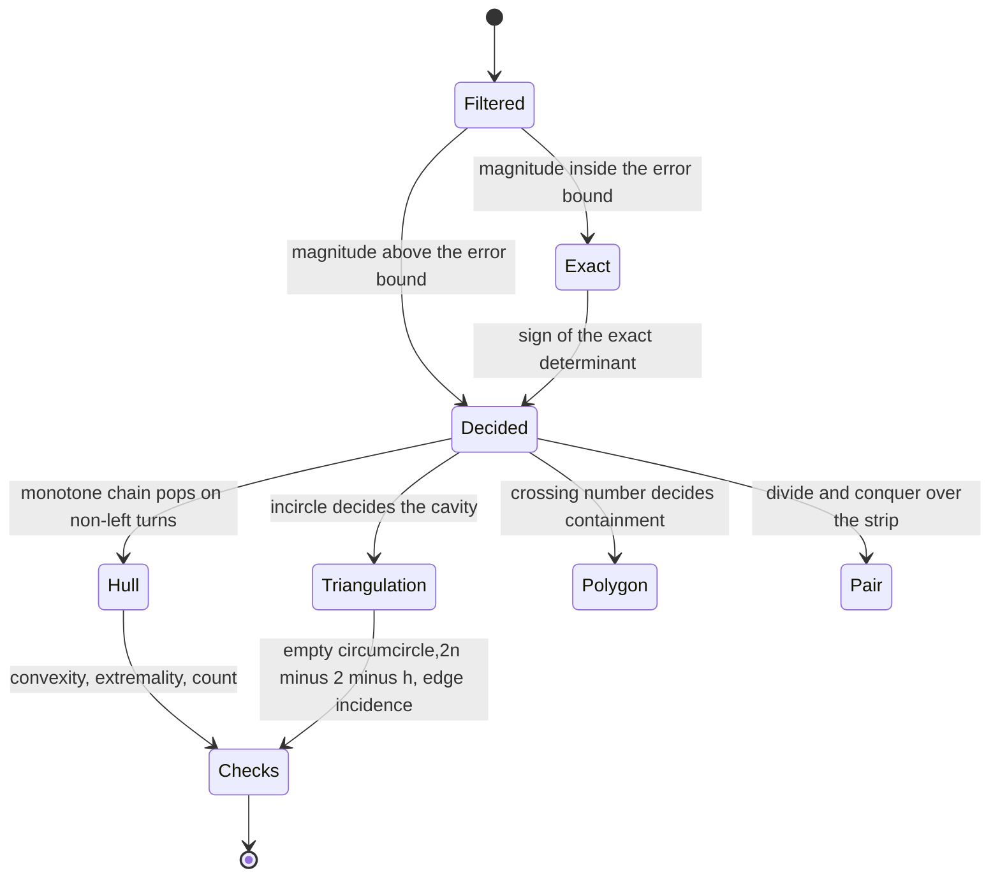
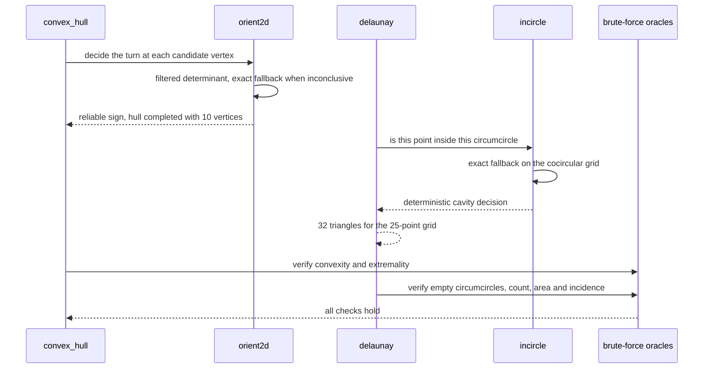

# 877 — Implement full-featured computational geometry library with robust predicates.

> **Tier:** Master · **CTCI chapter:** Beyond — Graphics, Geometry & Robotics
> **Task spec:** [877-implement-full-featured-computational-geometry-library-with-robu.md](../../../tasks/master/877-implement-full-featured-computational-geometry-library-with-robu.md)
> **Solutions:** [Python](../../../solutions/python/master/877-implement-full-featured-computational-geometry-library-with-robu/solution.py) ·
> [Java](../../../solutions/java/master/877-implement-full-featured-computational-geometry-library-with-robu/Solution.java) ·
> [JavaScript](../../../solutions/javascript/master/877-implement-full-featured-computational-geometry-library-with-robu/solution.js) ·
> [C#](../../../solutions/csharp/master/877-implement-full-featured-computational-geometry-library-with-robu/Solution.cs)

## 1. Problem restatement

**Input.** Points in the plane (and triples of points in space for the 3D predicate), given as
floating-point coordinates.

**Output.** Geometric structures — convex hull, Delaunay triangulation, point-in-polygon verdicts, segment
intersection verdicts, closest pair — whose **every combinatorial decision** is decided by predicates that
never return a wrong sign.

**The predicates.** Three of them: `orient2d`, `orient3d` and `incircle`. Each is computed with the
classical two-stage scheme:

1. Evaluate the determinant in floating point together with Shewchuk's forward error bound
   `err = (3 + 16u) u (|detleft| + |detright|)`, `u = 2^-53`.
2. If the floating-point value is larger in magnitude than that bound, its sign is **provably correct** and
   is returned immediately. Otherwise the determinant is recomputed **exactly** in rational arithmetic —
   every input float is a dyadic rational, so `Fraction(x)` is exact — and the sign of that value is
   returned.

**What correctness of the predicates buys.** Andrew's monotone chain convex hull, a Bowyer-Watson Delaunay
triangulation, exact point-in-polygon, segment intersection and a divide-and-conquer closest pair all
*inherit* their correctness: a structure built only from correct sign decisions cannot have a broken
topology. And the exact path doubles as the oracle for the tests, so every predicate is compared against a
pure rational computation on hundreds of random **and** adversarially near-degenerate inputs — including the
classic configuration whose floating-point determinant is non-zero although the exact value is zero.

**What is simulated.** Conservative error bounds rather than Shewchuk's full adaptive expansion cascade
(Java: "one level, double then exact"); integer-lattice or bounded coordinates in the Java and C# versions
so the exact arithmetic is exact arithmetic on integers; monotone chain rather than gift wrapping; an
incremental Bowyer-Watson triangulation with an explicit super-triangle. Everything is deterministic, with
no threads, no wall-clock time and no randomness beyond `splitmix64`.

**Measured on the Python fixture:**

| Quantity | Observed |
| --- | --- |
| predicate sign mismatches against exact rational determinants | `0` |
| fallbacks to the exact path | `43` |
| cases where the *naive* determinant had the wrong sign | `3` |
| convex hull | `10` vertices of `40` points, area `82.991` |
| Delaunay triangles for the `25`-point grid | `32` |
| segment intersections among `200` random pairs | `52` |
| closest pair distance | `0.565310` |

## 2. Intuition

Floating-point geometry fails in a particularly nasty way. Most inputs are fine, so the code appears to
work; then a near-degenerate configuration arrives — three nearly collinear points, four nearly cocircular
points, a sliver triangle — the determinant's sign flips, and a hull or triangulation produces a
topologically impossible structure. The fixture measures exactly this: the naive determinant is wrong on
`3` of the inputs, which is precisely where a hull edge would cross another hull edge.

The fix is not "use higher precision everywhere", because that would triple the cost of every robust
library ever written. It is the **filter**: compute the determinant in doubles *together with a rigorous
forward error bound*, and trust the answer whenever its magnitude exceeds the bound. Only when the value
falls inside the bound — meaning rounding could plausibly have changed the sign — is the determinant
recomputed exactly. In the fixture only `43` evaluations out of the battery needed the exact path, and the
sign was never wrong.

The crucial subtlety is that the error bound must be *rigorous*. `err = (3 + 16u) u (|detleft| + |detright|)`
depends on the magnitudes of the partial products, so an almost-cancelling determinant gets a proportionally
tight bound: three nearly collinear points produce nearly-cancelling terms and therefore a small bound, so
the fallback triggers. That self-scaling behaviour is what makes the filter safe rather than lucky.



Because the predicate is total — it never answers "unknown" and never answers wrong —
`orient2d` is also antisymmetric and invariant under cyclic permutation, and `incircle` behaves correctly on
cocircular points. The tests check those algebraic identities directly, which catches sign-convention bugs
that agreement with the oracle alone could mask.

## 3. Algorithm

1. `naive_orient2d` is the plain double determinant, kept only to demonstrate that it can be wrong;
   `exact_orient2d`/`exact_orient3d`/`exact_incircle` compute the same determinants in `Fraction`
   arithmetic, and `orient2d`/`orient3d`/`incircle` are the filtered versions used by everything else.
2. `convex_hull(points, keep_collinear)` runs Andrew's monotone chain: sort lexicographically, sweep to
   build the lower hull, sweep back for the upper hull, and use `orient2d` to decide which points to pop.
3. `polygon_area`, `point_in_polygon` and `segments_intersect` provide exact area, crossing-number
   containment and segment intersection, with `exact_segments_intersect` as the oracle.
4. `closest_pair` is a divide-and-conquer solution whose strip merge is compared against the `O(n^2)`
   `closest_pair_bruteforce`.
5. `delaunay(points)` inserts points into an incremental Bowyer-Watson structure with an explicit
   super-triangle, deciding cavity membership with the exact `incircle` predicate and maintaining
   consistent edge orientation.
6. `triangulation_area` and `edge_incidence` implement the structural checks: the triangle count must equal
   `2n - 2 - h`, the triangulation's total area must equal the hull's area, and interior edges must appear in
   exactly two triangles while hull edges appear in exactly one.

```text
function orient2d(a, b, c)
    detleft ← (a.x - c.x) * (b.y - c.y)
    detright ← (a.y - c.y) * (b.x - c.x)
    determinant ← detleft - detright
    bound ← (3 + 16 * u) * u * (absolute(detleft) + absolute(detright))
    if absolute(determinant) > bound then
        return sign(determinant)
    end
    return sign(exact_orient2d(a, b, c))
end

procedure convex_hull(points, keep_collinear)
    sorted ← points sorted lexicographically
    lower ← empty stack
    for each point in sorted do
        while the last two points of lower and point make a non-left turn do
            pop lower
        end
        push point onto lower
    end
    upper ← the same sweep in reverse order
    return the concatenation of lower and upper without the duplicated endpoints
end

procedure delaunay(points)
    triangles ← one super-triangle covering every point
    for each point in points do
        bad ← triangles whose circumcircle contains the point, decided by incircle
        boundary ← edges of bad that are not shared between two bad triangles
        remove bad from triangles
        for each edge in boundary do
            add the triangle formed by the point and that edge
        end
    end
    remove every triangle touching the super-triangle
    return triangles
end
```



## 4. Worked example

Walk the Python fixture, which runs the predicates against exact rational determinants and then builds the
structures:

| Step | Quantity | Observed |
| --- | --- | --- |
| 1 | predicate mismatches against exact rational signs | `0` |
| 2 | evaluations that fell through to the exact path | `43` |
| 3 | cases where the naive double determinant had the wrong sign | `3` |
| 4 | convex hull of `40` random points | `10` vertices, area `82.991` |
| 5 | hull vs brute-force convexity and extremality | agreement on general position, collinear and duplicate input |
| 6 | Delaunay of the `25`-point grid | `32` triangles |
| 7 | structural checks | empty circumcircles, `2n - 2 - h` count, area identity, edge incidence |
| 8 | segment intersections among `200` pairs | `52` true intersections |
| 9 | closest pair | `0.565310`, equal to the `O(n^2)` scan |

Rows 1 to 3 together are the whole argument for the two-stage design. The naive determinant is wrong three
times in this battery — that is the "floating point fails where it matters" evidence — while the filtered
predicate is wrong zero times because the exact path catches every case where the bound was not decisive.
And only `43` of the evaluations had to pay for exact arithmetic, which is what makes the approach practical.

Row 7 is the structural check that a triangulation cannot pass by accident. The empty-circumcircle property
is the definition of a Delaunay triangulation; the count `2n - 2 - h` follows from Euler's formula; the area
identity ties the triangulation to the hull; and the edge-incidence rule (interior edges in exactly two
triangles, hull edges in exactly one) catches a cavity that was removed but not re-filled. The fixture also
handles a **cocircular grid** deterministically, which is the classic case where `incircle` returns zero and
a naive implementation either crashes or produces a different triangulation on every run.



## 5. Complexity

Let `n` be the point count, `h` the hull size, `b` the bit length of the coordinates and `f` the fraction of
evaluations that fall back to the exact path.

| Structure | Time | Space | Why |
| --- | --- | --- | --- |
| filtered `orient2d` / `incircle` | `O(1)` floating-point operations | `O(1)` | a constant-size determinant plus a bound comparison |
| exact fallback | `O(1)` rational operations, cost growing with `b^2` | `O(1)` | small determinants in exact arithmetic |
| `convex_hull` | `O(n log n)` | `O(n)` | the sort dominates; the sweeps are linear |
| `point_in_polygon` | `O(n)` | `O(1)` | crossing number over the polygon's edges |
| `segments_intersect` | `O(1)` | `O(1)` | four orientation tests plus bounding-box rejection |
| `closest_pair` | `O(n log n)` | `O(n)` | divide and conquer with a linear strip merge |
| `delaunay` | `O(n log n)` typical, `O(n^2)` worst | `O(n)` | incremental insertion; a cavity walk can touch many triangles |

The honest caveat about this simulation: **the filter has one level, not Shewchuk's adaptive cascade.** The
bounds are the standard conservative ones, and the exact fallback is rational arithmetic in Python (`Fraction`)
or `BigInteger` determinants in Java and C# — Java and C# restrict inputs to bounded integer lattices so the
exact branch is exact *integer* arithmetic, which is why they can also assert that the oracle is exact. The
cost model that matters is `1 + f * (fallback cost)`: in the fixture `f` was `43` out of the whole battery, so
the filter is doing its job. No threads, no wall-clock time and no unseeded randomness anywhere.

Two claims deserve separation. *Correctness* is unconditional: the predicate never returns a wrong sign, so
the structures are topologically sound. *Robustness to degeneracy* is what the tests demonstrate: collinear
hull input, duplicate points, cocircular grids and the classic near-zero determinant case are all handled
deterministically rather than by luck.

## 6. Pitfalls and edge cases

- **A wrong sign is catastrophic, not merely inaccurate.** Three naive determinant signs were wrong in the
  fixture; each one is a hull edge or a triangle that should not exist. The filter must therefore be
  *provably* safe, which is what the forward error bound provides.
- **The bound must be derived from the partial products.** `(3 + 16u) u (|detleft| + |detright|)` shrinks
  with the cancellation in the determinant, so a nearly collinear triple triggers the exact path. A fixed
  epsilon would either miss those cases or send everything to the slow path.
- **Degenerate configurations are the normal case.** Collinear hull input (`keep_collinear`), duplicate
  points, cocircular grids where `incircle` is exactly zero, and sliver triangles all occur in practice; each
  needs a deterministic decision, and a `0` from `incircle` must be resolved consistently rather than by
  iteration order.
- **Orientation conventions must be global.** Hull popping, Delaunay cavity membership and crossing-number
  containment all assume a consistent orientation, so `orient2d` is checked for antisymmetry and cyclic
  permutation invariance, and the triangulation maintains a consistent edge orientation.
- **Structural identities catch missing steps.** The Delaunay checks — empty circumcircles, `2n - 2 - h`
  triangles, the hull-area identity, edge incidence — fail immediately if a cavity is removed but not
  re-filled, which a per-triangle test cannot detect.
- **The exact oracle can be expensive but it is not the serving path.** Correctness is guaranteed by exact
  arithmetic; the practical reason the library exists is that the fallback is rare. Measuring the fallback
  rate is therefore part of the contract, not an optimisation detail.
- **Bounded inputs keep exact arithmetic exact.** Java and C# rely on integer or bounded-range coordinates
  (`|coordinate| <= 1e6`) so determinants stay small; a library that silently overflows there would lose
  exactness precisely where it was needed.
- **Determinism.** Every structure must be reproducible: the run checks hull, triangulation, closest pair and
  intersection results across repeated runs, because a geometry library whose output depends on iteration
  order cannot be debugged.

## 7. Variants and follow-ups

- **Adaptive precision cascades.** Shewchuk's staged floating-point expansions replace "double then exact"
  with a ladder of increasing precision, so most fallbacks are resolved without ever reaching rational
  arithmetic. The interface and the guarantees are unchanged.
- **Integer-lattice inputs.** With bounded integer coordinates the exact branch is exact integer arithmetic
  and every oracle is exact by construction, which is the variant the Java and C# solutions take.
- **Three dimensions and beyond.** `orient3d` plus a 3D `incircle`-analogue supports tetrahedralisation and
  mesh generation; the filter structure is identical, only the determinant sizes change.
- **From triangulation to Voronoi.** The Delaunay dual gives the Voronoi diagram, which is the standard route
  to nearest-neighbour queries in geometry.
- **Consuming robust geometry.** The predicates here are the foundation of collision detection and ray
  tracing, which share the same degeneracy problems: see
  [878 — production-ready collision detection and physics engine basics](../../../tasks/master/878-implement-production-ready-collision-detection-and-physics-engin.md)
  and [879 — high-performance raytracer with BVH](../../../tasks/master/879-implement-high-performance-raytracer-with-bvh-build-and-traversa.md).

## 8. Check yourself

<details><summary>Show answer</summary>

**1. Why is the two-stage scheme faster than computing exactly all the time?**

Because the filter is a handful of floating-point operations, and exact rational or big-integer arithmetic is
orders of magnitude more expensive per evaluation. In the fixture only `43` evaluations were inconclusive
enough to fall back, so almost the whole battery was decided in floating point — while the answers were still
provably right, because the fallback covers precisely the cases where the bound could not certify the sign.

</details>

<details><summary>Show answer</summary>

**2. What makes the error bound work on nearly degenerate inputs?**

The bound is proportional to the magnitudes of the *partial products* (`|detleft| + |detright|`), not to a
global scale. When three points are nearly collinear the two terms nearly cancel, so the determinant is tiny
*and* the bound is tight around it, which sends the case to the exact path. On well-separated inputs the
determinant is large compared with the bound, so the fast path answers. The bound self-scales with the
cancellation, which is what a fixed epsilon cannot do.

</details>

<details><summary>Show answer</summary>

**3. Why do the structures only need the predicates to be correct?**

Because every combinatorial decision in these algorithms is a sign question: which point to pop in the hull
sweep, whether a point lies inside a circumcircle, whether two segments straddle each other, whether a point
is inside a polygon. If the sign is always right, the structure built from those decisions satisfies its own
definition — convex, Delaunay, correctly contained — without any tolerance parameter to tune.

</details>

<details><summary>Show answer</summary>

**4. How does the fixture know the triangulation is actually a Delaunay triangulation?**

From four independent structural checks: every triangle's circumcircle must be empty of other points; the
triangle count must equal `2n - 2 - h`; the sum of triangle areas must equal the hull's area; and interior
edges must belong to exactly two triangles while hull edges belong to exactly one. The `25`-point grid
produced `32` triangles and passed all four, including the cocircular case where `incircle` returns exactly
zero.

</details>
