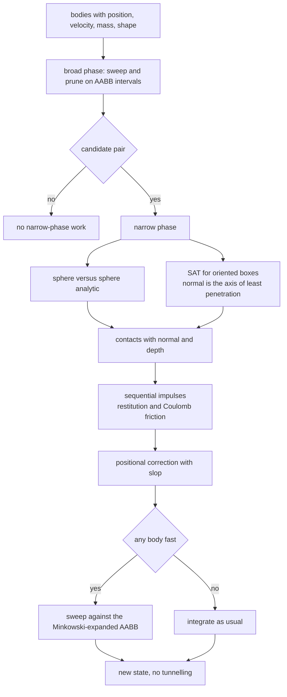
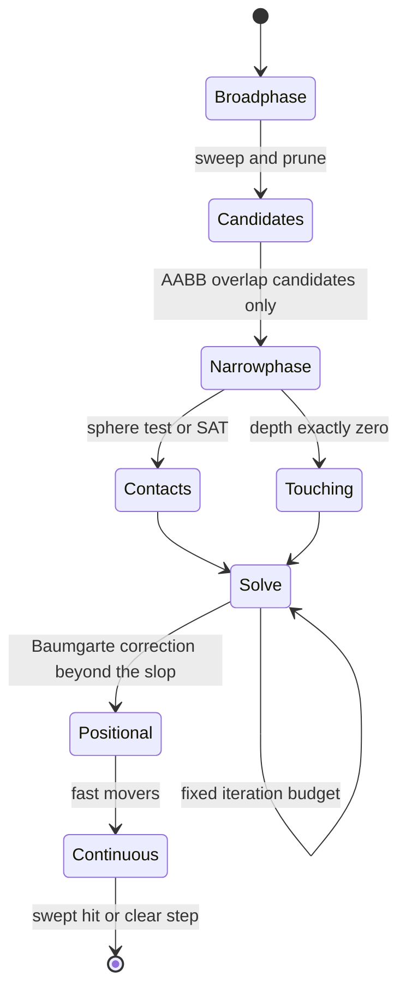
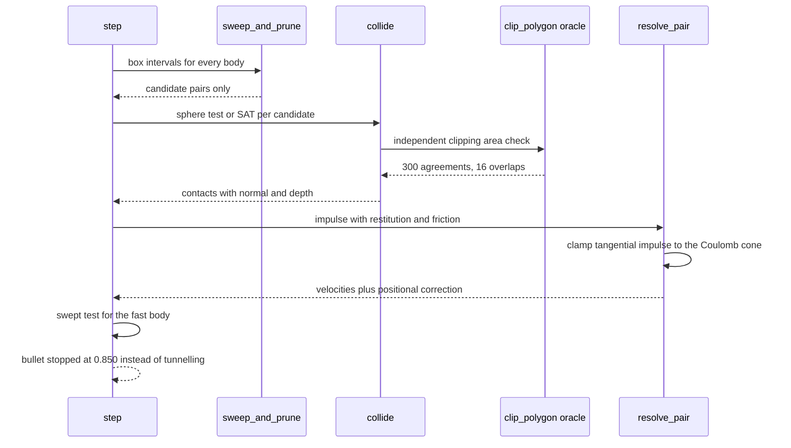

# 878 — Implement production-ready collision detection and physics engine basics.

> **Tier:** Master · **CTCI chapter:** Beyond — Graphics, Geometry & Robotics
> **Task spec:** [878-implement-production-ready-collision-detection-and-physics-engin.md](../../../tasks/master/878-implement-production-ready-collision-detection-and-physics-engin.md)
> **Solutions:** [Python](../../../solutions/python/master/878-implement-production-ready-collision-detection-and-physics-engin/solution.py) ·
> [Java](../../../solutions/java/master/878-implement-production-ready-collision-detection-and-physics-engin/Solution.java) ·
> [JavaScript](../../../solutions/javascript/master/878-implement-production-ready-collision-detection-and-physics-engin/solution.js) ·
> [C#](../../../solutions/csharp/master/878-implement-production-ready-collision-detection-and-physics-engin/Solution.cs)

## 1. Problem restatement

**Input.** A set of 2D rigid bodies — circles and oriented boxes, with position, velocity, mass, radius or
half-extents, angle, restitution and friction — plus gravity, a time step, a solver iteration count and a
continuous-collision flag. Static bodies have infinite mass.

**Output.** The set of confirmed contacts with normals and penetration depths, the velocities and positions
after each step, and the invariants that make the engine usable: conservation of momentum, non-increasing
kinetic energy for restitution below one, a settled stack with bounded penetration and no jitter, and no
tunnelling by fast bodies.

**The three stages, verified separately.**

| Stage | Method | Oracle |
| --- | --- | --- |
| broad phase | sweep and prune over the intervals of the axis-aligned bounding boxes | brute-force `O(n^2)` pairs |
| narrow phase | analytic sphere/sphere; separating axis theorem for oriented boxes, normal = axis of least penetration | Sutherland-Hodgman polygon clipping, intersection area greater than zero |
| solver | sequential impulses with restitution and Coulomb friction plus a positional (Baumgarte) correction | closed-form elastic velocities, momentum and energy identities |

Continuous collision detection is included because it is the difference between a simulation and a demo: a
bullet moving many times its own radius per step passes straight through a thin wall under discrete
sampling, so the world also sweeps the motion of a body centre against the Minkowski-expanded AABB of every
static body.

**What is simulated.** Two dimensions, circles and rectangles only, no rotation induced by friction, no
joints, no sleeping and no spatial queries beyond the sweep; a fixed iteration count instead of a
residual-based loop; no threads, no wall-clock time and no randomness beyond `splitmix64`. The other
solutions swap in a uniform grid (JavaScript) or a spatial hash with a sleeping rule (C#), and Java adds
substepping sized by the fastest body.

**Measured on the Python fixture:**

| Quantity | Observed |
| --- | --- |
| sparse scene: broadphase candidates / brute-force pairs / all unordered pairs | `0` / `0` / `78` |
| dense scene: broadphase candidates of all pairs | `13` of `36` |
| separating axis theorem vs the clipping oracle | `300` agreements, `16` overlaps |
| resting block: penetration / jitter | `-0.00000` / `0.00000` |
| fast bullet | swept `0.850`, without CCD tunnelled `100.000` |

## 2. Intuition

Testing every pair of bodies is `O(n^2)`, and the narrow-phase tests are the expensive ones. Production
engines therefore split the work: a cheap broad phase proposes candidates, and the exact tests run only on
those. The critical property of the broad phase is **asymmetry of errors** — a false negative is a physics
bug that shows up in front of a user (bodies interpenetrating, objects falling through floors), while a
false positive merely costs a little time. So the candidate set must be a *superset* of the truly colliding
pairs, and the fixture checks both halves of that contract: completeness against brute force, plus the
pruning factor (`0` candidates in a sparse scene, `13` of `36` pairs in a dense one).

The narrow phase is where geometry becomes decision-making. Sphere/sphere overlap is analytic; oriented
boxes need the **separating axis theorem**: if any candidate axis separates the projections of the two
shapes, they do not overlap, and the axis of least penetration gives both the contact normal and the
resolution depth. Because SAT and clipping are completely different algorithms — one projects onto axes, the
other clips polygons and measures area — using the clip as the oracle is a genuine differential test: the
fixture records `300` agreements with `16` overlaps, including the boundary case of shapes that merely
touch.

The solver's job is to make many simultaneous contacts behave. Sequential impulses apply one contact at a
time, iterating a fixed number of times, with restitution for bouncing and friction clamped to the Coulomb
cone `|j_t| <= mu * j_n`. A positional correction with a slop removes the residual penetration that impulses
alone leave behind — and the fixture's resting block reports penetration `-0.00000` and jitter `0.00000`,
which is exactly the "bounded and quiet" behaviour a stack needs.



Continuous collision detection exists for a specific, measurable failure: with discrete sampling the bullet
travels `100.000` units past the wall, while the swept test stops it at `0.850`. That is not a precision
issue, it is a modelling issue — the step is simply too long relative to the geometry — and the standard
remedies are substepping (Java sizes substeps by the fastest body) or a swept query (used here).

## 3. Algorithm

1. `Body.aabb()` computes the axis-aligned bounding box of a body; `aabb_overlap` is the cheap interval test.
2. `sweep_and_prune(bodies)` sorts the boxes along an axis and sweeps: maintain an active set, add a pair
   whenever an opening edge meets an interval still open, and remove a pair when the interval closes.
3. `sphere_sphere` and `obb_sat(first, second)` produce a contact when the shapes overlap; `project` gives
   the interval of a box on a candidate axis, and SAT returns the axis of minimum penetration as the normal.
4. `collide` dispatches by shape pair; `clip_polygon` / `intersection` implement Sutherland-Hodgman clipping
   and `polygon_area` measures the overlap, which is the independent oracle.
5. `resolve_pair(first, second, normal, depth, iterations, positional, slop)` applies the impulse with
   restitution, clamps the tangential impulse to `mu * j_n`, and corrects the positional error by a fraction
   of the penetration beyond a slop value.
6. `swept_static_hit(body, previous, others)` sweeps the body centre against the Minkowski-expanded AABB of
   every static body; `step(bodies, dt, gravity, iterations, continuous)` integrates semi-implicit Euler,
   gathers contacts, solves them and applies the continuous check when enabled.
7. `kinetic_energy`, `momentum` and the per-body heights supply the invariants: elastic closed-form
   velocities, momentum conservation to rounding, energy non-increasing below restitution one, and a resting
   stack that does not jitter.

```text
procedure sweep_and_prune(bodies)
    boxes ← for each body: its axis-aligned box
    sorted ← boxes sorted by lower bound along the sweep axis
    active ← empty list
    candidates ← empty set
    for each box in sorted do
        remove every entry of active whose upper bound is below box.lower
        for each entry in active do
            append the pair (entry, box) to candidates
        end
        append box to active
    end
    return candidates
end

procedure obb_sat(first, second)
    for each candidate axis in (first and second edge normals) do
        interval_a ← project(first.corners, axis)
        interval_b ← project(second.corners, axis)
        if intervals are disjoint then return no contact end
        depth ← overlap of the intervals
        if depth < minimum_depth then
            minimum_depth ← depth
            normal ← axis oriented from first to second
        end
    end
    return contact(normal, minimum_depth)
end

procedure resolve_pair(first, second, normal, depth, iterations, positional, slop)
    relative_velocity ← second.velocity - first.velocity
    normal_speed ← dot(relative_velocity, normal)
    if normal_speed < 0 then
        impulse ← -(1 + restitution) * normal_speed / (first.inverse_mass + second.inverse_mass)
        apply the impulse along the normal to both bodies
        tangential ← the tangential component of the relative velocity
        friction_impulse ← clamp the tangential impulse to absolute value at most friction * impulse
        apply the friction impulse
    end
    correction ← max(depth - slop, 0) * positional / (first.inverse_mass + second.inverse_mass)
    move both bodies apart along the normal in proportion to their inverse masses
end

procedure step(bodies, dt, gravity, iterations, continuous)
    for each dynamic body do
        velocity ← velocity + gravity * dt
        previous ← position
        position ← position + velocity * dt
    end
    if continuous then
        for each fast body do
            hit ← swept_static_hit(body, previous, static bodies)
            if hit exists then place the body at the hit and reflect its velocity end
        end
    end
    contacts ← narrow-phase results over the broad-phase candidates
    repeat iterations times: resolve_pair for every contact
    for each contact do apply the positional correction
end
```



## 4. Worked example

Walk the Python fixture's checks in order:

| Step | Check | Observed |
| --- | --- | --- |
| 1 | sparse scene versus brute force | `0` candidates, `0` colliding pairs, `78` possible pairs |
| 2 | dense scene pruning | `13` candidates of `36` pairs |
| 3 | SAT versus the clipping oracle | `300` agreements, `16` overlaps |
| 4 | elastic two-body collision | matches the closed-form velocities |
| 5 | momentum, energy | conserved to rounding; never increased for restitution below one |
| 6 | block resting on the floor | penetration `-0.00000`, velocity decaying, jitter `0.00000` |
| 7 | friction | bounded by the Coulomb cone, monotone in the tangential velocity |
| 8 | grazing reflection off a static wall | tangential velocity preserved |
| 9 | fast bullet, CCD on / off | stopped at `0.850` / passes through to `100.000` |

Rows 1 and 2 are the two-sided broad-phase contract. In a sparse scene the sweep prunes everything — `0`
candidates from `78` possible pairs, and brute force confirms there was nothing to find, so the pruning was
not a miss. In a dense scene the pruning is partial (`13` of `36`) rather than total, which is the honest
shape of sweep and prune: it is very good at sparse scenes and merely better than nothing at dense ones.

Row 9 is the most dramatic number in the run, and the reason continuous detection is in scope: without it
the bullet's centre ends the step `100.000` units past the wall because the discrete step simply skips over
the geometry. With the swept test the body is placed at the impact point (`0.850` along its path) and its
velocity is reflected. Both numbers come from the same time step, the same wall and the same body — the only
difference is whether the engine looks at the *path* or just the endpoints.



## 5. Complexity

Let `n` be the body count, `c` the number of candidate pairs, `k` the confirmed contacts, `I` the solver
iterations and `m` the number of static bodies.

| Stage | Time | Space | Why |
| --- | --- | --- | --- |
| `sweep_and_prune` | `O(n log n + c)` | `O(n + c)` | one sort plus a linear sweep over the active set |
| brute-force pairs | `O(n^2)` | `O(1)` | the oracle, kept for verification |
| `sphere_sphere` | `O(1)` | `O(1)` | one distance comparison |
| `obb_sat` | `O(1)` per pair | `O(1)` | two boxes give a constant number of candidate axes |
| clipping oracle | `O(v)` in the vertex count | `O(v)` | Sutherland-Hodgman on convex polygons |
| solver, one step | `O(I * k)` | `O(k)` | the impulse loop runs a fixed budget over the contacts |
| positional correction | `O(k)` | `O(1)` | one displacement per contact |
| continuous check | `O(#fast * m)` | `O(1)` | one swept test per static body per fast mover |

The honest caveat about this simulation: **the engine is two-dimensional and deliberately narrow.** Only
circles and rectangles, no rotation from friction, no joints, no sleeping, a fixed iteration count rather
than a residual-based loop, and no threads or wall-clock timing anywhere. Java swaps in substepping sized by
the fastest body, JavaScript a uniform grid for the broad phase, and C# a spatial hash plus a sleeping rule,
so the three solutions cover the standard alternatives — none of them measures hardware behaviour, and none
claims to be a production engine for arbitrary convex geometry.

What the numbers *do* establish is the set of invariants that make an engine usable, each against an
independent reference: the candidate set against brute force, the narrow phase against a different algorithm,
the impulse against a closed-form solution, energy and momentum against their conservation laws, and the
fast-mover case against the same step without CCD. Those are the checks that would catch a physics bug
before a user does.

## 6. Pitfalls and edge cases

- **A missed pair is worse than a spurious one.** The broad phase must be conservative: `0` candidates in a
  sparse scene is correct only because brute force also found `0` collisions among the `78` pairs. A false
  negative here is bodies passing through each other, and it is exactly the kind of bug that survives
  testing.
- **Touching shapes are the boundary case.** A contact of depth exactly zero must still resolve correctly;
  the SAT-versus-clipping battery includes `16` overlapping cases precisely to exercise the boundary rather
  than only well-separated configurations.
- **Restitution needs a bias threshold.** Applying a full bounce to slow-moving contacts produces jitter, so
  a velocity threshold (JavaScript's "bias threshold") damps micro-collisions while leaving real impacts to
  bounce.
- **Friction is clamped, not tuned.** The tangential impulse is limited to `|j_t| <= mu * j_n`; anything else
  silently violates the Coulomb model, and the run checks both the bound and monotonicity in the tangential
  velocity.
- **Impulses alone leave penetration.** Sequential impulses remove velocity error but leave positional
  overlap, which is why a Baumgarte-style correction with a slop value is applied afterwards; without the
  slop, corrections fight the solver and the stack hums.
- **Static bodies have infinite mass.** Their inverse mass is zero, so impulses must not divide by the
  combined inverse mass when both bodies are static, and a static body must not be integrated.
- **Discrete steps tunnel.** The bullet case is the canonical demonstration: `100.000` units of overshoot
  without CCD versus a stop at `0.850` with it. Substepping sized by the fastest body is the other standard
  remedy, and Java implements it.
- **Invalid bodies must be rejected.** Non-positive mass, zero or negative extents, and non-finite state
  values are refused rather than silently producing a singular inverse mass.

## 7. Variants and follow-ups

- **Alternative broad phases.** A uniform grid (JavaScript) or a spatial hash plus a sleeping rule (C#)
  replaces sweep and prune while keeping the same contract: the candidate set must be a superset of the
  true overlaps, and its pruning factor is measured against brute force.
- **Substepping instead of sweeping.** Java sizes substeps by the fastest body, which bounds the travel per
  step and therefore bounds tunnelling; combined with the swept test it makes fast-mover behaviour robust
  under both approaches.
- **Rotation and joints.** Allowing friction to induce rotation introduces angular impulses and inertia
  tensors; adding joints adds constraint rows solved in the same sequential-impulse loop. The broad and
  narrow phases are unchanged.
- **Robust predicates underneath.** Box/box and polygon/polygon decisions are sign questions near
  degeneracy, so a production engine wants the exact predicates from
  [877 — computational geometry library with robust predicates](../../../tasks/master/877-implement-full-featured-computational-geometry-library-with-robu.md).
- **Spatial acceleration for rays and queries.** The broad phase only proposes body pairs; ray and
  frustum queries need a hierarchy, which is what the raytracer's acceleration structure provides:
  [879 — high-performance raytracer with BVH build and traversal](../../../tasks/master/879-implement-high-performance-raytracer-with-bvh-build-and-traversa.md).

## 8. Check yourself

<details><summary>Show answer</summary>

**1. Why must the broad phase be conservative rather than precise?**

Because the two kinds of error are not symmetric. A false positive costs one narrow-phase test, which is
cheap; a false negative means a contact is never generated, so bodies interpenetrate or fall through the
floor. The fixture checks completeness against brute force (`0` candidates against `0` true collisions out of
`78` possible pairs in the sparse scene) and separately reports the pruning factor, so both sides of the
trade-off are visible.

</details>

<details><summary>Show answer</summary>

**2. Why use Sutherland-Hodgman clipping as the oracle for SAT?**

Because it is a genuinely different algorithm: SAT projects the shapes onto candidate axes and looks for a
separating one, while clipping computes the intersection polygon and measures its area. Agreement on `300`
random pairs — with `16` of them overlapping — is evidence about the narrow phase rather than a restatement
of it, which is the same reasoning a differential-testing harness uses for numerical kernels.

</details>

<details><summary>Show answer</summary>

**3. What does the resting block's `penetration -0.00000` and `jitter 0.00000` actually demonstrate?**

That the solver converged rather than ground to a halt noisily. Sequential impulses remove the velocity error
but leave a small overlap; the positional correction with a slop removes the overlap without fighting the
solver, so the block settles at essentially zero penetration with bounded velocity and no residual motion.
Jitter is measured as the spread of the block's height across steps, so `0.00000` is a direct observation
rather than a claim.

</details>
